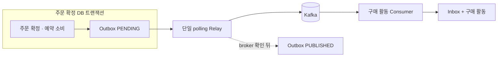
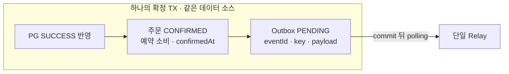
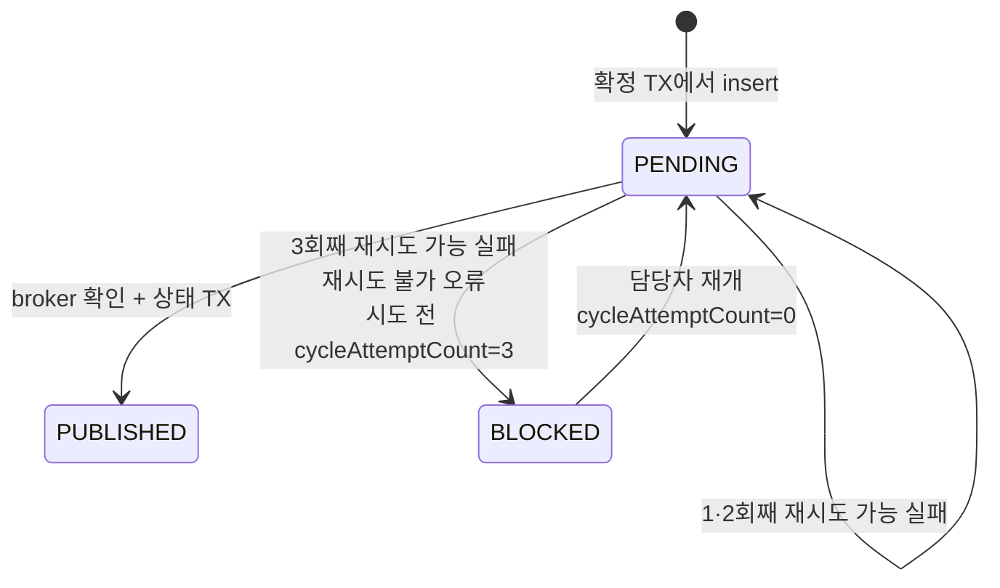
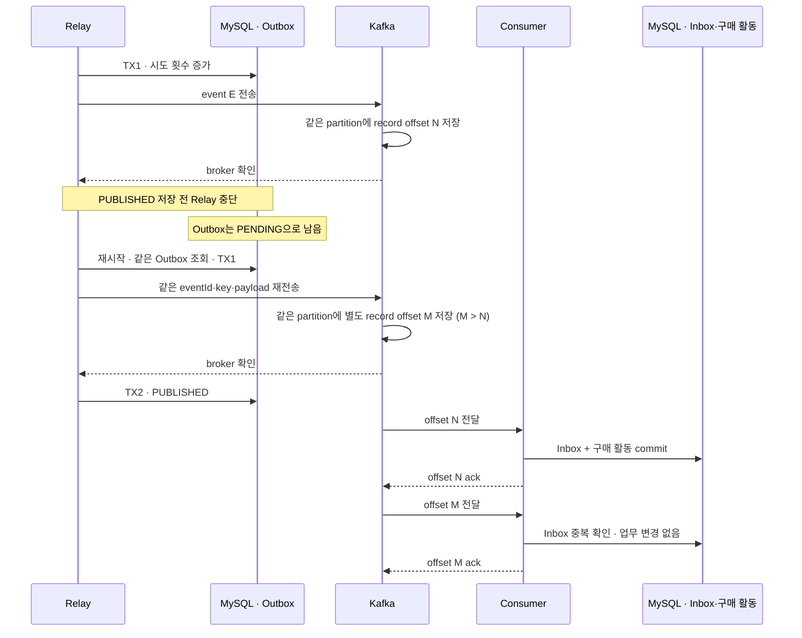
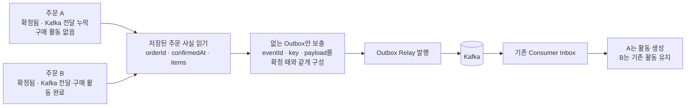

# OrderConfirmed Outbox 설계

> 주문 확정과 전달할 사실을 함께 저장하고, 중단 뒤에도 같은 메시지를 다시 발행한다.

## 한눈에 보기



| 책임 | 기준 |
| --- | --- |
| 원자적으로 기록 | 주문 확정과 Outbox insert를 같은 DB 트랜잭션에 둔다. |
| 다시 발행 | Relay가 저장된 key·payload를 사용한다. 성공이 불확실하면 같은 메시지를 재시도한다. |
| 중복 흡수 | 재발행은 별도 Kafka record를 만들 수 있다. Consumer Inbox가 구매 활동의 중복 반영을 막는다. |
| 완료 증거 | `PUBLISHED`는 Relay가 broker 성공을 확인해 저장한 상태다. Consumer 완료는 Inbox·구매 활동으로 따로 확인한다. |

## 목표와 범위

주문 확정 시 `OrderConfirmed`를 Outbox에 저장하고, 단일 polling Relay가 Kafka로 전달한다. 이벤트 형식은 [이벤트 계약](../../../docs/system-design/use-cases/order-confirmed-event.md#이벤트-계약), PG 결과 적용은 [결제 결과 적용](../../../docs/system-design/use-cases/order-payment-result.md), 구매 활동 소비는 [Consumer 설계](../../commerce-streamer/docs/purchase-activity-consumer.md)를 따른다. Outbox 없이 확정된 대상 주문은 별도 복구 경로로 보충한다.

이번 범위는 단일 Relay와 polling 방식이다. CDC, 다중 Relay, 새 결제수단·주문 도메인은 다루지 않는다.

## 모델 계층 경계

Outbox는 핵심 주문 모델이 아니라 전달 상태 기록이다. 별도 domain 모델은 만들지 않는다.

| 계층 | 책임 |
| --- | --- |
| Application | 확정 트랜잭션 안에서 `OrderConfirmedMessageV1`을 만들어 JSON으로 직렬화하고 Outbox에 기록한다. |
| Infrastructure | JPA Entity·저장소, polling Relay, Kafka adapter를 제공한다. |

Outbox `payload`는 MySQL `TEXT`에 JSON 문자열로 저장한다. 최대 크기는 65,535바이트이며 초과하면 Outbox insert와 주문 확정이 함께 rollback된다. Kafka의 메시지 크기 제한은 별도로 적용된다.

저장된 JSON 문자열은 전용 producer 경로에서 `StringSerializer`로 보낸다. `JsonSerializer`는 문자열을 JSON 문자열로 한 번 더 감싸므로 쓰지 않는다. Consumer의 `ByteArrayDeserializer`와 JSON 파서는 그대로 쓴다.

전용 `KafkaTemplate`은 공통 `ProducerFactory`를 기반으로 만들고, 템플릿별 ProducerConfig override에 `StringSerializer`와 Relay timeout을 지정한다. `acks=all`·멱등성·재시도·broker 주소는 공통 설정을 따르고, 별도 `ProducerFactory` bean은 등록하지 않는다. Kafka client 멱등성은 producer 내부 재시도의 중복을 줄이지만 Relay가 다시 `send()`하거나 producer가 재시작된 뒤 재발행한 record까지 합치지 않는다. Consumer Inbox는 계속 필요하다.

테스트에서는 실제 Kafka record value가 wrapper 문자열 없이 JSON 객체 바이트로 저장되는지, `acks`·멱등성·serializer·timeout 설정이 적용되는지 확인한다.

## 확정 트랜잭션



### 불변 조건

- Outbox는 최초 성공 전이가 적용될 때만 만든다. 미확정 결과와 중복 결과에는 새 행을 만들지 않는다.
- Outbox 저장 실패는 확정 TX 전체를 rollback한다. 주문은 기존 미완료 상태와 예약 상태로 남고 새 Outbox는 없다.
- 외부 PG 성공은 로컬 rollback으로 취소되지 않는다. 같은 거래를 다시 조회해 결과 적용을 재시도하며 새 결제를 만들지 않는다.
- 확정 후 직접 send와 after-commit Outbox insert를 사용하지 않는다. relay만 Outbox를 발행한다.

## Outbox 레코드

| 필드 | 저장 계약 |
| --- | --- |
| `id` | 기존 관례대로 `BaseEntity`의 `Long` 기본 키. |
| `eventId` | 이벤트 계약의 `order-confirmed:v1:{orderId}` 형식. `UNIQUE NOT NULL`로 중복 행을 막는다. |
| `orderId`, `eventType`, `schemaVersion` | 주문 ID와 `OrderConfirmed`, schema version `1`을 저장한다. |
| `messageKey`, `payload` | `messageKey`는 이벤트 계약대로 `String.valueOf(orderId)`. payload는 이벤트 계약의 `OrderConfirmed` JSON이다. 둘 다 생성 뒤 바꾸지 않는다. |
| `status` | `PENDING`·`PUBLISHED`·`BLOCKED`. 전이는 재시도 정책의 상태도를 따른다. |
| `createdAt`, `publishedAt` | Outbox 기록 시각과 전달 사실 확인을 저장한 시각을 구분한다. `publishedAt`은 broker 기록 시각을 추정한 값이 아니다. |
| `attemptCount`, `cycleAttemptCount`, `nextAttemptAt`, `lastError` | 전체 시도 누적값, 담당자 재개 뒤 현재 주기의 시도 수, 다음 시도 가능 시각, 마지막 실패 원인. 시도 수는 TX1에서 세므로 send 전에 중단된 시도도 포함하며 Kafka record 수와 다르다. |

생성 초기값은 `status = PENDING`, `attemptCount = 0`, `cycleAttemptCount = 0`, `nextAttemptAt = 생성 시점의 현재 시각`, `publishedAt = null`, `lastError = null`이다.

Relay는 현재 주문·상품을 다시 조회하지 않는다. 재발행 때도 저장된 `messageKey`와 `payload`를 그대로 쓴다.

`lastError`에는 예외 유형과 정제된 메시지만 저장하고 500자로 제한한다. payload·key·헤더·민감정보는 넣지 않는다. 전체 stack trace는 애플리케이션 로그에만 남긴다.

## Relay 실행 방식

기존 `commerce-api` 스케줄러로 실행하며 Spring Batch는 도입하지 않는다. 기본 간격은 이전 실행 완료 1초 뒤(`fixedDelay`)이고, 한 번에 최대 10건을 조회한다. 조회 조건은 `status = PENDING AND nextAttemptAt <= now`, 순서는 `nextAttemptAt, id`다. 이에 맞춰 `(status, next_attempt_at)` 인덱스를 둔다. 간격과 묶음 크기는 설정으로 바꿀 수 있다. Relay의 결과 대기가 결제 상태 조회를 막지 않도록 스케줄러 pool 크기는 2로 둔다.

스케줄과 수동 실행은 같은 Spring singleton 조정 객체를 거친다. `AtomicBoolean` 실행 가드가 이미 실행 중인 호출을 건너뛰고, `finally`에서 해제한다. 이 가드는 한 JVM 안에서만 유효하므로 여러 API 인스턴스가 동시에 Relay를 켜지 않도록 배포 설정을 둔다. 별도 JVM의 수동 실행은 진행 중인 Relay와 겹치지 않게 한다. 다중 인스턴스의 claim·lease·분산 잠금은 이번 범위에 포함하지 않는다.

각 행은 짧은 DB 트랜잭션 두 개로 처리한다. 외부 send를 기다리는 동안 DB 트랜잭션은 열어 두지 않는다.

```text
TX1  cycleAttemptCount가 이미 3이면 send 없이 BLOCKED → commit
     아니면 전송 시도 횟수 기록 · 다음 조회 시각 설정 → commit
     저장된 key·payload로 Kafka send
TX2  broker 성공 확인 → PUBLISHED
     실패 결과 → PENDING 또는 BLOCKED
```

TX1은 먼저 현재 주기 시도가 이미 3회인지 확인해, 결과 저장에 실패했거나 send 전에 중단된 세 번째 시도 뒤에 네 번째 send를 시작하지 않는다. 그다음 시도 횟수를 올리고 `nextAttemptAt`을 최대 대기 예산 이후로 설정한다. 이로써 결과를 기다리는 동안 같은 행을 다시 고르지 않는다. timeout 뒤에도 이전 send가 성공할 수 있으므로 다음 시도는 같은 `eventId`·key·payload를 쓴다. TX2는 `status = PENDING`이고 현재 시도 번호가 일치할 때만 상태를 갱신해 늦은 callback이 다음 시도 결과를 덮지 않게 한다. 늦은 성공 결과가 버려지면 재발행될 수 있다.

재시도 가능한 실패가 발생하면 해당 tick의 남은 발행을 멈춘다. 실패 행은 재시도 간격만큼 뒤로 밀리므로 다음 tick에서 다른 대기 행이 먼저 처리된다. 즉시 `BLOCKED`가 된 행은 건너뛰고 다음 대상을 계속 처리한다.

## Producer 결과 대기 방식 — 선택 완료

두 방식의 차이는 Relay가 send 결과와 상태 저장을 조정하는 방식이다.

| 선택지 | Relay 동작 | 확인할 점 |
| --- | --- | --- |
| `whenComplete` | Future 완료 callback에서 결과를 처리한다. | callback 실행 스레드, DB 상태 갱신, Relay 실행 가드의 유지 시점 |
| `future.get(timeout)` | Relay 실행 흐름에서 정해진 시간만큼 기다린다. | timeout 뒤 늦은 성공, 다음 시도와 상태 갱신의 경계 |

두 방식 모두 해당 행의 상태 갱신이 끝날 때까지 Relay 실행 가드를 유지한다. `whenComplete` 등록 메서드가 반환되는 즉시 가드를 풀면 다음 실행이 같은 행을 선택할 수 있으므로 callback 완료와 다음 실행의 순서를 시험한다.

비교 테스트에서는 `PUBLISHED` 저장 시점, timeout 뒤 재발행 identity, send 대기 중 DB 트랜잭션 유무, 실제 broker record와 Consumer 업무 결과를 확인한다.

결과 대기 후보는 `request.timeout.ms=2초`, `delivery.timeout.ms=5초`, `max.block.ms=1초`, Future 관찰 시간 6초다. 비교용 값이며 운영 값은 아니다. `delivery.timeout.ms >= request.timeout.ms + linger.ms`를 만족해야 한다. 한 번의 최대 대기 예산은 `max.block.ms`와 Future 관찰 시간을 합해 계산하고, TX1의 `nextAttemptAt`도 그 이후로 둔다.

두 방식을 실제 Kafka 통합 테스트에서 비교했다. 제한 대기 방식은 broker ack와 `PUBLISHED` 저장 뒤 호출을 반환했다. callback 방식은 ack 전에 호출을 반환했지만 실행 가드는 callback 완료까지 유지해야 했고, 이후 send와 상태 갱신도 같은 직렬 흐름에 묶였다. 단일 Relay에서는 처리량 이득이 확인되지 않았다.

기본 방식은 `BOUNDED_WAIT`로 정했다. Relay 스케줄러에서 제한 시간만 기다린 뒤 같은 실행 흐름에서 상태 TX를 처리하므로 순서가 분명하고, Kafka 완료 callback에 DB 갱신을 연결하는 실행 관리가 필요 없다. `future-timeout`은 6초, `max-block-time`은 1초이며 TX1은 두 값을 더한 최대 대기 예산 뒤로 `nextAttemptAt`을 둔다. 이 값은 현재 로컬 설정과 테스트 기준이다. 운영 환경에서는 broker 지연과 Relay 주기를 관찰해 조정한다.

## 재시도·운영 재개 정책

재시도 가능한 오류는 한 주기에 최대 3회 시도한다. 감싼 예외는 원인을 꺼내 아래 표로 분류한다.



| 결과 | 처리 |
| --- | --- |
| 재시도 가능한 Kafka 오류(topic이 없을 때의 metadata timeout 포함) 또는 결과 대기 timeout | 1·2회째에는 `PENDING`, 실패 확인 시각부터 5초 뒤 재시도한다. 3회째 실패하면 `BLOCKED`다. |
| broker 확인 뒤 `PUBLISHED` 저장 실패 | 행은 `PENDING`으로 남는다. 시도 주기가 3회에 도달했으면 다음 처리에서 새 send 없이 `BLOCKED`로 바꾼다. 그 전이면 같은 메시지를 다시 보낼 수 있다. |
| 크기 초과·권한·잘못된 topic 이름 등 재시도로 풀리지 않는 오류 | 첫 실패에서 `BLOCKED`로 바꾼다. |
| Kafka send·결과 대기 중 원인을 분류할 수 없는 예외 | 안전하게 재시도 가능하다고 가정하지 않고 즉시 `BLOCKED`로 바꾼다. 원인은 `lastError`에 남긴다. |
| 종료 중 발생한 interrupt 또는 producer 종료 오류 | `BLOCKED`로 분류하지 않는다. 행은 `PENDING`에 두고 TX1에서 정한 시각 이후 다시 처리한다. |

Outbox 상태 저장 TX 자체가 실패하면 상태 전이는 commit되지 않는다. 기존 `PENDING`을 유지하고 로그로 오류를 남긴 뒤, 저장된 `nextAttemptAt` 이후 다시 조회한다. 이는 Kafka send 결과의 오류 분류와 별개다.

재시도 간격은 초기값 5초로 두고 점증시키지 않는다. 테스트와 운영 설정은 분리한다. `BLOCKED`는 완료가 아니라 운영 확인이 필요한 미해결 전달이다. 원인을 해결한 담당자가 같은 행을 재개하면 상태는 `PENDING`, `nextAttemptAt`은 현재 시각, `cycleAttemptCount`는 0이 된다. 전체 `attemptCount`와 `eventId`·key·payload는 유지한다. 재개 시각과 직전 오류는 로그로 추적한다. 재개는 대상 `eventId` 목록을 받아 여러 행을 한 번에 처리할 수 있다.

Consumer에서 같은 `eventId`의 처리를 확인해도 Outbox 상태는 바꾸지 않는다.

## 관찰과 알림

`BLOCKED` 전환 TX가 commit되면 구조화 로그에 `eventId`·`orderId`·오류 유형을 남기고 `outbox_blocked_transitions_total` counter를 증가시킨다. label은 오류 유형처럼 값 종류가 적은 항목만 쓰고, 애플리케이션은 Slack을 직접 호출하지 않는다.

Relay는 tick마다 한 번의 집계 쿼리로 `PENDING` 수, `BLOCKED` 수, 가장 오래된 `PENDING.createdAt`을 읽어 메모리에 둔다. Micrometer gauge는 이 값을 사용하므로 scrape 때 DB를 조회하지 않는다. 대기 시간은 scrape 시각에서 저장된 `createdAt`을 빼 계산한다. 따라서 Relay가 멈춰도 오래된 `PENDING`의 대기 시간은 계속 커진다. `PENDING`이 없으면 대기 시간은 0이다.

| 지표 | 알려 주는 것 |
| --- | --- |
| `PENDING` 수 (gauge) | 발행 backlog |
| 가장 오래된 `PENDING`의 대기 시간 (gauge, `createdAt` 기준) | 장기 미발행. 임계값을 넘으면 Grafana가 Slack 알림에 사용 |
| `BLOCKED` 수 (gauge) | 담당자 확인이 필요한 현재 행 수. 대시보드·운영 조회용 |
| `outbox_blocked_transitions_total` 증가 | 새로 `BLOCKED`로 전환된 행이 있음. Grafana가 Slack 알림에 사용 |

DB commit 뒤 counter를 갱신하기 전에 프로세스가 종료되면 Slack 알림은 빠질 수 있지만 `BLOCKED` 행은 남는다. 대시보드와 SQL 조회로 미해결 행을 확인한다.

## 로컬 원자성 검증

Relay를 실행하지 않는 실제 MySQL 통합 테스트에서 확정 결과 적용 전의 주문·결제 시도·예약 상태를 기록하고 다음 기대값을 확인한다.

| 장면 | DB 기대값 |
| --- | --- |
| 메시지 직렬화 실패, Outbox insert 전 실패, insert·flush 뒤 commit 전 실패 | 확정 TX 전체 rollback, 주문·결제 시도·예약은 TX 직전 상태, Outbox 0행 |
| 실패 원인 해소 뒤 같은 PG 거래의 SUCCESS 재적용 | 주문 CONFIRMED·예약 소비·PG 성공 사실과 Outbox가 함께 한 번 반영됨 |
| 같은 SUCCESS의 중복 callback·reconcile | Outbox 1행과 최초 commit된 `eventId`·`confirmedAt` 유지, 예약 추가 소비 없음 |
| PENDING·UNKNOWN·확정 FAILED 관찰 | OrderConfirmed Outbox 생성 없음, 결제 결과 적용 규칙대로 처리 |

rollback 뒤에는 영속성 컨텍스트를 비우고 새 TX에서 재조회하며, PG create 누적 횟수가 기준값에서 늘지 않았는지 확인한다.

## 재시도·차단 검증

실제 상태 저장과 제어된 send 결과를 사용해 재시도와 차단 규칙을 확인한다. 각 시도 사이에는 저장된 `nextAttemptAt`까지 `MutableClock`을 전진시킨다.

| 장면 | 확인할 결과 |
| --- | --- |
| 재시도 가능 실패 반복 | 1·2회째는 `PENDING`, 실패 확인 시각 + 5초 뒤 시도 가능. 3회째는 `BLOCKED`; `attemptCount`와 `cycleAttemptCount`가 각각 3 |
| 재시도 불가 Kafka 오류, 분류할 수 없는 예외 | 첫 실패에서 `BLOCKED`, 추가 send 없음 |
| 다른 Outbox가 함께 대기 | 한 행이 `BLOCKED`되면 같은 tick의 다음 행을 계속 처리. 재시도 가능 실패면 그 tick의 남은 행은 send하지 않고, 다음 tick에서 실패 행보다 먼저 처리 |
| 최대 대기 예산 | producer가 Future 관찰 시간보다 먼저 실패를 알림, TX1 뒤 최대 대기 예산 동안 같은 행을 다시 선택하지 않음 |
| `BLOCKED` 수동 재개 | `PENDING`, `nextAttemptAt` = 재개 시각, `cycleAttemptCount = 0`, 누적 `attemptCount`·`eventId`·key·payload 유지. 원인이 남아 있으면 새 주기 3회째에 다시 `BLOCKED` |
| 같은 주기에서 TX1 commit 뒤 send 전에 3회 중단 | 세 시도 모두 시도 수에 포함, Kafka record 0건. 재시작 뒤 추가 send 없이 `BLOCKED` 전환 |
| 앱 종료로 결과 대기 중단 | 오류로 분류하지 않고 `PENDING` 유지, `BLOCKED` 전환 없음 |

## 전달 중단 검증

중단 테스트에서는 자동 polling을 끄고 테스트가 Relay 회차를 직접 실행해 중단과 재시작을 제어한다. 주문 확정 TX의 commit을 새 DB 조회로 확인한 뒤 다음 구간을 검증한다.



| 장면 | Outbox·Kafka·구매 활동 기대값 |
| --- | --- |
| commit 뒤 Relay 실행 전 중단 | Outbox PENDING 1행, Kafka record 0건, 구매 활동 없음 |
| 같은 DB·Kafka로 새 Relay 실행 | 저장된 Outbox에서 발행, broker 확인과 상태 TX 성공 뒤 PUBLISHED, Consumer 처리 완료 뒤 정상 구매 활동 |
| broker 성공 확인 뒤 PUBLISHED 저장 전 중단 | 같은 Outbox PENDING 유지, 실제 Kafka record 존재. Consumer 진행에 따라 구매 활동은 아직 없거나 이미 반영됐을 수 있음 |
| 같은 Outbox로 Relay 재시작·재발행 | 같은 `eventId`·key·payload의 별도 Kafka record 확인, 최종 Outbox PUBLISHED, 중복 소비 뒤 구매 활동 불변 |
| broker 중단 중 1·2회째 실패 뒤 broker 회복 | 같은 행이 다음 시도에서 `PUBLISHED`, 수동 재개 없음. Consumer 처리 뒤 구매 활동은 한 번만 반영 |
| broker 중단 중 같은 재개 주기의 세 시도 실패 | Outbox가 `BLOCKED`로 전환되고 자동 send를 멈춤. broker record가 0건일 수도 있음 |
| 원인 해결 뒤 수동 재개·Relay 실행 | 같은 행을 `PENDING`으로 재개해 재발행. 최종 `PUBLISHED`; Consumer 처리 뒤 구매 활동은 한 번만 반영 |

broker 성공 뒤의 중단 hook은 실제 성공 metadata를 확보한 다음 `PUBLISHED` 저장 TX를 수행하기 전에 둔다. 중단 뒤 Outbox 상태를 테스트가 직접 덮어쓰지 않으며, 제어된 실행 중단을 OS 강제 종료 시험으로 표현하지 않는다.

Relay의 대상 조회와 시도 시각 계산에는 같은 주입 Clock을 사용한다. 재시작·재발행 테스트에서는 첫 시도에서 저장한 `nextAttemptAt`을 읽고, `MutableClock`을 그 시각 이상으로 전진시킨 뒤 새 Relay를 실행한다. Outbox의 `status`나 `nextAttemptAt`을 직접 변경해 재시도 조건을 만들지 않는다. Kafka 응답과 Consumer 처리 완료를 기다릴 때는 실제 경과 시간을 기준으로 유한한 deadline을 둔다.

## 통합 테스트 자원과 스키마

복구·E2E 테스트는 전용 MySQL 8.0, Kafka, 로컬 PG fixture를 한 번 준비해 Producer·Consumer·Admin에 같은 주소를 제공한다. 테이블은 시작할 때 한 번 만들고, 앱과 자식 프로세스는 `ddl-auto=validate`로 실행해 준비 데이터를 보존한다.

실제 Consumer는 `commerce-streamer` bootJar를 자식 프로세스로 띄운다. 두 앱을 한 클래스패스에 합치지 않아 component scan·설정 충돌을 피하고, commerce-api에서 commerce-streamer로 제품 의존성을 추가하지 않는다. fixture 주소·topic·group은 실행 인자로 전달한다.

테스트는 `AdminClient`로 업무 Consumer group의 partition 배정을 확인하고 committed offset으로 소비 완료를 판단한다. commerce-api는 테스트 안에서 실행해 Relay 회차와 중단 hook을 제어한다. 준비·복구·재실행·결과 확인은 같은 테스트에서 이어가며, 그 사이 DB·Kafka·PG를 초기화하지 않는다. Relay는 새 실행 흐름으로 재생성하되 같은 DB·Kafka를 사용한다. 모든 확인이 끝난 뒤 테스트가 시작한 프로세스와 fixture만 정리한다.

## 누락 이벤트 복구 검증

Outbox 행 없이 확정된 주문 두 건을 준비해 복구 경로로 Outbox를 보충한다. 두 주문은 서로 다른 `orderId`·`eventId`를 가지며, 복구 중에도 기존 식별값을 유지한다.



준비에는 Outbox가 없는 기준 커밋 `c0806007aca993de80c7e2c70a6ec2b87b3b8089`의 `commerce-api` bootJar를 사용한다. 이 버전은 주문 확정 뒤 `@TransactionalEventListener(AFTER_COMMIT)`에서 직접 발행한다. 기준 버전이나 제품 코드에 우회 스위치는 추가하지 않는다.

1. 격리 topic의 `max.message.bytes`를 1바이트로 설정하고 준비용 앱에서 주문 A를 확정한다. broker가 발행을 거절해도 주문은 `CONFIRMED`이며 Kafka record·Inbox·구매 활동은 0건이어야 한다. 이 재현은 프로세스 강제 종료가 아니라 commit 이후의 발행 실패를 만든다.
2. topic 제한을 정상 크기로 복구하고 같은 앱에서 주문 B를 확정해 실제 발행과 Consumer 처리를 완료한다.
3. 준비용 앱을 종료하고 새 DB 조회로 두 주문이 `CONFIRMED`·예약 소비·Outbox 없음이고 A만 구매 활동이 없는지 확인한다. `orderId`, `eventId`, `confirmedAt`, 품목, PG create 수와 외부 거래 수를 기록한다.
4. 같은 자원에서 A·B를 대상으로 Outbox 복구를 실행한다.

복구는 대상 `orderId` 목록을 받는 로컬 운영 경로다. 주문별로 짧은 TX에서 저장된 확정 사실을 확인하고, 확정 당시와 같은 Application 코드로 `eventId`·`confirmedAt`·품목을 구성한다.

- 주문이 `CONFIRMED`가 아니거나 `confirmedAt`·품목이 없으면 해당 주문은 오류로 남긴다.
- 같은 `eventId`의 Outbox가 없으면 `PENDING`으로 추가한다. 이미 있으면 key·payload가 같은지 확인하고, 다르면 충돌로 처리한다. 동시 insert가 유일 제약에 걸리면 트랜잭션이 rollback된 뒤 같은 대상의 복구를 다시 실행해 기존 행의 내용을 확인한다.
- 복구는 주문·결제·예약을 변경하지 않는다. PG create·조회·callback도 추가 호출하지 않는다.
- Relay와 실제 Consumer를 실행해 A의 구매 활동이 생기고 B의 활동은 변하지 않는지 확인한다. 같은 복구를 다시 실행해도 Outbox와 구매 활동은 늘지 않아야 한다.

이 경로는 로컬 프로필에서만 켜지는 `ApplicationRunner`다. 대상은 실행 인자로 명시한다.

```text
--order.confirmed-event.outbox.backfill.order-ids=101,102
```

## 검증 경계와 E2E

Producer와 Consumer의 책임 테스트는 앱별로 둔다. `commerce-api` 통합 테스트는 MySQL Outbox와 Kafka 발행을 확인하고, `commerce-streamer` 통합 테스트는 record 소비·Inbox 멱등성·구매 활동 저장을 확인한다.

전체 흐름 E2E는 실제 주문 API, 로컬 PG, MySQL, Kafka, 구매 활동 Consumer를 연결한 한 시나리오로 검증한다.

1. 상품 7 수량 2개, 상품 8 수량 1개인 주문을 확정하고 Outbox 한 행을 확인한다.
2. 첫 broker 성공 확인 뒤 `PUBLISHED` 저장 전에 Relay를 멈춘다. Consumer가 첫 record를 처리하고 committed offset이 `첫 offset + 1`에 도달한 뒤 구매 활동을 기록한다.
3. 저장된 `nextAttemptAt` 이상으로 테스트 시각을 이동한 뒤, 같은 DB·Kafka에서 Relay를 재생성해 같은 Outbox를 재발행한다. 두 번째 record의 committed offset이 `두 번째 offset + 1`에 도달한 뒤 결과를 다시 읽는다.

기대값은 다음과 같다.

- Kafka에서 같은 `eventId`·key·payload를 가진 record 2건을 실제로 읽어 확인한다. 같은 partition의 서로 다른 offset에 기록되어야 한다.
- Outbox는 같은 `eventId`의 1행이며 최종 `PUBLISHED`다.
- `processed_order_confirmation`은 1행이다.
- `product_purchase_activity`는 품목마다 1행씩 2행이고, 수량이 주문과 같다. 두 번째 소비 뒤에도 첫 소비 결과가 유지된다.
- 대상 주문과 외부 PG 거래는 각각 1개다. 확정 직후를 기준으로 Relay 발행·재발행 동안 PG create 횟수와 외부 거래 수가 늘지 않는다.
- 확정 직후의 예약 상태·재고·포인트를 기준값으로 기록하고, 최종 소비 완료 뒤에도 같은지 확인한다. 예약 추가 소비·반환과 PG 주문의 포인트 추가 차감이 없어야 한다.

품목 두 개를 사용해 실제 주문의 payload 변환이 Consumer 결과까지 이어지는지 확인한다. 그 밖의 실패 조건은 단위·경계 통합 테스트로 검증한다.

## 보존과 정리

Outbox와 Inbox는 자동 삭제하지 않고 보존한다. `PENDING`·`BLOCKED` Outbox는 미해결 전달의 근거이므로 해결 전에 삭제하지 않는다. `PUBLISHED` Outbox와 Inbox 기록도 검증·재처리 근거로 남긴다.

정리 정책을 도입할 때는 Outbox 보존 기간, Kafka retention과 수동 replay 가능 기간, Inbox 중복 기록 보존 기간을 함께 정한다. Inbox 기록을 replay 가능 기간보다 먼저 지우면 과거 이벤트가 다시 처리되어 구매 활동이 중복될 수 있다.

## 로컬 운영 명령

BLOCKED 원인을 확인하고 해결한 뒤 같은 `eventId`로 재개한다. 새 Outbox 행은 만들지 않는다. 재개할 때 `cycleAttemptCount`를 0으로 초기화하고 `nextAttemptAt`을 현재 시각으로 설정한다. 누적 `attemptCount`와 메시지 identity·payload는 보존한다. 재개도 로컬 프로필 전용이며 공개 API는 두지 않는다.

```text
--order.confirmed-event.outbox.resume.event-ids=order-confirmed:v1:101
```

재개 뒤에도 같은 주기의 실패가 3회 누적되면 다시 `BLOCKED`가 된다. 새 `BLOCKED` 전환은 구조화 로그와 Micrometer counter로 관찰한다. Grafana 임계값과 Slack route는 운영 설정으로 둔다.

## 설계 상태와 구현 단계 후속 항목

설계 단계는 완료로 본다. 주문 확정과 Outbox의 원자성, 메시지 계약, 단일 polling Relay, 재시도·차단 정책, Consumer 멱등성, 누락 이벤트 복구와 E2E 범위는 결정했다. 실제 Kafka 비교에서 `BOUNDED_WAIT`를 선택했고, 로컬 backfill·재개 진입점과 backlog gauge를 구현했다.

| 단계 | 후속 항목 | 확정 방법 |
| --- | --- | --- |
| 구현·테스트 | Future 완료 방식 | 완료. 비교 통합 테스트에서 `BOUNDED_WAIT`를 기본으로 선택했다. |
| 운영 설정 | Grafana alert 임계값과 Slack route | backlog·BLOCKED gauge와 전환 counter를 기준으로 운영 환경에서 정한다. |
| 테스트 환경 | 기준 커밋 bootJar와 실제 API·PG·Kafka·Consumer 연결 | 격리 실행 스크립트에서 구현했다. CI shallow clone에 기준 커밋이 없으면 fetch 설정이 필요하다. |

이 후속 항목을 구현·검증하면서 기록하면 설계 문서는 완료 상태로 유지할 수 있다.
