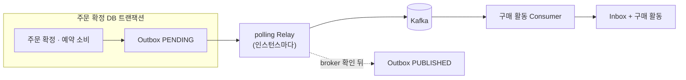
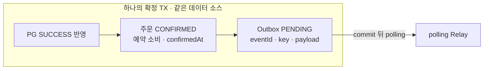
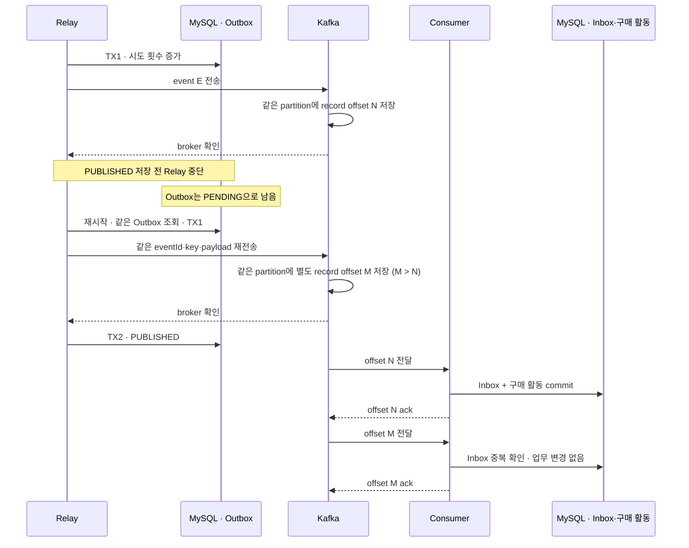

# OrderConfirmed Outbox 설계

> 주문 확정과 전달할 사실을 함께 저장하고, 중단 뒤에도 같은 메시지를 다시 발행한다.

## 한눈에 보기



| 책임 | 기준 |
| --- | --- |
| 원자적으로 기록 | 주문 확정과 Outbox insert를 같은 DB 트랜잭션에 둔다. |
| 다시 발행 | Relay가 저장된 key·payload를 사용한다. 성공이 불확실하면 같은 메시지를 재시도한다. |
| 중복 흡수 | 재발행은 별도 Kafka record를 만들 수 있다. Consumer Inbox가 구매 활동의 중복 반영을 막는다. |
| 완료 증거 | `PUBLISHED`는 Relay가 broker 성공을 확인해 저장한 상태다. Consumer 완료는 Inbox·구매 활동으로 따로 확인한다. |

## 목표와 범위

주문 확정 시 `OrderConfirmed`를 Outbox에 저장하고, 각 API 인스턴스의 polling Relay가 Kafka로 전달한다. 이벤트 형식은 [이벤트 계약](../../../docs/system-design/use-cases/order-confirmed-event.md#이벤트-계약), PG 결과 적용은 [결제 결과 적용](../../../docs/system-design/use-cases/order-payment-result.md), 구매 활동 소비는 [Consumer 설계](../../commerce-streamer/docs/purchase-activity-consumer.md)를 따른다. Outbox 없이 확정된 대상 주문은 별도 복구 경로로 보충한다.

이번 범위는 polling Relay다. Relay는 모든 API 인스턴스에서 실행하고, 같은 행은 조건부 갱신으로 한 실행만 시도한다. CDC, claim·lease 기반 작업 분배, 새 결제수단·주문 도메인은 다루지 않는다.

## 모델 계층 경계

Outbox는 핵심 주문 모델이 아니라 전달 상태 기록이다. 별도 domain 모델은 만들지 않는다.

| 계층 | 책임 |
| --- | --- |
| Application | 확정 트랜잭션 안에서 `OrderConfirmedMessageV1`을 만들어 JSON으로 직렬화하고 Outbox에 기록한다. |
| Infrastructure | JPA Entity·저장소, polling Relay, Kafka adapter를 제공한다. |

Outbox `payload`는 MySQL `TEXT`에 JSON 문자열로 저장한다. 최대 크기는 65,535바이트이며 초과하면 Outbox insert와 주문 확정이 함께 rollback된다. Kafka의 메시지 크기 제한은 별도로 적용된다.

저장된 JSON 문자열은 전용 producer 경로에서 `StringSerializer`로 보낸다. `JsonSerializer`는 문자열을 JSON 문자열로 한 번 더 감싸므로 쓰지 않는다. Consumer의 `ByteArrayDeserializer`와 JSON 파서는 그대로 쓴다.

전용 `KafkaTemplate`은 공통 `ProducerFactory`를 기반으로 만들고, 템플릿별 ProducerConfig override에 `StringSerializer`와 Relay timeout을 지정한다. `acks=all`·멱등성·재시도·broker 주소는 공통 설정을 따르고, 별도 `ProducerFactory` bean은 등록하지 않는다. Kafka client 멱등성은 producer 내부 재시도의 중복을 줄이지만 Relay가 다시 `send()`하거나 producer가 재시작된 뒤 재발행한 record까지 합치지 않는다. Consumer Inbox는 계속 필요하다.

factory를 밖에서 복사해 넘기지 않고 `new KafkaTemplate<>(sharedProducerFactory, overrides)`를 사용한다. Template이 전용 복사본의 소유권을 가져 종료 시 정리하고, 공통 factory는 정리하지 않는다. 종료 소유권은 별도 테스트로 확인한다.

테스트에서는 실제 Kafka record value가 wrapper 문자열 없이 JSON 객체 바이트로 저장되는지, `acks`·멱등성·serializer·timeout 설정이 적용되는지 확인한다.

## 확정 트랜잭션



### 불변 조건

- Outbox는 최초 성공 전이가 적용될 때만 만든다. 미확정 결과와 중복 결과에는 새 행을 만들지 않는다.
- Outbox 저장 실패는 확정 TX 전체를 rollback한다. 주문은 기존 미완료 상태와 예약 상태로 남고 새 Outbox는 없다.
- 외부 PG 성공은 로컬 rollback으로 취소되지 않는다. 같은 거래를 다시 조회해 결과 적용을 재시도하며 새 결제를 만들지 않는다.
- 확정 후 직접 send와 after-commit Outbox insert를 사용하지 않는다. relay만 Outbox를 발행한다.

## Outbox 레코드

| 필드 | 저장 계약 |
| --- | --- |
| `id` | 기존 관례대로 `BaseEntity`의 `Long` 기본 키. |
| `eventId` | 이벤트 계약의 `order-confirmed:v1:{orderId}` 형식. `UNIQUE NOT NULL`로 중복 행을 막는다. |
| `orderId`, `eventType`, `schemaVersion` | 주문 ID와 `OrderConfirmed`, schema version `1`을 저장한다. |
| `messageKey`, `payload` | `messageKey`는 이벤트 계약대로 `String.valueOf(orderId)`. payload는 이벤트 계약의 `OrderConfirmed` JSON이다. 둘 다 생성 뒤 바꾸지 않는다. |
| `status` | `PENDING`·`PUBLISHED`·`BLOCKED`. 전이는 재시도 정책의 상태도를 따른다. |
| `createdAt`, `publishedAt` | Outbox 기록 시각과 전달 사실 확인을 저장한 시각을 구분한다. `publishedAt`은 broker 기록 시각을 추정한 값이 아니다. |
| `attemptCount`, `cycleAttemptCount`, `nextAttemptAt`, `lastError` | 전체 시도 누적값, 수동 재시도 뒤 현재 주기의 시도 수, 다음 시도 가능 시각, 마지막 실패 원인. 시도 수는 TX1에서 세므로 send 전에 중단된 시도도 포함하며 Kafka record 수와 다르다. |

생성 초기값은 `status = PENDING`, `attemptCount = 0`, `cycleAttemptCount = 0`, `nextAttemptAt = 생성 시점의 현재 시각`, `publishedAt = null`, `lastError = null`이다.

Relay는 현재 주문·상품을 다시 조회하지 않는다. 재발행 때도 저장된 `messageKey`와 `payload`를 그대로 쓴다.

`lastError`에는 원인 체인의 가장 안쪽 예외 유형과 정제된 메시지만 저장하고 500자로 제한한다. KafkaTemplate의 `KafkaProducerException` wrapper 메시지로 원인을 대체하지 않는다. 영구 오류의 BLOCKED reason도 같은 원인 유형을 사용하며, 시도 소진으로 차단한 reason은 `ATTEMPTS_EXHAUSTED`를 유지한다. payload·key·헤더·민감정보는 넣지 않는다. 전체 stack trace는 애플리케이션 로그에만 남긴다.

## Relay 실행 방식

기존 `commerce-api` 스케줄러로 실행하며 Spring Batch는 도입하지 않는다. 기본 간격은 이전 실행 완료 1초 뒤(`fixedDelay`)이고, 한 번에 최대 10건을 조회한다. 조회 조건은 `status = PENDING AND nextAttemptAt <= now`, 순서는 `nextAttemptAt, id`다. 이에 맞춰 `(status, next_attempt_at)` 인덱스를 둔다. 간격과 묶음 크기는 설정으로 바꿀 수 있다. Relay의 결과 대기, 결제 상태 주기 조회, Outbox 지표 갱신이 서로의 긴 대기에 밀리지 않도록 스케줄러 pool 크기는 3으로 둔다.

스케줄과 수동 실행은 같은 Spring singleton 조정 객체를 거친다. `AtomicBoolean` 실행 가드가 이미 실행 중인 호출을 건너뛰고, `finally`에서 해제한다. 이 가드는 한 JVM 안에서 회차가 겹치지 않게 한다.

Relay는 모든 API 인스턴스에서 켠다(`test` 프로필 제외). 인스턴스 사이의 경합은 TX1·TX2의 조건부 갱신이 막는다. 여러 인스턴스가 같은 행을 동시에 고르면 한 실행만 시도를 시작하고 나머지는 건너뛰며, 늦은 결과가 다른 실행의 상태를 덮어쓰지 않는다. 결제 주기 조회와 같이 분산 잠금 없이 인스턴스 수만큼의 polling 조회와 경합 비용을 감수하고, 한 인스턴스가 멈춰도 다른 인스턴스가 발행을 이어 간다. 작업을 나누는 claim·lease는 두지 않는다. 주문마다 이벤트는 하나라 행 사이의 발행 순서에 의존하지 않는다.

각 행은 짧은 DB 트랜잭션 두 개로 처리한다. 외부 send를 기다리는 동안 DB 트랜잭션은 열어 두지 않는다.

```text
TX1  cycleAttemptCount가 이미 3이면 send 없이 BLOCKED → commit
     아니면 전송 시도 횟수 기록 · 다음 조회 시각 설정 → commit
     저장된 key·payload로 Kafka send
TX2  broker 성공 확인 → PUBLISHED
     실패 결과 → PENDING 또는 BLOCKED
```

TX1은 먼저 현재 주기 시도가 이미 3회인지 확인해, 결과 저장에 실패했거나 send 전에 중단된 세 번째 시도 뒤에 네 번째 send를 시작하지 않는다. 그다음 시도 횟수를 올리고 `nextAttemptAt`을 최대 대기 예산에 재시도 간격을 더한 시각으로 설정한다. 이로써 결과를 기다리는 동안 같은 행을 다시 고르지 않는다. timeout 뒤에도 이전 send가 성공할 수 있으므로 다음 시도는 같은 `eventId`·key·payload를 쓴다. TX2는 `status = PENDING`이고 현재 시도 번호가 일치할 때만 상태를 갱신해 늦은 callback이 다음 시도 결과를 덮지 않게 한다. 늦은 성공 결과가 버려지면 재발행될 수 있다.

TX1·TX2의 전이는 읽은 엔티티를 저장하지 않고 조건부 UPDATE로 적용한다. 조건은 `status = PENDING`과 읽은 `cycleAttemptCount`이며, 시도 시작은 `nextAttemptAt <= now`도 확인한다. 시도 소진으로 차단하는 경로는 기한이 된 행을 읽은 뒤 시도 번호만 확인한다. 확인과 갱신 사이에 다른 실행이 먼저 시작하거나 갱신했으면 0행이 되고, TX1은 시도를 시작하지 않으며 TX2는 결과를 적용하지 않는다. bulk UPDATE는 엔티티 수명주기 callback을 거치지 않으므로 `updatedAt`도 쿼리에서 함께 갱신한다. 수동 재시도는 한 번 실행하는 운영 경로라 엔티티 갱신을 유지한다.

재시도 가능한 실패가 발생하면 해당 tick의 남은 발행을 멈춘다. 실패 행은 재시도 간격만큼 뒤로 밀리므로 다음 tick에서 다른 대기 행이 먼저 처리된다. 즉시 `BLOCKED`가 된 행은 건너뛰고 다음 대상을 계속 처리한다.

## Producer 결과 대기 방식

두 방식의 차이는 Relay가 send 결과와 상태 저장을 조정하는 방식이다.

| 선택지 | Relay 동작 | 확인할 점 |
| --- | --- | --- |
| `whenComplete` | Future 완료 callback에서 결과를 처리한다. | callback 실행 스레드, DB 상태 갱신, Relay 실행 가드의 유지 시점 |
| `future.get(timeout)` | Relay 실행 흐름에서 정해진 시간만큼 기다린다. | timeout 뒤 늦은 성공, 다음 시도와 상태 갱신의 경계 |

두 방식 모두 해당 행의 상태 갱신이 끝날 때까지 Relay 실행 가드를 유지해야 한다. `whenComplete` 등록 메서드가 반환되는 즉시 가드를 풀면 다음 실행이 같은 행을 선택할 수 있다.

제품 Relay는 제한 시간 동안 결과를 기다리는 `BOUNDED_WAIT`만 사용한다. 실제 Kafka 비교 테스트에서 callback 방식도 실행 가드를 callback 완료까지 유지해야 했고, 이후 send와 상태 갱신이 같은 직렬 흐름에 묶였다. 따라서 한 인스턴스의 Relay에서 callback이 처리량 이득을 준다고 보지 않는다. 제한 대기는 같은 실행 흐름에서 상태 TX를 처리하므로 순서가 분명하고, Kafka 완료 callback에 DB 갱신을 연결하는 제품 실행 관리가 필요 없다. 비교 방법은 [Outbox·Relay 테스트 방법](../../../docs/system-design/use-cases/order-confirmed-event-verification.md#outboxrelay-테스트-방법)을 따른다.

현재 설정은 `request.timeout.ms=2초`, `delivery.timeout.ms=5초`, `max.block.ms=1초`, Future 관찰 시간 6초다. `delivery.timeout.ms >= request.timeout.ms + linger.ms`를 만족해야 하고, producer가 실제 결과를 먼저 알리도록 Future 관찰 시간은 `delivery.timeout.ms`보다 길게 둔다. 한 번의 최대 대기 예산은 `max.block.ms`와 Future 관찰 시간을 더한 7초다. TX1은 `nextAttemptAt`을 여기에 재시도 간격 5초를 더한 12초 뒤로 둔다. 결과를 기록하지 못하고 멈춘 시도도 대기 끝에 실패를 기록한 경우와 같은 간격 뒤에 다시 고르며, TX1 지연과 인스턴스 사이 시계 차이를 재시도 간격만큼 흡수한다. 실패를 기록하면 TX2가 다음 시각을 다시 정하므로 재시도 속도는 바뀌지 않는다. 이 값은 로컬 설정과 테스트 기준이며, 운영 환경에서는 broker 지연과 Relay 주기를 관찰해 조정한다.

## 재시도·차단 정책

재시도 가능한 오류는 한 주기에 최대 3회 시도한다. 감싼 예외는 원인을 꺼내 아래 표로 분류한다.


| 결과 | 처리 |
| --- | --- |
| 재시도 가능한 Kafka 오류(topic이 없을 때의 metadata timeout 포함) 또는 결과 대기 timeout | 1·2회째에는 `PENDING`, 실패 확인 시각부터 5초 뒤 재시도한다. 3회째 실패하면 `BLOCKED`다. |
| broker 확인 뒤 `PUBLISHED` 저장 실패 | 행은 `PENDING`으로 남는다. 시도 주기가 3회에 도달했으면 다음 처리에서 새 send 없이 `BLOCKED`로 바꾼다. 그 전이면 같은 메시지를 다시 보낼 수 있다. |
| 크기 초과·권한·잘못된 topic 이름 등 재시도로 풀리지 않는 오류 | 첫 실패에서 `BLOCKED`로 바꾼다. |
| Kafka send·결과 대기 중 원인을 분류할 수 없는 예외 | 안전하게 재시도 가능하다고 가정하지 않고 즉시 `BLOCKED`로 바꾼다. 원인은 `lastError`에 남긴다. |
| 종료 중 발생한 interrupt 또는 producer 종료 오류 | `BLOCKED`로 분류하지 않는다. 행은 `PENDING`에 두고 TX1에서 정한 시각 이후 다시 처리한다. |

Relay는 Spring `ContextClosedEvent`를 받으면 새 실행·다음 send를 시작하지 않는다. 이미 시작한 send의 성공·실패가 종료 신호 뒤 도착하면 상태 저장을 시도하지 않고 TX1의 `PENDING`을 보존한다. 따라서 producer 종료가 `IllegalStateException`으로 전달돼도 미해결 영구 오류로 격리하지 않는다. broker 성공도 저장하지 않는 것은 스레드 interrupt와 DataSource 종료 순서에 따라 저장 결과와 오류 로그가 달라지지 않게 하기 위해서다. 대가는 종료 중에 성공한 send의 재발행이다. 한 인스턴스의 Relay는 행을 직렬로 보내므로 종료하는 인스턴스마다 최대 1건이며, Consumer Inbox가 업무 중복을 막는다. 종료 신호가 없는 일반 예외에는 기존 오류 분류를 적용한다. 두 결과 대기 방식에서 종료 이벤트 → producer 종료 오류 → 새 Relay 재발행을 검증한다.

Outbox 상태 저장 TX 자체가 실패하면 상태 전이는 commit되지 않는다. 기존 `PENDING`을 유지하고 로그로 오류를 남긴 뒤, 저장된 `nextAttemptAt` 이후 다시 조회한다. 이는 Kafka send 결과의 오류 분류와 별개다.

재시도 간격은 초기값 5초로 두고 점증시키지 않는다. 테스트와 운영 설정은 분리한다. `BLOCKED`는 완료가 아니라 운영 확인이 필요한 미해결 전달이다. 원인을 해결한 담당자가 `BLOCKED` 행을 다시 `PENDING`으로 되돌리는 것을 수동 재시도라 하며, 한 주기 안에서 Relay가 하는 자동 재시도와 구분한다. 수동 재시도하면 상태는 `PENDING`, `nextAttemptAt`은 현재 시각, `cycleAttemptCount`는 0이 된다. 전체 `attemptCount`와 `eventId`·key·payload는 유지한다. 수동 재시도 시각과 직전 오류는 로그로 추적한다. 수동 재시도는 대상 `eventId` 목록을 받아 여러 행을 한 번에 처리할 수 있다.

Consumer에서 같은 `eventId`의 처리를 확인해도 Outbox 상태는 바꾸지 않는다.

## 관찰과 알림

`BLOCKED` 전환 TX가 commit되면 구조화 로그에 `eventId`·`orderId`·오류 유형을 남기고 `outbox_blocked_transitions_total` counter를 증가시킨다. label은 오류 유형처럼 값 종류가 적은 항목만 쓰고, 애플리케이션은 Slack을 직접 호출하지 않는다.

Grafana 알림은 최근 1분의 counter 증가를 확인하고, 1분 전까지 5분 동안 표본이 없던 시계열이 현재 양수인 경우도 감지한다. counter가 첫 실패 때 등록되면 첫 수집값부터 1이어서 `increase()`만으로는 그 전환을 잡지 못하기 때문이다. 새 오류 유형의 첫 전환도 같은 조건으로 확인한다. 존재 여부를 순간 조회가 아니라 5분 구간으로 확인하므로, 수집이 한 번 실패해 남은 stale 표시를 새 시계열로 오인하지 않는다. 앱이 재시작돼 counter가 1분 넘는 공백 뒤 다시 시작되면, 그 구간의 마지막 값과 현재 값이 달라지는 것으로 감지한다. 증가가 없는 기존 시계열은 0을 반환하므로 BLOCKED 행이 남아 있다는 이유만으로 전환 알림을 반복하지 않는다.

첫 양수 관측은 정확한 전환 시각을 증명하지 않는다. 수집을 새로 시작했거나 오랫동안 중단했다면 기존 누적값으로도 알림이 생길 수 있으므로 현재 `BLOCKED` 행과 `lastError`를 확인한다. 실제 provisioning 쿼리를 사용하는 [알림 회귀 테스트](../../../docker/grafana/tests/verify_outbox_alerts.py)는 첫 양수 관측, 기존 값의 증가·유지, 새 reason, counter 초기화, 한 번의 수집 실패, 재시작 공백 뒤 첫 전환, metric 부재를 격리된 promtool로 검증한다. 실행 방법은 루트 [모니터링 안내](../../../README.md#monitoring)를 따른다.

Relay와 분리한 지표 갱신 스케줄이 기동 직후 한 번, 이후 이전 갱신 완료 10초 뒤마다 집계 쿼리로 `PENDING` 수, `BLOCKED` 수, 가장 오래된 `PENDING.createdAt`을 읽어 메모리에 둔다. 읽기 전용이므로 Relay 설정과 관계없이 모든 인스턴스에서 실행한다. 따라서 Relay가 꺼져 있거나 멈춰도 쌓인 `PENDING`이 지표에 드러난다. 값은 인스턴스별이 아니라 DB 전체 기준이므로 여러 인스턴스의 값은 합계가 아니라 최댓값으로 본다. `test` 프로필은 갱신 스케줄을 끄고 테스트가 갱신 시점을 정한다.

Micrometer gauge는 메모리 값을 사용하므로 scrape 때 DB를 조회하지 않는다. 대기 시간은 scrape 시각에서 저장된 `createdAt`을 빼 계산하므로 갱신 사이에도 계속 커진다. `PENDING`이 없으면 대기 시간은 0이다. 집계가 실패하면 직전 값을 유지하고 warn 로그를 남긴다. 마지막 갱신 시각은 지표로 내보내지 않으므로 집계 실패가 이어지는지는 로그로 확인한다.

집계에는 `WHERE status IN ('PENDING', 'BLOCKED')`를 적용해 보존 중인 PUBLISHED 행을 대상에서 제외한다. 기존 `(status, next_attempt_at)` 인덱스의 상태 조건을 활용할 수 있으며, 실제 MySQL 테스트에서 발행 완료 이력과 소수 미해결 행을 함께 두고 실행 계획과 지표 값을 확인한다. Relay를 끈 상태에서도 갱신 스케줄이 미해결 행을 반영하는지 확인한다. 미해결 행이 없으면 수와 대기 시간 모두 0이다.

| 지표 | 알려 주는 것 |
| --- | --- |
| `PENDING` 수 (gauge) | 발행 backlog |
| 가장 오래된 `PENDING`의 대기 시간 (gauge, `createdAt` 기준) | 장기 미발행. 5분 초과가 1분 이어지면 Grafana가 발행 지연을 Slack으로 알리고, 풀리면 해결 메시지를 보낸다. 원인은 SQL로 조회 |
| `BLOCKED` 수 (gauge) | 담당자 확인이 필요한 현재 행 수. 대시보드·운영 조회용 |
| `outbox_blocked_transitions_total` 증가 또는 새 시계열의 첫 양수 관측 | `BLOCKED` 전환이 관측됨. Grafana가 Slack 알림에 사용하며 현재 상태는 DB에서 확인 |

발행 지연 알림은 인스턴스들의 대기 시간 중 최댓값이 5분을 넘긴 상태가 1분 이어질 때 보낸다. 정상 발행은 수 초 안에 끝나고, 재시도 가능한 실패가 이어지면 최악의 경우에도 약 31초 뒤 `BLOCKED`가 되므로 5분 넘게 남은 `PENDING`은 진행이 멈춘 상태로 본다. 원인은 모든 인스턴스의 Relay 중단일 수도, broker 장애 중 쌓인 backlog일 수도 있어 알림 이름을 "발행 지연"으로 둔다. 1분 유지 조건은 집계가 잠깐 실패해 남은 오래된 값을 거른다. 조건이 풀려야 해결되는 상태형 알림이라 별도 연락처로 해결 메시지도 보낸다. 앱이 모두 내려가 지표가 없는 경우는 앱 전체 감시가 맡으며 이 알림은 무시한다. 같은 회귀 테스트가 최댓값 집계, 5분 경계, 해제, metric 부재를 확인하며, `for` 1분 유지 조건은 promtool 쿼리 테스트 범위 밖이다.

DB commit 뒤 counter를 갱신하기 전에 프로세스가 종료되면 Slack 알림은 빠질 수 있지만 `BLOCKED` 행은 남는다. 수집 사이에 앱이 재시작되고 같은 label의 counter가 이전과 같은 값까지 증가한 경우도 counter만으로는 구분할 수 없다. 대시보드와 SQL 조회로 미해결 행을 확인한다.

운영자가 직접 행을 확인할 때는 다음 SQL로 상태별 규모와 수동 재시도 대상을 본다.

```sql
SELECT status, COUNT(*) AS row_count
FROM order_confirmed_outbox
GROUP BY status;

SELECT event_id, order_id, attempt_count, cycle_attempt_count,
       next_attempt_at, last_error, created_at
FROM order_confirmed_outbox
WHERE status IN ('PENDING', 'BLOCKED')
ORDER BY CASE status WHEN 'BLOCKED' THEN 0 ELSE 1 END,
         next_attempt_at, id;
```

`attempt_count`는 Relay가 시작한 시도 횟수이지 broker에 기록된 record 수가 아니다. send 전에 프로세스가 중단돼도 증가할 수 있고, timeout 뒤 record가 남아 있을 수도 있다.

## 누락 이벤트 복구

Outbox 도입 전 직접 발행 경로에서 확정됐지만 Kafka 전달이 누락된 주문은 저장된 주문 사실로 Outbox를 보충해 복구한다. 보충한 행은 일반 Outbox처럼 Relay가 발행한다. 이미 소비된 주문을 함께 지정해도 Consumer Inbox가 중복 효과를 막는다.

복구는 대상 `orderId` 목록을 받는 로컬 운영 경로다. 목록 순서대로 주문별 짧은 TX에서 저장된 확정 사실을 확인하고, 확정 당시와 같은 Application 코드로 `eventId`·`confirmedAt`·품목을 구성한다.

- 주문이 없거나 `CONFIRMED`가 아니거나 `confirmedAt`·품목이 없으면 오류다.
- 같은 `eventId`의 Outbox가 없으면 `PENDING`으로 추가한다. 이미 있으면 key·payload가 같은지 확인하고, 다르면 충돌 오류다. 동시 insert의 유일 제약 충돌도 자동 재시도하지 않고 오류로 처리한다.
- 첫 오류에서 실행을 멈추고 앱 기동을 실패시킨다. 오류 주문의 TX는 rollback되고, 앞서 처리한 주문의 보충은 commit된 채 남으며, 뒤의 주문은 처리하지 않는다. 목록에 미확정 주문이 섞였다면 대개 입력 실수이므로 남은 대상을 계속 처리하지 않는다.
- 담당자는 원인을 확인하고 목록을 고친 뒤 같은 명령을 다시 실행한다. 이미 보충한 주문은 기존 행의 내용만 확인하므로 재실행해도 행이 늘지 않는다.
- 복구는 주문·결제·예약을 변경하지 않는다. PG create·조회·callback도 추가 호출하지 않는다.

이 경로는 로컬 프로필에서만 켜지는 `ApplicationRunner`다. 대상은 실행 인자로 명시한다.

```text
--order.confirmed-event.outbox.backfill.order-ids=101,102
```

## 보존과 정리

Outbox와 Inbox는 자동 삭제하지 않고 보존한다. `PENDING`·`BLOCKED` Outbox는 미해결 전달의 근거이므로 해결 전에 삭제하지 않는다. `PUBLISHED` Outbox와 Inbox 기록도 검증·재처리 근거로 남긴다.

정리 정책을 도입할 때는 Outbox 보존 기간, Kafka retention과 수동 replay 가능 기간, Inbox 중복 기록 보존 기간을 함께 정한다. Inbox 기록을 replay 가능 기간보다 먼저 지우면 과거 이벤트가 다시 처리되어 구매 활동이 중복될 수 있다.

## 로컬 운영 명령

BLOCKED 원인을 확인하고 해결한 뒤 같은 `eventId`로 수동 재시도한다. 새 Outbox 행은 만들지 않는다. 수동 재시도할 때 `cycleAttemptCount`를 0으로 초기화하고 `nextAttemptAt`을 현재 시각으로 설정한다. 누적 `attemptCount`와 메시지 identity·payload는 보존한다. 로컬 전용 Runner는 지정한 행을 `PENDING`으로 바꾼 뒤 같은 Relay의 단일 대상 실행을 요청한다. Relay가 이미 실행 중이면 실행 가드를 따라 요청을 건너뛰며 행은 다음 tick에 처리된다. 수동 재시도도 로컬 프로필 전용이며 공개 API는 두지 않는다. 진입점의 코드·설정 이름은 `resume`을 쓴다.

```text
--order.confirmed-event.outbox.resume.event-ids=order-confirmed:v1:101
```

수동 재시도용 인스턴스는 주기 polling을 끄고 실행할 수 있다. 다른 인스턴스의 Relay가 실행 중이어도 조건부 갱신이 같은 시도의 중복 시작을 막는다.

```bash
./gradlew :apps:commerce-api:bootRun --args='--spring.profiles.active=local --order.confirmed-event.relay.enabled=false --order.confirmed-event.outbox.resume.event-ids=order-confirmed:v1:101'
```

수동 재시도 뒤에도 같은 주기의 실패가 3회 누적되면 다시 `BLOCKED`가 된다. 새 `BLOCKED` 전환은 구조화 로그와 Micrometer counter로 관찰한다. 알림 임계값과 Slack 연락처는 Grafana provisioning 파일에 두고 운영 환경에서 조정한다.

## 검증 기준

테스트 위치와 방법은 [Outbox·Relay 테스트 방법](../../../docs/system-design/use-cases/order-confirmed-event-verification.md#outboxrelay-테스트-방법), 앱을 함께 띄우는 실행은 [격리 검증 절차](../../../docs/verification/order-confirmed-event/README.md)를 따른다.

### 확정 TX 원자성

확정 결과 적용 전의 주문·결제 시도·예약 상태를 기준으로 한다.

| 장면 | DB 기대값 |
| --- | --- |
| 메시지 직렬화 실패, Outbox insert 전 실패, insert·flush 뒤 commit 전 실패 | 확정 TX 전체 rollback, 주문·결제 시도·예약은 TX 직전 상태, Outbox 0행 |
| 실패 원인 해소 뒤 같은 PG 거래의 SUCCESS 재적용 | 주문 CONFIRMED·예약 소비·PG 성공 사실과 Outbox가 함께 한 번 반영됨 |
| 같은 SUCCESS의 중복 callback·reconcile | Outbox 1행과 최초 commit된 `eventId`·`confirmedAt` 유지, 예약 추가 소비 없음 |
| PENDING·UNKNOWN·확정 FAILED 관찰 | OrderConfirmed Outbox 생성 없음, 결제 결과 적용 규칙대로 처리 |

### 재시도·차단

| 장면 | 확인할 결과 |
| --- | --- |
| 재시도 가능 실패 반복 | 1·2회째는 `PENDING`, 실패 확인 시각 + 5초 뒤 시도 가능. 3회째는 `BLOCKED`; `attemptCount`와 `cycleAttemptCount`가 각각 3 |
| 재시도 불가 Kafka 오류, 분류할 수 없는 예외 | 첫 실패에서 `BLOCKED`, 추가 send 없음 |
| 다른 Outbox가 함께 대기 | 한 행이 `BLOCKED`되면 같은 tick의 다음 행을 계속 처리. 재시도 가능 실패면 그 tick의 남은 행은 send하지 않고, 다음 tick에서 실패 행보다 먼저 처리 |
| 최대 대기 예산 | producer가 Future 관찰 시간보다 먼저 실패를 알림, TX1 뒤 최대 대기 예산에 재시도 간격을 더한 시각까지 같은 행을 다시 선택하지 않음 |
| `BLOCKED` 수동 재시도 | `PENDING`, `nextAttemptAt` = 수동 재시도 시각, `cycleAttemptCount = 0`, 누적 `attemptCount`·`eventId`·key·payload 유지. 원인이 남아 있으면 새 주기 3회째에 다시 `BLOCKED` |
| 같은 주기에서 TX1 commit 뒤 send 전에 3회 중단 | 세 시도 모두 시도 수에 포함, Kafka record 0건. 재시작 뒤 추가 send 없이 `BLOCKED` 전환 |
| 앱 종료로 결과 대기 중단 | 오류로 분류하지 않고 `PENDING` 유지, `BLOCKED` 전환 없음 |
| 여러 인스턴스의 Relay가 같은 대기 행들을 동시에 처리 | 행마다 send 1회, 모든 행 `PUBLISHED`, 행마다 시도 수 1 |
| 이전 값을 읽은 뒤 다른 실행이 같은 행을 먼저 시작하거나 다음 시도를 시작 | 늦게 갱신하는 쪽은 0행. TX1은 시도를 시작하지 않고 TX2는 결과를 적용하지 않으며, 먼저 commit된 시도 수·상태·다음 시도 시각 유지 |

### 전달 중단



| 장면 | Outbox·Kafka·구매 활동 기대값 |
| --- | --- |
| commit 뒤 Relay 실행 전 중단 | Outbox PENDING 1행, Kafka record 0건, 구매 활동 없음 |
| 같은 DB·Kafka로 새 Relay 실행 | 저장된 Outbox에서 발행, broker 확인과 상태 TX 성공 뒤 PUBLISHED, Consumer 처리 완료 뒤 정상 구매 활동 |
| broker 성공 확인 뒤 PUBLISHED 저장 전 중단 | 같은 Outbox PENDING 유지, 실제 Kafka record 존재. Consumer 진행에 따라 구매 활동은 아직 없거나 이미 반영됐을 수 있음 |
| 같은 Outbox로 Relay 재시작·재발행 | 같은 `eventId`·key·payload의 별도 Kafka record 확인, 최종 Outbox PUBLISHED, 중복 소비 뒤 구매 활동 불변 |
| broker 중단 중 1·2회째 실패 뒤 broker 회복 | 같은 행이 다음 시도에서 `PUBLISHED`, 수동 재시도 없음. Consumer 처리 뒤 구매 활동은 한 번만 반영 |
| broker 중단 중 같은 시도 주기의 세 시도 실패 | Outbox가 `BLOCKED`로 전환되고 자동 send를 멈춤. broker record가 0건일 수도 있음 |
| 원인 해결 뒤 수동 재시도·Relay 실행 | 같은 행을 `PENDING`으로 되돌려 재발행. 최종 `PUBLISHED`; Consumer 처리 뒤 구매 활동은 한 번만 반영 |

### 누락 복구

Outbox 행 없이 확정된 주문 두 건을 대상으로 한다. 주문 A는 Kafka 전달이 누락됐고, 주문 B는 전달과 구매 활동 반영까지 끝났다.

- A는 보충한 Outbox가 발행·소비되어 구매 활동이 생긴다. B는 Outbox가 보충·발행되지만 구매 활동은 바뀌지 않는다.
- 두 주문은 서로 다른 `orderId`·`eventId`를 가지며, 복구 중에도 기존 식별값을 유지한다.
- 같은 복구를 다시 실행해도 Outbox와 구매 활동은 늘지 않는다. 주문·결제·예약과 PG create·조회·callback 수도 바뀌지 않는다.

### 전체 흐름 E2E

실제 주문 API, 로컬 PG, MySQL, Kafka, 구매 활동 Consumer를 연결한다. 품목 두 개인 주문을 확정한 뒤 broker 성공 다음의 첫 `PUBLISHED` 저장을 실패시키고, 새 프로세스의 Relay가 같은 Outbox를 재발행한다. 품목 두 개로 실제 주문의 payload 변환이 Consumer 결과까지 이어지는지 확인하며, 그 밖의 실패 조건은 단위·경계 통합 테스트가 맡는다.

- Kafka에서 같은 `eventId`·key·payload를 가진 record 2건을 실제로 읽어 확인한다. 같은 partition의 서로 다른 offset에 기록되어야 한다.
- Outbox는 같은 `eventId`의 1행이며 최종 `PUBLISHED`다.
- `processed_order_confirmation`은 1행이다.
- `product_purchase_activity`는 품목마다 1행씩 2행이고, 수량이 주문과 같다. 두 번째 소비 뒤에도 첫 소비 결과가 유지된다.
- 대상 주문과 외부 PG 거래는 각각 1개다. 확정 직후를 기준으로 Relay 발행·재발행 동안 PG create 횟수와 외부 거래 수가 늘지 않는다.
- 확정 직후의 예약 상태·재고·포인트를 기준값으로 기록하고, 최종 소비 완료 뒤에도 같은지 확인한다. 예약 추가 소비·반환과 PG 주문의 포인트 추가 차감이 없어야 한다.
