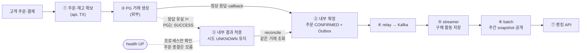
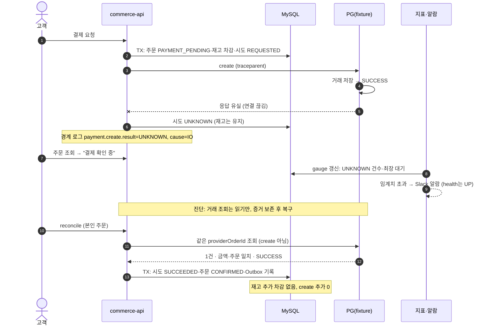
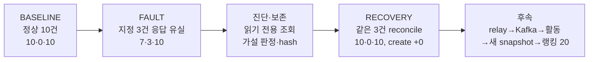

# 결제 응답 유실 사고의 진단과 복구 설계 (W10)

> **health가 UP이어도 결제는 미확인일 수 있다. 업무 지표로 알아채고, 경계 로그와 trace로 원인을 가르고, 기존 reconcile로 create 없이 같은 주문을 끝낸다.**<br>
> 복구의 증거는 "주문 상태"가 아니라 같은 10개 주문의 PG 거래·재고·Outbox·구매 활동·주간 랭킹까지 맞춘 대사 결과다.

W5 PG 결제·W7 Outbox·W6 구매 활동·W9 주간 랭킹을 한 e2e 테스트로 잇고, PG는 SUCCESS인데 생성 응답을 잃어 내부가 UNKNOWN으로 남는 사고를 재현한다.

## 발제의 핵심 주제

| 발제 주제 | 질문 | 이번 설계의 답 |
|---|---|---|
| 관측 | 로그·지표·추적은 각각 무엇에 답하나 | 지표는 "몇 건·얼마나 오래", 경계 로그는 "이 주문에 무슨 일", trace는 "한 요청이 어느 경계를 지났나" |
| 업무 기준 | health UP인데 사용자는 왜 실패를 겪나 | health는 프로세스·의존성 검사일 뿐. 미확인 결제 수와 가장 오래된 대기시간을 따로 본다 |
| 진단 | 같은 증상의 다른 원인을 어떻게 가르나 | 응답 유실과 내부 반영 실패는 둘 다 "PG SUCCESS + 내부 UNKNOWN". create 경계 로그와 적용 TX 결과로 가른다 |
| 복구 | 재결제 없이 어떻게 끝내나 | 기존 reconcile이 같은 거래를 조회해 검증된 SUCCESS만 적용. create 추가 0 |
| 대사 | 무엇까지 맞아야 복구인가 | 같은 10개 주문의 거래·재고·Outbox·구매 활동·랭킹 점수 |

## 전체 프로세스

### 사용자 여정과 사고 지점

각 경계의 성공은 다음 경계를 보장하지 않는다. 이번 사고는 ②와 ③ 사이에서 결과를 잃는다.



| 경계 | 성공이 뜻하는 것 | 아직 모르는 것 |
|---|---|---|
| ② PG SUCCESS | 외부 거래의 최종 성공 | 내부 주문 확정 |
| ③ 주문 CONFIRMED | 결제·재고 적용, Outbox 기록 | 소비 활동 도착 |
| ④ Outbox PUBLISHED | broker 발행 확인 | consumer DB commit |
| ⑥ 배치 COMPLETED | 실행 완료 | 공개본의 업무 정확성 |

### 응답 유실과 복구 (장애 주문 1건 기준)



## 범위

| 포함 | 제외 |
|---|---|
| 사고 fixture 제어, 사고 연결 e2e(baseline→fault→진단→복구→후속) | 실제 PG·카드·운영 DB, 부하·SLO 달성 주장 |
| 업무 지표 2개, 구조화 로그(MDC·key-value·JSON 파일 비동기) | 로그 집계(Loki·ELK) |
| 분산 추적(OTel → Tempo), Outbox 구간 trace 복원 | 자동 reconcile scheduler |
| Grafana 알람 → Slack(업무·에러), runbook | 운영 배포·실제 on-call |

## 핵심 결정

| 결정 | 이유 | 버린 대안 |
|---|---|---|
| 분산 추적은 **Micrometer Tracing + OTel bridge**, OTLP로 Tempo에 보낸다 | 테스트에서 span을 assert할 수 있고 Boot 계측(HTTP·RestClient·Kafka)을 그대로 쓴다. 표준 형식이라 백엔드에 묶이지 않는다 | Pinpoint(운영 부담·테스트 불가), OTel agent(검증이 백엔드에 의존) |
| Outbox 행에 **traceparent를 저장**하고 relay가 복원한다 | 저장 후 다른 스레드에서 발행하는 구간은 어떤 도구도 자동으로 잇지 못한다. 복원해야 consumer까지 한 trace다 | 끊김 유지(소비 구간을 요청 trace로 못 찾음) |
| 식별자는 **MDC(처리 범위) + addKeyValue(경계 사건)**로 남기고, 파일은 JSON 하나를 **비동기**로 쓴다 | MDC는 Spring·Hibernate 예외 로그에도 orderId를 붙여 TX rollback을 연결한다. 비동기는 로그가 요청을 막지 않게 한다 | 에러 파일 분리(맥락 없는 줄, jq로 충분), Loki(이번 규모엔 과함) |
| 업무 지표는 **미확인 건수 + 가장 오래된 대기시간** 두 개, 알람은 Grafana가 판단한다 | 건수는 장애 규모, 대기시간은 한 고객의 장기 정체를 잡는다. 앱은 숫자만 내보내고 임계치는 배포 없이 바꾼다 | 주문마다 알림(폭주), 건수만(소수 장기 정체 누락) |
| 에러 알람도 **로그가 아니라 지표**(`logback.events`)로 보낸다 | 같은 에러 1,000번에도 알람 1번. 이번 사고는 WARN·health UP이라 에러 알람은 울리지 않고 업무 알람만 울린다 | 로그마다 Slack(폭주), 중복 필터(파일 증거까지 버림) |
| 사고 검증은 **e2e 테스트 코드 1개**, `@Tag("e2e")`로 기본 빌드와 분리한다 | 수동 시나리오는 반복·누락 위험. 컨테이너·자식 프로세스로 수 분이 걸려 매 빌드엔 넣지 않는다 | 개발계 수동 확인, 단계별 테스트 메서드 분리 |

## 관측 구조

```
                         ┌──────────── commerce-api ─────────────┐
 고객 ──주문·결제────────▶│  OrderController / reconcile           │──HTTP + traceparent──▶ PG(fixture)
                         │        │ 결제 상태 저장                 │
                         │  ┌──────────┐   스케줄                   │
                         │  │  MySQL   │◀── count·min(createdAt) ── 미확인 결제 gauge
                         │  └──────────┘                          │        │
                         │   Outbox(+traceparent)                 │  /actuator/prometheus
                         │        │ relay(@Scheduled)             │        │ scrape
                         └────────┼───────────────────────────────┘        ▼
                                  │ Kafka + traceparent 헤더          Prometheus
                                  ▼                                        │
                         commerce-streamer: 구매 활동                     ▼
                                  │ (같은 MySQL)                 Grafana Alerting ──▶ Slack
                                  ▼                               · 미확인 > 5 for 5m
                         commerce-batch: 주간 랭킹                · 최장 대기 > 600s for 1m
                                                                  · error rate > 0 for 1m
  로그: 콘솔(plain) + logs/{app}.json(비동기, MDC·key-value)  →  jq로 orderId·traceId 검색
  추적: api·streamer ──OTLP──▶ Tempo ──▶ Grafana
```

| 신호 | 답하는 질문 | 식별자 |
|---|---|---|
| 업무 지표 | 미확인이 몇 건이고 가장 오래 기다린 고객은 얼마나 됐나 | label은 `status`만(유한) |
| 경계 로그 | 이 주문의 create·조회·적용이 어떻게 끝났나 | orderId·attemptKey·providerOrderId·transactionKey |
| trace | 이 요청이 PG·Kafka·consumer를 어떻게 지났나 | traceId(요청 단위. 업무 동일성 판단엔 쓰지 않음) |

trace의 범위는 **한 요청의 인과 흐름**이다. 나중에 사람이 시작한 reconcile과 주간 batch는 다른 trace이고, orderId·eventId·snapshotId로 잇는다.

## 사고 실험 흐름



| 단계 | 대상 | 내부 성공 | UNKNOWN | PG SUCCESS | 누적 거래 |
|---|---|---|---|---|---|
| baseline | 정상 집합 10 | 10 | 0 | 10 | 10 |
| fault | 장애 집합 10 | 7 | 3 | 10 | 20 |
| recovery | 같은 장애 집합 10 | 10 | 0 | 10 | 20 |

- 장애 3건은 실행 순서가 아니라 **실제 providerOrderId 목록**으로 지정한다. fixture는 거래를 저장한 뒤 연결만 끊는다.
- commerce DB에 상태를 직접 쓰지 않는다. 정상 건은 callback API로, 장애 건은 reconcile API로만 확정된다.
- 진단은 PG 거래를 **읽기만** 한다. fault 증거를 저장하고 hash를 남긴 뒤에야 reconcile을 호출한다.
- 같은 주(고정 시계)에 20건이 모두 확정되므로 새 snapshot의 상품 점수는 baseline 10 + 복구 집합 10 = 20이다.

## 가설과 판정

| 가설 | 예상 관찰 | 가르는 증거 |
|---|---|---|
| PG 처리 지연 | PG 조회도 PENDING | 같은 거래 조회 결과 |
| **PG 성공 응답 유실** | PG SUCCESS, 내부 UNKNOWN, create 경계 로그 `UNKNOWN`(I/O 원인), 적용 시도 없음 | create 경계 로그 + 거래 조회 + 적용 로그 부재 |
| 성공 결과의 내부 반영 실패 | PG SUCCESS, 적용 시도 후 rollback, 예약·Outbox 불일치 | `apply.rolled_back` 로그(MDC orderId) + TX 결과 |

PG SUCCESS와 내부 UNKNOWN만으로는 2번과 3번을 가르지 못한다. 경계 로그가 없으면 판정은 "미확정"이다.

## 알려진 한계

- 10건 통제 실험이다. SLO·처리량·운영 알람 임계치를 증명하지 않는다. 알람 값은 예시다.
- 지표는 스케줄로 갱신하는 gauge라 탐지 지연(gauge 주기 + scrape 주기 + `for`)이 있다.
- 비동기 로그는 큐가 가득 차면 버린다. 로그는 연결 단서이고 판단의 원천은 DB·PG 거래·지표다.
- Slack 실제 발송과 Tempo 화면은 로컬 수동 확인까지만 한다. 테스트는 span·헤더·로그로 전파를 검증한다.
- 전체 로그가 롤링되면 에러 기록도 함께 사라진다. 장기 보존이 필요하면 분리나 로그 집계를 다시 본다.

상세(로그 키, 지표 정의, 단계별 assert, 증거 구조, 테스트 목록)는 `incident-recovery.ai.md`에 있다.
