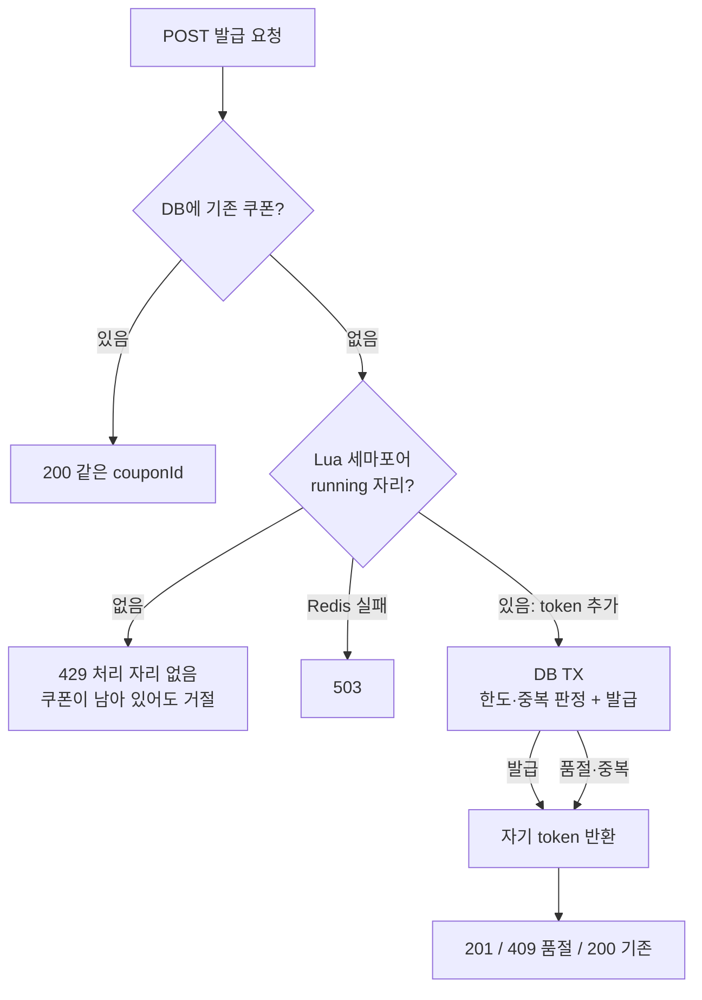
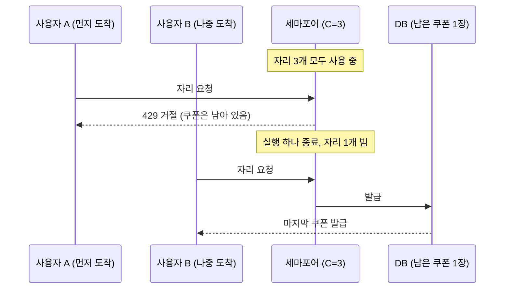
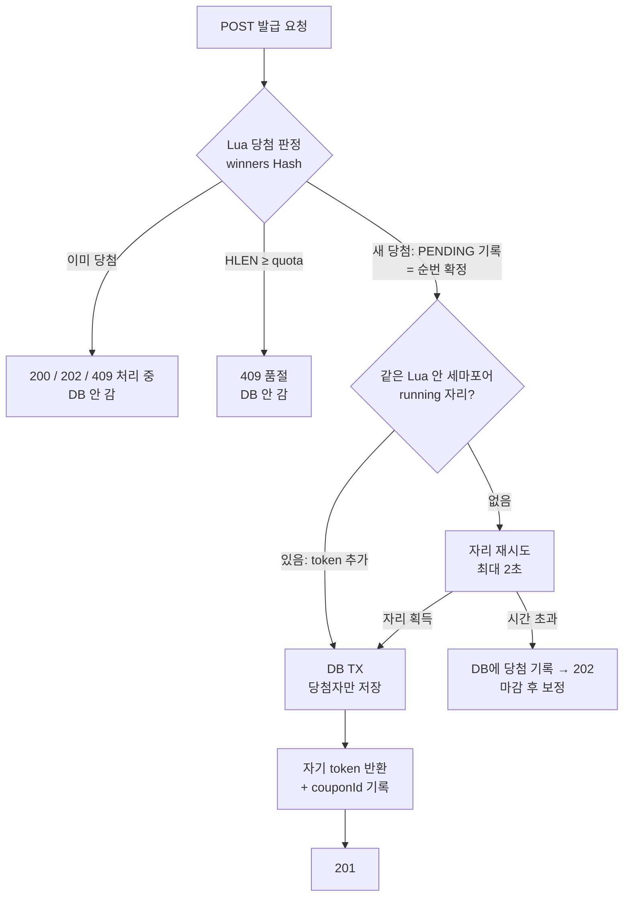
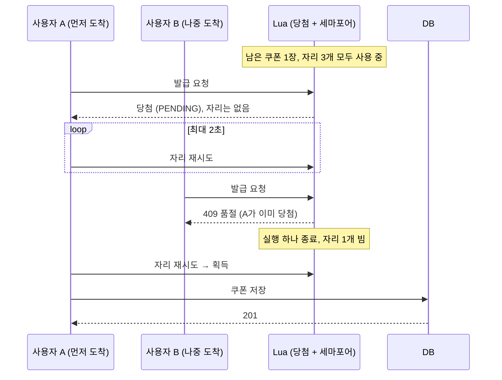
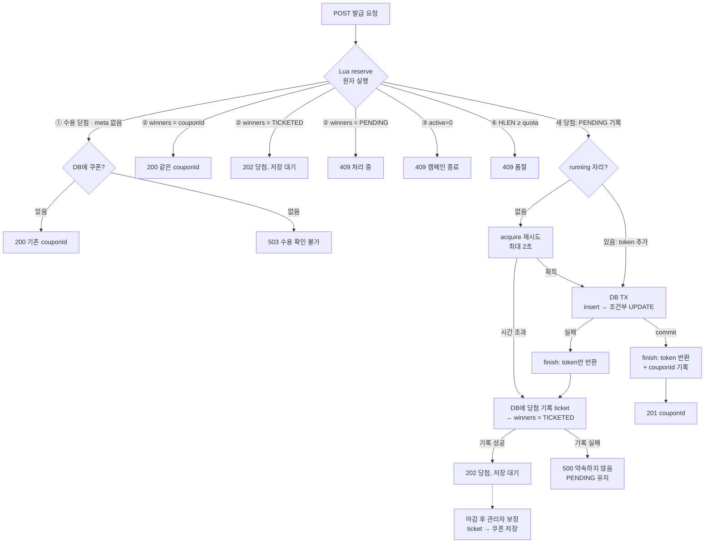

# 선착순 쿠폰 발급 설계 (W8)

> **선착순은 Redis의 당첨자 명단(winners Hash)이 정하고, 세마포어(running Set)는 당첨 뒤에서 DB 실행 수만 제한한다.**<br>
> 자리가 없으면 당첨자는 최대 2초 기다렸다가 저장한다. 기다리는 동안에도 당첨권은 사라지지 않으므로, 수용량을 제한해도 늦게 온 사람이 앞사람의 쿠폰을 가져가지 못한다.<br>
> 고객에게 약속한 결과(201 발급·202 당첨)는 응답 전에 반드시 DB에 남긴다. 그래서 Redis 상태를 잃어도 약속은 사라지지 않는다.

상세 구현(키·Lua·오류 우선순위·테스트 시나리오)은 [AI용 상세](coupon-issue-design.ai.md)에 있다. 요구사항은 `docs/note/week8/실습 과제.md`를 따른다.

## 이 구조를 선택한 이유

지켜야 할 것은 다섯 가지다: **선착순, 발급 총량, 1인 1장, 동시 처리 수용량 C, 동기 발급**(비동기 worker는 과제 범위 밖). 각 결정은 앞 결정에서 이어진다.

| # | 전제 | 그래서 | 결정 |
|---|---|---|---|
| 1 | 선착순이면 "누가 받는가"가 도착 순서로만 정해져야 한다 | 판정이 처리 자리·DB 잠금 획득 순서에 묶이면 안 된다 | 당첨은 **Redis Lua 한 번**으로 정한다. Redis는 스크립트를 하나씩 실행하므로 도착 순서가 곧 당첨 순서다 |
| 2 | 몰리는 요청을 DB가 모두 받으면 연결·잠금이 고갈된다 | 서버 여러 대가 함께 세는 실행 수 제한이 필요하다 | Redis **세마포어**(running Set)로 DB 실행을 C개로 묶는다 |
| 3 | 세마포어를 당첨 앞에 두면 자리를 얻은 순서가 당첨 순서가 된다 | 1번이 깨진다 | 세마포어를 **당첨 뒤**에 둔다. 세마포어는 "누가"가 아니라 "언제 DB에 쓰나"만 정한다 |
| 4 | 당첨 뒤에 두면 "당첨됐지만 아직 저장 안 됨" 상태가 생긴다 | 이 상태를 지우면 빈자리를 늦게 온 사람이 가져간다 | 당첨을 **PENDING으로 기록하고 지우지 않는다** |
| 5 | 재요청이 몰릴 때 PENDING·couponId를 DB에서 찾으면 탈락자·중복자까지 DB에 닿는다 | 명단에 상태와 결과를 함께 담아야 한다 | 명단을 Set이 아니라 **Hash**(userId → PENDING \| TICKETED \| couponId)로 둔다 |
| 6 | PENDING 당첨자의 저장을 누가 하나: worker는 범위 밖, 고객 재요청은 안 올 수 있다 | 같은 요청이 끝내야 한다. 쿠폰 발급은 조금 기다려도 되는 행사고 DB TX는 수 ms다 | 같은 요청이 **최대 2초 자리를 기다렸다가** 저장한다. 드문 시간 초과만 202 + 마감 보정 |
| 7 | "당첨 = 발급 확정"이려면 당첨 뒤 DB가 거절하면 안 된다 | 업무 판단(활성·한도·중복)을 당첨 전에 끝내야 한다 | 업무 판단은 **모두 Lua**에서. DB는 insert 먼저·조건부 UPDATE·유일 제약으로 **최종 방어**만 한다 |
| 8 | 당첨 판단의 원본이 Redis다 | Redis를 믿을 수 없으면 신규 판단을 할 수 없다 | Redis 장애 시 **신규 발급을 닫는다**(503). 이미 저장된 결과 조회만 DB로 유지하고, 재개는 관리자가 확인 뒤 연다 |
| 9 | Redis 상태는 사라질 수 있다. 202로 당첨을 약속한 뒤 사라지면 약속을 어긴다 | 약속은 Redis보다 오래 살아야 한다 | 202를 주기 전에 **DB에 당첨 기록(ticket)을 남긴다**. 기록하지 못하면 202를 약속하지 않는다 |

한 줄로 줄이면: **선착순(1)과 수용량(2)이 충돌하지 않도록 둘의 순서를 정했고(3), 그 순서가 만든 중간 상태(4)를 Redis Hash로 표현하고(5) 같은 요청 안에서 끝냈다(6). 끝내지 못한 약속은 DB에 남긴다(9).**

## 두 개의 한도

| 한도 | 예시 | 무엇을 지키나 | 줄어드나 |
|---|---|---|---|
| 발급 총량 (quota) | 쿠폰 5장 | 행사의 약속 | 발급할 때마다 줄고 되돌아오지 않음 |
| 처리 자리 (C) | 동시에 DB 실행 3개 | 서버와 DB | 실행이 끝나면 반환되어 다시 쓰임 |

쿠폰이 남아 있어도 처리 자리는 없을 수 있다. 반대로 처리 자리가 비어 있어도 쿠폰은 다 나갔을 수 있다. 두 한도는 따로 지킨다.

## 1. 왜 수용량 제한이 필요한가

```
도착 1,000건/초 ──▶ [ DB 발급 TX ] ──▶ 완료 200건/초
                      ▲
           나머지 800건/초가 DB 연결·행 잠금을 기다리며 쌓인다
```

- 선착순 행사는 짧은 순간에 요청이 몰린다. 도착 속도가 완료 속도보다 빠르면 기다리는 실행이 끝없이 늘어난다.
- 기다리는 실행도 DB 연결(Hikari pool)과 캠페인 행 잠금을 쥔다. pool이 바닥나면 쿠폰과 상관없는 주문·조회 API까지 실패한다.
- 그래서 **DB에 동시에 들어가는 쿠폰 실행 수를 C개로 묶는다.** 이 제한은 서버 여러 대가 함께 지켜야 하므로 서버 메모리가 아니라 Redis에 둔다.

## 2. 세마포어를 당첨 뒤로 옮긴 이유

처음 예시 구조는 세마포어가 **당첨보다 앞**에 있었다. 자리를 얻은 요청만 DB에서 당첨 여부를 판단했다.



- 당첨 여부는 자리를 얻은 뒤 DB가 정한다. 그래서 **자리를 얻은 순서가 곧 당첨 순서**다.
- 모든 요청이 DB 조회를 한 번 거친다. 탈락할 요청도 DB에 닿는다.

자리를 얻는 순서는 도착 순서와 다르다. 실행 하나가 끝나는 순간에 마침 도착한 요청이 자리를 얻는다.



먼저 온 A는 쿠폰이 남아 있는데도 거절됐고, 나중에 온 B가 쿠폰을 가져갔다. **선착순이 처리 자리의 운에 따라 바뀐다.**

지금 구조는 순서를 바꿨다. 당첨을 먼저 정하고, 세마포어는 당첨자의 DB 실행에만 건다.



- 당첨 여부는 Lua가 도착 순서대로 정한다. 세마포어는 그 뒤에서 **언제 DB에 쓰는지**만 정한다.
- 탈락·재요청은 Redis에서 끝나고 DB에는 당첨자만 닿는다.
- 자리를 기다리는 사람은 모두 이미 당첨자다. 그래서 대기에 순서를 두지 않는다. 누가 먼저 자리를 얻든 바뀌는 것은 응답 시간뿐이다.

같은 상황(자리 3개 사용 중, 남은 쿠폰 1장)을 다시 보면 다음과 같다.



| | 당첨 앞 세마포어 (예시) | 당첨 뒤 세마포어 (채택) |
|---|---|---|
| 세마포어가 결정하는 것 | 누가 받는가 | 언제 DB에 쓰는가 |
| 자리가 없을 때 | 429, 기회 상실 | 짧게 대기 후 저장. 시간 초과면 202, 당첨권 유지 |
| 늦게 온 사람이 앞지를 수 있나 | 있음 | 없음 (순번은 Lua가 이미 확정) |
| 탈락자의 DB 부하 | 자리를 얻으면 DB까지 감 | 쿠폰 경로는 Redis에서 끝남 (요청자 확인 조회 1회는 별도) |

세마포어 자체는 과제 예시와 같다(`SISMEMBER`·`SCARD`·`SADD`를 Lua로 묶고, 반환은 자기 token만 `SREM`). 바뀐 것은 **위치**다.

## 3. 당첨자 명단을 Set에서 Hash로 바꾼 이유

| | Set (`userId`) | Hash (`userId → 값`) |
|---|---|---|
| 이미 당첨됐나 | `SISMEMBER` | `HGET` |
| 남은 수량 | `SCARD` O(1) | `HLEN` O(1) |
| 재요청에 같은 couponId로 응답 | DB 조회 필요 | Redis만으로 가능 |
| 처리 중(PENDING)·약속됨(TICKETED)·발급 완료 구분 | 불가 | 값으로 구분 |

요청이 몰리는 행사에서는 재요청도 많다. Set만 쓰면 이미 받은 사람의 재요청마다 couponId를 찾으러 DB를 읽어야 한다. Hash에 `PENDING`·`TICKETED`·couponId를 값으로 두면 **당첨·중복·품절·재요청이 모두 Redis 한 번으로 끝나고, DB에는 당첨자만 쓴다.**

## 4. 흐름



| 응답 | 의미 | DB 효과 |
|---|---|---|
| 201 | 이번 요청으로 DB에 저장됨 | 쿠폰 1, issued_count +1 |
| 200 | 이미 발급된 쿠폰 (같은 couponId) | 없음 |
| 202 | 당첨 확정. 당첨 기록(ticket)은 DB에 있고 쿠폰은 마감 보정에서 저장됨 | ticket 1 |
| 409 | 품절, 종료된 캠페인, 같은 사용자의 다른 요청이 처리 중 | 없음 |
| 500 | 쿠폰도 당첨 기록도 DB에 남기지 못함. 약속하지 않음 | 없음 |
| 503 | Redis 수용 상태를 확인할 수 없음 | 없음 |

`winners`의 세 값은 약속의 정도를 나타낸다.

| 값 | 뜻 | DB에 있나 | 재요청 응답 |
|---|---|---|---|
| `PENDING` | 당첨됐고 지금 처리 중이거나, 처리에 실패해 약속하지 못함 | 없음 | 409 처리 중 |
| `TICKETED` | 당첨을 202로 약속함 | 당첨 기록(ticket) | 202 |
| couponId | 발급 완료 | 쿠폰 | 200 |

동기 응답이어도 같은 사용자의 요청은 겹친다(더블클릭, timeout 뒤 재시도, 응답 유실, 여러 기기). 2초 대기로 처리 시간이 길어지면 겹칠 가능성도 커진다. PENDING 재요청은 DB에 가지 않고 Redis에서 바로 409로 끝낸다.

409 처리 중의 메시지는 **"이미 당첨되어 발급을 처리하고 있습니다. 잠시 후 다시 확인해 주세요."**다. 응답 코드로는 발급을 약속하지 않고(DB에 아직 기록이 없다), 문구로만 상황을 알린다.

## 핵심 결정

| 결정 | 이유 |
|---|---|
| 업무 판단(활성·한도·1인 1장)은 모두 Lua에서 끝낸다 | 당첨 뒤 DB에서 거절되는 일이 없어야 "당첨 = 발급 확정"이 성립한다 |
| DB 저장이 실패해도 당첨권(PENDING)을 지우지 않는다 | 지우면 마지막 1장이 비어 늦게 온 사람이 가져간다 |
| TX 안에서 쿠폰 insert를 issued_count UPDATE보다 먼저 한다 | 유일 제약 충돌이 먼저 드러나야 이미 받은 사람을 품절로 잘못 판정하지 않는다 |
| 자리가 없으면 당첨자는 같은 요청 안에서 최대 2초 자리를 다시 시도한다 | 쿠폰 발급은 사용자가 조금 기다려도 되는 행사다. 비동기 worker는 과제 범위 밖이다. DB TX가 수 ms라 대부분 2초 안에 201로 끝난다 |
| 202를 주기 전에 DB에 당첨 기록(ticket)을 남긴다 | 약속한 결과(201·202)는 모두 DB에 있어야 Redis 유실에도 약속이 남는다. 이 쓰기는 드문 202 경로에서만 일어난다 |
| 미저장 당첨은 마감 후 관리자가 보정한다 | 마감 뒤에는 DB가 한가하다. 상시 스케줄러·비동기 queue 없이 끝난다 |
| `active`(업무)와 `open`(장애)를 나눈다 | 종료는 409, 장애는 503으로 응답이 다르다 |

### C와 대기 시간 정하기

| 기호 | 뜻 |
|---|---|
| N, Q | 동시에 몰리는 사용자 수, 쿠폰 수량 |
| W = min(N, Q) | DB까지 오는 당첨자 수. 탈락자는 Redis에서 끝난다 |
| T_tx | 발급 TX 한 건 시간(insert → UPDATE → commit). `coupon.issue.write` 타이머로 잰다 |
| T_lock | 같은 캠페인 행 잠금을 쥐는 시간(UPDATE → commit). 포화 처리량의 역수로 추정한다 |
| P, B, Th | 커넥션 풀 크기(40), 쿠폰에 줄 풀 비율(예: 0.2), Tomcat 스레드(200) |

```
X       = min(C / T_tx, 1 / T_lock)                      # 초당 발급 처리량
C       = min( ⌈T_tx / T_lock⌉ , ⌊P × B⌋ , W )            # 포화점 · 풀 예산 · 당첨자 수
대기시간 = clamp( k × (min(W, Th) − C) / X , T_tx_p99 , 클라이언트 timeout − 여유 )   # k = 1.5~2
```

- 모든 발급 TX가 **같은 캠페인 행 하나를 UPDATE**하므로 잠금 구간은 한 번에 하나씩만 지나간다. 처리량은 `1 / T_lock`을 넘지 못하고, C를 그보다 키우면 늘어난 실행은 연결을 쥔 채 잠금을 기다리기만 한다.
- N은 C를 직접 바꾸지 않는다. DB에 닿는 것은 당첨자 W명뿐이다.

**실측(k6, 한도 100·1,000명 동시, 로컬 단일 인스턴스)**

| C | T_tx p50 / 평균 / p99 | 처리량 X ≈ C ÷ 평균 T_tx |
|---|---|---|
| 3 | 7.6 / 17.7 / 78.3 ms | 약 170/s |
| 5 | 16.6 / 31.2 / 134.2 ms | 약 160/s |
| 10 | 32.1 / 103.2 / 357.9 ms | 약 97/s |

C를 3에서 10으로 늘려도 처리량은 늘지 않고 T_tx만 길어졌다(잠금 대기). 포화 처리량 약 170/s에서 `T_lock ≈ 6ms`이고, 잠금 경쟁이 적은 T_tx(C=3 p50 7.6ms)로 계산하면 `⌈7.6 / 6⌉ = 2`다. 그래서 **C=3을 유지**한다(포화점 2에 여유 1, 풀 40의 7.5%).

대기 시간은 `2 × (100 − 3) / 170 ≈ 1.1초`로 계산된다. 지금 설정 2초는 k ≈ 3.5에 해당하는 여유이고, 세 번의 실행 모두 202 없이 끝났다. 값은 설정(`coupon.issue.wait-timeout`)으로 두고 행사 규모가 바뀌면 같은 공식으로 다시 정한다.

## 검토하다 버린 안

| 안 | 버린 이유 |
|---|---|
| DB 실패 시 Redis에서 당첨 제거 (SREM) | 마지막 자리가 비면 101번째는 품절, 102번째가 당첨되는 역전 |
| 이미 당첨된 재요청도 DB 발급 허용 | 같은 사용자의 DB 쓰기가 겹치고, 한 사람이 요청을 쏟으면 수용량이 깨짐 |
| 사용자별 RUNNING 상태 | 재요청이 DB로 가지 않게 되면서 필요 없어짐 |
| 서버 안에서 즉시 재시도 | 연결 부족 상황에서 부하만 키움. 마감 보정으로 충분 |
| Redis Stream + 비동기 worker | 응답이 비동기로 바뀌고 재처리 장치가 커짐. 이번 범위에서는 동기 발급 유지 |
| 자리가 없으면 바로 202 | 몰리는 순간 많은 당첨자가 저장 대기로 끝나고 마감 보정까지 쿠폰을 볼 수 없음 |
| 순서 있는 대기열 (List·ZSET) | 기다리는 사람은 모두 당첨자라 순서가 공정성에 영향을 주지 않음. 재시도만으로 충분 |

## 장애와 재개

| 상황 | 처리 |
|---|---|
| Redis 접근 실패·timeout | 로컬 수용 스위치를 닫는다. 신규 발급은 503이고 DB 발급 TX에 들어가지 않는다. 이미 받은 사람의 POST는 DB에서 찾아 200, `GET /coupons`도 DB에서 계속 조회 |
| finish 호출 실패 | 쿠폰은 유지, 로컬 수용 스위치를 닫는다. token은 자동 해제하지 않음 |
| 재개 | 관리자가 실행 종료를 확인 → DB의 쿠폰(couponId)과 당첨 기록(TICKETED)으로 winners 재구성 → 남은 자기 token 정리 → 열기. 건강 확인(PONG)만으로 열지 않음 |
| DB issued_count UPDATE 0행 | Redis와 DB 불일치. 수용을 닫고 재구성 |

### Redis 상태를 잃으면

세 겹으로 대처한다.

| 겹 | 방법 | 막는 것 |
|---|---|---|
| 감지 | Redis 명령이 실패하면 로컬 스위치가 닫히고, meta가 비면 Lua가 CLOSED를 돌려준다 | 유실된 상태로 계속 발급하는 것 |
| 노출 줄이기 | 2초 대기로 대부분의 당첨은 곧바로 DB 쿠폰이 된다 | Redis에만 있는 당첨이 오래 남는 것 |
| 약속 보호 | 202 전에 DB에 당첨 기록을 남기고, 재구성 때 DB에서 되살린다 | 약속한 당첨이 사라지는 것 |

재구성은 DB만 믿는다. 그래서 잃을 수 있는 것은 **약속하지 않은 PENDING**(처리 중이었거나 500·409를 받은 당첨)뿐이다. 그 자리는 다시 남은 수량이 되고, 한도는 DB가 계속 지킨다.

수용 스위치는 두 겹이다. Redis `meta.open`만 두면 Redis가 데이터를 유지한 채 재시작할 때 `open=1`이 저절로 살아난다. 그래서 애플리케이션 메모리에도 **기본 닫힘** 스위치를 두고, 관리자 열기 API로만 연다.

TTL로 token을 자동 회수하지 않는다. 살아 있는 이전 실행과 새 실행이 한 자리를 나눠 쓰게 되기 때문이다. 장애 동안 자리가 남아 가용성이 줄어드는 비용을 받아들인다.

## 알려진 한계

| 한계 | 설명 |
|---|---|
| 약속 전 당첨의 원본이 Redis | Redis 상태를 잃으면 약속하지 않은 PENDING 당첨이 사라진다. 201·202로 약속한 결과는 DB에 있어 안전하다 |
| 202 경로의 DB 쓰기 | 당첨 기록 insert는 세마포어 밖의 DB 쓰기다. 시간 초과·DB 실패 같은 드문 경로에서만 일어난다 |
| 선착순의 기준 | Redis에 도착한 순서다. 고객의 클릭 시각·네트워크 지연까지 맞추지 않는다 |
| 핫 키 | 한 캠페인의 키는 한 Redis 노드에 있어 노드를 늘려도 그 캠페인 처리량은 늘지 않는다 |
| 202의 노출 | 마감 보정 전까지 202 당첨은 `GET /coupons`에 나오지 않는다. 같은 POST로 상태를 확인한다 |
| 요청자 확인의 DB 조회 | 탈락자도 `X-USER-ID` 확인 필터에서 users PK 조회를 한 번 한다. 1,000명이 한꺼번에 오면 이 조회로 Hikari 대기가 생겼다(부하 테스트). 쿠폰 세마포어 밖의 부하다 |
| 대기 중 스레드 점유 | 자리를 기다리는 요청이 Tomcat 스레드를 쥔다. 대기자는 당첨자로 한정되고 2초 상한이 있다 |
| 분산 semaphore | 로컬 단일 Redis의 통제된 장애·재개만 다룬다. 감지 못 한 상태 손실·자동 장애 전환은 보장하지 않는다 |
