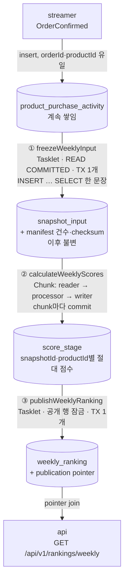
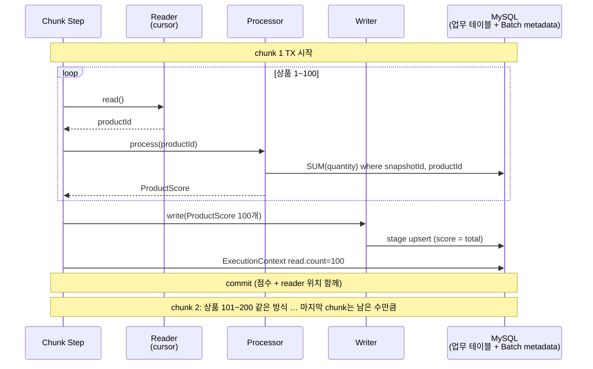

# 주간 구매 랭킹 배치 설계 (W9)

> **구매 활동을 snapshot으로 고정한 뒤, 상품별 절대 점수를 chunk로 계산하고, 완성본만 기간별 pointer로 공개한다. 재시작은 같은 snapshot을 이어 가고, 늦은 구매는 새 revision으로 다시 계산한다.** 
즉, "같은 입력으로 이어 하기"와 "새 입력으로 다시 하기"를 실행 식별값으로 구분한다.

W6·W7이 쌓은 `product_purchase_activity`(orderId·productId별 구매 활동)를 입력으로 `commerce-batch`에 `weeklyRanking` job을 만들고, `commerce-api`는 공개된 완성본만 조회한다.

## 발제의 핵심 주제

| 발제 주제 | 질문 | 이번 설계의 답 |
|---|---|---|
| 실행 식별 | 같은 작업과 새 시도를 어떻게 구분하나 | 식별 parameter는 `periodStart`·`revision`. 실패하면 같은 parameter로 다시 실행한다(같은 JobInstance, 새 JobExecution) |
| 입력 고정 | 늦게 도착한 활동이 재시작 입력을 바꾸지 않나 | 고정 Step이 원본을 snapshot 입력 테이블로 한 번 복사한다. 재시작은 원본을 다시 읽지 않는다 |
| 커밋 | 결과와 checkpoint가 어긋나지 않나 | writer와 JobRepository가 같은 DataSource·transaction manager를 쓴다. chunk 결과와 reader 위치가 한 번에 commit된다 |
| 멱등 쓰기 | 같은 항목을 다시 처리하면 | `score = total` 절대값 upsert. 몇 번 써도 같은 값이다 |
| 공개 | 중간 결과가 보이지 않나 | stage는 배치만 읽는다. 검증·순위·pointer 변경을 한 TX로 묶고 API는 pointer만 따라간다 |

## 범위

| 포함 | 제외 |
|---|---|
| 주간 job(입력 고정 → 점수 계산 → 공개), 랭킹 조회 API | Redis 실시간 랭킹, 조회·좋아요·매출 가중치 |
| 실패·재시작, 늦은 구매의 새 revision | 처리량·chunk 최적값 측정 |
| batch에 Checkstyle·ArchUnit 적용 | batch를 별도 프로세스로 띄우는 자동 E2E |

## 핵심 결정

| 결정 | 이유 |
|---|---|
| 입력 고정은 READ COMMITTED TX에서 `INSERT … SELECT` 한 문장으로 복사하고, 같은 TX에서 복사본으로 건수·checksum을 manifest에 남긴다 | 한 문장이 곧 하나의 일관된 읽기 시점이다. RR의 `INSERT … SELECT`는 원본에 공유 잠금을 걸어 W6 consumer를 막는다. `max(id)`는 commit 순서를 고정하지 못한다 |
| 식별 parameter는 `periodStart`(LocalDate)·`revision`(Long)이고 snapshotId는 `weekly-{yyyyMMdd}-r{n}`으로 만든다. 새 revision은 기존 최대+1만 허용한다 | snapshotId와 기간·revision이 어긋날 수 없다. `run.id`·현재 시각은 넣지 않는다 |
| item 하나는 상품 하나다. reader는 서로 다른 productId를 오름차순으로 읽고, processor가 snapshot 안에서 수량을 합산하고, writer가 절대값으로 upsert한다 | writer 스스로 멱등이라 TX 설정·reader 상태·운영 재실행 조건이 하나 깨져도 점수가 두 배가 되지 않는다. 합산은 DB가 커버링 인덱스로 한다 |
| 공개는 기간별 공개 행을 잠근 TX 하나에서 stage 검증 → 순위 → 완성 ranking insert → pointer 갱신을 한다. 더 새 revision이 공개돼 있으면 pointer를 바꾸지 않고 `SUPERSEDED`로 끝낸다 | 부분 결과와 이전 revision으로의 역행을 막는다. 같은 snapshot의 재공개는 no-op이다 |
| 테이블은 JPA 엔티티로 둔다. batch는 원본을 `@Immutable`로 읽고, local은 `ddl-auto=update`다. api는 ranking·pointer를 읽기 전용으로 매핑한다 | 저장소 관례. batch는 실행마다 뜨는 프로세스라 `create`면 재시작 사이에 고정 입력이 지워진다 |

## 흐름

### 전체 흐름

`weeklyRanking(periodStart=2026-08-17, revision=1)` → snapshotId=`weekly-20260817-r1`

| Step | 하는 일 | 다시 실행될 때 |
|---|---|---|
| ① 입력 고정 | 기간 `[월 00:00Z, 다음 월 00:00Z)`의 활동을 복사하고 manifest(건수·상품 수·입력 checksum, FROZEN)를 같은 commit으로 저장 | COMPLETED면 Batch가 건너뛴다. snapshot이 이미 있으면 복사하지 않고 checksum만 확인한다 |
| ② 점수 계산 | reader: snapshot의 `distinct productId` 오름차순 processor: 상품별 `SUM(quantity)` writer: stage에 `score = total` upsert | 마지막 commit된 `read.count` 다음 상품부터 |
| ③ 공개 | 공개 행 잠금 → stage 수 = 상품 수 검증 → `score DESC, productId ASC` 순위 → ranking insert → snapshot PUBLISHED·결과 checksum·pointer 갱신 | 이미 PUBLISHED면 no-op, 더 새 revision이 공개돼 있으면 `SUPERSEDED` |

### chunk 단위 동작

chunk 크기(`ranking.weekly.chunk-size`, 기본 100)는 **몇 개 상품마다 commit하는가**다. 합산 횟수가 아니다. 합산은 상품마다 한 번이다.

상품 250개일 때:

| chunk | 상품 | SUM 쿼리 | commit 뒤 `read.count` |
|---|---|---|---|
| 1 | 1~100 | 100번 | 100 |
| 2 | 101~200 | 100번 | 200 |
| 3 | 201~250 | 50번 | 250 |

- SUM은 모두 250번이고 commit은 3번이다. writer도 상품마다 조회 후 insert 또는 update를 하므로 상품 하나에 쿼리 2~3개가 나간다.
- chunk 2 도중 실패하면 chunk 2 전체가 rollback된다. 재시작 때는 cursor를 다시 열고 200이 아니라 100개를 건너뛴 뒤 상품 101부터 이어 간다.
- 점수와 `read.count`가 같은 TX라서 "점수는 저장됐는데 위치는 안 저장된" 상태가 생기지 않는다. 그런 상태가 생겨도 절대값 upsert라 다시 써도 같은 값이 된다.
- 재시작 실험(§6)은 chunk=2로 실행한다. 상품 7·8이 chunk 1, 상품 9가 chunk 2다.

### 실패와 재시작 (§6 입력)

| 시점 | 실행 101 (FAILED) | 실행 102 (같은 instance) |
|---|---|---|
| ① 입력 고정 | 4행 고정, COMPLETED | 건너뜀 (완료된 Step) |
| ② chunk 1 | 상품 7 = 5, 8 = 1, `read.count=2` commit | 건너뜀 (위치 2부터) |
| ② chunk 2 | 상품 9 처리 중 실패 → rollback | 상품 9 = 5 |
| ③ 공개 | 실행 안 됨, 기존 pointer 유지 | 7(1위), 9(2위), 8(3위) 공개 |

### 재시작과 새 revision

| | 재시작 | 새 revision |
|---|---|---|
| parameter | 같다 (`revision=1`) | 다르다 (`revision=2`) |
| JobInstance | 같다 | 새로 |
| 입력 | 이미 고정한 r1 입력 그대로 | 원본을 다시 고정, 늦은 구매 포함 |
| 공개 | r1 공개 | r2 공개 전까지 r1 유지, 공개 뒤 r2 |

## 랭킹 API 계약

`GET /api/v1/rankings/weekly?periodStart=2026-08-17&limit=10`

| 항목 | 계약 |
|---|---|
| periodStart | ISO 날짜, 월요일(UTC 주 시작). 아니면 400 `INVALID_INPUT` |
| limit | 기본 10, 1~100. 아니면 400 |
| 기간 | `[periodStart, periodEnd)`, periodEnd는 다음 월요일(포함하지 않음) |
| 공개본 없음 | 200, `status=NOT_PUBLISHED`, `items=[]` |
| 구매 없는 완성본 | 200, `status=PUBLISHED`, snapshotId 있음, `items=[]` |
| 삭제 상품 | 공개 조건을 먼저 적용하고 limit을 적용한다. 저장된 계산 순위를 그대로 보여 주므로 1·3위처럼 간격이 생길 수 있다 |
| 항목 | rank, productId, 현재 name·price·brand, score |

## 검증 방법

| 무엇을 | 어디서 |
|---|---|
| 기간·순위·revision·공개 분기·checksum 규칙 | batch domain 단위 테스트 |
| 같은 instance의 실패 → 재시작, checkpoint, 정상 실행과 같은 결과 | batch `RankingJobRestartTest` (상품 9 합계 조회를 spy로 한 번 실패) |
| 늦은 구매, 새 revision, 오래된 실행, 공개 TX rollback, 빈 주 | batch `WeeklyRankingFlowTest` |
| 공개 조건·미공개·빈 주·입력 검증 | api `WeeklyRankingApiE2ETest` |
| 실제 PG 확정 → Kafka → 활동 → job → API, 늦은 구매 | 로컬 인수 시나리오 (다른 세션의 잠금으로 실제 장애) |

## 알려진 한계

- 원본·ranking 테이블 정의가 앱마다 중복된다(streamer↔batch, batch↔api). 매핑이 어긋나면 batch의 `update`가 원본에 컬럼을 추가할 수 있다.
- local에서 api를 재시작하면 api가 매핑한 ranking·pointer 테이블이 `create`로 지워진다.
- manifest의 입력 고정 시점은 TX 시작 시각(Clock)이다. 실제 경계는 그 TX의 read view다.
- 입력 고정은 "그 주의 모든 구매가 도착했다"는 증명이 아니다. 늦은 구매는 새 revision으로만 반영한다.
- chunk 크기는 설정값이며 최적값·처리량은 측정하지 않았다.
- 점수 계산은 상품마다 SUM 쿼리를 따로 보낸다. 상품 수가 커서 비용이 측정되면 reader에서 `GROUP BY`로 합계까지 읽도록 바꾸는 것을 검토한다.
