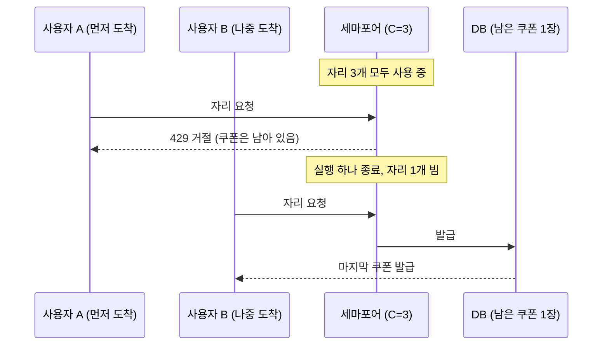
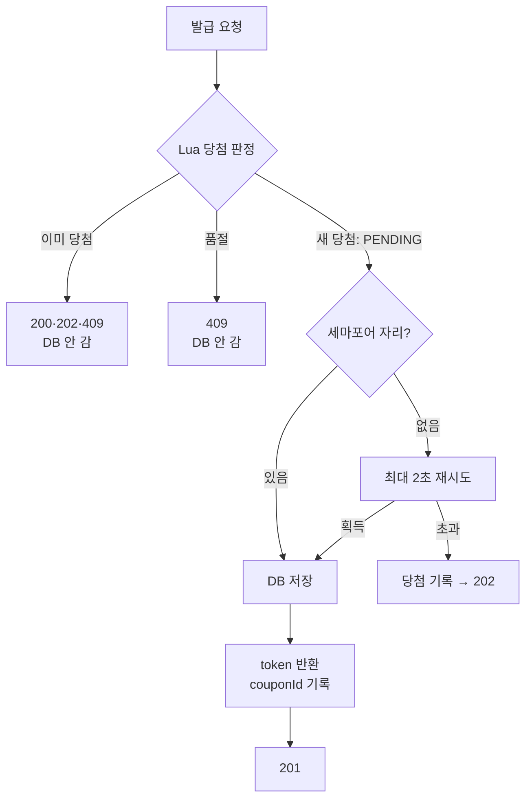

## 📌 Summary

선착순 쿠폰 발급과 본인 보유 목록을 추가하고, 발급 앞에 Redis 기반 수용량 제어를 두었습니다.
선착순도 지키면서 DB 커넥션 풀도 지키기 위한 구조로 설계하는데 주안점을 두었습니다.

- **두 한도를 따로 지킵니다.** 발급 총량은 DB(조건부 UPDATE·유일 제약)가, 동시 DB 실행 수(C=3)는 Redis 세마포어가 지킵니다. 자리를 반환해도 발급 수는 줄지 않습니다.
- **세마포어를 당첨 판정 뒤로 옮겼습니다.** 선착순이 처리 자리의 운에 좌우되지 않게 하기 위해서입니다. 자리가 없는 당첨자는 최대 2초 기다립니다.
- **Redis 장애 시 신규 발급을 닫습니다.** 이미 발급된 결과는 DB로 조회합니다. 재개는 관리자가 실행 종료를 확인하고 DB로 상태를 재구성한 뒤에만 엽니다.
- **부하 테스트(k6, 한도 100·1,000명 동시)**: C=3·5·10 모두 발급 100·품절 409 900·issued_count 100·running 최대 = C. C를 키워도 처리량은 늘지 않아(약 170→160→97/s) C=3을 유지했습니다.

## 💬 Review Points

### 1. 선착순과 커넥션 풀 보호를 함께 지키려고 세마포어 위치를 바꿨습니다

#### 예시 세마포어 구조의 문제점

발제 예시처럼 세마포어가 당첨 판정 앞에 있으면 **자리를 얻은 순서가 곧 당첨 순서**가 됩니다. 자리를 얻는 순서는 도착 순서와 다르기 때문에 진정한 선착순이 아닙니다.



#### 개선한 구조

"누가 받나"와 "언제 DB에 쓰나"를 떼어 냈습니다.
- 당첨 판정(활성·남은 수량·1인 1장)을 Lua 하나로 옮겨 확인과 기록을 원자적으로 처리합니다. Redis에 도착한 순서가 곧 당첨 순서입니다.
- 세마포어는 당첨 뒤에서 DB 실행 수만 제어합니다. 세마포어 자체는 예시와 같고, 위치만 바꿨습니다.



| | 당첨 앞 세마포어 (예시) | 당첨 뒤 세마포어 (채택) |
|---|---|---|
| 세마포어가 정하는 것 | 누가 받는가 | 언제 DB에 쓰는가 |
| 자리가 없을 때 | 거절, 기회 상실 | 최대 2초 대기 후 저장 |
| 늦게 온 사람이 앞지르나 | 그럴 수 있음 | 없음 |
| 탈락자가 DB에 닿나 | 자리를 얻으면 닿음 | 쿠폰 경로는 Redis에서 끝남 (요청자 확인 조회 1회는 별도) |

- **당첨 = 발급 확정.** 업무 판단은 Lua에서 끝내고 DB는 최종 방어만 합니다. 쿠폰 insert를 발급 수 UPDATE보다 먼저 해야, 이미 받은 사람이 품절로 잘못 판정되지 않습니다. DB 저장이 실패해도 당첨은 지우지 않습니다. 지우면 늦게 온 사람이 빈자리를 가져가는 역전이 생깁니다.
- **제한된 대기.** 쿠폰 발급은 사용자가 1~2초 기다려도 되는 행사입니다. 당첨됐는데 거절당하는 것보다 조금 늦게 받는 편이 낫고, DB TX가 수 ms라 대부분 대기 안에 201로 끝납니다. 대기열과 비동기 worker는 과제 범위 밖이라 동기 응답을 유지했습니다. 대기자는 모두 이미 당첨자라 대기 순서가 공정성에 영향을 주지 않으므로, 순서 있는 대기열 없이 jitter를 섞어 재시도만 합니다.
- **2초의 근거.** 동시 대기자는 Tomcat 스레드(200)를 넘지 못하고 자리가 비는 속도는 `C ÷ TX 시간`입니다. C=3이면 TX가 약 30ms까지 느려져도 200명이 2초 안에 빠집니다. 이 대기 시간은 기본값이며 쿠폰량, 사용자 수에 따라 측정 후 셋팅할 수 있도록 프로퍼티 설정 값으로 뺐습니다. 아래 4장의 공식과 실측으로 계산하면 약 1.1초라, 2초는 여유를 둔 값입니다. (측정 내용은 Technical Writing에 추가)

### 2. 당첨자 명단을 Set이 아니라 Hash로 두었습니다

예시의 Set은 당첨 여부만 알아서, 재요청마다 couponId를 찾으러 DB를 읽어야 합니다. 그래서 Hash에 `userId → 상태/couponId`를 저장해, 재요청은 DB 없이 바로 응답합니다.

| 값 | 뜻 | 재요청 응답 |
|---|---|---|
| `PENDING` | 당첨, 저장 중 | 처리 중 |
| `TICKETED` | 당첨을 약속했고 DB에 당첨 기록이 있음 | 저장 대기 |
| couponId | 발급 완료 | 같은 couponId |

당첨·품절·중복·재요청이 Redis 한 번으로 끝나고, DB에는 당첨자만 씁니다. 같은 사용자의 동시 요청은 HTTP 실행이 여러 개여도 DB 효과는 하나입니다. DB 유일 제약은 안전망으로 유지합니다.

### 3. Redis 유실에 대비해 당첨 기록을 DB에 남깁니다

당첨의 원본이 Redis가 되면서, Redis에만 있는 약속은 재시작과 함께 사라질 수 있습니다. 그래서 **고객에게 약속한 결과는 응답 전에 DB에 남긴다**는 원칙을 두었습니다.

- 드물게 대기 시간 초과나 DB 쓰기 실패로 202를 응답할 때는, 당첨 기록을 별도 테이블에 먼저 보존한 뒤 응답합니다. 기록하지 못하면 약속하지 않습니다.
- 이 쓰기는 세마포어 밖이지만 드문 경로에서만 일어나고 횟수가 당첨자 수를 넘지 않아, 커넥션 풀 고갈 위험이 없습니다.
- 당첨 기록은 마감 뒤 관리자 보정이 쿠폰으로 저장합니다.
- Redis 상태를 재구성할 때는 DB의 쿠폰과 당첨 기록만 믿습니다. 잃는 것은 약속하지 않은 처리 중 당첨뿐입니다.

### 4. 부하 테스트로 C를 정했습니다

**조건**: 로컬 단일 인스턴스(맥북), MySQL·Redis는 docker, k6도 같은 머신. 한도 100 캠페인에 서로 다른 1,000명이 동시에 한 번씩 요청(`k6/run-coupon-rush.sh <C>`). C마다 1회 실행.

| C | 201 / 202 / 409 | 쿠폰 / issued_count | running 최대 | Hikari 활성 최대 (대기) | 당첨 201 p50 / p99 | T_tx p50 / 평균 / p99 | 처리량 ≈ C ÷ 평균 T_tx |
|---|---|---|---|---|---|---|---|
| 3 | 100 / 0 / 900 | 100 / 100 | 3 | 10 (0) | 916 / 1,082 ms | 7.6 / 17.7 / 78.3 ms | 약 170/s |
| 5 | 100 / 0 / 900 | 100 / 100 | 5 | 32 (62) | 960 / 1,115 ms | 16.6 / 31.2 / 134.2 ms | 약 160/s |
| 10 | 100 / 0 / 900 | 100 / 100 | 10 | 34 (48) | 1,061 / 1,191 ms | 32.1 / 103.2 / 357.9 ms | 약 97/s |

- **정합성**: 세 번 모두 발급 100·품절 900·issued_count 100이고, 실행 자리는 C를 넘지 않았습니다.
- **C를 키워도 처리량이 늘지 않습니다.** 모든 발급 TX가 같은 캠페인 행 하나를 UPDATE해서 잠금 구간이 직렬이기 때문입니다. C를 늘리면 T_tx(잠금 대기)만 길어집니다.
- **공식**으로 C와 대기 시간을 정했습니다. T_tx는 발급 TX 타이머로 재고, T_lock은 포화 처리량의 역수(약 6ms)로 추정했습니다.
  ```
  X       = min(C / T_tx, 1 / T_lock)
  C       = min( ⌈T_tx / T_lock⌉ , ⌊커넥션 풀 × 쿠폰 몫⌋ , 당첨자 수 )   → ⌈7.6 / 6⌉ = 2, 여유 1을 두어 C=3
  대기시간 = clamp( k × (min(당첨자 수, Tomcat 스레드) − C) / X , T_tx_p99 , 클라이언트 timeout − 여유 )
          → 2 × (100 − 3) / 170 ≈ 1.1초 (설정 2초는 여유, 세 번 모두 202 없음)
  ```
- **지연의 대부분은 쿠폰 대기가 아닙니다.** 1,000명이 한꺼번에 오면 Tomcat 스레드(200) 대기와 요청자 확인 조회가 지연을 만듭니다. C=5·10에서 생긴 Hikari 대기는 쿠폰 TX(최대 C개)가 아니라 **요청자 확인 필터의 users 조회**가 풀을 나눠 쓴 결과입니다.
- **측정의 한계**: C마다 1회, k6와 서버가 같은 머신, running·Hikari는 샘플링이라 최대값을 놓쳤을 수 있습니다.

### 알려진 한계
- 선착순의 기준은 Redis 도착 순서입니다.
- 단일 Redis의 통제된 장애·재개만 다룹니다.
- 탈락자도 요청자 확인에서 users 조회를 한 번 합니다. 쿠폰 세마포어 밖의 DB 부하입니다.

## ✅ Checklist

### 🎟 실제 쿠폰
- [x] 정상 발급 결과를 본인 보유 목록에서 조회하고 다른 사용자 결과를 노출하지 않는다.
- [x] 한도·사용자 중복·발급 수와 쿠폰 insert를 DB에서 원자적으로 보호한다.
- [x] 처리 자리 반환이 발급된 쿠폰이나 총량을 되돌리지 않는다.

### 🪑 수용과 반환
- [x] 실제 Redis의 원자 연산으로 C=3에서 유지 중인 세 실행을 확인했다. 네 번째는 거절 대신 DB 밖에서 기다렸다가 반환된 자리로 발급된다(`CouponAdmissionTest`).
- [x] 실행 종료 뒤 자기 token만 반환하고 새 요청이 그 자리를 재사용한다.
- [x] 동일 업무의 중복 효과와 동시에 진행 중인 HTTP 실행 수를 구분한다.

### 🔌 장애와 회귀
- [x] Redis 장애에서 신규 발급을 우회하지 않고 기존 DB 결과 조회는 유지한다.
- [x] timeout·TTL만으로 활성 자리를 재사용하지 않으며 확인 후 명시적으로 재개한다.
- [x] 관련 기능·회귀·lint·ArchUnit을 실행하고 자기 테스트 자원을 정리했다.
