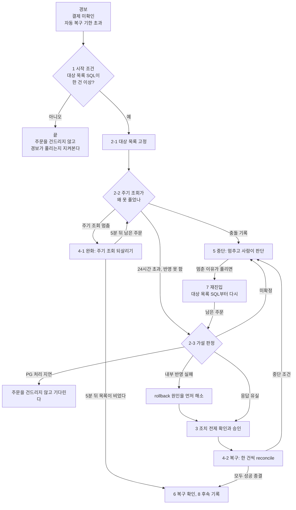

# 결제 응답 유실 런북

> 상태: 사고 실험(`CheckoutIncidentTest`)이 이 절차의 진단 관찰, 조치 전제의 데이터 조건, 본인 reconcile 복구, 복구 확인을 로컬에서 재현해 확인했다. 아래 SQL은 실제 스키마의 테이블과 컬럼으로 썼지만 사고 실험이 실행하지는 않는다. 운영 환경에서 실행해 본 절차는 아니다.

PG는 결제를 승인했는데 Commerce가 생성 응답을 받지 못해 결제 시도가 `UNKNOWN`으로 남은 사고에서 운영자가 따라 하는 절차다. 규칙, 판정 근거, 선택의 이유는 [결제 응답 유실 사고 대응](../system-design/use-cases/payment-response-lost.md)을 따른다.

## 한눈에 보기



1. 경보를 받으면 [증상과 시작 조건](#1-증상)을 확인한다. 맞지 않으면 여기서 끝낸다.
2. [대상 주문을 SQL로 고정](#2-1-대상-목록-고정)하고, [주기 조회가 풀지 못한 이유](#2-2-주기-조회가-풀지-못한-이유)와 [원인](#2-3-가설-판정)을 판정한다.
3. 완화: 주기 조회가 멈췄으면 [먼저 되살린다](#4-1-완화-주기-조회-되살리기).
4. 복구: [조치 전제](#3-조치-전제)를 확인하고, [남은 주문을 한 건씩 reconcile](#4-2-남은-주문-reconcile)한다.
5. [중단 조건](#5-중단-조건)이 보이면 그 주문은 멈춘다.
6. [복구를 확인](#6-복구-확인)하고 [기록을 남긴다](#8-후속).

## 시작하기 전에

### 하지 않는 일

- 결제 시도나 주문의 상태를 DB에서 직접 바꾸지 않는다.
- 결제 요청(`confirm`)을 다시 보내거나 새 결제 시도 키로 결제하지 않는다. PG에 생성 요청을 보내지 않는다.
- 이미 공개한 랭킹 회차의 점수와 순위를 고치지 않는다.
- 진단을 위해 관리 endpoint의 노출 범위를 넓히지 않는다. `env`, `heapdump`는 열지 않는다.

### 환경별 수단

질의와 SQL은 운영과 로컬이 같다. 운영에 없는 도구는 로컬에서 대신하는 수단을 함께 적는다.

| 단계 | 운영 | 로컬 |
|---|---|---|
| 경보·대시보드 | Grafana 경보 "결제 미확인 자동 복구 기한 초과"와 결제 미확인 대시보드 | 로컬 모니터링 스택(`docker/monitoring-compose.yml`)의 Grafana `http://localhost:3000` |
| 지표 | Prometheus 질의 | `curl -s http://127.0.0.1:8081/actuator/prometheus` |
| health | 배포 환경의 health | `curl -s http://127.0.0.1:8081/actuator/health` |
| DB | 읽기 전용 계정 | 로컬 MySQL의 `loopers` |
| 로그 | 로그 저장소에서 `event`, `attemptId`, `orderId` 필드 검색 | 콘솔 출력에서 로그 문장과 `attemptId=`로 검색. 콘솔에는 `event` 같은 필드가 따로 보이지 않는다 |
| PG 거래 | PG 조회 권한 | 테스트 PG 조회 API `http://127.0.0.1:8082` |
| 복구 | 본인 reconcile, 주문 소유자 식별값 사용 | 같다 |

### SQL 규칙

- SQL은 모두 읽기 질의다.
- `:order_ids` 자리에는 고정한 대상 주문 ID를 `1, 2, 3`처럼 넣는다.
- DB 시각 컬럼은 UTC다. SQL의 현재 시각은 `UTC_TIMESTAMP(6)`로 쓴다.

## 1. 증상

- 고객이 "결제가 계속 확인 중"이라고 문의한다. 주문 상세의 `paymentProgress`가 끝나지 않는다.
- health는 UP이다. 이 사고는 의존 서비스가 살아 있는 채로 결제 결과만 잃는다.
- "결제 미확인 자동 복구 기한 초과" 경보가 울리고, 대시보드의 기한 초과 칸이 빨갛다.
- 로그에 `payment.create.observed`가 `outcome=UNKNOWN`, WARN으로 늘어난다.

지표는 아래 질의로 본다. 첫 줄이 경보와 같은 값이고, 둘째 줄은 미종결 상태별 수다.

```promql
max(payment_attempt_overdue_unknown{application="commerce-api"})
max by (status) (payment_attempt_unresolved{application="commerce-api"})
```

### 시작 조건

아래 두 조건이 모두 맞을 때만 이 런북을 시작한다. 경보의 기준(기한 5분, 주기 조회 기간 24시간)은 설계 문서의 [자동 복구 기한을 넘긴 미확인 지표](../system-design/use-cases/payment-response-lost.md#자동-복구-기한을-넘긴-미확인-지표)에 있다.

1. "결제 미확인 자동 복구 기한 초과" 경보가 울렸다. 경보 없이 대시보드나 지표로 먼저 봤다면 `payment_attempt_overdue_unknown`이 0보다 큰지로 대신한다.
2. [대상 목록](#2-1-대상-목록-고정) SQL이 한 건 이상을 돌려준다.

| 관찰 | 뜻 | 다음 |
|---|---|---|
| 경보는 울렸는데 대상 목록이 비었다 | 그 사이 주기 조회가 풀었다. 지표는 갱신 주기와 수집 주기만큼 늦다 | 주문을 건드리지 않고 경보가 풀리는지 지켜본다. 같은 일이 되풀이되면 PG 응답 지연과 생성 요청 timeout 증가를 따로 확인한다. |
| 기한 초과 지표가 대상 목록 중 충돌이 없고 24시간 안인 건수와 다르다 | 지표 갱신이 멈췄을 수 있다 | 결제 지표 갱신 실패 경고 로그를 확인한다. 지표 대신 SQL을 기준으로 진행한다. |

## 2. 진단

### 2-1. 대상 목록 고정

```sql
-- 런북 대상. 마지막 변경 뒤 5분이 지나도 UNKNOWN인 시도다.
SELECT a.id AS attempt_id, a.order_id, o.user_id, a.provider_order_id,
       a.transaction_key, a.amount, a.conflict_reason,
       a.created_at, a.updated_at, a.last_checked_at
FROM payment_attempts a
JOIN orders o ON o.id = a.order_id
WHERE a.status = 'UNKNOWN'
  AND a.deleted_at IS NULL
  AND a.updated_at <= UTC_TIMESTAMP(6) - INTERVAL 5 MINUTE
ORDER BY a.updated_at, a.id;
```

결과를 시각과 함께 저장한다. 이후 단계는 이 목록만 다룬다. 경보는 이 중 충돌이 없고 생성 후 24시간 안의 것만 센다. 장기 미종결 `PENDING`과 `REQUESTED`는 이 런북의 대상이 아니며 [결제 회복](../system-design/use-cases/order-payment-recovery.md)의 기준을 따른다.

진단 전에 대상의 `status`와 `updated_at`을 기록해 둔다. 진단이 상태를 바꾸지 않았는지 조치 전에 비교한다.

### 2-2. 주기 조회가 풀지 못한 이유

| 관찰 | 뜻 | 다음 |
|---|---|---|
| `conflict_reason`이 있다 | 충돌이 기록됐다 | 그 주문은 멈춘다. 충돌 해제는 이 런북 범위 밖이다. |
| `created_at`이 24시간보다 오래됐다 | 자동 조회 대상에서 빠졌다 | 수동 복구 대상이다. 2-3으로 간다. |
| 생성 후 24시간 안인데 `last_checked_at`이 비었거나 5분보다 오래됐다 | 주기 조회가 이 시도를 보지 못했다 | 주기 조회 설정과 앱 실행 상태를 확인하고 [4-1. 완화](#4-1-완화-주기-조회-되살리기)로 간다. |
| `last_checked_at`이 최근인데 그대로 `UNKNOWN`이다 | 주기 조회는 돌았지만 반영하지 못했다 | 그 시도의 조회·반영 로그로 원인을 본다. |

주기 조회가 돌고 있으면 대상의 `last_checked_at`이 몇 분 안에 새 시각으로 바뀐다. 설정은 `payment.periodic-check.enabled`다.

충돌이 기록됐거나 생성 후 24시간이 지난 미확인은 경보에 잡히지 않는다. 그 수는 아래 질의로 본다.

```sql
-- 경보가 세지 않는 장기 미확인. 충돌이 기록됐거나 생성 후 24시간이 지나 자동 조회에서 빠진 UNKNOWN 시도 수다.
SELECT COUNT(*) AS long_term_unknown
FROM payment_attempts
WHERE status = 'UNKNOWN'
  AND deleted_at IS NULL
  AND (conflict_reason IS NOT NULL OR created_at < UTC_TIMESTAMP(6) - INTERVAL 24 HOUR);
```

### 2-3. 가설 판정

대상 주문마다 아래 세 가지를 읽고 판정한다. reconcile, callback, Commerce의 결제 API는 결과를 반영하므로 진단에 쓰지 않는다.

1. 생성 관찰 로그: `event="payment.create.observed"`, `attemptId=<attempt_id>`. `outcome`, `detail`, `elapsedMs`를 본다. `elapsedMs`가 PG 응답 timeout 이상이면 응답을 기다리다 끊은 것이다.
2. PG 거래: `provider_order_id`로 조회한다. 거래 수, 상태, 금액, 주문 식별자를 본다.

   ```bash
   # 로컬. 운영은 PG 조회 권한으로 같은 값을 확인한다.
   curl -s -H 'X-USER-ID: 135135' 'http://127.0.0.1:8082/api/v1/payments?orderId=<provider_order_id>'
   ```

3. 조회 로그와 rollback 로그: `event="payment.lookup.observed"`, `attemptId=<attempt_id>`. rollback은 기존 error 로그 "결제 결과 반영을 되돌립니다. attemptId=<attempt_id>"로 찾는다. 반영이 끝났는지는 시도의 `status`로 본다.

세 관찰을 설계 문서의 [판정 규칙](../system-design/use-cases/payment-response-lost.md#판정-규칙)에 대어 가설마다 지지, 기각, 미확정으로 판정한다.

PG 거래가 2건 이상이거나 금액·주문 식별자가 시도와 다르면 판정하기 전에 [5. 중단 조건](#5-중단-조건)으로 간다. 판정과 근거를 대상 목록 옆에 적는다.

가설은 함께 지지될 수 있다. 아래 표는 위에서부터 먼저 맞는 줄을 따른다.

| 판정 | 다음 |
|---|---|
| PG 처리 지연 지지 | 다른 가설과 상관없이 주문을 건드리지 않는다. PG의 처리 상태를 확인하고 기다린다. |
| 응답 유실 지지, 나머지 기각 | [3. 조치 전제](#3-조치-전제)로 간다. |
| 내부 반영 실패 지지 | rollback error의 원인을 먼저 해소한다. 해소한 뒤 3으로 간다. |
| 미확정 | 멈추고 근거를 더 모은다. |
| 위 어디에도 맞지 않는다. 지지된 가설이 없거나 PG 거래가 `SUCCESS`가 아니다 | 멈추고 사람이 판단한다. |

## 3. 조치 전제

아래를 모두 확인한 뒤에만 조치한다.

- [ ] 대상 목록을 고정하고 저장했다.
- [ ] 대상마다 판정이 "응답 유실 지지, 나머지 기각"이거나, 반영 실패의 원인을 해소했다.
- [ ] 대상마다 Commerce와 같은 PG 상점 계정으로 조회한 거래가 정확히 1건이고 `SUCCESS`이며, 금액과 주문 식별자가 시도와 같다.
- [ ] 대상에 `conflict_reason`이 없다.
- [ ] PG 조회가 정상이다.
- [ ] 대상의 `status`와 `updated_at`이 진단 전에 기록한 값과 같다.
- [ ] 대상 목록과 [중단 조건](#5-중단-조건)을 확인한 사람이 조치를 승인했다. 승인자, 승인 시각, 고정한 목록의 hash를 대상 목록과 함께 남긴다.

→ 다음: [4-2. 남은 주문 reconcile](#4-2-남은-주문-reconcile)

## 4. 완화와 복구

4-1은 새 미확인이 쌓이지 않게 하는 완화이고, 4-2는 이미 남은 주문을 마무리하는 복구다. 재시작은 PG 거래를 없애지 않고, 코드를 되돌려도 DB와 PG에 남은 사실은 그대로다.

### 4-1. 완화: 주기 조회 되살리기

2-2에서 주기 조회가 멈춘 것으로 보였을 때 먼저 한다.

1. `payment.periodic-check.enabled`가 꺼져 있으면 켜고 앱을 재시작한다. 켜져 있는데 돌지 않으면 앱을 재시작한다.
2. 재시작은 인스턴스를 하나씩 한다. 재시작하는 순간 처리 중이던 결제는 생성 응답을 반영하지 못해 `REQUESTED`로 남을 수 있다. 이 시도도 주기 조회가 다시 확인한다.
3. 5분 기다린 뒤 [대상 목록](#2-1-대상-목록-고정) SQL을 다시 실행하고, 기한 초과 경보가 풀리는지 본다. `REQUESTED`가 재시작 뒤 늘었는지도 함께 본다.

   ```sql
   -- 재시작 뒤 확인. 생성 응답을 반영하지 못하고 5분 넘게 REQUESTED로 남은 시도 수다.
   SELECT COUNT(*) AS stale_requested
   FROM payment_attempts
   WHERE status = 'REQUESTED'
     AND deleted_at IS NULL
     AND updated_at <= UTC_TIMESTAMP(6) - INTERVAL 5 MINUTE;
   ```

4. 대상 목록이 비었으면 [6. 복구 확인](#6-복구-확인)으로 간다. 남은 주문은 [2-2](#2-2-주기-조회가-풀지-못한-이유)부터 다시 보고, [2-3. 가설 판정](#2-3-가설-판정)과 [3. 조치 전제](#3-조치-전제)를 거쳐 4-2로 넘긴다.

### 4-2. 남은 주문 reconcile

주기 조회가 풀지 못한 주문과 생성 후 24시간이 지난 주문을 한 건씩 순서대로 복구한다. 같은 주문을 동시에 여러 번 호출하지 않는다.

```bash
curl -s -X POST -H 'X-USER-ID: <user_id>' \
  'http://127.0.0.1:8080/api/v1/orders/<order_id>/payment/reconcile'
```

| 응답 | 뜻 | 처리 |
|---|---|---|
| `200`, `attemptStatus=SUCCEEDED`, `orderStatus=CONFIRMED` | 성공 종결 | 다음 주문으로 간다. |
| `200`, `attemptStatus=FAILED` | PG가 실패로 응답했다 | 진단과 어긋난다. 멈추고 PG 거래를 다시 확인한다. |
| `202`, `lookupUnavailable=true` | PG 조회 불가 | 1분 간격으로 최대 3번 다시 호출한다. 그래도 같으면 멈춘다. |
| `202`, `lookupUnavailable=false` | 아직 미종결 | `conflict_reason`을 SQL로 확인한다. 있으면 바로 멈춘다. 없으면 1분 간격으로 최대 3번 다시 호출하고, 그래도 같으면 멈춘다. |
| `404` | 주문이 없거나 소유자가 다르다 | 멈추고 대상 목록의 `order_id`와 `user_id`를 확인한다. |
| `500` | 정합성 오류나 저장 상태 재조회 실패 | 멈추고 error 로그를 확인한다. |

호출마다 시각, 주문, 응답을 기록한다. 고객 응답에는 충돌 사유가 없으므로 충돌 여부는 SQL로 본다.

→ 다음: 모두 성공 종결이면 [6. 복구 확인](#6-복구-확인), 멈춘 주문이 있으면 [5. 중단 조건](#5-중단-조건)

## 5. 중단 조건

아래 중 하나라도 보이면 그 주문의 조치를 멈추고 상태를 그대로 둔다. 다음 판단은 사람이 한다.

- [2-3](#2-3-가설-판정) 판정이 미확정이거나 판정 표의 어느 줄에도 맞지 않는다.
- PG 거래가 0건이거나 2건 이상이다.
- PG 거래의 금액이나 주문 식별자가 시도와 다르다.
- `conflict_reason`이 기록됐다.
- PG 조회 불가나 미종결이 1분 간격 3번 뒤에도 이어진다.
- reconcile이 `FAILED`, `404`, `500`으로 끝났다.
- 진단 전후로 대상의 `status`나 `updated_at`이 바뀌었는데 이유를 모른다.
- 대상 목록에 없던 `UNKNOWN`이 계속 늘어난다. 원인이 아직 이어지는 중이므로 복구보다 원인 확인이 먼저다.

→ 다음: 멈춘 이유가 풀리면 [7. 재진입](#7-재진입)

## 6. 복구 확인

고정한 대상 목록의 주문으로 확인한다. 아래 SQL로 읽고 [6-4. 기대값](#6-4-기대값)과 비교한다.

### 6-1. 시도와 주문

```sql
-- 시도와 주문이 종결됐는지, 결제액과 확정 시각이 맞는지 본다.
-- 주문이 CONFIRMED면 결제 대기 예약에서 빠졌고 재고 반환도 없었다.
SELECT a.order_id, a.status AS attempt_status, a.transaction_key, a.amount,
       o.status AS order_status, o.payment_amount, o.confirmed_at
FROM payment_attempts a
JOIN orders o ON o.id = a.order_id
WHERE a.order_id IN (:order_ids)
ORDER BY a.order_id;
```

### 6-2. Outbox

```sql
-- 주문마다 Outbox 1행이어야 한다.
SELECT order_id, event_id, status, attempt_count, published_at
FROM order_confirmed_outbox
WHERE order_id IN (:order_ids)
ORDER BY order_id;
```

### 6-3. 구매 활동

```sql
-- 주문 품목마다 구매 활동 1행이고, 확정 시각은 주문과 같아야 한다.
SELECT order_id, product_id, quantity, confirmed_at
FROM product_purchase_activity
WHERE order_id IN (:order_ids)
ORDER BY order_id, product_id;
```

### 6-4. 기대값

| 확인 | 기대 |
|---|---|
| 시도와 주문 | 모두 `SUCCEEDED`와 `CONFIRMED`. `transaction_key`가 PG 거래 키와 같고, `payment_amount`가 `amount`와 같다. |
| 확정 시각 | 복구한 시각이다. PG에 결제를 요청한 시각이 아니다. |
| PG 거래 | 대상마다 여전히 1건. 로컬은 `GET /test-control/v1/orders/<provider_order_id>/stats`의 `createRequests`가 1이다. |
| 재고 | 대상 주문이 `CONFIRMED`면 결제 대기 예약에서 빠졌고 재고 반환도 없었다. 성공 반영은 추가로 차감하지 않는다. |
| Outbox | 주문마다 1행. relay가 돈 뒤 `PUBLISHED`다. `BLOCKED`면 [Outbox 수동 재시도](../../apps/commerce-api/docs/order-confirmed-outbox-design.md#로컬-운영-명령)를 따른다. |
| 구매 활동 | 주문 품목마다 1행. |
| 반복 reconcile, 늦은 callback | 위의 값이 그대로다. 종결된 시도는 PG를 다시 조회하지 않으므로 그 주문의 `payment.lookup.observed` 로그가 늘지 않는다. 로컬은 stats의 `lookupRequests`도 그대로다. |
| 대상 목록 | 고정한 목록의 주문이 모두 종결됐다. 이것이 이 런북의 종료 조건이다. |
| 지표와 경보 | 갱신 주기와 수집 주기가 지난 뒤 기한 초과 지표가 0으로 돌아오고 경보가 풀린다. |
| 포인트·쿠폰 | 대상 주문에 포인트·쿠폰 사용 기록이 생기지 않았다. |
| 주간 랭킹 | 복구한 주문의 확정 시각이 속한 주가 아직 계산 전이면 정기 실행이 포함한다. 이미 공개됐다면 회차를 올려 새로 계산한다. 공개한 회차는 고치지 않는다. 절차는 [늦은 구매와 재계산](../system-design/use-cases/weekly-ranking.md#늦은-구매와-재계산)을 따른다. |

운영에서는 다른 고객의 주문이 함께 일어나므로 위 확인은 대상 주문 단위로 한다. 상품 재고 총량이나 사용자의 포인트 잔액을 조치 전과 그대로 비교하는 것은 다른 거래가 없는 로컬 사고 실험에서만 한다.

→ 다음: [8. 후속](#8-후속)

## 7. 재진입

중간에 멈췄다가 다시 시작할 때의 절차다.

1. 멈춘 이유가 해소됐는지 먼저 확인한다. 해소되지 않았으면 다시 들어오지 않는다.
2. [대상 목록](#2-1-대상-목록-고정) SQL부터 다시 실행한다. 이미 성공 종결된 주문은 목록에서 빠진다.
3. 이전 목록과 비교한다. 새로 생긴 `UNKNOWN`은 별도 사건으로 2-2부터 따로 진단한다.
4. 남은 주문은 2-3 판정부터 다시 한다. 이전 판정을 그대로 쓰지 않는다.
5. 이미 종결된 주문에 reconcile을 다시 호출해도 PG를 다시 조회하지 않고 같은 결과를 돌려준다. `confirm`은 어떤 경우에도 다시 호출하지 않는다.
6. 호출 기록과 판정 기록은 이전 기록에 이어서 쓴다.

## 8. 후속

조치가 끝나면 아래를 기록한다. 실패한 조건과 빠진 방어를 찾는 기록이다.

| 항목 | 내용 |
|---|---|
| 경과 | 첫 증상, 목록 고정, 승인, 조치, 복구 확인의 시각 |
| 대상과 결과 | 고정한 목록, 주문별 최종 상태, 멈춘 주문과 멈춘 이유 |
| 판정 | 시도별 가설 판정과 근거가 된 로그와 질의 |
| 빠진 방어 | 주기 조회가 풀지 못한 이유, 사고를 늦게 알아챈 이유 |
| 개선 | 확인할 수 있는 문장과 그 확인 방법 |

이 사고 유형에서 이미 아는 빠진 방어와 개선 후보는 다음과 같다. 아직 구현하지 않았다.

| 빠진 방어 | 개선 | 확인 방법 |
|---|---|---|
| 주기 조회가 멈췄는지는 `last_checked_at`을 SQL로 봐야 안다 | 주기 조회가 정한 시간 동안 한 번도 돌지 않으면 경보한다 | 주기 조회를 끈 채 그 시간이 지나면 경보 쿼리가 울린다 |
| PG에 성공 거래가 있는데 Commerce는 실패로 종결한 주문은 지표와 이 런북으로 드러나지 않는다 | 기간 단위로 PG 거래 목록과 결제 시도를 비교하는 대사를 두고, 어긋난 건수를 지표로 내보낸다 | PG에만 성공 거래가 있는 주문을 만든 테스트에서 대사가 그 주문을 찾아낸다 |
| 원인이 이어질 때 새 결제 접수를 잠시 막을 수단이 없다 | 결제 요청을 일시 중단하는 설정을 둔다 | 중단 설정을 켠 동안 새 결제 요청이 PG에 가지 않는다 |
| PG가 느려지는 것을 `UNKNOWN`이 쌓이기 전에 보지 못한다 | PG 생성·조회의 응답 시간과 결과별 횟수를 지표로 남기고 경보한다 | PG 응답을 늦춘 테스트에서 응답 시간 지표가 오르고 경보 쿼리가 울린다 |
| 충돌이 기록돼도 알림이 없다 | 충돌이 기록되는 순간 한 번 알리는 경보를 둔다 | 충돌을 만든 테스트에서 경보 쿼리가 울린다 |
| 운영자가 복구하려면 주문 주인의 식별값으로 고객용 reconcile을 불러야 한다 | 관리자 권한으로 고정한 대상 목록을 한 건씩 확인하고 복구하는 운영 API를 둔다. 아무것도 바꾸지 않는 미리보기, 중단 조건, 승인 기록을 포함한다 | 다른 사용자의 주문을 관리자가 복구해도 결제 생성이 늘지 않고, 중단 조건을 만나면 그 주문은 건너뛰고 이유를 돌려준다 |
| PG가 생성 요청을 받지 못해 거래가 0건이면 시도를 종결할 경로가 없다. 런북은 멈추고, 경보는 생성 후 24시간이 지나 지표에서 빠질 때까지 울린다 | PG가 거래 등록을 보장하는 기한이 지나도 0건이면, 승인을 거쳐 실패로 종결하고 예약 재고를 푸는 운영 경로를 둔다 | 기한 전 0건은 그대로 두고, 기한 뒤 승인한 건만 실패로 종결되며 재고가 한 번만 돌아온다 |
| 경보 문구에 런북의 저장소 경로만 있다 | 머지 뒤 실제 주소를 경보의 `runbook_url`에 넣는다 | 경보 메시지에서 런북이 바로 열린다 |

기한 5분과 주기 조회 공백 시간은 실제 결제 처리 시간과 주기 조회 간격을 측정해 다시 정한다.

## 로컬 재현

장애 주문을 미리 정하려면 PG 주문 식별자의 suffix를 테스트가 정해야 한다. 그래서 `bootRun`으로 띄운 로컬 앱에서는 응답 유실을 특정 주문에 걸 수 없고, 재현은 아래 테스트로만 한다. 환경별 수단 표의 로컬 열은 로컬에서 실제로 생긴 미확인 결제를 진단할 때 쓴다.

```bash
./gradlew :apps:commerce-api:incidentTest --rerun
```

로컬 사고 실험에서는 [조치 전제](#3-조치-전제)에 하나를 더 확인한다. 새 실험 입력을 멈췄고, 실험이 등록한 응답 유실 주입을 해제했으며 테스트 PG의 조회 지연·실패 설정이 없다. 조회 설정은 `GET /test-control/v1/lookup`으로 확인한다. 대상 사용자의 포인트 잔액과 쿠폰 목록도 기록한다.

증거는 `apps/commerce-api/build/incident-evidence/<runId>/`에 남는다. 단계와 기대값은 [사고 실험](../system-design/use-cases/payment-response-lost.md#사고-실험)을 따른다.
