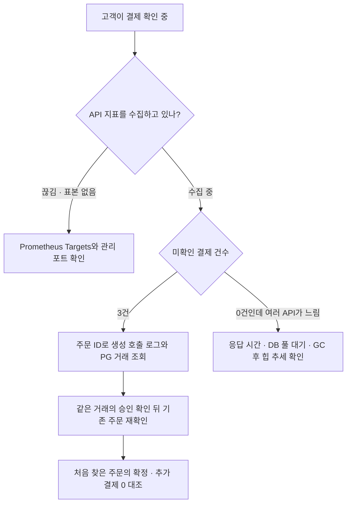

# W10 결제 확인 중 사고 진단·복구 Runbook

이 문서는 로컬 테스트 PG에서 고객 주문이 결제 확인 중으로 남은 경우에 사용한다. 주문 확정·예약 소비부터 Outbox, 구매 활동, 공개 주간 랭킹까지 같은 주문 ID로 대사한다. [W10 과제](../week10/assignment-original.md) · [채점 기준](../week10/grading-criteria.md) · [실행 기록](../week10/implementation-checklist.md)

## Grafana에서 사고 보기

### 지난 실험의 세 점을 바로 열기

Docker가 실행 중일 때 저장소 루트에서 아래 명령으로 열람 전용 Grafana를 띄운다. 이 구성은 Grafana 하나만 실행하며, 내장 TestData 데이터 소스가 보존된 관측값을 읽는다. 애플리케이션이나 사용자 DB를 시작할 필요가 없다. [열람 전용 Compose](../../docker/grafana-w10-compose.yml)

```sh
docker compose -p w10-grafana -f docker/grafana-w10-compose.yml up -d
```

1. [사고 기록 화면 열기](http://127.0.0.1:3300/d/w10-payment-incident/). 로컬 브라우저에서 로그인 없이 볼 수 있다. 3300번 포트를 이미 쓰고 있으면 실행할 때 `W10_GRAFANA_PORT=3301`을 지정하고 링크의 포트도 바꾼다.
2. 그래프의 세 점을 왼쪽부터 읽는다. **11월 26일 14:06:49~14:06:50 KST**에 관찰한 값은 정상 **0건**, 응답 유실 **3건**, 복구 후 **0건**이다. 시간 선택기를 현재로 바꿨다면 위 링크로 다시 연다. 세 시점 사이의 상태 변화 시각이나 장애 지속 시간은 측정하지 않았다.
3. 같은 화면의 단계별 숫자를 대조한다. 장애 시점까지 PG는 20건을 승인했고 내부 주문은 17건 확정됐다. 복구 시점에도 PG 승인은 20건 그대로이고 내부 확정만 20건으로 늘었다. 세 시점 모두 실제 health 응답은 `UP`이었다. 결제 생성 추가 0회와 같은 주문 12·15·19의 복구는 ZIP의 `incident/verified.json`에 있다. [사고 원문 ZIP](../week10/evidence/checkout-incident-stage6.zip)

관람을 마친 뒤 이 전용 Grafana를 종료할 때는 `docker compose -p w10-grafana -f docker/grafana-w10-compose.yml down`을 사용한다.

원본과 화면의 숫자를 독립적으로 검사하려면 저장소 루트에서 `python3 docker/grafana/tests/test_recorded_incident.py`를 실행한다. Grafana나 DB를 실행할 필요 없이 그래프의 시각·값과 두 표의 각 셀을 같은 실행의 원본에 대조한다.

### 실시간 지표에서 다음 확인 지점 고르기

격리 환경의 API가 관리 포트 8081을 제공 중이면 기존 `docker compose -f docker/monitoring-compose.yml up -d`로 [실시간 대시보드](http://localhost:3000/d/w10-payment-live/)를 연다. Prometheus는 5초마다 API를 수집한다. 위 실험은 임시 관리 포트에서 약 0.75초 사이에 세 번 읽었으므로, 지난 사고는 위의 고정 기록 화면에서 확인한다. [수집 대상과 간격](../../docker/grafana/prometheus.yml)



| 화면에 보이는 증상 | 다음으로 볼 곳과 이유 |
| --- | --- |
| 수집 상태가 0 또는 `No data` | [Prometheus Targets](http://localhost:9090/targets)에서 API 관리 포트에 접속 가능한지 먼저 본다. `up`은 Prometheus가 수집에 성공했는지를 나타낸다. 미확인 지표의 `NaN`은 집계 실패·오래된 표본일 수 있다. 이 값으로 고객 문제 0건을 판정할 수 없다. |
| 수집은 정상이고 미확인 결제가 늘었다 | 결제 확정 요청의 202와 주문별 로그를 본다. 당시 confirm은 누적 200 응답 17건·202 응답 3건이었다. 12번의 생성 호출 `NETWORK`, 내부 `UNKNOWN` 커밋, 같은 PG 거래 100원 `SUCCESS`를 함께 확인했다. [진단 질의와 가설 비교](#진단-질의와-가설-비교) |
| 응답 시간이 늘고 DB 연결 대기가 생겼다 | 같은 시간대 p95와 풀별 대기 수를 대조하고 연결을 오래 점유한 쿼리·트랜잭션을 조사한다. 결제 confirm 지연만으로 다른 API 전체의 지연을 판단할 수는 없다. |
| GC 뒤에도 장수 객체 영역 사용률이 계속 오른다 | 비슷한 부하에서 여러 차례 GC가 지난 뒤의 추세를 본다. 계속 오른다면 격리 환경에서 힙덤프를 분석할 근거가 된다. 이번 사고의 세 표본은 장기 메모리 추세를 판정하기에 부족하다. |

## 격리 환경에서 재현하기

저장소 루트에서 다음 명령을 실행하면 결제 20건을 새로 만들고 진단과 복구, 구매 활동 소비, 주간 배치와 고객 랭킹 조회까지 이어진다. 테스트는 로컬 PG·전용 컨테이너와 실행별 고유 Kafka topic·group을 사용한다. [사고 통합 테스트](../../apps/commerce-api/src/test/java/com/loopers/interfaces/api/order/CheckoutIncidentTest.java)

```sh
./gradlew :apps:commerce-api:test --tests 'com.loopers.interfaces.api.order.CheckoutIncidentTest' --rerun
```

각 실행은 `apps/commerce-api/build/reports/week10-checkout/<시각>-<UUID>/`에 별도 디렉터리를 만든다. `baseline/`, `fault/`, `recovery/`에는 해당 시점의 관리 HTTP 본문, 허용 필드로 추린 주문 경계 로그와 DB·PG 대사가 남는다. `fault/diagnosis.json`에는 경쟁 가설의 예상과 판정을, `fault-sha256.json`에는 복구 전에 봉인한 여섯 파일의 해시를 저장한다. 중간 실패 시 `failure.json`의 단계·예외 유형과 이미 저장한 파일부터 확인한다. 빌드 디렉터리를 정리하기 전에 제출할 실행의 디렉터리를 보존한다. [증거 수집·봉인](../../apps/commerce-api/src/test/java/com/loopers/interfaces/api/order/CheckoutIncidentEvidence.java)

4단계 보존본에서는 `cohorts.json`에서 장애 주문 11~20을 찾은 뒤 `fault/diagnosis.json`의 세 주문을 `fault/state.json`과 `recovery/state.json`에서 같은 ID로 비교하면 된다. 새로 실행할 때는 그 실행에서 생성된 실제 ID를 사용한다. [관측 원문·복구 결과 ZIP](../week10/evidence/checkout-incident-stage4.zip)

5단계 보존본에서 복구한 주문 하나를 따라가려면 `fault/diagnosis.json`의 12번을 찾는다. `stream.json`의 `applied["12"]`와 `duplicate`는 같은 eventId를 서로 다른 offset에서 소비한 결과다. `activities`에서 이 주문의 상품 1개를 확인한 뒤, `ranking.json`의 `allOrders.snapshot.inputs`에서 같은 주문·상품·수량·확정 시각을 찾는다. `allOrders.httpBody`는 이 입력으로 공개된 상품의 1위·20점 응답이다. [구매 활동·랭킹까지 연결한 원문 ZIP](../week10/evidence/checkout-incident-stage5.zip)

6단계 보존본의 `interrupted/`에는 결제 복구 뒤 후속 발행 단계에서 중단된 실행이 있다. `failure.json`의 단계와 이 실행의 주문·Outbox 상태를 먼저 대조한다. `incident/`에는 최종 검사에서 새로 만든 주문 집합의 원문이, `checks.json`에는 같은 최종 검사의 집계가 있다. 두 실행은 서로 다른 run ID를 사용한다. [중간 실패·최종 검증 ZIP](../week10/evidence/checkout-incident-stage6.zip)

## 증상과 시작 전제

고객에게 결제 확인 중이 보이는데 health는 UP이다. 현재 모델에서는 주문 `PAYMENT_PENDING`, 결제 시도 `UNKNOWN`, 품목 예약 `HELD`일 수 있다. PG 거래가 없다고 단정하거나 같은 주문의 결제를 다시 생성하지 않는다.

- 테스트 소유 API/DB/PG·관리 endpoint·Kafka/topic/group·streamer/Batch 자원을 식별한다. 사용자 DB와 공유 자원은 대상이 아니다.
- 유효한 결제를 수락한 baseline 10건과 별도 fault 10건의 실제 ID 목록을 확보한다. 영향 대상 세 주문의 소유자·시도 키·PG용 주문 ID·저장 금액을 고정한다.
- 기존 고객 식별·소유권과 PG 합성 제공자 계정 범위를 유지한다. 관리 endpoint나 고객 권한을 우회하는 공개 복구 기능을 추가하지 않는다.
- 새로운 실험 입력을 중단하고 같은 DB·PG 거래 저장소를 유지한다. 프로세스 재시작·DB 초기화·새 결제로 상태를 바꾸기 전에 증거를 남긴다.

## 조치 전에 보존할 증거

| 증거 | 보존할 내용·주의 |
| --- | --- |
| 실행·대상 | 고유 run ID, 코드 revision, 실제 관찰 시각과 테스트 업무 Clock, baseline/fault/영향 3건 목록 |
| 실제 HTTP | 주입된 관리 주소의 `/actuator/health`, `/actuator/prometheus` 상태·본문·관찰 시각. 상태 JSON을 Prometheus 텍스트로 꾸미지 않음 |
| 내부 상태 | 주문·시도·금액·예약과 재고, 해당 eventId의 Outbox, 포인트·기존 쿠폰의 필요한 필드 |
| 외부 상태 | 같은 계정·providerOrderId·금액·transactionKey·상태·create 수. 거래가 여러 개면 모두 보존하고 단일 거래로 축약하지 않음 |
| 경계 기록 | 생성 결과 TIMEOUT/NETWORK 등 실제 이유, 조회 결과, 내부 적용 시도와 TX 완료/rollback, 수집 구간 |
| 후속 상태 | 주문/상품별 활동, 대상 주의 입력·공개 snapshot·revision과 랭킹 응답 |

파일은 실행별 위치에 새로 저장하고 fault 자료는 이후 recovery로 덮어쓰지 않는다. 중간 실패와 주입/보류 설정도 기록한다. 카드 번호·인증 헤더·비밀키·개인정보·요청 전체를 저장하지 않는다. 합성 식별자와 허용 필드만 수집하며 hash는 파일 동일성 확인에만 쓴다.

보존본을 인계받으면 저장소 루트에서 다음 명령으로 장애 시점 원문 6개를 대조한다. 6단계 중단 사례를 확인할 때는 ZIP 경로 다음에 `interrupted/`를, 최종 실행을 확인할 때는 `incident/`를 넘긴다. 누락되거나 해시가 달라진 파일이 있으면 그 실행을 복구 판단의 근거로 쓰기 전에 원본을 확인한다.

```sh
python3 - docs/week10/evidence/checkout-incident-stage5.zip <<'PY'
import hashlib
import json
import sys
import zipfile

required = {"recorded-at.txt", "health.json", "prometheus.txt", "state.json", "boundaries.log", "diagnosis.json"}
prefix = sys.argv[2] if len(sys.argv) > 2 else ""
with zipfile.ZipFile(sys.argv[1]) as archive:
    expected = json.loads(archive.read(prefix + "fault-sha256.json"))
    if set(expected) != required:
        raise SystemExit("장애 시점 원문 목록이 다릅니다.")
    for name in sorted(required):
        digest = hashlib.sha256(archive.read(prefix + "fault/" + name)).hexdigest()
        if digest != expected[name]:
            raise SystemExit("원문 해시 불일치: " + name)
print("장애 시점 원문 6개 일치")
PY
```

`sendStartedAt`은 최초 발송권 기록 시각이다. 현재 상태가 시작된 시각과 같다고 보지 않는다. 새 로그의 observedAt도 관찰 시각임을 표시하고 영속 상태 전이 시각처럼 해석하지 않는다.

## 진단 질의와 가설 비교

1. 해당 인스턴스 관리 포트의 `/actuator/health`와 `/actuator/prometheus`를 함께 읽는다. Prometheus에서 `commerce_payment_unknown{application="commerce-api"} > 0`을 조회하면 결제 DB에서 미확인 시도를 관찰한 인스턴스가 보인다. 같은 DB를 읽는 인스턴스들은 같은 주문을 세므로 인스턴스별 값을 합산하면 중복 집계된다.
2. 기본 설정은 직전 집계가 끝난 뒤 5초 후에 다시 조회한다. 첫 집계 전, 조회 실패 또는 마지막 성공 조회 시작 이후 두 주기(기본 10초)가 지나면 `NaN`이다. 이 경우 마지막 정상 관찰 시각과 DB 연결을 확인한다. `0`은 유효한 표본에서 현재 UNKNOWN이 0건이라는 의미다.
3. 장애 집합의 주문 ID·시도 키로 수집한 `fault/boundaries.log`에서 `source=CONFIRM operation=CREATE`가 `result=UNKNOWN reason=NETWORK`로 끝난 주문을 찾는다. 같은 시도의 다음 적용 종료 행에서 `observation=UNKNOWN`과 `decision=APPLIED txOutcome=COMMITTED`를 확인한다. 아래 질의에서 별도로 얻은 UNKNOWN 목록과 대조한다. 상태와 로그가 가리키는 주문이 다르면 복구 대상을 확정하기 전에 수집 범위를 조사한다.

```sql
SELECT order_id, BIN_TO_UUID(attempt_key) AS attempt_key, provider_order_id, amount
FROM payment_attempt
WHERE status = 'UNKNOWN' AND order_id IN (:incidentOrderIds)
ORDER BY order_id;
```

위의 `:incidentOrderIds`에는 고정한 장애 주문 10개의 ID 목록을, 아래의 `:orderId`에는 확인할 주문 하나를 바인딩한다. 테스트는 독립 SQL 조회로 커밋된 사실을 읽는다. [DB 대사 코드](../../apps/commerce-api/src/test/java/com/loopers/interfaces/api/order/CheckoutIncidentDatabase.java)

```sql
SELECT o.id AS order_id, o.status AS order_status, o.payment_method,
       o.total_amount, o.paid_amount, o.confirmed_at,
       HEX(p.attempt_key) AS attempt_key_hex,
       p.provider_order_id, p.transaction_key, p.amount,
       p.status AS payment_status, p.send_started_at
FROM `order` o
JOIN payment_attempt p ON p.order_id = o.id
WHERE o.id = :orderId;

SELECT order_id, product_id, quantity, reservation_status
FROM order_item
WHERE order_id = :orderId
ORDER BY product_id;
```

이 조회는 상태 관찰이다. 권위 거래 확인은 기존 로컬 PG의 거래 키 GET 또는 `orderId` query GET을 사용하되 **commerce 결과 적용을 호출하지 않는 읽기**로 한다. PG용 식별자·계정·금액을 모두 대조한다. 고객 reconcile API는 진단용 읽기가 아니다.

| 가설 | 예상 관찰 | 판정에 필요한 추가 근거 |
| --- | --- | --- |
| H1: PG 처리 지연 | 권위 GET도 PENDING | 동일 거래 최종 상태. SUCCESS이면 현재 처리 지연 가설과 맞지 않음 |
| H2: 성공 응답 유실 | 외부 SUCCESS, create 응답 유실, 내부 UNKNOWN | 실제 adapter 관찰 이유와 내부 적용 경계 기록. 주입 코드의 설정만으로 확정하지 않음 |
| H3: 성공 결과 내부 반영 실패 | 외부 SUCCESS, 성공 결과 적용 시도, DB rollback | 성공 조회/응답과 TX 완료 상태·예약·Outbox 대조 |

최소 두 가설에 대해 예상·실제·근거 위치·판정을 남긴다. SUCCESS+UNKNOWN만 있거나 로그 수집이 불완전하면 H2/H3은 미확정이다. 로그가 없다는 사실만으로 적용 시도가 없었다고 단정하지 않는다.

단건 응답 유실 실험에서는 같은 주문에서 생성 호출의 `result=UNKNOWN reason=NETWORK`와 내부의 `observation=UNKNOWN txOutcome=COMMITTED`가 이어졌다. PG용 주문 ID로 직접 조회하면 같은 금액의 `SUCCESS` 거래 한 건을 확인할 수 있다. 반면 PG 결과를 읽은 경로는 `result=OBSERVED pgStatus=SUCCESS`를 남긴다. 이후 같은 시도의 `observation=SUCCESS`와 `txOutcome=ROLLED_BACK`이 있으면 성공 결과를 적용하려던 트랜잭션이 롤백된 것이다. `decision=APPLIED`는 도메인 판단 단계의 값이다. `txOutcome=UNKNOWN`이거나 완료 로그가 빠졌다면 별도 DB 연결에서 커밋된 주문·시도·예약을 읽어 대조한다.

11월 26일 20건 실험에서는 세 시점의 health가 모두 UP이었고 UNKNOWN 지표는 0 → 3 → 0이었다. 장애 집합의 CREATE 연결 오류와 커밋된 UNKNOWN에서 얻은 주문 ID는 12·15·19였고, 독립 SQL에서도 같은 세 주문의 예약이 HELD였다. 직접 조회한 해당 PG 거래는 각각 100원 SUCCESS였다. H1의 PENDING과 H3의 SUCCESS 적용 후 rollback은 이 시도의 관찰과 일치하지 않았다. H2의 판단에는 세 신호를 함께 사용했다. `NETWORK`만 수집됐다면 PG가 어디까지 처리했는지는 미확정으로 둔다.

## 제한된 복구

1. fault 원문과 진단 결과를 보존했는지 확인한다. 고정한 세 주문 외에 새 대상이 생기면 범위를 다시 검토한다.
2. 테스트의 응답 유실·조회/알림 보류를 해제한다. 기존 거래·DB·호출 수는 초기화하지 않는다.
3. 같은 소유자의 기존 `POST /api/v1/orders/{orderId}/payment/reconcile`을 호출한다. 본문 없음 또는 빈 JSON 객체의 현재 계약을 유지한다. 각 호출은 현재 서비스의 제한된 단건 조회를 사용한다.
4. 첫 확인은 대상별 1회다. 미종결이면 아래 중단 조건을 따른다. 추가 확인의 대상·횟수·기한은 재진입 전에 정하고 기록한다.
5. HTTP 성공만으로 끝내지 않고 새 DB 읽기에서 주문 CONFIRMED·결제 SUCCESS·예약 CONSUMED·최초 confirmedAt·Outbox를 대조한다. `meta.result=SUCCESS`와 실제 결제 결과를 구분한다.

| 중단 조건 | 보존할 것과 다음 판단 |
| --- | --- |
| PG 연결 실패·timeout·회로에서 조회 차단 | 현재 상태·예약·관찰 이유 유지. 실제 조회가 수행됐는지도 구분 |
| 거래 0건·복수 거래·식별/금액 불일치 | 성공으로 맞추지 않음. 전체 관찰값과 충돌을 기록하고 종료 |
| 계속 PENDING 또는 UNKNOWN | 실패/성공으로 임의 변환하지 않음. 새 결제·예약 반환 없이 종료 |
| TX 실패·Outbox 저장 실패 | 내부 rollback 상태와 외부 SUCCESS를 보존. 기존 거래를 다시 조회해 적용할 수 있는지 원인 제거 후 확인 |
| create 수 증가·거래/재고 추가 효과·권한 불일치 | 복구 진행을 멈추고 증거/영향 범위부터 확인 |

DB 강제 UPDATE로 CONFIRMED를 만들거나 UNKNOWN 주문을 새 PG create로 우회하는 조치는 이 절차에 없다.

## 복구 완료 확인과 재진입

| 확인할 대상 | 기대값 |
| --- | --- |
| 원래 장애 주문 집합 | 같은 10개가 내부 성공 10·UNKNOWN 0·외부 SUCCESS 거래 10. baseline을 섞지 않음 |
| 전체 PG | 거래 집합 20개 보존·복구 중 create 추가 0. GET 증가는 허용 |
| 재고·예약 | UNKNOWN 동안 HELD 유지, 성공 반영 시 한 번 CONSUMED. 복구 전후 가용 재고 동일 |
| 포인트·쿠폰 | 준비해 둔 기존 기록의 수·값·식별자 불변 |
| Outbox·활동 | 확정 주문별 불변 사실, 실제 Kafka 소비 후 주문/상품별 품목·quantity 한 번 반영. 전송 record 수와 구분 |
| 주간 랭킹 | 내부 최초 confirmedAt의 주에 새 snapshot/revision으로 반영. baseline 포함 전체 입력의 점수/순위 확인, 이전 snapshot 불변 |
| 실제 health·metric | 실제 health UP과 선택한 지표의 관측 범위·갱신 시각·복구 값 확인. stale 값이나 파일 존재로 대신하지 않음 |

미종결 상태로 중단했다면 같은 대상 ID·DB·PG 사실을 유지하고 실패 원인과 보류 제어를 확인한다. 직전 원문을 보존한 채 현재 상태를 새로 관찰한다. 이미 종결된 주문은 기존 결과를 유지하고, 아직 미종결인 주문만 범위·기한을 정해 기존 reconcile로 재확인한다. 동일 사건의 반복 callback/reconcile과 consumer 중복에도 추가 업무 효과가 없어야 한다.

재진입 전에는 실행 ID와 주문·시도·PG 거래 식별자를 대조하고 해당 실행의 DB와 테스트 PG가 살아 있는지 확인한다. 이미 전용 자원을 종료했다면 봉인된 ZIP으로 당시 판단을 검토한다. 위 Gradle 명령을 다시 실행하면 별도 저장소에 새 주문 20건이 생성되므로 새 실행 ID로 증거를 보존한다.

4단계 실험에서는 타인의 주문 조회와 reconcile이 모두 404를 반환했고 이때 PG 조회 횟수도 늘지 않았다. 각 대상의 소유자 reconcile로 같은 장애 집합을 확정 10·UNKNOWN 0으로 복구한 뒤 해당 세 주문의 reconcile과 callback을 한 번씩 더 호출했다. 누적 PG 거래·create 각 20, 가용 재고 10, 주문별 Outbox 누적 20행을 유지했다. 이 실행은 relay를 끈 상태에서 검사했다. [단계별 집계와 검사 범위](../week10/implementation-checklist.md#11월-26일-4단계-사고복구-결과)

## 구매 활동과 주간 랭킹 대사

이번 실험의 각 주문은 같은 상품을 하나씩 담는다. 다음 순서로 같은 실행의 `cohorts.json`에서 가져온 주문 ID를 추적한다.

| 확인 순서 | 확인할 근거 | 기대가 다를 때 먼저 확인할 곳 |
| --- | --- | --- |
| 1. 주문 → Outbox | 최초 내부 확정 시각, 주문별 eventId·상품·수량, 해당 Outbox의 발행 상태 | 미발행이면 해당 행의 시도·오류와 relay 상태를 확인한다. 주문 확정이나 결제를 다시 호출할 필요가 없다. |
| 2. Kafka → 소비자 | 같은 eventId와 주문 키의 topic·partition·offset, 해당 group의 처리 로그·커밋 위치 | broker에 도착한 뒤 활동이 없으면 소비자의 실패 로그, DB 커밋과 group의 위치를 확인한다. |
| 3. 소비자 → 구매 활동 | 중복 레코드가 실제로 처리된 뒤 원래 처리 기록과 품목별 활동의 PK·수량·확정 시각이 그대로인지 대조 | 동일 eventId에서 입력 내용이 다르면 발행 원문과 기존 처리 기록을 보존하고 충돌을 먼저 조사한다. |
| 4. 주간 입력 → 공개 API | 공개된 snapshot의 주문 ID·상품·수량·최초 확정 시각을 실제 활동과 대조하고 기간·revision·점수·순위를 HTTP로 읽는다. | 20점이 아니면 소비 완료 시점과 snapshot 고정 시각, 주문의 주간 소속부터 확인한다. 늦게 반영된 활동은 새 revision을 계산한다. |

구매 활동 DB에서 아래 조회는 어느 주문이 몇 점을 보탰는지 보여준다. `:snapshotId`는 해당 주의 랭킹 HTTP 응답에서 얻는다. 조회한 주문 집합이 이 실험의 정상 10개와 장애 10개를 정확히 포함하는지, 그리고 그 주 전체 입력에 다른 상품이나 구매가 있는지도 확인한다. 같은 상품 하나씩인 이 실험의 기대 점수는 20점이다.

```sql
SELECT order_id, product_id, quantity, confirmed_at_second, confirmed_at_nano
FROM weekly_ranking_input
WHERE snapshot_id = :snapshotId
ORDER BY order_id, product_id;
```

## 종료와 후속 기록

- finally에서 이번 실행이 켠 주입·보류를 해제한다. 실패 증거와 거래를 지워 실험을 성공으로 바꾸지 않는다.
- 필요한 증거를 보존한 뒤 소유 서버·consumer·스레드·자식 JVM·컨테이너만 정리한다. 전체 Docker/DB/Redis/topic 삭제 명령은 쓰지 않는다.
- 이번 실험의 표본은 정상 10건과 별도 장애 집합 10건이다. 관찰 범위는 로컬 PG의 응답 유실과 같은 주문 복구이며, 운영 오류율·월간 SLO는 별도 운영 표본이 필요하다.
- 실행 디렉터리의 `stream.json`에는 원본과 중복 레코드의 offset·처리 결과와 구매 활동이, `ranking.json`에는 두 공개본의 고정 입력·checksum·고객 응답이 있다. 세 앱의 누적 회귀·정적 검사와 채점 항목별 확인 범위는 [6단계 최종 검증 기록](../week10/final-verification.md)을 따른다.
