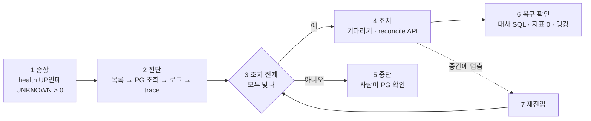

# Runbook — 결제 결과를 모르는 주문 (PG SUCCESS · 결제 UNKNOWN)

> 읽는 사람: 당직 개발자. 설계와 근거는 `docs/week10/plan.md` (D-4 업무 지표 · D-5 경계 로그 · D-6 진단 · D-7 복구 · D-8 대사 · D-12 추적).
> 아래 명령은 `docs/week10/run.sh`가 실제로 돌린 **같은 curl · 같은 SQL 파일**이다. 포트는 run.sh 기준이고, 운영에서는 그 환경의 주소로 바꾼다.



## 1. 증상

| 무엇이 | 이렇게 보인다 |
|---|---|
| 고객 | "결제 확인 중"이 끝나지 않는다. 주문은 `PAYMENT_PENDING` |
| health | `GET /actuator/health` → **UP** (서버는 살아 있다 — health로는 안 보인다) |
| 업무 지표 | `commerce_payment_unresolved{status="UNKNOWN"}` > 0 이고 줄지 않는다 |

```bash
curl -s http://127.0.0.1:18081/actuator/health | jq -r .status
curl -s http://127.0.0.1:18081/actuator/prometheus | grep '^commerce_payment_unresolved'
```

- 서버가 여러 대면 모든 서버가 같은 전체 수를 보고한다 → **합이 아니라 최댓값**으로 본다.
- `PENDING`만 늘면 PG가 느린 쪽, `UNKNOWN`이 늘면 생성 응답을 못 받은 쪽이라는 첫 힌트다 (확정은 2에서).

## 2. 진단 질의 (모두 읽기만 — reconcile은 결과를 반영하므로 여기서 부르지 않는다)

| 순서 | 무엇을 | 명령 |
|---|---|---|
| ① | 영향 목록 | `docs/week10/sql/unresolved-payments.sql` — 주문 · 결제 시도 · PG 주문 식별자 · 거래 키 · 선점 |
| ② | PG의 실제 상태 | PG 조회 API를 **직접** 부른다 (commerce-api를 거치지 않는다) |
| ③ | 어느 경계까지 갔나 | 주문 ID로 경계 로그 grep |
| ④ | 어디서 기다렸나 | ③의 `payment.create.result` 줄 traceId → Tempo(Grafana Explore) |

```bash
# ① 영향 목록
mysql loopers < docs/week10/sql/unresolved-payments.sql
# ② PG 조회 (PG 주문 식별자 = LP-ORD-%010d(orderId), X-USER-ID = PG 계정값 — 기록에 남기지 않는다)
curl -s -H "X-USER-ID: $PG_ACCOUNT" "http://127.0.0.1:8082/api/v1/payments?orderId=LP-ORD-0000000012"
# ③ 경계 로그 (orderId=12가 orderId=120에 걸리지 않게)
grep -E 'orderId=12[^0-9]' api.log
# ④ trace
curl -s http://127.0.0.1:33200/api/traces/<traceId>
```

**경계 로그** (모든 줄에 `orderId` · `paymentId` · `providerOrderId`)

| 줄 | 뜻 |
|---|---|
| ① `payment.requested` | 결제 시도를 저장했다 |
| ② `payment.create.result result=… cause=… elapsedMs=…` | PG 생성 1회의 결과. `UNKNOWN cause=READ_TIMEOUT`이면 응답을 기다리다 포기했다 |
| ③ `payment.lookup.result found=… pgStatus=… source=…` | PG 조회 결과 (callback · reconcile API · 스케줄러) |
| ④ `payment.apply from=… to=… outcome=… source=…` | 결과 반영이 commit됐다 |
| ⑤ `payment.apply.failed … error=…` | 결과 반영 트랜잭션이 실패했다 |

**가설 판정표** — 조치 전에 채운다. 증거가 빠지거나 서로 어긋나면 "미확정"이라고 쓴다.

| 가설 | 예상 | 실제 | 판정 |
|---|---|---|---|
| 1. PG가 아직 처리 중 | ② PG 조회 `PENDING` | | |
| 2. PG 성공 응답을 잃음 | ② 로그 `UNKNOWN cause=READ_TIMEOUT` · ⑤ 없음 · PG 호출 span ≈ 읽기 timeout | | |
| 3. 성공 조회 뒤 내부 반영 실패 | ③ `pgStatus=SUCCESS`인데 ④ 대신 ⑤ | | |

- DB만 보면 가설 2와 3은 똑같다 (`UNKNOWN` · 거래 키 NULL · PG `SUCCESS`). 로그 ②⑤와 trace로만 가른다.
- 2든 3이든 **조치는 같다** — reconcile은 조회 뒤 반영이라 어느 쪽이든 안전하다.

### 2-1. 같은 진단을 화면으로 (Grafana — `KEEP=1` 또는 `PAUSE_AFTER_FAULT=1`로 run.sh 실행)

```
지표 → Prometheus   trace → Tempo   로그 → (Alloy가 파일을 읽어) Loki      ← 저장
                 └──────── Grafana가 셋에 질의해 한 화면에 ────────┘          ← 보기만
```

대시보드 http://127.0.0.1:33000/d/w10-incident — 위에서 아래로 ① 증상 → ② 어디서 기다렸나 → ③ 어느 주문인가.

| 질문 | 어디서 | 질의 |
|---|---|---|
| 결과 모르는 결제가 있나 | Prometheus | `max by (status) (commerce_payment_unresolved)` |
| PG 생성 호출이 느렸나 | Prometheus | `max by (uri, outcome) (http_client_requests_seconds_max{uri=~"/api/v1/payments.*"})` |
| 어느 주문인가 | Loki | `{app="commerce-api"} \|= "result=UNKNOWN"` |
| 그 주문에 무슨 일이 | Loki | ``{app="commerce-api"} \|~ `payment\.[a-z.]+ orderId=12( \|$)` `` |
| 어디서 기다렸나 | Tempo | 로그 줄을 펼쳐 `traceId` 링크 → trace. 또는 TraceQL `{ kind = client && duration > 2s }` |
| 누가 누구를 불렀나 | Tempo service graph | 대시보드 "서비스 지도" (commerce-api → localhost(PG) · commerce-api → commerce-streamer) |

- Loki label은 `app`·`level`(값 종류가 적은 것)만이다. `orderId`·`traceId`는 줄 안의 글자 · 줄에 붙은 값(structured metadata)으로 찾는다 — 지표 label에 orderId를 넣지 않는 것과 같은 이유.
- AI에게 맡길 때는 Grafana MCP(읽기 전용, `docs/week10/example.mcp.json`)로 같은 저장소를 조회하게 하고, **판정표의 "실제" 칸은 사람이 질의 결과로 다시 확인한다.** AI의 확신으로 원인을 정하지 않는다.

## 3. 조치 전제 (하나라도 아니면 5로)

- [ ] 영향 목록(①)을 파일로 고정했다. 조치는 **이 목록 안의 주문만** 한다
- [ ] 진단 증거(health · 지표 원문 · 목록 · PG 조회 · 로그 · trace)를 저장했다
- [ ] 목록의 주문마다 PG 조회가 **1건 · SUCCESS · 금액이 결제 금액과 같다**
- [ ] PG create 호출 수(또는 PG 관리 화면의 거래 수)를 기록했다 → 조치 뒤 늘면 안 된다

## 4. 조치

| 상황 | 할 일 |
|---|---|
| 기본 | **기다린다.** 자동 reconcile 스케줄러가 5초 → 10초 → 30초 → 1분 → 5분 간격으로 다시 조회한다. 업무 지표가 줄어드는지 본다 |
| 지금 바로 고쳐야 한다 | 목록의 주문마다 결제 확인 API를 **한 번씩** 부른다 (아래). 응답 200 · `SUCCESS` · `CONFIRMED`를 확인한다 |

```bash
# 결제 확인 API — PG에 조회만 하고 결과를 반영한다. 결제를 다시 만들지 않는다
curl -s -X POST -H "X-USER-ID: <주문 주인>" http://127.0.0.1:18080/api/v1/orders/12/payment/reconcile
```

- 이 API는 **고객용**이다 (본인 주문만). 운영자 전용 경로는 아직 없다 → 8 "후속 개선".

## 5. 중단 조건 — 그 자리에서 멈추고 상태·증거를 보존한다

| 보이면 | 왜 | 다음 |
|---|---|---|
| reconcile 응답이 `SUCCESS`가 아님 (202 · `NOT_FOUND` · `MULTIPLE:n` · `MISMATCH:…` · `UNAVAILABLE`) | PG 답이 애매하다 — 상태를 바꾸지 않았다 | PG 관리 화면·조회 API로 어느 거래가 맞는지 사람이 확인 |
| PG create 호출 수가 늘었다 | 이중 결제 위험 | 즉시 멈춘다. 원인을 찾기 전에는 다시 하지 않는다 |
| `UNAVAILABLE`이 계속되고 보낸 지 30분이 다가온다 | 30분이 지나면 `FAILED(EXPIRED)` + 재고 반환 | 그 뒤 PG가 SUCCESS면 `만료 뒤 성공 — 환불 필요` 로그 → 환불 |

## 6. 복구 확인

```bash
mysql loopers -e "SET @fault_ids = '12,15,18'; SET @product_id = 1; SOURCE docs/week10/sql/reconcile-check.sql;"
```

| 항목 | 기대 |
|---|---|
| `fault.payment.UNKNOWN` · 업무 지표 UNKNOWN | 0 |
| PG create 호출 수 | 조치 전과 같다 |
| `product.stock` | 조치 전과 같다 (선점 때 이미 뺐다 — 줄면 이중 차감) |
| `fault.reservation.CONSUMED` | 목록 주문 수 |
| `fault.outbox.max_rows_per_order` · `fault.activity.max_rows_per_order` | 1 |
| `fault.activity.confirmed_at_mismatch` | 0 |
| 다음 주간 batch 뒤 랭킹 API | 복구한 주문이 점수에 들어 있다 |

## 7. 재진입 — 중간에 멈췄다가 다시 할 때

- 다시 해도 안전하다: 이미 `SUCCESS`인 결제에 reconcile을 부르면 `ALREADY_APPLIED` — 주문·재고·Outbox가 다시 바뀌지 않는다 (run.sh가 "한 번 더 + 보관 callback 전송 → 변화 없음"을 검사한다).
- 다시 시작하기 전에: ① 영향 목록 파일을 **다시 만들지 않고** 처음 것을 쓴다 ② PG create 호출 수를 다시 기록한다 ③ 3의 전제를 다시 확인한다.

## 8. 하지 않는 것 · 후속 개선 · 남은 위험

**하지 않는 것**
- 결제를 다시 만든다 (재결제 · create 재호출) — PG는 이미 돈을 받았다
- DB에 `UNKNOWN` · `SUCCESS` · `CONFIRMED`를 직접 쓴다 — 주문·선점·Outbox가 같이 바뀌지 않는다
- 영향 목록 밖의 주문에 reconcile을 부른다
- 증거를 저장하기 전에 reconcile을 부른다

**후속 개선**
- 운영자 전용 reconcile 경로 (지금은 고객 API이거나 스케줄러를 기다려야 한다)
- `만료 뒤 성공 — 환불 필요`를 사람 손이 아닌 환불 절차로

**남은 위험** (로컬 통제 사고로 확인한 범위 — 운영 완료가 아니다)

| 검증 안 함 | 왜 |
|---|---|
| 운영 배포 · 실제 PG · 부하 | 로컬 pg-sim으로만 일으켰다 |
| 포인트·쿠폰을 섞은 주문의 복구 | 이번 주문은 카드만 썼다 |
| 서버 여러 대의 업무 지표 | 한 대만 띄웠다 |
| 복구 중 Kafka·DB 장애 | 이번 사고 범위 밖 |
| 월요일 00:00 UTC를 넘는 복구 | run.sh가 그 근처 실행을 거부해 피했을 뿐이다. 넘으면 복구한 주문은 다음 주로 집계된다 |
| PG → callback · Outbox relay · batch 구간의 trace | 새 trace로 시작한다 — `orderId` · `eventId` · `snapshotId`로 잇는다 |
