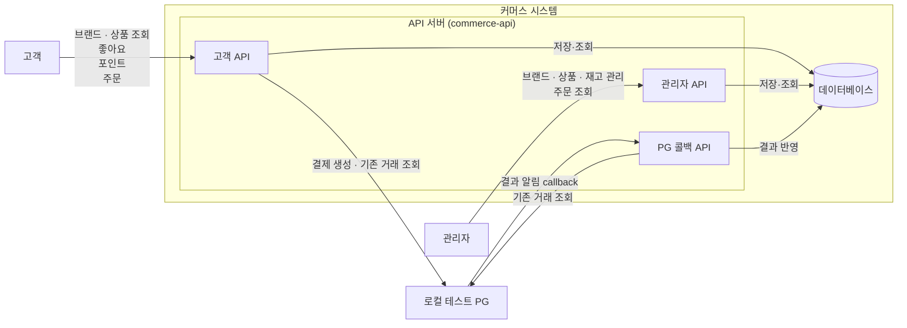

# 공통 시스템 개요

기존 절을 기능별 기준 문서로 이동했다. 절 번호·계약·승인/검증 상태는 보존하며, 이동 자체는 새 설계 승인이나 실행 검증을 뜻하지 않는다.

## 1.1 시스템 개요

이 시스템은 고객이 브랜드와 상품을 탐색하고, 관심 있는 상품에 좋아요를 표시하며, 포인트를 충전하고 상품을 주문할 수 있는 커머스 시스템이다.

관리자는 고객에게 노출되는 브랜드와 상품을 관리하고, 상품 재고를 변경하며 주문 현황을 조회한다.

고객과 관리자의 요청은 API 서버(`commerce-api`)가 처리하고, 주문·결제·고정 주문 품목과 확인 정보는 데이터베이스에 저장하고 충돌 요약은 별도로 보존한다. 신규 주문은 로컬 테스트 PG로 결제하며, 포인트 충전·조회와 과거 POINT 주문의 결제 사실은 유지한다.

PG 연동은 구현되어 있다. 아래 구성은 외부 HTTP 경계를 포함한 현재 구조이며, 실행 범위와 한계는 4.5의 I4·I5 검증 근거를 따른다. 로컬 PG는 2026-10-25 테스트 내부 fixture에서 단독 실행 앱(`apps/pg-simulator`)으로 전환했고, 테스트는 같은 PG 코드를 같은 JVM에서 시작한다([2.10](../features/pg-simulator/README.md#210-pg-시뮬레이터-앱의-책임과-수명)). 전환 뒤에도 아래 구성의 HTTP 경계는 같다.

## 1.2 시스템 구성과 기능 범위

*그림 1. 고객·관리자와 커머스 시스템의 경계 및 요청 방향*

API 서버(`commerce-api`)는 고객용 API와 관리자용 API를 구분한다. 두 사용자는 브랜드와 상품처럼 같은 데이터를 다루기도 하지만, 허용하는 기능과 접근 가능한 데이터의 범위는 서로 다르다. 관리자가 변경한 브랜드·상품·재고 정보는 고객의 조회와 주문 처리에 사용된다.

각 역할의 기능은 다음과 같다.

### 고객

- 브랜드 상세 정보와 상품 목록·상세 정보를 조회한다.
- 상품에 좋아요를 등록·취소하고 자신의 좋아요 목록을 조회한다.
- 포인트를 충전하고 현재 잔액을 조회한다.
- 주문을 생성·확정하고 자신의 주문 목록과 상세 정보를 조회한다.
- 주문 생성은 DRAFT와 저장 금액을 준비한다. 결제 시작 요청에서 재고를 선차감·예약하고 PG를 호출하며, 검증된 성공을 확인한 뒤 주문을 확정한다.
- 결제 결과가 미완료이면 자신의 주문 조회와 reconcile 요청으로 기존 거래를 확인한다. reconcile은 새 결제를 생성하지 않는다.

### 관리자

- 브랜드를 등록·조회·수정·삭제한다.
- 상품을 등록·조회·수정·삭제한다.
- 상품 재고를 변경한다.
- 전체 주문 목록과 주문 상세 정보를 조회한다.

PG 콜백은 고객 요청과 별도의 수신 경계다. 알림만으로 주문을 확정하지 않고 고정한 PG에서 기존 거래를 조회·검증한다. 콜백과 대사는 동일한 내부 결과 반영을 사용한다. PG 생성 응답에서 검증 가능한 최종 성공을 받은 경우도 같은 결과 반영을 사용한다.

PG는 합성 카드·제공자 계정을 사용하는 작은 로컬 HTTP 서버로 제한한다. 실제 카드·실금전·외부 PG 계정·공개 배포, 실패 후 새 결제 시도, 환불·정산·사용자 취소와 배송·외부 알림 연동은 포함하지 않는다. 주문당 하나의 PG 결제 시도만 허용한다.

PG 판단의 근거·대안·숨은 비용과 재검토 조건은 [판단 근거 색인](../decisions/payment.md#a29-pg-판단-근거-색인)에서 확인한다.

개별 API 계약, 상세 도메인 관계, 처리 순서, 계층별 책임은 뒤의 설계에서 구체화한다.
