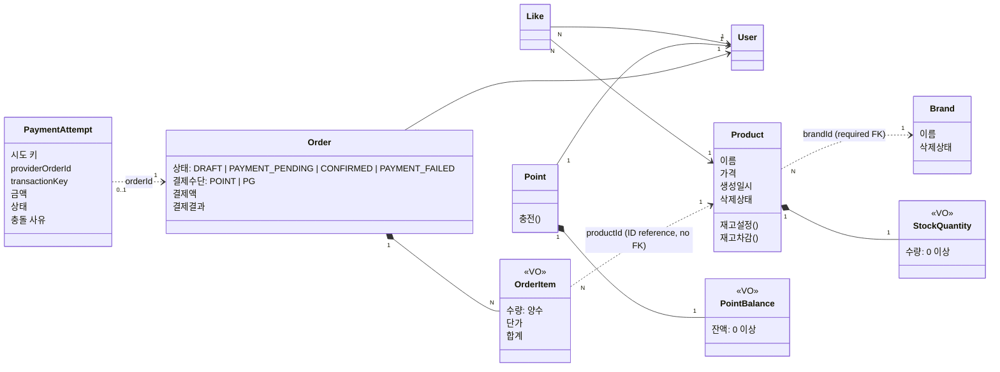

# 도메인 모델

Commerce 도메인의 용어, 애그리게이트 경계, 도메인 규칙과 불변식을 정리한다. 각 유스케이스의 트랜잭션 순서와 외부 응답은 해당 [유스케이스 설계](README.md#유스케이스)와 [API 계약](api-contracts.md)을, JPA 저장 모델과의 경계는 [영속성 매핑 설계](persistence-mapping.md)를 참고한다.

## 도메인 관계와 업무 규칙 및 설계 판단

### User

- [관계와 경계] User는 독립된 애그리게이트다. 하나의 User에 여러 Order가 연결된다.
- [관계 표현] User는 Order와 Like 컬렉션을 보유하지 않는다.
- [도메인 책임] User는 사용자를 식별하는 ID를 보유한다.

#### 사용자 식별

- User는 fixture로 저장하며, 고객별 API는 `X-USER-ID`로 존재하는 User를 식별한다.
- User CRUD는 현재 범위에 포함하지 않는다.

### Brand

- [관계와 경계] Brand는 독립된 애그리게이트다. 하나의 Brand에 여러 Product가 연결된다.
- [관계 표현] Brand는 Product 컬렉션을 보유하지 않는다.
- [도메인 책임] Brand는 자신의 이름과 삭제 상태를 관리하며, `delete()`는 자신의 삭제 상태를 변경한다.
- [도메인 책임] `BrandDeletionPolicy`는 이미 삭제된 Brand의 삭제를 거절하고 `Brand.delete()`를 호출한다. 연결 Product의 삭제와 Repository 조회·저장은 수행하지 않는다.
- [도메인 규칙] Brand 삭제는 기존 참조를 유지하며 `deletedAt`에 삭제 시각을 기록하는 논리 삭제를 사용한다.
- [불변식] Brand 이름은 공백만으로 구성될 수 없고, 1자 이상 100자 이하여야 한다.
- [불변식] 삭제 여부와 관계없이 Brand 이름은 유일해야 한다.

#### 조회 정책

- 고객 브랜드 상세에서는 삭제된 Brand를 제외한다.
- 관리자 목록과 상세는 삭제된 Brand도 반환한다. 목록은 `status`로 필터링하고 응답에 삭제 상태를 제공한다.

#### 삭제 정책

- Brand 삭제는 연결된 미삭제 Product 전체를 함께 논리 삭제하며, 전체 성공 또는 전체 실패로 처리한다.
- 재고 수량, 기존 Like 관계, 주문 스냅샷과 결제 정보는 보존한다.
- 보존 대상, 경합과 실패 처리의 기대값은 [브랜드와 연결 상품 일괄 삭제](use-cases/brand-deletion.md)를 기준으로 한다.

### Product

- [관계와 경계] Product는 Brand와 별도 애그리게이트이며, StockQuantity VO를 내부에 보유한다.
- [관계 표현] Product는 Brand 객체를 포함하지 않고 `brandId`로 Brand를 참조한다. 재고 수량은 StockQuantity VO로 표현한다.
- [도메인 책임] Product는 자신의 이름, 가격, 재고, 삭제 상태를 관리한다. 상품 수정과 재고 설정 및 차감 전에 자신의 삭제 상태를 검사하며, `delete()`는 자신의 삭제 상태를 변경한다.
- [도메인 책임] Product 삭제는 별도 Policy를 두지 않는다. 이미 삭제된 Product의 거절은 활성 상품 조회와 미삭제 조건부 갱신이 맡는다.
- [도메인 규칙] 상품 등록 시 존재하고 삭제되지 않은 Brand가 필요하다.
- [도메인 규칙] Product 수정 시 기존 Brand는 변경하지 않는다.
- [도메인 규칙] 새 좋아요와 주문 생성은 상품 조회 시 없거나 삭제된 Product를 거절한다. 삭제된 상품은 상품 수정과 재고 변경에 사용할 수 없다.
- [도메인 규칙] 관리자는 Product 재고를 0 이상인 최종 수량으로 설정할 수 있다.
- [도메인 규칙] Product의 재고 차감은 주문 수량이 양수이고 재고가 충분할 때만 허용한다.
- [도메인 규칙] `stock`은 결제 요청에서 차감한 수량을 제외한 가용 재고다. 관리자 재고 설정 값도 가용 재고다.
- [불변식] 가용 수량과 미완료 PG 주문 품목의 예약 수량 합은 `Long.MAX_VALUE` 이하다. 범위를 넘는 관리자 설정은 `400`으로 거절한다. 예약 집계는 별도로 저장하지 않는다.
- [도메인 규칙] PG 결제의 확정 실패를 처음 반영할 때 저장된 주문 품목의 수량만큼 재고를 반환한다. 논리 삭제된 상품도 실패 보상으로 재고를 반환할 수 있으며 삭제 상태는 유지한다.
- [불변식] Product 이름은 공백만으로 구성될 수 없고, 1자 이상 100자 이하여야 한다.
- [불변식] Product 가격은 1원 이상 100,000,000원 이하의 정수여야 한다.

#### 조회 정책

- 고객 상품 상세와 목록에서는 삭제된 Product를 제외한다.
- 관리자 목록과 상세는 삭제된 Product도 반환한다. 목록은 `status`로 필터링하고 응답에 삭제 상태를 제공한다.

#### 삭제 정책

- Product는 `deletedAt`에 삭제 시각을 기록하는 논리 삭제를 사용한다. 단독 삭제는 해당 Product만 변경하고 Brand는 유지한다.
- 재고 수량, 기존 Like 관계, 주문 스냅샷과 결제 정보는 보존한다.
- 단독 삭제의 기대값은 [API 계약](api-contracts.md#상품-단독-삭제-기대값)을 기준으로 한다.

#### StockQuantity VO

- [관계와 경계] StockQuantity는 Product 내부에서 재고 수량을 표현하는 VO다. 독립된 도메인 식별자와 생명주기를 갖지 않는다.
- [관계 표현] 재고 수량을 `amount` 값 하나로 표현한다.
- [값 동등성] 재고 수량이 같으면 같은 값으로 판단한다.
- [도메인 책임] StockQuantity는 재고 수량의 검증과 차감 결과 계산을 담당한다.
- [도메인 규칙] StockQuantity는 불변 값으로 다룬다. 차감 시 기존 값을 변경하지 않고, 기존 수량에서 차감 수량을 뺀 새 StockQuantity를 반환한다.
- [도메인 규칙] 차감 수량은 양수여야 하며, 0과 음수는 거절한다.
- [도메인 규칙] 차감 수량이 현재 재고보다 크면 재고 부족으로 거절한다.
- [불변식] 재고 수량은 0 이상의 정수여야 한다.

### Like

- [관계와 경계] User 1 : N Like N : 1 Product. Like는 User와 Product에서 독립된 좋아요 관계로 관리한다.
- [관계 표현] Like는 `userId`와 `productId`로 User와 Product를 참조하며 두 객체를 포함하지 않는다. User와 Product는 Like 컬렉션을 보유하지 않는다.
- [도메인 책임] Like는 사용자와 상품 사이의 좋아요 관계를 표현한다. 좋아요 등록은 관계 생성, 취소는 관계 제거로 처리한다.
- [도메인 규칙] 좋아요 등록 시 조회한 Product가 존재하고 삭제되지 않았는지 확인한다.
- [도메인 규칙] 미삭제 Product를 확인한 뒤 삭제와 겹쳐 좋아요를 저장하는 요청은 성공을 허용한다. 저장된 Like 관계는 보존한다.
- [도메인 규칙] User는 삭제된 Product에 남아 있는 자신의 좋아요를 취소할 수 있다. 취소 시 Product의 존재와 활성 여부를 요구하지 않는다.
- [도메인 규칙] 같은 관계의 동시 등록도 등록된 상태로 처리하며 관계는 한 건만 유지한다.
- [불변식] 같은 `(userId, productId)`의 Like는 중복으로 존재할 수 없다. DB의 유니크 제약으로 중복 저장을 막는다.

#### 조회 규칙

- Product의 좋아요 수는 해당 Product의 Like 관계 수를 집계해 조회한다.
- 내 좋아요 목록에서는 삭제된 Product를 제외한다.

### Point

- [관계와 경계] Point는 User와 별도 애그리게이트이며, PointBalance VO를 내부에 보유한다. 하나의 User에 하나의 Point가 연결된다.
- [관계 표현] Point는 `userId`로 User를 참조하며 User 객체를 포함하지 않는다. 잔액은 PointBalance VO로 표현한다.
- [도메인 책임] Point는 사용자별 잔액 상태를 관리하고 충전을 수행한다. 금액 검증과 계산은 PointBalance에 맡기고, 반환된 새 값으로 자신의 잔액을 갱신한다.
- [도메인 규칙] 주문 결제는 PG를 사용하며 Point를 조회하거나 차감하지 않는다. 이전 포인트 결제 주문의 결제 사실은 Order에 남아 있다.
- [도메인 규칙] 1포인트는 1원이다.
- [도메인 규칙] 새 Point의 잔액은 0포인트로 시작한다.
- [도메인 규칙] 충전은 기존 잔액에 충전액을 더한다.
- [도메인 규칙] 충전이 거절되면 기존 잔액을 유지한다.
- [불변식] 같은 `userId`를 가진 Point는 중복으로 존재할 수 없다.

#### PointBalance VO

- [관계와 경계] PointBalance는 Point 내부에서 포인트 잔액을 표현하는 VO다. 독립된 도메인 식별자와 생명주기를 갖지 않는다.
- [관계 표현] 포인트 잔액을 `amount` 값 하나로 표현한다.
- [값 동등성] 잔액이 같으면 같은 값으로 판단한다.
- [도메인 책임] PointBalance는 잔액과 충전액의 검증, 충전 결과 계산을 담당한다.
- [도메인 규칙] PointBalance는 불변 값으로 다룬다. 충전 시 기존 값을 변경하지 않고, 계산한 새 PointBalance를 반환한다.
- [도메인 규칙] 충전액은 양의 정수여야 하며, 0과 음수는 거절한다.
- [도메인 규칙] 충전 후 잔액이 표현 가능한 정수 범위를 넘으면 거절한다.
- [불변식] 잔액은 0포인트 이상이어야 한다.

### Order

- [관계와 경계] Order는 User와 별도 애그리게이트이며, OrderItem VO를 내부에 보유하는 애그리게이트 루트다.
- [관계 표현] Order는 `userId`로 User를 참조하며 User 객체를 포함하지 않는다. OrderItem 컬렉션은 직접 보유한다.
- [도메인 책임] Order는 자신의 소유자 정보, 품목 구성과 총액, 결제 상태 전이, 결제수단·결제액과 결제 결과를 관리한다.
- [도메인 규칙] Order 생성 시 여러 OrderItem의 수량·단가·합계와 DRAFT 상태를 저장한다.
- [도메인 규칙] Order 생성 시 같은 `productId`의 품목은 수량을 합산해 하나의 OrderItem으로 저장한다.
- [도메인 규칙] Order 생성 시 재고는 차감하지 않는다.
- [도메인 규칙] 주문 생성 시 상품 조회에서 존재하고 삭제되지 않은 Product와 양수 수량을 확인한다.
- [도메인 규칙] 미삭제 Product를 확인한 뒤 삭제와 겹쳐 DRAFT를 저장하는 요청은 성공을 허용한다.
- [도메인 규칙] User는 자신의 DRAFT Order만 결제를 요청할 수 있다.
- [도메인 규칙] 결제 요청 시 상품 사용 가능 여부를 다시 검사하고 각 Product의 합산된 총수량으로 재고를 확보한다. 삭제된 상품이 포함되거나 재고가 부족하면 요청을 거절한다.
- [도메인 규칙] Order 상태는 `DRAFT → PAYMENT_PENDING → CONFIRMED` 또는 `PAYMENT_PENDING → PAYMENT_FAILED`로만 바뀐다. 처리 중과 결과 미확인은 모두 `PAYMENT_PENDING`이고, 구분은 PaymentAttempt가 맡는다.
- [도메인 규칙] 결제 요청은 결제수단을 `PG`로 기록한다. PG 성공이 확인되면 결제액(주문 총액)과 결제 결과 `SUCCESS`를 저장하고 `CONFIRMED`로 바꾼다. PG 실패가 확인되면 결제 결과 `FAILED`를 저장하고 `PAYMENT_FAILED`로 바꾸며, 결제액은 비워 둔다. 외부 `PENDING`을 `CONFIRMED`로 바꾸지 않는다.
- [도메인 규칙] DRAFT가 아닌 주문의 결제 요청은 `409`로 거절한다. 같은 시도 키의 재전송은 이 전이 전에 [멱등성과 재요청 정책](use-cases/order-payment-request.md#멱등성과-재요청-정책)이 저장된 상태로 응답한다.
- [도메인 규칙] `PAYMENT_PENDING`이 아닌 주문의 결과 반영은 업무 충돌이 아니라 정합성 오류다. 미종결 시도는 `PAYMENT_PENDING` 주문에만 존재하므로 불변식이 깨진 경우에만 생긴다. 결과 반영 전체를 rollback하고 내부 오류로 처리한다. 경로별 응답은 [결과 반영의 실패 처리](use-cases/order-payment-result.md#실패-처리)를 따른다.
- [도메인 규칙] 재고를 차감한 `PAYMENT_PENDING` 주문은 이후 상품이 삭제돼도 저장된 품목·금액으로 결과를 마무리한다.
- [불변식] Order는 품목을 최소 하나 보유해야 한다. Order 생성 시 품목이 없으면 `400 Bad Request`로 거절한다.
- [불변식] 하나의 Order는 같은 `productId`의 OrderItem을 중복으로 보유하지 않는다.
- [불변식] Order 총액은 각 OrderItem의 품목 금액 합과 일치해야 하며 `long`으로 표현 가능한 범위 안이어야 한다. 합산 결과가 `Long.MAX_VALUE`를 초과하면 주문 생성을 `400 Bad Request`로 거절한다.
- [불변식] 하나의 Order에서 결제 결과는 한 번만 반영한다.
- [불변식] CONFIRMED 상태의 Order에는 결제수단, 결제액과 결제 결과가 저장되어야 한다. 이전 포인트 결제 주문의 결제수단은 `POINT`다.
- [복원 규칙] 결제수단은 저장된 값을 복원한다. 과거 POINT 주문의 데이터 전환과 새 PG 주문의 저장 규칙은 [영속성 매핑 설계](persistence-mapping.md#결제수단과-과거-주문-전환)를 따른다. CONFIRMED 상태만으로 결제수단을 추론하지 않는다.

#### 결제 재고 보상

- [도메인 규칙] PG 결제 성공은 결제 요청에서 차감한 재고를 그대로 유지한다. 추가 차감은 없다.
- [도메인 규칙] PG 결제의 확정 실패는 저장된 `OrderItem`의 상품 ID·수량을 기준으로 주문 전체의 재고를 한 번만 반환한다. 처리 중·결과 미확인은 차감 상태를 유지한다.
- [불변식] 하나의 결제 시도에서 실패 보상은 최대 한 번 반영한다. 종결 상태와 재고 반환은 함께 commit되어야 한다. 동시성·rollback의 보장 방식은 [결과 반영 설계](use-cases/order-payment-result.md#재고-보상-트랜잭션)를 따른다.
- [불변식] 다른 재고 조정이 없는 구간에서 `현재 가용 재고 = 구간 시작 재고 - commit된 결제 요청의 차감 수량 합 + commit된 실패 보상 수량 합`이다. 결제 성공은 이 값을 바꾸지 않는다.

##### 재고 예약과의 대응

별도 예약 테이블을 두지 않는 최소 예약 방식이다. 가용 재고를 결제 요청에서 미리 차감하고, 예약의 수량과 상태는 이미 저장하는 주문 품목과 주문·시도 상태로 나타낸다.

| 예약 개념 | 이 설계의 표현 |
| --- | --- |
| 예약 확보 | 가용 재고를 주문 품목 수량만큼 차감 |
| 주문별 확보 수량 | `OrderItem`의 상품 ID·수량 스냅샷. 결제 요청 이후 바뀌지 않는다. |
| 예약 상태 | 주문 `PAYMENT_PENDING`·미종결 시도는 예약 유지, `CONFIRMED`·`SUCCEEDED`는 소비, `PAYMENT_FAILED`·`FAILED`는 반환 완료 |
| 예약 유지 | 처리 중·결과 미확인·충돌에서 `stock`을 바꾸지 않음 |
| 예약 소비 | 성공 종결. 이미 차감했으므로 `stock`을 바꾸지 않는다. |
| 예약 반환 | 실패 종결과 함께 주문 품목 수량만큼 한 번 반환 |
| 예약을 제외한 가용 수량 | Product의 가용 재고 값. 관리자 재고 설정도 이 값을 설정한다. |

결과를 모르는 동안 주문은 `PAYMENT_PENDING`이고 예약을 유지한다. PG 관찰별 시도 상태는 [결과별 효과](use-cases/order-payment-result.md#결과별-효과), 화면 표시는 [결제 진행 표시](api-contracts.md#결제-진행-표시)를 따른다.

#### OrderItem VO

- [관계와 경계] OrderItem은 Order 내부에서 주문 품목을 표현하는 VO다. 독립된 도메인 식별자와 생명주기를 갖지 않는다.
- [관계 표현] OrderItem은 `productId` 값으로 Product를 참조하며 Product 객체를 포함하지 않는다. 저장 관계의 매핑은 [영속성 매핑 설계](persistence-mapping.md)를 따른다.
- [스냅샷] 주문 생성 시점의 Product ID, 상품명, 단가와 수량을 보존하며, 해당 단가와 수량으로 품목 금액을 계산한다. 주문 내역은 현재 Product를 다시 조회해 과거 상품 정보를 대체하지 않는다. Brand와 Product 삭제 후에도 기존 주문의 품목과 결제 정보는 유지한다.
- [불변식] 결제 요청 이후 주문 품목과 수량은 변경하지 않는다. 재고 차감과 실패 보상은 같은 저장 스냅샷을 사용한다.
- [값 동등성] Product ID, 상품명, 단가와 수량이 모두 같으면 같은 품목 값으로 판단한다.
- [도메인 책임] OrderItem은 품목의 상품 정보와 단가, 수량을 보유하고 단가와 수량 검증, 품목 금액 계산을 담당한다.
- [도메인 규칙] OrderItem은 불변 값으로 다룬다. 수량 합산이 필요하면 합산 수량의 새 OrderItem을 만들고, Order가 품목을 교체하며 총액을 다시 계산한다.
- [불변식] 단가는 1원 이상이어야 하며 별도의 상한을 두지 않는다. 0과 음수 단가는 `400 Bad Request`로 거절한다.
- [불변식] 수량은 1 이상 `Integer.MAX_VALUE` 이하여야 한다. 중복 품목의 합산 수량이 이 범위를 초과하면 기존 주문 입력 오류인 `400 Bad Request`로 거절한다.
- [불변식] 품목 금액은 저장된 단가와 수량의 곱과 일치해야 하며 `long`으로 표현 가능해야 한다. 생성이나 수량 합산 시 이 범위를 초과하면 `400 Bad Request`로 거절한다.

### PaymentAttempt

- [관계와 경계] PaymentAttempt는 Order와 별도 애그리게이트다. 하나의 Order에 시도는 최대 하나다.
- [관계 표현] PaymentAttempt는 `orderId`로 Order를 참조한다.
- [도메인 책임] 결제 요청의 식별자, 보낸 금액, PG 거래 키와 결과 확인 상태를 관리한다.
- [도메인 규칙] `paymentAttemptKey`는 고객 요청이, `providerOrderId`는 commerce가 만들어 PG 호출 전에 저장한다. `paymentAttemptKey`는 소문자로 정규화한 UUID이며 만료되지 않는다. `providerOrderId`는 주문 ID와 주입받은 무작위 값으로 시도 생성 시 한 번 만들고 바꾸지 않는다. 생성 형식은 [결제 요청](use-cases/order-payment-request.md#외부-주문-식별자-생성)을 따른다. `transactionKey`는 PG가 발급하며 생성 응답을 잃으면 비어 있다.
- [도메인 규칙] 생성 응답을 잃은 뒤 조회로 거래를 확인하면 해당 키를 저장한다. 조회에서 바로 SUCCESS·FAILED를 확인한 경우에도 키와 종결 결과를 함께 기록한다. 한 번 기록한 키는 교체하거나 지우지 않는다.
- [도메인 규칙] 상태는 `REQUESTED → PENDING`, `REQUESTED → UNKNOWN`, 미종결 상태에서 `SUCCEEDED` 또는 `FAILED`로 바뀐다. `UNKNOWN`은 조회 결과에 따라 `PENDING`이나 종결 상태로 바뀐다.
- [도메인 규칙] `REQUESTED`, `PENDING`, `UNKNOWN`은 미종결이다. 어떤 상태에서도 결제 생성 요청을 다시 보내지 않는다.
- [도메인 규칙] `FAILED`는 PG 거래의 실패 또는 생성 전 확정 거절을 확인한 경우에만 쓴다. timeout만으로 실패로 확정하지 않는다.
- [불변식] `paymentAttemptKey`, `orderId`, `providerOrderId`는 각각 유일하다.
- [불변식] 종결 상태(`SUCCEEDED`, `FAILED`)는 다른 상태로 바뀌지 않는다.
- [불변식] PENDING·SUCCEEDED와 PG 거래 실패로 인한 FAILED에는 거래 키가 있다. 생성 전 확정 거절로 인한 FAILED는 거래 키가 없다. 이미 거래를 확인한 시도에 생성 전 거절을 적용하지 않는다.
- [저장 규칙] 도메인의 전이 검사와 함께 [결과 반영의 DB 조건부 갱신](use-cases/order-payment-result.md#중복-방지)을 적용한다. PENDING·UNKNOWN 갱신도 허용된 이전 상태와 거래 키 조건을 확인한다.
- [도메인 규칙] 중복 callback이나 늦은 응답처럼 전이가 일어나지 않는 반영은 예외 없이 무시하고, 전이가 일어났는지만 알린다. 이미 기록한 거래 키와 다른 키도 반영하지 않는다.
- [도메인 규칙] 복수 거래나 결과를 판정할 수 없는 모순 관찰은 충돌 사유(`MULTIPLE_TRANSACTIONS`, `TRANSACTION_MISMATCH`, `RESULT_CONTRADICTION`)로 보존한다. 처음 기록한 사유와 시각을 유지하고 지우거나 덮어쓰지 않으며, 충돌 기록은 시도 상태·거래 키·주문·재고를 바꾸지 않는다. 기록 규칙은 [충돌 기록](use-cases/order-payment-result.md#충돌-기록)을 따른다.
- [불변식] 카드 정보는 저장하지 않는다.

