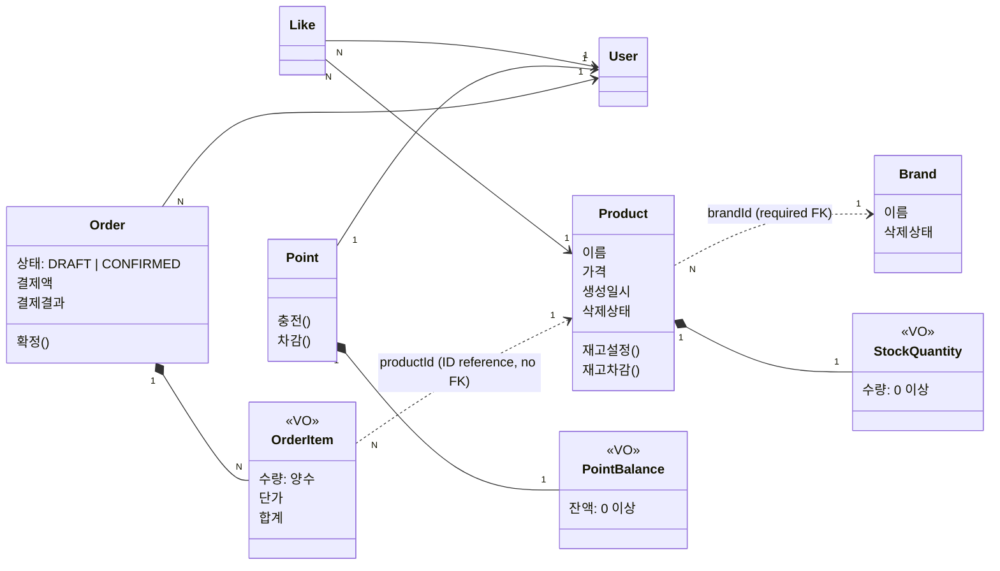

# 도메인 모델

Commerce 도메인의 용어, 애그리게이트 경계, 도메인 규칙과 불변식을 정리한다. 각 유스케이스의 트랜잭션 순서와 외부 응답은 해당 [유스케이스 설계](use-cases/)와 [API 계약](api-contracts.md)을, JPA 저장 모델과의 경계는 [영속성 매핑 설계](persistence-mapping.md)를 참고한다.

## 도메인 관계와 업무 규칙 및 설계 판단

### User

- [관계와 경계] User는 독립된 애그리게이트다. 하나의 User에 여러 Order가 연결된다.
- [관계 표현] User는 Order와 Like 컬렉션을 보유하지 않는다.
- [도메인 책임] User는 사용자를 식별하는 ID를 보유한다.

#### 사용자 식별

- User는 fixture로 저장하며, 고객별 API는 `X-USER-ID`로 존재하는 User를 식별한다.
- User CRUD는 현재 범위에 포함하지 않는다.

### Brand

- [관계와 경계] Brand는 독립된 애그리게이트다. 하나의 Brand에 여러 Product가 연결된다.
- [관계 표현] Brand는 Product 컬렉션을 보유하지 않는다.
- [도메인 책임] Brand는 자신의 이름과 삭제 상태를 관리하며, `delete()`는 자신의 삭제 상태를 변경한다.
- [도메인 책임] `BrandDeletionPolicy`는 이미 삭제된 Brand의 삭제를 거절하고 `Brand.delete()`를 호출한다. 연결 Product의 삭제와 Repository 조회·저장은 수행하지 않는다.
- [도메인 규칙] Brand 삭제는 기존 참조를 유지하며 `deletedAt`에 삭제 시각을 기록하는 논리 삭제를 사용한다.
- [불변식] Brand 이름은 공백만으로 구성될 수 없고, 1자 이상 100자 이하여야 한다.
- [불변식] 삭제 여부와 관계없이 Brand 이름은 유일해야 한다.

#### 조회 정책

- 고객 브랜드 상세에서는 삭제된 Brand를 제외한다.
- 관리자 목록과 상세는 삭제된 Brand도 반환한다. 목록은 `status`로 필터링하고 응답에 삭제 상태를 제공한다.

#### 삭제 정책

- Brand 삭제는 연결된 미삭제 Product 전체를 포함한다. 재고 0인 상품도 포함하며, 연결 상품이 없어도 삭제할 수 있다.
- 일괄 삭제는 전체 성공 또는 전체 실패로 처리하며, 실패하면 이번 요청의 변경을 모두 취소한다.
- 이미 삭제된 Product의 삭제 상태와 시각, 다른 Brand와 Product는 변경하지 않는다.
- 재고 수량, 기존 Like 관계, 주문 스냅샷과 결제 정보는 보존한다.
- 삭제 전에 생성했거나 삭제와 겹쳐 생성된 DRAFT 주문도 확정 시 상품 사용 가능 여부를 다시 확인한다. 삭제된 상품이 포함되면 확정을 거절하고 주문 상태, 재고, 포인트와 결제 결과를 유지한다.

### Product

- [관계와 경계] Product는 Brand와 별도 애그리게이트이며, StockQuantity VO를 내부에 보유한다.
- [관계 표현] Product는 Brand 객체를 포함하지 않고 `brandId`로 Brand를 참조한다. 재고 수량은 StockQuantity VO로 표현한다.
- [도메인 책임] Product는 자신의 이름, 가격, 재고, 삭제 상태를 관리한다. 상품 수정과 재고 설정 및 차감 전에 자신의 삭제 상태를 검사하며, `delete()`는 자신의 삭제 상태를 변경한다.
- [도메인 책임] Product 삭제는 별도 Policy를 두지 않는다. 이미 삭제된 Product의 거절은 활성 상품 조회와 미삭제 조건부 갱신이 맡는다.
- [도메인 규칙] 상품 등록 시 존재하고 삭제되지 않은 Brand가 필요하다.
- [도메인 규칙] Product 수정 시 기존 Brand는 변경하지 않는다.
- [도메인 규칙] 새 좋아요와 주문 생성은 상품 조회 시 없거나 삭제된 Product를 거절한다. 삭제된 상품은 상품 수정과 재고 변경에 사용할 수 없다.
- [도메인 규칙] 관리자는 Product 재고를 0 이상인 최종 수량으로 설정할 수 있다.
- [도메인 규칙] Product의 재고 차감은 주문 수량이 양수이고 재고가 충분할 때만 허용한다.
- [불변식] Product 이름은 공백만으로 구성될 수 없고, 1자 이상 100자 이하여야 한다.
- [불변식] Product 가격은 1원 이상 100,000,000원 이하의 정수여야 한다.

#### 조회 정책

- 고객 상품 상세와 목록에서는 삭제된 Product를 제외한다.
- 관리자 목록과 상세는 삭제된 Product도 반환한다. 목록은 `status`로 필터링하고 응답에 삭제 상태를 제공한다.

#### 삭제 정책

- Product는 기존 참조를 유지하며 `deletedAt`에 삭제 시각을 기록하는 논리 삭제를 사용한다.
- 단독 삭제는 해당 Product만 변경하며 Brand는 유지한다.
- 삭제해도 재고 수량, 기존 Like 관계, 주문 스냅샷과 결제 정보는 보존한다.

#### StockQuantity VO

- [관계와 경계] StockQuantity는 Product 내부에서 재고 수량을 표현하는 VO다. 독립된 도메인 식별자와 생명주기를 갖지 않는다.
- [관계 표현] 재고 수량을 `amount` 값 하나로 표현한다.
- [값 동등성] 재고 수량이 같으면 같은 값으로 판단한다.
- [도메인 책임] StockQuantity는 재고 수량의 검증과 차감 결과 계산을 담당한다.
- [도메인 규칙] StockQuantity는 불변 값으로 다룬다. 차감 시 기존 값을 변경하지 않고, 기존 수량에서 차감 수량을 뺀 새 StockQuantity를 반환한다.
- [도메인 규칙] 차감 수량은 양수여야 하며, 0과 음수는 거절한다.
- [도메인 규칙] 차감 수량이 현재 재고보다 크면 재고 부족으로 거절한다.
- [불변식] 재고 수량은 0 이상의 정수여야 한다.

### Like

- [관계와 경계] User 1 : N Like N : 1 Product. Like는 User와 Product에서 독립된 좋아요 관계로 관리한다.
- [관계 표현] Like는 `userId`와 `productId`로 User와 Product를 참조하며 두 객체를 포함하지 않는다. User와 Product는 Like 컬렉션을 보유하지 않는다.
- [도메인 책임] Like는 사용자와 상품 사이의 좋아요 관계를 표현한다. 좋아요 등록은 관계 생성, 취소는 관계 제거로 처리한다.
- [도메인 규칙] 좋아요 등록 시 조회한 Product가 존재하고 삭제되지 않았는지 확인한다.
- [도메인 규칙] 미삭제 Product를 확인한 뒤 삭제와 겹쳐 좋아요를 저장하는 요청은 성공을 허용한다. 저장된 Like 관계는 보존한다.
- [도메인 규칙] User는 삭제된 Product에 남아 있는 자신의 좋아요를 취소할 수 있다. 취소 시 Product의 존재와 활성 여부를 요구하지 않는다.
- [불변식] 같은 `(userId, productId)`의 Like는 중복으로 존재할 수 없다. DB의 유니크 제약으로 중복 저장을 막는다.
- [도메인 규칙] 같은 관계의 동시 등록도 등록된 상태로 처리하며 관계는 한 건만 유지한다.

#### 조회 규칙

- Product의 좋아요 수는 해당 Product의 Like 관계 수를 집계해 조회한다.
- 내 좋아요 목록에서는 삭제된 Product를 제외한다.

### Point

- [관계와 경계] Point는 User와 별도 애그리게이트이며, PointBalance VO를 내부에 보유한다. 하나의 User에 하나의 Point가 연결된다.
- [관계 표현] Point는 `userId`로 User를 참조하며 User 객체를 포함하지 않는다. 잔액은 PointBalance VO로 표현한다.
- [도메인 책임] Point는 사용자별 잔액 상태를 관리하고 충전과 주문 확정의 포인트 차감을 수행한다. 금액 검증과 계산은 PointBalance에 맡기고, 반환된 새 값으로 자신의 잔액을 갱신한다.
- [도메인 규칙] 1포인트는 1원이다.
- [도메인 규칙] 새 Point의 잔액은 0포인트로 시작한다.
- [도메인 규칙] 충전은 기존 잔액에 충전액을 더하고, 주문 확정은 저장된 주문 총액만큼 잔액을 차감한다.
- [도메인 규칙] 충전이나 차감이 거절되면 기존 잔액을 유지한다.
- [불변식] 같은 `userId`를 가진 Point는 중복으로 존재할 수 없다.

#### PointBalance VO

- [관계와 경계] PointBalance는 Point 내부에서 포인트 잔액을 표현하는 VO다. 독립된 도메인 식별자와 생명주기를 갖지 않는다.
- [관계 표현] 포인트 잔액을 `amount` 값 하나로 표현한다.
- [값 동등성] 잔액이 같으면 같은 값으로 판단한다.
- [도메인 책임] PointBalance는 잔액과 변경 금액의 검증, 충전 및 차감 결과 계산을 담당한다.
- [도메인 규칙] PointBalance는 불변 값으로 다룬다. 충전과 차감 시 기존 값을 변경하지 않고, 계산한 새 PointBalance를 반환한다.
- [도메인 규칙] 충전액과 차감액은 양의 정수여야 하며, 0과 음수는 거절한다.
- [도메인 규칙] 충전 후 잔액이 표현 가능한 정수 범위를 넘으면 거절한다.
- [도메인 규칙] 차감액이 현재 잔액보다 크면 잔액 부족으로 거절한다.
- [불변식] 잔액은 0포인트 이상이어야 한다.

### Order

- [관계와 경계] Order는 User와 별도 애그리게이트이며, OrderItem VO를 내부에 보유하는 애그리게이트 루트다.
- [관계 표현] Order는 `userId`로 User를 참조하며 User 객체를 포함하지 않는다. OrderItem 컬렉션은 직접 보유한다.
- [도메인 책임] Order는 자신의 소유자 정보, 품목 구성과 총액, DRAFT 상태 검사와 확정 상태 전이, 결제액과 결제 결과를 관리한다.
- [도메인 규칙] Order 생성 시 여러 OrderItem의 수량·단가·합계와 DRAFT 상태를 저장한다.
- [도메인 규칙] Order 생성 시 같은 `productId`의 품목은 수량을 합산해 하나의 OrderItem으로 저장한다.
- [도메인 규칙] Order 생성 시 재고와 포인트는 차감하지 않는다.
- [도메인 규칙] 주문 생성 시 상품 조회에서 존재하고 삭제되지 않은 Product와 양수 수량을 확인한다.
- [도메인 규칙] 미삭제 Product를 확인한 뒤 삭제와 겹쳐 DRAFT를 저장하는 요청은 성공을 허용한다. 확정 시 상품 사용 가능 여부를 다시 검사한다.
- [도메인 규칙] User는 자신의 DRAFT Order만 확정할 수 있다.
- [도메인 규칙] Order는 DRAFT 상태를 확인한 뒤 결제액과 결제 결과를 저장하고 CONFIRMED 상태로 변경한다.
- [도메인 규칙] 주문 확정 시 상품 사용 가능 여부를 다시 검사하고 각 Product의 합산된 총수량으로 재고를 확인한다. 삭제된 상품이 포함되면 확정을 거절한다.
- [도메인 규칙] 주문 확정 시 재고 또는 잔액이 부족하면 확정을 거절한다.
- [불변식] Order는 품목을 최소 하나 보유해야 한다. Order 생성 시 품목이 없으면 `400 Bad Request`로 거절한다.
- [불변식] 하나의 Order는 같은 `productId`의 OrderItem을 중복으로 보유하지 않는다.
- [불변식] Order 총액은 각 OrderItem의 품목 금액 합과 일치해야 하며 `long`으로 표현 가능한 범위 안이어야 한다. 합산 결과가 `Long.MAX_VALUE`를 초과하면 주문 생성을 `400 Bad Request`로 거절한다.
- [불변식] 하나의 Order에서 최초 확정은 한 번만 반영한다.
- [불변식] CONFIRMED 상태의 Order에는 결제액과 결제 결과가 저장되어야 한다.

#### OrderItem VO

- [관계와 경계] OrderItem은 Order 내부에서 주문 품목을 표현하는 VO다. 독립된 도메인 식별자와 생명주기를 갖지 않는다.
- [관계 표현] OrderItem은 `productId` 값으로 Product를 참조하며 Product 객체를 포함하지 않는다. 주문 품목의 Product ID는 DB FK로 설정하지 않는다.
- [스냅샷] 주문 생성 시점의 Product ID, 상품명, 단가와 수량을 보존하며, 해당 단가와 수량으로 품목 금액을 계산한다. 주문 내역은 현재 Product를 다시 조회해 과거 상품 정보를 대체하지 않는다. Brand와 Product 삭제 후에도 기존 주문의 품목과 결제 정보는 유지한다.
- [값 동등성] Product ID, 상품명, 단가와 수량이 모두 같으면 같은 품목 값으로 판단한다.
- [도메인 책임] OrderItem은 품목의 상품 정보와 단가, 수량을 보유하고 단가와 수량 검증, 품목 금액 계산을 담당한다.
- [도메인 규칙] OrderItem은 불변 값으로 다룬다. 수량 합산이 필요하면 합산 수량의 새 OrderItem을 만들고, Order가 품목을 교체하며 총액을 다시 계산한다.
- [불변식] 단가는 1원 이상이어야 하며 별도의 상한을 두지 않는다. 0과 음수 단가는 `400 Bad Request`로 거절한다.
- [불변식] 수량은 1 이상 `Integer.MAX_VALUE` 이하여야 한다. 중복 품목의 합산 수량이 이 범위를 초과하면 기존 주문 입력 오류인 `400 Bad Request`로 거절한다.
- [불변식] 품목 금액은 저장된 단가와 수량의 곱과 일치해야 하며 `long`으로 표현 가능해야 한다. 생성이나 수량 합산 시 이 범위를 초과하면 `400 Bad Request`로 거절한다.

