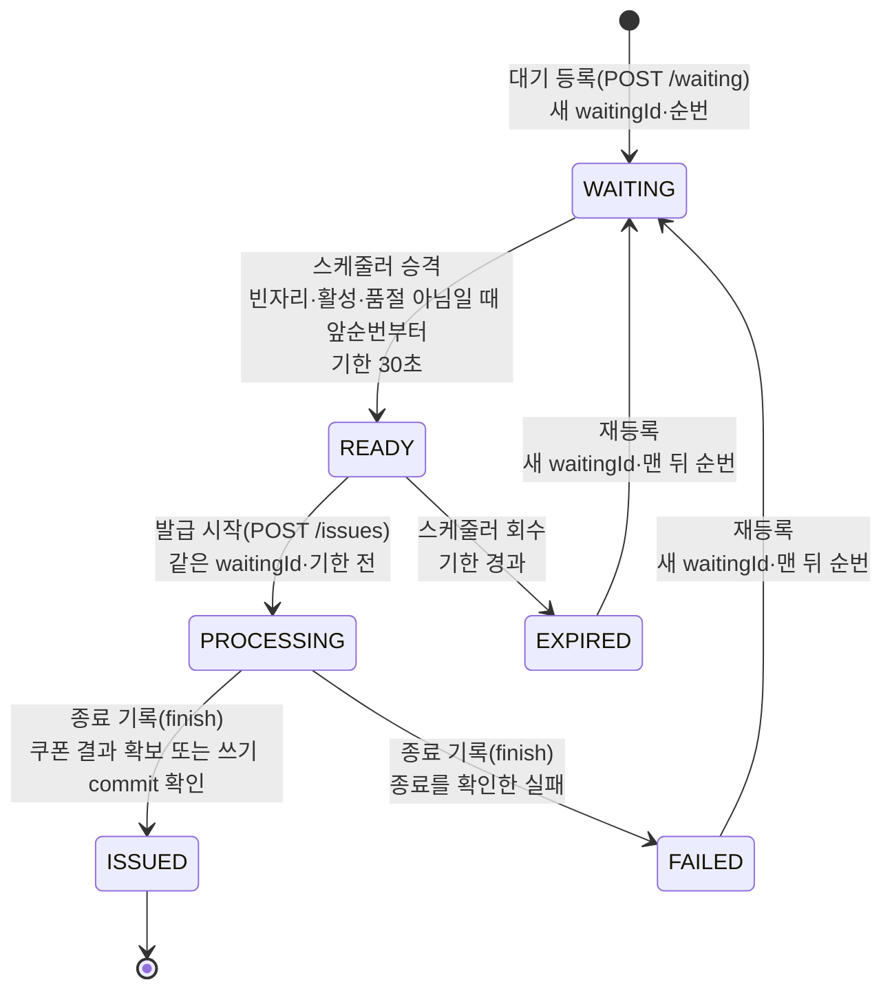
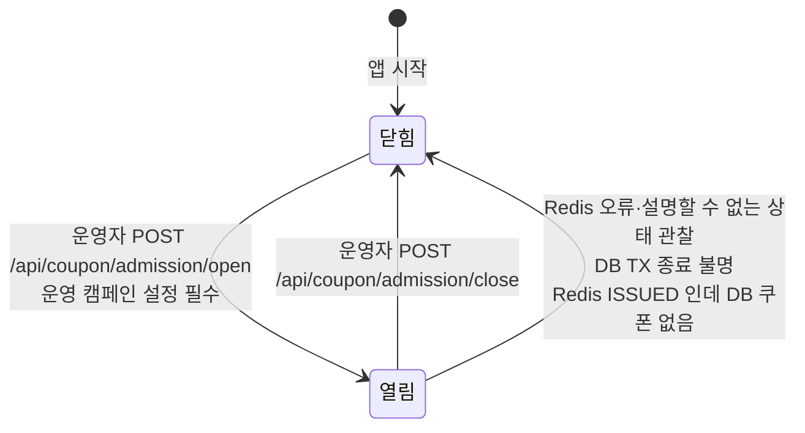
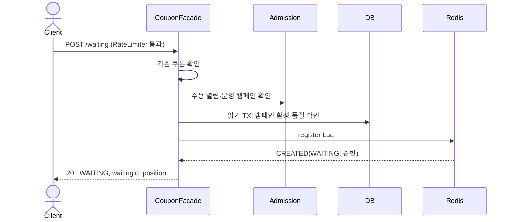
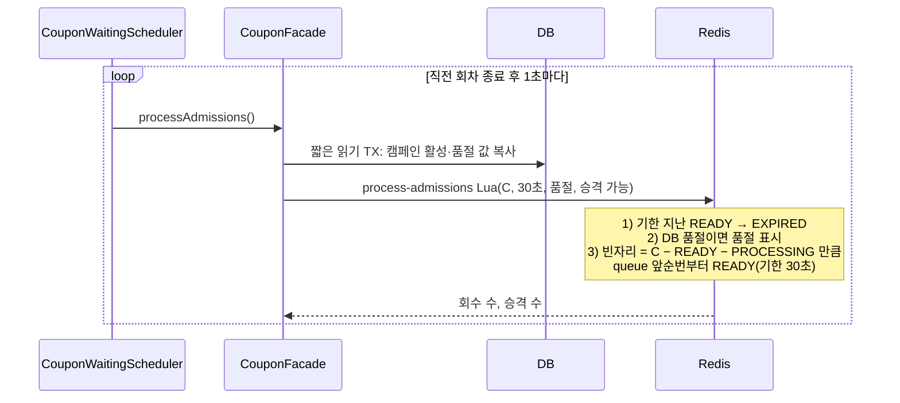
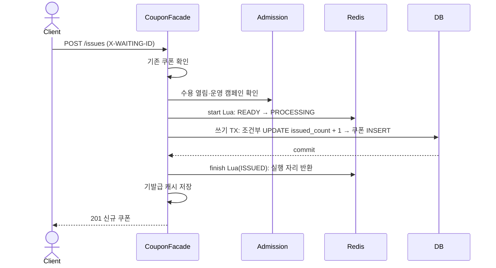
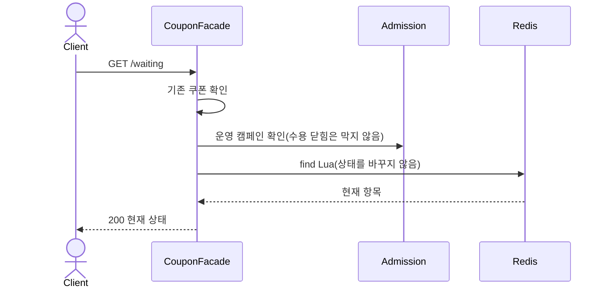

# 쿠폰 대기실 흐름 그림

이 문서는 [쿠폰 상세설계](coupons.md) §12·§13에 구현된 대기 등록 → 입장 → 발급 흐름을 그림으로 요약한다. 계약·판단의 원본은 상세설계와 [쿠폰 설계 판단](../decisions/coupons.md)이며, 그림과 원본이 다르면 원본을 따른다. 실행 근거는 [쿠폰 실행 기록](../verification/coupons.md)에 있다.

## 1. 구성과 책임

| 구성 요소 | 코드 | 맡는 일 |
|---|---|---|
| 요청률 제한 | `CouponWaitingRateLimitInterceptor` | 대기 등록 POST 만 앱 인스턴스 하나의 limiter 로 제한한다. 사용자 조회 전에 거절한다(429). |
| HTTP | `CouponV1Controller`, `CouponAdmissionController` | 고객 API 4개와 수용 제어 API 3개. 결과에 맞는 상태 코드만 고른다. |
| 흐름 조율 | `CouponFacade` | 기존 쿠폰 확인 → 수용 확인 → Redis 상태 전이 → DB TX 순서를 조율한다. 상위 TX 없이 짧은 TX 를 나눠 Redis 를 기다리는 동안 DB 연결을 잡지 않는다. |
| 수용·대기 상태 해석 | `CouponAdmissionService` | 수용 열림/닫힘을 갖고 Redis 결과를 업무 결과로 바꾼다. Redis 오류·설명할 수 없는 상태를 보면 수용을 닫는다. |
| 캐시 | `CouponCacheService` | 기발급 결과와 품절을 캐시한다. 오류는 miss 로 바꿔 DB 로 확인한다. |
| 대기실 저장소 | `CouponAdmissionRedisRepository` + `redis/coupon-waiting-*.lua` | 캠페인별 Redis 키 5개를 Lua 로만 원자적으로 바꾼다. |
| 입장 스케줄러 | `CouponWaitingScheduler` | 직전 회차가 끝나고 1초 뒤 다음 회차로 만료 회수·입장 배정을 부른다. |
| DB | `coupon_campaign`, `coupon` | 수량 정합성의 최종 기준. 조건부 UPDATE 로 수량을 확보하고 `uk_coupon_campaign_user` 로 중복을 막는다. |

역할 경계는 다음과 같다. Redis 대기실은 **동시에 발급을 시도하는 사람 수**(실행 자리 C, 기본 3)를 제한하는 흐름 제어 장치이고, 발급 수량을 세는 장부가 아니다. 쿠폰 수량과 1인 1장은 DB 가 판단한다.

### Redis 키

| 키 | 자료구조 | 내용 |
|---|---|---|
| `waiting:meta:v1:{campaignId}` | Hash | 다음 등록 순번, 품절 표시 |
| `waiting:entries:v1:{campaignId}` | Hash | 사용자 ID → 현재 항목(waitingId·상태·순번·기한) |
| `waiting:queue:v1:{campaignId}` | Sorted Set | WAITING 사용자, 등록 순번 순 |
| `waiting:ready:v1:{campaignId}` | Sorted Set | READY 사용자, 입장 기한 순 |
| `waiting:processing:v1:{campaignId}` | Set | PROCESSING 사용자 |

실행 자리 점유는 `ready 수 + processing 수` 이며 C 를 넘지 않는다. 키에는 TTL 을 두지 않는다.

## 2. 상태 전이

### 2.1 대기 항목

- 사용자별로 현재 항목 하나만 둔다. 재등록하면 항목을 새 waitingId 로 교체하고, 옛 waitingId 로 발급하면 미발견(404)이다.
- **PROCESSING 은 기한이 지나도 회수하지 않는다.** DB 결과를 모르는 채 자리를 돌려주면 실행 자리가 C 를 넘을 수 있어서다. DB TX 종료를 확인하지 못하면 PROCESSING 을 그대로 두고 수용을 닫는다.
- 응답에서만 쓰는 표현 상태가 두 가지 있다.
  - `SOLD_OUT`: 품절 표시가 있을 때 WAITING·READY 를 이렇게 보여 준다. 저장 상태는 바꾸지 않는다.
  - `EXPIRED` 표현: 기한이 지났지만 아직 회수 전인 READY 를 조회·재등록 응답에서 EXPIRED 로 보여 준다. 저장 상태는 다음 스케줄러 회차에 바뀐다.

### 2.2 신규 발급 수용

- 수용 상태는 앱 메모리의 값 하나이며 시작할 때 닫혀 있다.
- 닫히면 신규 등록·발급 시작·스케줄러 회차가 Redis·DB 를 부르지 않는다. 대기 조회와 기존 쿠폰 반환은 계속된다.
- 다시 여는 것은 운영자의 명시 호출뿐이다. 시간 경과나 Redis 응답 회복으로 자동으로 열지 않는다. 열기 전 확인 절차는 상세설계 §8.3 을 따른다.
- 캐시 오류는 수용을 닫지 않는다.

## 3. 요청별 흐름

그림은 정상 흐름만 그리고 분기는 아래 표에 둔다. `기존 쿠폰 확인` 은 기발급 캐시를 보고 miss·오류면 DB 읽기 TX 로 본인 쿠폰을 찾는 단계다. `Admission` 은 `CouponAdmissionService`, `Redis` 는 Lua 실행이다. 모든 Redis 호출에서 예외·응답 없음·`INVARIANT_ERROR` 가 나오면 수용을 닫고 503 이다(발급 종료 기록은 예외).

### 3.1 대기 등록 — `POST /api/v1/coupon-campaigns/{campaignId}/waiting`

| 조건 | 응답 |
|---|---|
| RateLimiter 허가 없음 | 429 `COUPON_RATE_LIMITED`, 사용자 조회 전에 거절 |
| 기존 쿠폰 있음 | 200 ISSUED + couponId. 수용이 닫혀 있어도 이 응답이 먼저다. |
| 운영 캠페인 아님·수용 닫힘 | 503 |
| 품절 캐시 hit(로컬 → Redis) | 409 SOLD_OUT, DB 를 읽지 않음 |
| 캠페인 없음 / 비활성 / 품절 | 404 / 409 / 409. 품절이면 품절 캐시 저장 |
| Lua 결과 EXISTING | 200 현재 상태(WAITING·READY·PROCESSING·회수 전 EXPIRED) |
| Lua 결과 Redis 품절 표시 | 409 SOLD_OUT |
| Redis 항목이 ISSUED | DB 로 쿠폰을 다시 확인해 200. DB 에 없으면 설명할 수 없는 상태라 수용을 닫고 500 |

### 3.2 입장 처리 — 스케줄러 회차

- 수용이 닫혔거나 운영 캠페인이 없으면 회차를 건너뛰고 DB·Redis 를 부르지 않는다.
- 캠페인이 없거나 비활성이면 회수만 하고 승격하지 않는다.
- 회차에서 예외가 나도 다음 회차는 계속된다. Redis 오류면 서비스가 이미 수용을 닫았으므로 이후 회차는 건너뛴다.
- 기한은 Lua 안에서 Redis 서버 시각으로 판단한다.

### 3.3 발급 — `POST /api/v1/coupon-campaigns/{campaignId}/issues`

조건부 UPDATE 는 `WHERE status = ACTIVE AND issued_count < total_quota` 이다. 발급은 입장 때 받은 READY 자리를 PROCESSING 으로 바꿔 쓰고, 발급 시점에 자리를 다시 얻지 않는다.

**발급 시작 전 분기**

| 조건 | 응답 |
|---|---|
| 기존 쿠폰 있음 | 200 기존 쿠폰(헤더가 없어도) |
| `X-WAITING-ID` 없음 | 400 `COUPON_WAITING_ID_REQUIRED` |
| 수용 닫힘·운영 캠페인 아님 | 503 |
| start 결과 NOT_FOUND | 404(옛 waitingId 포함) |
| start 결과 NOT_READY·EXPIRED·ALREADY_USED | 409 |
| start 결과 PROCESSING(같은 권한이 진행 중) | DB 를 다시 확인해 쿠폰 있으면 200, 없으면 202 PROCESSING |
| start 결과 ISSUED | DB 확인 후 200 기존 쿠폰 |

**쓰기 TX 결과별 처리**

| TX 결과 | 후속 처리 | finish | 응답 |
|---|---|---|---|
| commit | — | ISSUED | 201 |
| 조건부 UPDATE 0건(rollback) | 새 읽기 TX 로 원인 판별 | 쿠폰 있으면 ISSUED, 아니면 FAILED | 200 기존 / 404 / 409 비활성·품절 / 500 설명 불가 |
| `uk_coupon_campaign_user` 충돌(rollback) | 새 읽기 TX 로 기존 쿠폰 조회 | ISSUED | 200 기존 쿠폰 |
| 종료 불명 | 수용 닫기 | 호출 안 함(PROCESSING 유지) | 500 |

- TX 종료는 예외 종류가 아니라 `ObservedTransaction` 이 관찰한 콜백 진입과 afterCompletion 통지로 판정한다. 업무 미시작·commit·rollback·종료 불명으로 나눈다.
- 종료 불명이 아니면 모든 DB 호출이 끝난 뒤 finish 를 한 번 호출한다. finish 결과는 이미 정한 응답을 바꾸지 않는다. finish 예외·`INVARIANT_ERROR` 면 수용을 닫고, 현재 항목과 맞지 않아 바꾸지 않은 경우(`UNCHANGED`)는 경고만 남긴다.
- 캐시 저장은 DB TX 종료(신규 발급은 finish) 뒤에 확보한 결과로만 한다.

### 3.4 대기 조회 — `GET /api/v1/coupon-campaigns/{campaignId}/waiting`

| 조건 | 응답 |
|---|---|
| 기존 쿠폰 있음 | 200 ISSUED + couponId |
| 항목 없음 | 404 `COUPON_WAITING_NOT_FOUND` |
| 항목 ISSUED | DB 로 쿠폰 확인 후 200 ISSUED + couponId |
| 그 밖 | 200 WAITING(순번) / READY(기한) / PROCESSING / EXPIRED / FAILED / SOLD_OUT |

## 4. 코드 위치

### 4.1 대기·발급

| 흐름 | 시작 지점 |
|---|---|
| 대기 등록·조회·발급 HTTP | `interfaces/api/coupon/CouponV1Controller` |
| 요청률 제한 | `interfaces/api/coupon/CouponWaitingRateLimitInterceptor`, 대상 표시 `CouponWaitingRateLimited` |
| 요청 흐름 조율 | `application/coupon/CouponFacade` 의 `registerWaiting`·`getWaiting`·`issue`·`processAdmissions` |
| 발급 DB 처리 | `CouponFacade.issueStarted` → `applyWrite`·`applyFollowUp`·`recordTermination`, TX 관찰은 `ObservedTransaction` |
| 조건부 수량 UPDATE | `infrastructure/coupon/CouponCampaignJpaRepository.reserveOne` |
| 캐시 | `application/coupon/CouponCacheService`, `infrastructure/coupon/CouponCacheRedisRepository` |
| Redis 대기실 | `infrastructure/coupon/CouponAdmissionRedisRepository`, `resources/redis/coupon-waiting-{common,register,find,process-admissions,start,finish}.lua` |
| 스케줄러 | `interfaces/scheduler/CouponWaitingScheduler` |

### 4.2 수용 제어(열기·닫기)

수용 상태는 `CouponAdmissionService` 의 `accepting` 값 하나다. 여는 길은 운영자 호출 하나이고, 닫는 길은 운영자 호출과 자동 닫기로 나뉜다.

| 동작 | 코드 |
|---|---|
| 운영자 조회·열기·닫기 HTTP | `interfaces/api/coupon/CouponAdmissionController`: `GET /api/coupon/admission`, `POST .../open`, `POST .../close` |
| 열기·닫기 처리 | `CouponFacade.open`·`close`·`isAccepting` → `CouponAdmissionService.open`·`close`·`isAccepting` |
| Redis 오류·응답 없음·`INVARIANT_ERROR` 자동 닫기 | `CouponAdmissionService.callRedis` → `closeWaiting` (등록·조회·발급 시작·입장 처리) |
| 발급 종료 기록 실패 자동 닫기 | `CouponAdmissionService.finish` |
| Redis 와 DB 결과 모순 자동 닫기 | `CouponAdmissionService.closeOnContradiction` (Redis ISSUED 인데 DB 쿠폰 없음) |
| DB TX 종료 불명 자동 닫기 | `CouponFacade.recordTermination` |
| 열림 확인 | `CouponAdmissionService.requireAdmitting` (등록·발급 시작), `admittingCampaignId` (스케줄러) |
