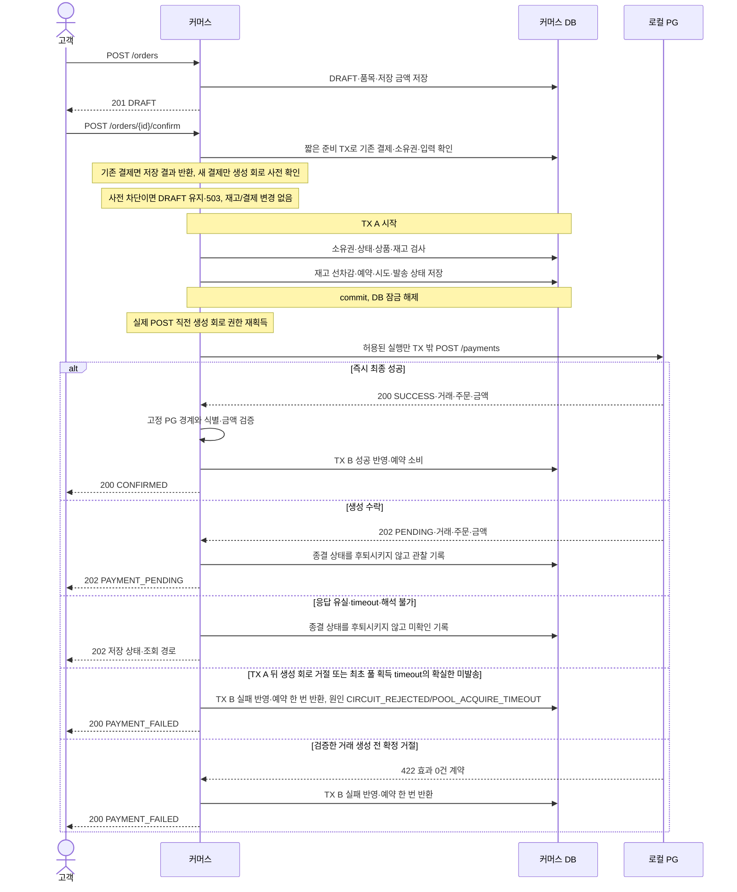
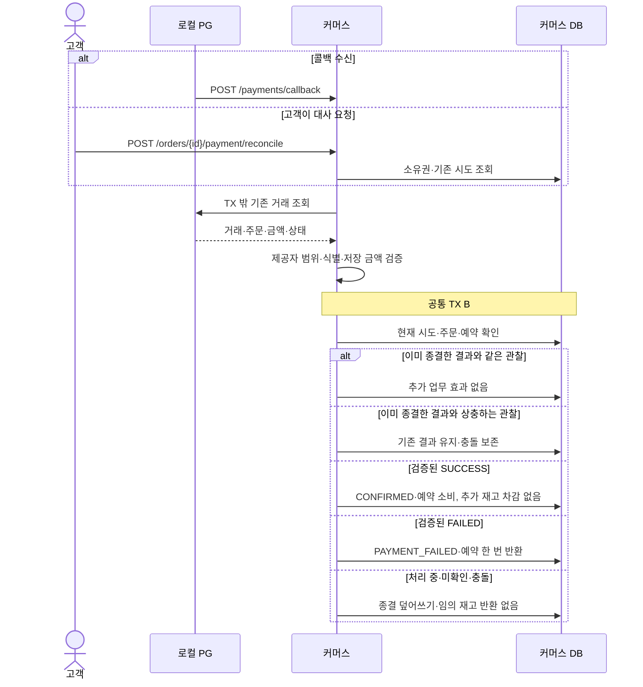

# 주문·결제 처리와 트랜잭션

기존 절 번호 참조: [2.8](pg-client.md#28-pg-http-도구와-테스트-서버의-구성).

기존 문서의 계약·절 번호·승인/검증 상태를 보존해 이동했다. 재편 자체는 제품 계약 변경이나 새 실행 검증을 뜻하지 않는다.

## 2.7 PG 호출과 로컬 TX의 책임 분리

TX 객체·오류 경계의 근거는 [A.19](../../decisions/payment.md#a19-tx-담당-객체와-충돌-응답-경계), Info·DTO·목록 조립의 대안과 비용은 [A.28](../../decisions/payment.md#a28-과거-point와-조회dto권한의-호환)을 따른다.

### 호출 구조

```text
OrderV1Controller → OrderConfirmFacade.confirm       (TX 없음)
PaymentV1Controller → PaymentCallbackFacade.handle  (TX 없음)
OrderV1Controller → PaymentReconcileFacade.reconcile (TX 없음)
  ├→ PaymentTransactionService                     (각 public 메서드가 짧은 TX)
  └→ PaymentGateway                               (TX 밖 외부 I/O)
```

Facade 간 호출은 없다. 세 진입점은 같은 `PaymentTransactionService`의 결과 반영 메서드를 사용한다. `*Service`라는 이름만으로 Domain Service가 되는 것은 아니며, 이 객체는 `application/payment`에 있는 로컬 TX 조율자다. Entity·VO의 상태 판단을 중복 구현하지 않는다. 기존 `OrderConfirmFacade` 전체의 단일 `@Transactional`은 제거한다. Controller의 Facade 전용 호출과 application → domain 의존 규칙은 유지한다.

|위치·타입|책임과 메서드 계약|
|---|---|
|`application/order/OrderConfirmFacade`|`confirm(userId, orderId, command)`: prepareConfirmation의 저장 결과 우선 반환 → 신규 준비만 생성 회로 사전 확인 → TX A 재검증/발송 권한 → 회로 안 POST → 공통 TX B. 사전 차단은 DRAFT 유지·503, TX A 후 회로 거절·생성 POST 최초 풀 획득 timeout의 확실한 미발송은 실패 반환|
|`application/payment/PaymentCallbackFacade`|`handle(notification)`: resolveCallbackOrderId의 별도 스칼라 읽기 완료 → 새 업무 TX의 확인 준비 → TX 밖 권위 조회 → 결과 반영. 콜백 문자열만으로 성공 처리하지 않음|
|`application/payment/PaymentReconcileFacade`|`reconcile(userId, orderId)`: 소유권과 기존 시도 확인, 종결 주문도 TX 밖 재조회, 결과 반영. 생성 포트를 호출하지 않음|
|`application/payment/PaymentTransactionService`|`resolveCallbackOrderId`: 별도 readOnly TX의 후보 스칼라 조회로 orderId만 반환. `prepareConfirmation`, `beginConfirmation`, `prepareVerification`, `applyObservation`: 각 업무 TX에서 Order PK를 먼저 잠근 뒤 Payment/PaymentConflict 일반 조회·규칙 호출·저장·결과 값 복사. `recordConstraintConflict(token, evidence)`: 거래 unique 위반의 TX B rollback 완료 뒤 Facade가 별도 public 업무 TX로 호출. 같은 Order 잠금 아래 연결/현재 상태 재검증·충돌 요약과 확인 정보 저장 후 CONFLICT 결과 반환, commit 완료 뒤 409로 변환. 기록 TX 실패는 500. 외부 I/O 없음|
|`domain/payment/PaymentGateway`|`checkCreateAdmission()`(HTTP 없는 사전 확인), `create(request)`(실제 회로 권한 재획득 뒤 POST), `findByTransactionKey(key)`, `findByOrderId(providerOrderId)`: 외부 결제 포트. 저장소나 로컬 TX를 호출하지 않음|
|`domain/payment/PaymentObservation`|PG 관찰·로컬 미발송 증거의 값 계약. 출처(CREATE/QUERY), 거래·주문·금액·상태 또는 UNAVAILABLE/CONFLICT/REJECTED_NO_EFFECT/LOCAL_NOT_DISPATCHED를 표현. HTTP/JSON 타입을 노출하지 않음|
|`infrastructure/payment`|PG HTTP 어댑터와 결제 시도 저장소 구현. HTTP 도구·timeout·회로 설정은 2.8~2.9의 계약 적용|
|`domain/order/OrderItemModel`|고정 productId·quantity·unitPrice. 별도 예약 행 없이 확보·반환 수량의 원본|
|`domain/payment/PaymentModel`|주문당 결제 행 하나. 외부 식별·금액·업무 상태·최근 확인 결과/시각. 카드 미저장|
|`domain/payment/PaymentConflictModel`|결제당 마지막 충돌 요약 0~1행. 파싱 근거·시각 보존, 전체 이력 아님|

`PaymentTransactionService`는 별도 Spring bean의 public 메서드에 `@Transactional`을 둔다. 호출은 Facade에서 bean 프록시를 통과한다. 내부 메서드를 자기 호출해서 새 TX가 생긴다고 가정하지 않는다. 기본 REQUIRED를 사용하고, 외부 호출을 포함하는 상위 TX를 만들지 않는다. `REQUIRES_NEW`로 외부 호출 중의 상위 TX를 보류하는 구조도 사용하지 않는다. 이 경계는 Spring Framework 6.2 Reference의 Using @Transactional 절에 있는 프록시 모드·자기 호출 규칙을 따른다.

격리 수준은 기존 REPEATABLE READ를 유지한다. 후보 식별의 readOnly TX는 Facade 호출에 결과를 반환하기 전에 종료하며, 뒤의 prepareVerification 호출은 별도 업무 TX다. 업무 TX의 첫 업무 데이터 접근 SQL은 Order PK SELECT FOR UPDATE이며, 엔티티·스칼라·exists·native 조회 모두를 순서 검사에 포함한다. 연결/TX 초기화용 제어문은 별도로 구분하며 4.3의 SQL 수명 계약을 따른다. 그 전에 일반 조회·품목 지연 로딩·Payment/PaymentConflict 로드를 하지 않는다. 기존 OSIV=false와 호출별 영속성 컨텍스트 경계를 유지하고 다른 TX의 Entity를 재사용하지 않는다. 같은 Order를 먼저 잠근 모든 쓰기가 commit/rollback한 뒤 Payment/PaymentConflict를 처음 일반 조회하도록 하며, 최신 읽기와 잠금 대기 후 종결 보호는 4.3·4.5의 실제 MySQL 검증 대상이다.

### TX 밖으로 넘기는 값과 오류

TX A는 관리 Entity 대신 불변 결과를 반환한다. 신규 발송 권한이 있으면 시도 식별자·저장 주문 식별·요청 금액·확인 토큰을, 기존 시도이면 복사한 `OrderInfo`를 준다. 외부 호출에 필요한 합성 카드 값은 이번 입력 또는 고정 설정에서만 사용하며 DB·로그·예외 본문에 넣지 않는다.

TX B는 `PaymentApplyResult(OrderInfo, outcome)`을 반환한다. `outcome`은 FINAL/PENDING/UNAVAILABLE/CONFLICT이며 HTTP 응답 코드 자체는 도메인에 넣지 않는다. 충돌을 보존해야 하는 경로는 TX 안에서 rollback 대상 예외를 던지지 않고 CONFLICT 결과를 반환해 commit한다. Facade·interfaces가 commit 완료 후 409로 변환한다. 저장 실패 같은 기술 예외는 그대로 전파해 해당 TX를 rollback하고 500으로 처리한다.

`OrderInfo`는 주문·품목·선택적 결제 정보의 값 복사다. 고객·관리자 주문 생성·상세·목록·결제 응답 모두 동일한 의미를 사용하고 Controller에서 각 API DTO로 변환한다. 목록은 기존 주문 ID 페이지 조회를 유지하고 해당 페이지의 시도를 `findAllByOrderIds`로 한 번에 읽어 매핑한다. 주문마다 개별 결제 조회를 반복하지 않는다. 읽기 전용 조회는 PG를 호출하거나 verificationStatus를 바꾸지 않는다. 관리 Entity·지연 로딩 컬렉션을 TX 밖에서 결제 정보 조립에 사용하지 않는다.

### PG 저장 포트의 상세 계약

아래 포트는 domain에 선언하고 infrastructure에 JPA 구현을 둔다. 반환 Entity는 호출 TX 안에서만 사용하며, 결제·충돌 요약을 숨기는 삭제 필터는 추가하지 않는다.

|포트|메서드와 보장|
|---|---|
|`PaymentRepository`|`findByOrderId(orderId)`는 업무 TX의 Order 잠금 후 일반 조회. `existsByAttemptKey(key)`, `findOrderIdsByProviderOrderId(provider, account, externalId)`는 Entity 없는 후보 orderId 목록, `findAllByOrderIds(ids)`, `save(payment)`|
|`PaymentConflictRepository`|`findByPaymentId(paymentId)`는 업무 TX의 Order 잠금 후 일반 조회, `save(conflict)`. 같은 Order 잠금 아래 결제당 한 요약 생성·갱신|
|`ProductRepository`|기존 활성 다건 잠금 유지. 내부 반환용 `findAllByIdsForUpdate(ids)`는 삭제 포함·중복 제거 ID 오름차순|
|`OrderRepository`|기존 `findForUpdate`는 Order PK 행만 잠그고 items join·EntityGraph를 결합하지 않음. 기존 조회·페이지 복원 유지|
|`StockHistoryRepository`|기존 저장 포트 유지. 예약·반환 팩토리의 결과를 같은 TX에서 저장|

`findOrderIdsByProviderOrderId`는 일반 idx_payment_provider_order로 콜백 대상을 식별하고 Payment Entity/상태 없이 각 후보의 orderId만 반환한다. DISTINCT로 중복을 숨기지 않는다. 별도 readOnly TX에서 0건은 404, 2건 이상은 내부 정합성 오류 500으로 PG 호출 없이 종료하며 임의 선택하지 않는다. 1건은 orderId만 복사하고 TX를 종료한다. 이후 새 업무 TX에서 해당 Order를 먼저 잠그고 Payment를 일반 조회하여 제공자/계정·외부 ID의 결정적 매핑과 현재 상태를 재검증한다. 후보 읽기의 스냅샷이나 Entity를 이 TX로 가져오지 않는다. 목록의 `findAllByOrderIds`는 페이지에 속한 시도를 한 번에 읽고 중복 주문 시도가 발견되면 임의 한 건을 선택하지 않는다. 관련 unique 제약을 명시적 이름으로 생성해 충돌 분류에 사용한다. 프록시 commit에서도 제약 실패가 발생하므로 Facade가 TX 호출 바깥에서 예외를 받는다. support.persistence의 ConstraintViolationClassifier가 예외 원인의 제약 metadata를 읽어 위에서 명명한 unique 제약만 분류한다. 식별할 수 없는 오류는 500이며 SQL/예외 원문에 카드·응답 본문을 넣지 않는다. 저장 기술 예외를 domain에 전달하지 않는다. Payment/PaymentConflict의 선행 잠금 조회는 없고, INSERT/UPDATE와 unique 검사에 따른 DB 내부 잠금은 남는다. 충돌 요약의 기존 행이 없어도 Order 잠금으로 생성을 직렬화한다. PaymentConflict.record가 마지막 반영 충돌로 요약을 교체하며 TX 조율자가 같은 TX에서 결제 확인 정보와 요약을 저장한다. 일반 OrderInfo/Page 응답은 충돌 상세를 읽지 않아 상시 조인을 추가하지 않는다.

### 주문 응답 조립

`OrderInfo.from(order, optionalAttempt)`는 id·userId·status·totalAmount·pointAmount·paidAmount·items에 선택적 `PaymentInfo(method, status, paymentAttemptKey, amount, verificationStatus)`를 더한다. DRAFT는 PaymentInfo=null, POINT는 method=POINT·status=SUCCESS만 채우고 PG는 저장 시도에서 복사한다. 결제 방식 PG인데 시도가 없는 행은 POINT로 추론하지 않고 내부 정합성 오류로 처리한다. 성공 금액은 Order에서 읽으며 amount와 혼용하지 않는다.

orderUrl·reconcileUrl은 API 경로이므로 Info·domain에 저장하지 않는다. 고객 DTO와 관리자 DTO가 orderId·method로 각각 [5장](../../common/api-contract.md)의 경로를 조립한다. 관리자 응답에도 고객용 reconcileUrl을 넣되 소유권을 우회하는 권한을 추가하지 않는다. 기존 PageResult의 순서·total은 유지하며 페이지에 포함된 Order와 결제 시도를 읽기 전용 TX 안에서 값으로 복사한다.

## 4.3 주문 확정

신규 결제는 PG를 사용한다. DRAFT 주문 생성과 결제 시작을 구분하고, PG 호출 전에 가용 재고를 선차감해 주문별로 예약한다. 검증된 결제 성공을 확인한 뒤 주문을 CONFIRMED로 바꾼다. 포인트 차감·주문 원인의 포인트 사용 이력은 만들지 않으며, Point 행의 존재·잔액을 신규 결제의 전제조건으로 사용하지 않는다.

이 절의 PG 흐름은 I4·I5에서 구현한 현행 계약이다. 구현·실행 범위와 한계는 이 문서 마지막의 I4·I5 검증 근거를 따른다. 아래 접힌 POINT 기록은 이전 구현과 검증의 근거다. 그 기록의 단일 TX·포인트 잠금·포인트 부족·중복 확정 오류 규칙을 신규 PG 주문에 적용하지 않는다. 클래스·저장·잠금 상세는 관련 구조·도메인 설계에 반영하며, 미정 사항을 구현자가 임의로 채우지 않는다.

### PG 결제의 진입점과 보존 범위

|진입점|책임|외부 호출|
|---|---|---|
|`POST /api/v1/orders`|품목·저장 단가·총액을 준비하고 DRAFT 저장. 재고·포인트 변경 없음|없음|
|`POST /api/v1/orders/{orderId}/confirm`|본인 DRAFT의 재고 확보·예약·결제 시도 준비 후 결제 시작. 같은 시도 재요청은 저장 결과 반환|발송 권한을 얻은 실행의 결제 생성 1회|
|`GET /api/v1/orders/{orderId}` 및 주문 목록|저장된 본인 주문·결제 상태 조회. 관리자 조회는 기존 접근 경계 유지|없음|
|`POST /api/v1/orders/{orderId}/payment/reconcile`|본인 주문의 기존 PG 거래를 조회·검증하고 결과 반영|기존 거래 조회만 수행|
|`POST /api/v1/payments/callback`|PG 알림을 받아 기존 거래를 권위 조회·검증한 뒤 결과 반영|기존 거래 조회만 수행|

`confirm`은 결제 절차의 시작 경로이며, 호출 수락이 주문 확정을 뜻하지 않는다. 내부 주문 확정은 검증된 SUCCESS를 결과 반영 TX에 commit한 시점이다. 별도의 고객용 완료 API나 PG 승인 confirm API는 추가하지 않는다.

주문 생성 시 저장한 품목·양수 수량·단가·총액을 결제에 사용하며 현재 상품 가격으로 금액을 다시 계산하지 않는다. 주문당 한 시도만 허용하고 실패 후 새 키·새 결제로 재시도하지 않는다. 이전 POINT 확정 주문의 결제액·사용 포인트·품목과 소유권은 보존하고, 해당 주문의 confirm 재요청은 기존 ORDER_NOT_CONFIRMABLE을 유지한다.

### 결제 시작과 재고 선차감

다음 시퀀스는 생성 응답 처리 전에 콜백이 종결을 반영하지 않은 대표 흐름이다. 콜백이 먼저 종결한 경우에는 같은 거래의 늦은 생성 PENDING·timeout 관찰을 적용하지 않고, confirm에서 이미 저장된 종결 결과를 200으로 반환한다. 늦은 생성 응답이 저장 키와 다른 거래이거나 금액이 다르면 [3.6 판정 순서](model.md#확인-정보의-반영-순서와-종결-처리)의 충돌·409다.



0. **사전 확인:** 기존 결제/입력/소유권을 짧은 TX에서 확인한다. 기존 결제면 저장 결과를 반환하고 신규 DRAFT만 생성 회로를 사전 확인한다. 사전 차단은 503 PG_CREATE_UNAVAILABLE이며 DRAFT·재고·결제 행을 바꾸지 않는다. 경쟁/실제 POST 권한 거절은 아래 공통 흐름에서 다시 처리한다.
1. **TX A:** 본인 주문과 저장 품목을 확인하고, 활성 상품·가용 재고를 검사한다. 가용 재고를 줄이고 주문별 예약·시도·결제 대기 상태와 발송 권한을 DB에 보존한다. 하나라도 실패하면 TX A 전체를 rollback하고 PG를 호출하지 않는다.
2. **TX 밖 HTTP:** 발송 권한을 얻은 실행만 생성 회로의 실제 호출 권한을 재획득하고 PG 생성 POST를 수행한다. PG를 기다리는 동안 TX A의 DB 연결·재고 잠금을 계속 보유하지 않는다. 발송 시작을 영속 기록한 뒤에는 client·proxy·회복 도구를 통한 자동 create 재시도를 허용하지 않는다.
3. **결과 반영:** 즉시 SUCCESS 응답은 고정한 PG 경계와 저장 주문·거래·금액의 일치를 검증한 뒤 추가 조회 없이 공통 TX B로 반영한다. PENDING·응답 불확실도 이미 기록된 종결 상태를 후퇴시키지 않는 조건으로 저장한다.
4. **응답:** 성공 반영 commit이 끝나면 200 CONFIRMED, 확정 실패와 반환을 반영하면 200 PAYMENT_FAILED를 반환한다. PENDING·UNKNOWN 등 미완료이면 202와 저장 상태·조회 경로를 반환한다. TX A commit 뒤의 PG 오류는 TX A를 자동 rollback하지 않는다.

TX A commit 뒤 PG 응답 전은 주문 PAYMENT_PENDING·결제 UNKNOWN·verificationStatus=NOT_CHECKED로 표현한다. UNKNOWN은 최종 결과를 모른다는 뜻이며 발송 여부·timeout 발생을 뜻하지 않는다. PG에서 PENDING을 확인하면 결제 PENDING으로, 발송 후 응답 유실이면 UNKNOWN·UNAVAILABLE로 기록한다. 공개 REQUESTED 상태는 추가하지 않는다.

같은 주문·같은 시도의 동시 confirm은 결제 행을 중복 생성하거나 재고를 중복 차감하지 않고 실제 PG POST 1회만 허용한다. 다른 주문·금액·요청에 같은 키를 사용하거나 같은 주문에 새 키로 두 번째 시도를 만들려는 요청은 효과 없이 거절한다. 이미 종결된 동일 PG 시도의 confirm 재요청은 저장 결과를 반환한다. 카드 값은 합성 값만 사용하고 DB·로그에 남기지 않는다.

### 콜백과 대사



콜백은 고객 인증 요청이 아니라 외부 알림이다. 알림 본문의 `providerOrderId, transactionKey, status`는 거래를 확인할 계기로 사용한다. 본문의 성공 문자열만으로 주문을 확정하지 않는다. 고정한 제공자 계정 범위에서 PG를 조회하고 저장 주문·transactionKey·요청 금액이 일치하는지 검증한다.

transactionKey를 알고 있으면 해당 거래를 조회하고, 생성 응답 유실로 모르면 저장된 providerOrderId로 기존 거래 목록을 조회한다. 0건·PENDING·조회 실패는 확정 실패의 증거가 아니다. 2건 이상이거나 주문·금액·거래가 불일치하면 임의 거래를 선택하지 않고 미확인·충돌로 보존한다. 대사는 create를 수행하지 않는다.

callback-first, lookup-first, 동시 적용이 같은 결과로 수렴해야 한다. 콜백이나 대사가 먼저 성공·실패로 종결했다면 늦게 도착한 생성 PENDING·timeout 처리로 상태를 되돌리지 않는다. 다른 종결 결과가 들어오면 기존 결과를 덮어쓰지 않는다. 내부 결과 반영 실패는 해당 TX를 rollback하고 같은 외부 거래를 다시 확인해 반영한다.

응답의 payment.verificationStatus는 결제 상태와 별개로 마지막 확인 결과를 표현한다. 예를 들어 기존 PENDING에서 조회가 실패하면 결제 상태·예약은 유지하고 확인 결과는 UNAVAILABLE이다. 관찰 저장·경쟁 처리는 [3.6](model.md#36-pg-저장-모델과-제약)의 마지막 DB 반영 기준·출처·종결 보호 규칙을 따른다.

이미 SUCCESS·FAILED로 종결한 PG 주문의 reconcile도 PG를 다시 조회·검증한다. 같은 종결 결과는 추가 효과 없이 200, 상충 종결은 기존 결과 유지와 충돌 기록 후 409로 반환한다. 재조회 불가는 저장 종결을 유지한 채 verificationStatus=UNAVAILABLE·202로 표현한다. 이때 202는 이번 대사 확인 불가이며 주문 종결 취소가 아니다. 콜백의 권위 조회도 계속 수행한다.

### 결과에 따른 주문·예약 처리

|검증한 관찰|주문·결제 의미|재고·후속 처리|
|---|---|---|
|생성 응답 SUCCESS 또는 조회 SUCCESS|결제 성공, 주문 CONFIRMED|예약 소비, 추가 차감 없음|
|PENDING|결제 처리 중, 주문 PAYMENT_PENDING|예약 유지|
|생성 응답 유실·timeout·해석 불가|최종 결과 UNKNOWN|예약 유지, 기존 거래 대사|
|이미 알던 시도의 조회 불가·회로 차단|저장한 상태 유지, 이번 확인 불가|예약 유지, 실패 종결·새 결제 생성 없음|
|조회 FAILED|확정 실패, 주문 PAYMENT_FAILED|예약 한 번 반환|
|계약상 거래 생성 전 확정 거절|외부 효과 0건을 확인한 실패|예약 한 번 반환, transactionKey를 꾸며 저장하지 않음|
|조회 0건·복수 거래·식별/금액 불일치|미완료 또는 충돌 보존|임의 확정·반환·재발송 없음|
|이미 같은 종결 결과 반영|동일 결과 재확인|추가 확정·반환 없음|

거래 생성 전 확정 거절은 고정 PG의 `422 + TEST_PG_REJECTED_BEFORE_CREATE + transactionCreated=false + 요청 orderId·amount 일치`를 모두 검증한 경우만 인정한다. 본문 없는 422·다른 4xx/5xx·잘못된 JSON·일반 조회 404를 효과 0건으로 해석하지 않는다.

재고 5개에서 수량 2개를 확보하면 가용 재고는 3개다. PENDING·UNKNOWN과 성공 반영 뒤에도 3개이고, 확정 실패 반환 뒤에만 5개다. 반환은 새 TX의 보상 처리이며 이미 commit한 TX A의 rollback이 아니다.

발송 기록 뒤 HTTP 전에 프로세스가 멈추면 실제 발송 0회일 수 있다. HTTP 뒤 내부 저장 전에 멈추면 외부 거래가 있을 수 있다. 재시작 후 이 시도를 기존 거래 조회 대상으로 유지하고, 조회 0건이나 시간 경과만으로 재발송·예약 반환하지 않는다. 모든 시도의 자동 완료를 보장하지 않는 한계를 남긴다.

### 상품 변경·기존 기능 보호와 검증

- 관리자 재고 설정은 예약을 제외한 가용 수량의 최종 설정으로 해석한다. 예약 정보를 지우거나 성공 때 다시 차감하지 않는다.
- 삭제 전 재고를 확보한 PAYMENT_PENDING 주문은 저장 품목·금액·예약으로 결과를 마무리한다. 삭제 후 새로 결제를 시작하는 DRAFT는 기존 활성 검사로 거절한다. 반환 때문에 삭제 상품이 다시 노출되지 않도록 한다.
- 재고 확보·반환의 commit 뒤 기존 상세 캐시 무효화 정책을 연결한다. 실패 rollback에서 다른 요청의 재고·캐시를 임의 복원하지 않는다.
- 소유권·저장 품목·저장 금액과 과거 POINT 주문의 조회 사실을 보존한다. Point 충전·조회 API의 불변식은 유지하되 PG 결제에는 Point 초기화·잔액 조건을 요구하지 않는다.
- 외부 거래 수·create/lookup 횟수·주문·결제·고정 품목·가용 재고·포인트와 확보/반환 이력을 함께 검증한다. HTTP 계약, 실제 MySQL, 실제 callback controller, 재시작 상태 보존과 관련 회귀를 포함한다.
- 기존 포인트 차감·포인트 부족·단일 TX rollback 테스트는 신규 PG 계약에 맞게 교체하고, 과거 POINT 조회·포인트 충전·권한·품목·재고 보호 검증은 유지한다. 아래 과거 검사 수는 PG 기능의 통과 근거가 아니다.

### PG 로컬 TX와 잠금 계약

선차감은 [A.21](../../decisions/payment.md#a21-주문-생성재고-확보외부-결제의-순서), 재발송 금지는 [A.22](../../decisions/payment.md#a22-한-시도발송-권한과-불확실한-외부-효과), 권위 조회는 [A.23](../../decisions/payment.md#a23-즉시-응답콜백대사의-권위와-복구-경계), 잠금은 [A.18](../../decisions/payment.md#a18-외부-호출-전후의-동시성-제어)을 따른다. payment 한 행과 고정 주문 품목으로 확보·반환을 관리하고 충돌만 payment_conflict로 분리한다. 별도 예약 테이블은 없다.

비관적 쓰기 잠금은 같은 주문의 상태 전이를 직렬화하고 payment의 세 unique는 주문당 결제 하나·전역 시도 키·외부 거래 중복 결합을 막는다. 외부 주문 ID는 고정 매핑을 검증하고 일반 조회 인덱스를 사용한다. 메모리 mutex나 PG의 중복 제거에 의존하지 않는다.

|처리|자원 획득 순서|commit에 포함되는 것|
|---|---|---|
|콜백 후보 식별: resolveCallbackOrderId|별도 readOnly TX·비잠금 스칼라 조회|orderId만 반환. 0/복수 후보 거절, 업무 TX 전에 종료|
|사전 준비: prepareConfirmation|Order PK 잠금 → 기존 Payment 일반 조회|소유권·입력·기존 결제/키 검사, STORED/READY 값 복사. DB 변경 없음|
|TX A: beginConfirmation|Order PK 잠금 → 기존 Payment 일반 조회 → 활성 Product ID 오름차순 잠금|PAYMENT_PENDING·최초 결제 INSERT·발송 권한·고정 품목 수량 선차감·ORDER_RESERVATION 이력|
|확인 준비: prepareVerification|Order PK 잠금 → Payment 일반 조회|소유권·조회 대상·종결 여부 확인. 번호 발급/상태 갱신·재고 효과 없음|
|TX B: applyObservation|Order PK 잠금 → Payment 일반 조회, 충돌이면 기존 PaymentConflict 일반 조회 / 실패 반환이면 필요한 Product ID 오름차순 잠금|주문·결제·확인 정보, 신규 확정 실패의 수량 반환·이력 또는 충돌 요약|
|제약 충돌 기록: recordConstraintConflict|Order PK 잠금 → Payment·기존 PaymentConflict 일반 조회|앞선 TX rollback 뒤 마지막 충돌 요약·이 TX에서 반영한 확인 정보|

모든 Payment/PaymentConflict 생성·변경 경로는 같은 Order PK 잠금을 commit/rollback까지 보유한다. 자식은 일반 조회하고 선행 SELECT FOR UPDATE는 하지 않는다. 결제나 요약이 없어도 같은 Order의 실행은 부모 잠금으로 직렬화한다. 다른 Order의 시도 키/외부 거래 경쟁은 unique가 최종 방어다. INSERT/UPDATE·unique 검사에 따른 DB 내부 잠금은 남으며 모든 gap lock/deadlock 제거를 보장하지 않는다. OrderItem은 생성 뒤 수정·삭제 경로가 없으며 결제 시작 후에도 고정한다. 충돌 요약 저장과 실패 반환은 서로 다른 판정 분기다.

**최신 조회와 TX 수명:** 격리 수준은 기존 REPEATABLE READ를 유지한다. 각 업무 TX의 첫 업무 데이터 접근 SQL은 Order PK SELECT FOR UPDATE다. 업무 SQL에는 엔티티·스칼라·exists·native 조회와 INSERT/UPDATE/DELETE를 모두 포함한다. 프레임워크의 연결/TX 초기화용 BEGIN·SET 같은 제어문은 이 순서 검사에서 구분하며, 일반 조회를 앞당기거나 스냅샷을 미리 만드는 용도로 사용하지 않는다. 잠금 획득 전에는 일반 조회·존재 확인·품목 지연 로딩·자식 Entity 로드를 하지 않는다. 이후 처음 수행하는 일반 조회부터 Payment/PaymentConflict 상태를 읽는다. Facade에 상위 TX가 없고 OSIV=false·각 호출의 별도 영속성 컨텍스트를 유지하여 앞선 TX의 Entity/스냅샷을 재사용하지 않는다. 콜백 후보 식별의 readOnly TX는 orderId만 반환하고 종료한 뒤 새 prepareVerification을 호출한다. 잠금 대기 후 최신 종결/요약을 읽는 조건은 실제 MySQL 검증 대상이며 미충족 시 일반 조회를 그대로 구현하지 말고 원인을 확인해 설계를 재검토한다.

TX A는 기존 findAllActiveByIdsForUpdate로 활성 상품을, 실패 반환은 삭제 조건 없는 findAllByIdsForUpdate로 상품을 잠근다. ID를 중복 제거·오름차순 요청하고 반환 ID 집합을 확인한다. TX A 누락은 PRODUCT_NOT_FOUND, 기존 결제의 반환 상품 물리 누락은 내부 정합성 오류다. 관리자 변경은 같은 Product 잠금에 참여하며 브랜드 bulk 삭제의 [기존 동시성 한계](../catalog.md#415-동시성-범위와-향후-대안)는 유지한다.

SQL·잠금 절·실행계획은 infrastructure 책임이다. IN + ORDER BY만으로 모든 분포의 실제 잠금 순서를 증명하지 않으며 [4.3.3](../../verification/legacy-point.md#433-여러-product-잠금-쿼리의-구현-선택-기준)의 쿼리/PK 힌트/ID별 조회 전환 기준을 적용한다. deadlock·잠금 timeout·DB 실패는 해당 TX rollback·500이고 자동 TX retry는 없다. TX A 실패에 PG 호출은 없으며 TX B 실패 뒤에는 기존 거래를 재조회한다. MySQL 8.0 Reference Manual의 InnoDB Locking Reads 절의 TX 범위 잠금을 사용하고 HTTP 동안 보유하지 않는다.

### 결과·확인 토큰의 값 계약

- PrepareConfirmationResult: READY 또는 STORED. READY는 결제 없는 DRAFT이며 발송 권한·재고 확보를 의미하지 않는다. STORED는 복사한 OrderInfo다.
- BeginConfirmationResult: SEND 또는 STORED. SEND는 이번 실행의 발송 권한·불변 PaymentRequest·확인 토큰, STORED는 복사한 OrderInfo를 갖는다.
- PaymentCheckToken: paymentId·orderId·source(CREATE/QUERY)·terminalAtStart. 순번은 없다. 조회 종류·식별자(거래 키 또는 외부 주문 ID)는 토큰에 넣지 않고 확인 준비 결과인 VerificationTarget(token·kind·target)에만 둔다. terminalAtStart는 확인 준비 때 이미 종결했는지이며 늦은 PENDING 처리 구분에 사용한다.
- PaymentApplyResult: OrderInfo와 FINAL/PENDING/UNAVAILABLE/CONFLICT. 저장 업무 상태와 이번 확인 결과를 구분하며 콜백은 data 없는 HTTP ACK로 변환한다.
- PaymentObservation: 파싱한 관찰·충돌 근거를 전달하며 원문 HTTP 예외·카드를 저장 모델로 넘기지 않는다. 제공자·계정·대상 URL은 서버 설정으로 고정한다.

### prepareConfirmation·beginConfirmation 내부 처리

```text
prepareConfirmation(userId, orderId, command):  // 짧은 일반 TX, 상태 변경 없음
  Order PK 잠금부터 시작 → 기존 Payment 일반 조회; 소유권/POINT 오류 우선·UUID/합성 카드 검증
  기존 payment면 beginConfirmation과 같은 키·고정 요청·상태 정합성 검사 뒤 STORED
  결제 없으면 DRAFT/품목·금액 정합성 검사
  정규 키가 다른 결제에 쓰였으면 existsByAttemptKey로 충돌; 상세 노출 없음
  return READY  // Product 잠금/재고 변경/발송 기록 없음

TX A beginConfirmation(userId, orderId, command):
  order = OrderRepository.findForUpdate(orderId), 없거나 다른 소유자면 404
  과거 POINT 확정이면 ORDER_NOT_CONFIRMABLE (새 카드 검증보다 먼저)
  UUID·고정 합성 카드 검증; 잘못되면 INVALID_REQUEST
  payment = PaymentRepository.findByOrderId(orderId)  // Order 잠금 후 첫 일반 조회
  if payment가 있으면:
    키·저장 주문·금액·고정 요청 규칙이 다르면 PAYMENT_ATTEMPT_CONFLICT
    order/payment/고정 품목 정합성 확인
    return STORED(OrderInfo); 생성·조회 HTTP와 재고 변경 없음
  order.requireDraft(); PG 표시인데 결제가 없으면 내부 정합성 오류
  고정 품목 복원; 병합 수량·저장 단가·totalAmount 정합성 확인
  활성 상품을 ID 오름차순으로 잠금; 요청 ID 집합·모든 가용 수량 확인
  payment = 새 UNKNOWN 결제(orderId, 정규 UUID, 저장 총액, 고정 외부 ID)
  외부 ID가 LP-ORD- + 해당 orderId 매핑과 일치하는지 검사
  dispatch_claimed_at 기록; verification_status=NOT_CHECKED/checked_at=null
  각 고정 품목을 productId 오름차순으로:
    change = product.decreaseStock(저장 quantity)
    ORDER_RESERVATION 이력 저장  // 별도 예약 행 없음
  order.startPgPayment(); order/payment/변경 Product 저장
  영향 상품의 기존 afterCommit 캐시 DEL 등록
  return SEND(불변 요청, CREATE 토큰 terminalAtStart=false)
  // 프록시 commit까지 성공한 뒤에만 Facade가 발송 권한을 받음
```

다른 주문에서 같은 키가 경쟁하면 uk_payment_key, 한 주문의 중복 결제 생성은 uk_payment_order가 최종 방어다. insert/flush/commit 실패는 TX A 재고·이력·결제·주문 전체를 rollback한다. Facade는 이 두 제약만 분류하고 실패한 TX 밖 새 짧은 읽기에서 확인한다. 동일 주문·동일 키의 저장 결제면 STORED, 그 외는 PAYMENT_ATTEMPT_CONFLICT다. 다른 고객 주문은 노출하지 않고 모든 DataIntegrityViolation을 업무 충돌로 바꾸지 않는다. 예상 밖 제약 실패는 500이며 실패한 TX에서 발송을 계속하지 않는다.

카드는 항상 같은 합성 값이므로 hash·원문을 저장하지 않는다. 금액은 고객 입력 없이 저장 주문·결제 값으로 비교하고 새 주문에 같은 UUID를 재사용해도 충돌이다.

### confirm 흐름과 외부 오류 경계

```text
OrderConfirmFacade.confirm(...):  // TX 없음
  prepared = prepareConfirmation 호출; commit 완료까지 대기
  if STORED: 기존 계약대로 저장 결과 200/202 반환; 생성 회로 확인도 없음
  if gateway.checkCreateAdmission() == BLOCKED:
    사전 거절 직전 prepareConfirmation 재호출
    // 사이에 다른 실행이 만든 결제는 STORED로 반환; 여전히 READY면 아래 503
    return 503 PG_CREATE_UNAVAILABLE  // 이 실행의 TX A/POST 없음, DRAFT 유지
  begin = TX A 호출, commit 완료까지 대기; 기존 계약 전부 재검증
  if STORED: 종결이면 200, 미종결이면 202로 저장 OrderInfo 반환
  observation = PaymentGateway.create(begin.request)  // SEND 실행만 1회
    통신 실패·해석 불가만 UNAVAILABLE 관찰
    검증한 효과 0건 거절만 REJECTED_NO_EFFECT 관찰
    LOCAL_NOT_DISPATCHED 관찰은 원인별 증거가 있을 때만:
      CIRCUIT_REJECTED: 실제 pgCreate decorator의 권한 거절이고 이 호출의 본문 미진입
        // 판정 조건 ①~④는 2.8 미발송 판정 장치; 타입·이름·미진입 하나만으로 판정 금지
      POOL_ACQUIRE_TIMEOUT: 이 POST의 최초 연결 풀 획득 timeout·전송 없음(2.8 풀 획득 판정)
        // 연결/읽기 timeout·취소·원인 불명·후속 풀 오류는 UNAVAILABLE 등 기존 분류
  result = TX B applyObservation(begin.token, observation)
  commit 완료 뒤 result를 200/202/409로 변환
```

예외 변환은 gateway 호출에만 적용한다. TX B의 DB 예외를 PG 통신 실패로 잡아 UNKNOWN을 다시 저장하지 않는다. 발송 권한 복원·자동 재발송은 없으며 TX B commit 실패는 500, 대사는 기존 거래를 확인한다. 사전 차단에는 결제/발송 기록이 없어서 이후 고객 confirm은 첫 시도 생성이 가능하다. TX A 뒤 미발송 실패가 commit되면 주문당 한 시도 계약대로 재결제하지 않는다. 두 원인 모두 LOCAL_NOT_DISPATCHED 반영 TX가 실패하거나 증거 저장 전에 프로세스가 종료되면 UNKNOWN·확보 재고가 남을 수 있으며 이후 조회 0건만으로 실패 확정하지 않는다. 별도 미발송 증거 영속화/자동 복구는 이번 범위에 추가하지 않는다.

### prepareVerification·callback·reconcile 내부 처리

```text
resolveCallbackOrderId(notification):  // 별도 public readOnly TX; Facade가 먼저 호출
  고정 제공자/계정 + providerOrderId로 findOrderIdsByProviderOrderId 일반 조회
  Entity/상태 없이 orderId 스칼라 목록만 읽고 DISTINCT로 중복을 숨기지 않음
  0건: ORDER_NOT_FOUND; 2건 이상: 내부 정합성 오류 500; PG 호출 없음
  정확히 1건: orderId만 복사하여 반환; 이 TX 종료 뒤 업무 TX 시작

prepareVerification(orderId, requester, notification):  // 새 짧은 업무 TX
  첫 업무 SQL로 Order PK 잠금; 고객 요청이면 본인 소유 확인
  payment = PaymentRepository.findByOrderId(orderId)  // 첫 일반 조회
  없으면 ORDER_NOT_FOUND; 현재 주문/결제 연결·고정 제공자/계정·외부 ID 매핑 재검증
  callback의 필수 식별·상태 형식은 수신 경계에서 선행 검증
  token = (payment/order 식별, QUERY, 현재 종결 여부)  // 준비에서 번호·상태 갱신 없음
  callback 조회 키 = notification.transactionKey (이 단계에서 결합하지 않음)
  reconcile 조회 키 = 저장 transactionKey, 없으면 저장 providerOrderId
  return 불변 token + 조회 대상; commit

PaymentCallbackFacade.handle(notification):  // TX 없음
  orderId = resolveCallbackOrderId(notification) 호출; readOnly TX 종료 확인
  prepareVerification(orderId, callback, notification) 별도 프록시 호출
  알림의 거래 키로 PG 권위 조회; 요청/응답 거래 키 일치 검증
  관찰을 TX B에 전달; 알림 status로 최종 결과를 덮지 않음
  commit 뒤 200/202/409, data 생략

PaymentReconcileFacade.reconcile(userId, orderId):  // TX 없음
  prepareVerification(orderId, userId, notification 없음) 호출; 종결 주문도 조회
  저장 거래 키가 있으면 거래 GET 1회, 없으면 주문별 목록 GET 1회
  0건: 정상 빈 배열은 회로 성공 1회·UNAVAILABLE
  1건: 요청 외부 주문 ID와 비교, 다르면 recordResult 실패·IDENTITY_MISMATCH
  2건 이상: MULTIPLE_TRANSACTIONS, 임의 선택/필터링 금지
    요청 주문만 있으면 회로 성공 1회, 다른 주문이 섞이면 실패 1회
  관찰을 TX B에 전달; commit 뒤 OrderInfo와 200/202/409
  // create·추가 GET·자동 retry·polling 없음
```

단건 요청 키 A/응답 B는 회로 실패로 집계하지만 CONFLICT/IDENTITY_MISMATCH 관찰을 보존해 TX B에 전달한다. 콜백이 요청한 B를 정확히 조회한 뒤 내부 주문 A와 다르면 회로 성공·업무 충돌이다. 같은 주문·금액의 정확한 KB 거래가 저장 키 KA와 다른 경우도 회로 성공이며, TX B가 종결 비교 전에 IDENTITY_MISMATCH로 판정한다([3.6 거래 식별 판정](model.md#확인-정보의-반영-순서와-종결-처리)). 주문별 목록의 다른 주문 1건도 직접 대상 위반이며, 유효 복수 목록에 다른 주문이 섞이면 회로 실패·MULTIPLE_TRANSACTIONS 우선이다. 요청 주문의 정확한 복수 거래와 정상 빈 배열은 회로 성공 1회이며 업무 결과는 각각 CONFLICT·UNAVAILABLE다. 유효 식별/형식의 금액 차이·종결 불일치/후퇴는 회로 성공이고 TX B가 충돌을 기록한다. 시작 전 미종결이었던 조회의 늦은 PENDING은 무시한다. 일반 fallback으로 충돌 근거를 삼키거나 수동 중복 집계하지 않는다.

정상 응답 뒤 식별한 내부 프로그램 오류는 회로 표본 제외·500이며 UNAVAILABLE 합성/TX B 호출이 없다. 확인 준비는 상태를 변경하지 않으며 기존 확인 정보가 그대로 유지된다. 계약상 해석 불가·실제 수신 I/O 실패·조회의 200 이외 2xx/3xx는 회로 실패 1회·UNAVAILABLE이며 redirect/부분 본문 적용은 없다. 모든 분류·recordResult·fallback·HTTP 제한의 원본은 [2.8](pg-client.md#28-pg-http-도구와-테스트-서버의-구성)·[2.9](pg-client.md#29-http-제한과-pg-회로의-초기-정책)다.

### applyObservation 내부 처리

6주차 목표에서는 아래 PG 판정·예약 규칙을 유지하고 최초 확정·저장 뒤 사건 등록을 4.6으로 확장한다. 현재 코드의 1인자 confirmPg와 구분하며, 4.6의 2인자 계약·commit 전 등록 순서가 변경 후 기준이다.

```text
TX B applyObservation(token, observation):
  첫 업무 SQL로 Order PK 잠금 → Payment 일반 조회; 선행 조회/Entity 재사용 없음
  token의 payment/order 연결과 허용 source 검증
  저장 주문/결제 상태·고정 품목·양수 수량·금액·외부 ID 매핑 검사
  decision = payment.recordObservation(token, observation)
    응답 없음/형식 불가/조회 0건: UNAVAILABLE  // 거래 확인 불가; 아래 순서 대상 아님
    거래 관찰의 업무 충돌 코드 순서(3.6), 앞 단계 충돌이면 뒤 비교로 코드 변경 없음:
      1 복수 거래: MULTIPLE_TRANSACTIONS (adapter 근거 유지)
      2 거래 식별: 제공자/계정·외부 주문·요청/응답 키(adapter 직접 대상 위반)·
          저장 키 KA≠관찰 키 KB 중 하나라도 다르면 IDENTITY_MISMATCH
          // 금액도 달라도 IDENTITY 우선; KB 결합·KA 교체 없음; KB 상태로 종결 비교 안 함
          // 저장 키 null이면 저장 키 비교 없음: 기존 최초 결합 규칙
      3 금액: 식별 일치·금액만 다르면 AMOUNT_MISMATCH
      // adapter가 준 CONFLICT도 파싱 근거로 이 순서를 다시 적용; 앞 단계 코드로만 바꿈
      // 요약에는 선택 코드와 파싱한 키·주문·금액·상태·건수 근거를 그대로 보존
    // 아래 종결 규칙은 식별·금액을 통과한 같은 거래 관찰에만 적용
    PG 효과 0건 또는 로컬 확실한 미발송과 결합 거래 공존: TERMINAL_MISMATCH
    로컬 미발송은 gateway가 2.8 판정으로 만든 CREATE 관찰만 허용: CIRCUIT_REJECTED(해당 호출 본문 미진입) 또는
      POOL_ACQUIRE_TIMEOUT(이 POST의 최초 풀 획득 timeout·전송 없음)
  if CONFLICT:
    recordConflictSummary(payment, evidence)
    verificationStatus=CONFLICT·현재 checked_at 기록
    업무 상태·재고 유지; return CONFLICT(OrderInfo)
  if 이미 종결이고 CREATE의 늦은 UNAVAILABLE 또는 위 1~3을 통과한 같은 거래(KA)의 CREATE PENDING:
    return FINAL(저장 OrderInfo), 확인 정보도 덮지 않음  // UNAVAILABLE은 거래 확인 요구 없음
  if 이미 종결이고 QUERY의 PENDING:
    terminalAtStart=false면 무시·FINAL
    true면 TERMINAL_REGRESSION 요약·이 관찰의 CONFLICT 확인 정보 저장·CONFLICT
  if LOCAL_NOT_DISPATCHED:
    현재 상태를 검사; 이미 같은 원인(CIRCUIT_REJECTED/POOL_ACQUIRE_TIMEOUT)의 실패면 추가 효과 없이 FINAL
    결합 거래/반대 종결/다른 실패 원인 공존이면 TERMINAL_MISMATCH 요약·CONFLICT 확인 정보 저장 뒤 CONFLICT 반환
    미종결이면 아래 실패 반환과 동일한 Product 잠금·고정 수량 반환·이력 저장
    payment FAILED/failure_kind=관찰 원인·order PAYMENT_FAILED, 거래 키 미생성
    PG 확인 결과가 아니므로 기존 verificationStatus/checked_at 유지
    return FINAL(OrderInfo)  // commit 뒤 200, 최초 확인 정보는 NOT_CHECKED/null
  if 유효한 종결 결과:
    기존 반대 종결이면 TERMINAL_MISMATCH 요약·이 관찰의 CONFLICT 확인 정보 저장·CONFLICT
    같은 종결이면 재고·이력 효과 없음
    미종결 SUCCESS이면:
      order PAYMENT_PENDING·payment UNKNOWN/PENDING 확인
      검증한 거래 키 결합; payment SUCCESS
      4.6의 최초 CONFIRM 단계로 order.confirmPg(amount, confirmedAt)·불변 사건 준비
      재고 추가 차감·StockHistory 없음
    미종결 FAILED/REJECTED_NO_EFFECT이면:
      order PAYMENT_PENDING·payment UNKNOWN/PENDING 확인
      일반 FAILED는 거래 키 결합; 효과 0건 거절에는 키 생성 없음
      고정 품목의 상품을 삭제 포함·ID 오름차순으로 잠금; 집합 일치 검사
      각 현재 재고에 고정 order_item.quantity를 안전하게 가산
      ORDER_RELEASE 이력·payment FAILED/failure_kind·order.failPg 저장
      기존 afterCommit 캐시 DEL 등록
    VERIFIED·현재 checked_at 기록; return FINAL(OrderInfo)
  if 유효 PENDING:
    거래 키 결합; 미종결 payment PENDING (UNKNOWN으로 후퇴 금지)
    VERIFIED·현재 checked_at 기록; return PENDING(OrderInfo)
  if UNAVAILABLE:
    업무 상태·재고 유지; UNAVAILABLE·현재 checked_at 기록
    return UNAVAILABLE(OrderInfo)  // 저장 종결이 있어도 이번 조회 불가는 202

recordConflictSummary(payment, evidence):  // TX B 내부 또는 별도 복구 TX 내부
  같은 Order 잠금 아래 기존 PaymentConflict를 payment_id로 일반 조회
  없으면 새 요약; 있으면 record(evidence)로 이 관찰의 충돌 내용 반영
  부모 잠금 아래 마지막 충돌을 생성/교체하여 같은 TX에 저장
  // 카드·원문 본문 미저장, 정상 확인에서 과거 요약을 지우지 않음
```

최근 확인과 마지막 충돌은 DB에 마지막 반영한 관찰이다. 시작 순서·수신 시각·표시 시각 비교로 늦게 적용하는 관찰을 제외하지 않는다. 다만 위 source/terminalAtStart의 명시적 무시 조건과 업무 종결 보호는 유지한다. 잘못된 거래는 결합 전에 거절한다. 동일 FAILED 재반영은 저장 실패 상태를 확인한 뒤 수량·이력을 바꾸지 않는다. 반환 중 실패하면 모든 상품·이력·주문·결제 변경을 rollback한다. 결제와 충돌 요약은 별도 Repository이지만 같은 TX를 사용하며 요약 실패도 성공으로 응답하지 않는다.

uk_payment_transaction 위반은 TX B 전체 rollback 뒤 새 recordConstraintConflict TX의 첫 업무 SQL로 Order를 잠그고 Payment/PaymentConflict를 일반 조회하여 TRANSACTION_ALREADY_BOUND를 기록한 뒤 409로 반환한다. 현재 상태를 다시 검사하고 확인 정보는 새 기록 TX에서 반영한 관찰로 갱신한다. 이 기록 TX도 실패하면 500이며 다른 주문 상세는 노출하지 않는다.
