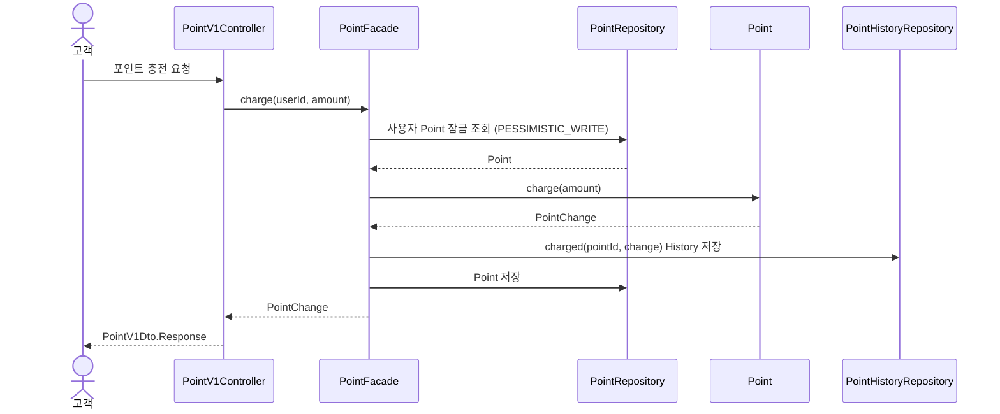

# 포인트 충전·조회

기존 절을 기능별 기준 문서로 이동했다. 절 번호·계약·승인/검증 상태는 보존하며, 이동 자체는 새 설계 승인이나 실행 검증을 뜻하지 않는다.

읽기: [공통 API 계약](../common/api-contract.md)·[공통 모델](../common/domain-model.md)·[공통 의존](../common/architecture.md)을 함께 따른다.

공통 DTO 설명과 null/생략 규칙, [고객 API 공통 설명](catalog.md#52-고객-api)을 함께 적용한다.

## 4.2 포인트 충전

포인트 충전은 Spring 프록시를 통과하는 public `PointFacade.charge()`의 `@Transactional`이 유스케이스 전체를 관리한다. 첫 Entity 조회부터 사용자별 Point를 비관적 쓰기 잠금으로 복원하고 잠금 획득 후의 잔액에서 충전한다. PointHistory는 Point 변경에 부속된 감사 기록으로 같은 트랜잭션에서 저장하며 잠금은 commit 또는 rollback까지 유지한다. 잔액 조회의 기존 비잠금 경로는 유지한다. 신규 PG 결제는 Point를 조회·잠금·차감하지 않는다.

공통 요청자 식별 단계에서 `UserFacade`가 테스트 DB에 준비된 User의 존재를 확인한 뒤, PointFacade는 해당 User와 함께 fixture로 준비된 Point를 조회한다. 존재하는 User에게 Point가 없는 경우에는 최초 충전으로 간주해 새로 생성하지 않고 비정상적인 데이터 상태로 처리한다. 구체적인 오류 응답은 [5장](../common/api-contract.md)의 API 계약에서 정한다.

*그림 6. 포인트 충전 객체 협력 흐름*

Point는 충전 금액이 양수인지 확인하고 잔액을 증가시킨 뒤 변경 전후 잔액과 충전액을 담은 PointChange를 반환한다. PointFacade는 `PointHistoryModel.charged(pointId, change)`로 충전 이력을 생성해 저장하고 domain 타입인 PointChange를 Controller에 반환한다. Controller는 충전 후 잔액을 `PointV1Dto.Response`로 변환한다. fixture에서 Point에 설정한 초기 잔액 0은 충전이나 사용에 따른 변경이 아니므로 PointHistory를 생성하지 않는다. Point 변경과 History 저장은 같은 트랜잭션에서 처리하며, 입력이나 저장에 실패하면 잔액과 History는 모두 변경되지 않는다.

## 5.1 포인트 입력·DTO 계약

### 포인트 입력 정책

|항목|잠정 기준|잘못된 입력|
|---|---|---|
|포인트 충전액|1 이상의 정수|`400 INVALID_POINT_AMOUNT`|

### 포인트 요청 DTO (5.1)

|요청 모델|필드|
|---|---|
|`PointChargeRequest`|`amount: Long`|

### 포인트 응답 DTO (5.1)

|응답 모델|필드|
|---|---|
|`PointResponse`|`balance: Long`|

### 포인트 API별 data 타입 (5.1)

|API|data 타입|
|---|---|
|포인트 충전·잔액 조회|`PointResponse`|

## 5.2 포인트 고객 API

### 포인트

|기능|Method & Path|입력|성공 결과|대표 오류|
|---|---|---|---|---|
|포인트 충전|`POST /api/v1/points/charge`|본문 `amount`|`200`, 충전 후 잔액|`INVALID_POINT_AMOUNT`, `NUMERIC_OVERFLOW`, `POINT_NOT_INITIALIZED`|
|포인트 잔액 조회|`GET /api/v1/points`|추가 입력 없음|`200`, 현재 잔액|`POINT_NOT_INITIALIZED`|

1포인트는 1원으로 계산한다. 잔액 0은 유효하지만 충전 요청 0은 유효하지 않다. 공통 요청자 식별 단계에서 User 존재 여부를 확인하며, 존재하는 User에게 fixture로 함께 준비되어야 할 Point가 없으면 `PointFacade`는 새 Point를 만들지 않고 데이터 불변식 위반인 `500 POINT_NOT_INITIALIZED`로 응답한다. Point 조회·저장과 트랜잭션은 PointFacade가 담당하고, 충전 금액 검증과 잔액 변경은 PointModel이 담당한다.

충전은 사용자 Point 행의 비관적 잠금을 유지하고 보호된 잔액에서 변경·History를 같은 트랜잭션으로 저장한다. 신규 PG 결제는 Point를 조회·잠금·차감하지 않는다. 일반 잔액 조회는 비잠금으로 유지한다.

## 5.4 포인트 대표 규칙의 테스트 기대값

|규칙|주어진 상태와 요청|기대 결과|
|---|---|---|
|포인트 충전|잔액 0, 충전액 10,000|잔액 10,000과 PointHistory 저장|
|유효하지 않은 충전|잔액 1,000, 충전액 0|`400 INVALID_POINT_AMOUNT`, 잔액과 History 유지|
|포인트 초기화 불변식|존재하는 User에게 Point가 없는 상태에서 잔액 조회 또는 충전|`500 POINT_NOT_INITIALIZED`, Point와 PointHistory를 새로 생성하지 않음|
