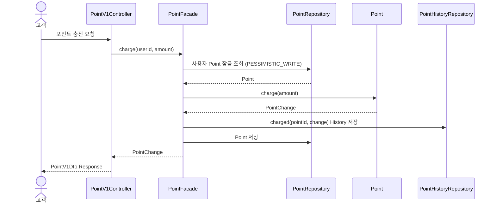
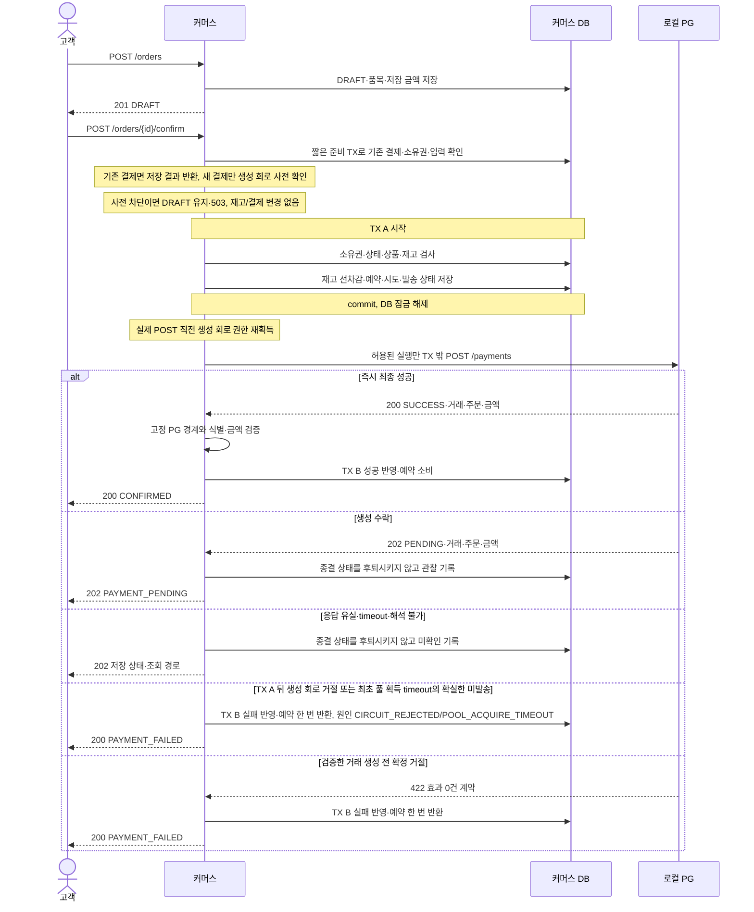
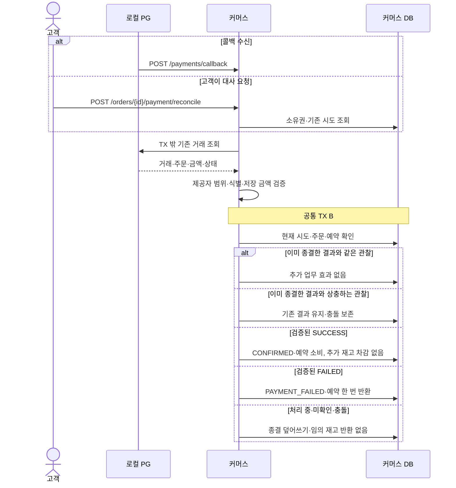
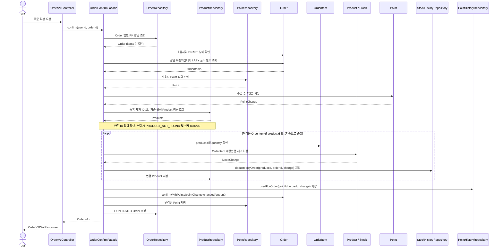

# 4. 대표 흐름

## 4.1 브랜드와 연관 상품 일괄 삭제

기존에 활성 상품이 있으면 브랜드 삭제를 거절하던 계약을, 브랜드와 연결 상품을 함께 삭제하는 계약으로 변경한다. 브랜드 삭제 시 연결된 미삭제 상품을 단일 bulk UPDATE로 Soft Delete하고, 브랜드 삭제와 하나의 트랜잭션으로 묶는다. 상품별 Entity 조회와 개별 UPDATE 반복을 피하기 위해 bulk 방식을 선택한다.

2026-10-07 브랜드 일괄 삭제의 구현·검증을 완료했다. 아래 계약과 검증 기준은 이후 회귀에도 유지한다. 실행계획 확인 범위는 4.1.6, 완료 근거는 4.1.7에 구분해 기록한다. 4.2~4.3의 공통 잠금·주문 동시성도 이후 구현·검증했으며 완료 근거는 4.3.5에 둔다.

### 4.1.1 대상과 보존 범위

상품 삭제 조건은 `brand_id = 요청한 brandId AND deleted_at IS NULL`이다. 재고가 0인 상품도 포함하며, 이미 삭제된 상품의 삭제·수정 시각과 다른 브랜드·상품은 변경하지 않는다. 연결 상품이 없는 활성 브랜드도 정상 삭제한다. 없는 브랜드와 이미 삭제된 브랜드는 상품 변경 전에 `BRAND_NOT_FOUND`로 거절한다.

상품에서는 `deleted_at`과 `updated_at`만 변경한다. 기존 재고·가격·생성 시각, Like 관계, StockHistory와 과거 Order·OrderItem의 품목·수량·단가·총액·포인트 결제 결과는 유지한다. 삭제는 재고 조정이나 거래 기록 삭제가 아니다.

### 4.1.2 호출 순서와 트랜잭션

```text
BrandAdminV1Controller.delete
  → Spring Transaction Proxy
    → BrandFacade.delete @Transactional
        1. BrandRepository.findActive(brandId)
           → 없거나 이미 삭제됐으면 BRAND_NOT_FOUND
        2. ProductRepository.softDeleteAllActiveByBrandId(brandId, deletedAt)
           → 단일 UPDATE 실행, 변경 행 수 0도 정상
        3. Brand.delete()
        4. BrandRepository.save(brand)
    → 정상 처리 후 commit 완료 시 Brand와 Product 전체 확정
    → commit 전 업무 거절·중간 처리 RuntimeException 전파 시 전체 rollback
```

`BrandFacade.delete()`를 기존 진입점과 하나의 쓰기 트랜잭션 경계로 유지한다. domain의 `ProductRepository`에 브랜드별 일괄 삭제 포트를 선언하고 infrastructure에서 bulk UPDATE를 구현한다. Facade에 JPQL·SQL을 두지 않고, 새 Domain Service나 별도 Removal Facade를 추가하지 않는다. Product별 `REQUIRES_NEW`, 단계별 독립 commit, 일부 성공 응답과 예외 삼키기는 사용하지 않는다.

commit 중 통신 장애로 완료 여부를 확인하지 못한 경우까지 오류 응답만으로 rollback을 단정하지 않는다. 이 한계의 기록은 장애 실험·복구 기능을 추가하라는 요구가 아니며, [5.1의 공통 실패 계약](./05-api-contract.md#51-공통-계약과-입력-정책)을 따른다.

확정한 Repository 계약은 `int softDeleteAllActiveByBrandId(Long brandId, ZonedDateTime deletedAt)`이다. domain의 `ProductRepository`에 선언하고, infrastructure의 `ProductRepositoryImpl`이 `ProductJpaRepository`의 `@Modifying` native SQL UPDATE에 위임한다. 반환값은 변경된 상품 수이며, 사전에 조회한 상품 수와 같아야 한다는 조건이나 최소 1개라는 조건은 두지 않는다.

기존 `BrandModel.delete(boolean hasActiveProducts)`의 상품 존재 여부 기반 거절 규칙은 제거하고, Brand 삭제는 상속한 `BaseEntity.delete()`를 사용한다. 단순히 부모 행동을 호출하기 위한 override는 추가하지 않는다. 삭제 거절을 위해 사용하던 `ProductRepository.existsActiveByBrandId()`와 대응하는 infrastructure·JPA Repository 메서드는 다른 사용처가 없다면 함께 제거한다. `BRAND_HAS_ACTIVE_PRODUCTS`도 변경 후 사용처가 없다면 제거하되, 부록의 과거 결정 설명은 보존한다. `BrandFixture`의 `delete(false)` 호출은 `delete()`로 변경하며, fixture는 데이터 준비 역할을 유지하고 일괄 삭제 유스케이스를 재현하지 않는다.

```sql
UPDATE product
   SET deleted_at = :deletedAt,
       updated_at = :deletedAt
 WHERE brand_id = :brandId
   AND deleted_at IS NULL;
```

상품들의 삭제·수정 시각에는 한 번 생성한 값을 사용한다. Brand는 기존 Entity 삭제 행동을 사용하며, Brand와 Product의 삭제 시각이 정확히 같아야 한다는 계약은 두지 않는다.

### 4.1.3 bulk와 영속성 컨텍스트

bulk UPDATE는 개별 `Product.delete()`, 변경 감지와 `@PreUpdate` 콜백을 거치지 않는다. 따라서 기존 `BaseEntity` 콜백에 맡기지 않고 `updated_at`도 쿼리에 명시한다. 상품별 업무 행동·검증·이벤트가 삭제에 추가되면 bulk 경로에서 이를 어떻게 보존할지 다시 검토한다.

이 흐름에서는 삭제 대상 Product Entity를 미리 조회하거나 bulk 이후 관리 객체를 계속 사용하지 않는다. Brand는 bulk 전에 조회하되 자신의 삭제 변경은 bulk 이후에 수행한다. 다만 이 순서만으로 다른 호출 경로에서 이미 적재한 Product까지 자동 동기화된다고 보장하지는 않는다.

bulk 전에 필요한 미반영 변경이 있다면 먼저 flush하고, 이후 영향을 받은 관리 객체를 다시 사용해야 한다면 재조회·refresh 또는 영속성 컨텍스트 정리를 판단한다. 무조건 `clear()`하면 아직 flush하지 않은 변경을 잃고 Brand도 분리될 수 있으므로 자동 clear를 기본 정책으로 두지 않는다. 현재 구현의 `@Modifying`은 `flushAutomatically`·`clearAutomatically`를 켜지 않으며 운영 흐름에 명시적 flush·clear를 추가하지 않았다. bulk 영속성 컨텍스트 테스트에서는 bulk 전에 적재한 Brand·Product가 계속 관리 상태이고 Product 객체가 자동 동기화되지 않는 점을 확인했다.

### 4.1.4 삭제 이후 사용 제한과 조회 방어

일괄 삭제된 상품은 고객·관리자 목록과 상세, 새 Like, 내 Like 목록, 새 주문, 관리자 수정·재고 변경·재삭제 대상에서 제외한다. 삭제 전에 만든 DRAFT 주문도 확정 시 잠금 조회로 상품 상태를 다시 확인해 하나라도 삭제됐다면 기존 `PRODUCT_NOT_FOUND`로 거절한다. 주문 확정은 4.3의 `Order → Point → Product` 순서를 따르므로 Point 검증·사용이 먼저 수행될 수 있지만, 실패 요청의 포인트·재고·주문·History 변경은 전체 rollback한다. Point 부족 등과 상품 삭제가 함께 있는 경우의 복합 오류 우선순위는 별도 계약으로 보존하지 않는다. 기존 자신의 Like 취소와 과거 주문 조회는 유지한다.

현재 `ProductQueryRepositoryImpl`은 상품 조회와 관련 count 쿼리에 Product와 Brand 양쪽의 `deletedAt IS NULL` 조건을 이미 적용한다. 이 조건을 유지하고 고객·관리자 상품 목록·상세와 내 Like 목록의 비노출을 검증한다. 삭제가 commit된 이후 시작된 새 조회에서, 경쟁으로 뒤늦게 등록된 상품도 삭제 Brand 조건으로 숨기는 방어 수단이다. 기존 스냅샷을 읽는 진행 중 트랜잭션에 즉시 반영된다는 보장은 하지 않는다.

조회 방어는 상품 행 자체의 삭제를 대신하지 않는다. 현재 명령용 `ProductRepository.findActive()`와 `findAllActiveByIds()`는 Product 자신의 삭제 여부만 확인하므로, `삭제 Brand + 미삭제 Product`가 남으면 화면에서 숨겨져도 상품 ID 기반 명령에서 사용할 가능성이 있다. 이번에는 이 한계를 기록하며 명령 경로의 Brand 조건 추가나 동시 등록 차단까지 구현한 것으로 간주하지 않는다.

### 4.1.5 동시성 범위와 향후 대안

브랜드 일괄 삭제 경로에는 별도의 명시적 잠금을 추가하지 않는다. 보장 범위는 한 삭제 요청에서 bulk UPDATE가 변경한 Product와 Brand 변경의 원자성이다. 4.3의 주문·개별 상품 변경 잠금 규칙을 이 bulk 경로까지 확장한 것은 아니다. Brand 삭제와 상품 등록·수정·재고 변경·DRAFT 확정·Like 또는 주문 생성 간 경쟁의 정합성은 별도 확장 범위다.

MySQL InnoDB의 REPEATABLE READ를 전제로, 일반 SELECT의 MVCC 스냅샷과 UPDATE의 배타적 잠금을 구분한다. bulk UPDATE는 사용 인덱스와 검색 범위에 따라 record·next-key/gap lock으로 INSERT를 대기시킬 수 있다. 그러나 잠금 해제 후 INSERT가 진행될 수 있으므로, 벌크 잠금 자체가 삭제된 Brand의 상품 등록을 거부하는 업무 규칙은 아니다. 실제 격리 수준과 실행계획은 구현·실험 시 확인한다.

```text
TX B: 활성 Brand 확인 후 상품 등록 준비
TX A: Product bulk 삭제, Brand 삭제
TX B: INSERT 시도 → 잠금과 겹치면 대기
TX A: commit 및 잠금 해제
TX B: Brand를 다시 검사하지 않고 INSERT·commit → 미삭제 상품 잔존 가능
```

이 경쟁 자체를 팬텀 리드로 부르지 않는다. 같은 조건의 반복 조회 결과가 달라지는 읽기 현상과, 삭제·등록의 업무 규칙이 엇갈리는 문제를 구분한다. RR의 일반 SELECT와 UPDATE가 대상으로 삼는 데이터도 반드시 같지는 않다.

다음 두 대안은 검토 후보로만 남기며 이번에는 구현하지 않는다.

- 사후 보정 배치: 삭제 Brand 아래의 미삭제 Product를 찾아 삭제한다. 보정 전 사용 가능성을 막지는 못하며, 배치를 구현하기 전에는 자동 복구도 보장하지 않는다.
- 공통 Brand 잠금: 상품 등록과 Brand 삭제 양쪽이 같은 Brand 행을 `FOR UPDATE`로 조회하고, 잠금을 획득한 뒤 최신 삭제 여부를 검사한다. 기존 Product 행만 잠그거나 삭제 경로만 Brand를 잠그는 것으로 새로운 상품 INSERT를 업무적으로 차단했다고 보장하지 않는다.

### 4.1.6 인덱스와 설계 재검토 기준

**2026-10-16 변경**: 상품 목록 인덱스를 라이팅 실험에서 고른 구성으로 정리하면서 `product(brand_id)` 단독 인덱스를 제거했다. 현재 product 보조 인덱스는 `(brand_id, price)`·`(brand_id, created_at)`·`(brand_id, deleted_at)`이다([4.4.1](#441-대상과-보존-계약)). 단독 인덱스는 세 복합 인덱스의 `brand_id` 선두 범위와 중복된다. D0(상품 100,000)에서 일괄 삭제 UPDATE를 EXPLAIN만 해 보니, 상품 809개 브랜드는 단독 인덱스 구성과 새 구성 모두 `brand_id` 범위 809행(새 구성은 `(brand_id, price)` 선택), 상품 20,000개 브랜드는 두 구성 모두 PRIMARY 전체 스캔이었다. 갱신 열 `deleted_at`을 포함한 `(brand_id, deleted_at)`은 이 UPDATE에 선택되지 않았다. 실제 UPDATE 시간·잠금은 측정하지 않았다. 인덱스 검사 테스트는 "brand_id 단독 인덱스 하나"에서 "합의한 세 복합 인덱스만 있고 같은 열 구성의 중복이 없음"으로 바꿨다. 아래 문단은 2026-10-07 결정 당시 기록이다.

이번 구현에 `product(brand_id)` 단독 인덱스를 추가한다. 목적은 bulk UPDATE에서 해당 Brand의 상품을 찾는 탐색 비용을 줄이는 것이다. `brand_id`로 대상을 찾고 `deleted_at IS NULL`을 추가 검사한다. 인덱스는 `ProductModel`의 `@Table(indexes = …)`에 `@Index(columnList = "brand_id")`로 선언하고, local·test의 기존 `ddl-auto: create` 설정에 따른 스키마 생성으로 반영한다. 새 마이그레이션 체계는 도입하지 않는다. 어노테이션 선언만으로 스키마 생성을 하지 않는 기존 DB까지 변경된다고 보장하지 않으며, 동일한 인덱스를 중복 생성하지 않는다. 실제 사용 여부는 실행계획으로 확인한다.

2026-10-07 브랜드 bulk의 EXPLAIN은 정상 삭제·rollback 증명이 아니라 `brand_id` 인덱스 선택의 보조 근거로 확인했다. 테스트에서 수집한 native bulk SQL·바인딩을 기준으로, 사용자가 기존 DB `loopers`의 버전·격리 수준·DDL·인덱스·건수를 확인한 뒤 `brand_id = 1 AND deleted_at IS NULL` 조건의 UPDATE에 EXPLAIN을 직접 실행했다. 당시 product는 0건이었고 결과는 `type=range`, `key=IDX1td6gorl25rsvufiiive2svlx`, `rows=1`, `Extra=Using where`였다. `rows=1`은 추정치이며 실제 대상 건수가 아니다.

테스트 DB의 단독 인덱스 생성·중복 없음과 실제 데이터의 bulk 동작 테스트를 함께 근거로 삼아, 사용자 결정으로 이번 브랜드 bulk의 인덱스 실행계획 확인 항목을 충족한 것으로 인정했다. 제안한 5,000건 삽입·ANALYZE·추가 EXPLAIN은 진행하지 않았으며, 데이터가 있는 조건의 bulk 실행계획·탐색 효율·성능은 미검증이다. 두 DB의 MySQL 버전과 격리 수준은 8.0.46·REPEATABLE-READ로 같지만, 사용자 테이블 collation은 utf8mb4_0900_ai_ci, Testcontainers 서버 옵션은 utf8mb4_general_ci이며 테스트 테이블의 실제 collation은 미확인이다.

`(brand_id, deleted_at)` 복합 인덱스는 필수가 아니다. 이미 삭제된 상품이 많이 누적되어 불필요한 탐색이 커지면 비교한다. 대부분 미삭제라면 탐색 감소 이점이 작을 수 있고, 복합 인덱스의 공간 및 삭제 시 인덱스 갱신 비용도 고려한다.

이번 실습에서는 성능 측정을 필수 검증 범위에 포함하지 않는다. commit을 포함한 삭제 API 응답시간 2초 이내, 3초 초과의 반복은 향후 설계 재검토를 위한 잠정 참고 기준으로만 둔다. 측정으로 도출한 수치나 성능 보장이 아니며, 운영 요구와 향후 측정 결과에 따라 조정한다. API timeout·거절 조건이나 자동 비동기 전환 규칙으로 사용하지 않는다.

- 응답 지연이 반복되거나 다른 요청의 잠금 대기가 커지면 실행계획·탐색량·인덱스·잠금 대기를 먼저 확인한다.
- 1,000개 같은 임의의 상품 수 API 상한은 추가하지 않는다. 향후 성능 측정 시 상품 수·전체 테이블 규모·동시 요청·실행 환경을 함께 기록한다.
- 개선 후에도 동기 처리가 적절하지 않으면 비동기 또는 분할 배치를 검토한다. 비동기는 DB 작업 자체를 줄이지 않으며, 분할 commit은 전체 원자성 계약을 바꾸므로 삭제 진행 상태·응답 의미·재시도와 실패 처리까지 별도 설계한다.

### 4.1.7 검증 계획

실습의 핵심 검증은 정상 일괄 삭제와 중간 실패 시 전체 rollback이다. 기존 검증은 새 계약에서도 유효한 경우에만 유지한다. 브랜드 이름 검증·등록·조회·수정, 연결 상품 없는 Brand 삭제, 연결 상품이 모두 삭제된 Brand 삭제, 다른 Brand·Product 보존, 없는·이미 삭제된 Brand 거절은 유지한다. `활성 Product가 있으면 Brand 삭제 거절`처럼 사라진 규칙을 검증하는 도메인·통합·API 테스트는 제거한다. 기존 테스트마다 다른 테스트를 대응시켜 대체할 필요는 없으며, 새 일괄 삭제와 rollback 계약은 별도로 검증한다. 이는 폐기된 규칙의 검증을 정리하는 것이며, 새 설계에서도 유효한 테스트나 lint·ArchUnit 규칙을 완화하는 것은 아니다.

정상 일괄 삭제 테스트에서는 재고 0을 포함한 연결 미삭제 Product 전체와 Brand의 삭제, 연결 상품 없는 Brand 성공, 없는·삭제된 Brand 오류, 이미 삭제된 상품의 삭제·수정 시각 보존, 다른 Brand·Product와 과거 주문 보존을 확인한다.

rollback 통합 테스트는 Brand와 연결 Product 2개(하나는 재고 0), 다른 Brand의 Product와 과거 주문을 준비하고 먼저 commit한다. 테스트 전체를 하나의 부모 트랜잭션으로 감싸지 않으며, 실제 Spring bean의 `BrandFacade.delete()`를 프록시를 통해 호출해 유스케이스 트랜잭션이 시작·종료되게 한다.

rollback 테스트는 실제 MySQL에서 Product bulk UPDATE를 실행한 뒤, 테스트 구성의 다음 Brand 저장 경계에서 RuntimeException을 유발한다. 전체 Repository를 mock하지 않고, bulk 쿼리를 생략하거나 실제 SQL 실행 전에 실패시키지 않는다. 운영 코드에 테스트용 실패 분기·sleep·barrier를 넣지 않는다.

Facade 트랜잭션이 끝난 뒤 새로운 트랜잭션·영속성 컨텍스트에서 Brand와 모든 대상 Product의 삭제·수정 시각 등 상태가 작업 전과 같은지 확인한다. 활성 데이터 조회만으로 판단하지 않고 삭제 행도 조회할 수 있는 경로로 변경 전후 상태를 비교한다. 다른 대상과 과거 주문도 유지되고 예외가 호출자에게 전파되어야 한다. 단순 `save()` 호출 횟수나 같은 관리 객체의 값은 rollback 증거로 사용하지 않는다.

HTTP 테스트와 중간 실패 rollback 통합 테스트의 역할은 구분한다. HTTP에서는 관리자 삭제 성공의 `200`과 데이터 없는 성공 응답(내부 `data` 값은 null이며 실제 JSON에서는 생략), 없는·이미 삭제된 Brand의 `404 BRAND_NOT_FOUND`, 일반 사용자·익명 요청의 `403`을 실제 DB 결과와 연결해 확인한다. 성공 시 대상 전체가 삭제되고, 거절 시에는 Brand·Product가 변경되지 않아야 한다. 관리자 변경 요청과 역할 거절 테스트에는 기존 정책에 따라 유효한 CSRF 입력을 보낸다. 실패 주입에 의한 전체 rollback은 위 실제 MySQL Facade 통합 테스트로 증명하며, HTTP 계층에서 같은 실패 주입을 반복하는 것을 필수로 두지 않는다.

변경 영향에 대한 회귀 테스트로 삭제 이후 조회·사용 제한, 기존 Like 취소와 DRAFT 확정 거절을 검증한다. 영향받는 브랜드·상품·포인트·주문 테스트와 기존 lint(Checkstyle)·ArchUnit도 실행한다.

브랜드 삭제와 상품 등록의 동시 실행 테스트는 선택 확장이다. 4.1.5의 사후 보정 배치와 공통 Brand 잠금은 향후 대안으로 유지하되, 이번에 구현하거나 검증한 것으로 간주하지 않는다.

2026-10-07 완료 근거: 정상 bulk·보존·영속성·인덱스 확인에 이어, `BrandRemovalTransactionIntegrationTest`의 전용 `BrandRepository` spy에서 현재 트랜잭션의 실제 DB 조회로 삭제 상품 총 3건을 확인한 뒤 RuntimeException을 주입했다. 준비 데이터는 기존 삭제 1건과 bulk 대상 미삭제 2건이었다. 검증용 native SELECT 직전의 AUTO flush로 Brand UPDATE도 전송됐으며, 이는 테스트 조회가 유발한 동작이다. Facade 종료 후 새 조회에서 Brand·Product의 삭제/수정 시각 등 상태와 과거 주문·Like가 작업 전과 같음을 확인했다. 삭제 후 회귀에서는 사용 제한·과거 주문 보존·DRAFT 확정 거절과 HTTP·접근 경계를 확인했다. 브랜드 인계 시점의 `cleanTest check` 결과는 326건·실패/오류/skip 0, Checkstyle·ArchUnit 통과다. 이후 주문·동시성과 정리 보호 보완을 포함한 최종 결과는 4.3.5에 둔다.

## 4.2 포인트 충전

포인트 충전은 Spring 프록시를 통과하는 public `PointFacade.charge()`의 `@Transactional`이 유스케이스 전체를 관리한다. 첫 Entity 조회부터 사용자별 Point를 비관적 쓰기 잠금으로 복원하고 잠금 획득 후의 잔액에서 충전한다. PointHistory는 Point 변경에 부속된 감사 기록으로 같은 트랜잭션에서 저장하며 잠금은 commit 또는 rollback까지 유지한다. 잔액 조회의 기존 비잠금 경로는 유지한다. 신규 PG 결제는 Point를 조회·잠금·차감하지 않는다.

공통 요청자 식별 단계에서 `UserFacade`가 테스트 DB에 준비된 User의 존재를 확인한 뒤, PointFacade는 해당 User와 함께 fixture로 준비된 Point를 조회한다. 존재하는 User에게 Point가 없는 경우에는 최초 충전으로 간주해 새로 생성하지 않고 비정상적인 데이터 상태로 처리한다. 구체적인 오류 응답은 [5장](./05-api-contract.md#5-api-계약과-주요-규칙)의 API 계약에서 정한다.



*그림 6. 포인트 충전 객체 협력 흐름*

Point는 충전 금액이 양수인지 확인하고 잔액을 증가시킨 뒤 변경 전후 잔액과 충전액을 담은 PointChange를 반환한다. PointFacade는 `PointHistoryModel.charged(pointId, change)`로 충전 이력을 생성해 저장하고 domain 타입인 PointChange를 Controller에 반환한다. Controller는 충전 후 잔액을 `PointV1Dto.Response`로 변환한다. fixture에서 Point에 설정한 초기 잔액 0은 충전이나 사용에 따른 변경이 아니므로 PointHistory를 생성하지 않는다. Point 변경과 History 저장은 같은 트랜잭션에서 처리하며, 입력이나 저장에 실패하면 잔액과 History는 모두 변경되지 않는다.

## 4.3 주문 확정

신규 결제는 PG를 사용한다. DRAFT 주문 생성과 결제 시작을 구분하고, PG 호출 전에 가용 재고를 선차감해 주문별로 예약한다. 검증된 결제 성공을 확인한 뒤 주문을 CONFIRMED로 바꾼다. 포인트 차감·주문 원인의 포인트 사용 이력은 만들지 않으며, Point 행의 존재·잔액을 신규 결제의 전제조건으로 사용하지 않는다.

이 절의 PG 흐름은 I4·I5에서 구현한 현행 계약이다. 구현·실행 범위와 한계는 이 문서 마지막의 I4·I5 검증 근거를 따른다. 아래 접힌 POINT 기록은 이전 구현과 검증의 근거다. 그 기록의 단일 TX·포인트 잠금·포인트 부족·중복 확정 오류 규칙을 신규 PG 주문에 적용하지 않는다. 클래스·저장·잠금 상세는 관련 구조·도메인 설계에 반영하며, 미정 사항을 구현자가 임의로 채우지 않는다.

### PG 결제의 진입점과 보존 범위

|진입점|책임|외부 호출|
|---|---|---|
|`POST /api/v1/orders`|품목·저장 단가·총액을 준비하고 DRAFT 저장. 재고·포인트 변경 없음|없음|
|`POST /api/v1/orders/{orderId}/confirm`|본인 DRAFT의 재고 확보·예약·결제 시도 준비 후 결제 시작. 같은 시도 재요청은 저장 결과 반환|발송 권한을 얻은 실행의 결제 생성 1회|
|`GET /api/v1/orders/{orderId}` 및 주문 목록|저장된 본인 주문·결제 상태 조회. 관리자 조회는 기존 접근 경계 유지|없음|
|`POST /api/v1/orders/{orderId}/payment/reconcile`|본인 주문의 기존 PG 거래를 조회·검증하고 결과 반영|기존 거래 조회만 수행|
|`POST /api/v1/payments/callback`|PG 알림을 받아 기존 거래를 권위 조회·검증한 뒤 결과 반영|기존 거래 조회만 수행|

`confirm`은 결제 절차의 시작 경로이며, 호출 수락이 주문 확정을 뜻하지 않는다. 내부 주문 확정은 검증된 SUCCESS를 결과 반영 TX에 commit한 시점이다. 별도의 고객용 완료 API나 PG 승인 confirm API는 추가하지 않는다.

주문 생성 시 저장한 품목·양수 수량·단가·총액을 결제에 사용하며 현재 상품 가격으로 금액을 다시 계산하지 않는다. 주문당 한 시도만 허용하고 실패 후 새 키·새 결제로 재시도하지 않는다. 이전 POINT 확정 주문의 결제액·사용 포인트·품목과 소유권은 보존하고, 해당 주문의 confirm 재요청은 기존 ORDER_NOT_CONFIRMABLE을 유지한다.

### 결제 시작과 재고 선차감

다음 시퀀스는 생성 응답 처리 전에 콜백이 종결을 반영하지 않은 대표 흐름이다. 콜백이 먼저 종결한 경우에는 같은 거래의 늦은 생성 PENDING·timeout 관찰을 적용하지 않고, confirm에서 이미 저장된 종결 결과를 200으로 반환한다. 늦은 생성 응답이 저장 키와 다른 거래이거나 금액이 다르면 [3.6 판정 순서](./03-domain-model.md#확인-정보의-반영-순서와-종결-처리)의 충돌·409다.



0. **사전 확인:** 기존 결제/입력/소유권을 짧은 TX에서 확인한다. 기존 결제면 저장 결과를 반환하고 신규 DRAFT만 생성 회로를 사전 확인한다. 사전 차단은 503 PG_CREATE_UNAVAILABLE이며 DRAFT·재고·결제 행을 바꾸지 않는다. 경쟁/실제 POST 권한 거절은 아래 공통 흐름에서 다시 처리한다.
1. **TX A:** 본인 주문과 저장 품목을 확인하고, 활성 상품·가용 재고를 검사한다. 가용 재고를 줄이고 주문별 예약·시도·결제 대기 상태와 발송 권한을 DB에 보존한다. 하나라도 실패하면 TX A 전체를 rollback하고 PG를 호출하지 않는다.
2. **TX 밖 HTTP:** 발송 권한을 얻은 실행만 생성 회로의 실제 호출 권한을 재획득하고 PG 생성 POST를 수행한다. PG를 기다리는 동안 TX A의 DB 연결·재고 잠금을 계속 보유하지 않는다. 발송 시작을 영속 기록한 뒤에는 client·proxy·회복 도구를 통한 자동 create 재시도를 허용하지 않는다.
3. **결과 반영:** 즉시 SUCCESS 응답은 고정한 PG 경계와 저장 주문·거래·금액의 일치를 검증한 뒤 추가 조회 없이 공통 TX B로 반영한다. PENDING·응답 불확실도 이미 기록된 종결 상태를 후퇴시키지 않는 조건으로 저장한다.
4. **응답:** 성공 반영 commit이 끝나면 200 CONFIRMED, 확정 실패와 반환을 반영하면 200 PAYMENT_FAILED를 반환한다. PENDING·UNKNOWN 등 미완료이면 202와 저장 상태·조회 경로를 반환한다. TX A commit 뒤의 PG 오류는 TX A를 자동 rollback하지 않는다.

TX A commit 뒤 PG 응답 전은 주문 PAYMENT_PENDING·결제 UNKNOWN·verificationStatus=NOT_CHECKED로 표현한다. UNKNOWN은 최종 결과를 모른다는 뜻이며 발송 여부·timeout 발생을 뜻하지 않는다. PG에서 PENDING을 확인하면 결제 PENDING으로, 발송 후 응답 유실이면 UNKNOWN·UNAVAILABLE로 기록한다. 공개 REQUESTED 상태는 추가하지 않는다.

같은 주문·같은 시도의 동시 confirm은 결제 행을 중복 생성하거나 재고를 중복 차감하지 않고 실제 PG POST 1회만 허용한다. 다른 주문·금액·요청에 같은 키를 사용하거나 같은 주문에 새 키로 두 번째 시도를 만들려는 요청은 효과 없이 거절한다. 이미 종결된 동일 PG 시도의 confirm 재요청은 저장 결과를 반환한다. 카드 값은 합성 값만 사용하고 DB·로그에 남기지 않는다.

### 콜백과 대사



콜백은 고객 인증 요청이 아니라 외부 알림이다. 알림 본문의 `providerOrderId, transactionKey, status`는 거래를 확인할 계기로 사용한다. 본문의 성공 문자열만으로 주문을 확정하지 않는다. 고정한 제공자 계정 범위에서 PG를 조회하고 저장 주문·transactionKey·요청 금액이 일치하는지 검증한다.

transactionKey를 알고 있으면 해당 거래를 조회하고, 생성 응답 유실로 모르면 저장된 providerOrderId로 기존 거래 목록을 조회한다. 0건·PENDING·조회 실패는 확정 실패의 증거가 아니다. 2건 이상이거나 주문·금액·거래가 불일치하면 임의 거래를 선택하지 않고 미확인·충돌로 보존한다. 대사는 create를 수행하지 않는다.

callback-first, lookup-first, 동시 적용이 같은 결과로 수렴해야 한다. 콜백이나 대사가 먼저 성공·실패로 종결했다면 늦게 도착한 생성 PENDING·timeout 처리로 상태를 되돌리지 않는다. 다른 종결 결과가 들어오면 기존 결과를 덮어쓰지 않는다. 내부 결과 반영 실패는 해당 TX를 rollback하고 같은 외부 거래를 다시 확인해 반영한다.

응답의 payment.verificationStatus는 결제 상태와 별개로 마지막 확인 결과를 표현한다. 예를 들어 기존 PENDING에서 조회가 실패하면 결제 상태·예약은 유지하고 확인 결과는 UNAVAILABLE이다. 관찰 저장·경쟁 처리는 [3.6](./03-domain-model.md#36-pg-저장-모델과-제약)의 마지막 DB 반영 기준·출처·종결 보호 규칙을 따른다.

이미 SUCCESS·FAILED로 종결한 PG 주문의 reconcile도 PG를 다시 조회·검증한다. 같은 종결 결과는 추가 효과 없이 200, 상충 종결은 기존 결과 유지와 충돌 기록 후 409로 반환한다. 재조회 불가는 저장 종결을 유지한 채 verificationStatus=UNAVAILABLE·202로 표현한다. 이때 202는 이번 대사 확인 불가이며 주문 종결 취소가 아니다. 콜백의 권위 조회도 계속 수행한다.

### 결과에 따른 주문·예약 처리

|검증한 관찰|주문·결제 의미|재고·후속 처리|
|---|---|---|
|생성 응답 SUCCESS 또는 조회 SUCCESS|결제 성공, 주문 CONFIRMED|예약 소비, 추가 차감 없음|
|PENDING|결제 처리 중, 주문 PAYMENT_PENDING|예약 유지|
|생성 응답 유실·timeout·해석 불가|최종 결과 UNKNOWN|예약 유지, 기존 거래 대사|
|이미 알던 시도의 조회 불가·회로 차단|저장한 상태 유지, 이번 확인 불가|예약 유지, 실패 종결·새 결제 생성 없음|
|조회 FAILED|확정 실패, 주문 PAYMENT_FAILED|예약 한 번 반환|
|계약상 거래 생성 전 확정 거절|외부 효과 0건을 확인한 실패|예약 한 번 반환, transactionKey를 꾸며 저장하지 않음|
|조회 0건·복수 거래·식별/금액 불일치|미완료 또는 충돌 보존|임의 확정·반환·재발송 없음|
|이미 같은 종결 결과 반영|동일 결과 재확인|추가 확정·반환 없음|

거래 생성 전 확정 거절은 고정 PG의 `422 + TEST_PG_REJECTED_BEFORE_CREATE + transactionCreated=false + 요청 orderId·amount 일치`를 모두 검증한 경우만 인정한다. 본문 없는 422·다른 4xx/5xx·잘못된 JSON·일반 조회 404를 효과 0건으로 해석하지 않는다.

재고 5개에서 수량 2개를 확보하면 가용 재고는 3개다. PENDING·UNKNOWN과 성공 반영 뒤에도 3개이고, 확정 실패 반환 뒤에만 5개다. 반환은 새 TX의 보상 처리이며 이미 commit한 TX A의 rollback이 아니다.

발송 기록 뒤 HTTP 전에 프로세스가 멈추면 실제 발송 0회일 수 있다. HTTP 뒤 내부 저장 전에 멈추면 외부 거래가 있을 수 있다. 재시작 후 이 시도를 기존 거래 조회 대상으로 유지하고, 조회 0건이나 시간 경과만으로 재발송·예약 반환하지 않는다. 모든 시도의 자동 완료를 보장하지 않는 한계를 남긴다.

### 상품 변경·기존 기능 보호와 검증

- 관리자 재고 설정은 예약을 제외한 가용 수량의 최종 설정으로 해석한다. 예약 정보를 지우거나 성공 때 다시 차감하지 않는다.
- 삭제 전 재고를 확보한 PAYMENT_PENDING 주문은 저장 품목·금액·예약으로 결과를 마무리한다. 삭제 후 새로 결제를 시작하는 DRAFT는 기존 활성 검사로 거절한다. 반환 때문에 삭제 상품이 다시 노출되지 않도록 한다.
- 재고 확보·반환의 commit 뒤 기존 상세 캐시 무효화 정책을 연결한다. 실패 rollback에서 다른 요청의 재고·캐시를 임의 복원하지 않는다.
- 소유권·저장 품목·저장 금액과 과거 POINT 주문의 조회 사실을 보존한다. Point 충전·조회 API의 불변식은 유지하되 PG 결제에는 Point 초기화·잔액 조건을 요구하지 않는다.
- 외부 거래 수·create/lookup 횟수·주문·결제·고정 품목·가용 재고·포인트와 확보/반환 이력을 함께 검증한다. HTTP 계약, 실제 MySQL, 실제 callback controller, 재시작 상태 보존과 관련 회귀를 포함한다.
- 기존 포인트 차감·포인트 부족·단일 TX rollback 테스트는 신규 PG 계약에 맞게 교체하고, 과거 POINT 조회·포인트 충전·권한·품목·재고 보호 검증은 유지한다. 아래 과거 검사 수는 PG 기능의 통과 근거가 아니다.

### PG 로컬 TX와 잠금 계약

선차감은 [A.21](./appendix-decisions.md#a21-주문-생성재고-확보외부-결제의-순서), 재발송 금지는 [A.22](./appendix-decisions.md#a22-한-시도발송-권한과-불확실한-외부-효과), 권위 조회는 [A.23](./appendix-decisions.md#a23-즉시-응답콜백대사의-권위와-복구-경계), 잠금은 [A.18](./appendix-decisions.md#a18-외부-호출-전후의-동시성-제어)을 따른다. payment 한 행과 고정 주문 품목으로 확보·반환을 관리하고 충돌만 payment_conflict로 분리한다. 별도 예약 테이블은 없다.

비관적 쓰기 잠금은 같은 주문의 상태 전이를 직렬화하고 payment의 세 unique는 주문당 결제 하나·전역 시도 키·외부 거래 중복 결합을 막는다. 외부 주문 ID는 고정 매핑을 검증하고 일반 조회 인덱스를 사용한다. 메모리 mutex나 PG의 중복 제거에 의존하지 않는다.

|처리|자원 획득 순서|commit에 포함되는 것|
|---|---|---|
|콜백 후보 식별: resolveCallbackOrderId|별도 readOnly TX·비잠금 스칼라 조회|orderId만 반환. 0/복수 후보 거절, 업무 TX 전에 종료|
|사전 준비: prepareConfirmation|Order PK 잠금 → 기존 Payment 일반 조회|소유권·입력·기존 결제/키 검사, STORED/READY 값 복사. DB 변경 없음|
|TX A: beginConfirmation|Order PK 잠금 → 기존 Payment 일반 조회 → 활성 Product ID 오름차순 잠금|PAYMENT_PENDING·최초 결제 INSERT·발송 권한·고정 품목 수량 선차감·ORDER_RESERVATION 이력|
|확인 준비: prepareVerification|Order PK 잠금 → Payment 일반 조회|소유권·조회 대상·종결 여부 확인. 번호 발급/상태 갱신·재고 효과 없음|
|TX B: applyObservation|Order PK 잠금 → Payment 일반 조회, 충돌이면 기존 PaymentConflict 일반 조회 / 실패 반환이면 필요한 Product ID 오름차순 잠금|주문·결제·확인 정보, 신규 확정 실패의 수량 반환·이력 또는 충돌 요약|
|제약 충돌 기록: recordConstraintConflict|Order PK 잠금 → Payment·기존 PaymentConflict 일반 조회|앞선 TX rollback 뒤 마지막 충돌 요약·이 TX에서 반영한 확인 정보|

모든 Payment/PaymentConflict 생성·변경 경로는 같은 Order PK 잠금을 commit/rollback까지 보유한다. 자식은 일반 조회하고 선행 SELECT FOR UPDATE는 하지 않는다. 결제나 요약이 없어도 같은 Order의 실행은 부모 잠금으로 직렬화한다. 다른 Order의 시도 키/외부 거래 경쟁은 unique가 최종 방어다. INSERT/UPDATE·unique 검사에 따른 DB 내부 잠금은 남으며 모든 gap lock/deadlock 제거를 보장하지 않는다. OrderItem은 생성 뒤 수정·삭제 경로가 없으며 결제 시작 후에도 고정한다. 충돌 요약 저장과 실패 반환은 서로 다른 판정 분기다.

**최신 조회와 TX 수명:** 격리 수준은 기존 REPEATABLE READ를 유지한다. 각 업무 TX의 첫 업무 데이터 접근 SQL은 Order PK SELECT FOR UPDATE다. 업무 SQL에는 엔티티·스칼라·exists·native 조회와 INSERT/UPDATE/DELETE를 모두 포함한다. 프레임워크의 연결/TX 초기화용 BEGIN·SET 같은 제어문은 이 순서 검사에서 구분하며, 일반 조회를 앞당기거나 스냅샷을 미리 만드는 용도로 사용하지 않는다. 잠금 획득 전에는 일반 조회·존재 확인·품목 지연 로딩·자식 Entity 로드를 하지 않는다. 이후 처음 수행하는 일반 조회부터 Payment/PaymentConflict 상태를 읽는다. Facade에 상위 TX가 없고 OSIV=false·각 호출의 별도 영속성 컨텍스트를 유지하여 앞선 TX의 Entity/스냅샷을 재사용하지 않는다. 콜백 후보 식별의 readOnly TX는 orderId만 반환하고 종료한 뒤 새 prepareVerification을 호출한다. 잠금 대기 후 최신 종결/요약을 읽는 조건은 실제 MySQL 검증 대상이며 미충족 시 일반 조회를 그대로 구현하지 말고 원인을 확인해 설계를 재검토한다.

TX A는 기존 findAllActiveByIdsForUpdate로 활성 상품을, 실패 반환은 삭제 조건 없는 findAllByIdsForUpdate로 상품을 잠근다. ID를 중복 제거·오름차순 요청하고 반환 ID 집합을 확인한다. TX A 누락은 PRODUCT_NOT_FOUND, 기존 결제의 반환 상품 물리 누락은 내부 정합성 오류다. 관리자 변경은 같은 Product 잠금에 참여하며 브랜드 bulk 삭제의 [기존 동시성 한계](#415-동시성-범위와-향후-대안)는 유지한다.

SQL·잠금 절·실행계획은 infrastructure 책임이다. IN + ORDER BY만으로 모든 분포의 실제 잠금 순서를 증명하지 않으며 [4.3.3](#433-여러-product-잠금-쿼리의-구현-선택-기준)의 쿼리/PK 힌트/ID별 조회 전환 기준을 적용한다. deadlock·잠금 timeout·DB 실패는 해당 TX rollback·500이고 자동 TX retry는 없다. TX A 실패에 PG 호출은 없으며 TX B 실패 뒤에는 기존 거래를 재조회한다. MySQL 8.0 Reference Manual의 InnoDB Locking Reads 절의 TX 범위 잠금을 사용하고 HTTP 동안 보유하지 않는다.

### 결과·확인 토큰의 값 계약

- PrepareConfirmationResult: READY 또는 STORED. READY는 결제 없는 DRAFT이며 발송 권한·재고 확보를 의미하지 않는다. STORED는 복사한 OrderInfo다.
- BeginConfirmationResult: SEND 또는 STORED. SEND는 이번 실행의 발송 권한·불변 PaymentRequest·확인 토큰, STORED는 복사한 OrderInfo를 갖는다.
- PaymentCheckToken: paymentId·orderId·source(CREATE/QUERY)·terminalAtStart. 순번은 없다. 조회 종류·식별자(거래 키 또는 외부 주문 ID)는 토큰에 넣지 않고 확인 준비 결과인 VerificationTarget(token·kind·target)에만 둔다. terminalAtStart는 확인 준비 때 이미 종결했는지이며 늦은 PENDING 처리 구분에 사용한다.
- PaymentApplyResult: OrderInfo와 FINAL/PENDING/UNAVAILABLE/CONFLICT. 저장 업무 상태와 이번 확인 결과를 구분하며 콜백은 data 없는 HTTP ACK로 변환한다.
- PaymentObservation: 파싱한 관찰·충돌 근거를 전달하며 원문 HTTP 예외·카드를 저장 모델로 넘기지 않는다. 제공자·계정·대상 URL은 서버 설정으로 고정한다.

### prepareConfirmation·beginConfirmation 내부 처리

```text
prepareConfirmation(userId, orderId, command):  // 짧은 일반 TX, 상태 변경 없음
  Order PK 잠금부터 시작 → 기존 Payment 일반 조회; 소유권/POINT 오류 우선·UUID/합성 카드 검증
  기존 payment면 beginConfirmation과 같은 키·고정 요청·상태 정합성 검사 뒤 STORED
  결제 없으면 DRAFT/품목·금액 정합성 검사
  정규 키가 다른 결제에 쓰였으면 existsByAttemptKey로 충돌; 상세 노출 없음
  return READY  // Product 잠금/재고 변경/발송 기록 없음

TX A beginConfirmation(userId, orderId, command):
  order = OrderRepository.findForUpdate(orderId), 없거나 다른 소유자면 404
  과거 POINT 확정이면 ORDER_NOT_CONFIRMABLE (새 카드 검증보다 먼저)
  UUID·고정 합성 카드 검증; 잘못되면 INVALID_REQUEST
  payment = PaymentRepository.findByOrderId(orderId)  // Order 잠금 후 첫 일반 조회
  if payment가 있으면:
    키·저장 주문·금액·고정 요청 규칙이 다르면 PAYMENT_ATTEMPT_CONFLICT
    order/payment/고정 품목 정합성 확인
    return STORED(OrderInfo); 생성·조회 HTTP와 재고 변경 없음
  order.requireDraft(); PG 표시인데 결제가 없으면 내부 정합성 오류
  고정 품목 복원; 병합 수량·저장 단가·totalAmount 정합성 확인
  활성 상품을 ID 오름차순으로 잠금; 요청 ID 집합·모든 가용 수량 확인
  payment = 새 UNKNOWN 결제(orderId, 정규 UUID, 저장 총액, 고정 외부 ID)
  외부 ID가 LP-ORD- + 해당 orderId 매핑과 일치하는지 검사
  dispatch_claimed_at 기록; verification_status=NOT_CHECKED/checked_at=null
  각 고정 품목을 productId 오름차순으로:
    change = product.decreaseStock(저장 quantity)
    ORDER_RESERVATION 이력 저장  // 별도 예약 행 없음
  order.startPgPayment(); order/payment/변경 Product 저장
  영향 상품의 기존 afterCommit 캐시 DEL 등록
  return SEND(불변 요청, CREATE 토큰 terminalAtStart=false)
  // 프록시 commit까지 성공한 뒤에만 Facade가 발송 권한을 받음
```

다른 주문에서 같은 키가 경쟁하면 uk_payment_key, 한 주문의 중복 결제 생성은 uk_payment_order가 최종 방어다. insert/flush/commit 실패는 TX A 재고·이력·결제·주문 전체를 rollback한다. Facade는 이 두 제약만 분류하고 실패한 TX 밖 새 짧은 읽기에서 확인한다. 동일 주문·동일 키의 저장 결제면 STORED, 그 외는 PAYMENT_ATTEMPT_CONFLICT다. 다른 고객 주문은 노출하지 않고 모든 DataIntegrityViolation을 업무 충돌로 바꾸지 않는다. 예상 밖 제약 실패는 500이며 실패한 TX에서 발송을 계속하지 않는다.

카드는 항상 같은 합성 값이므로 hash·원문을 저장하지 않는다. 금액은 고객 입력 없이 저장 주문·결제 값으로 비교하고 새 주문에 같은 UUID를 재사용해도 충돌이다.

### confirm 흐름과 외부 오류 경계

```text
OrderConfirmFacade.confirm(...):  // TX 없음
  prepared = prepareConfirmation 호출; commit 완료까지 대기
  if STORED: 기존 계약대로 저장 결과 200/202 반환; 생성 회로 확인도 없음
  if gateway.checkCreateAdmission() == BLOCKED:
    사전 거절 직전 prepareConfirmation 재호출
    // 사이에 다른 실행이 만든 결제는 STORED로 반환; 여전히 READY면 아래 503
    return 503 PG_CREATE_UNAVAILABLE  // 이 실행의 TX A/POST 없음, DRAFT 유지
  begin = TX A 호출, commit 완료까지 대기; 기존 계약 전부 재검증
  if STORED: 종결이면 200, 미종결이면 202로 저장 OrderInfo 반환
  observation = PaymentGateway.create(begin.request)  // SEND 실행만 1회
    통신 실패·해석 불가만 UNAVAILABLE 관찰
    검증한 효과 0건 거절만 REJECTED_NO_EFFECT 관찰
    LOCAL_NOT_DISPATCHED 관찰은 원인별 증거가 있을 때만:
      CIRCUIT_REJECTED: 실제 pgCreate decorator의 권한 거절이고 이 호출의 본문 미진입
        // 판정 조건 ①~④는 2.8 미발송 판정 장치; 타입·이름·미진입 하나만으로 판정 금지
      POOL_ACQUIRE_TIMEOUT: 이 POST의 최초 연결 풀 획득 timeout·전송 없음(2.8 풀 획득 판정)
        // 연결/읽기 timeout·취소·원인 불명·후속 풀 오류는 UNAVAILABLE 등 기존 분류
  result = TX B applyObservation(begin.token, observation)
  commit 완료 뒤 result를 200/202/409로 변환
```

예외 변환은 gateway 호출에만 적용한다. TX B의 DB 예외를 PG 통신 실패로 잡아 UNKNOWN을 다시 저장하지 않는다. 발송 권한 복원·자동 재발송은 없으며 TX B commit 실패는 500, 대사는 기존 거래를 확인한다. 사전 차단에는 결제/발송 기록이 없어서 이후 고객 confirm은 첫 시도 생성이 가능하다. TX A 뒤 미발송 실패가 commit되면 주문당 한 시도 계약대로 재결제하지 않는다. 두 원인 모두 LOCAL_NOT_DISPATCHED 반영 TX가 실패하거나 증거 저장 전에 프로세스가 종료되면 UNKNOWN·확보 재고가 남을 수 있으며 이후 조회 0건만으로 실패 확정하지 않는다. 별도 미발송 증거 영속화/자동 복구는 이번 범위에 추가하지 않는다.

### prepareVerification·callback·reconcile 내부 처리

```text
resolveCallbackOrderId(notification):  // 별도 public readOnly TX; Facade가 먼저 호출
  고정 제공자/계정 + providerOrderId로 findOrderIdsByProviderOrderId 일반 조회
  Entity/상태 없이 orderId 스칼라 목록만 읽고 DISTINCT로 중복을 숨기지 않음
  0건: ORDER_NOT_FOUND; 2건 이상: 내부 정합성 오류 500; PG 호출 없음
  정확히 1건: orderId만 복사하여 반환; 이 TX 종료 뒤 업무 TX 시작

prepareVerification(orderId, requester, notification):  // 새 짧은 업무 TX
  첫 업무 SQL로 Order PK 잠금; 고객 요청이면 본인 소유 확인
  payment = PaymentRepository.findByOrderId(orderId)  // 첫 일반 조회
  없으면 ORDER_NOT_FOUND; 현재 주문/결제 연결·고정 제공자/계정·외부 ID 매핑 재검증
  callback의 필수 식별·상태 형식은 수신 경계에서 선행 검증
  token = (payment/order 식별, QUERY, 현재 종결 여부)  // 준비에서 번호·상태 갱신 없음
  callback 조회 키 = notification.transactionKey (이 단계에서 결합하지 않음)
  reconcile 조회 키 = 저장 transactionKey, 없으면 저장 providerOrderId
  return 불변 token + 조회 대상; commit

PaymentCallbackFacade.handle(notification):  // TX 없음
  orderId = resolveCallbackOrderId(notification) 호출; readOnly TX 종료 확인
  prepareVerification(orderId, callback, notification) 별도 프록시 호출
  알림의 거래 키로 PG 권위 조회; 요청/응답 거래 키 일치 검증
  관찰을 TX B에 전달; 알림 status로 최종 결과를 덮지 않음
  commit 뒤 200/202/409, data 생략

PaymentReconcileFacade.reconcile(userId, orderId):  // TX 없음
  prepareVerification(orderId, userId, notification 없음) 호출; 종결 주문도 조회
  저장 거래 키가 있으면 거래 GET 1회, 없으면 주문별 목록 GET 1회
  0건: 정상 빈 배열은 회로 성공 1회·UNAVAILABLE
  1건: 요청 외부 주문 ID와 비교, 다르면 recordResult 실패·IDENTITY_MISMATCH
  2건 이상: MULTIPLE_TRANSACTIONS, 임의 선택/필터링 금지
    요청 주문만 있으면 회로 성공 1회, 다른 주문이 섞이면 실패 1회
  관찰을 TX B에 전달; commit 뒤 OrderInfo와 200/202/409
  // create·추가 GET·자동 retry·polling 없음
```

단건 요청 키 A/응답 B는 회로 실패로 집계하지만 CONFLICT/IDENTITY_MISMATCH 관찰을 보존해 TX B에 전달한다. 콜백이 요청한 B를 정확히 조회한 뒤 내부 주문 A와 다르면 회로 성공·업무 충돌이다. 같은 주문·금액의 정확한 KB 거래가 저장 키 KA와 다른 경우도 회로 성공이며, TX B가 종결 비교 전에 IDENTITY_MISMATCH로 판정한다([3.6 거래 식별 판정](./03-domain-model.md#확인-정보의-반영-순서와-종결-처리)). 주문별 목록의 다른 주문 1건도 직접 대상 위반이며, 유효 복수 목록에 다른 주문이 섞이면 회로 실패·MULTIPLE_TRANSACTIONS 우선이다. 요청 주문의 정확한 복수 거래와 정상 빈 배열은 회로 성공 1회이며 업무 결과는 각각 CONFLICT·UNAVAILABLE다. 유효 식별/형식의 금액 차이·종결 불일치/후퇴는 회로 성공이고 TX B가 충돌을 기록한다. 시작 전 미종결이었던 조회의 늦은 PENDING은 무시한다. 일반 fallback으로 충돌 근거를 삼키거나 수동 중복 집계하지 않는다.

정상 응답 뒤 식별한 내부 프로그램 오류는 회로 표본 제외·500이며 UNAVAILABLE 합성/TX B 호출이 없다. 확인 준비는 상태를 변경하지 않으며 기존 확인 정보가 그대로 유지된다. 계약상 해석 불가·실제 수신 I/O 실패·조회의 200 이외 2xx/3xx는 회로 실패 1회·UNAVAILABLE이며 redirect/부분 본문 적용은 없다. 모든 분류·recordResult·fallback·HTTP 제한의 원본은 [2.8](./02-architecture.md#28-pg-http-도구와-테스트-서버의-구성)·[2.9](./02-architecture.md#29-http-제한과-pg-회로의-초기-정책)다.

### applyObservation 내부 처리

```text
TX B applyObservation(token, observation):
  첫 업무 SQL로 Order PK 잠금 → Payment 일반 조회; 선행 조회/Entity 재사용 없음
  token의 payment/order 연결과 허용 source 검증
  저장 주문/결제 상태·고정 품목·양수 수량·금액·외부 ID 매핑 검사
  decision = payment.recordObservation(token, observation)
    응답 없음/형식 불가/조회 0건: UNAVAILABLE  // 거래 확인 불가; 아래 순서 대상 아님
    거래 관찰의 업무 충돌 코드 순서(3.6), 앞 단계 충돌이면 뒤 비교로 코드 변경 없음:
      1 복수 거래: MULTIPLE_TRANSACTIONS (adapter 근거 유지)
      2 거래 식별: 제공자/계정·외부 주문·요청/응답 키(adapter 직접 대상 위반)·
          저장 키 KA≠관찰 키 KB 중 하나라도 다르면 IDENTITY_MISMATCH
          // 금액도 달라도 IDENTITY 우선; KB 결합·KA 교체 없음; KB 상태로 종결 비교 안 함
          // 저장 키 null이면 저장 키 비교 없음: 기존 최초 결합 규칙
      3 금액: 식별 일치·금액만 다르면 AMOUNT_MISMATCH
      // adapter가 준 CONFLICT도 파싱 근거로 이 순서를 다시 적용; 앞 단계 코드로만 바꿈
      // 요약에는 선택 코드와 파싱한 키·주문·금액·상태·건수 근거를 그대로 보존
    // 아래 종결 규칙은 식별·금액을 통과한 같은 거래 관찰에만 적용
    PG 효과 0건 또는 로컬 확실한 미발송과 결합 거래 공존: TERMINAL_MISMATCH
    로컬 미발송은 gateway가 2.8 판정으로 만든 CREATE 관찰만 허용: CIRCUIT_REJECTED(해당 호출 본문 미진입) 또는
      POOL_ACQUIRE_TIMEOUT(이 POST의 최초 풀 획득 timeout·전송 없음)
  if CONFLICT:
    recordConflictSummary(payment, evidence)
    verificationStatus=CONFLICT·현재 checked_at 기록
    업무 상태·재고 유지; return CONFLICT(OrderInfo)
  if 이미 종결이고 CREATE의 늦은 UNAVAILABLE 또는 위 1~3을 통과한 같은 거래(KA)의 CREATE PENDING:
    return FINAL(저장 OrderInfo), 확인 정보도 덮지 않음  // UNAVAILABLE은 거래 확인 요구 없음
  if 이미 종결이고 QUERY의 PENDING:
    terminalAtStart=false면 무시·FINAL
    true면 TERMINAL_REGRESSION 요약·이 관찰의 CONFLICT 확인 정보 저장·CONFLICT
  if LOCAL_NOT_DISPATCHED:
    현재 상태를 검사; 이미 같은 원인(CIRCUIT_REJECTED/POOL_ACQUIRE_TIMEOUT)의 실패면 추가 효과 없이 FINAL
    결합 거래/반대 종결/다른 실패 원인 공존이면 TERMINAL_MISMATCH 요약·CONFLICT 확인 정보 저장 뒤 CONFLICT 반환
    미종결이면 아래 실패 반환과 동일한 Product 잠금·고정 수량 반환·이력 저장
    payment FAILED/failure_kind=관찰 원인·order PAYMENT_FAILED, 거래 키 미생성
    PG 확인 결과가 아니므로 기존 verificationStatus/checked_at 유지
    return FINAL(OrderInfo)  // commit 뒤 200, 최초 확인 정보는 NOT_CHECKED/null
  if 유효한 종결 결과:
    기존 반대 종결이면 TERMINAL_MISMATCH 요약·이 관찰의 CONFLICT 확인 정보 저장·CONFLICT
    같은 종결이면 재고·이력 효과 없음
    미종결 SUCCESS이면:
      order PAYMENT_PENDING·payment UNKNOWN/PENDING 확인
      검증한 거래 키 결합; payment SUCCESS·order.confirmPg(amount)
      재고 추가 차감·StockHistory 없음
    미종결 FAILED/REJECTED_NO_EFFECT이면:
      order PAYMENT_PENDING·payment UNKNOWN/PENDING 확인
      일반 FAILED는 거래 키 결합; 효과 0건 거절에는 키 생성 없음
      고정 품목의 상품을 삭제 포함·ID 오름차순으로 잠금; 집합 일치 검사
      각 현재 재고에 고정 order_item.quantity를 안전하게 가산
      ORDER_RELEASE 이력·payment FAILED/failure_kind·order.failPg 저장
      기존 afterCommit 캐시 DEL 등록
    VERIFIED·현재 checked_at 기록; return FINAL(OrderInfo)
  if 유효 PENDING:
    거래 키 결합; 미종결 payment PENDING (UNKNOWN으로 후퇴 금지)
    VERIFIED·현재 checked_at 기록; return PENDING(OrderInfo)
  if UNAVAILABLE:
    업무 상태·재고 유지; UNAVAILABLE·현재 checked_at 기록
    return UNAVAILABLE(OrderInfo)  // 저장 종결이 있어도 이번 조회 불가는 202

recordConflictSummary(payment, evidence):  // TX B 내부 또는 별도 복구 TX 내부
  같은 Order 잠금 아래 기존 PaymentConflict를 payment_id로 일반 조회
  없으면 새 요약; 있으면 record(evidence)로 이 관찰의 충돌 내용 반영
  부모 잠금 아래 마지막 충돌을 생성/교체하여 같은 TX에 저장
  // 카드·원문 본문 미저장, 정상 확인에서 과거 요약을 지우지 않음
```

최근 확인과 마지막 충돌은 DB에 마지막 반영한 관찰이다. 시작 순서·수신 시각·표시 시각 비교로 늦게 적용하는 관찰을 제외하지 않는다. 다만 위 source/terminalAtStart의 명시적 무시 조건과 업무 종결 보호는 유지한다. 잘못된 거래는 결합 전에 거절한다. 동일 FAILED 재반영은 저장 실패 상태를 확인한 뒤 수량·이력을 바꾸지 않는다. 반환 중 실패하면 모든 상품·이력·주문·결제 변경을 rollback한다. 결제와 충돌 요약은 별도 Repository이지만 같은 TX를 사용하며 요약 실패도 성공으로 응답하지 않는다.

uk_payment_transaction 위반은 TX B 전체 rollback 뒤 새 recordConstraintConflict TX의 첫 업무 SQL로 Order를 잠그고 Payment/PaymentConflict를 일반 조회하여 TRANSACTION_ALREADY_BOUND를 기록한 뒤 409로 반환한다. 현재 상태를 다시 검사하고 확인 정보는 새 기록 TX에서 반영한 관찰로 갱신한다. 이 기록 TX도 실패하면 500이며 다른 주문 상세는 노출하지 않는다.

### 구현 검증 기준

- 생성 회로 사전 차단은 503·DRAFT·결제/발송 기록/재고/이력 변경 0·POST 0이며 회복 후 같은 주문/키의 고객 confirm을 허용한다. 기존 결제는 회로 OPEN이어도 저장 결과를 우선 반환한다. 사전 허용 뒤 실제 권한 거절은 POST 0·CIRCUIT_REJECTED 실패·반환 1회이고 중복/경쟁도 추가 반환 0이다. 생성 POST의 확실한 최초 풀 획득 timeout은 PG 수신 0·POOL_ACQUIRE_TIMEOUT 실패·반환 1회이며 연결/읽기 timeout·후속 풀 오류는 이 실패로 처리하지 않는다. DB 오류·TX A rollback·STORED·사전 확인은 실제 PG 성공/실패/느림 표본을 만들지 않는다.

- 실제 MySQL에서 같은 주문/다른 주문의 키·외부 거래 경쟁을 검증한다. payment unique 세 개·amount > 0 CHECK, 외부 주문 ID 일반 인덱스·매핑 검증, payment_conflict의 UNIQUE(payment_id)를 확인한다. 콜백 후보 0/1/복수에서 임의 선택·추가 외부 호출이 없는지 확인한다.
- 같은 주문 동시 confirm은 결제 행·선차감·ORDER_RESERVATION을 한 번만 만들고 PG create 1회다. 주문 품목은 결제 시작 뒤에도 불변이며 별도 예약 테이블에 기대지 않는다.
- 부모 잠금/최신 읽기: 서로 다른 주문·키·상품의 첫 TX A와 서로 다른 결제의 첫 충돌 요약 생성을 각각 장벽으로 겹쳐 모두 commit되는지 확인한다. 업무 TX의 첫 업무 데이터 접근 SQL이 Order PK 잠금이고 Payment/PaymentConflict의 선행 FOR UPDATE가 없는지 확인한다. 잠금 대기 중 앞선 TX가 종결·충돌 요약을 commit한 뒤, 뒤 TX가 최신 상태/기존 요약을 읽어 종결 후퇴·재고 중복 반환·요약 중복 INSERT가 없는지 반드시 검증한다. 콜백 후보 식별 뒤 다른 TX가 종결한 경우 새 prepareVerification의 terminalAtStart=true·PG PENDING 후 TERMINAL_REGRESSION/409를 확인한다. 상세 통제와 기대값은 4.5를 따른다.
- 실제 PG 응답을 지연하는 동안 TX A의 DB 연결·재고 잠금을 보유하지 않는지 확인하고, 다른 관리자 재고 변경이 같은 Product 잠금 규칙으로 진행되는지 검증한다.
- TX A·성공 TX B·실패 반환 TX B에서 실제 SQL 뒤 예외를 넣고 새 TX로 전체 rollback을 확인한다. 같은 FAILED의 반복·경쟁은 고정 품목 수량을 한 번만 반환하고 ORDER_RELEASE도 한 번이다.
- callback-first·lookup-first·생성 응답 유실·반영 순서 역전·반대 종결·종결 후 PENDING·효과 0건과 거래 존재 충돌, 저장 키와 다른 유효 거래의 IDENTITY_MISMATCH 선행 판정을 고정한다. 검증한 거래 키의 한 번 결합·변경 금지, 순번 컬럼/발급 없음, payment 확인 정보와 payment_conflict 요약의 마지막 commit 기준·독립 갱신, 정상 확인 후 충돌 보존을 확인한다. 각 기대값을 입증하는 계층(실제 HTTP·업무 TX 경계·부모 잠금)은 4.5의 [업무 관찰 순서의 TX 경계 검증](#업무-관찰-순서의-tx-경계-검증)을 따른다.
- 충돌 요약 commit 뒤 409, 요약 SQL 뒤 실패의 전체 rollback·500, 거래 unique rollback 뒤 새 요약 TX를 확인한다. 같은 결제 동시 첫 충돌도 한 요약만 만들고 마지막 반영 충돌이 요약을 교체한다. rollback 시에는 직전 commit 요약·확인 정보를 유지한다.
- 관리자 가용량 변경·삭제 후 실패 반환·가산 overflow·품목/상품 누락·캐시 commit 뒤 DEL·과거 POINT 금액/품목 보존을 검증한다. Point 없는 고객의 PG 결제를 거절하지 않고 포인트 변경도 0이다. 과거 POINT 결과를 PG 통과 근거로 사용하지 않는다.

<details>
<summary>이전 POINT 결제의 구현·검증 기록</summary>

2026-10-06 확정한 3주차 설계다. 최초 주문 확정의 전체 원자성과 동일 Order·Point·Product를 변경하는 요청의 경쟁을 함께 다룬다. 설계 확정과 전체 구현·검증 완료는 구분한다. Product 잠금 조회의 실행계획 확인 근거는 4.3.3에 기록하며, 그 결과만으로 주문·동시성 전체의 검증 완료를 뜻하지 않는다.

주문 생성은 이 흐름보다 먼저 완료되어 있으며, 고객이 소유한 `DRAFT` 주문이 존재한다고 가정한다. 포인트 충전과 주문 확정은 서로 다른 API 요청이자 별도의 트랜잭션이다. 따라서 주문 확정이 실패하더라도 앞서 완료된 포인트 충전 결과는 유지된다.

주문 확정은 [5.1](./05-api-contract.md#51-공통-계약과-입력-정책)의 전액 포인트 결제 규칙을 따른다. 주문 총액 전부를 포인트로 결제하며, 주문 확정 요청에서 사용할 포인트를 별도로 입력하지 않는다. 따라서 포인트 사용액과 결제액은 주문 총액과 같으며, 고객의 포인트 잔액이 주문 총액보다 적으면 확정을 거절한다.

주문 생성은 `OrderFacade`가 Product 조회, 요청한 모든 Product의 존재·활성 상태 확인, Order 저장과 트랜잭션을 담당하고, 순수 Domain Service인 `OrderService`가 중복 품목 병합과 준비된 상품의 주문 시점 가격으로 초안 Order를 만드는 규칙을 담당한다. 주문 확정은 별도 처리 흐름과 변경 범위를 가진 `OrderConfirmFacade`가 Order, Product·Stock, Point의 변경 순서와 전체 트랜잭션을 관리한다. 두 Facade는 서로 호출하지 않고 필요한 Repository와 도메인 객체에 직접 의존한다.



*그림 7. 주문 확정 객체 협력 흐름*

### 4.3.1 진입점과 전체 원자성

현재 구현의 호출 경계는 다음과 같다. 잠금 조회는 domain Repository의 `findForUpdate`, `findByUserIdForUpdate`, `findAllActiveByIdsForUpdate`와 infrastructure의 비관적 쓰기 잠금 쿼리로 구현했다.

```text
CustomerIdArgumentResolver → UserFacade.requireExists (별도 읽기 트랜잭션 종료)
OrderV1Controller.confirm
  → Spring Transaction Proxy
    → public OrderConfirmFacade.confirm @Transactional
        1. Order 단독 PK 잠금 조회 → requireOwnedBy → requireConfirmable
        2. 같은 트랜잭션에서 저장 items 별도 복원
        3. 사용자 Point 잠금 조회 → point.use(orderTotal)
        4. 중복 제거 productId 오름차순 활성 Product 잠금 조회 → 누락 검증
        5. 처리용 품목 ID 오름차순 재고 차감 → StockHistory와 Product 저장
        6. PointHistory 저장 → order.confirmWithPoints → Point와 Order 저장
        7. 트랜잭션 안에서 OrderInfo 복사
    → 정상 처리 후 commit 완료 시 전체 변경 확정
    → commit 전 업무 거절·중간 처리 RuntimeException 전파 시 전체 rollback
```

유효한 요청자의 존재는 공통 resolver가 확인하고, 실제 주문 소유권과 DRAFT는 잠근 Order에서 확인한다. 없는·다른 사용자 주문은 `ORDER_NOT_FOUND`, 이미 확정된 주문은 `ORDER_NOT_CONFIRMABLE`이다. 동일 주문의 동시 확정은 성공 1건만 허용하며 나머지는 대기 후 기존 상태 오류로 거절한다. 새 요청 키나 성공 응답 재사용은 추가하지 않는다.

재고 차감에 사용하는 상품과 수량은 확정 요청에서 다시 받지 않고 저장된 OrderItem의 `productId`와 `quantity`를 기준으로 한다. 생성의 `OrderService.mergeQuantities()`가 각 입력의 양수·합산 overflow를 검증해 Product당 하나의 품목을 저장하므로, 확정에서 다시 합산하거나 비정상 중복 품목을 복구하는 책임은 추가하지 않는다. 저장 단가·품목 금액·총액은 현재 상품 가격으로 재계산하지 않는다.

Order는 요청자가 주문 소유자인지와 현재 상태가 `DRAFT`인지 확인한다. Point는 잔액이 주문 총액 이상인지 확인한 뒤 주문 총액을 먼저 차감하고 PointChange를 반환한다. 이후 각 OrderItem에 대응하는 Product와 Stock이 상품의 주문 가능 여부와 재고를 확인하고 수량을 차감한 뒤 StockChange를 반환한다. OrderConfirmFacade는 각 변경 결과에 주문 식별자를 더해 `PointHistoryModel.usedForOrder(pointId, orderId, change)`와 `StockHistoryModel.deductedByOrder(productId, orderId, change)`로 이력을 생성하고 저장한다. Order는 PointChange의 포인트 사용액이 주문 총액과 같은지 확인하고, 같은 금전적 가치를 결제액으로 기록한 뒤 `CONFIRMED`로 전이한다. OrderConfirmFacade는 트랜잭션 안에서 확정된 주문·품목·결제 정보를 `OrderInfo`로 구성해 반환하고, Controller는 이를 `OrderV1Dto.Response`로 변환한다. 이 상태 전이가 주문 확정과 결제의 성공 결과를 나타낸다. Point와 Stock의 처리 순서를 선택한 근거와 비용은 [부록 A.3](./appendix-decisions.md#a3-주문-확정의-포인트재고-처리-순서)에서 비교한다.

주문이 없거나 요청자가 소유자가 아닌 경우, 주문이 이미 확정된 경우, 상품이 없거나 삭제된 경우, 재고 또는 포인트가 부족한 경우에는 확정을 거절한다. commit 전 업무 거절 또는 중간 검증·저장의 RuntimeException이 전파되면 재고·포인트·History·주문 상태 변경을 모두 롤백한다. 앞서 별도 트랜잭션으로 완료된 포인트 충전은 이 롤백에 포함되지 않는다. 이 rollback은 설계 계약이며, 실제 SQL 이후 실패 주입과 새 조회로 계약의 이행을 확인했다(4.3.5).

Facade가 시작한 같은 물리 트랜잭션에 모든 변경을 포함한다. 자기 호출된 하위 메서드의 애너테이션에 새 경계를 기대하지 않고, 다른 Facade 호출·예외 삼키기·상품별 또는 단계별 독립 commit·`REQUIRES_NEW`를 추가하지 않는다. 기존 `CoreException`은 RuntimeException이며 예외 응답 변환은 Facade 프록시 종료 뒤 `ApiControllerAdvice`가 담당한다. History는 보호된 현재 상태의 Change VO와 원인 식별자로 생성하는 기존 행동을 유지한다.

### 4.3.2 보호 대상·공통 순서·조회 경계

이 표는 접힌 이전 POINT 구현의 이력이다. 현행 PG의 잠금 순서는 위 TX A/B 계약을 따르며 Point를 잠그지 않는다.

주 전략은 Order·Point·Product 행의 비관적 쓰기 잠금(`PESSIMISTIC_WRITE`)이다. Stock은 Product에 포함된 VO이며 별도 재고 테이블·잠금 모델을 도입하지 않는다.

|변경 경로|잠금 대상과 획득 순서|
|---|---|
|`OrderConfirmFacade.confirm`|`Order → Point → Product(ID 오름차순)`|
|`PointFacade.charge`|해당 사용자 Point 하나|
|`ProductFacade.update/delete/changeStock`|해당 Product 하나; 이후 Point·Order 획득 없음|

Order는 EntityGraph와 잠금 조회를 결합하지 않고 행만 PK로 잠근 뒤, 소유권·상태를 확인하고 LAZY items를 같은 트랜잭션에서 별도 SELECT로 복원한다. 현재 품목 변경 운영 경로가 없어 Item 쓰기 잠금은 필요하지 않다. 조인 잠금 범위의 불확실성을 피하고 고정 1회 추가 SELECT 비용을 수용한다. EntityGraph 자체는 잠금 범위 명세가 아니므로 실제 Order 단독 잠금 SQL과 품목 복원 SQL을 확인한다.

Point를 잠근 직후 기존 `point.use(orderTotal)`로 부족 판단과 변경을 수행한다. 부족 요청이 공유 Product 잠금을 얻기 전에 끝나며, Point를 기다리는 동안 인기 Product를 보유하지 않는 것이 선택 이유다. 반대로 Product 대기 동안 자신의 Point를 보유하므로 같은 사용자의 충전·다른 주문은 더 기다릴 수 있다. 별도 Point 검증 전용 행동은 도입하지 않는다.

Product는 잠금 조회의 `deletedAt IS NULL` 조건과 반환 ID 집합을 요청한 중복 제거 ID 집합과 비교해 누락을 `PRODUCT_NOT_FOUND`로 거절한다. 모든 대상 보호 후 처리용 품목 목록을 ID 오름차순으로 순회해 재고·History·저장을 처리한다. 수정 불가 `OrderModel.getItems()`나 DB 복원 순서에 의존하지 않으며 저장·응답 품목 순서의 새 계약은 추가하지 않는다. 이 처리 순서가 Hibernate의 모든 flush SQL 순서를 보장하는 것은 아니다.

상품 수정·삭제는 재고 변경 목적이 아니더라도 같은 Product Entity를 저장한다. 오래된 Entity의 UPDATE 컬럼 집합에 안전성을 맡기지 않고 첫 조회부터 같은 행을 잠근다. 메타데이터 변경도 주문과 직렬화되는 비용을 수용한다. `changeStock`은 보호된 현재 재고를 기준으로 최종 수량을 설정하고 ADMIN_CHANGE History를 같은 트랜잭션에 저장한다. 상품 수정·삭제는 재고 History를 추가하지 않는다.

일반 읽기와 잠금 조회 포트는 분리한다. 상세·목록, DRAFT 생성, 좋아요의 Product 확인과 잔액 조회에 기존 비잠금 메서드를 유지하며 기존 읽기를 일괄 잠금으로 바꾸지 않는다. 변경 경로는 일반 Entity를 먼저 읽고 나중에 잠금만 붙이지 않고 첫 Entity 조회부터 잠근 현재 상태를 사용한다. 잠금은 Repository 반환 시 해제되는 것이 아니라 바깥 Facade 트랜잭션 종료까지 유지한다. 새 계층·전략 프레임워크 없이 domain Repository에 계약을 선언하고 infrastructure에서 구현한다.

### 4.3.3 여러 Product 잠금 쿼리의 구현 선택 기준

기본은 활성 조건의 `IN (...) ORDER BY id ASC` 단일 잠금 조회다. 한 번의 DB 왕복과 기존 일괄 조회 구조를 유지하되, 결과 정렬만으로 내부 잠금 획득 순서까지 보장된다고 단정하지 않는다.

|단계|확인·선택 기준|
|---|---|
|1. 일반 단일 쿼리|실제 SQL의 활성 조건·IN·ORDER BY id ASC·잠금 절 확인. EXPLAIN에서 PRIMARY 접근·오름차순 스캔 근거·별도 filesort 없음 확인|
|2. PK 힌트 단일 쿼리|1에서 예상한 접근 근거를 얻지 못하면 infrastructure native SELECT에 MySQL `FORCE INDEX (PRIMARY)` 적용 후 같은 기준으로 확인|
|3. ID별 PK 조회|2에서도 근거를 얻지 못하면 중복 제거 ID를 오름차순으로 개별 잠금 조회. 같은 Facade 트랜잭션과 활성·누락 검증 유지|

일반 EXPLAIN과 필요 시 `EXPLAIN FORMAT=TREE`로 접근 방식·정렬 노드·역방향 스캔 여부를 함께 본다. `key = PRIMARY` 하나만으로 통과시키지 않는다. 대표 단건·다건 ID 집합의 SQL·DB 버전·실제 격리 수준·선택 단계·계획을 기록하며 EXPLAIN ANALYZE는 필수가 아니다. 힌트 SELECT도 같은 영속성 컨텍스트의 관리 Product를 반환하며 domain·Facade에 SQL을 노출하지 않는다.

filesort는 인덱스 순서 외의 별도 정렬이며 반드시 디스크 사용을 뜻하지 않는다. 힌트는 인덱스 선택을 제한할 뿐 filesort 금지나 잠금 순서 보장 명령이 아니다. EXPLAIN은 접근 계획의 근거이지 잠금 획득 추적이나 모든 deadlock 부재의 증명이 아니므로 겹치는 다중 Product의 실제 서비스 경쟁 검증도 수행한다.

이 단계 선택은 구현·검증 시 한 번 결정하는 기준이며 운영 요청 중 전략 전환·deadlock 재시도가 아니다. ID별 조회도 앞의 잠금·connection을 매번 반납하지 않으므로 대기열이 사라지는 대안은 아니며, N번 DB 왕복으로 잠금 요청 순서를 더 직접 제어하는 선택이다. IN의 최소~최대 전체 범위를 무조건 잠근다는 가정도 하지 않는다. 실제 보호 범위는 격리 수준·접근 계획·스캔 범위에 의존한다.

2026-10-07 실행계획 확인: 테스트에서 Hibernate의 실제 Product 잠금 SQL과 BIGINT 바인딩을 수집한 뒤, 사용자가 기존 DB `loopers`에서 동일한 SQL 형태에 대표 ID를 대입해 일반·TREE EXPLAIN을 실행했다. 환경은 MySQL 8.0.46·REPEATABLE-READ·InnoDB, PK `id`이며 임시 상품 1,000건 중 활성 900건·삭제 100건을 확인하고 통계를 갱신했다. 테스트 바인딩 ID는 `1, 2, 3`, 수동 확인 ID는 `1, 501, 999`로 서로 다르다. Collation 차이는 4.1.6과 같으며 테스트 테이블의 실제 값은 미확인이다.

|대표 조건|일반 EXPLAIN|TREE EXPLAIN|
|---|---|---|
|다건: `id IN (1, 501, 999) AND deleted_at IS NULL ORDER BY id FOR UPDATE`|`type=range`, `key=PRIMARY`, `rows=3`, `Extra=Using where`; `Using filesort` 없음|`Filter` 아래 PRIMARY의 `(id = 1) OR (id = 501) OR (id = 999)` index range scan; 별도 Sort·역방향 스캔 표시 없음|
|단건: `id = 1 AND deleted_at IS NULL FOR UPDATE`|`type=const`, `key=PRIMARY`, `rows=1`, Extra 없음|`Rows fetched before execution`|

이 대표 조건의 PK 접근·별도 정렬 없는 계획을 근거로 **1단계 일반 단일 잠금 쿼리를 유지**하고, PK 힌트나 ID별 개별 조회는 도입하지 않는다. `rows`는 추정치이며, 이 확인은 모든 데이터 분포의 계획·성능이나 내부 잠금 획득 순서·deadlock 부재를 증명하지 않는다. TREE 확인에 사용한 수동 콘솔 세션의 출력 형식은 `TRADITIONAL`로 복원했고, 임시 데이터 정리는 사용자 완료 보고를 받았다. 운영 설정 변경이나 EXPLAIN ANALYZE는 수행하지 않았다.

### 4.3.4 오류·재시도·설정과 보장 범위

소유권·DRAFT·상품 활성·재고·잔액과 기존 입력·overflow 검증은 유지한다. 복합 오류 우선순위를 별도 외부 계약으로 보존하지 않으므로 삭제 상품과 잔액 부족이 함께 있으면 Point 오류가 먼저 노출될 수 있다. Point가 먼저 변경·flush되더라도 뒤의 상품·재고 검증 실패 시 그 요청의 전체 변경은 rollback한다.

deadlock·lock timeout·DB·connection·flush·commit 실패는 업무 부족이 아닌 기술 오류다. 기존 HTTP 500과 `ErrorType.INTERNAL_ERROR` 처리를 유지하며 실제 `meta.errorCode`는 enum 이름이 아닌 `Internal Server Error`다.

재시도 정책은 사용자 재요청이다. 애플리케이션 내부 자동 재시도·충돌 재시도 한도·새 오류 코드를 추가하지 않는다. 실패가 확인되면 추가 재실행 없이 기존 오류 응답으로 요청을 종료하고, 사용자가 재요청 여부를 결정한다. 재요청은 새 트랜잭션에서 현재 상태를 다시 판단하며 이미 CONFIRMED이면 기존 상태 오류로 거절한다. 서버 내부 반복 실행 대신 실패와 재요청의 선택권을 사용자에게 전달하는 정책이며, 일시적인 기술 실패에서도 사용자가 직접 다시 요청해야 하는 비용을 수용한다. 재고·잔액 부족이나 상태 오류까지 무조건 재요청하라는 의미는 아니다.

이는 실패 확인 후 내부 재시도로 응답을 더 지연시키지 않는 정책이지, 잠금 경합을 즉시 실패시키거나 응답시간 상한을 보장하는 정책이 아니다. 비관적 잠금 대기는 기존 DB·연결 설정에 따른다.

이번에는 격리 수준과 운영 lock timeout을 새로 지정하지 않고 기존 DB·연결 기본값을 사용한다. 실행 시 실제 격리 수준을 기록하며 특정 값으로 미리 단정하지 않는다. 풀 connection 획득 timeout과 DB 행 잠금 대기는 다르다. 테스트 제한 시간은 운영 잠금 정책과 분리한다.

commit 전 업무 거절·중간 실패로 rollback된 요청 자신의 부분 차감·확정·결제·성공 History는 남지 않는다. 단독 DRAFT 실패는 준비 상태를 유지하지만 공유 자원에 대한 다른 성공 요청의 변경까지 되돌리지 않는다. 동일 주문의 중복 확정 거절 뒤 공유 최종 Order는 성공 요청의 CONFIRMED이고, 이미 CONFIRMED인 주문 거절도 기존 결제 결과를 유지한다.

DB 변경은 하나의 트랜잭션으로 전체 commit 또는 rollback한다. 다만 commit 중 통신 장애로 완료 여부를 확인하지 못한 경우에는 기술 오류로 처리하며 오류 응답만으로 rollback을 단정하지 않는다. 이 결과 불확실성의 장애 실험·복구 기능은 이번 구현·검증 범위에 포함하지 않는다. 이는 commit 전 업무 거절·중간 실패의 전체 rollback 계약을 완화하는 것이 아니다.

일관된 순서는 현재 경로의 역순 자원 획득 위험을 줄이지만 gap/next-key·다른 인덱스·추가 SQL까지 모든 deadlock 부재를 보장하지 않는다. 브랜드 bulk 삭제와의 동시 경쟁, 상품 등록 경쟁, 보정 배치·비동기 처리는 포함하지 않는다. 브랜드 삭제가 먼저 commit된 뒤 기존 DRAFT 확정을 거절하는 순차 회귀는 포함한다.

### 4.3.5 구현 단계 검증 계획

다음은 준비·실행·판정 기준이며, 실행 결과는 이 절 끝의 완료 근거에 구분해 둔다. 기존 MySQL fixture와 실제 Spring Facade·Repository를 사용하고, 운영 코드·설정에 테스트용 sleep·barrier·실패 분기나 flush를 추가하지 않는다.

commit 중 통신 장애·완료 응답 유실을 재현하는 실험은 추가하지 않는다. 아래 검증은 commit 전 실패의 rollback과 실제 서비스 경쟁을 다루며, 실행 중 발생한 기술 오류를 무시하거나 정상으로 집계한다는 뜻은 아니다.

**실제 SQL 뒤 전체 rollback:** 여러 품목 DRAFT와 충분한 재고·Point를 준비·commit하고 부모 테스트 트랜잭션 없이 Facade 프록시를 호출한다. 전용 통합 테스트의 OrderRepository spy가 마지막 `save(order)` 진입에서 현재 트랜잭션의 EntityManager를 flush한다. 실제 Product·Point·Order 변경 SQL과 History INSERT 전송·flush 완료를 확인한 뒤 RuntimeException을 던진다. 관리 Order의 확정 변경도 flush 대상이므로 원래 save를 실행하기 전에 실패를 주입할 수 있다. flush 자체 실패는 의도한 주입 증거가 아니다. Facade 종료 뒤 새 트랜잭션·새 영속성 컨텍스트로 DRAFT·null 결제·초기 재고·잔액·품목 스냅샷·주문 성공 History 없음과 예외 전파를 확인한다. 모든 Repository mock이나 save 횟수는 rollback 증거가 아니다.

**갱신 유실 대조군:** 테스트 전용 독립 트랜잭션 두 개가 commit된 재고 5를 비잠금 SELECT로 읽은 뒤 post-read 장벽을 풀어 상수 4를 조건·version 없이 저장한다. 두 읽기·쓰기·commit 완료, 성공 2·최종 4·`2 + 4 != 5`를 assertion한다. 두 번째 UPDATE의 실제 변경 행 수 0을 업무 실패로 세지 않는다. 최소 두 worker·connection을 확보하고 timeout·SQL 오류를 재현 성공으로 세지 않는다. 이 장벽과 대조군은 실제 서비스 검증과 분리한다.

**실제 경쟁 공통 실행:** fixture 선행 commit, 요청별 독립 트랜잭션·connection, worker 시작만 동기화, 부모 테스트 트랜잭션 없음. 요청별 성공·업무 거절·기술 오류와 반환 결과를 수집한다. 시나리오가 허용한 기존 업무 오류 외의 예외는 기술 오류로 실패시킨다. future·latch에 제한 시간을 두고 finally에서 대기 해제·취소·executor 종료 후 worker 종료를 제한 시간 내 확인한다. future 취소만으로 JDBC·트랜잭션 종료를 가정하거나 살아 있는 worker와 DB cleanup을 병행하지 않는다. 정리 실패도 테스트 실패로 기록하며 안전한 DB 재사용을 주장하지 않는다. 모든 worker 종료 후 새 조회로 최종 상태를 확인하고 실제 pool 점유 구조도 점검한다.

각 준비 요청의 최초 호출 결과를 집계한다. 사용자 재요청 정책을 이유로 실패 worker를 다시 호출하거나 그 결과를 성공으로 대체해 기대 건수를 맞추지 않는다.

|시나리오|준비·실행|판정|
|---|---|---|
|동일 주문|같은 DRAFT를 둘 이상이 확정, 충분한 재고·Point|성공 1, 나머지 ORDER_NOT_CONFIRMABLE, 기술 오류 0; 공유 Order CONFIRMED, 차감·PointHistory 1회와 품목별 StockHistory 1회|
|재고 경쟁|재고 5, 서로 다른 사용자·DRAFT 8개가 같은 Product를 1개씩 주문, 충분한 Point|확정 5, INSUFFICIENT_STOCK 3, 기술 오류 0, 최종 재고 0|
|Point 경쟁|한 사용자 잔액 10,000, 서로 다른 4,000원 DRAFT 3개, 주문별 별도 Product·충분한 재고|확정 2, INSUFFICIENT_POINT 1, 기술 오류 0, 최종 잔액 2,000; 거절 주문 재고 유지|
|충전·결제|잔액 10,000에서 충전 2,000과 주문 7,000, 충분한 재고|모두 성공, 기술 오류 0, 최종 잔액 5,000; History는 10,000→12,000→5,000 또는 10,000→3,000→5,000|
|관리자 최종 설정·차감|재고 5, 최종 10 설정과 수량 1 확정, 충분한 Point|모두 성공, 기술 오류 0; ADMIN_CHANGE 5→10 후 차감 10→9 또는 차감 5→4 후 ADMIN_CHANGE 4→10|
|겹치는 여러 Product|P1·P2 재고 각각 8, 별도 사용자·DRAFT 8개가 각 1개 주문. 생성 입력 순서는 절반씩 반대로 준비|확정 8, 업무·기술 오류 0, 각 최종 재고 0·차감 History 8건. DB 품목 복원 순서를 전제로 하지 않음|
|상품 수정·확정 — 합의 확장|재고 5, 수량 1 DRAFT·충분한 Point에서 update와 confirm|모두 성공, 업무·기술 오류 0, 재고 4·수정 정보 보존·주문 저장 단가/결제 보존·주문 History 각각 1건. 수정 응답 순간 재고는 직렬 순서에 따름|
|상품 삭제·확정 — 합의 확장|재고 5, 수량 1 DRAFT·충분한 Point에서 delete와 confirm|확정 먼저: 모두 성공·삭제 Product 재고 4·CONFIRMED·History 각각 1건. 삭제 먼저: 삭제 성공·PRODUCT_NOT_FOUND 거절·재고 5·DRAFT/null·초기 잔액·주문 성공 History 없음. 모두 기술 오류 0·품목 보존|

관리자 경쟁 수치는 보호 우회 경로를 검증하기 위해 선택했고, 수정·삭제 경쟁은 변경 경로 확장에 따라 추가했다. 단일 실행에서 가능한 두 직렬 순서를 모두 관찰했다고 주장하지 않는다. 삭제 Product는 활성 필터 없는 조회로 행·재고를 확인한다.

요청 결과와 Order·OrderItem·Product·Point·History를 함께 판정한다.

- `성공 + 업무 거절 + 기술 오류 = 전체 요청 수`.
- 주문 차감만 있으면 `초기 재고 - 성공 주문 품목 수량 합 = 최종 재고`.
- 관리자 변경이 있으면 `초기 재고 + ADMIN_CHANGE의 (after - before) 합 - 성공 주문 수량 합 = 최종 재고`.
- `초기 잔액 + 성공 충전액 합 - 성공 결제액 합 = 최종 잔액`.
- 성공 Order만 확정·결제를 남긴다. 동일 orderId의 거절은 성공자의 최종 CONFIRMED를 공유하며, 다른 성공 요청이 없는 실패 DRAFT는 DRAFT/null을 유지한다.
- ORDER_USE·ORDER_DEDUCTION의 orderId 집합·건수·차감량은 성공 주문·품목과 일치한다. CHARGE·ADMIN_CHANGE는 주문 원인과 분리한다.
- 실행분 History의 before/after는 초기→최종으로 연결한다. 준비 History는 기준선으로 분리하고, StockChange의 변경량 크기를 signed delta로 오해하지 않는다. 관리자 경쟁에서는 ADMIN_CHANGE와 ORDER_DEDUCTION 전체를 연결한다.
- 실패 요청 기여는 없고 모든 저장 품목·수량·단가·금액은 보존한다. 공유 재고·잔액의 초기값 복원과 혼동하지 않는다.

대표 HTTP에서는 정상 200, Point·Stock 부족과 중복 확정 409, 없는·다른 사용자 주문 및 상품 삭제 404와 DB 결과를 연결한다. 브랜드 삭제 commit 뒤 기존 DRAFT 거절은 충분한 Point로 PRODUCT_NOT_FOUND를 분리 검증한다. 일반 기술 예외는 기존 Advice의 500·`Internal Server Error`와 연결하며 SQL 이후 rollback 증거와 역할을 나눈다. 고객 헤더·관리자 역할/CSRF 경계와 기존 검증을 유지하고 경쟁 시나리오 전체를 HTTP에서 반복하지 않는다.

관련 회귀는 DRAFT 생성·중복 수량/overflow·스냅샷·확정/History·Point 충전·관리자 상품 변경과 주문·Point HTTP를 포함한다. 구현·검증에서는 `OrderConfirmFacadeIntegrationTest`, `OrderFacadeIntegrationTest`, `PointFacadeIntegrationTest`, `AdminProductCommandIntegrationTest`, `ProductFacadeIntegrationTest`, `OrderV1ApiE2ETest`, `PointV1ApiE2ETest`, `ArchitectureTest` 등의 유효한 검증을 유지·보강했다. 유효한 기대값·Checkstyle·ArchUnit은 완화하지 않았으며 최종 검사 결과는 아래에 둔다.

**구현·검증 완료 근거(2026-10-07)**

`OrderTransactionIntegrationTest`는 마지막 Order 저장 진입에서 테스트 spy의 flush를 완료하고, 현재 트랜잭션의 DB 조회로 주문 확정·결제액·잔액·재고·History 변경을 확인한 뒤 RuntimeException을 주입했다. Facade 종료 후 새 조회로 DRAFT·null 결제·초기 잔액·재고·품목·History 기준선이 유지됨을 확인했다. 별도의 HTTP 사례에서는 일반 기술 예외의 `500 Internal Server Error` 응답과 DB 무변경을 확인했다. 운영 코드에는 실패 분기나 명시적 flush를 추가하지 않았다.

`LostUpdateControlIntegrationTest`는 서로 다른 connection의 두 트랜잭션이 재고 5를 읽고 상수 4를 저장해 commit한 결과, 성공 2·최종 재고 4·불변식 위반을 assertion하는 Green 대조군이다. `OrderConcurrencyIntegrationTest`의 8개 사례는 위 표의 실제 Facade 경쟁을 검증했다. 재고 경쟁은 확정 5·재고 부족 3·최종 0, Point 경쟁은 확정 2·잔액 부족 1·최종 2,000원, 충전과 결제는 모두 성공·최종 5,000원이며 모든 사례의 기술 오류는 0건이었다. 요청 집계와 주문·품목·잔액·재고·History를 함께 비교했다.

잠금 범위 테스트는 다른 connection의 `FOR UPDATE NOWAIT`로 Order 단독 잠금·Item 비잠금, Point·Product의 잠금과 종료 후 해제, 일반 조회의 비잠금을 확인했다. 테스트용 `LockProbe`와 경쟁 worker는 executor의 실제 종료를 확인한 경우에만 해당 DB 정리를 허용한다. `LockProbeTest` 4건은 정상 종료·작업 실패 후 종료·인터럽트 무시·종료 대기 중 인터럽트를 확인했다. 종료 미확인 시 테스트를 실패시키고 해당 TRUNCATE를 보류하지만, 같은 JVM의 후속 테스트가 같은 DB를 쓰는 것을 자동 차단하지는 않는다. 그 실행은 정상 회귀 근거로 사용하지 않는다. 실행자는 필요 시 실행을 중단하고 테스트 자원을 정리하며, 테스트 JVM·컨테이너 종료·폐기를 확인한 뒤 새 환경에서 재검증한다. 종료·폐기를 확인하기 전에는 해당 테스트 DB의 안전한 재사용을 보장하지 않는다.

최종 `:apps:commerce-api:cleanTest :apps:commerce-api:check`의 저장된 JUnit XML은 353건·실패/오류/skip 0이며 ArchUnit 3건을 포함한다. 실행 보고는 BUILD SUCCESSFUL·exit 0이고, Checkstyle은 직전 검사 통과 이후 Java 소스 변경이 없어 최종 실행에서 UP-TO-DATE였다. 브랜드 인계 당시 326건, 주문·동시성 구현 당시 349건, LockProbe 도우미 검증 4건 추가 후 최종 353건을 구분한다.

최종 경쟁 실행에서는 충전·관리자 재고 설정·상품 삭제가 각각 주문 확정보다 먼저인 순서를 관찰했다. 상품 삭제 경쟁의 확정 먼저 분기는 assertion을 갖췄지만 이 실행에서는 관찰하지 못했으며, 가능한 모든 직렬 순서를 검증한 것으로 간주하지 않는다. 실제 JDBC 호출이 멈춘 장애는 재현하지 않았고, 잠금 대기 시간·성능·모든 deadlock 부재는 미검증이다. 대표 EXPLAIN과 브랜드 bulk 경쟁·commit 통신 장애 등의 보장 한계는 4.3.3~4.3.4 및 4.1의 범위를 유지한다.

</details>

## 4.4 상품 조회

상태: **2026-10-15 기본정보 JSON String·좋아요 DB 조회·고정 TTL·공통 afterCommit callback·cold 관측·회귀 on·CPU 제외·로컬 공유 확정 / 앱 구현·변경/실패/복구·회귀/check 완료(2026-10-15) / 목록 전후 반복 지연·전체 응답 비교 보완 필요(2026-10-16 E0로 완료) / 캐시 읽기량 감소·지연 향상 미입증(2026-10-16 Quest hit 조건 미충족 판정·정책 유지) / 라이팅 실험·글 미완료**.

### 4.4.1 대상과 보존 계약

목록의 브랜드 필터·latest/price_asc/likes_desc·page/size·동점 정렬·Product/Brand 삭제 조건·응답 필드·정확한 total은 [5장](./05-api-contract.md)을 유지한다. 목록은 캐시하지 않고 현재 스칼라로 측정한다. 목록 SQL은 바꾸지 않고 인덱스만 추가했다. 2026-10-16 라이팅 실험(D0)에서 고른 구성으로 정리해 product는 `(brand_id, price)`(가격순)·`(brand_id, created_at)`(최신순)·`(brand_id, deleted_at)`(브랜드별 total COUNT), product_like는 `(product_id)`(좋아요 수)를 둔다. 기존 `product(brand_id)` 단독 인덱스는 이 세 인덱스의 선두 범위와 중복돼 제거했다([4.1.6](#416-인덱스와-설계-재검토-기준)). 좋아요 unique 인덱스는 유지한다. 가격순·최신순 목록은 정렬 없이 20항목을 읽고, `deleted_at`은 상품 행에서 Filter로 확인한다. 삭제 0% 자료의 관측이며 삭제가 많이 쌓인 경우의 읽기량은 측정하지 않았다. 2026-10-15 첫 구현은 `(deleted_at, brand_id, price)` 하나였고, 기존 "brand_id 선두 인덱스 하나" 검사를 유지하려고 고른 열 순서였다. Product 좋아요 수 컬럼의 비정규화는 성능·쓰기 책임을 보고 결정한다. 좋아요순은 전체 후보의 순위를 정한 뒤 페이지를 고른다. keyset은 SQL 비교만 하며 API를 교체하지 않는다.

고객 상세의 상품명·Brand 이름·가격·재고는 하나의 JSON String으로 cache-aside한다. 좋아요 수는 DB에서 조회·집계하며 별도 count cache를 두지 않는다. key는 `commerce:product-detail:v1:{productId}`, 값은 `{"name","brandName","price","stockQuantity"}`다. id는 요청 경로, brandId는 매 조회의 DB 확인 결과에서 가져온다. domain 포트 `ProductDetailCache`(값 `ProductDetailData.CacheValue`)를 infrastructure `ProductDetailRedisCache`가 구현한다. Redis Hash·count INCR/DECR·Lua·Redis 원본→DB 주기 반영/배치는 도입하지 않는다.

관리자 생성/수정 응답·목록·내 좋아요 목록에는 상세 캐시를 확대하지 않는다. 삭제 비노출·소유권·주문 금액/재고/포인트·과거 주문 보존은 완화하지 않는다. 상세 hit에도 Product/Brand 노출의 권위 확인을 유지하고 주문 판단은 원본 DB로 수행한다.

### 4.4.2 읽기 흐름과 책임

기본정보 hit는 재사용하고 miss면 DB 원본 조회·고정 TTL 저장 후 응답한다. 좋아요 수는 hit/miss와 무관하게 DB에서 구한다. application이 기본정보·DB 좋아요 수·권위 확인 결과를 합성하며 infrastructure가 RedisTemplate·JSON 변환·연결을 담당한다.

구현은 캐시 GET을 먼저 한다. miss는 기존 완성 상세 SQL 한 문장(노출 조건·좋아요 집계·기본정보)으로 응답하고 기본정보만 채운다. hit는 `ProductQueryRepository.findVisibleWithLikeCount` 한 문장(결과 `ProductDetailData.DbResult`)으로 Product·Brand 미삭제 조건, brandId와 DB 좋아요 수만 읽는다(기본정보 열 미선택). 고객 상세 Facade 메서드는 Redis 대기 동안 DB 연결을 잡지 않도록 트랜잭션을 열지 않으며, 두 경로 모두 단일 SELECT라 commit된 값만 채운다. hit의 DB 호출 0회를 목표로 계약을 완화하지 않는다. 실제 줄인 기본정보 조회/조인과 남는 count/권위 확인을 측정한다. 완성 상세 SQL을 매번 전부 수행한 뒤 같은 값을 캐시에서 다시 읽는 구조를 source 감소로 세지 않는다.

JSON 형식 오류는 miss·DB 재조회·올바른 재채움·로그로 처리한다. 정상 형식의 오래된 값은 형식 검사로 알 수 없다. DB 실패는 기존 오류이며 빈 값/0으로 숨기지 않는다.

평시·일반 업무 회귀는 cache on이다. 캐시 경로의 DB-only/miss/hit 성능·정확성 비교에 필요한 경우만 스위치로 읽기/채움을 우회한다. 일반 테스트를 모두 off/on으로 반복하지 않는다. off(`commerce.cache.product-detail.enabled=false`, 앱 기동 설정)는 기본정보 읽기·채움만 우회해 기존 완성 상세 SQL로 응답한다. commit 뒤 DEL은 유지해 다시 켰을 때 그 사이 변경분의 옛 key가 남지 않게 하며, 이미 있던 key는 지우지 않고 TTL로 만료되게 둔다. cold는 기본 cache-aside와 통제된 동시 miss 관측만 하며 중복 조회 공유·잠금은 도입하지 않는다.

### 4.4.3 변경 책임과 commit 이후 처리

기본정보 영향 쓰기는 DB commit 성공 뒤 해당 JSON key를 동기 DEL한다. Product 수정/삭제, Brand 변경/bulk 삭제, 관리자 재고 변경·주문 확정의 재고 변경 등 실제 영향 경로/여러 상품 key를 확인한다. 좋아요 관계 변경만으로는 기본정보를 무효화하지 않는다. 좋아요 등록/취소·중복·없는 취소·rollback은 기존 DB 계약을 유지하고 조회의 DB count로 검증한다.

각 업무는 실제 TX 안에서 영향 상품/작업을 공통 afterCommit callback 도구에 전달한다. 공통 도구가 Spring transaction synchronization에 등록하고 실제 commit 뒤 같은 요청 흐름에서 동기 실행한다. rollback에서는 실행하지 않는다. 별도 캐시 AOP·AFTER_COMMIT 이벤트는 추가하지 않는다. 공통화가 업무별 영향 key를 자동 발견하는 것은 아니다. 도구는 `support.transaction.AfterCommitRunner`이며, 실제 트랜잭션 밖 호출은 commit 시점을 정할 수 없으므로 `IllegalStateException`으로 거절한다. Product 수정·삭제·최종 재고는 해당 상품, Brand 이름 변경은 같은 TX에서 조회한 그 Brand의 미삭제 상품, Brand 일괄 삭제는 bulk 전에 조회한 미삭제 상품, 주문 확정은 재고를 바꾼 상품을 등록한다.

commit 후 작업은 HTTP 응답 전 완료 또는 제한 대기/실패 처리를 마친다. cache 후처리 오류만으로 DB 성공을 실패로 바꾸지 않도록 공통 경계에서 로그를 남긴다. 별도 재시도·재처리 worker·배치는 없고 미commit 공용 cache를 게시하지 않는다. DB 실패 자체를 성공으로 바꾸지는 않는다.

### 4.4.4 장애 계약과 표시 최신성·복구

|조건|계약|
|---|---|
|정상 변경 뒤 새 순차 조회|장애·동시 fill 없는 조건에서 변경 결과 반환|
|DB rollback|원본 유지·미commit cache 비게시|
|Redis 오류·DB 정상·통제 부하 가능|제한 대기 뒤 DB 원본 우회|
|DB도 실패|기존 오류 유지|
|JSON 형식 오류|miss·DB 재조회·올바른 재채움·로그|
|후처리 실패·늦은 fill|옛 기본정보를 실제 만료까지 허용. 고정 TTL과 다음 DB miss 재채움으로 복구 검증|
|삭제·소유권·주문 판단|기존 DB 보호 계약 유지|

TTL은 시험 10초·평시 5분의 고정값으로 저장 시 설정하고 정상 hit에서 연장하지 않는다. 별도 최대 보존 metadata는 두지 않는다. 늦은 읽기가 새 TTL로 옛 값을 저장할 수 있으므로 DB 변경 시점부터 무조건 5분이라는 전역 최신성 상한은 아니다.

늦은 fill 검증은 옛 DB 읽기 → 변경 commit/후처리 → 옛 SET → 새 조회를 래치로 재현한다. 진행 중 옛 fill을 모두 종료한 뒤 실제 만료·다음 DB miss·원본 일치/재채움을 확인한다. 반복 hit가 만료를 미루지 않는지도 확인한다. 실제 만료 뒤 miss 재채움은 별도 배치/재시도가 아니다. 정상 DEL 경로는 유지하며 수동 무효화는 구현 보류다.

### 4.4.5 연결·설정과 비용

기존 master 전용 String RedisTemplate/factory를 우선 사용한다. 새 구성은 필요 근거가 생길 때 검토하고 replica/복제 지연 실험은 제외한다. 초기 connect/command 각 200ms는 정상 GET/SET/DEL·연결·장애 대기 실측으로 확인·조정하며 HTTP 전체 상한으로 쓰지 않는다.

기본정보 DB-only/miss/hit의 실제 원본 감소, JSON 처리·Redis 왕복·DB 좋아요 count·권위 확인·후처리를 나눠 관측한다. hit TTL 갱신과 별도 count 캐시의 부분 miss 비용은 없다. cold의 기본정보 원본 중복과 항상 남는 count를 구분한다.

### 4.4.6 검증·상태·관련 기록

진행 순서는 구현과 아래 필수 검증 완료 → 구현 뒤 SQL-only 라이팅 실험 → 글 작성이다. 변경 전 SQL/DDL/코드 복원 자료는 보존하되 대규모 후보 실험/본문 작성을 구현의 선행 조건으로 두지 않는다. SQL-only는 후속 글 실험의 범위이며 실제 앱/DB/Redis의 변경·실패·복구 검증을 대체하지 않는다. 후속 SQL 결과/시간을 HTTP 전체 성능으로 표현하지 않는다.

기존 로컬 Docker MySQL/Redis + IntelliJ·현재 loopers를 함께 사용한다. 별도 DB/Compose를 필수로 만들지 않는다. Quest의 격리된 실습 DB 조건과 달리 공유 사용을 선택했으므로 동시 작업·측정/장애 구간·한계를 명시하며 전용 격리 환경이었다고 하지 않는다. 최신 합의대로 별도 schema·복제/테스트 테이블 없이 실제 loopers에서 비교한다. 실험 대상으로 명시한 비제약 조회용 인덱스만 보존 DDL에 따라 일시 전환하고 시작 구성으로 복구한다. PK/unique/필수 FK·관계없는 인덱스와 자료는 유지한다. ddl-auto 재시작과 실험 key/worker 정리, 장애 뒤 선택한 로컬 Redis의 사용 가능 상태 복구를 확인한다. 관계없는 컨테이너 중단·FLUSHALL은 하지 않는다.

DB warm·현재 scalar·후보/누적 인덱스·작은 트리·집계·페이징·단건/묶음 쓰기·공간을 비교한다. 기본 규모는 상품 100,000·브랜드 100·사용자 20,000·좋아요 1,000,000으로 승인됐다. 확정한 읽기 표본·삭제 비율과 아직 제안인 쓰기 묶음 조건은 실행 계획에서 구체화하고 최종 DDL은 실측 후 선택한다. seed SQL의 MySQL 설치/실행은 미검증이다.

실제 앱/MySQL/Redis에서 기본정보 DB-only/miss/hit·형식 오류, 필수 변경/rollback/후처리 실패/늦은 fill/Redis 중단·재시작 8장면을 검증한다. 좋아요는 기본정보 hit 상태에서도 DB 변경 count가 반영되는지 확인한다. 일반 업무 회귀는 cache on으로 실행하고 Checkstyle·ArchUnit/check를 유지한다.

앱·DB·Redis CPU 수집은 모두 이번 범위에서 제외한다. 기존 Actuator/Micrometer 등 모니터링 구성은 변경하지 않는다. 지연/오류·실제 읽기량/loops·집계/정렬·쓰기 시간·공간으로 판단하며 CPU 효율/포화·최대 처리량을 검증했다고 쓰지 않는다. 실제 버전·자원 할당·다른 로컬 부하는 기록한다.

2026-10-15 앱 구현·변경/실패/복구·회귀 검증을 완료했다. 실습 전체의 성능 비교까지 완료한 것은 아니다. 목록은 진단 seed에서 I/IGNORE 계획과 상위 ID·순서를 비교했지만, Quest 2번의 동일 자료·입력 전후 반복 지연과 ID·가격·좋아요 수·페이지 정보 전체 비교가 남아 있다. 2026-10-16 D0에서 실제 API로 변경 전 B와 현재 인덱스 구성을 각 90회 비교해 이를 채웠다. 응답 180개가 같았고 목록 SQL rows_examined는 20,020,020에서 176으로, HTTP p50은 1,053.8ms에서 18.4ms로 줄었다. 정확한 total COUNT는 변경 뒤에도 20,000항목을 읽는다(경로만 `(brand_id, deleted_at)` covering). 같은 구성에서 최신순·좋아요순도 기대 응답과 일치했다. SQL 실험은 글을 준비하는 과정에서 수행하며 이 제출 근거도 함께 보완할 수 있다. E0–E9 전체를 별도 선행 완료 단계로 강제하지 않는다. 최종 `cleanTest check`는 377건·fail/error/skip 0이며 Checkstyle·ArchUnit도 통과했다. 기존 353건에 캐시 24건이 더해졌다. 실제 앱·로컬 MySQL/Redis의 DB-only/miss/hit 결과는 같았다. hit는 완성 상세 문장 대신 확인 SQL을 실행하므로 전체 SQL 수는 같다. rows_examined도 두 SQL 모두 소량 자료에서 6행으로 같았다. 두 SQL은 같은 PK 조회·브랜드 조인·좋아요 COUNT를 수행하므로 2026-10-16 Quest의 hit 비싼 원본 호출 감소 조건은 미충족으로 판정했고, 좋아요 DB 조회·권위 확인 정책은 유지한다([캐시 검증 01 판정](../../week4/cache-verification/01-cache-performance.md#판정--quest-hit-조건-미충족-2026-10-16-현-정책-유지)). 실제 redis-master 중단 중에는 요청당 약 0.42초 대기 뒤 DB 값으로 응답했다. 재시작 뒤에는 AOF로 복원된 옛 기본정보가 실제 만료까지 보인 뒤 DB 값으로 재채움됐다. 근거는 [상품 상세 캐시 구현 검증](../../week4/cache-verification/README.md)에 있다. SQL-only 라이팅 실험은 미완료다.


## 4.5 PG 연동의 검증과 관찰

아래는 **구현 후 실행할 필수 검증 기준**이다. 설계 문서 작성으로 통과한 검사는 없다. 기존 POINT 구현·별도 회로 학습 테스트의 과거 결과를 PG 연동의 근거로 사용하지 않는다. HTTP 계약, 도메인 상태, 실제 DB 경쟁의 목적을 나누어 같은 조합을 모든 계층에서 중복하지 않는다.

### 검증 경계와 책임

|경계·목표 테스트|필수 입력/통제|관찰·기대 결과|
|---|---|---|
|PG fixture 자체 계약|임의 포트·고유 주문·메모리 store|202 PENDING/200 SUCCESS/422 무효과, 동일 orderId 2회 생성 시 다른 거래 2건, 조회 0/1/복수, state 변경과 callback 전송 분리, reset/종료|
|PgHttpGatewayContractTest|실제 RestClient+Apache → 테스트 내부 PG HTTP 서버|method/path/header/숫자 금액/문자열 ID·URI 인코딩, 정상/손상 JSON·식별/금액 불일치·거래 없음, create 1회/조회 최대 1회, redirect 대상 수신 0|
|PgCircuitIntegrationTest|Boot YAML registry+실제 adapter, 케이스별 새 회로|2.8의 성공/실패/제외·recordResult CONFLICT 보존·회로 밖 fallback, POST는 pgCreate·GET은 pgLookup·로컬 TX 제외, 공통 초기값/각 Customizer 실제 적용|
|Payment/PaymentConflict 도메인 테스트|저장 상태·관찰·토큰을 순수 값으로 입력|불변조건·종결 중복·반영 순서·terminalAtStart·충돌 유형, 프레임워크 없이 전이 검증|
|PaymentTransactionIntegrationTest|실제 MySQL·짧은 TX·failure seam|TX A/B/충돌 기록의 commit/rollback, unique/CHECK·고정 품목/상태·충돌 요약 분리·POINT 보정, 실제 SQL 후 실패 보상. 늦은 CREATE·QUERY 관찰과 확인/충돌 반영 순서는 아래 [업무 관찰 순서의 TX 경계 검증](#업무-관찰-순서의-tx-경계-검증). 열 타입·기존 데이터 전환은 아래 [스키마 타입과 기존 데이터 전환](#스키마-타입과-기존-데이터-전환-검증)|
|PaymentFlowIntegrationTest|실제 Facade/TX/DB+테스트 내부 PG HTTP|callback-first/lookup-first의 순차 HTTP 흐름·생성 응답 유실 뒤 정상 콜백/대사 종결·DB 실패 뒤 같은 거래로 회복·중복 효과 0. 늦은 응답의 적용 순서는 HTTP 대기에 묶지 않고 TX 경계 절에서 입증|
|PaymentConcurrencyIntegrationTest|독립 TX/connection·gate·시작 장벽|동시 confirm·최종 결과 적용·다른 주문의 같은 거래 결합, create 1회·고정 품목/이력/가용량 정합성·별도 충돌 요약 commit|
|Order/Payment API 테스트|실제 controller·validation·인증 경계|소유권·callback 비고객 인증·400/404/409/500/503·200/202·payment 필드 생략/0·관리자 URL·과거 POINT 보존|
|위조 콜백 controller 검증|테스트 코드가 유효 형식의 조작 JSON을 commerce의 실제 callback controller에 실제 HTTP로 직접 POST. commerce는 실제 adapter로 테스트 PG를 권위 조회. fixture sendCallbacks는 사용·변경하지 않음|본문 status·거래 키만으로 종결·결합하지 않음. 아래 [위조 콜백 본문](#위조-콜백-본문의-실제-controller-검증) A~C의 ACK·권위 GET 1회·commit 뒤 API/DB 기대값|
|PaymentRestartIntegrationTest|같은 DB/PG, commerce context 두 번. 각 컨텍스트는 기동 전 자기 포트·callback URL 동시 주입|발송 기록·미확인 상태·예약 유지, client/회로 재생성 뒤 고객 조회·reconcile로 동일 거래 확인, create 증가 0. 첫 컨텍스트 주소의 callback URL 수정·이전 주소 수신 없음|
|테스트 내부 전체 HTTP 흐름|5.7의 PG fixture(임의 포트→base-url)와 기동 전 선택·주입한 commerce 포트·callback URL·실제 controller|기동 후 실제 수신 포트와 callback URL 일치 확인 뒤 실제 고객 주문/confirm/조회/reconcile·콜백 결과와 PG state/count 대조. 별도 수동 서버/단독 앱 기동은 검증 조건이 아님|

목표 클래스명은 목적별 배치 안내이며 계약이 달라지지 않는 병합·분리는 가능하다. 콜백 HTTP를 수신하거나 callback controller에 직접 POST하는 테스트는 5.7의 기동 전 포트 선택·`server.port`/callback URL 동시 주입·기동 후 일치 확인을 준비 조건으로 둔다. 선택 포트의 bind 실패나 포트/URL 불일치는 테스트 준비 실패이며 검증 통과로 세지 않고, 포트 예약·자동 재시도를 추가하지 않는다. PG fixture 제어 메서드는 테스트 준비/관측이고 최종 결과는 실제 commerce API/DB 새 조회로 확인한다. 대사를 DB를 직접 수정하는 것으로 대체하지 않는다.

### 시나리오별 재현과 기대값

공통 기준은 fixture 선행 commit, 테스트 부모 TX 없음, 요청별 독립 TX/connection, case별 새 회로/고유 주문이다. DB 검증은 worker 종료·commit 뒤 새 TX로 읽는다. sendCallbacks를 쓰는 사례는 CallbackBatchResult의 각 전송에서 기대한 ACK를 받은 뒤에만 새 API/DB 조회로 판정하고, 송신 timeout·통신 오류가 난 실행은 정상 콜백 통과로 세지 않는다([5.7 전송 결과 계약](./05-api-contract.md#57-테스트-pg-제어와-상태-보존)). 아래 외부/내부 수량을 함께 검증한다.

|시나리오|재현 순서|핵심 기대값|
|---|---|---|
|정상 PENDING → SUCCESS 콜백|재고 5·수량 2, 기본 202 PENDING confirm 완료 → setStatus SUCCESS → sendCallbacks 1회 완료 → 새 API/DB 조회|confirm 직후 미확정·가용 3. 콜백의 권위 GET 1회 뒤 CONFIRMED·SUCCESS·저장 금액/거래 일치, createReceived=1·callbackSent=1·추가 차감/반환/포인트 효과 0|
|정상 PENDING → FAILED 콜백|기본 PENDING confirm 완료 → setStatus FAILED → sendCallbacks 1회 완료|PAYMENT_FAILED·paidAmount 생략·가용 5·ORDER_RELEASE 1회. 같은 콜백 중복 알림(count)도 추가 반환 0. 동시 경쟁은 아래 부모 잠금 절에서 입증|
|즉시 성공|재고 5·수량 2, CREATE SUCCESS plan으로 confirm. 콜백 없이 생성 200 SUCCESS 응답만으로 확정|외부 거래/create 수신 1·즉시 확정 시 callbackSent=0, 가용 3·CONFIRMED·paidAmount=저장 총액. 추가 GET/재고 차감/포인트 변화 0, 뒤늦은 같은 콜백의 업무 효과 0|
|사전 차단/실제 생성 회로 거절|생성 회로 OPEN·사전 허용 후 최종 권한 거절을 각각 통제|사전 차단 503·DRAFT·결제/재고/POST 효과 0, 회복 뒤 첫 시도 가능. TX A 후 actual 권한 거절의 본문 미진입·POST 0·FAILED/CIRCUIT_REJECTED·재고 반환/ORDER_RELEASE 1·거래 키 없음·PG 확인 정보 유지. 반환 TX 실패 시 전체 rollback·500, UNKNOWN을 조회 0건으로 임의 종결하지 않음|
|거래 생성 전 거절|정확한 REJECT_BEFORE_CREATE plan, 같은 관찰 중복 적용|거래 0·주문 실패·가용 재고 원상량·반환 이력 1. 일반 422/5xx와 구분|
|생성 후 응답 유실|CREATE DELAY 1500ms 또는 CLOSE_EARLY, 이후 PG SUCCESS·고객 reconcile|create 수신/거래 1·초기 UNKNOWN/UNAVAILABLE·예약 유지. 같은 거래 SUCCESS로 한 번 확정·create 추가 0|
|발송 직전 종료|TX A 완료 뒤 발송 전 테스트 seam으로 중단·commerce 재시작·0건 조회|거래 0·UNKNOWN/예약 유지. 0건을 무효과 확정으로 삼지 않고 재발송 0. 자동 완료되지 않는 한계를 근거에 표시|
|외부 성공 후 저장 실패|테스트 PG가 거래 SUCCESS를 유지한 채, TX B의 실제 UPDATE/flush 뒤 commit 전에 테스트에서 예외 주입|TX B만 전체 rollback·500, PG 거래 SUCCESS와 TX A의 PAYMENT_PENDING/확보 재고는 유지. 같은 기존 거래를 재조회해 한 번 확정·create 추가 0. 실패 반환도 실제 수량 변경 SQL 뒤 commit 전 실패의 전체 rollback을 별도 검증|
|생성 응답 유실 뒤 콜백 종결·중복(실제 HTTP)|CREATE DELAY 1500ms 또는 CLOSE_EARLY로 confirm 완료(UNKNOWN/UNAVAILABLE·202) → setStatus SUCCESS → sendCallbacks 1회 완료 → 새 API/DB 조회. 이어 sendCallbacks count=2와 고객 reconcile. 대조로 reconcile 먼저 종결 뒤 콜백(lookup-first)|콜백 권위 GET 1회로 같은 거래를 한 번 종결(CONFIRMED·SUCCESS·거래 키 결합), create 추가 0·ORDER_RESERVATION 1회·추가 차감/반환 0. 중복 콜백·reconcile·뒤늦은 콜백은 업무 효과 0. 콜백 처리 전체를 생성 HTTP의 1초 안에 끝내야 통과하는 조건은 두지 않음|
|늦은 관찰·확인/충돌 반영 순서(업무 TX 경계)|아래 [업무 관찰 순서의 TX 경계 검증](#업무-관찰-순서의-tx-경계-검증)의 토큰·관찰·장벽 통제|종결 뒤 같은 거래의 늦은 CREATE PENDING·CREATE UNAVAILABLE의 후퇴 없음, 종결 뒤 다른 거래 CREATE의 IDENTITY_MISMATCH, 복합 불일치 코드 순서, 종결 전 준비 QUERY PENDING 무시·종결 후 준비 QUERY PENDING의 TERMINAL_REGRESSION, 확인 정보/충돌 요약의 마지막 commit 기준, 반대 종결 보존·중복 효과 0. 순번 컬럼·발급 없음|
|0건/복수/식별·금액·종결 충돌|정상 빈 목록/중복 PG 거래/RAW 응답 제어|2.8 표본 분류와 3.5/4.3 결과 적용 일치. 0건 UNAVAILABLE, 충돌 요약 commit/409, 업무·예약·기존 종결 보존|
|같은 주문의 다른 유효 거래 키(실제 HTTP)|주문 A를 기본 PENDING confirm으로 준비해 저장 키 KA 확인 → 테스트가 A의 providerOrderId·같은 금액·커머스 callback URL로 PG에 직접 POST해 KB 생성 → setStatus(KB, SUCCESS) → sendCallbacks(KB, 1). 대조로 KA SUCCESS 콜백으로 먼저 종결한 뒤 setStatus(KB, FAILED) → sendCallbacks(KB, 1)|기대 ACK 409 PAYMENT_RESULT_CONFLICT. GET KB 1회·회로 성공 1(요청 KB/응답 KB, 직접 대상 위반 아님)·create 추가 0. IDENTITY_MISMATCH 요약 commit·verificationStatus=CONFLICT, 저장 키 KA 유지·KB 결합 0·재고/이력 효과 0. 대조는 TERMINAL_MISMATCH가 아니며 성공 보존·반환 0. 직접 POST 금액을 다르게 한 변형도 회로 성공 1·IDENTITY_MISMATCH이며 요약에 관찰 금액 보존. 주문별 조회의 KA·KB 두 거래는 위 행의 MULTIPLE_TRANSACTIONS, 알림 키의 PG 404는 아래 위조 콜백 B의 UNAVAILABLE·202·요약 0을 그대로 적용|
|위조 콜백 본문|정상 confirm으로 준비한 주문에 테스트가 유효 형식의 조작 JSON을 실제 callback controller로 직접 POST|아래 A(PG PENDING·본문 SUCCESS)·B(PG에 없는 거래 키)·C(다른 주문의 유효 거래 키)의 사례별 기대값. 본문만으로 확정·실패·거래 키 결합·재고 효과 없음|
|예약 뒤 관리자 변경·삭제|수량 2 예약→관리자 가용 10 설정 또는 상품 soft delete→FAILED 조회|가용 12·반환 1회, 삭제 상태 유지·소비 시 추가 차감 없음. 캐시 DEL은 commit 후, rollback에는 DEL 없음|
|POINT 보존/주변 기능|과거 CONFIRMED+POINT 행·당시 금액/품목, 신규 고객 Point 없음|과거 결제 사실과 권한 유지. 신규 PG에 Point 요구/차감/ORDER_USE 생성 0. 포인트 충전·조회는 기존 검증 유지|

### 위조 콜백 본문의 실제 controller 검증

실습 요구 "조작한 callback 본문만으로 성공하지 않는지 확인"을 기존 [PG 콜백 수신 계약](./05-api-contract.md#pg-콜백-수신)·위 콜백 의사코드·[2.8 조회 표본 분류](./02-architecture.md#합의한-조회-회로-표본-분류)로 검증하는 필수 기준이다. 실제 A/B/C 사례는 PaymentRecoveryFlowIntegrationTest.forgedCallbackHasExactlyOneAuthoritativeReadAndNoExtraEffects로 구현했으며 실행 경계는 마지막 I5 근거를 따른다. 새 상태·오류·정책을 추가하지 않는다.

fixture의 sendCallbacks는 저장 거래의 정상 snapshot만 보내므로 변경하지 않고 이 검증에 사용하지 않는다. 테스트의 HTTP client가 5.7 절차로 기동 전 선택·주입한 포트에서 실행 중인 commerce의 `POST /api/v1/payments/callback`에 조작한 JSON을 직접 보내고, commerce는 실제 adapter·pgLookup으로 [5.7](./05-api-contract.md#57-테스트-pg-제어와-상태-보존)의 테스트 PG를 권위 조회한다. 커머스 콜백 수신은 테스트 요청 수로 세며 fixture callbackSent와 혼동하지 않는다.

- **독립·형식:** 각 사례는 새 fixture/회로와 서로 다른 고유 주문·상품을 사용하고 테스트 부모 TX를 두지 않는다. providerOrderId는 저장 매핑(LP-ORD- + 최소 10자리 숫자), transactionKey는 `[A-Za-z0-9_-]{1,255}`, status는 PENDING/SUCCESS/FAILED 중 하나로 보낸다. 입력 검증 400이나 후보 0건 404로 PG 조회 전에 끝난 실행, 해당 거래의 권위 GET 수신이 1이 아닌 실행은 이 검증의 통과 근거가 아니다.
- **공통 관측:** 콜백 POST 전후 fixture state를 비교해 해당 lookupByKeyReceived +1, lookupByOrderReceived·createReceived·거래 수·거래 상태·callbackSent 변화 0을 확인한다. pgLookup 표본은 2.8대로 각 사례 성공 1·실패 0이며 pgCreate 표본은 변하지 않는다. ACK만으로 판정하지 않고 응답 뒤 새 API/DB 조회로 주문·결제 상태, 저장 거래 키, paidAmount, 가용 재고, ORDER_RESERVATION 1회·ORDER_RELEASE 0회, 포인트 잔액·ORDER_USE 0, verificationStatus·verification_checked_at, payment_conflict를 확인한다. 200/202 ACK는 data를 생략한 ApiResponse이고 409는 기존 오류 ApiResponse다.

|사례|준비와 직접 POST 본문|권위 조회|기대값|
|---|---|---|---|
|A. PG PENDING·본문 SUCCESS|재고 5·수량 2 주문 A를 기본 202 PENDING confirm으로 준비해 결제 PENDING·저장 키 KA·가용 3을 확인한다. setStatus는 호출하지 않아 PG의 KA는 PENDING이다. 본문 `{A의 providerOrderId, KA, SUCCESS}`|GET KA 1회가 실제 PENDING 반환|HTTP 202·data 생략. 주문 PAYMENT_PENDING·결제 PENDING·verificationStatus=VERIFIED·checked_at 갱신·저장 키 KA 유지·paidAmount 생략. 가용 3·추가 차감/반환·포인트 효과 0, 충돌 요약 생성 0|
|B. PG에 없는 거래 키|A와 같은 방식으로 PENDING·저장 키 KA의 주문을 준비한다. fixture state에 없는 것을 확인한 유효 형식 키 X(KA와 다름)를 사용한다. 본문 `{해당 주문의 providerOrderId, X, SUCCESS}`|GET X 1회가 고정 PG 계약의 거래 부재 404 반환|HTTP 202·data 생략·verificationStatus=UNAVAILABLE. 주문/결제 PENDING·저장 키 KA·확보 재고 유지. X 결합·성공/실패 종결·반환·충돌 요약 생성 0. 대조: 저장되지 않은 providerOrderId는 후보 식별에서 404 ORDER_NOT_FOUND·PG GET 0이며 이 사례로 세지 않는다|
|C. 다른 주문의 유효 거래 키|서로 다른 상품·같은 총액(예: 7,000원)의 주문 A·B를 각각 기본 PENDING confirm으로 준비해 저장 키 KA·KB를 확인한다. setStatus(KB, SUCCESS)만 호출하고 B의 콜백은 보내지 않는다. 본문 `{A의 providerOrderId, KB, SUCCESS}`|GET KB 1회가 B의 정확한 SUCCESS 거래(orderId=B의 providerOrderId) 반환|HTTP 409 PAYMENT_RESULT_CONFLICT. A의 payment_conflict 한 행 commit: IDENTITY_MISMATCH·관찰 주문 ID=B의 providerOrderId·관찰 거래 키=KB·관찰 금액·관찰 상태 SUCCESS. A는 verificationStatus=CONFLICT, PAYMENT_PENDING·PENDING·저장 키 KA 유지(KB 결합 없음)·가용 재고 유지·추가 차감/반환 0. B는 PAYMENT_PENDING·PENDING·저장 키 KB·확인 정보·재고 변화 0, 충돌 요약 없음. 요청 KB/응답 KB이므로 직접 조회 대상 위반이 아니며 회로 성공 1|

세 사례 모두 콜백 처리 구간의 PG GET 증가는 1, POST/create와 외부 거래 증가는 0이다. 같은 거래의 정상 snapshot 콜백(위 정상 PENDING → SUCCESS/FAILED 콜백)과 이 조작 본문 검증은 서로 대체하지 않는다.

### 업무 관찰 순서의 TX 경계 검증

**분리 이유:** 생성/조회 HTTP 응답을 GATE로 잡아 둔 동안 다른 HTTP·TX를 끝내야 하는 사례는, 그 과정이 제품 읽기 timeout 1초를 넘으면 의도한 늦은 PENDING 대신 timeout만 검증한다. 테스트 환경이 빠를 것이라는 가정으로 해결하지 않으며, 제품 읽기 timeout·회로 초기값을 바꾸거나 테스트의 PG 읽기 timeout만 늘리지 않는다. 그래서 기존 "중복·경쟁·callback 선도착"과 "확인/충돌 반영 순서 역전"의 업무 순서 기대값은 이 절의 TX 경계 검증으로 옮기고, 실제 HTTP의 지연·timeout·유실·회로·정상 콜백 종결은 위 시나리오 표와 아래 실제 timeout·풀·회로 절의 증거로 유지한다. 기대값은 삭제·완화하지 않는다. 실제 TX 경계 사례는 PaymentObservationOrderIntegrationTest로 구현했으며 실행 근거는 마지막 I5 절을 따른다.

**통제:** 실제 PaymentTransactionService의 public TX 메서드를 프록시로 호출하고 실제 MySQL에 commit한다. 외부 HTTP 없이 adapter가 만들 수 있는 유효한 PaymentObservation(저장 외부 주문 ID·금액과 일치하는 거래 키·상태, 충돌 사례는 표에 적은 키·금액만 바꾼 값)과 PaymentCheckToken을 준비하고, 적용 순서는 테스트 장벽과 호출 순서로 정한다. 준비는 정상 beginConfirmation으로 주문을 PAYMENT_PENDING·UNKNOWN·재고 확보 상태로 만들고 CREATE 토큰(terminalAtStart=false)을 받는 것으로 시작한다. QUERY 토큰은 실제 prepareVerification으로 얻는다. 각 사례는 고유 주문을 쓰고 테스트 부모 TX를 두지 않으며 결과는 commit 뒤 새 TX로 읽는다. 장벽의 유한 대기(전체 10초 이내)는 HTTP timeout과 별개이며 finally에서 해제한다. 단순 mock 호출 순서나 순수 도메인 테스트는 이 검증을 대체하지 않고 보완 계층으로 유지한다.

|사례|적용 순서|기대값|
|---|---|---|
|종결 뒤 늦은 CREATE PENDING|QUERY 토큰으로 저장 키 KA의 SUCCESS(또는 FAILED)를 applyObservation해 commit → TX A의 CREATE 토큰으로 같은 KA·정상 금액의 유효 PENDING 적용|FINAL·저장 종결 유지(CONFIRMED/SUCCESS 또는 PAYMENT_FAILED/FAILED). verificationStatus·checked_at은 종결 반영 때 값 그대로. 추가 차감·반환·이력 0, 충돌 요약 0|
|종결 뒤 다른 거래의 CREATE PENDING|위와 같이 KA로 종결 commit → CREATE 토큰으로 같은 제공자/계정·외부 주문·금액의 유효 KB PENDING 적용|IDENTITY_MISMATCH 요약 commit(관찰 키 KB)·CONFLICT·verificationStatus=CONFLICT. 기존 종결·저장 키 KA·재고·이력 보존, KB 결합 0|
|종결 뒤 늦은 CREATE UNAVAILABLE|위와 같은 종결 commit → CREATE 토큰으로 UNAVAILABLE(거래 키 없음) 적용|거래 키 확인을 요구하지 않고 위와 같은 종결·확인 정보 보존. UNKNOWN/UNAVAILABLE로 후퇴하지 않음, 충돌 요약 0|
|종결 전 준비한 QUERY PENDING|미종결에서 prepareVerification으로 토큰 P(terminalAtStart=false) 준비 → 다른 QUERY 토큰으로 SUCCESS commit → P에 유효 PENDING 적용|무시·FINAL. 종결·확인 정보 유지, 충돌 요약 0|
|종결 후 준비한 QUERY PENDING|SUCCESS commit → 새 prepareVerification으로 토큰 R(terminalAtStart=true) 준비 → R에 유효 PENDING 적용|TERMINAL_REGRESSION 요약 commit·CONFLICT·verificationStatus=CONFLICT. 성공 종결·재고 유지|
|확인 결과 반영 순서 역전|미종결 PENDING에서 QUERY 토큰 A·B 준비 → B에 UNAVAILABLE 적용·commit → A에 유효 PENDING 적용. 대조로 반대 순서|마지막 commit 관찰이 확인 정보가 됨(A 나중이면 VERIFIED, B 나중이면 UNAVAILABLE). 업무 상태·재고 변화 0|
|충돌 요약 반영 순서 역전|토큰 A·B 준비 → B의 충돌 관찰(예: IDENTITY_MISMATCH) commit → A의 다른 충돌 관찰(예: AMOUNT_MISMATCH) commit|요약 한 행이 마지막 commit 내용(A)으로 교체. 시작 순서·표시 시각으로 교체를 막지 않음. 업무 상태·재고 변화 0|
|반대 종결·같은 종결 재적용|저장 키 KA로 SUCCESS commit → 같은 KA의 반대 FAILED 관찰 적용, 별도로 같은 SUCCESS 재적용|반대 종결은 SUCCESS 보존·TERMINAL_MISMATCH·반환 0. 같은 종결 재적용은 업무·재고 효과 0|
|저장 키와 다른 유효 거래(미종결)|저장 키 KA로 유효 PENDING commit → QUERY 토큰에 같은 제공자/계정·외부 주문·금액의 유효 KB 관찰(PENDING·SUCCESS 각각) 적용|IDENTITY_MISMATCH 요약 commit(관찰 거래 키 KB)·CONFLICT·verificationStatus=CONFLICT. PAYMENT_PENDING·PENDING·저장 키 KA 유지, KB 결합 0, 재고·이력 효과 0|
|저장 키·금액 복합 불일치|저장 키 KA로 유효 PENDING commit → QUERY 토큰에 같은 외부 주문이지만 키 KB·금액도 다른 유효 관찰 적용|AMOUNT_MISMATCH가 아닌 IDENTITY_MISMATCH 요약 commit. 요약의 관찰 금액에 KB의 금액 보존·관찰 키 KB. 업무 상태·저장 키 KA·재고 효과 0|
|식별 일치·금액만 불일치|저장 키 KA로 유효 PENDING commit → QUERY 토큰에 같은 KA·외부 주문이고 금액만 다른 유효 관찰 적용|기존 AMOUNT_MISMATCH 요약 commit·관찰 금액 보존. 업무 상태·저장 키·재고 효과 0|
|저장 키와 다른 유효 거래(종결 뒤)|저장 키 KA로 SUCCESS commit → 새 QUERY 토큰(terminalAtStart=true)에 같은 주문·금액의 유효 KB·FAILED 관찰 적용|TERMINAL_MISMATCH가 아닌 IDENTITY_MISMATCH 요약 commit·CONFLICT. CONFIRMED/SUCCESS·저장 키 KA 보존, KB 결합 0, 반환·ORDER_RELEASE 0. 같은 KA의 반대 FAILED는 위 행의 기존 TERMINAL_MISMATCH|

**계약과 입증 계층:** callback-first·lookup-first·동시 적용의 계약(위 콜백과 대사 절)은 다음처럼 나눠 입증한다. 순차 HTTP의 callback-first/lookup-first 수렴·중복 콜백/대사 효과 0·생성 응답 유실 뒤 정상 콜백 종결은 위 시나리오 표의 실제 HTTP 사례가 맡는다. 종결 뒤 늦은 생성 응답과 늦은 조회의 무시/충돌, 확인/충돌 반영 순서는 이 절이 맡는다. 같은 주문 TX B의 동시 적용과 잠금 대기 후 최신 종결은 아래 부모 잠금 절이 맡는다. 복합 불일치의 업무 충돌 코드 순서(복수 → 식별 → 금액 → 종결)는 이 절의 TX 경계 사례가, 그 관찰의 회로 표본 분류가 바뀌지 않았다는 점은 아래 실제 timeout·풀·회로 절의 2.8 분류 검증과 위 시나리오 표의 실제 HTTP 사례가 맡는다. sendCallbacks count≥2의 중복 알림은 callback worker 2개에서 병렬 실행될 수 있어도 실제 겹침을 입증하지 않으므로 동시 적용의 통과 근거로 쓰지 않는다. 실제 HTTP 실행에서 timeout만 발생했다면 "늦은 PENDING 응답 검증"으로 기록하지 않는다. 풀 고갈·HALF_OPEN 탐색 허용량처럼 HTTP GATE가 필요한 검증은 아래 절의 기존 timeout·장벽·유한 대기·정리 조건대로 유지한다.

### 부모 잠금과 일반 조회의 실제 MySQL 검증

아래는 필수 검증 기준이다. PaymentParentLockIntegrationTest·PaymentOverlapEvidenceIntegrationTest로 구현했으며 실행 근거는 마지막 I5 절을 따른다. HTTP·재고 경쟁과 분리하여 업무 TX를 독립 connection으로 실행하고, 겹침은 유한 장벽/SQL 관측으로 통제한다. 공유 상품 때문에 직렬화되어 잠금 문제를 가리지 않도록 서로 다른 주문·키·상품을 사용한다. 테스트 부모 TX·동일 Entity 재사용은 금지하며 worker 종료/commit 뒤 새 TX로 결과를 읽는다.

- **SQL/수명:** prepareConfirmation·TX A·prepareVerification·TX B·recordConstraintConflict 각각 첫 업무 데이터 접근 SQL이 Order PK SELECT FOR UPDATE인지 SQL 기록으로 확인한다. 엔티티뿐 아니라 스칼라·exists·native 조회도 같은 순서 검사에 포함하고, 연결/TX 초기화용 제어문은 분리한다. Payment/PaymentConflict에 FOR UPDATE가 없음을 확인한다. 콜백 스칼라 식별 TX는 prepareVerification 전에 끝나며 두 호출이 같은 TX/영속성 컨텍스트를 공유하지 않는지 확인한다. INSERT/UPDATE의 DB 내부 잠금 부재를 기대값으로 삼지 않는다.
- **독립 첫 생성:** 두 TX A가 모두 Payment 일반 조회를 완료하고 INSERT 직전 장벽에 도달한 뒤에만 어느 쪽이든 INSERT를 실행한다. 각 TX의 조회 반환·장벽 도달 기록과 SQL 실행 순서로 이 겹침을 입증한다. IDENTITY INSERT가 save 시 실행될 수 있으므로 commit 직전이 아닌 실제 INSERT 직전에 장벽을 둔다. 이후 각 SEND 결과의 commit·결제/ORDER_RESERVATION 한 번·정확한 재고를 확인한다. 서로 다른 결제의 첫 충돌 요약도 두 TX가 모두 PaymentConflict 일반 조회를 완료한 뒤 첫 INSERT 직전 장벽에 도달해야 해제하며, 같은 방식으로 겹침과 각 CONFLICT 결과/요약 한 행의 commit을 확인한다. 이 서비스 경계 테스트는 PG를 호출하지 않으며, 409 응답 변환은 별도 API 경계에서 확인한다. 통제한 독립 키 사례의 deadlock/lock timeout은 실패이며 모든 경쟁에서 발생하지 않는다는 일반화는 하지 않는다.
- **같은 부모의 생성/교체:** 같은 주문 동시 confirm의 한 결제/발송 권한, 같은 결제의 동시 첫 충돌·요약 교체를 확인한다. 요약은 한 행이고 마지막 commit 내용이며 500으로 대체되지 않아야 한다. 다른 주문의 같은 시도 키·외부 거래 결합은 기존 unique 분류와 rollback/새 기록 TX를 별도 확인한다.
- **잠금 대기 후 최신 종결 — 필수:** T1이 실패 반환의 실제 SQL 뒤 commit 전에 멈추고 T2가 같은 Order 잠금을 기다리는 것을 SQL/잠금 관측으로 확인한다. T1 commit 뒤 T2의 일반 조회가 FAILED를 읽어 추가 반환/ORDER_RELEASE가 0인지 확인한다. SUCCESS commit 뒤 반대 FAILED를 적용하는 대조군도 기존 성공 보존·충돌·반환 0이어야 한다. 기존 요약 생성 commit을 기다린 TX가 요약을 교체하고 중복 INSERT/500이 없는지도 확인한다. 잠금 대기 동안 스냅샷/Entity를 미리 읽는 경로가 없어야 한다.
- **콜백 후보 읽기와 종결 사이:** 후보 스칼라 읽기 종료 뒤 다른 TX가 SUCCESS를 commit하고, 새 prepareVerification이 Order 잠금 후 terminalAtStart=true를 복사하도록 통제한다. 이 콜백의 PG 조회가 PENDING이면 TERMINAL_REGRESSION 요약 commit·409, 성공 상태/재고 보존이어야 한다. 후보 읽기의 PENDING 상태나 Entity로 판정하지 않는다.

장벽/worker/잠금 관측 대기는 전체 10초 이내로 제한하고 finally에서 해제·정리한다. 독립 생성 사례에서 양쪽 조회 완료/장벽 도달 전 INSERT가 실행되거나 겹침을 입증하지 못한 실행은 독립 생성 통과 근거가 아니다. 최신 읽기 사례에서 권한 부족으로 잠금 관측이 안 되거나 대기 순서를 입증하지 못한 실행도 최신 읽기 통과 근거가 아니다. 이 필수 검증이 실패하면 원인을 확인해 사용자와 설계를 재검토하며, 자식 잠금·격리 수준 변경·자동 retry로 조용히 우회하지 않는다.

### 스키마 타입과 기존 데이터 전환 검증

아래는 [3.6의 전환 순서와 열 타입·ORM 매핑](./03-domain-model.md#orders의-확장과-point-보존)을 확인하는 필수 검증 기준이다. PaymentSchemaIntegrationTest·PgPaymentMigrationIntegrationTest로 구현했으며 테스트 DB의 실행 근거는 마지막 I5 절을 따른다. 테스트용 새 스키마 생성과 기존 데이터 보존 전환을 별도 사례로 실행한다. 실제 DB 확인 결과만 근거로 쓰고 과거 DDL 로그나 문서의 SQL 예시를 현재 DB 상태의 확인으로 대체하지 않는다.

- **새 스키마의 열 타입:** 새 코드가 빈 테스트 MySQL에 만든 스키마를 `INFORMATION_SCHEMA.COLUMNS`의 DATA_TYPE·COLUMN_TYPE·문자 길이·IS_NULLABLE·collation으로 3.6 표와 비교한다. 신규 enum 열 5개(orders.payment_method, payment.status·failure_kind·verification_status, payment_conflict.code)는 native ENUM이 아닌 표의 VARCHAR 길이·nullable이어야 한다. orders.status·stock_history.cause는 ENUM이며 새 값을 포함한다. CHAR(36)·ASCII binary collation·TEXT 등 그 밖의 문자열 열도 표와 일치해야 한다. 불일치는 매핑 수정 대상이며 통과가 아니다. 새 스키마의 두 ENUM 허용값 목록은 보존 전환 뒤의 목록과도 비교해 차이를 기록한다.
- **기존 데이터 보존 전환의 재현:** 테스트 MySQL에 과거 생성 DDL과 같은 orders·stock_history(기존 ENUM·기존 금액 열 이름)를 SQL로 준비하고, 과거 POINT CONFIRMED·DRAFT 주문과 ADMIN_CHANGE·ORDER_DEDUCTION 이력을 넣는다. 3.6의 사전 확인 → ENUM 확장 → 금액 열 이름 전환·POINT 보정 → 신규 테이블 생성 순서를 실행한다. 전환 전후 상태/원인별 건수와 기존 행의 금액·품목·이력 값이 같고, 확장한 열의 nullable·기본값이 바뀌지 않았는지 확인한다. 사전 확인에서는 기존 DRAFT의 used_point_amount·payment_amount null만 보고 아직 없는 payment_method는 조회하지 않는다. 열 추가·보정 뒤에는 DRAFT의 payment_method·point_amount·paid_amount가 null이고 기존 CONFIRMED의 payment_method가 POINT인지 확인한다.
- **새 값의 저장:** 전환한 스키마에서 PAYMENT_PENDING·PAYMENT_FAILED 주문과 ORDER_RESERVATION·ORDER_RELEASE 이력의 실제 INSERT/UPDATE가 오류·빈 문자열 대체 없이 저장되는지 확인한다. 이어서 새 코드를 ddl-auto=validate로 기동해 과거 POINT 주문 조회 결과의 보존과, 신규 PG confirm의 PAYMENT_PENDING·ORDER_RESERVATION 저장을 확인한다. validate가 ENUM 허용값 목록까지 비교하는지는 확인하지 않았으므로 허용값은 COLUMN_TYPE으로 별도 확인한다.
- **중단 기준:** 사전 확인 결과가 3.6의 기대 정의·값과 다르면 전환 SQL을 실행하지 않고 그 결과를 실행 기록에 남긴다. 이 재현 검증의 통과를 로컬 loopers 등 실제 보존 대상 DB의 전환 완료로 쓰지 않으며, 그 전환은 별도 승인된 실행 단위에서 실제 SHOW CREATE TABLE·값 확인부터 다시 수행한다.

### 실제 timeout·풀·회로 전이

최종 Apache bean의 timeout·풀·retry/redirect 실행 체인은 저장소의 PgHttpConfigTest.appliesTimeoutsPoolAndNoRetryOrRedirectToActualClient로 확인한다. I5 당시의 독립 임시 probe는 과거 실행 이력이며, 현재 설정 적용의 필수 근거를 임시 파일에만 두지 않는다. 이 설정 검사를 실제 connect timeout·네트워크 취소 재현으로 확대하지 않는다.

- **읽기 timeout:** 실제 HTTP에서 header 전 DELAY와 본문 중단을 각각 재현해 경과 시간·원인·실패 표본·UNAVAILABLE·연결 반환을 확인한다. 플랫폼 오차를 허용한 제한시간 안에 종료하는지 검사하고 정확히 1000ms 또는 API 전체 1초를 assert하지 않는다. 이 HTTP timeout 사례의 테스트 전체 제한은 10초, worker 종료 대기는 5초로 두고 초과/종료 실패는 실패다.
- **연결:** 닫힌 loopback port의 연결 거절을 실제 adapter로 확인한다. connect timeout 300ms의 설정 적용은 최종 Apache 설정으로 검증한다. 별도 통제 경로 없이 loopback 연결 거절을 실제 connect timeout 재현이라고 쓰지 않는다. 실제 connect timeout을 재현하지 못했다면 실행 근거에 그 한계를 남긴다.
- **풀 대기 제외:** GATE 10개로 실제 PG 연결 leased=10을 관측하고 해제 전 11번째 요청을 실행한다. 200ms lease timeout이 read timeout보다 먼저 발생하도록 시작/도달 장벽을 사용한다. 11번째의 PG 수신 0·회로 표본 0·UNAVAILABLE, 나머지 gate 해제 후 leased/pending=0을 확인한다. 우연히 10개 요청이 오래 걸린 것을 풀 부족 재현으로 기록하지 않는다.
- **생성 최초 풀 획득 timeout 미발송:** 제품 timeout·공유 풀 크기·회로 초기값은 바꾸지 않는다. 위와 같이 GATE로 실제 공유 풀 leased=10을 관측한 상태에서 사전 확인과 TX A를 마친 생성 요청을 실행한다. 시작/도달 장벽으로 그 생성 요청의 최초 lease timeout(200ms)이 점유 요청들의 읽기 timeout보다 먼저 났음을 입증한다. 기대값은 다음과 같다.
  - 생성의 PG createReceived·외부 거래 증가 0, pgCreate 성공·실패·느림·전체 표본 증가 0이다.
  - CREATE/LOCAL_NOT_DISPATCHED(POOL_ACQUIRE_TIMEOUT), confirm 200 PAYMENT_FAILED·결제 FAILED/failure_kind=POOL_ACQUIRE_TIMEOUT, 거래 키 없음, verificationStatus·checked_at은 기존 값(NOT_CHECKED/null) 유지, 재고/ORDER_RELEASE 반환 한 번이다.
  - 같은 관찰 재적용은 추가 반환 0이고, 반환 SQL 뒤 commit 전 실패를 주입하면 TX B 전체가 rollback되어 UNKNOWN·확보 재고가 남으며 조회 0건으로 임의 종결하지 않는다.
  - 대조군: 같은 점유 상황의 조회 GET은 기존 UNAVAILABLE·반환 0이다. 생성의 연결 거절/timeout·응답/읽기 timeout·interrupt/취소·원인 사슬에 ConnectionRequestTimeoutException이 없는 풀 관련 오류는 POOL_ACQUIRE_TIMEOUT으로 처리되지 않고 기존 분류(생성 UNKNOWN·재고 유지)를 따른다.
  - 최종 client 설정에서 Apache 자동 retry·redirect 비활성, 재실행 exec interceptor·RestClient 재시도 interceptor 부재를 확인한다(2.8 보장 조건). 사전 확인 통과 뒤 실제 회로 거절 검증(아래 미발송 판정)은 그대로 유지한다.
  - 기존 GATE·유한 대기(전체 10초)·worker/연결 정리 기준을 따른다. lease timeout이 먼저 났음을 입증하지 못했거나 PG 수신이 생긴 실행은 통과로 세지 않는다.
- **실패율:** 새 회로에 빠른 정상 조회 2회+빠른 5xx 조회 3회를 순서대로 실행한다. 4회까지 CLOSED·5회 뒤 실패 3/5로 OPEN. OPEN의 후속 요청은 PG GET 0·UNAVAILABLE다. 이 케이스는 느림 조건을 충족하지 않게 해 실패율만의 원인을 검증한다.
- **느림 비율:** 실패하지 않는 정상 조회 5회 중 3회를 800ms 초과·읽기 timeout 미만으로 통제한다. 정상 성공 표본이어도 느림 3/5로 OPEN인지 확인한다. 로컬 scheduling으로 timeout이 발생했다면 ‘느린 성공’ 재현으로 인정하지 않고 원인을 기록해 재실행한다. 경계값/전이 조합은 주입 clock 단위 테스트로 보완하되 실제 HTTP 증거와 구분한다.
- **회복 판정:** 새 회로/시나리오별로 OPEN 후 5초가 지난 다음 요청이 HALF_OPEN 탐색을 시작하는지 확인한다. 빠른 정상 2회 완료면 CLOSED, 빠른 성공 1·실패 1이면 OPEN이다. 자동 OPEN→HALF_OPEN 전환 false·maxWait=10초를 최종 config로 확인한다. 아래 허용량·만료·비취소는 독립 사례로 검증한다.
- **탐색 허용량:** 실제 PG HTTP 탐색 두 요청을 GATE로 짧게 보류하고 세 번째가 PG 수신 없이 거절되는지 확인한다. 이 순서는 HTTP 읽기 timeout/회로 만료 전에 완료하고 finally에서 두 gate를 해제해 작업/연결을 정리한다. 1초 읽기 timeout인 두 HTTP를 10초 동안 묶어 두는 방식으로 만료 검증을 대신하지 않는다.
- **HALF_OPEN 10초 만료:** 빠른 정상 PENDING 조회 한 번만 완료한 뒤 두 번째 탐색을 보내지 않는다. 10초 전 HALF_OPEN·판정 미완료 10초 경과 뒤 OPEN을 실제 타이머로 확인한다. 만료만으로 추가 PG 요청/주문 실패/재고 반환/확인 정보 변경이 발생하지 않아야 한다. 5초 OPEN 대기·10초 탐색 대기와 정리를 포함한 테스트 전체 제한은 30초다.
- **진행 중 작업 비취소:** 별도 회로 계층 테스트에서 latch로 완료를 보류한 작업과 실제 상태 타이머를 사용해 만료 후에도 작업이 취소/중단되지 않았음을 확인하고, 테스트가 직접 latch를 해제해 완료/종료를 확인한다. 이 사례만 테스트 전용 짧은 maxWait를 사용할 수 있으며 실제 HTTP 종료의 증거로 취급하지 않는다. 실제 승인값 10초/PG·업무 효과는 앞 만료 통합 사례에서, HTTP timeout/자원 반환은 별도 실제 HTTP 사례에서 검증한다. 제품 실행 체인에 executor/TimeLimiter를 추가하지 않는다.
- **생성 회로:** 사전 권한 반환으로 HALF_OPEN 탐색 슬롯이 새지 않는지, TX A 후 actual decorator 거절/허용 경쟁에서 POST 0/1·반환 1회가 지켜지는지 검증한다. 생성만 OPEN인 상태에서 lookup은 가능하고 반대도 가능한지 확인한다. 승인 표본 분류와 공통 초기값의 전이는 각 instance를 독립 초기화해 검증하며 DB 대기·처리는 생성 느림 표본에서 제외한다.
- **미발송 판정:** [2.8 미발송 판정 장치](./02-architecture.md#생성-회로와-사전-차단)의 조건을 아래 사례로 검증한다. 사례마다 새 회로·고유 주문을 사용하며 대조군을 위해 새 오류 정책을 만들지 않는다.
  - **사전 확인 통과 뒤 actual 권한 거절:** 사전 확인 통과 → TX A commit 뒤, create 호출 전에 pgCreate를 OPEN으로 전이한다(또는 HALF_OPEN 탐색 슬롯 소진). 실행 본문 미진입, PG createReceived 0, CREATE/LOCAL_NOT_DISPATCHED(CIRCUIT_REJECTED), 회로 성공·실패·느림 표본 0을 확인한다. 이어서 기존 TX B 계약대로 FAILED/CIRCUIT_REJECTED·PAYMENT_FAILED·반환/ORDER_RELEASE 한 번·거래 키 없음·PG 확인 정보 유지를 확인한다.
  - **본문 진입 뒤 같은 타입 예외(대조군):** 테스트 seam이 실행 본문의 첫 동작 뒤, 본문 안 catch 범위의 POST 전에 pgCreate 이름의 CallNotPermittedException을 던진다. 원인을 보존한 PgAdapterProgrammingException으로 식별되어 pgCreate 성공·실패·느림·전체 표본 증가 0, confirm HTTP 500, TX B 호출 0, LOCAL_NOT_DISPATCHED·CREATE_UNAVAILABLE 관찰 합성 0, CIRCUIT_REJECTED 실패·재고 반환/ORDER_RELEASE 0, PG createReceived 0·자동 재전송 0을 확인한다. 상태 보존으로 TX A 뒤의 PAYMENT_PENDING·결제 UNKNOWN·확보 재고·확인 정보가 그대로인지 새 TX로 확인한다.
  - **호출별 독립성:** 실제 PgHttpGateway.create를 서로 다른 주문으로 두 번 호출한다. 첫 호출을 CREATE GATE로 보류해 본문 진입·PG 수신을 확인한 뒤 pgCreate를 OPEN으로 전이하고 두 번째를 호출한다. 두 번째만 미진입·POST 0·LOCAL_NOT_DISPATCHED이고, 첫 호출은 PG 수신 1이며 LOCAL_NOT_DISPATCHED가 아닌지 확인한다. 한쪽의 진입 표시가 다른 쪽 판정에 쓰이지 않아야 한다. gate는 읽기 timeout 전에 해제하고 finally에서 정리한다.
  - **미진입이지만 해당 회로 거절이 아님:** decorator 실행 호출 전 seam에서 ① pgLookup 이름의 CallNotPermittedException, ② 일반 RuntimeException을 각각 던진다. 진입 표시는 미진입이지만 pgCreate 표본 증가 0(수동 기록 없음), confirm HTTP 500, TX B 호출 0, LOCAL_NOT_DISPATCHED·CREATE_UNAVAILABLE 관찰 합성 0, PG createReceived 0, 재고 반환/ORDER_RELEASE 0·자동 재전송 0을 확인한다. 상태 보존도 위 대조군과 같다. 사전 확인 BLOCKED는 기존 503·DRAFT 계약으로 따로 검증하며 이 분기와 합치지 않는다.
- **분류:** 2.8 각 행은 parameterized case로 검증한다. 성공·실패·제외 증가와 실제 PG 수신/일반 fallback 횟수·업무 결과를 별도로 측정한다. recordResult 실패를 예외 fallback으로 바꾸지 않고 한 요청을 두 번 집계하지 않는다.
- **자원:** response body/connection close를 finally 또는 request factory lifecycle로 보장한다. fixture/server/client/executor 종료, worker 제한시간 내 종료를 확인한다. future.cancel 반환만으로 HTTP 작업 종료를 가정하지 않는다. 종료가 불명확하면 DB를 재사용하며 통과했다고 기록하지 않는다.

### 기존 테스트의 유지·교체

전환 근거는 신규 DRAFT 결제수단의 POINT→PG 변경이다. 테스트 전체를 삭제하거나 기대값만 느슨하게 만들지 않는다. 아래 현재 파일의 **해당 사례**를 식별해 제거 사유와 대체 테스트명을 구현 diff/검증 기록에 남긴다.

|현재 테스트 파일/사례|처리·대체 검증|
|---|---|
|OrderConfirmFacadeIntegrationTest / 신규 결제 포인트 차감·ORDER_USE·잔액 부족·Point 미생성 거절|해당 POINT 결제 실행 기대만 교체. payment/고정 품목의 확보·반환/TX B, 포인트 변화 0·Point 없는 고객 성공으로 대체. 소유권·재고 부족/삭제·동일 주문 보호는 유지|
|OrderTransactionIntegrationTest / Point/Product/Order 단일 TX rollback|TX A와 TX B의 실제 SQL 뒤 rollback 및 외부 성공 뒤 내부 실패 회복으로 재구성. 원자성 검증 목적 유지|
|OrderConcurrencyIntegrationTest / Point 잔액 경쟁·충전과 주문 사용의 직렬화|신규 주문의 잔액 소비 기대는 교체. 동시 confirm의 발송 1회·재고 경쟁·관리자 변경/삭제 경쟁·callback/reconcile 경쟁으로 대체. 독립 포인트 충전 경쟁 검증은 유지|
|OrderV1ApiE2ETest / confirm 입력 없음·신규 전액 POINT·INSUFFICIENT_POINT|합성 카드/UUID 입력·PG payment 응답·202/200으로 교체. 비소유/없는 주문·재고 부족·확정 POINT 재요청 오류는 보존|
|OrderModelTest·조회/목록/관리자 주문 테스트|새 PG 상태 전이를 추가하고 과거 POINT snapshot을 유지. DRAFT 재고 미차감·당시 품목/금액·소유권·삭제 이후 과거 주문 조회 검증 유지|
|PointModel/PointHistory/PointFacade·PointV1ApiE2ETest·Stock/History·캐시·ArchitectureTest|독립 기존 기능은 유지. PG 예약/반환 원인·commit 뒤 무효화·새 의존 경계를 보강. 코어 학습 테스트를 PG 통합 검증으로 대체하지 않음|

### 실행 근거와 비교 실험의 경계

각 실행은 코드/설정 버전, 초기 데이터·plan·재현 순서, 예상/실제 HTTP·외부 거래 수, 주문·결제·고정 품목·가용 재고·포인트·확인 정보/별도 충돌 요약, 회로 표본/상태, 지연, 자원 종료와 미검증 조건을 기록한다. 실행 실패·0건·skip·인프라 연결 실패는 통과가 아니다. 실제 MySQL·Redis·controller 회귀와 Checkstyle·ArchUnit을 포함하고, 실패를 통과시키기 위한 보호 검사 삭제는 허용하지 않는다.

구현 필수 검증과 글의 비교 실험은 구분한다. 필수 검증은 위 계약 준수 확인이다. 글은 구현 뒤 사용자와 축/대안을 정하고, 같은 요청열·PG 상태·지연·동시성·HTTP timeout을 통제한 채 한 설정 또는 명시한 상호작용을 바꿔 본다. 관찰 후보는 호출별 표본/실패율/느림/상태, 실제 PG GET 수, 차단/정상 요청 거절 수와 회복 지연이다. `COUNT_BASED`/`TIME_BASED`, 창 크기·최소 표본·느린 호출 임계값 등은 비교 후보이며 최종 실험값·횟수·결과를 지금 확정하지 않는다. 로컬 결과를 운영 일반론으로 확대하지 않는다.


### I4 구현과 검증 근거 — 2026-10-23

I1 fixture·I2 adapter·I3 저장/TX 위에 confirm·callback·reconcile과 고객/관리자 주문 응답을 연결했다. Facade에는 상위 TX가 없으며 `PaymentObservationApplier`가 공통 TX B 호출과 거래 unique rollback 후 별도 충돌 기록 호출을 맡는다. 충돌은 기록 TX가 반환한 뒤 409로 변환하며, 기술 오류를 확인 불가 관찰로 바꾸지 않는다. 주문 생성·조회·목록은 TX 안에서 OrderInfo로 복사하고 목록의 payment는 해당 페이지 ID로 일괄 조회한다.

검증 대상은 `7a9723a` 이후 I4 변경이다. `./gradlew :apps:commerce-api:test :apps:commerce-api:checkstyleMain :apps:commerce-api:checkstyleTest --offline` 실행에서 **752건, 실패·오류·skip 0**을 확인했다(ArchUnit 3 포함). Checkstyle main 157파일·test 111파일 위반 0이며 main은 동일 소스의 직전 실제 검사 이후 UP-TO-DATE였다. 이후 캐시 테스트의 과거 주문 준비를 명시적 PG 즉시 성공과 CONFIRMED 검사로 보강하고 `--tests 'com.loopers.domain.product.ProductCacheInvalidationIntegrationTest'`와 checkstyleTest를 실행해 **9건·실패·오류·skip 0, 위반 0**을 확인했다. 두 실행 사이 Java 변경은 그 캐시 테스트 한 파일뿐이며 운영 코드는 동일하다. 전체 752건을 보강 후 다시 실행한 것으로 합산하지 않는다.

|검증 경계|실제 근거와 기대값|
|---|---|
|실제 PG → adapter → MySQL → commerce HTTP|PgPaymentApiIntegrationTest 15건. 기동 전 commerce 포트/콜백 URL 동시 주입·실제 포트 일치 확인. Point 없는 PENDING/즉시 SUCCESS, 정확한 422 무효과 실패·반환, 생성 응답 유실 후 주문별 조회 복구, 같은 시도 재요청의 POST 추가 0, 입력/소유권/없는 시도 오류 확인|
|명시적 콜백|실제 sendCallbacks의 SUCCESS 1건·FAILED 3건에서 기대 200 ACK를 받은 뒤 API/DB로 종결·금액·확보/반환 이력을 확인. 알림 상태와 권위 상태 불일치·미존재 거래 키·다른 주문 거래의 위조 알림은 별도 실제 HTTP로 확인. 콜백 data 생략·고객 헤더 불필요·중복 반환 0|
|종결 후 대사·충돌 보존|저장 종결 뒤 조회 실패는 202/UNAVAILABLE·종결 유지, 종결 후 PENDING은 409/TERMINAL_REGRESSION·요약 commit. 식별 충돌도 409 뒤 저장 키/업무 상태/확보를 유지|
|TX 경계와 실패 복구|실제 create/lookup 호출의 상위 TX 부재를 spy에서 확인. OrderTransactionIntegrationTest 3건은 TX A SQL 뒤 rollback/PG 0, PG SUCCESS 뒤 TX B SQL 실패의 500·UNKNOWN/확보 유지와 기존 거래 대사 복구, 실패 반환 SQL rollback 뒤 단 한 번 반환을 확인|
|동시성과 회귀|OrderConcurrencyIntegrationTest 8건은 동일 주문 POST/확보 1회, 잔액과 무관한 다중 PG 결제·충전 병행, 재고 부족 경쟁·관리자 수량 설정·정보 수정·삭제·반대 품목 순서 경쟁을 확인. OrderConfirmFacadeIntegrationTest의 Order/Product 잠금 6건도 유지|
|읽기·과거 POINT|고객/관리자 금액 필드 totalAmount/pointAmount/paidAmount·분리된 payment DTO·관리자 orderUrl/고객 reconcileUrl, 페이지 결제 1회 조회/개별 조회 0, PG 결제 행 누락의 500을 확인. 과거 POINT 주문의 구매자·품목·실제 금액·삭제 뒤 조회는 전용 과거 snapshot fixture와 기존 데이터 전환 검사로 유지|

신규 POINT 결제 실행을 전제로 했던 사례의 전환 근거는 위 ‘기존 테스트의 유지·교체’ 계약이다. 다음 사례 외 소유권·재고·조회·잠금 보호를 삭제하거나 완화하지 않았다.

|이전 사례|대체 사례|
|---|---|
|OrderConfirmFacadeIntegrationTest의 포인트 사용 이력·잔액 부족·Point 미생성 거절|savesReservationWithoutPointUse·allowsInsufficientPointBalance·allowsZeroPointBalance·allowsUninitializedPoint. POINT 변화 0·Point 없는 PG 성공|
|동일 주문의 확정 재요청 거절|returnsSamePgAttemptWithoutMoreEffects·confirmsOnlyOnce: 같은 PG 키는 저장 결과, 발송/확보는 1회. 과거 POINT 재결제 거절은 OrderV1ApiE2ETest.rejectsAlreadyConfirmed로 유지|
|OrderTransactionIntegrationTest의 단일 POINT TX rollback|rollsBackEverythingWhenLastOrderSaveFailsAfterFlush·respondsInternalServerErrorOnTechnicalFailure·failureReleaseSqlRollbackDoesNotUndoCommittedReservation: TX A/B SQL 뒤 실패를 분리하고 기존 외부 거래 복구까지 확인|
|OrderConcurrencyIntegrationTest의 잔액 소비 경쟁·충전/사용 직렬화|confirmsOnlyWhatBalanceAllows는 모든 PG 결제 허용·잔액 유지로 전환, keepsBothChargeAndPayment는 충전과 PG 성공을 함께 보존. 독립 포인트 기능 검사는 유지|
|OrderV1ApiE2ETest·CustomerPurchaseFlowE2ETest의 입력 없는 신규 POINT 결제|UUID/합성 카드 입력·PG payment 응답·200/202, 충전 잔액 유지로 전환. 비소유·없는 주문·재고 부족/삭제·과거 POINT 확정 오류는 유지|

I4의 기본 API 연결 완료이며 4.5 전체 검증 완료는 아니다. I5의 callback-first/조회 시작·반영 역전 장벽, 실제 풀 점유와 미발송의 업무 연결, 같은 PG·DB를 유지한 commerce 컨텍스트 재시작, 전체 V 항목의 남은 조건과 글 실험은 별도로 검증해야 한다. 일반 회귀 통과를 이 조건들의 대체 근거로 사용하지 않는다.


### I5 경쟁·장애 회복·재시작 검증 근거 — 2026-10-23

I4 커밋 `58b5faf`와 마지막 검증 소스가 같음을 확인하고, 실제 HTTP·Facade 오류 경계·ArchUnit 30건을 다시 실행해 통과한 뒤 I5를 시작했다. 구현 종료 시 I5 변경은 스테이징하지 않았다. 이후 사용자의 추가 요청으로 I5 코드·테스트와 기준 설계의 검증 기록을 스테이징했으며, 커밋은 사용자가 직접 수행한다. 제품의 timeout·풀/회로 초기값·격리 수준·한 시도/재발송 금지 계약은 유지했다.

**제품 보완:** 저장 품목 없음·수량 0·고정 품목 합계 불일치의 실제 MySQL 사례가 기존 코드에서 모두 202로 진행되는 것을 먼저 재현했다(3건 실패). OrderModel.requireStoredItemsConsistent가 저장 품목·양수 수량·합계를 검사하고, 기존 PaymentTransactionService의 신규 준비와 저장 결제 정합성 경계에서 호출하도록 최소 보완했다. 저장 값의 산술 overflow도 내부 정합성 오류로 다루며 확인/반영 전에 500으로 중단한다. 이는 3.6·4.3에 있던 검사를 구현한 것이며 새 정책이 아니다. 동일 3건과 TX/부모 잠금 회귀로 500·PG 조회 0·결제/재고 변화 0을 확인했다.

|I5 단위·경계|구현·실제 관측|
|---|---|
|I5-1 실제 복구·경쟁·오류|PaymentRecoveryFlowIntegrationTest 30건. 정상 PENDING→SUCCESS/FAILED 단일 콜백의 기대 200 ACK 뒤 새 API/DB·정확한 PG/포인트/이력 수량, 생성 응답 유실의 callback-first/lookup-first 수렴, 즉시 성공 뒤 같은/반대 종결 콜백, 같은 주문의 다른 거래·금액 복합 충돌, 위조 A/B/C의 실제 권위 GET/회로 표본, 빈/2건/3건/혼합 목록·직접 대상 위반을 확인했다. 실제 InnoDB LOCK WAIT를 관측한 callback/reconcile 실패 반환 경쟁은 반환 1회, 두 주문의 동일 거래 unique 경쟁은 패자 TX rollback 뒤 별도 TRANSACTION_ALREADY_BOUND commit·409다. PG DELAY 중 DB pool active=0·관리자 변경 선완료를 확인했고, 반환은 현재 가용 재고에 가산했다. overflow·물리/논리 삭제·품목 누락·요약 SQL 뒤 실패의 상태 보존도 확인했다|
|I5-1/2 반환 캐시|PaymentReleaseCacheIntegrationTest 2건. 실제 반환 SQL 뒤 commit 전에는 이전 cache를 유지하고 DEL 0, commit 후 DEL 1·새 가용량 조회, rollback은 DB/캐시 유지·DEL 0이다|
|I5-2 생성/조회 장애와 업무 효과|PgPaymentResilienceIntegrationTest 13건. 사전 확인 뒤 actual OPEN/HALF_OPEN 거절은 본문 미진입·POST 0·CIRCUIT_REJECTED·반환 1회. 본문 안/장식 전 대조 오류는 표본/관찰 합성/TX B 0·500·UNKNOWN/예약 유지다. 정상 응답 뒤 decoder 프로그램 오류도 저장 확인 정보를 덮지 않는다. GATE 10개와 Apache 실제 leased=10을 관측한 뒤 조회와 생성의 풀 획득 실패를 읽기 timeout보다 먼저 끝내고 점유 요청 미완료를 확인했다. 생성은 POOL_ACQUIRE_TIMEOUT·표본/거래 0·반환 1회, 조회는 UNAVAILABLE·반환 0이며 반환 SQL rollback과 이후 0건 조회의 UNKNOWN 보존도 확인했다. gate 해제 후 leased/pending=0·점유 요청 200을 확인했다. 읽기 지연/본문 중단 뒤 연결 반환·재시도 0, 실제 연결 거절의 UNKNOWN 보존, 사전 차단 직전 다른 TX가 commit한 결제 재확인도 검증했다|
|I5-2 승인된 실제 시간|PaymentCircuitTimingIntegrationTest 7건. 빠른 성공 2+실패 3의 실패율 OPEN과 GET 차단, 실제 OPEN 5초 후 2회 탐색의 CLOSED/OPEN, 실패 없는 느린 성공 3/5의 OPEN, 실제 HTTP HALF_OPEN 두 슬롯과 세 번째 미수신, 승인 10초 만료의 PG/업무 자동 효과 0을 확인했다. 진행 작업 비취소만 별도 회로 계층의 허용된 100ms maxWait 대조이며 실제 HTTP 취소 근거가 아니다. TX A DB 대기 900ms는 pgCreate 느림 표본에 들어가지 않았다|
|I5-3 재시작|PaymentRestartIntegrationTest 2건. 테스트 MySQL 별도 스키마와 같은 PG를 두 commerce context보다 오래 유지했다. 최초 create→두 번째 validate 사이 reset/TRUNCATE/재생성 없이 결제 전체 행/발송 시각/스키마 정의/확보 수량을 비교했다. 두 context는 기동 전 자기 포트/콜백 URL을 주입하고 실제 일치를 확인했다. 첫 client/회로/DB pool 종료·두 번째 새 instance, 저장 UNKNOWN 고객 조회→기존 주문별 reconcile로 동일 거래 종결·추가 POST 0을 확인했다. TX A 직후 외부 생성 전 중단 대조는 거래 0건이므로 UNKNOWN/예약 유지·202이며 재발송하지 않는다. 저장된 첫 callback URL을 수정하거나 이전 주소로 받지 않는다|
|I5-4 독립 TX/SQL·정리|PaymentOverlapEvidenceIntegrationTest 2건. 서로 다른 두 실제 CONNECTION_ID를 확보한 두 TX가 payment 또는 payment_conflict 조회 후 INSERT 직전 모두 대기하는 동안 해당 INSERT SQL 0·테이블 행 0·양쪽 미완료를 확인하고, 해제 뒤 각각 commit·2행·정확한 재고를 확인했다. I3의 첫 업무 SQL/최신 읽기/관찰 순서/스키마 전환 검증도 전체 회귀에서 실행했다. I5 HTTP 사례마다 새 fixture/회로/context를 사용하며, caller·실제 servlet 요청이 모두 종료된 뒤 정리하고 context 종료 후 PG HTTP/콜백 worker와 DB pool 종료를 직접 assert한다|

**실행 버전과 수량:** 제품 보완과 I5 기본 구현을 포함한 전체 commerce-api 회귀는 **805건·fail/error/skip 0**(ArchUnit 3 포함), Checkstyle 위반 0으로 통과했다. 이후 테스트에만 독립 INSERT SQL 근거 2건·사전 차단 경합 1건과 사례별 context/자원 종료 검사를 보강했다. 최종 I5 전체 **56건·fail/error/skip 0**, Checkstyle main 157파일·test 118파일 위반 0을 확인했다. 추가로 transport fault를 주입한 PgCreateFailureClassificationTest 5건을 별도 실행해 socket timeout·interrupt·취소를 감싼 I/O·이름만 풀 오류인 I/O·lease timeout 하위 타입이 모두 UNAVAILABLE/실패 1이며 LOCAL_NOT_DISPATCHED가 아님을 확인했다. 이 5건은 실제 네트워크 취소 실측이 아닌 타입 경계 대조다. 최종 Checkstyle test 119파일 위반 0이다. 운영 소스는 이 실행들 사이 변경 0이며, 서로 겹치는 건수를 최종 단일 전체 실행으로 합산하지 않는다. 전체 805건은 3분 57초, 최종 I5 56건은 2분 29초였다.

전체 실행은 `./gradlew :apps:commerce-api:test :apps:commerce-api:checkstyleMain :apps:commerce-api:checkstyleTest --offline`, 최종 보강 실행은 6개 I5 테스트 클래스 필터와 같은 Checkstyle task다. 전체 XML은 `/tmp/codex-i5-evidence/full-xml/`, 최종 XML은 `final-i5-xml/`, 실행별 집계·class/운영 소스·최종 소스 해시도 같은 디렉터리에 보존했다. build/test-results/test는 마지막 분류 대조 5건만 담으며 56건은 final-i5-xml/, 분류 5건은 classification-final-xml/에 보존했다. Java/테스트 외 기존 데이터 전환은 테스트 컨테이너의 별도 스키마에서만 실행했으며 실제 보존 대상 로컬 DB를 전환한 것이 아니다.

**최종 구성과 한계:** 별도 독립 probe에서 실제 Apache client의 connect/socket/pool/response 제한 300/1000/200/1000ms·총/경로별 10, redirect=false, 실행 체인 `[ContentCompressionExec, ProtocolExec, ConnectExec, MainClientExec]`를 확인했다(자동 retry/redirect 실행 없음). 실제 로드된 Resilience4j는 2.2.0이다. 연결 거절은 재현했지만 별도 통제 네트워크에서의 실제 connect timeout은 재현하지 않았으며 300ms 설정 적용과 구분한다. 단일 실행 결과를 운영 적정값·장시간 안정성·무작위 경합/부하 시험으로 확대하지 않는다. I2/I3 전체 코드 교차 검토·글 비교 실험·실제 제출은 이 실행 완료와 별개다.


### F5·Claude 검토 보완과 최종 회귀 — 2026-10-23

사용자가 실습·발제 대조에서 발견한 F5 보완과 Claude 검토 확인을 승인했다. 기존 3.6의 저장 정합성 계약대로 PaymentTransactionService.requireConsistent에서 PG의 pointAmount=0, 대기의 paidAmount=null, 성공의 paidAmount=결제 amount를 검사한다. 실패 paidAmount=null 검사는 유지하며 손상 값을 정상 값으로 덮어쓰지 않는다. 같은 시도 재요청·확인 준비·결과 반영·제약 충돌 기록이 공통 검사를 사용한다. 정책·스키마·timeout/회로 수치는 변경하지 않았다.

|보완|재현 가능한 코드·검증|
|---|---|
|F5 저장 금액 정합성|PaymentStoredConsistencyIntegrationTest 10건. UNKNOWN/PENDING/SUCCESS/FAILED의 손상 값과 null, confirm/reconcile/callback의 500·PG 추가 호출 0·주문/결제/상품/포인트/이력/확인 정보 보존을 실제 HTTP·MySQL로 확인했다. CREATE/QUERY 확인 준비 뒤 값이 손상된 경우도 실제 결과 TX에서 다시 검사해 rollback한다. 정상 API가 손상 값을 생성한다는 주장은 아니다|
|재고 부족의 직접 효과 수|OrderConfirmFacadeIntegrationTest의 여러 품목 rollback/관리자 재고 감소와 OrderV1ApiE2ETest에 create 0·거래 0을 직접 확인했다. 과거 ORDER_DEDUCTION 부재만 보던 검사를 현재 ORDER_RESERVATION/ORDER_RELEASE 부재로 바꾸고 DB snapshot 보호는 유지했다. 포인트 부족 PG 성공 검사의 메서드 이름도 기대와 맞췄다|
|성공 저장 실패 뒤 복구|OrderTransactionIntegrationTest.respondsInternalServerErrorOnTechnicalFailure가 같은 PG 거래 키·재고 3·예약 1·반환/ORDER_USE 0과 두 번째 reconcile 뒤 동일 업무 효과를 확인한다. create 1, 주문별 조회 1·그다음 키 조회 1을 분리한다|
|정확한 422 재적용|OrderTransactionIntegrationTest.applyingSameExactRejectionTwiceReleasesReservationOnlyOnce가 실제 adapter의 RejectedNoEffect를 실제 DB TX에 두 번 적용한다. 거래 0·create 1·키 없음·실패 상태·재고 5·반환 1·예약 1을 확인한다|
|관리자 값 응답|OrderAdminV1ApiTest.detailAndPageExposeStoredPgStatesWithoutQueryingPg 4건이 UNKNOWN/PENDING/SUCCESS/FAILED의 상세·목록 상태/금액/확인 정보/URL과 PG 호출·확인 정보 변화 0을 확인한다. 기존 목록 PENDING 직접 검사가 없었던 것은 아니며 이번에 상태별 상세·목록을 보강했다|
|최종 Apache 적용 근거|PgHttpConfigTest.appliesTimeoutsPoolAndNoRetryOrRedirectToActualClient가 실제 client bean의 connect/socket/pool/response 300/1000/200/1000ms, 풀 총/경로별 10, redirect=false, retry/redirect exec 부재와 실제 로드된 Resilience4j 2.2.0을 검사한다. 기존 interceptor 부재·실제 HTTP retry/redirect/timeout 검사는 유지한다. I5 당시 임시 probe는 이력이며 현재 검사의 필수 소스가 아니다. 내부 필드/메서드 리플렉션 검사는 사용 중인 Apache 버전에 종속되어 버전 변경 시 재검토한다|

최종 소스의 관련 82건과 Checkstyle main/test가 먼저 실제 실행으로 통과했다. 이후 같은 Java/리소스 280파일이 유지된 전체 commerce-api check가 **829건·failure/error/skip 0(ArchUnit 3 포함)**으로 통과했다(5분 9초). Checkstyle main 157파일·test 120파일 위반 0이며 전체 check에서는 동일 소스의 직전 검사 결과로 UP-TO-DATE였다. 82건은 전체 829건에 포함되므로 합산하지 않는다. Claude가 보고한 수정 전 813건은 이 수정 버전의 근거로 대신하지 않는다.

일반 재현은 `./gradlew :apps:commerce-api:check --rerun-tasks --offline`로 가능하다. 실제 이번 전체 실행은 `./gradlew :apps:commerce-api:check --init-script /tmp/codex-w5-review-fix/isolated.init.gradle --offline`이며 init script는 test의 binary/XML/HTML 출력 경로만 분리했다. 테스트·제품 설정은 바꾸지 않았다. 결과는 /tmp/codex-w5-review-fix의 full-xml/·full-summary.json·full-check.log·full-source-sha256.json, 관련 검사는 related-xml/·related-summary.json에 보존했다. 이 임시 출력 없이도 저장소의 위 테스트를 재실행할 수 있으며 핵심 수량·판정·한계는 이 절에 남긴다.

문서의 현행 구현 전/미실행 표기는 구현·사례별 근거와 맞췄다. 접힌 이전 POINT의 Order→Point→Product 표는 역사 기록이므로 유지하고 현행 PG가 아님을 명시했다. 2.9에는 GET 최대 1회·자동 간격 해당 없음과 단계별 대기 제한을 명시했으며 합계 1500ms를 전체 deadline으로 보장하지 않는다. 미발송 실패·반환(A.32)의 한 시도 소진 비용, 인증 없는 콜백의 확인 정보/요약 오염 가능성, UNKNOWN 예약 장기 점유는 승인된 범위의 남은 한계이며 변경하지 않았다. PR·기술 글은 별도 I6 산출물로 남아 있다. 이번 변경을 stage/commit하지 않았다.
