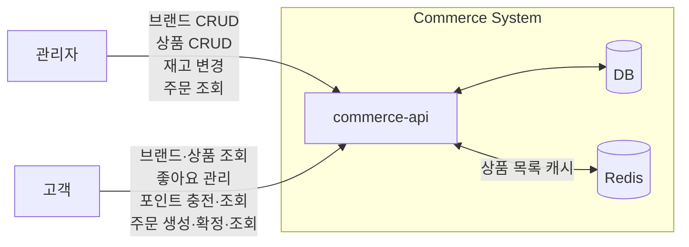
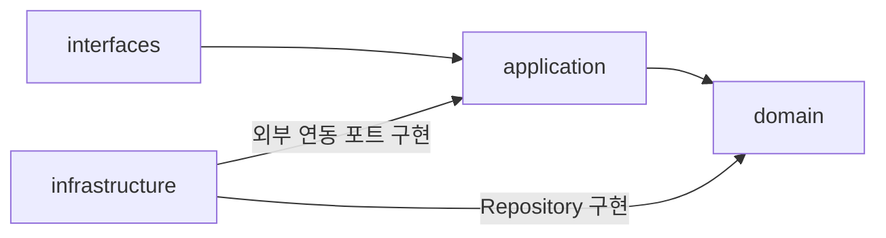
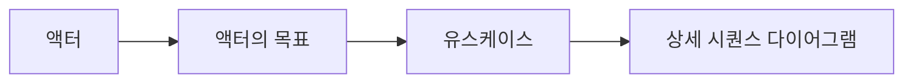

# 시스템 개요

Commerce API의 시스템 경계, 계층별 책임, 대표 흐름을 정리한다. 도메인 규칙은 [도메인 모델](domain-model.md), 외부 HTTP 계약은 [API 계약](api-contracts.md)을 기준으로 한다.

## 시스템 구조

### 시스템 경계

고객과 관리자의 요청은 `commerce-api`에서 처리하며, 조회·변경에 필요한 데이터를 DB와 주고받는다. 고객 상품 목록은 Redis 캐시를 함께 사용한다.

### 계층과 의존성

화살표는 소스 코드의 의존 방향을 나타낸다. `infrastructure → application`은 구현체가 Application에 정의된 외부 연동 포트와 그 포트에서 사용하는 모델을 참조하는 관계다.

현재 캐시는 Application의 `ProductFacade`가 같은 계층의 `ProductListCache` 인터페이스를 사용하고, Infrastructure의 `RedisProductListCache`가 이를 구현한다. Redis 구현체는 포트와 함께 `ProductListCacheKey`, `CustomerProductInfo`를 참조하며, `ProductFacade`에는 생성자 주입으로 연결된다.

#### 계층의 역할

##### interfaces

- HTTP 요청과 API 요청 DTO를 검증하고 Application 유스케이스를 호출한다.
- Application 결과를 응답 DTO로 변환해 `ApiResponse`로 반환한다.
- Application 계층에만 의존하고, Domain·Infrastructure 계층은 직접 호출하지 않는다.

##### application

- 유스케이스 단위로 요청자를 식별하고 도메인 객체·서비스를 오케스트레이션한다.
- Domain의 Repository와 Application에 정의한 외부 연동 포트를 사용한다. 현재 캐시 포트인 `ProductListCache`는 Application에 둔다.
- DB·Redis 등 외부 기술의 구체적인 구현은 Infrastructure에 맡긴다.
- 유스케이스 요청·결과 모델을 통해 HTTP DTO와 Domain 모델을 분리한다.

##### domain

- Entity, VO, 도메인 서비스와 비즈니스 규칙·불변식을 관리한다.
- 필요한 조회·저장 기능을 Repository 인터페이스로 정의한다.
- interfaces, application, infrastructure 계층에 의존하지 않는다.

##### infrastructure

- Domain의 Repository 인터페이스를 JPA·DB 기술로 구현한다.
- Commerce의 Brand·Product·Like·Point·Order·User 도메인 모델과 JPA 엔티티를 분리한다. 각 Repository 구현체의 매퍼가 두 모델을 변환하고, Product 도메인은 브랜드 ID만 보유한다. `OrderItem`의 DB 식별자는 Infrastructure에 둔다.
- DB, Redis, Kafka 등 외부 기술과의 연결을 책임진다.
- Application에 정의한 외부 연동 포트를 구현하고, 해당 포트에서 사용하는 요청·결과 모델을 참조한다. 현재 `RedisProductListCache`가 Application의 캐시 포트를 Redis로 구현한다.

### 액터와 유스케이스

대표 흐름은 **관리자 상품 수정 → 고객 상품 상세 조회**이며, 상세 시퀀스는 [고객 상품 상세 조회](use-cases/product-detail.md)에 있다. 관리자가 삭제되지 않은 상품의 이름과 가격을 수정하면, 고객은 상품 상세 조회에서 변경된 상품 정보와 브랜드 정보·좋아요 수를 확인한다.

#### 액터

대표 흐름을 기능 목록이 아니라 사용자의 목표에서 출발시키기 위해 먼저 액터를 정리한다.

이 흐름이 도메인 책임을 바로 결정하지는 않지만, 어떤 객체가 어떤 변화에 책임져야 하는지 판단하는 단서가 된다.

| 구분 | 의미 | 예시 |
|----|----|-----|
| 액터 | 시스템 밖에서 목표를 가지고 시스템과 상호작용하는 역할 | 관리자 고객 |
| 목표 | 액터가 얻고 싶은 결과 | 상품을 찾고 구매한다. |
| 유스케이스 | 목표를 이루기 위해 시스템에서 하는 하나의 행동 단위 | 상품을 조회한다. 주문을 생성한다. 주문을 확정한다. |

#### 액터의 목표

##### 관리자

무엇을 관리하기 위해 서비스를 이용하는가?

- 판매할 브랜드와 상품을 운영한다.
- 상품의 재고를 관리하고 고객 주문 현황을 조회한다.

##### 고객

무엇을 위해 서비스를 이용하는가?

- 상품을 찾고 구매한다.
- 좋아요를 통해 추후 구매할 상품을 저장한다.

#### 유스케이스

유스케이스는 API가 아니라, 예를 들어 "고객이 주문을 확정한다"처럼 시스템을 통해 달성하려는 행동이다.

##### 관리자

- 브랜드를 등록•수정•삭제한다.
- 상품을 등록•수정•삭제한다.
- 상품 재고를 변경한다.
- 브랜드를 조회한다.
- 상품을 조회한다.
- 고객 주문을 조회한다.

##### 고객

- 좋아요를 등록하거나 취소한다.
- 포인트를 충전한다.
- 주문을 생성한다.
- 주문을 확정한다.
- 브랜드 정보를 조회한다.
- 상품을 조회한다.
- 내 좋아요 목록을 조회한다.
- 내 포인트 잔액을 조회한다.
- 내 주문 목록•상세를 조회한다.

