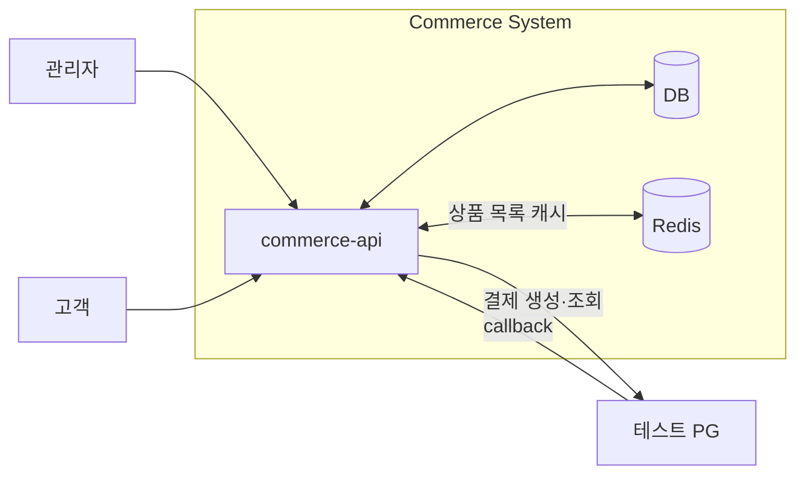
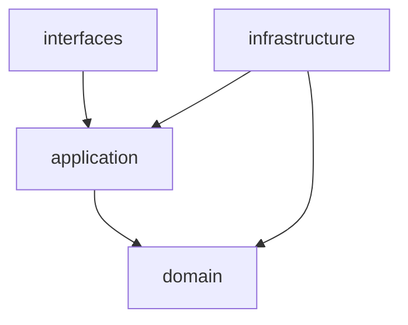

# 시스템 개요

Commerce API의 시스템 경계, 코드 의존 방향과 계층별 책임을 정리한다. 개별 기능의 정책과 실행 흐름은 [유스케이스 설계](README.md#유스케이스)를 따른다.

## 시스템 경계

고객·관리자 요청과 PG의 결과 알림은 `commerce-api`에서 수신한다.

테스트 PG는 `apps:test-pg`의 별도 앱·컨테이너로 구성하며 Commerce와 HTTP로 통신한다. 
PG와의 송수신 계약은 [PG 연동 설계](external-systems/payment-gateway.md), 실행 경계, 시나리오 제어와 후속 작업은 [로컬 테스트 PG](external-systems/test-payment-gateway.md)에서 관리한다.

## 계층과 의존성

화살표는 소스 코드에서 타입을 참조하는 방향이다. 실행 중의 호출 순서와 트랜잭션 경계는 각 유스케이스 설계에서 설명한다.

| 계층 | 책임 |
| --- | --- |
| `interfaces` | HTTP 입력을 검증하고 요청·응답을 변환하며 Application 유스케이스를 호출한다. |
| `application` | 요청자를 확인하고 도메인 객체의 협력과 트랜잭션 경계를 조율한다. Repository와 외부 연동 계약을 사용한다. |
| `domain` | 업무 규칙·불변식과 상태 전이를 관리하고, 필요한 조회·저장 계약을 정의한다. |
| `infrastructure` | Domain·Application의 계약을 영속 기술과 외부 연동 기술로 구현한다. 모델 변환과 저장소·외부 시스템 연결을 담당한다. |

저장 모델과의 매핑은 [영속성 매핑 설계](persistence-mapping.md), 업무 오류의 HTTP 응답 변환은 [오류 변환 설계](error-mapping.md)를 따른다.

## 액터와 유스케이스

| 액터 | 주요 기능 |
| --- | --- |
| 관리자 | 브랜드·상품 운영, 재고 관리, 주문 조회 |
| 고객 | 브랜드·상품 탐색, 좋아요 관리, 포인트 충전·조회, 주문 생성·결제·조회 |

고객·관리자 API의 입력·응답은 [API 계약](api-contracts.md), 업무 규칙은 [도메인 모델](domain-model.md)을 기준으로 한다.
