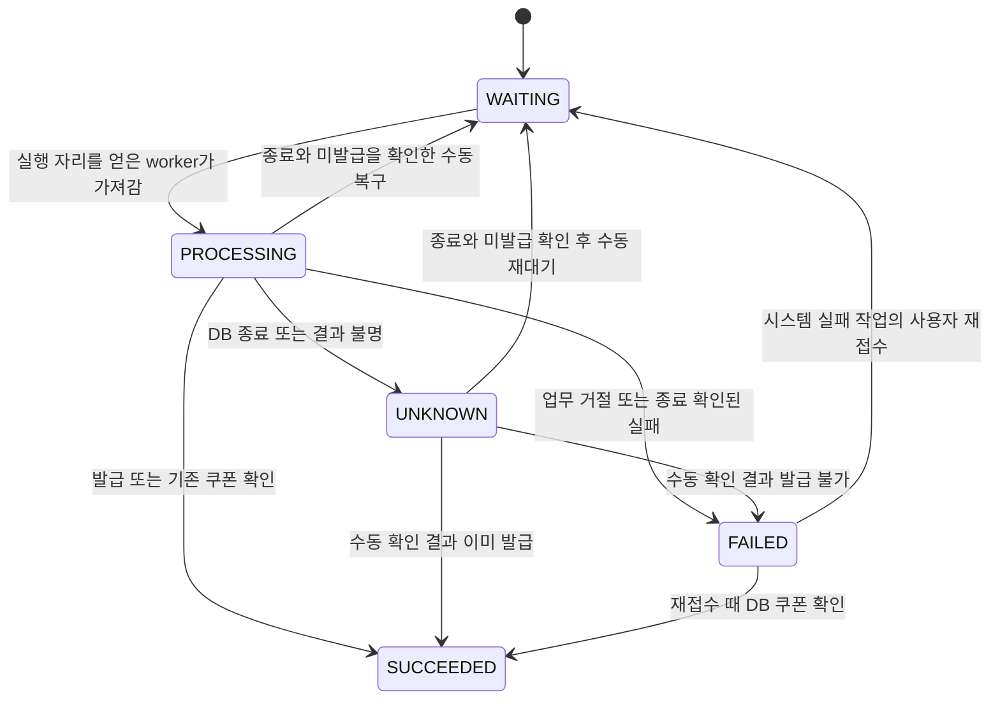
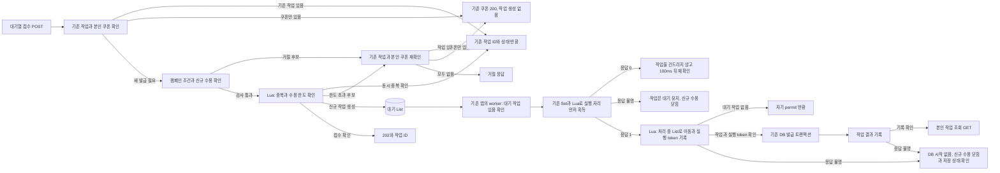

# Redis List 쿠폰 발급 대기열

> 상태: 학습용 첫 버전의 정책을 확정한 설계. 대기열과 worker 코드는 아직 구현하지 않았다. 현재 구현된 동기 발급 계약은 [쿠폰 발급 설계](coupon-issuance.md)를 따른다. 이 문서는 추가할 비동기 접수와 작업 조회, 로컬 수동 복구를 다룬다. 실제 구현과 검증 결과는 구현 단계에서 갱신한다.

## 합의한 범위와 정책

| 항목 | 결정 |
|---|---|
| 저장 자료구조 | Redis List로 대기 작업을 저장한다. |
| 기존 API | 동기 발급 POST와 보유 목록 GET은 유지한다. 기존 201, 200, 429 계약을 바꾸지 않는다. |
| 새 API | 대기열 접수 POST와 본인 작업 조회 GET을 추가한다. 접수는 발급 완료를 뜻하지 않으며, 처리 시작 시점도 약속하지 않는다. |
| 작업 조회 응답 | 본인 작업 정보를 정상적으로 읽으면 5개 상태 모두 HTTP 200과 `meta.result=SUCCESS`로 반환한다. 발급 결과는 `data.status`와 reasonCode로 구분한다. |
| 중복 접수 | 같은 사용자와 캠페인은 기존 작업 ID와 상태를 반환한다. 동시 접수에서도 대기 작업은 하나다. 시스템 실패로 끝난 작업만 예외로 다시 대기시킨다. |
| 시스템 실패 재접수 | `DB_ERROR`, `INTERNAL_ERROR`로 끝난 작업만 사용자가 다시 접수할 때 같은 작업 ID로 다시 대기시킨다. 업무 거절과 성공은 저장된 결과를 반환한다. worker나 복구 절차가 자동으로 다시 대기시키지 않는다. 작업 정보는 최신 시도의 상태만 보존하고, 이전 실패 사유는 서버 로그에 남긴다. |
| 기존 쿠폰만 있는 접수 | 작업 이력이 없고 DB에 본인 쿠폰이 있으면 작업을 만들지 않고 기존 couponId를 HTTP 200으로 바로 반환한다. 이 응답에는 requestId가 없다. 접수 한도, 신규 수용 닫힘, Redis 장애와 관계없이 반환한다. |
| 작업 상태 | `WAITING`, `PROCESSING`, `SUCCEEDED`, `FAILED`, `UNKNOWN` 5개를 사용한다. 확정된 업무 거절과 시스템 실패는 `FAILED`로 합치고 6개 `reasonCode`로 구분한다. |
| 거절 사유 전달 | `CoreException(CONFLICT)`를 상속하고 사유를 가진 도메인 예외로 품절과 기간 밖을 구분한다. 동기 API 응답은 유지한다. 조기 종료는 총량 소진이므로 품절로 분류한다. |
| 작업 이력 보존 | 학습용 첫 버전에서는 작업 정보와 사용자, 캠페인별 작업 ID 연결을 자동 만료하거나 자동 삭제하지 않는다. `SUCCEEDED` 또는 `FAILED` 뒤에도 같은 작업 ID와 결과를 조회한다. |
| 접수 한도 계산 | 로컬 실험은 대기와 처리 중 작업을 합쳐 최대 20건으로 제한한다. 결과 불명으로 수동 복구를 기다리는 작업도 포함한다. `SUCCEEDED` 또는 `FAILED`로 끝난 작업은 제외한다. 한도는 서버 YAML로 설정한다. |
| 중단 작업 복구 | 처리 중 목록에 남긴다. 이전 worker와 해당 DB 작업의 종료, 실제 발급 결과를 확인한 뒤 수동으로 복구한다. 자동 재시도와 시간 기반 회수는 하지 않는다. |
| 복구 적용 범위 | 상태 변경은 `PROCESSING`, `UNKNOWN`만 허용한다. 완료 상태는 결과와 List를 유지하며 확인된 자기 잔여 permit만 정리한다. |
| 수동 복구 실행 | 첫 버전은 별도 복구 명령을 만들지 않고 문서화한 절차와 조건부 Lua로 처리한다. `redis-cli`와 SQL로 먼저 조회하고, 운영자가 이전 실행과 DB 작업 종료를 확인한 뒤 Lua를 `redis-cli EVAL`로 실행한다. |
| worker 실행 | 기존 `commerce-api` 안의 전용 스레드 최대 3개로 실행한다. 대기 작업이 있으면 실행 자리(permit)를 먼저 얻은 뒤 작업을 가져와 연속 처리한다. 비었거나 실행 자리를 못 얻으면 작업을 건드리지 않고 100ms 뒤 다시 확인한다. |
| worker 활성화 | 자동 실행은 기본 비활성이고 로컬에서 명시적으로 켠다. 켜져 있어도 앱 준비 완료와 신규 수용 열림을 확인한 뒤 가져온다. worker가 꺼져 있어도 접수는 받으며, 작업은 worker를 켤 때까지 `WAITING`에 머문다. |
| 순서 | 순번 안내와 엄격한 선착순 완료는 요구하지 않는다. |
| 발급 결과 | 기존 DB 발급 트랜잭션과 사용자별 유일 제약을 재사용한다. 접수 시 쿠폰 수량을 예약하지 않는다. |
| 학습 데이터 초기화 | 모든 API 인스턴스를 멈춘 상태에서 한 인스턴스로만 reset한다. `coupon.seed.reset=true`가 해당 캠페인의 대기열 정보도 함께 정리한다. 남은 작업이나 token이 있으면 DB 변경 전에 거절하고, Redis를 먼저 정리한 뒤 DB를 초기화한다. |

## API 계약

| API | 동작 |
|---|---|
| `POST /api/v1/coupon-campaigns/{campaignId}/issue-requests` | 신규 작업 접수 또는 같은 사용자와 캠페인의 기존 작업 반환 |
| `GET /api/v1/coupon-issue-requests/{requestId}` | `X-USER-ID` 사용자 본인 작업의 상태와 결과 조회 |

응답에는 `requestId`, `campaignId`, `status`, `requestedAt`, 성공 시 `couponId`, 실패나 결과 불명 시 `reasonCode`와 사유를 담는다. 작업 ID는 실행 permit token과 별개다. `requestedAt`은 처음 접수한 시각이며 시스템 실패 재접수로 다시 대기해도 바뀌지 않는다. 작업 조회에서 다른 사용자의 ID와 없는 ID는 모두 404로 처리한다. 기존 쿠폰을 바로 반환하는 응답은 작업이 없으므로 `requestId`와 `requestedAt`을 비운다. 값이 없는 필드는 공통 Jackson 설정(`NON_NULL`)에 따라 응답에서 빠진다.

신규 접수와 진행 중 작업의 재접수는 202, 완료된 기존 작업 반환과 작업 조회는 200으로 응답한다. 202는 작업을 저장했다는 뜻이며 처리 시작 시점을 약속하지 않는다. worker가 꺼져 있어도 접수는 받고 작업은 `WAITING`에 머물며, 미완료 작업이 한도에 차면 새 접수는 429로 거절된다. 작업 이력이 없어도 이미 본인 쿠폰이 있으면 작업을 만들지 않고 기존 쿠폰을 200으로 반환한다. 새 발급이 필요한 요청의 발급 불가 캠페인은 기존과 같이 404 또는 409로 거절한다.

### HTTP 응답

아래 표는 새 대기열 API에 적용할 응답이다. 기존 동기 발급 API의 HTTP 상태는 변경하지 않는다. 본인 작업 조회는 5개 상태 모두 HTTP 200과 `data.status`로 작업 결과를 표현한다.

| 요청과 상황 | HTTP | 응답 내용 |
|---|---|---|
| POST 신규 접수 완료 | 202 Accepted | 작업 ID와 현재 상태. 접수 직후 worker가 가져갈 수도 있으므로 상태를 항상 `WAITING`으로 고정하지 않음. worker가 꺼져 있어도 접수하며 처리 시작 시점은 약속하지 않음 |
| POST 기존 `WAITING`, `PROCESSING`, `UNKNOWN` 작업 | 202 Accepted | 같은 작업 ID와 현재 상태, 새 작업 생성 없음 |
| POST 기존 `SUCCEEDED` 작업 또는 업무 거절로 끝난 `FAILED` 작업 | 200 OK | 같은 작업 ID와 저장된 결과, 자동 재실행 없음 |
| POST 시스템 실패(`DB_ERROR`, `INTERNAL_ERROR`)로 끝난 `FAILED` 작업 | 202 Accepted | 재접수 확인을 통과하면 같은 작업 ID를 `WAITING`으로 다시 대기. 그사이 쿠폰이 발급됐으면 `SUCCEEDED`와 200, 거절되면 작업은 `FAILED`로 두고 해당 거절 응답 |
| POST 작업 이력이 없고 DB에 본인 쿠폰이 있음 | 200 OK | 작업을 만들지 않고 `status=SUCCEEDED`와 기존 couponId 반환, requestId 없음. Redis 쓰기, List, permit을 사용하지 않음 |
| GET 본인 작업 조회 | 200 OK | 작업의 5개 상태 중 현재 상태와 결과 |
| POST 미완료 20건에서 새로운 사용자와 캠페인 접수 | 429 Too Many Requests | 신규 작업을 추가하지 않음. 진행 중이거나 완료된 기존 작업의 재접수는 한도 초과로 거절하지 않음. 시스템 실패 작업을 다시 대기시킬 때는 한도를 확인 |
| POST 신규 작업의 캠페인이 없음 | 404 Not Found | 작업을 생성하지 않음 |
| POST 신규 작업의 캠페인이 발급 불가 | 409 Conflict | 새 발급이 필요한 요청은 작업을 생성하지 않음. 이미 본인 쿠폰이 있으면 기존 쿠폰 반환 |
| GET 작업이 없거나 다른 사용자 소유 | 404 Not Found | 동일한 공통 오류 응답으로 소유 정보 노출 방지 |
| 요청자 헤더 누락 또는 입력 형식 오류 | 400 Bad Request | 기존 공통 오류 처리 재사용 |
| Redis 접근 실패 또는 접수 결과 불확실 | 503 Service Unavailable | 접수나 조회 성공을 확인할 수 없음. 단, DB에 본인 쿠폰이 있는 POST는 기존 쿠폰을 200으로 반환 |
| 신규 수용 닫힘에서 새 발급 작업 접수 | 503 Service Unavailable | 새 발급 작업은 접수하지 않음. 기존 작업 반환과 이미 받은 쿠폰의 반환은 유지 |

POST는 기존 작업을 먼저 찾는다. 기존 작업이 있으면 현재 캠페인 상태, 한도, 신규 수용 닫힘보다 그 작업의 반환을 우선한다. 시스템 실패로 끝난 `FAILED` 작업은 예외로, 아래 재접수 절차를 따른다. 신규 추가 연산에서도 같은 사용자와 캠페인의 작업이 다른 요청에 의해 먼저 생성됐는지 원자적으로 재검사한다.

최초 조회에서 작업이나 쿠폰이 없었어도 사전 검사 중 다른 요청이 먼저 접수하거나 발급할 수 있다. 접수 API가 캠페인 조건, 접수 한도 또는 신규 수용 닫힘으로 최종 거절하기 전에는 다음 순서로 재확인한다.

1. 같은 사용자와 캠페인의 작업을 다시 조회한다. 있으면 그 작업 ID와 현재 상태를 반환한다.
2. 작업이 없으면 DB의 본인 쿠폰을 다시 조회한다. 있으면 기존 쿠폰을 200으로 반환한다.
3. 여전히 작업과 쿠폰이 없으면 원래의 404, 409, 429 또는 503으로 거절한다. 이 재확인은 제한된 한 번의 확인이며 반복 재시도하지 않는다.

Lua의 한도 초과 판단도 같은 사용자와 캠페인의 기존 작업 확인을 먼저 한다. Redis를 읽거나 쓸 수 없으면 결과를 추측하지 않고 503을 반환한다. 다만 DB에 본인 쿠폰이 있으면 결과가 이미 확정이므로 기존 쿠폰을 200으로 반환한다. DB 조회 자체가 실패한 경우도 미발급이나 품절로 바꾸지 않고 기존 공통 내부 오류로 처리한다.

접수 명령이 timeout으로 끝났다면 503이어도 Redis에 작업이 생성됐을 수 있다. 503을 작업 부재나 DB 신규 효과 없음의 증거로 사용하지 않는다. 같은 사용자와 캠페인의 재접수는 원자적 중복 검사로 이미 생성된 작업 ID를 찾으며, 사용자 임의의 새 작업 ID로 우회하지 않는다. 이 점은 요청을 저장하지 않는 기존 동기 발급 API와 다르다.

### 작업 조회 응답 예시

기존 `ApiResponse`를 사용한다. HTTP 200과 `meta.result=SUCCESS`는 작업 정보를 정상적으로 조회했다는 뜻이다. 쿠폰 발급 성공 여부는 `data.status`와 `couponId`로 판단한다.

```json
{
  "meta": {
    "result": "SUCCESS"
  },
  "data": {
    "requestId": "8e078261-f7c6-4d41-a8e9-f068d900c0cf",
    "campaignId": 1,
    "status": "FAILED",
    "requestedAt": "2026-11-13T00:00:00Z",
    "reasonCode": "SOLD_OUT",
    "message": "쿠폰이 모두 발급된 캠페인입니다."
  }
}
```

작업을 못 읽은 404, 503 등의 응답은 기존과 같이 `meta.result=FAIL`과 공통 오류 코드를 사용한다. `reasonCode`는 접수된 작업의 처리 사유이며 `meta.errorCode`와 혼용하지 않는다. DB 예외 메시지나 SQL 원문을 작업 응답에 그대로 저장하지 않는다. 사유 문구는 reasonCode마다 정한 문구를 쓰며 작업 정보에 따로 저장하지 않는다. 시스템 실패 문구에는 다시 접수할 수 있다는 안내를 넣는다.

### 기존 쿠폰이 있는 접수

기존 작업 이력이 없으면 DB에서 같은 사용자와 캠페인의 쿠폰부터 확인한다. 이미 발급됐으면 작업을 만들지 않고 `status=SUCCEEDED`와 기존 couponId를 HTTP 200으로 바로 반환한다. 결과가 이미 확정이라 다시 조회할 작업이 없으므로 응답의 `requestId`와 `requestedAt`은 비운다. Redis에 쓰지 않고, List에 넣거나 permit을 획득하지 않으며, 쿠폰을 추가 발급하거나 발급 수를 변경하지 않는다.

이 응답은 미완료 한도, 캠페인 종료, 신규 수용 닫힘의 영향을 받지 않는다. Redis로 기존 작업을 확인할 수 없을 때도 DB에 본인 쿠폰이 있으면 같은 응답을 반환한다. 기존 DB 전용 보유 목록과 동기 API의 기존 결과 조회는 별도로 유지한다.

같은 사용자가 동시에 접수해도 Redis에 쓰지 않으므로 경쟁할 작업이 생기지 않는다. 기존 작업이 있으면 그 작업을 먼저 반환하며, 시스템 실패로 끝난 작업을 재접수하는 중에 쿠폰이 확인되면 그 작업을 `SUCCEEDED`로 바꾸는 흐름은 아래 재접수 절차를 따른다.

### 시스템 실패 작업의 재접수

`DB_ERROR`, `INTERNAL_ERROR`로 끝난 `FAILED`는 DB 작업 종료와 미발급을 확인한 시스템 실패다. 사용자의 요청 때문에 생긴 결과가 아니므로, 같은 사용자와 캠페인이 다시 접수하면 같은 작업 ID로 다시 대기시킨다. 사용자가 직접 다시 요청할 때만 실행하며, worker나 복구 절차가 `FAILED`를 자동으로 다시 대기시키지는 않는다. 업무 거절(`SOLD_OUT`, `CAMPAIGN_NOT_ISSUABLE`, `CAMPAIGN_NOT_FOUND`)로 끝난 `FAILED`와 `SUCCEEDED`는 저장된 결과를 그대로 반환한다.

재접수는 신규 접수와 같은 순서로 확인한다.

1. DB의 본인 쿠폰을 먼저 확인한다. 그사이 동기 API로 발급됐으면 Lua에서 작업이 여전히 같은 `FAILED`와 reasonCode인지 확인한 뒤 기존 couponId의 `SUCCEEDED`로 바꾸고 200을 반환한다.
2. 쿠폰이 없으면 캠페인 조건과 신규 수용을 확인한다. 거절되면 작업은 기존 `FAILED`와 reasonCode를 유지하고 404, 409 또는 503으로 응답한다.
3. 통과하면 Lua에서 작업이 여전히 같은 `FAILED`와 reasonCode인지, 미완료 한도가 남았는지 확인한다. 조건이 맞으면 `WAITING`으로 바꾸고 reasonCode와 사유, 이전 실행 token을 비운 뒤 대기 List에 추가해 202를 반환한다. 한도가 찼으면 작업을 바꾸지 않고 429로 응답한다.

작업 정보는 최신 시도의 상태만 보존한다. 다시 대기시킬 때 이전 reasonCode와 사유, 실행 token을 서버 로그에 남긴 뒤 작업 정보에서 비운다. 사용자 조회에는 현재 상태만 보인다. `requestedAt`은 작업 ID와 함께 처음 접수할 때 정해지는 값이라 재접수해도 바꾸지 않으며, 최신 시도 시각은 재대기 로그로 확인한다.

동시에 여러 번 재접수해도 Lua의 상태 비교로 대기 항목은 하나만 생긴다. 다시 대기한 작업은 미완료 한도에 다시 포함되고, 다음 처리 때 새 실행 token을 만든다. 시스템 실패로 끝난 실행의 permit은 이미 반환됐거나, 반환에 실패했다면 신규 수용이 닫혀 있어 재접수가 503으로 끝난다. 따라서 이전 실행 token을 비워도 남은 permit의 단서를 잃지 않는다.

## 작업 상태

| 상태 | 의미 | List 위치 | 미완료 20건에 포함 |
|---|---|---|---|
| `WAITING` | worker가 가져가기 전의 대기 작업 | 대기 List | 예 |
| `PROCESSING` | worker가 가져간 작업. DB 실행 중이라는 뜻으로 한정하지 않음 | 처리 중 List | 예 |
| `SUCCEEDED` | 발급 완료 또는 기존 쿠폰 확인 | 두 List에서 제거, 작업 이력 유지 | 아니오 |
| `FAILED` | 발급되지 않은 것으로 확정된 업무 거절 또는 시스템 실패 | 두 List에서 제거, 작업 이력 유지 | 아니오 |
| `UNKNOWN` | DB 작업 종료 또는 commit 결과를 확인하지 못함 | 처리 중 List | 예 |

품절 같은 업무 거절도 `FAILED`로 표현하며 별도 `REJECTED` 상태는 두지 않는다. 원인은 아래 6개의 `reasonCode`로 구분한다. 이 코드는 작업 결과의 원인이며 HTTP 공통 오류 코드와 구분한다.

### reasonCode

| reasonCode | 작업 상태 | 조건 |
|---|---|---|
| `SOLD_OUT` | `FAILED` | 실제 발급 수가 총량에 도달해 발급 불가. 총량 소진으로 기록된 조기 종료(`terminated_at`)도 포함 |
| `CAMPAIGN_NOT_ISSUABLE` | `FAILED` | 발급 기간 밖이어서 발급 불가 |
| `CAMPAIGN_NOT_FOUND` | `FAILED` | 처리 시 캠페인이 없음을 확인 |
| `DB_ERROR` | `FAILED` | DB 오류 뒤 해당 DB 작업 종료와 미발급을 확인 |
| `INTERNAL_ERROR` | `FAILED` | 그 밖의 서버 처리 오류 뒤 해당 DB 작업 종료와 미발급을 확인 |
| `DB_RESULT_UNKNOWN` | `UNKNOWN` | DB 작업 종료 또는 실제 발급 결과를 확인하지 못함 |

`DB_ERROR`, `INTERNAL_ERROR`는 사용자가 다시 접수하면 다시 대기하는 시스템 실패다. 나머지 `FAILED` 사유는 다시 접수해도 저장된 결과를 반환하는 업무 거절이다.

같은 캠페인에서 품절과 기간 종료가 함께 성립하면, 기존 쿠폰을 먼저 확인한 뒤 현재 도메인 검증 순서처럼 품절을 우선한다. 접수 전 HTTP 404, 409로 거절된 요청은 작업 자체가 없으므로 위 코드의 작업 이력을 만들지 않는다.

reasonCode를 분류하려고 한국어 오류 메시지 문자열을 비교하지 않는다. 도메인의 거절 사유와 DB 작업 완료 확인 결과를 구조화해 전달하고, 기존 동기 API의 공통 오류 응답은 유지한다.

캠페인 발급 불가는 `CoreException(CONFLICT)`를 상속하고 품절, 기간 밖 사유를 가진 도메인 예외로 전달한다. `validateIssuable`이 이 예외를 던지며, 동기 API는 지금처럼 409와 같은 메시지로 응답한다. worker는 예외의 사유로 `SOLD_OUT`과 `CAMPAIGN_NOT_ISSUABLE`을 정한다. 캠페인 없음은 지금처럼 `NOT_FOUND`로 전달되어 `CAMPAIGN_NOT_FOUND`가 된다. 조기 종료는 총량 소진으로만 기록되므로 품절 사유로 분류한다.

실행 자리를 얻지 못하면 작업을 가져오지 않으므로 `FAILED` 사유가 아니며, 작업은 `WAITING`에 그대로 남는다. `WAITING`, `PROCESSING`, `SUCCEEDED`의 reasonCode는 비운다.

`FAILED`는 발급되지 않았고 해당 DB 작업도 끝났다는 확인이 있어야 한다. 예외 클래스만 보고 `FAILED`로 바꾸면 안 된다. DB 작업이 끝났는지 알 수 없으면 `UNKNOWN`으로 남긴다. worker가 중단돼 상태 갱신 자체를 못 했다면 `PROCESSING`에 남을 수 있으며, 시간 경과만으로 실패를 확정하지 않는다.

worker는 DB 작업이 끝난 실패에서 먼저 실제 쿠폰을 확인하고, 쿠폰이 없을 때만 예외로 사유를 정한다. 사유를 담은 캠페인 거절 예외는 품절과 기간 밖, `NOT_FOUND`는 캠페인 없음, Spring DB 예외(`DataAccessException`, `TransactionException`)는 `DB_ERROR`, 그 밖은 `INTERNAL_ERROR`다. 쿠폰 확인 자체가 실패하면 실제 결과를 모르므로 `UNKNOWN`으로 기록한다.

DB 작업 종료 확인과 미발급 확인도 구분한다. commit 완료 뒤 다른 처리에서 예외가 났다면 DB에 남은 실제 쿠폰을 확인해 `SUCCEEDED`와 해당 쿠폰 ID로 기록한다. 단순히 예외가 전달됐다는 이유로 이미 발급된 작업을 `FAILED`로 저장하지 않는다.



`SUCCEEDED`와 `FAILED`는 완료된 작업이다. 같은 사용자와 캠페인의 재접수는 저장된 작업 ID와 결과를 반환하며 자동으로 다시 실행하지 않는다. 시스템 실패로 끝난 `FAILED`만 사용자가 다시 접수할 때 같은 작업 ID로 다시 대기한다.

## 저장과 처리



| 데이터 | 책임 |
|---|---|
| 대기 List | 처리할 작업 ID 보관 |
| 처리 중 List | worker가 가져간 작업 ID 보관. 꺼낸 직후 중단돼도 작업 ID를 잃지 않음 |
| 작업 정보 | 사용자, 캠페인, 접수 시각, 상태, 쿠폰 ID, reasonCode와 사유 |
| 중복 접수 정보 | 사용자와 캠페인에 대응하는 작업 ID |
| 기존 permit Set | 동기 요청과 worker가 공유하는 현재 실행 자리 |

### Redis 키와 데이터 초안

모든 대기열 쓰기와 상태 조회는 기존 `redisTemplateMaster`를 사용한다. 현재 String serializer를 따르며 업무별 key prefix를 캐시와 구분한다.

| 키 | 타입 | 내용 |
|---|---|---|
| `coupon:issue:queue:waiting` | List | 대기 중 requestId. 오른쪽에 추가하고 왼쪽에서 가져옴 |
| `coupon:issue:queue:processing` | List | worker가 가져간 requestId. 결과 불명이나 중단 작업도 보존 |
| `coupon:issue:queue:jobs` | Hash | requestId를 field로, 작업 정보 JSON을 value로 저장 |
| `coupon:issue:queue:requests` | Hash | 서버에서 만든 `campaignId:userId`를 field로, requestId를 value로 저장 |
| `coupon:issue:permits` | Set | 기존 동기 발급과 공유하는 실행 token |

작업 정보 JSON은 `requestId`, `campaignId`, `userId`, `status`, `requestedAt`, `couponId`, `reasonCode`, `executionToken`을 담는다. Lua가 JSON을 읽고 다시 쓸 때 숫자 정밀도가 바뀌지 않도록 ID는 문자열로, 접수 시각은 ISO-8601 문자열로 저장한다. 사유 문구는 reasonCode로 정하므로 저장하지 않는다. 읽은 작업 정보는 도메인 복원 규칙으로 검증하며, 상태와 맞지 않는 값이나 형식 오류는 저장 불일치로 본다. 대기열 Lua가 돌려주는 오류 문구는 `coupon queue:`로 시작해 Redis 연결 문제와 구분한다.

작업 정보에는 API 응답 필드 외에 소유 사용자 ID와 내부 실행 token을 둔다. 사용자 ID는 본인 조회 검증에 쓰고, 실행 token은 worker의 해당 처리 시도와 수동 복구를 연결한다. 내부 실행 token은 고객에게 반환하지 않는다.

가장 최근 실행 token은 `SUCCEEDED`, `FAILED` 이력에도 보관한다. DB는 끝났지만 permit 반환에 실패한 경우, 완료된 작업에서도 자기 잔여 token을 찾을 수 있어야 한다. 이 token의 보존이 현재 점유 중이라는 뜻은 아니다.

worker는 permit을 요청하기 전에 UUID 실행 token을 만들고, 응답 유실 시에도 해당 시도의 확인에 사용한다. 같은 token으로 permit을 얻은 뒤 작업 가져오기 Lua를 호출하며, Lua는 처리 중 전환과 함께 이 token을 기록하고 작업 ID와 token을 반환한다. 기존 requestId를 token으로 재사용하지 않는다. 작업에 기록된 token은 그 실행이 permit을 얻은 뒤 작업을 가져갔다는 뜻이며, DB 시작이 완료됐다는 뜻은 아니다.

worker가 만든 token과 이미 얻은 permit으로 기존 발급 실행의 DB 단계를 시작하는 내부 협력이 필요하다. HTTP 입력으로 token을 받는 API는 추가하지 않는다. 동기 요청은 지금처럼 서버가 실행별 token을 생성한다.

### Lua로 묶을 처리

| 연산 | 함께 처리할 내용 |
|---|---|
| 접수 | 사용자와 캠페인의 기존 requestId 확인, 미완료 개수 확인, 작업 정보와 중복 정보 생성, 대기 List 추가 |
| 시스템 실패 재접수 | 현재 `FAILED`와 reasonCode 일치 확인, 실패 작업이 대기·처리 중 List에 남아 있지 않은지 확인, 미완료 개수 확인, `WAITING` 기록과 reasonCode·사유·이전 실행 token 정리, 대기 List에 `RPUSH`. 쿠폰이 이미 있으면 같은 상태 확인 뒤 `SUCCEEDED` 기록 |
| 가져오기 | permit을 얻은 실행만 호출. 첫 대기 항목과 작업 상태 검사, 대기에서 처리 중 List로 이동, `PROCESSING`과 실행 token 기록. 대기 작업이 없으면 없음 응답 |
| 완료 | 현재 `PROCESSING`과 실행 token 일치 확인, 쓰기 전에 처리 중 List에 해당 ID가 있는지 `LPOS`로 확인, 결과 기록, 처리 중 List에서 해당 ID만 `LREM`으로 제거. 같은 실행의 같은 결과 반복은 이미 기록됨으로, token이나 상태가 다르면 거절로 응답 |
| 결과 불명 기록 | 현재 `PROCESSING`과 실행 token 일치 확인, 처리 중 List 위치 확인, `UNKNOWN`과 사유 기록, 처리 중 List 항목은 유지 |
| seed reset 캠페인 정리 | permit Set이 비어 있는지, 해당 캠페인의 작업이 대기·처리 중 List에 없는지 확인한 뒤 해당 캠페인의 중복 접수 field와 연결된 작업 정보만 삭제 |
| 수동 복구 | 이전 실행과 DB 작업 종료 확인 후, 예상한 기존 상태와 실행 token이 일치하는 작업만 완료 또는 재대기 처리. 처리 중 List에서 해당 ID를 `LREM`으로 지우고, 재대기면 대기 List에 `RPUSH` |

`LMOVE`는 List의 맨 앞이나 맨 뒤 항목만 옮기므로 작업 가져오기에만 쓴다. 가져오기는 대기 List의 맨 앞을 처리 중 List로 `LMOVE`한다. 처리 중 List 가운데 있는 특정 작업의 완료, 재대기, 복구는 `LREM`으로 그 ID를 지우고, 다른 List로 옮겨야 하면 `RPUSH`로 넣는다. 상태와 실행 token 확인, 상태 기록은 같은 Lua 실행에서 처리한다. 미완료 한도가 20건이라 `LREM`이 List 전체를 훑어도 부담이 없다. worker는 처리 중 List에 이미 있는 항목을 자동으로 다시 가져가지 않는다. 재대기 작업은 대기 List의 오른쪽에 넣으며 처음 접수한 순서를 유지하는 선착순을 약속하지 않는다.

오래된 worker의 완료 기록이 새 처리 시도의 결과를 덮어쓰지 않도록 실행 token을 비교한다. 완료된 상태에 같은 실행의 완료 요청이 반복되면 기존 결과를 보존하며, 다른 실행 token이나 다른 결과로 덮어쓰지 않는다. 수동 복구도 현재 상태를 읽은 뒤 무조건 덮어쓰지 않고 예상한 상태와 token을 조건으로 사용한다.

Lua 입력, key 타입, 작업 JSON과 상태는 쓰기 전에 확인한다. Lua는 다른 명령이 중간에 끼어들지 않게 하지만 실행 중 오류가 난 앞선 쓰기를 자동으로 rollback하지는 않는다. 명령 결과가 불확실하거나 저장 상태가 어긋났으면 성공으로 처리하지 않고 수동 확인 대상으로 남긴다.

### 작업 가져오기와 완료 기록의 응답 유실

명령 응답을 못 받았어도 Redis의 상태 변경은 끝났을 수 있다. 앱에서 관찰한 timeout이나 예외만으로 작업이 원래 상태에 남아 있다고 판단하지 않는다.

| 구간과 확인 결과 | 후속 처리 |
|---|---|
| 가져오기 응답에서 작업 ID와 자기 실행 token 확인 | 이미 얻은 permit으로 기존 DB 발급 흐름 진행 |
| 가져오기 응답이 대기 작업 없음 | 자기 permit을 반환하고 다음 확인 주기를 기다림 |
| 가져오기 응답 불명 | DB 발급을 시작하지 않음. DB 작업이 없으므로 얻은 permit의 반환을 시도함. 신규 수용을 닫고 추가 가져오기를 중단. 자동 재호출이나 재대기 없이 저장된 상태 확인 |
| 완료 기록 응답 불명 | 신규 수용을 닫고 저장된 상태 확인. DB 재발급이나 상태 덮어쓰기, List 복원 없이 수동 확인 |

가져오기 응답이 유실되면 작업이 아직 `WAITING`일 수도 있고 이미 `PROCESSING`일 수도 있다. 호출 전에 생성한 실행 token을 확인 단서로 보관하며, 응답에서 작업 ID를 못 받았다고 다음 대기 항목을 대신 가져오지 않는다. 이미 처리 중인 작업은 그 token과 List 항목을 유지한다. 아직 대기 중인 작업을 추측으로 처리 중 상태로 바꾸거나, 처리 중 작업을 자동 재대기시키지 않는다.

완료 기록 응답이 유실되면 같은 실행의 `SUCCEEDED` 또는 `FAILED` 이력과 List 제거가 이미 반영됐을 수 있다. primary에서 상태, 실행 token, 결과와 List 위치를 쓰기 없는 한 번의 Lua로 확인한다. 같은 실행과 결과의 완료 상태가 확인되면 그대로 유지한다. 여전히 `PROCESSING`이면 자동 재대기하지 않고 기존 수동 복구 절차를 적용한다. 읽을 수 없거나 정보가 어긋나면 쓰지 않고 수용을 닫은 상태로 둔다. Redis 기록 응답 유실만으로 `UNKNOWN`이나 `FAILED`를 덮어쓰지 않으며, `UNKNOWN`은 DB 종료 또는 결과가 불명확한 경우에만 사용한다.

이 확인은 읽기만 수행하며 신규 수용을 자동으로 다시 열지 않는다. 시스템 실패 재접수와 수동 복구 Lua의 응답이 유실됐을 때도 저장 상태를 재확인하며, 원래 상태를 가정한 보상 쓰기나 변경 명령의 자동 재실행은 하지 않는다.

### 수용 한도와 저장 불변식

위 키 구조는 현재 로컬 primary 구성의 설계다. 다른 인스턴스에서도 같은 경로를 처리하면 같은 키와 같은 한도 설정을 사용해야 한다. 다중 Redis 노드의 자동 장애 전환이나 Cluster 배치를 보장하는 설계로 확대하지 않는다. 동시 실행 상한과 중복 접수 방지는 primary Redis의 permit Set과 작업 정보를 신뢰할 수 있는 동안에만 보장한다. 앱별 신규 수용 상태는 메모리에 있어 Redis 데이터가 조용히 유실되거나 자동 장애 전환으로 다른 노드가 primary가 된 것을 감지하지 못하므로, 그 뒤의 안전성은 범위 밖이다.

중복 확인과 작업 생성, List 추가를 Lua로 묶는다. 동시에 같은 사용자 요청이 들어와도 작업 두 개가 생성되면 안 된다. 대기 List와 처리 중 List의 길이 합을 확인하는 것과 신규 추가도 같은 원자 연산으로 처리한다.

접수 한도에는 미완료 작업 전체를 센다. 미완료 작업 ID는 대기 List와 처리 중 List 중 한 곳에만 존재하며, 각 List 안에서도 중복되지 않아야 한다. 결과를 모르는 작업은 처리 중 List에 남아 한도를 계속 점유한다. `SUCCEEDED` 또는 `FAILED`는 결과 기록과 처리 중 항목 제거를 함께 수행해 한도에서 제외한다.

학습용 첫 버전은 대기 작업, 처리 중 작업, 성공 및 실패 이력과 중복 접수 정보를 모두 자동 만료 없이 보관한다. 성공 및 실패 이력은 접수 한도에서 제외해도 작업 정보와 사용자, 캠페인별 작업 ID 연결은 유지한다. 따라서 재접수에는 같은 작업 ID와 결과를 반환하며, 미완료 20건 제한이 완료 이력까지 포함한 전체 저장량 제한은 아니다. 로컬 데이터와 테스트 자원을 명시적으로 정리하는 동작은 자동 만료와 구분한다.

같은 작업의 재접수는 한도를 추가로 쓰지 않는다. 한도가 찼어도 이미 접수된 같은 사용자와 캠페인에는 기존 작업 ID와 상태를 반환한다. 예외로 시스템 실패로 끝난 작업을 다시 대기시키면 완료 작업이 미완료 작업이 되므로, 이때는 한도를 확인하고 찼으면 429로 응답한다. 처리 중 작업을 다시 대기로 옮겨도 미완료 작업 수는 늘지 않는다.

로컬 실험은 미완료 20건으로 시작한다. 처리 중이 3건이면 대기는 17건까지 받을 수 있다. 20은 접수 한도 도달과 반환을 검증하기 위한 값이며 운영 적정값으로 측정한 수치는 아니다.

접수 한도는 새 대기열 API의 작업에 적용한다. 기존 동기 요청은 이 개수에 포함하지 않는다. 동기 요청과 worker의 실제 발급 실행은 기존 permit 한도를 공유한다. 아래 설정 이름은 구현 시 사용할 초안이다.

```yaml
coupon:
  issue:
    capacity: 3 # 동기 요청과 worker가 공유하는 동시 발급 실행 수
    queue:
      capacity: 20 # 대기와 처리 중 작업의 합, 결과 불명 포함
```

worker는 별도 서버를 추가하지 않고 `commerce-api` 안의 전용 스레드에서 실행한다. 실행 스레드 수를 제한하고 Java 내부에 대기 작업을 쌓지 않는다. 기존 공유 Redis command timeout이 100ms이므로 첫 버전은 무한 blocking 명령 대신 짧은 주기로 원자적 List 이동을 호출한다.

worker는 대기 작업이 있을 때만 permit을 요청하고, permit을 얻은 뒤에만 작업을 가져온다. 자리가 없으면 작업을 건드리지 않으므로 자리 부족 때문에 작업 순서가 바뀌거나 꺼냈다 넣는 반복이 생기지 않는다. 429를 사용자 작업의 최종 발급 거절로 저장하지 않는다. 여러 worker가 동시에 처리하므로 완료 순서는 접수 순서와 다를 수 있다. permit을 얻은 뒤 작업을 가져오기까지 짧은 동안 자리를 차지하므로, 그 사이 동기 요청이 429를 받을 수 있다.

### permit 획득 결과에 따른 worker 처리

| 확인한 상황 | DB 발급 시작 | 작업 처리 |
|---|---|---|
| 대기 List가 비었거나 신규 수용 닫힘 | 하지 않음 | permit을 요청하지 않음. 비었으면 100ms 뒤 재확인, 닫혔으면 추가 가져오기 중단 |
| 대기 작업 확인 읽기 실패 | 하지 않음 | 바뀐 상태가 없으므로 수용을 닫지 않고 다음 주기에 다시 확인. Redis가 계속 응답하지 않으면 다음 permit 요청에서 수용이 닫힘 |
| 획득 응답 0 | 하지 않음 | 작업을 건드리지 않고 100ms 뒤 재확인. 획득하지 않은 token에 반환 명령을 보내지 않음 |
| 획득 응답 1 | 작업을 가져온 뒤 시작 | 같은 실행 token으로 작업 가져오기. 대기 작업이 없으면 자기 permit 반환 |
| 획득 응답 timeout, 예외 또는 해석 불가 | 하지 않음 | 작업을 가져오지 않아 `WAITING` 유지. 신규 수용 닫힘, token을 반환하지 않고 오류 로그에 실행 token 기록 후 수동 확인 |

Redis가 token을 추가하고 응답만 유실했을 수 있으므로 획득 실패 예외를 응답 0처럼 취급하지 않는다. 이때 작업은 아직 가져오지 않았으므로 `WAITING`으로 남고, 작업 상태와 reasonCode를 바꾸지 않는다. Set에 남았을 수 있는 token은 수용이 닫힌 상태에서 확인해 정리한다.

worker는 permit 획득을 직접 호출하고 응답을 해석한다. 기존 발급 흐름에서는 permit을 얻은 이후 단계, 즉 DB 발급 트랜잭션과 완료 상태 판단, 자기 token 반환을 재사용한다. HTTP 503이나 예외 클래스만으로 미획득을 추측하지 않는다. 처리 중 기록과 token을 확인할 수 없으면 DB 발급으로 진행하지 않는다.

### worker 실행 설정

| 항목 | 설정 |
|---|---|
| 실행 위치 | 기존 `commerce-api` 앱 |
| 실행 스레드 | 대기열 전용 최대 3개. HTTP 요청 스레드와 구분 |
| 실행 대기 | Java 실행기 내부에는 작업을 쌓지 않음. 빈 실행 스레드가 있을 때만 가져오기 시도 |
| 확인 주기 | 대기열이 비었거나 실행 자리가 없으면 100ms 뒤 다시 확인. 처리 후 작업과 자리가 있으면 연속 처리. 명령 timeout과는 별개의 설정 |
| 전역 동시 실행 | 동기 API와 같은 permit Set 사용. 앱 인스턴스가 늘어도 permit 한도를 따름. 단, primary Redis의 permit Set을 신뢰할 수 있는 동안에만 보장 |
| 기본 활성화 | 자동 실행 비활성. 로컬에서 명시적으로 켜고, 통합 테스트는 직접 worker를 호출 |

스케줄러는 가용 worker의 실행만 맡기고 DB 발급은 전용 worker 스레드에서 수행한다. 각 worker는 한 작업을 처리한 뒤 다음 작업을 확인하며, 대기열이 비거나 실행 자리를 얻지 못하면 멈추고 다음 확인 주기를 기다린다. worker 스레드가 모두 사용 중이면 Redis에서 추가 작업을 가져와 Java 메모리에 쌓지 않는다. 아래 값은 확정한 로컬 학습용 설정이다.

```yaml
coupon:
  issue:
    queue:
      worker:
        enabled: false # local 프로필에서만 true
        concurrency: 3
        poll-interval: 100ms
        shutdown-timeout: 30s # 종료할 때 실행 중인 처리를 기다리는 최대 시간
```

확인 주기 100ms는 발급 시간 제한이나 초당 처리량을 뜻하지 않는다. 종료할 때는 새 작업 가져오기를 먼저 중단하고 실행 중 작업의 종료를 기다린다. 종료를 확인하지 못한 작업과 token을 임의로 삭제하지 않는다. 기동 시에도 처리 중 List의 기존 항목은 자동으로 다시 가져가지 않는다.

### 시작과 종료 순서

기동 시 seed 준비, 기존 permit 수용 상태 확인을 마친 뒤 worker를 시작한다. 기존 seed runner의 순서 0과 수용 시작 runner의 순서 100을 따르며, worker runner는 순서 200에서 시작해 준비 전 작업이 실행되지 않게 한다. 설정한 스레드 수만큼만 반복 실행하며, 작업을 처리하면 바로 다음 작업을 확인하고 그 밖에는 확인 주기만큼 기다린다. 처리 중 예상하지 못한 오류가 나도 스레드는 끝나지 않고 다음 주기에 다시 확인한다.

worker는 켜짐 설정과 앱 준비 완료, 신규 수용 열림을 모두 확인하고 대기 작업을 가져온다. 오류로 신규 수용이 닫히면 추가 가져오기를 멈추며, worker 활성화 설정이 수용 상태를 자동으로 다시 열지는 않는다. 기존 작업 조회는 신규 발급 실행과 분리한다.

종료 시에는 다음 순서를 따른다.

1. 새 worker 실행과 대기 작업 가져오기를 중단한다.
2. 실행 중인 발급의 DB 종료와 Redis 결과 기록을 `shutdown-timeout`(기본 30초)까지 기다린다. 쉬고 있던 스레드는 종료 신호로 바로 깨어나며, 실행 중인 처리는 끊지 않는다. 시간이 지나도 끝나지 않은 처리는 로그로 남긴다.
3. DB 작업 종료를 확인한 실행만 기존 기준에 따라 token을 반환한다. 작업 결과 기록도 마치며, DB 종료를 확인하지 못한 실행의 token과 처리 중 항목은 보존한다.

기존 HTTP 동기 발급은 기존 종료 절차와 완료 확인 규칙을 유지한다. 재기동은 처리 중 List를 비우거나 중단 작업을 다시 실행하는 수단으로 사용하지 않는다.

DB 실행 자리 반환과 작업 이력 완료 기록은 구분한다. DB 종료 뒤 permit을 반환했지만 작업 결과의 Redis 기록 여부를 확인하지 못할 수도 있다. 이 경우에는 신규 수용을 닫고 저장된 작업 상태와 List 위치를 확인한다. 미완료로 남은 항목은 수동 복구 대상으로 보존하며, 이미 완료된 이력과 List 제거는 되돌리지 않는다. 처리 중 항목마다 반드시 활성 permit이 있다고 가정하거나, token이 없다는 이유로 DB 종료를 추정하지 않는다.

## 장애와 복구

| 상황 | 추천 동작 |
|---|---|
| permit 획득 직후, 작업을 가져오기 전 중단 | 작업은 `WAITING` 유지. Set에 어떤 작업에도 기록되지 않은 token이 남아 재시작 때 수용이 열리지 않음. 아래 연결되지 않은 permit 정리 절차로 제거 |
| 꺼낸 직후 worker 중단 | 처리 중 List에 보존, 자동으로 삭제하지 않음 |
| permit 획득 응답 불명 | 작업을 가져오지 않아 `WAITING` 유지, DB 시작 없음, 신규 수용 닫힘. Set에 남았을 수 있는 token은 확인 후 수동 정리 |
| 가져오기 응답 불명 | DB 시작 없음, 얻은 permit 반환 시도, 신규 수용 닫힘과 추가 가져오기 중단, 실제 작업 상태와 실행 token 확인 후 수동 복구 |
| DB 정상 발급 또는 기존 결과 확인 | 쿠폰 ID를 기록하고 처리 중 목록에서 제거 |
| 확정 업무 거절 | 사유를 기록하고 처리 중 목록에서 제거 |
| DB 오류 뒤 미발급과 rollback 완료 확인 | `FAILED`와 reasonCode 기록, 처리 중 목록에서 제거 |
| DB 작업 종료나 commit 결과 불명 | 결과 불명 상태와 처리 중 항목 유지, 자동 재실행하지 않음 |
| DB 완료 뒤 Redis 결과 기록 실패 또는 응답 불명 | DB 결과 유지, 신규 수용 닫힘. 실제 완료 이력은 유지하고 미완료 항목은 수동 복구 대상으로 보존 |
| Redis 접근 실패 | 접수나 결과 기록을 성공으로 응답하지 않음 |

worker가 `FAILED`와 `UNKNOWN`을 구분할 수 있도록 기존 발급 실행의 DB 완료 확인 정보를 전달해야 한다. HTTP 동기 API의 기존 응답은 유지하며, worker가 예외 이름만으로 DB 완료를 추측하지 않게 한다.

중단된 작업은 수동으로 복구한다. 처리 중 항목의 시간 경과만으로 DB 작업이 끝났다고 판단하지 않으며, TTL로 삭제하거나 자동 재접수하지 않는다.

복구 순서는 다음과 같다.

1. 현재 상태와 실행 token을 조회하고 해당 작업의 이전 worker와 DB 작업이 모두 끝났는지 확인한다. 종료를 알 수 없으면 상태와 token을 유지한다.
2. DB에서 같은 사용자와 캠페인의 실제 쿠폰, 캠페인 발급 수를 확인한다. 상태 변경 대상은 `PROCESSING`, `UNKNOWN`으로 제한한다.
3. 이 두 상태에서는 이미 발급됐으면 `SUCCEEDED`, 미발급이고 현재 발급 가능하면 같은 requestId의 `WAITING`, 미발급이고 발급 불가하면 사유를 담은 `FAILED`로 복구 결과를 결정한다. 이 시점에는 아직 쓰지 않는다.
4. Lua에서 조회 때의 상태와 token을 다시 비교한 뒤, 그 이전 token만 정리하고 결정한 상태 기록과 List 이동을 함께 수행한다. `WAITING`, `SUCCEEDED`, `FAILED`를 이 절차로 다시 대기시키지 않는다.

다시 대기 상태로 돌린 작업은 정리된 이전 실행과 겹치지 않도록 위 확인과 정리를 마친 뒤 실행한다. 구체적인 복구 Lua와 실행 예시는 구현 단계에서 문서와 테스트에 추가한다.

### 로컬 수동 복구 절차

첫 버전은 별도 복구 명령을 만들지 않는다. 운영자가 `redis-cli`와 SQL로 작업과 DB 결과를 조회하고, 위 종료 확인을 전제로 저장소에 둔 조건부 Lua를 `redis-cli EVAL`로 실행해 `PROCESSING`, `UNKNOWN` 작업을 같은 ID의 완료 또는 재대기 상태로 바꾼다. Lua는 상태와 실행 token을 조건으로 하며, 다른 작업의 List 항목이나 permit은 건드리지 않는다. 별도의 HTTP 관리 API는 추가하지 않는다.

복구 절차는 조회와 적용을 구분한다. 조회는 작업과 DB 결과를 확인하기만 하고 데이터나 permit을 변경하지 않는다. 적용은 이전 worker와 DB 작업의 종료를 운영자가 확인한 뒤 실행한다. Lua를 실행했다는 사실이 이전 DB 작업 종료의 증거가 되지는 않는다.

| 단계 | 도구 | 동작 |
|---|---|---|
| 조회 | `redis-cli`, SQL | 작업 정보(`HGET`), 대기·처리 중 List 위치(`LPOS`), 실행 token의 permit 점유(`SISMEMBER`), 본인 쿠폰과 캠페인 발급 수를 확인. 변경 없음 |
| 적용 | 조건부 복구 Lua, `redis-cli EVAL` | requestId, 조회 때 확인한 상태와 실행 token, 바꿀 상태와 결과를 입력. 상태와 token을 비교하고 적용 대상 상태에서만 복구. 완료 상태는 결과를 유지하며 자기 잔여 permit 정리만 허용 |

복구 Lua는 입력이 빠졌거나 조회 후 상태 또는 token이 바뀌었으면 변경하지 않고 그 사유를 반환한다. 이미 완료된 같은 작업에 다시 실행해도 새 List 항목을 만들거나 다른 실행의 permit을 제거하지 않는다.

| 적용 시 현재 상태 | 허용하는 변경 |
|---|---|
| `PROCESSING`, `UNKNOWN` | 종료와 DB 결과 확인 후 `SUCCEEDED`, `WAITING`, `FAILED`로 변경, 자기 이전 permit 정리 |
| `WAITING` | 상태, List, permit 변경 없음. 이미 대기 중인 작업을 추가하지 않음 |
| `SUCCEEDED`, `FAILED` | 상태, 결과, List 유지. 이력에 남은 실행 token과 기대 token이 일치하고 종료를 확인한 경우 자기 잔여 permit 정리만 허용 |

완료 이력에 실행 token이 없으면 제거할 permit도 없는 것으로 처리하고 변경하지 않는다. 처리 중 작업에 token이 없거나 List와 상태가 어긋났다면 불일치로 보고 적용하지 않는다. Lua는 깨진 정보를 추측해서 다른 token을 제거하지 않는다. 종료를 확인한 자기 token에 대한 `SREM` 결과 0은 이미 제거됐거나 획득 전 중단됐을 수 있으므로 수동 복구에서는 다른 token을 대신 지우지 않고 그대로 둔다.

적용 시 현재 상태와 실행 token의 비교를 먼저 하고, 해당 이전 token 정리와 작업 상태 기록, List 이동을 같은 Lua 실행으로 묶는다. 기대한 상태가 아니면 permit 제거도 수행하지 않는다. 다른 복구 실행과 겹쳐도 이전 조회 결과만 믿고 변경하지 않는다.

적용할 때는 해당 작업을 처리하던 앱의 새 접수와 worker 실행을 중단하고, 이전 DB 작업도 종료됐는지 확인한다. 원래 앱을 단순히 재시작하거나 복구 Lua를 실행했다는 이유로 대기 작업을 자동으로 처리하지 않는다.

복구 절차는 앱을 띄우지 않고 `redis-cli`와 SQL 클라이언트로 실행한다. 따라서 seed 준비와 reset, 일반 ApplicationRunner, worker와 신규 수용 열기가 복구와 함께 실행되지 않는다.

`PROCESSING`, `UNKNOWN` 복구 후 결과는 다음과 같다. 완료 상태에 이 표를 적용해 재대기시키지 않는다.

| 확인한 DB 결과 | 작업 상태와 처리 |
|---|---|
| 이미 쿠폰이 있음 | 기존 couponId로 `SUCCEEDED`, 처리 중 항목 제거, 이력과 중복 정보 유지 |
| 쿠폰이 없고 현재 발급 가능 | 같은 requestId로 `WAITING`, 처리 중에서 대기 List로 이동, 다음 처리 시 새 실행 token 생성 |
| 쿠폰이 없고 현재 발급 불가 | 사유를 기록해 `FAILED`, 처리 중 항목 제거, 이력과 중복 정보 유지 |
| DB 조회 실패 또는 이전 실행 종료 불명 | 변경하지 않음. 처리 중 작업과 token 유지 |

복구 Lua 파일과 `redis-cli`, SQL 실행 예시는 구현하면서 추가한다. 현재 실행 가능한 복구 Lua가 존재한다는 뜻은 아니다.

### 작업과 연결되지 않은 permit 정리

worker가 permit을 얻은 직후, 작업을 가져오기 전에 앱이 중단되면 permit Set에는 token이 남지만 어떤 작업에도 기록되지 않는다. 동기 발급의 DB 결과 불명 token(D-24)도 작업과 연결되지 않는다. 작업 ID로 하는 복구로는 이 token을 정리할 수 없으므로 다음 절차를 따른다.

1. 동기 API와 worker를 포함해 쿠폰을 발급하는 모든 인스턴스를 멈춘다.
2. 진행 중인 발급 DB 작업이 없는지 확인한다. 확인하지 못하면 정리하지 않는다.
3. `PROCESSING`, `UNKNOWN` 작업에 기록된 token은 작업 복구 절차로 정리한다.
4. permit Set에 남은 token 가운데 어떤 작업에도 기록되지 않은 token을 `SREM`으로 하나씩 지운다. 로그에 남은 token이 있으면 그 값과 대조하고, 앱이 중단돼 로그가 없으면 작업 기록에 없는 token으로 골라낸다. Set 전체를 지우지 않는다.

정리 뒤 재시작하면 기존 수용 시작 조건대로 primary Set이 비어 있을 때만 신규 수용이 열린다. 동기 발급 설계의 "확인된 비활성 token만 Redis CLI로 제거한다"는 원칙과 같다.

### 로컬 seed 초기화와 작업 이력

기존 seed reset은 DB의 발급 수와 쿠폰 배정을 되돌린다. Redis 성공 이력과 중복 접수 정보가 남아 있으면 DB에서는 초기화된 쿠폰을 작업 조회가 여전히 발급 완료로 응답할 수 있다. 그래서 대기열을 추가할 때 seed reset이 해당 캠페인의 대기열 정보도 함께 정리하게 바꾼다. 현재 seed 코드에 이 동작이 이미 있다는 뜻은 아니다.

reset은 다른 API 인스턴스를 모두 멈춘 상태에서 한 인스턴스로만 실행한다. 신규 수용 닫힘은 인스턴스마다 메모리에 있는 상태라서, 다른 인스턴스가 살아 있으면 reset 중에도 접수와 발급이 계속될 수 있기 때문이다. 동기 발급 설계에서 seed runner를 로컬 단일 인스턴스에서만 실행하고 여러 인스턴스의 동시 reset을 지원하지 않는 것과 같은 조건이다.

`coupon.seed.reset=true`일 때 seed 준비는 다음 순서로 진행한다.

1. DB를 바꾸기 전에 Redis를 확인한다. 해당 캠페인의 작업이 대기 List나 처리 중 List에 남아 있거나 permit Set에 token이 남아 있으면 reset을 거절한다. permit Set은 캠페인을 구분하지 않으므로 다른 캠페인의 남은 token도 reset을 막는다. Redis 상태를 확인할 수 없거나 저장 정보가 어긋나도 거절한다.
2. 남은 실행이 없으면 Lua 한 번으로 해당 캠페인의 작업 정보와 중복 접수 정보를 지운다. 중복 접수 Hash에서 해당 캠페인의 field를 찾아 연결된 작업 정보와 함께 지우며, 다른 캠페인의 작업과 이력, permit Set은 건드리지 않는다.
3. Redis 정리 결과를 확인한 뒤 기존 seed reset 트랜잭션으로 캠페인의 기간, 발급 수와 쿠폰 배정을 초기화한다.

Redis를 먼저 정리하는 이유는 중간 실패의 결과가 덜 위험하기 때문이다. Redis 정리 뒤 DB 초기화가 실패하면 사용자의 쿠폰은 DB에 남고, 다시 접수하면 기존 쿠폰을 바로 반환한다. 반대로 DB를 먼저 초기화한 뒤 Redis 정리가 실패하면 초기화된 DB에 대해 옛 성공 이력이 남는다. 정리 응답을 못 받았거나 DB 초기화가 실패하면 seed 준비를 실패로 끝내고 신규 수용과 worker를 열지 않는다.

구현에서는 seed 준비 트랜잭션 안에서 DB에 쓰기 전에 Redis 정리 Lua를 먼저 호출한다. 로컬 단일 인스턴스의 시작 단계라 DB 연결을 잡은 채 Redis를 한 번 호출하는 비용은 감수한다. 정리가 막히거나 Redis를 확인할 수 없으면 예외로 트랜잭션을 rollback하고 앱 시작을 실패시킨다.

seed 준비는 앱 시작 때 worker와 신규 수용보다 먼저 실행되므로, 1단계는 이전 실행이 남긴 상태를 확인하는 것이다. 처리 중 작업이나 token이 남아 있으면 수동 복구 절차로 먼저 정리한 뒤 reset한다.

기존 seed를 보존하는 일반 기동에서는 이력을 자동 삭제하지 않는다. 복구 절차에 seed reset을 섞지 않으며, 복구 Lua는 이력 삭제나 DB 초기화를 수행하지 않는다. DB를 새로 만들 때도 같은 실험의 Redis 이력을 그대로 재사용하지 않는다.

Redis 재시작 후 접수 정보를 보존하는 수준은 실제 RDB, AOF 설정에 따르며, List 이동만으로 영속성이나 정확히 한 번 실행을 보장하지 않는다.

## 변경할 책임과 파일

| 위치 | 변경 |
|---|---|
| `domain/coupon` | 접수 작업(`CouponIssueRequest`), 상태(`CouponIssueRequestStatus`), reasonCode(`CouponIssueRequestReason`). 상태별로 허용된 쿠폰, 사유, 실행 token 조합과 소유자, 재접수 때의 처리를 정한다. 상태 전이 자체는 Lua가 원자적으로 처리하므로 Java에 전이 메서드를 두지 않는다. 캠페인 발급 불가 사유(품절, 기간 밖)를 담은 예외를 추가하고 `validateIssuable`이 던지게 변경. `CoreException(CONFLICT)`를 상속해 동기 API의 409와 메시지 유지 |
| `application/coupon/CouponIssueQueueFacade` | 본인 접수, 중복 결과 반환, 본인 작업 조회 |
| `application/coupon/CouponIssueQueue` | 대기열 저장과 claim, 완료 기록을 위한 port. 응답 불명 시 상태, token, 결과와 List 위치를 일관되게 읽는 협력 |
| `application/coupon/CouponIssueQueueWorker` | permit을 먼저 얻고 대기 작업을 가져와 기존 발급 흐름으로 처리하고 결과 기록. 대기 작업이 없으면 permit 반환. 가져오기 응답 불명 시 DB 진입 중단, 기록 응답 불명 시 저장 상태 보존 |
| 기존 발급 애플리케이션 협력 | permit을 얻은 이후의 DB 발급, 완료 상태 판단, token 반환을 `CouponIssueExecutor`로 분리하고 결과를 `CouponIssueExecution`(`Issued`, `AlreadyIssued`, `Failed`)으로 돌려준다. 동기 facade와 worker가 함께 사용한다. 확정 실패와 DB 결과 불명 구분 정보 전달. 동기 API 응답 계약 유지 |
| `infrastructure/coupon` | primary Redis List adapter, 제한된 worker 실행 설정 |
| 로컬 seed 준비 | reset 전에 남은 작업과 token 확인, 해당 캠페인의 작업 정보와 중복 접수 정보를 Lua로 정리한 뒤 DB 초기화 |
| `resources/redis` | 중복 접수, 수용 한도, claim과 완료의 Lua 연산. 수동 복구용 조건부 Lua, seed reset용 캠페인 정리 Lua |
| 이 문서의 복구 절차 | 구현 때 실제 키, 복구 Lua 파일 위치, `redis-cli`와 SQL 실행 예시 추가 |
| `interfaces/api/coupon` | 새 접수와 조회 controller, 응답 DTO |
| `application.yml` | 대기열 한도와 worker 설정, local과 test의 실행 범위 |

## 검증 계획

| 테스트 | 기대값 |
|---|---|
| 도메인 상태와 사유 규칙 | 미완료(`WAITING`, `PROCESSING`, `UNKNOWN`)와 완료(`SUCCEEDED`, `FAILED`) 구분, reasonCode별 상태와 재접수 처리, 거절 사유 변환, 상태별 값 조합 검증, 소유자 확인 |
| Lua 상태 전이 | 실제 Redis에서 접수, 가져오기, 완료, 결과 불명 기록, 시스템 실패 재접수, 수동 복구가 허용된 상태에서만 바뀌고, 기대 상태나 실행 token이 다르면 변경하지 않음 |
| 확정 실패와 결과 불명 구분 | 품절은 `FAILED`, rollback 완료를 확인한 오류도 `FAILED`이되 reasonCode 구분, DB 종료나 결과 불명은 `UNKNOWN` |
| 사유 코드와 메시지 | 6개 reasonCode로 사유 구분, 한국어 메시지 문구 비교 없이 분류, 기존 동기 오류 응답 유지 |
| 캠페인 거절 사유 | 품절과 조기 종료는 품절 사유, 기간 전후는 기간 밖 사유를 담은 예외. 품절과 기간 밖이 함께 성립하면 품절. 동기 API는 같은 예외에 409와 기존 메시지 유지 |
| commit 뒤 예외 | commit 완료와 실제 쿠폰을 확인하면 `SUCCEEDED`와 같은 couponId 기록, 예외만으로 `FAILED` 처리하지 않음 |
| 실제 Redis 동시 중복 접수 | 같은 사용자와 캠페인은 작업 ID 하나, 대기 항목 하나 |
| 실제 Redis 접수 한도 | 마지막 한 자리를 동시에 요청해도 설정 한도를 넘지 않음 |
| 로컬 한도 20건 | 처리 중 3건과 대기 17건으로 미완료 20건 유지, 추가 신규 작업은 한도 초과로 거절, 한 작업 완료 뒤 새 접수 가능 |
| 한도 계산과 반환 | 미완료 합계에 `UNKNOWN` 포함, `SUCCEEDED`와 `FAILED` 기록 후 빈자리 신규 접수 가능 |
| 한도 도달 중복 접수와 재대기 | 기존 작업 ID 반환, List 중복 없음, 처리 중에서 재대기로 이동해도 미완료 작업 수 불변 |
| 실제 Redis claim | worker 둘이 같은 작업을 동시에 가져가지 않음, 처리 중 목록으로 원자 이동 |
| 가져오기 실행 뒤 응답 유실 | 실제 Redis에서 List 이동과 token 기록 후 응답 오류 주입. DB 진입 없음, 얻은 permit 반환, `PROCESSING`과 같은 token, 미완료 개수 유지, 신규 수용 닫힘과 추가 가져오기 중단, 자동 재대기 없음 |
| 가져오기 미실행 상태에서 응답 불명 | 작업은 `WAITING`과 대기 List에 그대로 유지. 처리 중 전환이나 DB 진입을 추측으로 수행하지 않음, 얻은 permit 반환, 신규 수용 닫힘 |
| permit 획득 응답 0 | 작업 가져오기, DB 진입, SREM 없음. 작업은 `WAITING`과 대기 List 위치 유지 |
| 자리 획득 뒤 대기열 비어 있음 | 작업 없음 응답에 자기 permit만 반환, 다른 token 유지 |
| 자리 부족과 작업 순서 | 동기 요청이 자리를 모두 쓰는 동안 대기 List의 순서와 작업 상태가 바뀌지 않음 |
| permit 획득 응답 유실 | token 추가 뒤 응답 오류를 주입. 작업 가져오기와 DB 진입 없음, 작업은 `WAITING` 유지, 신규 수용 닫힘, Set에 남은 token은 정리 전까지 유지 |
| permit 요청 전 수용 닫힘 | permit 연산, 작업 가져오기, DB 진입 없음. 작업은 `WAITING` 유지, 추가 가져오기 중지 |
| 특정 작업 이동 | 처리 중 List가 [A, B, C]일 때 B만 재대기하면 A와 C는 처리 중 List에 남고 B는 대기 List 끝으로 이동. B만 완료하면 B만 제거 |
| 실행 소유권 | 재대기 후 새 실행이 가져간 작업에 이전 실행이 완료를 기록해도 현재 상태와 List 항목을 바꾸지 못함 |
| 완료 반복 | 같은 실행과 같은 결과의 완료 기록 반복은 기존 결과 유지, 다른 token과 결과로 덮어쓰기 없음 |
| HTTP 접수와 본인 조회 | 202와 작업 ID, 본인만 상태 조회, 다른 사용자에게 결과 노출 없음 |
| 기존 쿠폰과 작업 이력 없음 | 기존 couponId와 HTTP 200, requestId 없음. 작업 정보와 중복 정보를 만들지 않음, List와 permit 진입 없음, 발급 수 불변 |
| 한도 도달, 신규 수용 닫힘, Redis 장애에서 기존 쿠폰 | 기존 couponId와 HTTP 200, 신규 발급 실행 없음 |
| 사전 거절과 동시 접수 경합 | 두 요청이 최초 작업과 쿠폰 부재를 확인한 뒤 한 요청을 완료. 뒤 요청을 캠페인 검사에서 거절하기 전 재조회해 같은 작업 ID와 결과 반환 |
| 접수 한도와 동기 발급 경합 | 쿠폰 부재 확인 뒤 동기 발급이 완료되고 대기열이 찬 경우, 최종 429 전 재조회해 기존 couponId를 200으로 반환, 신규 발급 없음 |
| 작업 결과와 조회 결과 | `FAILED`, `UNKNOWN` 본인 작업도 조회 성공 시 HTTP 200과 `meta.result=SUCCESS`, 작업 결과는 `data.status`와 reasonCode로 표현 |
| 접수 응답 timeout | 작업 생성 후 응답만 실패한 경우 재접수에서 같은 ID 복구, 추가 List 항목과 중복 발급 없음 |
| 완료 이력과 중복 정보 보존 | `SUCCEEDED`와 `FAILED` 뒤에도 같은 작업 ID와 결과 조회. `SUCCEEDED`와 업무 거절 `FAILED`의 재접수는 새 List 항목 없음, 자동 만료 없음 |
| 시스템 실패 재접수 | `DB_ERROR`, `INTERNAL_ERROR` 작업 재접수 시 같은 작업 ID로 202와 `WAITING`, 대기 항목 하나, 미완료 개수 증가. 작업 정보에서 이전 reasonCode와 사유가 비워짐. 업무 거절 `FAILED`와 `SUCCEEDED`는 200과 저장된 결과 유지 |
| 시스템 실패 재접수의 거절과 경합 | 캠페인 발급 불가, 한도 도달, 신규 수용 닫힘이면 작업은 기존 `FAILED` 유지. 그사이 쿠폰이 발급됐으면 같은 작업 ID로 `SUCCEEDED`. 동시 재접수에도 대기 항목 하나. worker와 복구 절차는 `FAILED`를 자동으로 다시 대기시키지 않음 |
| 실제 DB 발급 | 처리 후 쿠폰 ID가 보유 목록과 일치, 총량과 중복 규칙 유지 |
| 동기 요청과 worker 경합 | 같은 permit 키를 공유하고 전체 발급 실행 상한 유지 |
| worker 중단과 결과 미기록 | 완료 기록이 실행되지 않은 경우 처리 중 작업 ID와 DB 결과 보존, 자동 재실행 없음, 수동 복구에서 실제 쿠폰 확인 |
| 완료 기록 실행 뒤 응답 유실 | 실제 Redis에 `SUCCEEDED` 또는 `FAILED`와 List 제거를 반영한 뒤 응답 오류 주입. 신규 수용 닫힘, 같은 결과와 실행 token 유지, List 복원이나 재발급 없음, 미완료 개수도 실제 완료 상태와 일치 |
| worker 실행 제한 | 전용 실행 수를 넘겨 Java 내부에 작업을 쌓지 않음, 자동 실행이 꺼진 테스트는 가져오기 시점을 직접 제어 |
| worker 시작과 중지 | 준비와 수용 확인 전에는 가져오기 없음, 수용 닫힘과 종료 시 추가 가져오기 중지, 기존 처리 중 작업 자동 재실행 없음 |
| permit 획득 뒤 가져오기 전 중단 | permit을 얻은 직후 실행을 멈추면 작업은 `WAITING` 유지, Set에 작업과 연결되지 않은 token이 남고 재시작 때 수용이 열리지 않음 |
| 수동 복구 Lua | 종료 불명 작업은 유지, 이미 발급됐으면 같은 couponId로 완료, 미발급 작업의 재대기에도 작업 ID와 중복 접수 정보 유지 |
| 복구 Lua의 적용 조건 | 기대 상태나 token이 빠졌거나 현재 값과 다르면 변경 없이 사유 반환. 다른 실행으로 바뀐 작업에는 적용하지 않음 |
| 복구 Lua 반복 | 이미 완료한 작업은 같은 결과 유지, List 중복과 추가 발급 없음, 다른 실행 token은 제거하지 않음 |
| 복구 상태 제한 | `FAILED` 작업의 캠페인이 현재 발급 가능해도 재대기하지 않음. `WAITING`에 재적용해도 List와 permit 변경 없음 |
| 완료 작업의 잔여 permit | DB 종료와 기대 token 확인 후 자기 잔여 token만 제거. 성공 또는 실패 결과와 List 유지, 반복 제거 0에도 다른 token 보존 |
| seed reset과 남은 실행 | 해당 캠페인의 작업이 대기·처리 중 List에 있거나 permit token이 남아 있으면 DB와 Redis를 바꾸지 않고 거절 |
| seed reset의 대기열 정리 | 남은 실행이 없으면 해당 캠페인의 작업 정보와 중복 접수 정보만 지운 뒤 DB 초기화. 다른 캠페인의 작업, 이력과 permit 유지. 초기화 뒤 같은 사용자의 접수는 새 작업 ID |
| seed reset 중 실패 | Redis 확인 불가나 정리 응답 유실이면 DB 변경 없이 실패. Redis 정리 뒤 DB 초기화가 실패하면 신규 수용과 worker를 열지 않고, 다시 접수하면 기존 쿠폰을 바로 반환. 예전 성공 이력과 초기화된 DB가 공존하지 않음 |
| 기존 회귀 | 동기 쿠폰 API, 관련 ArchUnit, Checkstyle과 `:apps:commerce-api:check` 유지 |

코드는 확정한 계약에 맞춰 대표 규칙의 실패 테스트부터 작성한다. 구현한 단계와 실제 실행 결과를 이 문서에 구분해 기록한다.

## 관련 결정 기록

결정별 맥락, 대안, 근거와 영향은 [쿠폰 발급 대기열 결정 기록](coupon-issuance-queue-decisions.md)의 Q-01~Q-11에 정리했다. 이 문서에는 선택된 계약과 처리 흐름, 검증 계획을 유지한다.
