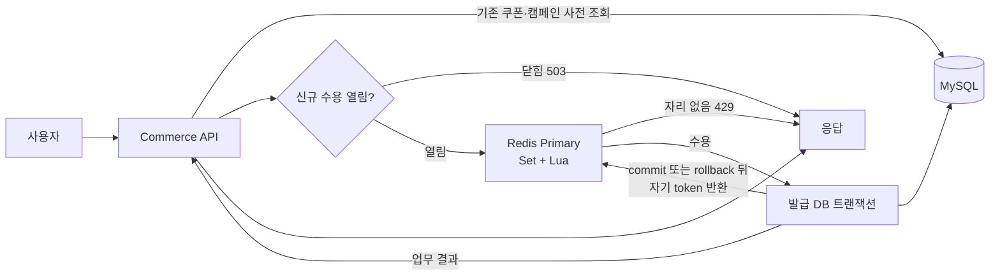
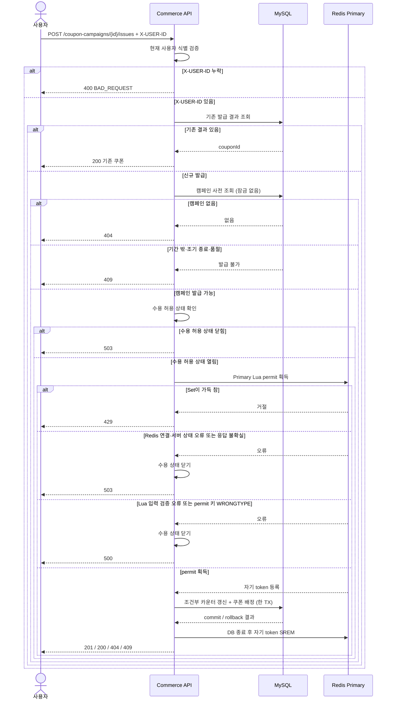
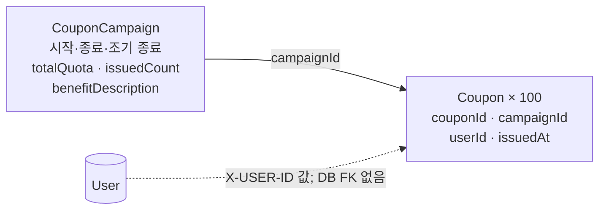
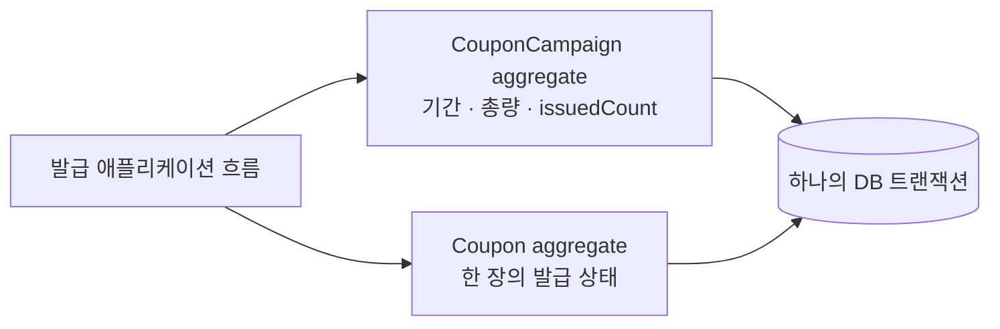
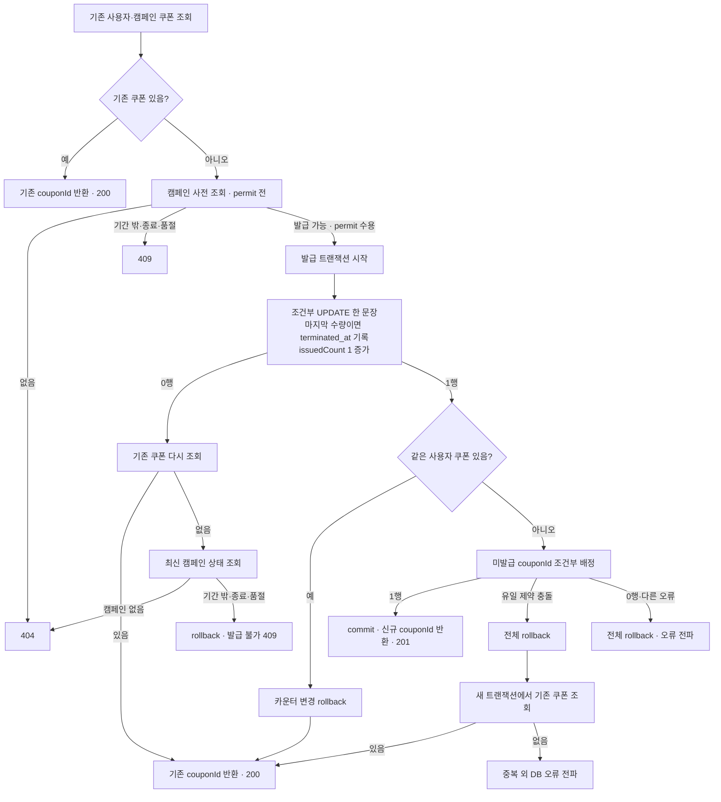
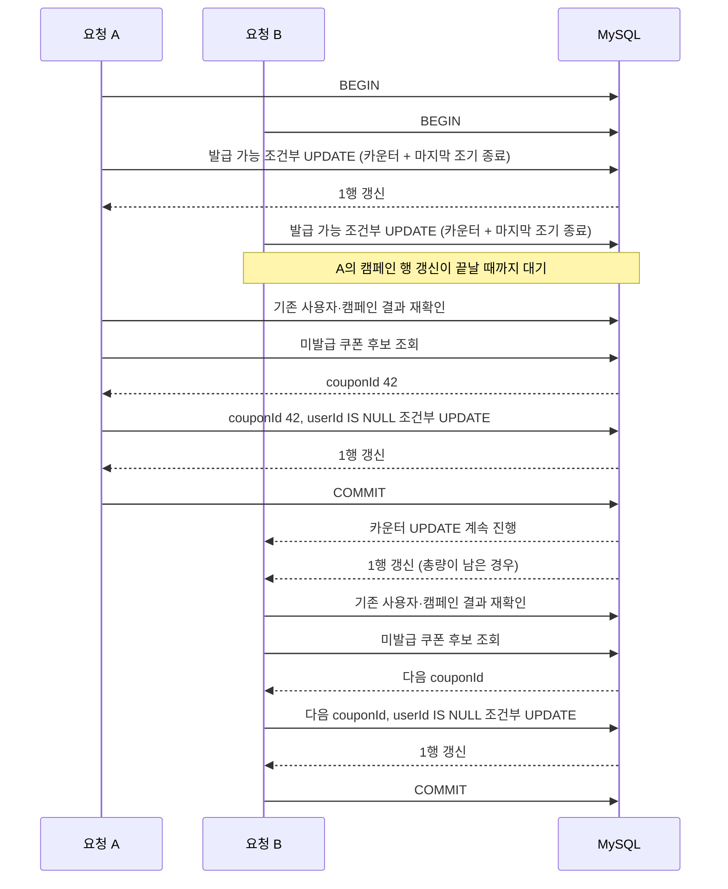
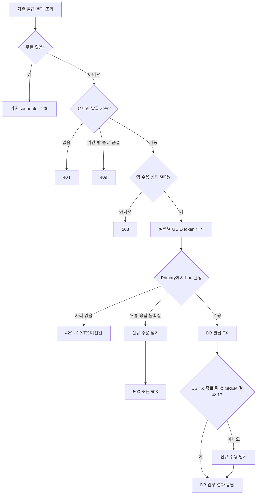
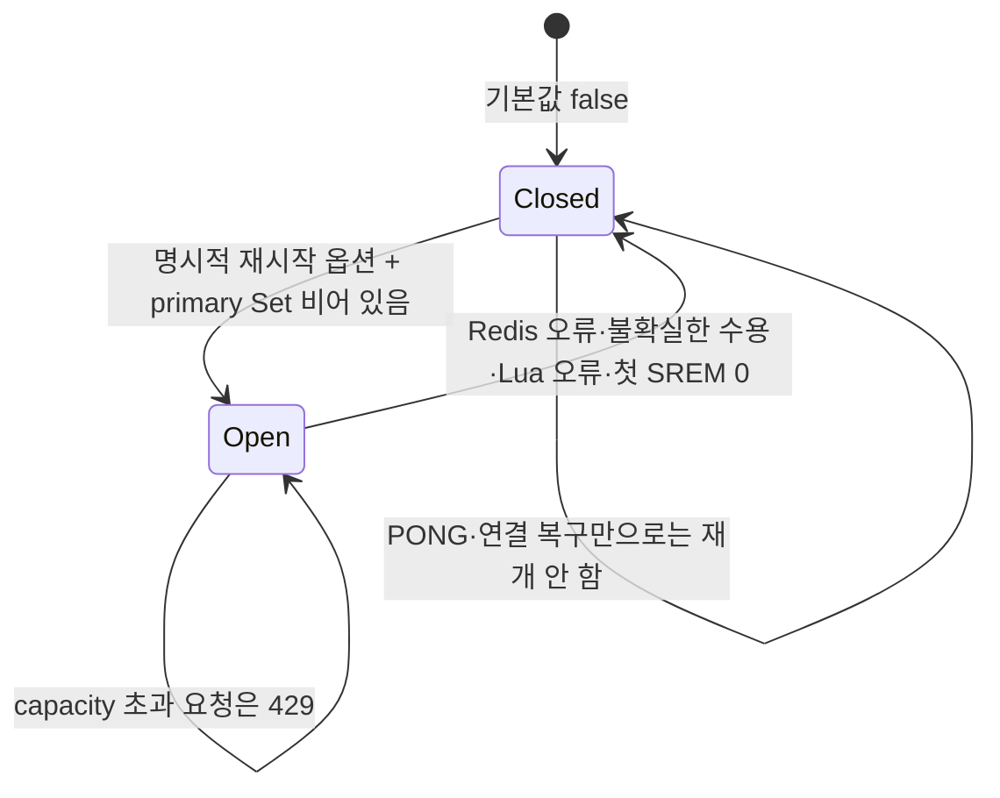

# 쿠폰 발급

> 구현 상태: 캠페인·쿠폰 도메인과 저장소, 조건부 카운터·쿠폰 배정 SQL, 로컬 seed runner, 발급 애플리케이션 흐름, Redis primary Lua permit, HTTP API를 구현했다. 로컬·통합 검증은 아래 시나리오에 정리했다. 이 문서는 계약·처리 흐름·검증을, [결정 기록](coupon-issuance-decisions.md)은 선택 배경·대안·영향을 다룬다.

쿠폰 발급은 캠페인에 정해진 혜택을 사용자에게 한 번 부여하고, 본인 보유 목록에서 확인할 수 있게 하는 기능이다. 쿠폰 사용·주문 할인 적용·환불은 범위에 포함하지 않는다.

## 범위와 용어

| 개념 | 이번 설계 |
|---|---|
| 발급 총량 | 개발 DB에 캠페인 1건과 쿠폰 행 100개를 준비한다. |
| 동시 수용량 | 신규 발급 실행 수를 제한한다. 총량과 별개이며 Redis permit을 사용한다. |
| `couponId` | 발급 결과 식별자다. 입력 쿠폰 코드나 주문 적용은 범위 밖이다. |
| 실행 환경 | 기존 `commerce-api`와 개발 DB를 사용한다. 별도 앱·서버는 추가하지 않는다. |

## 요구사항

### 기능 요구사항

| ID | 요구사항 | 수용 기준 |
|---|---|---|
| FR-01 | 캠페인이 존재하고 예정 발급 기간 안이며 조기 종료되지 않았고, 발급 가능한 수량이 남아 있을 때 신규 발급을 허용한다. | 발급 가능한 캠페인은 신규 발급 경로에 진입하고, 기간 밖·조기 종료·품절은 거절한다. |
| FR-02 | 신규 발급은 현재 사용자에게 쿠폰 한 장을 부여하고 `couponId`와 발급 시각을 결과로 반환한다. | 응답의 `couponId`와 발급 시각이 본인 보유 목록 결과와 일치하는지 확인한다. |
| FR-03 | 한 사용자는 같은 캠페인에서 한 장만 받는다. 재요청에는 기존 `couponId`를 `200 OK`로 반환하고, 캠페인 종료 뒤에도 기존 결과를 반환한다. | 최초 응답과 재요청 응답의 ID가 같고, 재요청에서 신규 발급 효과가 생기지 않는지 확인한다. |
| FR-04 | 보유 쿠폰 목록은 현재 사용자 소유의 쿠폰만 반환하고 `issuedAt DESC, couponId DESC` 순으로 정렬한다. | 다른 사용자 쿠폰이 포함되지 않고 동률에서도 정렬 결과가 안정적인지 확인한다. |
| FR-05 | 발급·목록의 사용자 식별값은 로컬 `X-USER-ID` 헤더만 사용한다. 본문·경로·query에 별도의 `userId` 입력을 두지 않는다. | 헤더 누락은 거절하고, 발급·목록이 헤더 사용자 기준으로만 처리되는지 확인한다. 헤더 자체의 위조 방지는 범위 밖이다. |
| FR-06 | 최초 발급은 `201 Created`, 요청자 헤더 누락은 `400 BAD_REQUEST`, 없는 캠페인은 `404 NOT_FOUND`, 기간 밖·조기 종료·품절은 `409 CONFLICT`로 응답한다. | 각 사전 조건에서 지정된 HTTP 상태와 공통 오류 코드를 확인한다. |
| FR-07 | 처리 자리가 없으면 `429 TOO_MANY_REQUESTS`, 수용 상태를 확인할 수 없으면 `503 SERVICE_UNAVAILABLE`, 내부 서버 오류는 `500 INTERNAL_ERROR`로 응답한다. 이 응답들은 발급 예약이나 대기열 등록을 뜻하지 않는다. | 각 상황의 HTTP 상태를 확인하고, 거절된 요청이 대기열이나 신규 발급 결과로 남지 않는지 확인한다. |
| FR-08 | 처리 자리가 없을 때 요청은 즉시 거절되며, 서버는 요청을 보관하거나 나중에 자동 실행하지 않는다. 발급 요청 순서는 보장하지 않는다. | `429`를 받은 뒤 새 HTTP 요청을 보내야만 다시 발급을 시도하는지 확인한다. |

### 비기능 요구사항

| ID | 요구사항 | 검증 기준 |
|---|---|---|
| NFR-01 · 데이터 정합성 | 동시 요청과 실패가 있어도 발급 수는 총량을 넘지 않고 실제 배정된 쿠폰 수와 일치한다. 한 쿠폰이 둘 이상의 사용자에게 배정되지 않는다. | 마지막 수량 동시 발급, 동일 사용자 동시 요청에서 FR-03이 지켜지는지, 발급 중 실패 뒤 쿠폰 수와 `issuedCount`가 일치하는지 확인한다. |
| NFR-02 · 동시성 제한 | 동시에 진행 중인 신규 발급 실행 수는 서버 설정값 이하로 유지한다. 로컬·테스트의 설정값은 3이다. | 세 실행을 유지한 동안 네 번째 요청이 `429`를 받고 신규 발급 DB 처리에 진입하지 않는지 실제 Redis로 확인한다. |
| NFR-03 · 장애 안전성 | 수용 상태를 확인할 수 없으면 신규 발급을 허용하지 않는다. DB가 정상인 동안 기존 보유 쿠폰 조회는 유지한다. | 실제 Redis 중단과 수용 결과 불확실 상황에서 신규 발급 효과가 없고, 기존 본인 쿠폰 조회가 가능한지 확인한다. PONG·연결 복구만으로 수용이 다시 열리지 않는지도 확인한다. |
| NFR-04 · 실행 수명 | 발급 작업이 끝났다고 확인하기 전에 그 작업의 처리 자리를 다른 신규 작업에 재사용하지 않는다. | DB 종료 전에는 자리가 유지되고, 정상 종료 뒤에는 해당 실행의 자리만 반환되는지 확인한다. |

### 설계 수단과 미정 목표

- 위 요구사항을 만족시키는 구현 수단은 뒤의 DB 트랜잭션·Redis 설계 절과 결정 기록에 정리한다. 예를 들어 조건부 갱신, 유일 제약, Redis primary Lua, 실행 token과 TTL 정책은 요구사항 자체가 아니라 선택한 설계 수단이다.
- 운영 처리량·응답 지연 목표와 운영 동시 수용량은 아직 수치로 정하지 않는다. 로컬·테스트의 3은 검증 설정값이며, 운영값은 부하와 SLO 측정 후 정한다.
- 로컬·테스트 프로필만 `coupon.issue.capacity=3`을 설정한다. 다른 프로필은 수용이 닫힌 채 기동할 수 있고, 시작 시 수용을 열려면 양의 수용량을 별도로 설정해야 한다.
- Redis permit은 쿠폰 발급 경로의 동시 실행만 제한한다. 공유 DB 연결 풀을 격리하거나 전체 API 요청률을 제한하지 않는다.
- 별도의 단위 시간당 요청률 제한은 이번 범위에 포함하지 않는다.
- 로컬 seed runner는 캠페인과 미발급 쿠폰 100행을 준비한다. 기본 실행은 기존 데이터를 보존하고, 명시적 reset 옵션에서만 해당 seed를 초기화한다.

## 처리 구조 한눈에 보기



**MySQL은 쿠폰 발급 결과와 총량의 원본이고, Redis는 현재 실행 자리만 관리한다.**

## 업무 계약과 API

| 항목 | 계약 |
|---|---|
| 캠페인 | ID, 이름, 예정 발급 시작 시각(start_at), 예정 종료 시각(end_at), 조기 품절 종료 시각(terminated_at), 총 발급 한도, 현재 발급 수를 가진다. 캠페인별 테이블이 아니라 캠페인별 행으로 관리한다. |
| 쿠폰 혜택 | 캠페인의 고정 혜택 설명이다. 초기 fixture는 benefitDescription = "5,000원 할인권"으로 둔다. 실제 할인 적용은 하지 않는다. |
| 사용자별 제한 | 같은 캠페인에서 한 사용자는 한 장만 발급받는다. |
| 발급 결과 | 사용자, 캠페인, couponId, 발급 시각이 쿠폰 행에 남는다. 혜택 설명은 연결된 캠페인에서 조회한다. |
| 기존 발급 | 같은 사용자가 같은 캠페인을 다시 요청하면 기존 couponId를 반환한다. 발급 기간 전·후이거나 조기 품절된 뒤에도 기존 발급 결과는 보존하고 반환한다. |
| 사용자 식별 | 로컬 `X-USER-ID` 헤더를 사용자 식별값으로 사용한다. 본문·경로·query에 별도 `userId` 입력을 두지 않으며 헤더가 없으면 400이다. `coupons.user_id`에는 사용자 ID를 값으로 저장하고 `users` FK는 두지 않는다. 실제 인증과 헤더 위조 방지는 범위 밖이다. |

| API | 동작 |
|---|---|
| POST /api/v1/coupon-campaigns/{campaignId}/issues | 현재 사용자의 쿠폰 발급 |
| GET /api/v1/coupons | 현재 사용자의 보유 쿠폰 목록 |

| 응답 | 계약 |
|---|---|
| 최초 발급 | `201 Created`와 `couponId`, `campaignId`, `issuedAt`, `benefitDescription` |
| 기존 발급 재요청 | `200 OK`; 최초 발급과 같은 쿠폰 정보와 `couponId` |
| 보유 목록 | 본인 쿠폰 전체, `issuedAt DESC, couponId DESC`; 각 항목은 발급 응답과 같은 필드 |
| 혜택 조회 | 수정하지 않는 캠페인 혜택 설명을 조회 |
| 목록 크기 | 현재 fixture는 캠페인 1건이므로 페이지네이션 없이 반환. 캠페인 수 증가 시 재검토 |

오류는 공통 `ErrorType`을 사용하고, `meta.errorCode`는 기존 규칙대로 HTTP reason phrase를 담는다.

| 상황 | HTTP / 공통 `ErrorType` | 응답 의미 |
|---|---|---|
| `X-USER-ID` 누락 | 400 BAD_REQUEST | 요청자 식별값이 필요함 |
| 존재하지 않는 캠페인 | 404 NOT_FOUND | 캠페인을 찾을 수 없음 |
| 발급 기간 전·후 또는 조기 종료 | 409 CONFLICT | 현재 발급할 수 없는 캠페인 |
| 품절 | 409 CONFLICT | 발급 가능한 쿠폰이 남지 않음 |
| 처리 자리 없음 | 429 TOO_MANY_REQUESTS | 이번 실행을 수용하지 않음 |
| Redis 수용 상태 확인 불가 | 503 SERVICE_UNAVAILABLE | 안전한 수용 판단을 할 수 없음 |
| Lua 입력 검증 오류 또는 permit 키의 `WRONGTYPE` | 500 INTERNAL_ERROR | 내부 수용 처리 오류; 신규 수용을 닫음 |
| Redis 서버 상태 오류 (`READONLY`, `LOADING`, `OOM`, `BUSY` 등) | 503 SERVICE_UNAVAILABLE | Redis 수용 상태 확인 불가; 신규 수용을 닫음 |

기간 불가·조기 종료·품절은 `409 CONFLICT`로 구분하고 메시지로 사유를 전달한다. 429와 503은 대기열 등록이나 향후 발급 예약을 뜻하지 않는다.

### 요청 순서



| 판정 | 담당 |
|---|---|
| 기존 쿠폰·캠페인 사전 확인 | MySQL 잠금 없는 조회; permit 낭비를 줄임 |
| 신규 발급 최종 승인 | 발급 트랜잭션의 조건부 갱신 |
| 처리 자리 | Redis Primary Lua |

## 데이터 모델 초안

캠페인 한 행과 쿠폰 행 100개를 준비하고, 발급 때 한 쿠폰 행을 배정한다.



| 개념 | 주요 데이터 |
|---|---|
| `CouponCampaign` | ID, 이름, 시작·종료·조기 종료 시각, 총량, 현재 발급 수, 고정 혜택 설명 |
| `Coupon` | 쿠폰 ID, 캠페인 ID, nullable 사용자 ID·발급 시각; 발급 전 재고이자 발급 기록 |

미발급은 `user_id`, `issued_at`이 모두 NULL인 상태다. 별도 상태 컬럼과 혜택 스냅샷은 두지 않는다. 발급 시 별도의 보유 쿠폰 행을 insert하지 않고, 미발급 `Coupon` 행 자체에 사용자와 발급 시각을 갱신한다.
`user_id`는 로컬 요청자 식별값이라 `users` 테이블 참조 여부를 발급 전제나 FK로 검증하지 않는다. `campaign_id`에는 FK를 둔다.

## 도메인 aggregate 경계



두 aggregate는 저장 모델만 나누고, 발급은 한 DB 트랜잭션으로 조정한다. 캠페인은 쿠폰 행 전체를 로드하지 않는다.

## 도메인 불변식과 규칙

| 대상 | 불변식·규칙 | 최종 보장 위치 |
|---|---|---|
| CouponCampaign | `totalQuota > 0`, `0 <= issuedCount <= totalQuota` | 캠페인 생성 검증, 발급 수 조건부 UPDATE |
| CouponCampaign | 발급 가능 여부는 `start_at <= issueNow < end_at`, `terminated_at IS NULL`, `issuedCount < totalQuota`로 계산한다. 별도 boolean은 두지 않는다. | 도메인 정책으로 표현하고, DB 조건부 UPDATE가 동시성에서 최종 판정 |
| CouponCampaign | 새 발급 효과 한 건마다 `issuedCount`를 한 번 증가한다. 기존 발급 재응답이나 Redis permit 반환은 발급 수를 바꾸지 않는다. | 발급 애플리케이션 트랜잭션 |
| CouponCampaign | `start_at < end_at`. `terminated_at`은 발급 총량을 소진해 예정 종료 시각보다 일찍 끝난 때만 기록하며, 마지막 쿠폰 발급과 같은 시각으로 저장한다. | 캠페인 생성 검증, 발급 트랜잭션 |
| Coupon | 미발급이면 `userId`와 `issuedAt`이 모두 비어 있다. 발급되면 두 값이 모두 기록된다. | 도메인 상태 전이와 DB 저장 |
| Coupon | 한 쿠폰은 한 번만 한 사용자에게 발급되고, 발급 후 소유자를 바꾸거나 미발급으로 되돌리지 않는다. | 도메인 규칙, `couponId`와 `userId IS NULL` 조건부 UPDATE |
| Coupon | 같은 캠페인·사용자의 발급 결과는 최대 한 건이다. | `(campaignId, userId)` DB 유일 제약 |
| Coupon | 로컬 `user_id`는 요청 헤더의 식별값이며 실제 사용자 존재를 뜻하지 않는다. | `users` FK 없음; 헤더 위조 방지는 범위 밖 |
| Campaign + Coupon | 캠페인에 속한 전체 쿠폰 행 수는 `totalQuota`와 같고, 발급은 이 행 수를 바꾸지 않는다. | seed 생성·reset, DB 통합 검증 |
| Campaign + Coupon | 발급 수와 실제 발급된 쿠폰 수가 일치하고, 카운터 증가와 쿠폰 배정이 함께 commit 또는 rollback된다. | 한 DB 트랜잭션, 통합 검증 |
| Campaign + Coupon | 카운터 증가에 성공했는데 미발급 쿠폰 행이 없으면 데이터 불일치로 처리하고 전체 rollback한다. | 발급 트랜잭션, 실패 검증 |

| 경계 | 책임 |
|---|---|
| 기존 발급 결과 | 신규 발급 가능 여부보다 먼저 조회해 기간 종료 후에도 반환 |
| 발급 수와 발급 쿠폰 수 일치 | 교차 aggregate 규칙; 한 DB 트랜잭션으로 보장 |
| permit·429/503·Redis 복구 | 도메인 밖의 애플리케이션·인프라 책임 |

## 개발 DB seed

| 구분 | 초기 상태·동작 |
|---|---|
| 데이터 | 캠페인 1건, 쿠폰 100행; `totalQuota=100`, `issuedCount=0`, `terminated_at=NULL`; 미발급 쿠폰의 `user_id`, `issued_at`은 NULL |
| 생성 | `local` seed runner가 예약된 이름 `local-coupon-seed`로 조회하고 없을 때 캠페인·쿠폰을 같은 TX에서 생성 |
| 재설정 | `coupon.seed.reset=true`일 때 해당 seed만 초기화. 캠페인 reset SQL → 쿠폰 할당 초기화 순서로 같은 TX에서 실행하고 쿠폰 ID를 보존한다. 기본값은 false이며 만료 후 재시작도 기존 기간·발급 결과를 보존한다. |
| 발급 기간 | 생성·reset 시 `ApplicationTime`으로 읽은 실행 시각부터 하루 뒤까지 설정한다. 시작 포함·종료 제외이며 기본 재시작에서는 갱신하지 않는다. |
| 이상 상태 | 예약된 이름 중복, 총량과 쿠폰 행 수 불일치에는 임의 선택·자동 보충 없이 실패해 local 앱 시작을 중단한다. 기본 실행은 실제 발급 행 수와 카운터의 일치도 확인한다. |
| DB 스키마 | 로컬은 `ddl-auto=validate`다. 새 DB는 [init.sql](../../../docker/mysql/init.sql), 기존 DB는 [쿠폰 스키마 준비 SQL](../../../docker/mysql/coupon-migration.sql)을 적용한 뒤 시작한다. 이 파일은 캠페인 테이블을 먼저 만들고 쿠폰 테이블을 만든다. |
| 범위 | 기존 commerce-api와 개발 DB만 사용. 별도 서버·앱·캠페인 CRUD 없음 |

seed runner는 로컬 단일 인스턴스의 시작 단계에서 실행하며 여러 인스턴스의 동시 seed 생성·reset은 지원하지 않는다. 쿠폰 발급 허용을 여는 시작 절차는 seed 준비가 끝난 뒤 수행해야 한다. reset은 이전 발급 실행·DB 작업의 종료를 확인한 뒤 사용한다.

## 발급 DB 트랜잭션



| 불변식 | DB 보장 |
|---|---|
| `0 <= issuedCount <= totalQuota` | `issueNow`, `terminated_at IS NULL`, 잔여 한도를 조건으로 한 증가 |
| 캠페인·사용자별 발급 최대 한 건 | `(campaignId, userId)` 유일 제약 |
| 쿠폰 한 장은 한 번만 배정 | 캠페인 카운터 갱신 뒤 기본키와 `userId IS NULL` 조건부 UPDATE; 해당 UPDATE가 쿠폰 행을 잠그고 최종 상태를 확인 |
| 카운터와 쿠폰 배정의 원자성 | 같은 DB 트랜잭션에서 commit/rollback |

| 규칙 | 설명 |
|---|---|
| 미발급 행의 유일 제약 | MySQL은 복합 유일 인덱스에서 여러 `NULL user_id`를 허용한다. |
| 동시 중복 방지 | 선조회가 아닌 트랜잭션 재확인과 유일 제약이 담당한다. |
| 격리 수준 | 발급 TX는 `READ_COMMITTED`; 캠페인 행 갱신 대기 뒤 일반 조회가 최신 commit 결과를 읽도록 한다. |
| 트랜잭션 경계 | permit 획득 뒤 DB TX 시작, commit/rollback 완료를 트랜잭션 완료 상태로 확인한 뒤 token 반환. 종료를 확인하지 못하면 반환하지 않는다(D-24). Redis 호출은 TX 밖이다. |
| 쿠폰 후보 경합 | 캠페인 카운터 행에서 발급 TX가 직렬화된다. 그 뒤 후보 조회와 조건부 UPDATE를 수행하며 별도 `SELECT ... FOR UPDATE`, `SKIP LOCKED`, 후보 재시도는 쓰지 않는다. |

캠페인 카운터는 다음 한 문장에서 조기 품절 시각과 함께 변경한다. `terminated_at`의 조건은 증가 전 수량을 기준으로 계산하므로 이 대입을 먼저 둔다. 두 값 모두 쿠폰 배정과 같은 트랜잭션에서 rollback된다.

```sql
UPDATE coupon_campaigns
SET terminated_at = CASE
        WHEN issued_count = total_quota - 1 THEN :issueNow
        ELSE terminated_at
    END,
    issued_count = issued_count + 1,
    updated_at = :issueNow
WHERE id = :campaignId
  AND deleted_at IS NULL
  AND start_at <= :issueNow AND :issueNow < end_at
  AND terminated_at IS NULL
  AND issued_count < total_quota;
```

MySQL 단일 테이블 UPDATE는 대입을 왼쪽부터 평가한다. 카운터를 먼저 증가시키면 뒤 조건식이 증가한 값을 읽으므로 위 대입 순서를 유지한다.

`validateIssuable()`은 사전 조회의 도메인 판정에 사용한다. `recordIssue()`는 메모리 모델의 동일한 상태 전이를 표현하며, DB 경로는 조건부 SQL로 갱신한다. DB 갱신 뒤 `recordIssue()`를 호출해 다시 증가시키거나, 갱신 전 조회한 수량으로 마지막 발급을 판단하지 않는다. DB 통합 테스트에서 도메인 전이와 SQL 결과를 대조한다.

### 동시 쿠폰 후보 선점 시퀀스

카운터 행이 같은 캠페인의 발급 트랜잭션을 직렬화한다. 마지막 쿠폰을 먼저 발급한 뒤 대기 중인 갱신은 0행이 되어 품절로 끝난다.



같은 사용자의 동시 요청이 유일 제약에 충돌하면 rollback 뒤 새 트랜잭션에서 기존 `couponId`를 조회한다. 다른 DB 오류는 중복 성공으로 바꾸지 않는다.

## Redis 처리 자리 설계

Redis는 **신규 발급 실행 수**만 제한한다. 모든 캠페인이 하나의 전역 permit Set을 공유하며, 쿠폰 총량과 발급 결과는 MySQL이 관리한다.



| 설정·연산 | 계약 |
|---|---|
| 수용량 | 신뢰하는 YAML 설정. 로컬·테스트는 3; 다른 프로필은 값을 정하지 않으며 수용을 열 때 양의 값을 명시. DB 연결 풀 자체를 조정하지 않음 |
| permit Set | 고정 키 `coupon:issue:permits`; 모든 캠페인이 공유 |
| token | 발급 요청 실행마다 서버가 UUID 생성; 사용자 ID·couponId와 분리; 자동 TTL 없음 |
| 획득 Lua | 입력 검증 → `SISMEMBER` → `SCARD` → 빈자리면 `SADD`를 한 번에 수행. 같은 token 확인은 동일 실행의 방어 경로이며, 서로 다른 실행은 새 UUID를 사용. 애플리케이션에서 명령을 나누거나 획득을 재시도하지 않음 |
| Redis API·드라이버 | Spring Data Redis `RedisTemplate`의 Lua 실행 API를 사용한다. 기존 `RedisConfig`는 Lettuce 드라이버를 사용하므로 이를 재사용하며, 직접 Lettuce API나 Redisson 의존성은 추가하지 않는다. |
| 연결 | 기존 `redisTemplateMaster`와 `StringRedisSerializer`로 primary에서 획득·반환. replica count는 수용 판단에 사용하지 않음 |
| Timeout | 기존 공유 설정 `datasource.redis.connect-timeout=100ms`, `command-timeout=100ms`를 재사용한다. 원래 상품 캐시의 빠른 fallback을 위해 둔 API 설정이다. |
| 반환 | DB commit/rollback과 실행 종료 확인 뒤 자기 token에 `SREM`; 첫 반환은 1이어야 함. 종료를 확인하지 못하면 반환하지 않음 |

| Redis 결과 | 응답 | 수용 상태 |
|---|---|---|
| Set 용량 초과 | 429 | 열린 상태 유지 |
| 연결 실패·수용 응답 불확실·100ms command timeout | 503 | 닫힘; Redis script가 실행됐는지 모를 수 있음 |
| Lua 입력 검증 오류·permit 키 `WRONGTYPE` | 500 | 닫힘 |
| 그 밖의 Redis command/server 오류 | 503 | 닫힘 |
| 정상 획득 token의 첫 `SREM=0` | DB 업무 결과대로 응답 | 닫힘 |

발급 트랜잭션은 첫 줄에서 Spring 트랜잭션 동기화를 등록해 commit 요청 여부와 완료 상태(COMMITTED·ROLLED_BACK·UNKNOWN)를 기록한다. permit을 얻은 뒤의 실행은 `CouponIssueExecutor`가 맡고, 예외 종류가 아니라 이 기록으로 token 반환을 정한다(D-24). facade는 실행 결과를 동기 API 응답으로 바꾼다.

| 발급 트랜잭션이 끝난 방식 | token | 수용 상태 | 응답 |
|---|---|---|---|
| 정상 반환(commit 완료) | 반환 | 유지 | 201 |
| commit 완료 뒤 예외 전달 | 반환 | 유지 | 500 |
| commit 요청 전 예외 뒤 rollback 완료(업무 거절·같은 사용자 중복 충돌·잠금 대기 timeout 등) | 반환 | 유지 | 404·409, 중복은 새 조회 뒤 200, 그 밖은 500 |
| 발급 SQL 실행 전 실패(트랜잭션 시작 실패 등) | 반환 | 유지 | 500 |
| commit 요청 뒤 실패(Spring이 ROLLED_BACK으로 알려도 포함) | 남김 | 열린 채 유지 | 500; 오류 로그에 `campaignId`·permit token |
| rollback 실패 등 완료 상태 UNKNOWN 또는 기록 없음 | 남김 | 열린 채 유지 | 500; 같은 오류 로그 |

commit 요청 뒤 DB 연결이 끊기면 Spring은 commit 실패 예외를 rollback 처리하고 완료 상태를 ROLLED_BACK으로 알릴 수 있다. 서버가 COMMIT을 받았는지는 알 수 없으므로 끝난 것으로 보지 않는다. 남은 token은 자리를 계속 점유해 그동안 쓸 수 있는 자리가 하나 줄지만 상한은 넘지 않는다. 운영자가 해당 DB 작업의 종료와 쿠폰·발급 수를 확인한 뒤 로그의 permit token만 제거한다. permit token은 인증 정보가 아니라 실행별 내부 ID다. Redis 상태 자체는 확인된 상태라 신규 수용은 닫지 않는다.

설정된 수용량은 앱 시작 때 양의 정수인지 확인하며, 시작 시 수용을 열려면 수용량 설정을 요구한다. Lua도 capacity와 token을 검증한다.

### 앱의 신규 발급 허용 상태



| 재개 단계 | 조건 |
|---|---|
| 기존 실행 확인 | 발급 실행·DB 작업 종료와 쿠폰 수·발급 수 대조를 확인한다. |
| permit 정리 | 확인된 비활성 token만 Redis CLI로 제거한다. 앱 허용 상태는 Redis CLI로 바꾸지 않는다. |
| 앱 재시작 | `coupon.issue.admission.open-on-startup=true`; primary permit Set이 비어 있을 때만 열린다. |
| 범위 | 앱 메모리 상태를 쓰는 로컬 단일 실행 실험이다. Redis 장애 중에도 기존 쿠폰 결과와 본인 목록은 조회 가능하다. |

Set이 비었다는 사실만으로 기존 DB 작업 종료를 대신 확인하지 않는다.

## 검증 시나리오: 현재 수용량과 permit 반환

| 사전 조건 | 값 |
|---|---|
| 수용량 | 3; 3+1 API 테스트는 Redis를 비운 뒤 테스트에서 허용 상태를 연다. 시작 runner는 별도의 실제 Redis 통합 테스트에서 `open-on-startup=true`로 확인한다. |
| Redis | 격리된 실제 Redis; 시작 전에 permit Set 비어 있음 |
| 캠페인 | 총량이 네 요청보다 큼 |
| 검증 대상 | Redis permit이 동시 신규 DB 발급 실행을 세 개로 제한하는지 확인; 총량 경합과 분리 |

| 순서 | 동작 | 기대 결과 |
|---|---|---|
| 1 | 서로 다른 세 사용자의 실제 발급 요청을 보내고, 실제 Redis permit 획득 직후·DB 트랜잭션 시작 전에 테스트 barrier에서 멈춘다. | Redis primary에 서로 다른 활성 token 세 개가 있고, 세 요청 모두 DB 트랜잭션 전이다. |
| 2 | 활성 token 세 개를 유지한 채 네 번째 사용자가 발급을 요청한다. | 429를 받고 DB 발급 트랜잭션에 진입하지 않으며 쿠폰도 발급되지 않는다. 진입 여부는 트랜잭션 spy로 직접 확인한다. |
| 3 | 첫 세 실행 중 하나만 barrier에서 풀어 발급·commit·token 반환을 완료한다. 나머지 두 실행은 계속 멈춰 둔다. | 발급 수는 1, Redis에는 나머지 두 token만 남는다. |
| 4 | 네 번째 사용자가 새 HTTP 요청을 보내고, 그 요청도 DB 트랜잭션 직전까지 멈춘다. | 새 token이 들어가며 Redis Set에는 기존 두 token과 새 token이 함께 있다. 먼저 받은 429가 자동으로 처리된 것이 아니다. |
| 5 | 남은 두 실행과 네 번째 재요청을 진행해 commit·token 반환을 기다린다. | 발급 쿠폰 네 장, issuedCount 4, 활성 token 0개가 확인된다. |

| 테스트 보조 조건 | 확인 |
|---|---|
| Barrier | deadline 설정; 실패 시 요청을 풀고 종료·token 정리까지 대기 |
| 네 번째 요청 | 첫 429 요청은 transaction spy로 DB 진입이 없음을 확인; 재요청은 나머지 두 실행이 유지되는 동안 새 permit을 얻음 |
| Set 구성원 | Redis Set에서 실제 UUID token을 비교; 단순 크기만 확인하지 않음 |
| token 반환 | 첫 `SREM=1`; 반복·미지 token은 `0`, 다른 활성 token 유지 여부를 실제 Redis에서 확인 |
| TTL | 활성 token이 있는 동안 Redis key의 TTL이 `-1`인지 확인 |
| 실제 의존성 | 실제 Redis Set과 token을 검사; mock·thread-local 대체 금지 |
| 시작 runner | `open-on-startup=true` 실제 앱 컨텍스트가 빈 primary Set에서 열리고, token 존재 시 runner가 닫는지 확인 |
| 닫힘 시나리오 | 클래스당 하나, 전용 Spring 컨텍스트·Redis, `@DirtiesContext(AFTER_CLASS)` |
| Redis 중단 | 전용 Testcontainers Redis와 `@DynamicPropertySource`; 수용 재개용 테스트 기능 없음 |

## 검증 시나리오: 쿠폰 결과·중복·장애

| 장면 | 준비·실행 | 핵심 기대 |
|---|---|---|
| 요청자 식별 누락 | `X-USER-ID` 없이 발급 또는 목록 API 호출 | 400 `BAD_REQUEST`; 신규 발급 permit·DB 효과 없음 |
| 캠페인 사전 거절 | 없음·기간 밖·종료·품절 | 404/409; permit과 발급 TX에 진입하지 않음 |
| Lua·키 오류 | 잘못된 입력 또는 permit 키 타입 오류 | 500 `INTERNAL_ERROR`; 수용 닫힘, DB 신규 효과 없음 |
| 캠페인 조건부 SQL | 첫 발급·마지막 발급·동시 수량 경쟁·rollback | 첫 발급에는 종료 시각 없음, 마지막 발급에만 같은 `issueNow` 저장; rollback 시 카운터와 종료 시각 원복 |
| 쿠폰 저장소 SQL | 100행 준비·조건부 배정·유일 제약·DB에 없는 로컬 사용자 ID·사용자별 정렬 | 재배정 없음; 같은 사용자 제약만 별도 중복 예외; `users` 행 없는 ID도 허용 |
| 로컬 seed | 생성·기본 재실행·명시적 reset·잘못된 재고 | 100개 ID 유지, 기본 재실행에서 기존 결과 보존, reset에서만 기간·발급 초기화; 다른 캠페인 유지 |
| 정상 발급·목록 | 신규 발급 후 본인 목록 조회 | 쿠폰 1건, `issuedCount=1`, 같은 `couponId` 노출 |
| 동일 사용자 재요청 | 같은 캠페인으로 재호출 | 같은 `couponId`; 추가 배정·카운터 증가 없음 |
| 동시 동일 사용자 | 같은 사용자 요청 병렬 실행 | DB 효과 1건, 응답은 같은 쿠폰; 타인 목록에 없음 |
| 마지막 한 장의 동시 중복 | 총량 1, 같은 사용자의 두 요청을 barrier 뒤 함께 진행 | 201·200과 같은 `couponId`; `issuedCount=1` |
| 마지막 수량 경쟁 | 총량 5, 서로 다른 사용자 8명 | 발급 5·품절 3·쿠폰 5·`issuedCount=5`; Redis 거절은 품절로 세지 않음 |
| 쿠폰 배정 실패 | 카운터 UPDATE 뒤 조건부 쿠폰 UPDATE 실패 | 전체 TX rollback; 쿠폰 미발급·카운터 원복·permit 반환 |
| commit 뒤 응답 유실 | 같은 사용자가 재요청 | 기존 쿠폰 반환; 추가 발급 0 |
| Redis 중단 | 실제 연결 endpoint 중단 | 신규 발급 503·DB 효과 없음; 기존 본인 목록 조회와 같은 사용자 재요청의 200 유지 |
| permit 반환 실패 | 첫 `SREM=0` 및 반환 명령 오류 주입 | DB 결과대로 응답; 쿠폰 보존·수용 닫힘·복구 확인 후 token 정리 |
| 잠금 대기 timeout | 수용량 1, 다른 연결이 캠페인 행을 잠금, 테스트 연결의 잠금 대기 1초 | 500; rollback 완료로 token 반환·수용 열림; 잠금 해제 뒤 같은 사용자 201 |
| commit 직전 연결 끊김 | 수용량 1, 발급 SQL 뒤 다른 연결에서 `KILL CONNECTION` | 500; Spring 완료 상태는 ROLLED_BACK, 쿠폰 미발급; token 1개 남음·수용 열림; 같은 사용자 429; token 정리 뒤 201 |
| TTL 경과 | 활성 token 대기; Redis key TTL 확인 | 자동 만료 없음(`TTL=-1`); 시간 경과만으로 permit 재사용 불가 |

| 검증 분리·정리 | 조건 |
|---|---|
| 발급 총량 경합 | Redis 용량을 충분히 두거나 DB handler를 실제 병렬 호출해 DB 불변식만 검증 |
| 장애 대상 | 실제 application endpoint; 테스트가 만든 자원만 정리 |
| 테스트 판정 | 0건·skip·연결 실패는 통과가 아님; 기존 MySQL·Redis fixture 우선 사용 |
| 실행 시점 | 발급 facade 19건·발급 실행기 12건·DB 트랜잭션 2건(완료 상태 기록 포함)·설정 3건·수용 시작 runner 5건(단위 4·실제 Redis 1)·HTTP E2E 8건·Redis 장애/스크립트/반환 실패 E2E 4건·발급 트랜잭션 실패 E2E 2건·Redis 오류 분류 4건을 검증했다. 실제 Redis와 barrier로 수용량 3, 한 permit 반환 중 재수용, 마지막 한 장의 동일 사용자 경합, 시작 시 Set 확인, Redis 중단 후 기존 결과 조회, 활성 permit의 무TTL을 확인했다. 실제 MySQL로 잠금 대기 timeout 뒤 permit 반환과 commit 직전 연결 끊김 뒤 permit 유지를 확인했다. |
| 전체 회귀 | `./gradlew :apps:commerce-api:check` 통과: 1,054건, 실패·오류·skip 0. 대기열 구현을 포함한 결과다. |

## 관련 결정 기록

결정별 맥락·대안·근거·영향은 [쿠폰 발급 결정 기록](coupon-issuance-decisions.md)에 정리했다. 이 문서에는 선택된 계약과 처리 흐름, 검증 시나리오를 유지한다.

## 범위 밖

사용자 대기실, 비동기 worker, 쿠폰 사용·주문 할인 적용, 알림, 캠페인 관리 화면과 전체 CRUD는 이번 구현 범위에서 제외한다.

다음은 필요성을 확인했지만 값을 측정한 뒤 정하기로 하고 이번에 넣지 않았다.

| 항목 | 현재 동작 | 남은 개선 |
|---|---|---|
| 발급 트랜잭션 timeout | 캠페인 행 잠금을 기다리는 실행은 MySQL 기본 잠금 대기 시간(50초)까지 permit을 쥐고, 그동안 다른 신규 요청은 429를 받는다. | 부하 측정으로 발급 처리 시간을 확인한 뒤 트랜잭션 timeout을 정해, 오래 기다리는 실행을 일찍 rollback하고 자리를 돌려준다. |
| 429 재시도 안내 | 응답에 `Retry-After`가 없어 클라이언트가 곧바로 다시 요청하면 거절이 같은 시각에 다시 몰릴 수 있다. | 처리 시간을 근거로 재시도 간격을 안내한다. 안내는 쿠폰 확보나 예약이 아니다. |
