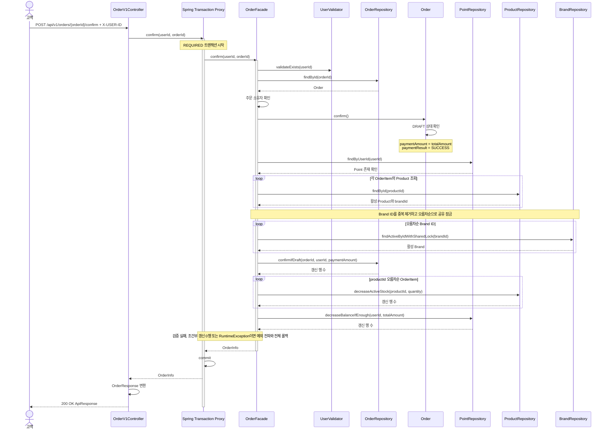

# 주문 확정과 포인트 결제

요청자 소유의 DRAFT 주문을 확정하고 재고와 주문 총액을 Point 잔액에서 같은 트랜잭션으로 차감하는 유스케이스다. 현재 구현의 결제 결과는 내부 포인트 차감 성공을 나타내며, 외부 결제대행 연동은 포함하지 않는다. HTTP 입력과 오류는 [API 계약](../api-contracts.md), 주문·상품·포인트 규칙은 [도메인 모델](../domain-model.md)을 기준으로 한다. 브랜드 삭제와 공유하는 Brand 잠금 규칙은 [브랜드 삭제 설계](brand-deletion.md)와 함께 확인한다.

## 업무 계약과 기대값

대상은 `POST /api/v1/orders/{orderId}/confirm`의 최초 확정이다. 요청자 소유의 DRAFT 주문을 확정하고, 저장된 품목 수량만큼 재고를, 주문 총액만큼 포인트를 차감한다.

각 사례는 독립적으로 준비한 데이터로 확인한다. 별도 명시가 없으면 요청자 소유의 DRAFT 주문과 사용 가능한 상품을 준비하며, 확정 전 `paymentAmount`와 `paymentResult`는 `null`이다. 거절된 시도의 변경은 모두 취소하고, 다른 요청이 commit한 결과는 보존한다.

| 규칙 | 주어진 상태와 입력 | 기대값 |
|---|---|---|
| 정상 확정 | 단가 `2,000원`, 수량 `2`인 본인 DRAFT 주문, 재고 `5`, 잔액 `10,000원` | `200 OK`, CONFIRMED, 재고 `3`, 잔액 `6,000원`, 결제액 `4,000원`, 결제 결과 SUCCESS |
| 주문 총액만큼 포인트 차감 | 총액 `70원`인 본인 DRAFT 주문, 잔액 `100원`, 상품 재고 충분 | `200 OK`, CONFIRMED, 잔액 `30원`, 결제액 `70원`과 SUCCESS 저장, 주문 품목 수량만큼 재고 차감 |
| 주문 총액보다 잔액 부족 | 총액 `101원`인 본인 DRAFT 주문, 잔액 `100원`, 상품 재고 충분 | `409 Conflict`, DRAFT와 잔액 `100원` 유지, 재고 차감과 결제 정보 저장 없음 |
| 재고와 잔액 경계값 | 주문 수량 `2`, 총액 `4,000원`, 재고 `2`, 잔액 `4,000원` | 확정 성공, 재고와 잔액 모두 `0` |
| 요청자 식별값 누락 | `X-USER-ID` 없이 확정 요청 | `400 Bad Request`, 주문, 재고와 잔액 변경 없음 |
| 조회할 수 없는 주문 | 없는 User나 Order 또는 타인 소유 Order의 확정 요청 | `404 Not Found`, 주문, 재고와 잔액 변경 없음 |
| 이미 확정된 주문 | 정상 확정 사례를 성공시킨 뒤 같은 주문에 다시 확정 요청 | `409 Conflict`, CONFIRMED와 기존 결제 정보 유지, 재고 `3`과 잔액 `6,000원` 유지 |
| 주문 당시 금액 사용 | 단가 `2,000원`, 수량 `2`로 저장한 DRAFT 주문의 현재 상품 가격을 `3,000원`으로 변경, 잔액 `10,000원`과 충분한 재고 | 확정 성공, 저장된 단가와 총액 유지, 결제액 `4,000원`, 잔액 `6,000원` |
| 합산 수량 차감 | 같은 Product의 수량 `2`와 `3`을 합산해 저장한 DRAFT 주문, 저장 단가 `2,000원`, 재고 `5`, 잔액 `10,000원` | 확정 성공, 해당 Product 재고를 총수량 `5`만큼 차감해 `0`, 잔액 `0`, 결제액 `10,000원` |
| 상품 사용 불가 | 확정 시 주문 품목의 Product가 없거나 삭제되어 있음. 삭제와 겹쳐 생성된 DRAFT도 포함 | `409 Conflict`, DRAFT와 확정 전 결제 정보 유지, 해당 시도의 재고와 포인트 차감 없음 |
| 재고 부족 | 주문 수량 `2`, 총액 `4,000원`, 재고 `1`, 잔액 `10,000원` | `409 Conflict`, DRAFT, 재고 `1`과 잔액 `10,000원` 유지, 결제 정보 `null` |
| 잔액 부족 | 주문 수량 `2`, 총액 `4,000원`, 재고 `5`, 잔액 `3,999원` | `409 Conflict`, DRAFT, 재고 `5`와 잔액 `3,999원` 유지, 결제 정보 `null` |
| 여러 품목의 부분 차감 취소 | P1의 실제 차감 SQL 실행 후 P2의 재고 조건을 만족하지 못함 | `409 Conflict`, P1과 P2 재고 및 잔액 복구, DRAFT와 확정 전 결제 정보 유지 |
| 중간 저장 실패 | Order와 상품의 조건부 갱신 및 Point 차감 SQL 실행 후 테스트 구성에서 예외 발생 | `500`, 해당 시도의 재고와 포인트 차감, 확정 상태와 결제 정보 전체 롤백 |
| 같은 주문의 동시 확정 | 정상 확정 사례의 같은 DRAFT를 두 요청이 읽고 확정 | 성공 `1건`, 나머지는 DRAFT 상태 검사 또는 조건부 갱신 실패로 `409`, 재고 `3`, 잔액 `6,000원`, 결제액 `4,000원`과 SUCCESS 한 번 반영 |
| 같은 재고의 동시 차감 | 재고 `5`, 서로 다른 사용자의 서로 다른 주문 `8건`이 각각 `1개` 구매, 모든 사용자의 포인트 충분 | 성공 `5건`, 재고 부족 `3건`, 최종 재고 `0`, 거절된 주문은 DRAFT와 확정 전 결제 정보 유지 |
| 상품 수정과 재고 차감 | 상품 수정 요청이 재고 `5`를 조회한 뒤 주문 확정이 `2개` 차감하고 commit, 이후 이름과 가격 수정 UPDATE 실행 | 두 요청 성공, 변경된 이름과 가격 및 최종 재고 `3` 유지 |
| 재고 차감 후 최종 수량 설정 | 재고 `5`에서 주문 확정이 `2개` 차감하고 commit, 이후 관리자 재고 `10` 설정 UPDATE 실행 | 두 요청 성공, 최종 재고 `10`, 주문의 수량과 결제 결과 유지 |
| 최종 수량 설정 후 재고 차감 | 관리자의 재고 `10` 설정이 commit된 뒤 주문 확정의 `2개` 차감 UPDATE 실행 | 두 요청 성공, 최종 재고 `8`, 성공한 주문 수량만 차감 |
| 같은 잔액의 차감과 잔액 부족 | 한 사용자의 잔액 `10,000원`, 서로 다른 상품의 `4,000원` DRAFT 주문 `3건`, 각 상품 재고 충분. 세 주문 확정을 동시에 시작 | 조건부 차감 성공 `2건`, 잔액 부족 `1건`, 자동 재시도 없음, 최종 잔액 `2,000원`, 거절된 주문의 재고 차감과 확정 결과 없음 |
| 충전과 주문 확정 경쟁 | 잔액 `10,000원`에서 `2,000원` 충전과 총액 `7,000원` 주문 확정을 함께 실행하고 재고는 충분히 준비 | 두 요청 모두 성공, 최종 잔액 `5,000원`, 기술 오류 없음 |

실패와 동시 요청의 최종 상태는 서비스 트랜잭션 및 모든 요청이 종료된 뒤 새 DB 조회로 확인한다. 주문의 품목과 총액은 유지하며 성공한 주문만 CONFIRMED와 결제 정보를 갖는다. 조건부 갱신 결과의 업무 거절과 기술 오류를 구분한다.

한 사용자의 서로 다른 DRAFT 주문 세 건을 동시에 확정해 같은 Point 잔액 행의 조건부 차감을 검증한다. 주문마다 상품을 다르게 하고 재고를 충분히 준비한다. 각 차감은 실행 순서와 관계없이 잔액 조건을 만족하는 두 건만 성공하고, 남은 한 건은 잔액 부족으로 거절되어야 한다. 충전도 Point 행을 원자적으로 증가시켜 주문 차감과 겹친 변경을 보존한다.

## 트랜잭션 경계와 흐름

`OrderFacade.confirm()`을 유스케이스 트랜잭션 경계로 둔다. 주문 상태, 상품 재고, 포인트 잔액과 결제 결과를 같은 트랜잭션에서 변경한다.
브랜드·연결 상품 일괄 삭제와 실행 순서를 정하기 위해 주문 상품이 속한 활성 Brand를 공유 잠금으로 보호한다.
모두 성공하면 commit하고, 업무 조건을 만족하지 못하거나 처리 중 RuntimeException이 발생하면 Facade 밖으로 예외를 전달해 이번 시도의 변경을 전부 rollback한다.

상품별 요청 수량과 결제액은 저장된 OrderItem과 주문 총액을 사용한다. 현재 상품 가격으로 결제액을 다시 계산하지 않는다.
조회한 재고와 잔액은 확정 결과를 보장하지 않으므로, 실제 UPDATE에서 현재 상태와 차감 조건을 검사한다.

bulk UPDATE 전에 필요한 변경을 flush하고, 실행 후 영속성 컨텍스트를 clear한다. 갱신된 값이 필요하면 clear 후 재조회한다.
이전에 조회한 JPA 엔티티를 다시 저장하지 않는다. 같은 관리 엔티티를 단순 재조회하는 것만으로 값이 갱신됐다고 보지 않는다.

## 동시성 보호 전략

**같은 주문의 최초 확정은 한 번만 반영하고, 성공한 확정의 수량과 금액만 차감한다.**

### 대상별 전략

| 대상 | 전략 | 보호하는 규칙 |
|---|---|---|
| Brand | 활성 Brand `PESSIMISTIC_READ` 공유 잠금 | 브랜드 삭제와 주문 확정의 순서를 정함 |
| Order | `id`, `user_id`, `status = DRAFT` 조건부 상태 갱신 | 같은 주문의 최초 확정은 한 번만 성공 |
| Product 재고 | `id`, `deleted_at IS NULL`, `stock >= :quantity` 조건부 차감 | 삭제된 상품과 재고 부족 차단 |
| Point 잔액 | `user_id`, `balance >= :amount` 조건부 차감 | 잔액 부족과 동시 초과 차감 차단 |
| Point 충전 | `balance = balance + :amount` 원자적 증가와 잔액 상한 조건 | 주문 차감과 겹친 충전의 갱신 유실·표현 범위 초과 차단 |

Brand ID는 중복 제거 후 오름차순으로 잠그고, Product도 ID 오름차순으로 갱신한다.
Brand 잠금 조회와 모든 갱신은 **같은 트랜잭션**에서 수행한다. Brand 공유 잠금과 UPDATE가 얻는 쓰기 잠금은 트랜잭션 종료까지 유지한다.

### 동시 요청의 처리 결과

**같은 주문의 확정**

- 두 요청이 같은 DRAFT를 읽었더라도 Order 조건부 갱신으로 최초 확정을 보호한다.
- 먼저 처리한 확정이 commit되면 나머지는 갱신 행 수 0 또는 DRAFT 상태 검사 실패로 `409`를 받는다. 추가 재고와 포인트 차감은 남기지 않는다.
- 먼저 처리한 시도가 rollback되면 다음 요청은 현재 상태와 업무 조건을 다시 판단한다.

**같은 재고와 포인트 잔액의 변경**

- 재고와 포인트 차감은 현재 값에서 요청 수량과 주문 총액을 빼는 UPDATE로 처리한다. 조건을 만족한 요청만 성공한다.
- 재고나 잔액 조건을 만족하지 못하면 `409`로 종료하고, 이미 실행한 주문 상태 변경과 다른 품목 차감도 함께 rollback한다.
- 포인트 충전도 같은 Point 행을 원자적으로 증가시킨다. 양수 입력과 잔액 상한을 검사하고, 조회한 잔액에 충전액을 더한 오래된 값을 다시 저장하지 않는다.

**브랜드 삭제와 상품 변경**

- 확정이 Brand 공유 잠금을 먼저 얻으면 해당 트랜잭션이 끝날 때까지 브랜드 일괄 삭제가 기다린다.
- 삭제가 Brand 배타 잠금을 먼저 얻으면 확정은 기다린다. 삭제가 commit되면 `409`로 종료하고, rollback되면 활성 Brand를 확인해 확정을 계속 판단한다.
- 상품 단독 삭제와 재고 설정은 Product의 UPDATE 순서로 처리한다. 단독 삭제가 먼저 commit되면 재고 차감은 `409`, 재고 설정이 먼저 commit되면 설정된 수량에서 차감한다.
- 상품 수정은 이름과 가격만 갱신해 재고 차감을 보존한다. 관리자 재고 설정이 주문 차감 뒤 실행되면 입력한 최종 수량을 적용한다.

## 실패 처리와 재시도

갱신 행 수가 1이면 성공, 0이면 해당 업무 조건을 만족하지 못한 것으로 판정한다. 0 자체가 트랜잭션을 rollback하지는 않는다.
Facade가 `CoreException` 등 RuntimeException을 프록시 밖으로 전달해, 같은 트랜잭션에서 이미 실행한 변경까지 rollback한다.
예외를 잡아 정상 반환하거나 실패한 트랜잭션 안에서 처리를 계속하지 않는다.

| 결과 | 처리 |
|---|---|
| 식별값 누락 | 기존 `400`, 변경 없음 |
| User/Order/Point 없음 또는 타인 주문 | 기존 `404`, 변경 없음 |
| Order가 DRAFT 아님 또는 DRAFT 조건부 갱신 0행 | 기존 상태 오류 `409`, 전체 rollback |
| 상품 또는 Brand가 없거나 삭제됨, 재고 조건부 차감 0행 | 기존 업무 오류 `409`, 전체 rollback |
| Point 잔액 조건부 차감 0행 | 기존 잔액 부족 `409`, 전체 rollback |
| 교착, 잠금 시간 초과, 그 밖의 저장 또는 commit 전 flush 오류 | 전체 rollback 후 기존 기술 오류 처리; 자동 재시도하지 않음 |
| commit 자체의 오류 | 기술 오류 처리; commit 응답을 확인하지 못한 경우 확정 여부가 불명확할 수 있으므로 rollback 완료로 단정하지 않음; 자동 재시도하지 않음 |

업무 거절과 기술 오류 모두 자동 재시도하지 않는다. DB에서 발생하는 잠금 대기는 현재 SQL의 실행 대기이며, 유스케이스를 다시 실행하는 재시도가 아니다.
잠금 시간 초과와 교착은 잔액 부족이나 재고 부족으로 바꾸지 않는다.

## 검증 기준

| 검증 | 준비와 실행 | 기대 결과 |
|---|---|---|
| 요청자와 주문 상태 | 본인 DRAFT, 타인 주문, 이미 확정된 주문을 각각 준비 | 본인 DRAFT만 확정. 타인 주문은 `404`, 이미 확정된 주문은 추가 차감 없이 `409` |
| 같은 주문의 확정 | 같은 DRAFT에 확정 요청 두 개 실행 | 성공 1건, 나머지는 `409`. 재고, 포인트와 결제 결과 한 번만 반영 |
| 중간 실패 | 일부 품목의 실제 갱신 뒤 실패, 전체 갱신 뒤 commit 전 실패 | 해당 시도의 상태 변경과 차감 전체 rollback. 다른 요청의 commit 보존 |
| 재고 경쟁 | 재고 5개, 서로 다른 주문 8개가 각 1개 요청. 구매자별 잔액 충분 | 확정 5건, 재고 부족 3건, 기술 오류 0건, 최종 재고 0개 |
| 포인트 경쟁 | 한 사용자 잔액 10,000원, 서로 다른 상품의 4,000원 주문 3개. 재고 충분 | 확정 2건, 잔액 부족 1건, 기술 오류 0건, 최종 잔액 2,000원. 거절된 주문의 재고와 결제 결과 유지 |
| 충전과 확정 | 잔액 10,000원에서 2,000원 충전과 7,000원 확정을 함께 실행 | 두 요청 성공, 기술 오류 0건, 최종 잔액 5,000원 |
| 삭제와 확정 | Brand 잠금의 획득 순서를 바꾸고, 삭제 실패도 유발 | 확정 우선이면 확정 후 삭제. 삭제 commit 우선이면 확정 `409`, 삭제 rollback 후에는 확정 계속 판단 |

품목 수량은 Product별 총수량으로 검사한다. 상품 또는 Brand가 없거나 삭제됐거나 재고나 잔액이 부족하면 DRAFT, 재고, 잔액과 확정 전 결제 정보를 유지한다.
요청별 성공, 업무 거절과 기술 오류를 수집하고 모든 worker 종료 후 **새 조회 경계**에서 다음 불변식을 확인한다.

- 재고: 초기 재고 − 성공 주문 품목 수량 합 = 최종 재고
- 포인트: 초기 잔액 + 성공 충전액 합 − 성공 결제액 합 = 최종 잔액
- 주문: 성공한 주문은 CONFIRMED와 결제 결과를 가지며, rollback된 주문은 DRAFT와 확정 전 결제 정보를 유지

JPA의 자동 flush 시점과 실제 SQL 순서는 DB 통합 테스트에서 확인한다. 같은 관리 객체의 값만으로 commit이나 rollback을 검증하지 않는다.

