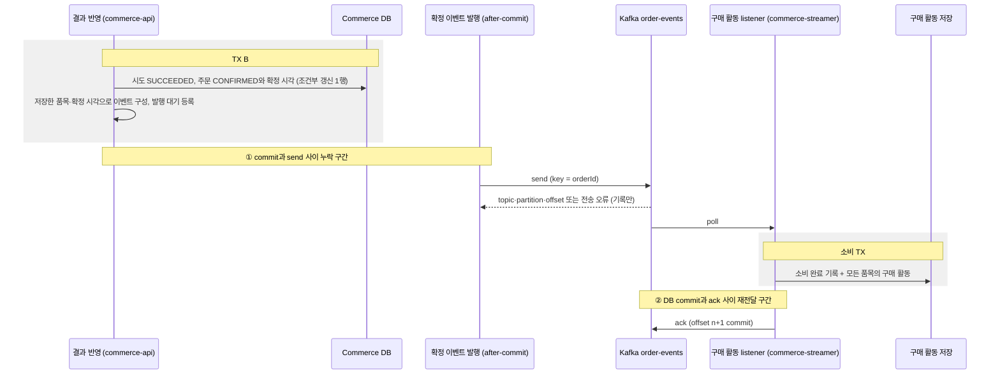

# 주문 확정 이벤트와 구매 활동

> 주문 결제: [1. 결제 요청](order-payment-request.md) → [2. PG 연동](../external-systems/payment-gateway.md) → [3. 결과 반영](order-payment-result.md) → **4. 확정 이벤트**

> 상태: 구현 중. 발행은 TX B commit 뒤 직접 발행이며, DB와 broker 사이의 누락 구간은 다음 단계의 Outbox에서 개선한다.

PG 성공으로 처음 확정된 주문의 사실을 `OrderConfirmed` 이벤트로 Kafka에 발행하고, `commerce-streamer`가 상품별 구매 활동으로 한 번만 저장한다.<br>
구매 활동은 이후 주간 상품 랭킹의 입력이다. 이번 범위에서 랭킹 조회와 Outbox는 만들지 않는다.

## 이벤트로 연결하는 이유

결과 반영(TX B)이 구매 활동 저장을 직접 호출하면 후속 기능의 지연·장애가 결제 결과 반영에 묶인다. 구매 활동 저장이 실패했다는 이유로 PG가 이미 승인한 결제를 실패로 돌릴 수 없다.

| 표현 | 의미 | 이 설계에서 |
| --- | --- | --- |
| 커맨드 (예: 구매 활동을 기록하라) | 특정 주체에게 작업 수행을 요청 | 쓰지 않는다. 주문 확정은 후속 기능의 이름과 실패를 알지 않는다. |
| 이벤트 `OrderConfirmed` | 주문이 확정됐다는 이미 일어난 사실 | 소비 실패는 과거 확정을 취소하지 않는다. 소비자는 사실을 자기 책임으로 저장한다. |

이벤트는 결합을 없애지 않고 경계를 옮긴다. 발행 누락, 전달 지연, 중복 전달은 이 문서의 규칙으로 다룬다.

## 경계와 흐름



| 경계 | 소유 | 함께 commit되는 것 | 함께 묶이지 않는 것 |
| --- | --- | --- | --- |
| TX B | commerce-api | 시도 종결, 주문 확정과 확정 시각, 예약 소비(재고 유지) | Kafka 전송 |
| producer 전송 | commerce-api | broker 기록. producer 재시도의 중복은 broker가 거른다. | 주문 commit |
| 소비 TX | commerce-streamer | 소비 완료 기록과 모든 품목의 구매 활동 | offset commit |
| offset commit | commerce-streamer | group이 다음에 읽을 위치 | 소비 TX |

commerce-streamer는 주문·상품·결제·포인트 테이블을 읽거나 바꾸지 않는다. 결제, 재고 차감, 포인트 차감을 다시 수행하지 않고 이벤트에 담긴 사실만 저장한다.<br>
이벤트 발행을 추가해도 결제 결과 반영의 주문·재고 규칙은 바뀌지 않으며, PG 주문 결제는 지금처럼 포인트를 조회하거나 차감하지 않는다.

## 이벤트 계약

| 항목 | 계약 |
| --- | --- |
| topic | `order-events`. 테스트는 실행마다 고유 suffix를 붙인 topic을 쓴다. |
| key | 내부 `orderId`의 10진 문자열 (`"42"`). payload의 `orderId`와 같아야 한다. |
| value | UTF-8 JSON. 아래 필드만 담는다. |
| `eventType` / `schemaVersion` | `"OrderConfirmed"` / `1` |
| `eventId` | `order-confirmed:v1:{orderId}`. 주문당 한 번뿐인 최초 확정 사실에서 유도한다. |
| `orderId` | 확정 주문 ID |
| `confirmedAt` | 최초 확정 시각. `orders.confirmed_at`과 같은 값의 UTC ISO-8601이며 마이크로초까지 표현한다. |
| `items` | `productId`, `quantity`의 목록. 저장된 주문 품목 스냅샷에서 만들며 상품당 하나, 상품 ID 오름차순, 수량은 양수다. 주문은 생성할 때 같은 상품의 수량을 합산해 품목 하나로 저장하므로, 스냅샷을 그대로 옮기면 상품 중복이 없다. |

```json
{
  "eventType": "OrderConfirmed",
  "schemaVersion": 1,
  "eventId": "order-confirmed:v1:42",
  "orderId": 42,
  "confirmedAt": "2026-09-07T01:00:00Z",
  "items": [
    {"productId": 7, "quantity": 2},
    {"productId": 8, "quantity": 1}
  ]
}
```

예시의 ID와 시각은 합성 값이다.

- `eventId`의 `v1`은 ID 형식의 버전이다. payload의 `schemaVersion`이 바뀌어도 같은 확정 사실은 같은 `eventId`를 유지한다. 전송 시도 횟수, 현재 시각, 새 UUID는 넣지 않는다.
- 소비자는 `eventId`를 불투명한 식별자로 다룬다. 형식을 해석해 `orderId`를 꺼내지 않는다.
- 카드 정보, PG 거래 키, 사용자 식별자, 금액처럼 구매 활동에 필요 없는 값은 담지 않는다.
- 같은 사실인지는 JSON 문자열이 아니라 정규화한 값으로 비교한다. 속성 순서와 `items` 배열 순서는 사실을 바꾸지 않는다. 규칙은 [사실의 비교](#사실의-비교)를 따른다.
- 고객이나 관리자가 `OrderConfirmed`를 발행하는 HTTP endpoint는 두지 않는다. 합성 이벤트 주입은 테스트 코드에서만 한다.

### key 선택

같은 주문의 이벤트가 같은 partition의 순서를 따르도록 `orderId`를 key로 쓴다. 한 이벤트가 여러 상품을 담으므로 상품 ID를 key로 쓰지 않고, 품목별로 이벤트를 쪼개지 않는다. 상품 key는 인기 상품의 partition에 부하가 몰리는 비용도 있다.

같은 key가 같은 partition으로 가는 것은 같은 partitioner·직렬화·partition 수에서만 성립한다. partition 수를 바꾸면 매핑이 달라진다.

## 발행

### 발행 조건

결과 반영에서 시도를 `SUCCEEDED`로 종결하고 주문을 `PAYMENT_PENDING → CONFIRMED`로 바꾼 조건부 갱신이 1행인 요청만 이벤트를 만든다. 생성 응답, callback, reconcile, 주기 조회가 모두 같은 TX B를 지나므로 경로와 관계없이 같은 조건이다.

| 상황 | 발행 |
| --- | --- |
| 최초 PG 성공 확정, TX B commit | 1회 |
| 처리 중·결과 미확인(`PENDING`·`UNKNOWN`), 충돌 | 없음 |
| 확정 실패(`PAYMENT_FAILED`) | 없음 |
| 최초 확정 TX B rollback | 없음 |
| 이미 종결된 시도에 같은 결과 반복 (중복 callback, reconcile, 주기 조회) | 없음. 조건부 갱신 0행 |
| 이전 POINT 확정 주문, 이번 변경 전 PG 확정 주문 | 없음. 소급 발행하지 않는다. |

### 발행 위치

TX B는 조건부 갱신 1행을 확인한 뒤 같은 트랜잭션 안에서 이벤트를 만들어 Spring application event로 등록한다. 전송은 `@TransactionalEventListener(AFTER_COMMIT)` listener가 TX B commit 뒤에 수행한다.

- TX B 메서드 끝에서 직접 send하지 않는다. 메서드가 끝나도 commit 전이므로 rollback된 확정의 이벤트가 나갈 수 있다.
- 이벤트는 TX B에서 읽은 `Order`의 품목 스냅샷과 저장한 확정 시각으로 미리 만든다. listener는 DB나 지연 로딩에 접근하지 않는다.
- listener는 TX B를 commit한 스레드에서 send를 호출한다. broker가 응답하지 않을 때 결과 반영 요청이 오래 묶이지 않도록 producer의 metadata 대기를 짧게 둔다. 값은 [producer 설정](#producer-설정)을 따른다.

### 전송 결과와 실패

send 결과를 비동기로 받아 성공이면 `eventId`와 topic·partition·offset을 info 로그로, 실패면 `eventId`, `orderId`와 원인을 error 로그로 남긴다.

- 전송이 실패하거나 listener에서 예외가 나도 이미 commit된 주문을 실패·미확인으로 되돌리지 않고, PG 생성·조회를 다시 호출하지 않는다. 결과 반영의 응답은 저장된 주문 상태로 정한다.
- 이번 단계는 실패한 발행을 자동으로 다시 보내지 않는다. 아래 누락 구간과 같은 상태로 남는다.

### 발행 누락 구간

TX B commit과 broker 기록은 하나의 원자적 작업이 아니다. commit 뒤 send 전에 프로세스가 멈추거나 send가 실패하면 주문은 `CONFIRMED`이고 예약은 소비됐지만, 해당 `eventId`의 record와 구매 활동은 없다.

commit 전에 보내면 rollback된 확정의 이벤트가 남으므로 택하지 않는다. `@Async`나 after-commit listener는 실행 시점만 바꿀 뿐 이 구간을 없애지 않는다.

다음 단계에서 주문 확정과 같은 트랜잭션에 전달할 사실을 기록하는 Outbox로 개선한다. 이번 단계는 [발행 누락 사례](#발행-누락-사례)를 재현 테스트로 남긴다.

## 소비

### 저장할 사실

| 저장 모델 | 의미 | 유일성 |
| --- | --- | --- |
| `processed_order_confirmation` | 소비를 마친 확정 이벤트의 처리 기록. `event_id`, `order_id`. 이미 처리한 이벤트인지만 표시한다. | `event_id` 유일, `order_id` 유일 |
| `product_purchase_activity` | 확정 주문의 상품별 구매 사실. `order_id`, `product_id`, `quantity`, `confirmed_at` | `(order_id, product_id)` 유일 |

- 구매 활동의 `confirmed_at`은 이벤트의 최초 확정 시각이다. 소비 시각을 쓰지 않는다.
- 확정 시각과 품목은 구매 활동에만 둔다. 처리 기록은 처리 여부만 표시하고, 같은 사실인지는 구매 활동과 비교해 판정한다.
- `product_id`는 과거 주문의 상품 식별자로 보존한다. 소비할 때 상품의 존재·삭제·가격을 조회하지 않고 상품 테이블에 FK를 두지 않는다. 삭제·비노출 상품을 거르는 일은 활동을 읽는 쪽(이후 랭킹)이 맡는다.

주문 42가 상품 7을 2개, 상품 8을 1개 구매했다면 활동은 2행이다. 같은 이벤트를 다시 받아도 2행이다. 주문 43이 상품 7을 3개 구매하면 활동은 3행이고 상품 7의 구매 수량 합은 5다.

### 사실의 비교

같은 사실인지는 받은 이벤트를 정규화한 값과 이미 저장된 구매 활동을 비교해 정한다. JSON 원문이나 그 해시를 저장해 비교하지 않는다.

1. 받은 이벤트의 품목에서 같은 상품의 수량을 합산해 상품별로 하나로 만든다. 배열 순서는 보지 않는다.
2. 기존 처리 기록의 `orderId`로 구매 활동 행을 읽어 상품별 수량과 확정 시각을 얻는다.
3. 상품 집합, 상품별 수량, 확정 시각(UTC, 마이크로초)이 모두 같으면 같은 사실이다.

`eventId`와 `orderId`는 처리 기록에서 비교한다. `eventType`·`schemaVersion`은 사실이 아니라 해석 계약이며 파싱 단계에서 검증하므로 비교에 넣지 않는다.<br>
다르면 어느 상품의 어떤 값이 다른지 error 로그에 남긴다.

### 판정 규칙

| 받은 이벤트 | 기존 완료 기록 | 처리 | ack |
| --- | --- | --- | --- |
| 새 `eventId`, 새 `orderId` | 없음 | 완료 기록과 모든 품목 저장 | 소비 TX commit 뒤 |
| 같은 `eventId`, 같은 `orderId`, 저장된 구매 활동과 같은 사실 | 있음 | 효과 추가 없이 완료 (정상 재전달) | 판정 뒤 |
| 같은 `eventId`, 다른 `orderId`, 또는 저장된 구매 활동과 다른 사실 | 있음 | 충돌. 저장하지 않음 | 하지 않음 |
| 다른 `eventId`, 같은 `orderId` | 있음 | 충돌. 저장하지 않음 | 하지 않음 |
| key와 `orderId` 불일치, 알 수 없는 `eventType`·`schemaVersion`, 품목 없음, 0 이하의 ID·수량 | 확인하지 않음 | 계약 위반. 저장하지 않음 | 하지 않음 |

충돌과 계약 위반을 `INSERT IGNORE`처럼 조용히 넘기지 않는다. error 로그로 드러내고 [실패와 중단](#실패와-중단)을 따른다.

### 소비 트랜잭션

1. listener가 record의 key와 value를 파싱하고 계약을 검증한다.
2. 소비 TX에서 같은 `eventId` 또는 `orderId`의 완료 기록을 찾는다. 있으면 판정 규칙으로 no-op이나 충돌을 정한다.
3. 없으면 완료 기록과 모든 품목의 구매 활동을 저장하고 commit한다. 중간 품목 저장이 실패하면 완료 기록과 앞선 품목도 함께 rollback한다.
4. 소비 TX가 commit된 뒤에만 listener가 ack한다.

완료 기록만 먼저 commit하면 그 뒤 중단됐을 때 재전달을 이미 처리한 것으로 건너뛰어 구매 활동이 빠진다. 구매 활동을 먼저 commit하고 완료 기록을 다른 트랜잭션에 남기면 그 사이 중단됐을 때 재전달이 활동을 다시 저장한다. 그래서 두 저장을 한 트랜잭션에 둔다.

### 동시 중복

조회만으로는 같은 이벤트의 동시 소비를 막지 못한다. 같은 group에서도 rebalance 중에는 이전 member와 새 member가 같은 record를 처리할 수 있다. 두 소비가 모두 기록 없음을 보고 저장하면 DB 유일 제약이 하나만 통과시킨다.

- 유일 제약 위반(MySQL 중복 키)이 나면 그 트랜잭션은 rollback한다. 같은 트랜잭션에서 예외를 삼키고 commit하지 않는다.
- rollback 뒤 새 트랜잭션에서 기존 완료 기록을 다시 읽어 판정 규칙을 적용한다. 같은 사실이면 no-op으로 완료하고, 다르면 충돌이다.
- 새 트랜잭션에서도 기존 기록을 찾지 못하면 판정할 수 없으므로 원래 오류로 실패시킨다.
- 중복 키가 아닌 저장 오류는 중복으로 바꾸지 않고 그대로 실패시킨다.

## Kafka 설정

### listener 설정

구매 활동 listener는 기존 batch factory(`BATCH_LISTENER_DEFAULT`)를 바꾸지 않고 commerce-streamer의 별도 record listener factory를 쓴다.

| 설정 | 값 | 이유 |
| --- | --- | --- |
| group | `purchase-activity` | 구매 활동 저장 전용이다. 다른 소비 목적은 별도 group으로 같은 로그를 따로 읽는다. |
| listener 형태 | record 단위, concurrency 1 | record마다 소비 TX와 ack가 하나씩 대응한다. 처리량은 partition 수 안에서 인스턴스를 늘려 조정한다. |
| key / value 역직렬화 | `StringDeserializer` / `ByteArrayDeserializer` | JSON 파싱과 계약 검증을 listener가 직접 해서 형식 오류를 원인과 함께 드러낸다. |
| `enable.auto.commit` | `false` | 주기적 자동 commit이 DB 완료 전에 offset을 넘기지 않게 한다. Kafka consumer가 실제로 받은 설정 값으로 확인한다. |
| ack mode | `MANUAL_IMMEDIATE` | 소비 TX commit 뒤 listener 스레드에서 해당 record의 offset을 바로 commit한다. |
| `auto.offset.reset` | `earliest` | group에 commit된 위치가 없을 때 처음부터 읽는다. 공통 설정의 `latest`는 group이 생기기 전에 발행된 확정 이벤트를 건너뛴다. |
| fetch 대기 | Kafka 기본값 | batch factory의 1MiB·5초 대기는 대량 처리용이다. 확정 이벤트는 건별로 바로 처리한다. |
| error handler | `CommonContainerStoppingErrorHandler` | [실패와 중단](#실패와-중단) |

### producer 설정

| 설정 | 값 | 의미와 한계 |
| --- | --- | --- |
| `acks` | `all` | 현재 ISR의 기록을 확인한 뒤 성공으로 본다. 로컬과 테스트는 broker 1대, 복제 1이라 복제 장애의 내구성은 확인하지 못한다. |
| `enable.idempotence` | `true` | producer 재시도로 broker에 생기는 중복을 막는다. 애플리케이션이 같은 사실을 새 record로 다시 보내는 중복은 막지 않으며, 소비 쪽 판정 규칙이 맡는다. |
| `max.block.ms` | 3초 | after-commit send가 metadata를 기다리며 결과 반영 요청 스레드를 묶는 시간을 제한한다. |

### 공통 설정과 topic

- 공통 `kafka.yml`의 consumer `value-serializer`는 `value-deserializer`로 바로잡는다. `properties` 아래의 `enable-auto-commit`은 Kafka가 읽지 않는 키이므로 consumer 속성 `enable-auto-commit`으로 옮긴다.
- local·test 프로필의 admin 속성에는 컨테이너 내부 주소(`kafka:9092`)가 있지만, Spring Boot가 admin의 `bootstrap.servers`를 공통 주소로 다시 덮어써 실제로는 쓰이지 않는다. 세 client가 같은 broker를 쓰는지는 테스트로 확인한다.
- `auto.create.topics.enable`은 broker 설정이라 client 속성으로는 효과가 없다. `order-events`는 자동 생성에 기대지 않고, local·test 프로필에서 commerce-api가 없을 때만 partition 3, 복제 1로 만든다. 운영 topic의 생성과 partition 변경은 배포 절차가 맡는다.

## 실패와 중단

| 시점 | 결과 | 복구 |
| --- | --- | --- |
| TX B rollback | 확정과 이벤트 없음 | 결과 반영의 기존 복구 (주기 조회, reconcile) |
| TX B commit 뒤 send 전 중단, send 실패 | 주문 `CONFIRMED`, record와 구매 활동 없음 | 이번 단계는 자동 복구 없음. error 로그. 다음 단계 Outbox |
| 파싱·계약 위반, 판정 충돌 | 저장 없음, ack 없음, 컨테이너 중단 | 원인 조사·수정 뒤 재시작. 같은 record부터 다시 읽는다. |
| 소비 TX 중 DB 오류 | 소비 TX 전체 rollback, ack 없음, 컨테이너 중단 | 원인 제거 뒤 재시작. 재전달로 저장한다. |
| 소비 TX commit 뒤 ack 전 중단 | 구매 활동 저장, offset 미commit | 재전달된 같은 사실은 no-op, 그 뒤 ack |
| rebalance 중 같은 record 동시 처리 | 유일 제약이 한 저장만 통과 | 나머지는 새 트랜잭션의 판정으로 no-op |

실패한 record는 건너뛰지 않고 컨테이너를 멈춘다.

- 건너뛰면 구매 활동이 조용히 빠진다. 빠른 재시도를 반복하면 같은 오류를 키운다.
- 멈추면 실패 record와 그 뒤 record의 offset은 commit되지 않고, 이미 ack한 record의 offset만 남는다. 재시작한 컨테이너는 commit된 위치, 즉 실패 record부터 다시 읽는다.
- 대가는 한 record의 실패가 그 인스턴스의 모든 partition 소비를 멈춘다는 점이다. 다른 인스턴스로 rebalance되면 그 인스턴스도 같은 record에서 멈춘다. DLQ로 옮기고 계속 진행하는 방식은 이번 범위에 넣지 않는다.

## 전달 보장

| 구간 | 보장 | 근거 |
| --- | --- | --- |
| 주문 확정 → broker | 최대 한 번. 누락 가능 | commit 뒤 직접 발행, 재발행 없음 |
| producer → broker | 재시도로 인한 중복 없음 | idempotent producer, `acks=all` |
| broker → 구매 활동 | 최소 한 번 전달, 효과는 한 번 | 소비 TX commit 뒤 ack, 완료 기록과 유일 제약 |

Kafka transaction의 exactly-once는 Kafka record와 offset을 함께 다루는 보장이며 MySQL의 구매 활동 저장은 포함하지 않는다. 그래서 소비 쪽 중복 판정을 Kafka 설정에 맡기지 않는다.<br>
단일 broker 실험으로는 복제, leader 장애, `min.insync.replicas`, 네트워크 분할에서의 보장을 확인하지 못한다.

## 검증 기준

결과는 실제 broker와 MySQL에서 확인한다. DB는 새 조회 경계에서, offset은 group의 committed offset으로, record 위치는 send metadata로 확인한다. 테스트는 고유한 topic·group을 쓰고 모든 대기에 deadline을 둔다.

| 영역 | 상황 | 기대값 |
| --- | --- | --- |
| 발행 | 실제 주문 API와 테스트 PG로 최초 성공 확정 | record 1건. key는 `orderId`, payload의 품목·수량·확정 시각이 저장된 주문과 같다. |
| 미발행 | 처리 중, `UNKNOWN`, 확정 실패, TX B rollback | 해당 `eventId`의 record 없음 |
| 중복 반영 | 중복 callback, callback 뒤 reconcile | 새 record와 재고 변경 없음 |
| 발행 실패 | send 직전 실패 주입 | 주문 `CONFIRMED`와 재고 차감 유지, record 없음, 응답은 저장된 상태 |
| 소비 | 주문 42(7×2, 8×1), 같은 이벤트 재수신, 주문 43(7×3) | 2행 → 2행 → 3행, 상품 7 합계 5 |
| 충돌 | 같은 `eventId`에 다른 수량·확정 시각, 같은 `orderId`에 다른 `eventId` | 추가 행 없음, 오류 노출 |
| 원자성 | 중간 품목 저장 실패 | 완료 기록과 앞선 품목 모두 없음 |
| 동시 중복 | 같은 이벤트 동시 소비 | 완료 기록 1건, 활동 행 수 불변, no-op으로 완료 |
| listener 설정 | 실제 consumer 설정 | `enable.auto.commit=false`, 역직렬화기, ack mode |
| listener 실패 | 소비 TX commit 전 오류 주입 | 전체 rollback, committed offset이 실패 record를 넘지 않음, 컨테이너 중단. 오류 제거 뒤 재시작하면 재전달·저장·ack |
| 재전달 | 소비 TX commit 뒤 offset을 commit하지 않고 종료, 같은 group의 새 consumer | 같은 partition·offset `n`을 다시 읽음, 활동 불변, committed offset `n → n → n+1` |
| partition 배정 | partition 2개 topic에 같은 group의 consumer 1 → 2 → 3개 | 각 partition은 한 member에만 배정, 3개면 하나 이상 배정 없음 |
| key 매핑 | partition 수를 고정하고 같은 key 반복 전송 | 같은 partition |

재전달 실험은 low-level consumer로 첫 consumer의 offset commit만 보류한다. 두 번째 consumer는 seek이나 offset reset 없이 group의 committed offset에서 읽는다. partition 배정과 key 매핑 실험은 업무 topic과 분리된 topic을 쓰고 구매 활동을 만들지 않는다.

### 발행 누락 사례

다음 단계 Outbox 개선의 출발점으로, 실제 주문 API·테스트 PG·결과 반영 경로로 두 주문을 확정하는 재현 테스트를 남긴다.

| 사례 | 처리 | 남길 관찰 |
| --- | --- | --- |
| 누락 | 확정 commit 뒤 send 직전에 실패를 주입 | 주문 `CONFIRMED`와 재고 차감, 해당 `eventId`의 record 없음 |
| 정상 | 실제 broker까지 발행 | record의 topic·partition·offset과 payload |

- 고정 Clock과 품목·수량을 재현 테스트에 둔다. 실행 기록에는 실제 `orderId`, `providerOrderId`, `transactionKey`, `eventId`, `confirmedAt`, `items`와 주문·재고·broker 상태를 남기고 카드 값은 남기지 않는다.
- 실패 주입은 프로세스 강제 종료가 아니다. DB와 broker가 원자적으로 묶이지 않았다는 관찰이다.
- commerce-api 테스트는 broker record까지 확인하고, 구매 활동 저장은 commerce-streamer 테스트가 같은 계약의 record로 확인한다. PG 확정부터 구매 활동까지의 전체 연결은 로컬에서 두 앱을 함께 실행한 기록으로 남기며, 한 자동 테스트가 전체 연결을 증명하지는 않는다.
- 다음 단계는 이 재현 테스트로 직접 발행 경로를 다시 실행해 새 ID를 얻는다. 이전 실행의 ID에 숫자를 맞추지 않는다.

## 범위 밖

- Outbox와 발행 누락의 자동 복구
- DLQ와 자동 재시도 정책
- 주간 랭킹 조회와 집계 인덱스
- 확정 이후의 주문 취소·환불 이벤트
