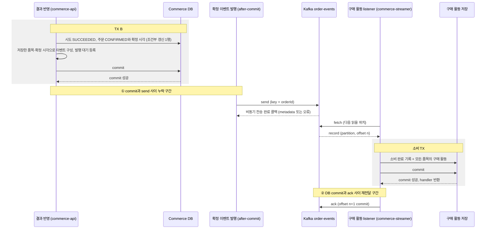

# 주문 확정 이벤트 공통 계약

> 주문 결제: [1. 결제 요청](order-payment-request.md) → [2. PG 연동](../external-systems/payment-gateway.md) → [3. 결과 반영](order-payment-result.md) → **4. 확정 이벤트**

> 발행은 TX B commit 뒤 직접 발행이며, DB와 broker 사이의 누락 구간은 다음 단계의 Outbox에서 개선한다.

PG 성공으로 처음 확정된 주문의 사실을 `OrderConfirmed` 이벤트로 Kafka에 발행하고, `commerce-streamer`가 상품별 구매 활동으로 한 번만 저장한다.<br>
구매 활동은 이후 주간 상품 랭킹의 입력이다. 이번 범위에서 랭킹 조회와 Outbox는 만들지 않는다.

## 설계 문서의 책임

이 문서는 두 애플리케이션이 공유하는 이벤트의 의미·형식·버전과 전체 처리 경계를 정의한다. 각 모듈의 실행·저장·설정 정책은 다음 문서에서 관리한다.

| 문서 | 책임 |
| --- | --- |
| [Producer 설계](../../../apps/commerce-api/docs/order-confirmed-producer.md) | 최초 확정 조건, 이벤트 구성, after-commit 전송과 실패 처리 |
| [Broker 설계](../../../modules/kafka/docs/broker.md) | 단일 broker·topic·partition·복제·보존 설정과 연결 주소 |
| [Consumer 설계](../../../apps/commerce-streamer/docs/purchase-activity-consumer.md) | 버전 해석, 구매 활동 저장·멱등성, listener·ack·복구 |
| [검증 방법](order-confirmed-event-verification.md) | 모듈별 테스트와 broker·DB·offset 실험 |

## 이벤트로 연결하는 이유

결과 반영(TX B)이 구매 활동 저장을 직접 호출하면 후속 기능의 지연·장애가 결제 결과 반영에 묶인다. 구매 활동 저장이 실패했다는 이유로 PG가 이미 승인한 결제를 실패로 돌릴 수 없다.

| 표현 | 의미 | 이 설계에서 |
| --- | --- | --- |
| 커맨드 (예: 구매 활동을 기록하라) | 특정 주체에게 작업 수행을 요청 | 쓰지 않는다. 주문 확정은 후속 기능의 이름과 실패를 알지 않는다. |
| 이벤트 `OrderConfirmed` | 주문이 확정됐다는 이미 일어난 사실 | 소비 실패는 과거 확정을 취소하지 않는다. 소비자는 사실을 자기 책임으로 저장한다. |

이벤트는 결합을 없애지 않고 경계를 옮긴다. 발행 누락, 전달 지연, 중복 전달은 이 문서의 규칙으로 다룬다.

### 이벤트에 담을 데이터

확정 당시의 `productId`, `quantity`, `confirmedAt`을 이벤트에 포함한다. Consumer는 주문 API를 호출하지 않고 구매 활동을 저장하며, 재전달에서도 같은 확정 사실을 해석한다. 현재 상품이나 주문의 최신 상태를 조회해 과거 사실을 다시 구성하지 않는다.

대안인 Zero Payload는 이벤트 종류와 식별자 등 최소 정보만 보내고, 소비자가 필요한 데이터를 API로 조회하는 방식이다. 이 방식으로도 불변의 주문 확정 사실을 조회하는 API를 제공하면 구매 활동을 만들 수 있다. 다만 소비 시점에 조회 API의 가용성·응답과 추가 요청 부하를 함께 다뤄야 한다.

현재 요구에서는 구매 수량과 확정 시각이라는 작은 불변 사실을 직접 전달하는 방식을 선택한다. Consumer의 추가 조회를 없애는 대신 양쪽이 이벤트 필드와 버전 호환성을 관리한다. 주문 전체나 PG·개인정보를 포함하지 않고 구매 사실에 필요한 값만 전달한다. 두 방식의 특성은 [Event Notification과 Event-Carried State Transfer](https://martinfowler.com/articles/201701-event-driven.html)를 참고한다.

## 경계와 흐름



그림은 정상 경로의 예시다. producer 완료 콜백과 consumer의 처리 완료 사이에 선후 관계를 가정하지 않는다. consumer는 broker에서 읽은 record를 자기 DB 트랜잭션으로 처리한다.

| 경계 | 소유 | 함께 commit되는 것 | 함께 묶이지 않는 것 |
| --- | --- | --- | --- |
| TX B | commerce-api | 시도 종결, 주문 확정과 확정 시각, 예약 소비(재고 유지) | Kafka 전송 |
| producer 전송 | commerce-api | broker 기록. producer 재시도의 중복은 broker가 거른다. | 주문 commit |
| 소비 TX | commerce-streamer | 소비 완료 기록과 모든 품목의 구매 활동 | offset commit |
| offset commit | commerce-streamer | group이 다음에 읽을 위치 | 소비 TX |

commerce-streamer는 주문·상품·결제·포인트 테이블을 읽거나 바꾸지 않는다. 결제, 재고 차감, 포인트 차감을 다시 수행하지 않고 이벤트에 담긴 사실만 저장한다.<br>
이벤트 발행을 추가해도 결제 결과 반영의 주문·재고 규칙은 바뀌지 않으며, PG 주문 결제는 지금처럼 포인트를 조회하거나 차감하지 않는다.

## 이벤트 계약

| 항목 | 계약 |
| --- | --- |
| topic | `order-events`. 테스트는 실행마다 고유 suffix를 붙인 topic을 쓴다. |
| key | 내부 `orderId`의 10진 문자열 (`"42"`). payload의 `orderId`와 같아야 한다. |
| value | UTF-8 JSON. 현재 payload는 아래 필드로 구성한다. |
| `eventType` / `schemaVersion` | `"OrderConfirmed"` / `1`. schemaVersion은 payload의 구조와 의미를 해석하는 계약의 버전이며, 변경 정책은 아래를 따른다. |
| `eventId` | `order-confirmed:v1:{orderId}`. 주문당 한 번뿐인 최초 확정 사실에서 유도한다. |
| `orderId` | 확정 주문 ID |
| `confirmedAt` | 최초 확정 시각으로 `orders.confirmed_at`과 같은 순간을 UTC 문자열(`Z`)로 표현한다. 기존 DB의 `DATETIME(6)`에 맞춰 마이크로초 정밀도(소수초 최대 6자리)를 유지한다. |
| `items` | `productId`, `quantity`의 목록. 저장된 주문 품목 스냅샷에서 만들며 상품당 하나, 상품 ID 오름차순, 수량은 양수다. 주문은 생성할 때 같은 상품의 수량을 합산해 품목 하나로 저장하므로, 스냅샷을 그대로 옮기면 상품 중복이 없다. |

```json
{
  "eventType": "OrderConfirmed",
  "schemaVersion": 1,
  "eventId": "order-confirmed:v1:42",
  "orderId": 42,
  "confirmedAt": "2026-09-07T01:00:00Z",
  "items": [
    {"productId": 7, "quantity": 2},
    {"productId": 8, "quantity": 1}
  ]
}
```

예시의 ID와 시각은 합성 값이다.

### 이벤트의 신원과 불변 값

- 한 주문의 최초 확정 사실은 하나다. `eventId`는 `order-confirmed:v1:{orderId}`로 유도하며, 재발행·재전달에도 바꾸지 않는다. 전송 시도 횟수, 현재 시각, 매번 새 UUID를 넣지 않는다.
- `eventId`의 `v1`은 ID 형식의 버전이다. payload의 `schemaVersion`이 바뀌어도 같은 확정 사실은 같은 `eventId`를 유지한다. Consumer는 eventId를 불투명한 식별자로 다루고 형식에서 orderId를 추출하지 않는다.
- `confirmedAt`은 주문 상태와 같은 DB 트랜잭션에서 저장한 최초 확정 시각이다. 발행·소비 시각으로 바꾸지 않으며 UTC·마이크로초 정밀도를 유지한다.
- `items`는 저장된 주문 품목 스냅샷이다. Producer는 상품별 수량이 합산된 품목을 상품 ID 오름차순으로 보낸다.
- 카드 정보, PG 거래 키, 사용자 식별자, 금액처럼 구매 활동에 필요 없는 값은 담지 않는다. 고객이나 관리자가 임의로 이벤트를 발행하는 공개 HTTP endpoint는 두지 않는다. 합성 이벤트 주입은 테스트 코드에서만 한다.

### 사실의 비교

같은 `eventId`·`orderId`에 대해 정규화한 상품 집합·상품별 수량·확정 시각이 같으면 같은 구매 사실이다. JSON 속성 순서와 items 배열 순서는 신원을 바꾸지 않는다. 동일 상품이 여러 항목으로 들어오면 수량을 합산해 비교한다.

같은 eventId의 다른 주문·수량·시각이나, 같은 주문의 다른 eventId는 충돌이다. `eventType`·`schemaVersion`은 payload 해석 계약이며 파싱에서 검증한다. 지원하는 다른 버전으로 같은 구매 사실을 표현해도 비교할 업무 값은 같다. 저장된 사실을 조회·비교하고 충돌을 처리하는 방법은 [Consumer 설계](../../../apps/commerce-streamer/docs/purchase-activity-consumer.md#사실의-비교)를 따른다.

### schemaVersion의 의미와 변경 정책

`schemaVersion`은 애플리케이션이 관리하는 payload 계약의 버전이다. `eventId`가 어떤 확정 사실인지를 식별한다면, schemaVersion은 그 사실을 어떤 필드 구조와 의미로 읽을지 나타낸다. 현재 버전은 1이다.

| 명세 변경 | 버전 정책 |
| --- | --- |
| JSON 속성·배열의 표현 순서만 달라지고 계약 구조·의미는 같음 | 현재 버전 유지 |
| 선택 필드 추가를 포함한 필드 구성·타입·필수 여부·의미 등 명세 변경 | 새 버전 도입 |

명세는 Producer와 Consumer의 약속이며, schemaVersion으로 그 이력을 구분한다. 선택 필드 추가도 새 버전으로 남긴다. 호환성은 버전 증가 여부와 별개로 확인한다. 기존 Consumer가 새 필드를 무시해도 동일한 업무를 처리하는지, 새 Consumer가 그 필드가 없는 과거 메시지를 처리할 수 있는지 검증한다.

메시지 DTO와 해석 코드는 버전별로 구분한다. V1의 필드 구조·의미를 바꾸어 V2를 섞지 않고, V2 명세가 정해지면 V2 DTO와 해석기를 추가한다. 각 버전의 명세 문서, JSON 예시와 테스트를 함께 보존한다.

Producer는 발행할 버전의 DTO로 메시지를 구성한다. Consumer는 schemaVersion에 해당하는 DTO·해석기를 선택해 동일한 구매 사실로 해석한다. 새 버전을 추가할 때 기존 버전의 해석기도 유지해 여러 버전을 함께 지원한다.

변경 명세를 공유하고, 먼저 Consumer가 기존 버전과 새 버전을 모두 지원하도록 준비·배포한 뒤 Producer가 새 버전을 발행한다. 선택 필드 추가라도 새 버전 번호의 지원 여부를 확인한다. 메시지에 새 번호를 넣는 것만으로 Consumer에 새 해석 코드가 생기지는 않는다.

지원 목록에 없는 버전은 계약 오류로 거절한다. DB에 구매 활동을 저장하거나 성공 ack하지 않는다. 구체적인 해석기 등록과 실패·복구 정책은 [Consumer 설계](../../../apps/commerce-streamer/docs/purchase-activity-consumer.md#버전별-해석)를 따른다.

### key 선택

같은 주문의 이벤트를 같은 partition에 모으도록 orderId를 key로 사용한다. 한 이벤트가 여러 상품을 포함하므로 품목마다 주문 확정 이벤트를 쪼개지 않는다. 현재 주문당 최초 확정 이벤트는 하나이며, 주문 단위 순서 연결은 이후 취소·환불 같은 사건이 추가될 때도 사용할 수 있다.

같은 partitioner·직렬화·partition 수에서 같은 key는 같은 partition에 연결된다. partition 수나 분배 방식을 바꾸면 매핑도 바뀔 수 있다. 해시 분산은 정확한 균등 분포를 보장하지 않는다. 순서·분산과 partition 설정의 관계는 [Broker 설계](../../../modules/kafka/docs/broker.md#topic과-partition)를 따른다.

## 전달 보장

| 구간 | 보장 | 근거 |
| --- | --- | --- |
| 주문 확정 → broker | commit 뒤 직접 전송. 발행 누락 가능 | 전송 단계까지 실행되면 send 1회 시도, 애플리케이션 재발행 없음 |
| producer → broker | 같은 producer 세션의 내부 재시도 중복 제거 | idempotent producer, `acks=all`. 애플리케이션 재전송의 업무 중복은 별도 |
| broker → 구매 활동 | 재전달을 허용하고 같은 사실의 구매 효과는 한 번 | record 보존과 원인 제거 후 소비 재개를 전제로, 소비 TX commit 뒤 ack·완료 기록·유일 제약 |

Kafka transaction의 exactly-once는 Kafka record와 offset을 함께 다루는 보장이며 MySQL의 구매 활동 저장은 포함하지 않는다. 그래서 소비 쪽 중복 판정을 Kafka 설정에 맡기지 않는다.<br>
단일 broker 실험으로는 복제, leader 장애, `min.insync.replicas`, 네트워크 분할에서의 보장을 확인하지 못한다.

## 검증 기준

결과는 실제 broker와 MySQL에서 확인한다. DB는 새 조회 경계에서, offset은 group의 committed offset으로, record 위치는 send metadata로 확인한다. 테스트는 고유한 topic·group을 쓰고 모든 대기에 deadline을 둔다. 테스트 위치와 실험 설계는 [주문 확정 이벤트 검증](order-confirmed-event-verification.md)을 따른다.

| 영역 | 상황 | 기대값 |
| --- | --- | --- |
| 발행 | 실제 주문 API와 테스트 PG로 최초 성공 확정 | record 1건. key는 `orderId`, payload의 품목·수량·확정 시각이 저장된 주문과 같다. |
| 발행 결과 관찰 | 정상 전송 완료 | 성공 결과의 topic·partition·offset으로 실제 record 확인. 건별 성공 로그·별도 DB 발행 이력은 요구하지 않음 |
| 미발행 | 처리 중, `UNKNOWN`, 확정 실패, TX B rollback | 해당 `eventId`의 record 없음 |
| 중복 반영 | 중복 callback, callback 뒤 reconcile | 새 record와 재고 변경 없음 |
| 발행 실패 | send 직전 실패 주입 | 주문 `CONFIRMED`와 재고 차감 유지, record 없음, 응답은 저장된 상태 |
| 전송 오류 | send 호출 예외 또는 비동기 완료 실패 | `eventId`·`orderId`·원인 error 로그, 확정 주문·재고 유지. 실패 로그만으로 record 부재를 단정하지 않음 |
| 소비 | 주문 42(7×2, 8×1), 같은 이벤트 재수신, 주문 43(7×3) | 2행 → 2행 → 3행, 상품 7 합계 5 |
| 충돌 | 같은 `eventId`에 다른 수량·확정 시각, 같은 `orderId`에 다른 `eventId` | 추가 행 없음, 오류 노출 |
| 원자성 | 중간 품목 저장 실패 | 완료 기록과 앞선 품목 모두 없음 |
| 동시 중복 | 같은 이벤트 동시 소비 | 완료 기록 1건, 활동 행 수 불변, no-op으로 완료 |
| listener 설정 | 실제 consumer 설정 | `enable.auto.commit=false`, 역직렬화기, ack mode |
| listener 실패 | 소비 TX commit 전 오류 주입 | 전체 rollback, committed offset이 실패 record를 넘지 않음, 컨테이너 중단. 오류 제거 뒤 재시작하면 재전달·저장·ack |
| 재전달 | 소비 TX commit 뒤 offset을 commit하지 않고 종료, 같은 group의 새 consumer | 같은 partition·offset `n`을 다시 읽음, 활동 불변, committed offset `n → n → n+1` |
| partition 배정 | partition 2개 topic에 같은 group의 consumer 1 → 2 → 3개 | 각 partition은 한 member에만 배정, 3개면 하나 이상 배정 없음 |
| key 매핑 | partition 수를 고정하고 같은 key 반복 전송 | 같은 partition |
| 전체 연결 | API·streamer·테스트 PG를 함께 띄운 로컬 실행 ([절차](order-confirmed-event-verification.md#로컬-전체-흐름-관찰)) | 확정 주문의 품목·수량·확정 시각과 같은 구매 활동, group committed offset 진행 |
| 로컬 앱 재시작 | 같은 DB·broker·topic·group으로 streamer 프로세스 재시작 | local의 `ddl-auto=validate`로 완료 기록·활동의 행 ID·내용·생성/수정 시각과 committed offset 유지 |

## 범위 밖

- Outbox와 발행 누락의 자동 복구
- 발행 누락의 주기적 자동 대조와 보충 발행
- DLQ와 자동 재시도 정책
- 주간 랭킹 조회와 집계 인덱스
- 확정 이후의 주문 취소·환불 이벤트
