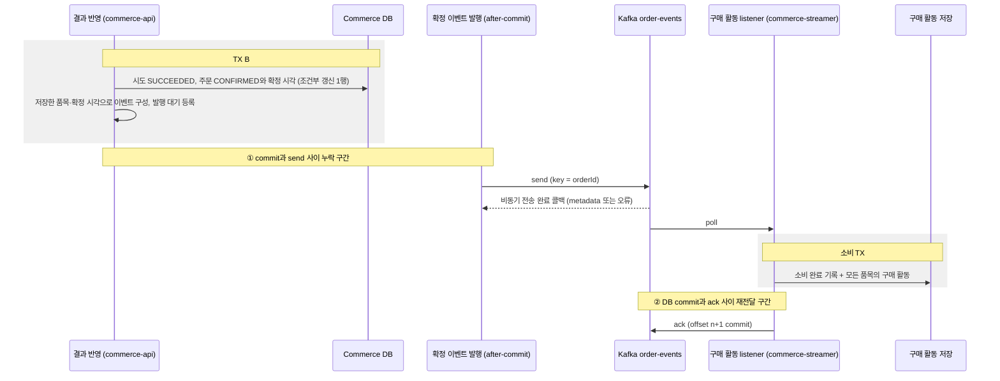

# 주문 확정 이벤트와 구매 활동

> 주문 결제: [1. 결제 요청](order-payment-request.md) → [2. PG 연동](../external-systems/payment-gateway.md) → [3. 결과 반영](order-payment-result.md) → **4. 확정 이벤트**

> 상태: 구현 중. 발행은 TX B commit 뒤 직접 발행이며, DB와 broker 사이의 누락 구간은 다음 단계의 Outbox에서 개선한다.

PG 성공으로 처음 확정된 주문의 사실을 `OrderConfirmed` 이벤트로 Kafka에 발행하고, `commerce-streamer`가 상품별 구매 활동으로 한 번만 저장한다.<br>
구매 활동은 이후 주간 상품 랭킹의 입력이다. 이번 범위에서 랭킹 조회와 Outbox는 만들지 않는다.

## 이벤트로 연결하는 이유

결과 반영(TX B)이 구매 활동 저장을 직접 호출하면 후속 기능의 지연·장애가 결제 결과 반영에 묶인다. 구매 활동 저장이 실패했다는 이유로 PG가 이미 승인한 결제를 실패로 돌릴 수 없다.

| 표현 | 의미 | 이 설계에서 |
| --- | --- | --- |
| 커맨드 (예: 구매 활동을 기록하라) | 특정 주체에게 작업 수행을 요청 | 쓰지 않는다. 주문 확정은 후속 기능의 이름과 실패를 알지 않는다. |
| 이벤트 `OrderConfirmed` | 주문이 확정됐다는 이미 일어난 사실 | 소비 실패는 과거 확정을 취소하지 않는다. 소비자는 사실을 자기 책임으로 저장한다. |

이벤트는 결합을 없애지 않고 경계를 옮긴다. 발행 누락, 전달 지연, 중복 전달은 이 문서의 규칙으로 다룬다.

## 경계와 흐름



| 경계 | 소유 | 함께 commit되는 것 | 함께 묶이지 않는 것 |
| --- | --- | --- | --- |
| TX B | commerce-api | 시도 종결, 주문 확정과 확정 시각, 예약 소비(재고 유지) | Kafka 전송 |
| producer 전송 | commerce-api | broker 기록. producer 재시도의 중복은 broker가 거른다. | 주문 commit |
| 소비 TX | commerce-streamer | 소비 완료 기록과 모든 품목의 구매 활동 | offset commit |
| offset commit | commerce-streamer | group이 다음에 읽을 위치 | 소비 TX |

commerce-streamer는 주문·상품·결제·포인트 테이블을 읽거나 바꾸지 않는다. 결제, 재고 차감, 포인트 차감을 다시 수행하지 않고 이벤트에 담긴 사실만 저장한다.<br>
이벤트 발행을 추가해도 결제 결과 반영의 주문·재고 규칙은 바뀌지 않으며, PG 주문 결제는 지금처럼 포인트를 조회하거나 차감하지 않는다.

## 이벤트 계약

| 항목 | 계약 |
| --- | --- |
| topic | `order-events`. 테스트는 실행마다 고유 suffix를 붙인 topic을 쓴다. |
| key | 내부 `orderId`의 10진 문자열 (`"42"`). payload의 `orderId`와 같아야 한다. |
| value | UTF-8 JSON. 현재 payload는 아래 필드로 구성한다. |
| `eventType` / `schemaVersion` | `"OrderConfirmed"` / `1`은 과제 지정값이다. schemaVersion은 payload의 구조와 의미를 해석하는 계약의 버전이며, 변경 정책은 아래를 따른다. |
| `eventId` | `order-confirmed:v1:{orderId}`. 주문당 한 번뿐인 최초 확정 사실에서 유도한다. |
| `orderId` | 확정 주문 ID |
| `confirmedAt` | 최초 확정 시각으로 `orders.confirmed_at`과 같은 순간을 UTC 문자열(`Z`)로 표현한다. 기존 DB의 `DATETIME(6)`에 맞춰 마이크로초 정밀도(소수초 최대 6자리)를 유지한다. |
| `items` | `productId`, `quantity`의 목록. 저장된 주문 품목 스냅샷에서 만들며 상품당 하나, 상품 ID 오름차순, 수량은 양수다. 주문은 생성할 때 같은 상품의 수량을 합산해 품목 하나로 저장하므로, 스냅샷을 그대로 옮기면 상품 중복이 없다. |

```json
{
  "eventType": "OrderConfirmed",
  "schemaVersion": 1,
  "eventId": "order-confirmed:v1:42",
  "orderId": 42,
  "confirmedAt": "2026-09-07T01:00:00Z",
  "items": [
    {"productId": 7, "quantity": 2},
    {"productId": 8, "quantity": 1}
  ]
}
```

예시의 ID와 시각은 합성 값이다.

### Producer의 이벤트 구성

Producer는 저장된 주문 사실을 일정한 형태로 구성한다. 정상 발행과 재발행에서 같은 확정 사실은 같은 `eventId`, 구매 내용, 품목 순서를 유지한다.

1. `eventId`는 `order-confirmed:v1:{orderId}`로 계산한다. 한 주문의 최초 확정 사실은 하나이므로 producer에 별도 eventId 컬럼을 두지 않아도 같은 ID를 재구성할 수 있다.
2. `confirmedAt`은 최초 PG 성공으로 주문을 확정할 때 주문 상태와 같은 DB 트랜잭션에서 저장한다. 기존 코드의 마이크로초 절삭과 DB의 `DATETIME(6)` 기준을 유지한다. 중복 callback·reconcile에서 바꾸지 않으며, 발행·재발행 모두 저장된 값을 같은 순간의 UTC 문자열로 표현한다. producer의 발행 시각이나 consumer의 처리 시각을 넣지 않는다.
3. `items`는 저장된 주문 품목 스냅샷으로 구성한다. 같은 상품의 수량은 주문 생성 시 합산되어 있으므로 이를 재사용하고, producer가 `productId` 오름차순으로 정렬해서 발행한다. 재발행도 같은 구성 규칙을 사용한다.

소비자의 중복 판정은 별도의 비교 계약이다. JSON 속성 순서와 `items` 배열 순서가 달라도 필드 값이 같은 사실은 동일하게 판단하며, 수량이나 확정 시각이 다르면 충돌로 처리한다. 자세한 규칙은 [사실의 비교](#사실의-비교)를 따른다.

- `eventId`의 `v1`은 ID 형식의 버전이다. payload의 `schemaVersion`이 바뀌어도 같은 확정 사실은 같은 `eventId`를 유지한다. 전송 시도 횟수, 현재 시각, 새 UUID는 넣지 않는다.
- 소비자는 `eventId`를 불투명한 식별자로 다룬다. 형식을 해석해 `orderId`를 꺼내지 않는다.
- 카드 정보, PG 거래 키, 사용자 식별자, 금액처럼 구매 활동에 필요 없는 값은 담지 않는다.
- 고객이나 관리자가 `OrderConfirmed`를 발행하는 HTTP endpoint는 두지 않는다. 합성 이벤트 주입은 테스트 코드에서만 한다.

### schemaVersion의 의미와 변경 정책

`schemaVersion`은 애플리케이션이 관리하는 payload 계약의 버전이다. `eventId`가 어떤 확정 사실인지를 식별한다면, schemaVersion은 그 사실을 어떤 필드 구조와 의미로 읽을지 나타낸다. 이번 과제는 버전 1을 사용한다.

| 명세 변경 | 버전 정책 |
| --- | --- |
| JSON 속성·배열의 표현 순서만 달라지고 계약 구조·의미는 같음 | 현재 버전 유지 |
| 선택 필드 추가를 포함한 필드 구성·타입·필수 여부·의미 등 명세 변경 | 새 버전 도입 |

명세는 Producer와 Consumer의 약속이며, schemaVersion으로 그 이력을 구분한다. 선택 필드 추가도 새 버전으로 남긴다. 호환성은 버전 증가 여부와 별개로 확인한다. 기존 Consumer가 새 필드를 무시해도 동일한 업무를 처리하는지, 새 Consumer가 그 필드가 없는 과거 메시지를 처리할 수 있는지 검증한다.

메시지 DTO와 해석 코드는 버전별로 구분한다. V1의 필드 구조·의미를 바꾸어 V2를 섞지 않고, V2 명세가 정해지면 V2 DTO와 해석기를 추가한다. 각 버전의 명세 문서, JSON 예시와 테스트를 함께 보존한다.

Producer는 발행할 버전의 DTO로 메시지를 구성한다. Consumer는 schemaVersion에 해당하는 DTO·해석기를 선택하고 공통 구매 사실 모델인 `OrderConfirmation`으로 변환해 구매 활동 저장에 전달한다. 새 버전을 추가할 때 기존 버전의 해석기도 유지해 여러 버전을 함께 지원한다.

변경 명세를 공유하고, 먼저 Consumer가 기존 버전과 새 버전을 모두 지원하도록 준비·배포한 뒤 Producer가 새 버전을 발행한다. 선택 필드 추가라도 새 버전 번호의 지원 여부를 확인한다. 메시지에 새 번호를 넣는 것만으로 Consumer에 새 해석 코드가 생기지는 않는다.

지원 목록에 없는 버전은 계약 오류로 거절한다. 공통 구매 사실로 임의 변환하거나 DB handler를 호출하지 않으며, 성공 ack를 하지 않는다. 실패 record를 완료한 위치로 offset이 진행하지 않도록 하는 실제 ack·error handler 설정과 중단·복구 정책은 4번 listener 설계에서 검토·검증한다.

구현은 다음 책임으로 나눈다. 특정 앱의 DTO를 다른 앱에서 import하거나 modules에 비즈니스 DTO를 넣지 않는다.

| 위치 | 구현 | 책임 |
| --- | --- | --- |
| commerce-api infrastructure | `OrderConfirmedMessageV1` | 저장된 확정 사실을 V1 JSON 계약으로 구성 |
| commerce-streamer interfaces | `OrderConfirmedParser` | 공통 JSON·eventType 검증, schemaVersion에 등록된 해석기 선택, key와 변환 결과 orderId 일치 검증 |
| commerce-streamer interfaces | `OrderConfirmedVersionReader` | 지원 버전 번호와 공통 구매 사실로 변환하는 해석 규칙의 계약 |
| commerce-streamer interfaces | `OrderConfirmedV1Reader`, `OrderConfirmedMessageV1` | V1의 엄격한 필드 타입 검증, V1 DTO 구성과 `OrderConfirmation` 변환 |

Spring이 수집한 버전별 해석기를 버전 번호에 대응하는 불변 맵으로 등록한다. 같은 번호의 해석기가 중복 등록되면 구성이 모호하므로 시작 단계에서 거절한다. 현재 실제 명세와 DTO·해석기는 V1이며, 추가 버전은 실제 명세가 정해질 때 해석기를 추가해 함께 지원한다.

### key 선택

같은 주문의 이벤트가 같은 partition의 순서를 따르도록 `orderId`를 key로 쓴다. 한 이벤트가 여러 상품을 담으므로 상품 ID를 key로 쓰지 않고, 품목별로 이벤트를 쪼개지 않는다. 상품 key는 인기 상품의 partition에 부하가 몰리는 비용도 있다.

같은 key가 같은 partition으로 가는 것은 같은 partitioner·직렬화·partition 수에서만 성립한다. partition 수를 바꾸면 매핑이 달라진다.

## 발행

### 발행 조건

결과 반영에서 시도를 `SUCCEEDED`로 종결하고 주문을 `PAYMENT_PENDING → CONFIRMED`로 바꾼 조건부 갱신이 1행인 요청만 이벤트를 만든다. 생성 응답, callback, reconcile, 주기 조회가 모두 같은 TX B를 지나므로 경로와 관계없이 같은 조건이다.

| 상황 | 발행 |
| --- | --- |
| 최초 PG 성공 확정, TX B commit | 1회 |
| 처리 중·결과 미확인(`PENDING`·`UNKNOWN`), 충돌 | 없음 |
| 확정 실패(`PAYMENT_FAILED`) | 없음 |
| 최초 확정 TX B rollback | 없음 |
| 이미 종결된 시도에 같은 결과 반복 (중복 callback, reconcile, 주기 조회) | 없음. 조건부 갱신 0행 |
| 이전 POINT 확정 주문, 이번 변경 전 PG 확정 주문 | 없음. 소급 발행하지 않는다. |

### 발행 위치

TX B는 조건부 갱신 1행을 확인한 뒤 같은 트랜잭션 안에서 이벤트를 만들어 Spring application event로 등록한다. 전송은 `@TransactionalEventListener(AFTER_COMMIT)` listener가 TX B commit 뒤에 수행한다.

`PaymentResultTransaction.completeOrder`에서 `OrderConfirmedEvent`를 등록하고, `OrderConfirmedKafkaPublisher.onConfirmed`가 commit 뒤 메시지 변환과 전송을 담당한다.

- callback·reconcile이 공통으로 사용하는 결과 반영 TX에서 최초 확정 이벤트를 등록하고, Kafka 전송 책임은 after-commit listener에 둔다.
- listener에는 `@Async`를 붙이지 않고 애플리케이션의 별도 executor를 추가하지 않는다. Kafka Producer의 내부 I/O 스레드가 실제 네트워크 전송을 비동기로 처리하는 구조를 사용한다.
- TX B 메서드 끝에서 직접 send하지 않는다. 메서드가 끝나도 commit 전이므로 rollback된 확정의 이벤트가 나갈 수 있다.
- 이벤트는 TX B에서 읽은 `Order`의 품목 스냅샷과 저장한 확정 시각으로 미리 만든다. listener는 DB나 지연 로딩에 접근하지 않는다.
- listener는 TX B를 commit한 스레드에서 send를 호출한다. send 호출 자체에는 metadata 조회·buffer 할당 대기가 있을 수 있다. `max.block.ms`는 별도 지정하지 않고 Kafka client 기본값을 사용한다.

### 전송 결과와 실패

현재 단계의 전송 결과 관찰 수단은 완료 콜백으로 정한다. `KafkaTemplate.send(...)`가 반환하는 `CompletableFuture`에 콜백을 등록해 전송 결과를 비동기로 확인한다. 결과를 받기 위한 별도 조회를 반복하거나 요청 스레드에서 `get()`·`join()`으로 기다리지 않는다. 비동기 전송 결과와 send 호출 자체의 metadata·buffer 할당 대기는 구분한다. API 사용 방식은 [Spring Kafka 전송 결과 문서](https://docs.spring.io/spring-kafka/reference/kafka/sending-messages.html)를 따른다.

Outbox는 이후 발행 누락을 개선할 방안으로 남겨둔다. 도입하더라도 전송 시도의 성공·실패를 확인하는 콜백 방식을 활용할 수 있다. 발행 대상과 처리 상태의 영속화 정책은 Outbox를 다루는 단계에서 설계한다.

이 콜백은 Kafka producer의 전송 완료 통지다. PG가 HTTP로 보내는 결제 결과 callback과는 별개다. `acks=all`은 producer가 broker의 현재 ISR 기록을 확인하는 기준이며, 주문 확정이나 구매 활동 저장의 완료 조건이 아니다. 주문 확정은 send 전에 TX B commit으로 끝나고, 구매 활동 저장은 consumer의 별도 트랜잭션에서 끝난다.

| 결과 | 처리 |
| --- | --- |
| 전송 성공 | 건별 성공 로그나 별도 DB 발행 이력을 남기지 않는다. 테스트에서는 성공 결과의 topic·partition·offset과 실제 record를 확인한다. |
| 비동기 전송 실패 | 완료 콜백에서 `eventId`, `orderId`와 원인을 애플리케이션의 error 로그로 남긴다. |
| send 호출에서 즉시 발생한 예외 | 호출 경계에서 같은 식별자와 원인을 error 로그로 남긴다. 완료 콜백에만 실패 처리를 맡기지 않는다. |

- 전송이 실패하거나 listener에서 예외가 나도 이미 commit된 주문을 실패·미확인으로 되돌리지 않고, PG 생성·조회를 다시 호출하지 않는다. 결과 반영의 응답은 저장된 주문 상태로 정한다.
- 전송 실패는 send 호출 경계의 예외 처리와 완료 콜백의 두 경로에서 error 로그로 관찰하며, 애플리케이션의 자동 재발행은 추가하지 않는다. Kafka producer의 설정에 따른 내부 재시도는 유지하고 애플리케이션의 새 발행과 구분한다.
- 로그는 전송 결과를 관찰한 기록이며, 주문과 함께 commit되는 영속 발행 이력이 아니다. 성공 로그를 생략해도 `acks=all`의 broker 확인은 유지된다.

### 발행 누락 구간

TX B commit과 broker 기록은 하나의 원자적 작업이 아니다. commit 뒤 send 전에 프로세스가 멈추면 주문은 `CONFIRMED`이고 예약은 소비됐지만, 해당 `eventId`의 record와 구매 활동은 없다. 이때는 전송 요청 자체가 없어 실패 콜백도 실행되지 않으며, 프로세스 중단을 애플리케이션 error 로그로 남긴다는 보장도 없다.

send 이후 오류나 timeout을 관찰한 경우에는 broker 기록 여부가 불명확할 수 있다. broker가 기록했지만 producer가 성공 응답을 확인하지 못했을 가능성도 있으므로, 전송 실패 로그만으로 record와 구매 활동이 없다고 단정하지 않는다. 전송 오류 이후 실제 기록 확인의 필요성은 [Kafka producer API](https://kafka.apache.org/41/javadoc/org/apache/kafka/clients/producer/KafkaProducer.html)에서도 설명한다.

commit 전에 보내면 rollback된 확정의 이벤트가 남으므로 택하지 않는다. `@Async`나 after-commit listener는 실행 시점만 바꿀 뿐 이 구간을 없애지 않는다.

완료 콜백은 전송 결과를 관찰하는 수단이고, Outbox는 주문 확정과 발행할 사실의 DB 기록을 같은 트랜잭션에 묶는 방식이다. 두 방식은 역할이 다르며, 콜백으로 이 누락 구간을 없앨 수 없다. 다음 단계에서 Outbox로 개선하고, 이번 단계는 [발행 누락 사례](#발행-누락-사례)를 테스트로 확인한다.

### 누락 판단과 관찰 범위

검증은 [발행 조건](#발행-조건)에 해당하는 확정 주문에서 출발해 Kafka record와 소비 완료 기록·구매 활동을 대조한다. 소급 발행하지 않는 이전 확정 주문은 대상에서 제외한다. 구매 활동은 주문당 한 행이 아니라 품목별 행이므로, 행 수만 비교하지 않고 상품 집합·수량·확정 시각까지 원본과 비교한다.

| 관찰 | 판단 |
| --- | --- |
| 같은 `eventId`의 record 있음, 소비 완료 기록과 구매 활동 없음 | 발행은 확인했지만 소비는 미완료다. 소비 지연·중단·저장 실패와 실제 committed offset을 확인한다. |
| record 있음, 소비 완료 기록과 모든 구매 활동이 원본과 일치 | 전달과 업무 처리를 확인했다. |
| record를 확인하지 못했고 소비 완료 기록과 구매 활동도 없음 | 미반영 후보다. 이 관찰만으로 미발행을 확정하지 않고 전송 경계와 broker의 조사 범위를 확인한다. |

- 소비 지연을 고려해 정해진 기한 안에서 관찰한다. 구매 활동이 즉시 보이지 않는다는 이유만으로 유실로 판단하지 않는다.
- 실패 로그가 없다는 것은 발행 성공의 증거가 아니다. send 전 중단은 실패 콜백에도 나타나지 않는다.
- consumer lag가 0이어도 발행 누락은 발견할 수 없다. broker에 들어오지 않은 이벤트는 group의 offset이나 lag에 포함되지 않는다.
- Kafka record의 존재는 보존 범위 안에서 확인한다. retention으로 이미 삭제된 record가 현재 없다는 사실만으로 과거 미발행을 증명하지 않는다.
- 원본 대조는 테스트와 검증용으로 수행한다. commerce-streamer의 정상 소비 경로에서 주문 테이블을 조회하지 않으며, 주기적 자동 대조와 보충 발행은 이번 범위에 넣지 않는다.

## 소비

### 저장할 사실

| 저장 모델 | 의미 | 유일성 |
| --- | --- | --- |
| `processed_order_confirmation` | 소비를 마친 확정 이벤트의 처리 기록. `event_id`, `order_id`. 이미 처리한 이벤트인지만 표시한다. | `event_id` 유일, `order_id` 유일 |
| `product_purchase_activity` | 확정 주문의 상품별 구매 사실. `order_id`, `product_id`, `quantity`, `confirmed_at` | `(order_id, product_id)` 유일 |

- 구매 활동의 `confirmed_at`은 이벤트의 최초 확정 시각이다. 소비 시각을 쓰지 않는다.
- 소비 모델은 시각을 UTC `Instant`의 마이크로초 정밀도로 정규화하고 `datetime(6)`에 저장한다. `event_id`의 DB 비교는 대소문자와 뒤 공백을 구분해 애플리케이션의 문자열 비교와 일치시킨다.
- 확정 시각과 품목은 구매 활동에만 둔다. 처리 기록은 처리 여부만 표시하고, 같은 사실인지는 구매 활동과 비교해 판정한다.
- `product_id`는 과거 주문의 상품 식별자로 보존한다. 소비할 때 상품의 존재·삭제·가격을 조회하지 않고 상품 테이블에 FK를 두지 않는다. 삭제·비노출 상품을 거르는 일은 활동을 읽는 쪽(이후 랭킹)이 맡는다.

주문 42가 상품 7을 2개, 상품 8을 1개 구매했다면 활동은 2행이다. 같은 이벤트를 다시 받아도 2행이다. 주문 43이 상품 7을 3개 구매하면 활동은 3행이고 상품 7의 구매 수량 합은 5다.

### 사실의 비교

같은 사실인지는 받은 이벤트를 정규화한 값과 이미 저장된 구매 활동을 비교해 정한다. JSON 원문이나 그 해시를 저장해 비교하지 않는다.

1. 받은 이벤트의 품목에서 같은 상품의 수량을 합산해 상품별로 하나로 만든다. 배열 순서는 보지 않는다.
2. 기존 처리 기록의 `orderId`로 구매 활동 행을 읽어 상품별 수량과 확정 시각을 얻는다.
3. 상품 집합, 상품별 수량, 확정 시각(UTC, 마이크로초)이 모두 같으면 같은 사실이다.

`eventId`와 `orderId`는 처리 기록에서 비교한다. `eventType`·`schemaVersion`은 사실이 아니라 해석 계약이며 파싱 단계에서 검증하므로 비교에 넣지 않는다.<br>
다르면 어느 상품의 어떤 값이 다른지 error 로그에 남긴다.

### 판정 규칙

| 받은 이벤트 | 기존 완료 기록 | 처리 | ack |
| --- | --- | --- | --- |
| 새 `eventId`, 새 `orderId` | 없음 | 완료 기록과 모든 품목 저장 | 소비 TX commit 뒤 |
| 같은 `eventId`, 같은 `orderId`, 저장된 구매 활동과 같은 사실 | 있음 | 효과 추가 없이 완료 (정상 재전달) | 판정 뒤 |
| 같은 `eventId`, 다른 `orderId`, 또는 저장된 구매 활동과 다른 사실 | 있음 | 충돌. 저장하지 않음 | 하지 않음 |
| 다른 `eventId`, 같은 `orderId` | 있음 | 충돌. 저장하지 않음 | 하지 않음 |
| key와 `orderId` 불일치, 알 수 없는 `eventType`·`schemaVersion`, 품목 없음, 0 이하의 ID·수량 | 확인하지 않음 | 계약 위반. 저장하지 않음 | 하지 않음 |

충돌과 계약 위반을 `INSERT IGNORE`처럼 조용히 넘기지 않는다. error 로그로 드러내고 [실패와 중단](#실패와-중단)을 따른다.

### 소비 트랜잭션

구현 책임은 streamer 안에서 나눈다. `OrderConfirmedParser`는 메시지를 검증하고 `OrderConfirmation`이 품목을 정규화한다. `PurchaseActivityHandler`는 트랜잭션 호출과 중복 경쟁 복구를, 별도 Bean인 `PurchaseActivityTransaction`은 완료 기록과 품목의 원자적 저장을 맡는다. `PurchaseActivityRepository`의 JPA 구현만 두 테이블에 접근한다. API 애플리케이션이나 현재 상품 모델에 의존하지 않는다.

이번 단계의 기대값은 신규 주문의 활동 2행, 동일 사실 재수신 후 2행 유지, 다른 주문 추가 후 3행·상품 7 합계 5다. ID·수량·시각 충돌은 기존 값을 유지한 채 실패하고, 두 번째 품목 저장 오류는 완료 기록과 첫 품목도 rollback한다. 동시 요청이 모두 사전 조회를 통과하도록 통제해 DB 유일 제약과 rollback 뒤 새 트랜잭션 판정을 확인한다.

1. listener가 record의 key와 value를 파싱하고 계약을 검증한다.
2. 소비 TX에서 같은 `eventId` 또는 `orderId`의 완료 기록을 찾는다. 있으면 판정 규칙으로 no-op이나 충돌을 정한다.
3. 없으면 완료 기록과 모든 품목의 구매 활동을 저장하고 commit한다. 중간 품목 저장이 실패하면 완료 기록과 앞선 품목도 함께 rollback한다.
4. 소비 TX가 commit된 뒤에만 listener가 ack한다.

완료 기록만 먼저 commit하면 그 뒤 중단됐을 때 재전달을 이미 처리한 것으로 건너뛰어 구매 활동이 빠진다. 구매 활동을 먼저 commit하고 완료 기록을 다른 트랜잭션에 남기면 그 사이 중단됐을 때 재전달이 활동을 다시 저장한다. 그래서 두 저장을 한 트랜잭션에 둔다.

### 동시 중복

조회만으로는 같은 이벤트의 동시 소비를 막지 못한다. 같은 group에서도 rebalance 중에는 이전 member와 새 member가 같은 record를 처리할 수 있다. 두 소비가 모두 기록 없음을 보고 저장하면 DB 유일 제약이 하나만 통과시킨다.

- 유일 제약 위반(MySQL 중복 키)이 나면 그 트랜잭션은 rollback한다. 같은 트랜잭션에서 예외를 삼키고 commit하지 않는다.
- rollback 뒤 새 트랜잭션에서 기존 완료 기록을 다시 읽어 판정 규칙을 적용한다. 같은 사실이면 no-op으로 완료하고, 다르면 충돌이다.
- 새 트랜잭션에서도 기존 기록을 찾지 못하면 판정할 수 없으므로 원래 오류로 실패시킨다.
- 중복 키가 아닌 저장 오류는 중복으로 바꾸지 않고 그대로 실패시킨다.

완료 기록을 `saveAndFlush`하는 저장 경계에서 MySQL 중복 키(오류 1062, SQLState 23000)만 `DuplicateOrderConfirmationException`으로 변환한다. 구매 활동의 저장 오류와 다른 무결성 오류는 이 복구 경로에 넣지 않는다. `PurchaseActivityHandler`는 기존 트랜잭션 참여를 금지하고, 별도 Bean의 `REQUIRES_NEW` 메서드가 rollback을 마친 뒤 새 트랜잭션의 비교 메서드를 호출한다.

### 구매 활동 검증

- `OrderConfirmationTest`: 양수 규칙, 동일 상품 수량 합산·정렬, overflow 거절과 불변 목록.
- `PurchaseActivityIntegrationTest`: 실제 MySQL의 행·수량·확정 시각, ID·payload 충돌, 중간 품목 오류의 전체 rollback, 각 유일 제약과 동시 경쟁 후 새 TX 판정. 저장 후 flush·clear한 새 조회와 별도 SQL로 확인한다.
- `PurchaseActivityKafkaIntegrationTest`: 실제 broker에 JSON record를 발행하고 실제 Spring listener로 저장한 뒤 group committed offset을 확인한다. 같은 사실을 새 record로 추가 발행해 완료 기록 1행·활동 2행 유지도 확인한다. 이 검증은 같은 broker record의 offset 미커밋 재전달 실험을 대체하지 않는다.
- streamer의 `ArchitectureTest`와 Checkstyle은 계층 의존·순수 도메인의 JPA/Lombok 의존 금지·Java import 규칙을 검사한다.

## Kafka 설정

### listener 설정

구매 활동 listener는 기존 batch factory(`BATCH_LISTENER_DEFAULT`)를 바꾸지 않고 commerce-streamer의 별도 record listener factory를 쓴다.

4단계에서는 `PurchaseActivityListenerIntegrationTest`로 실제 등록된 listener와 factory의 설정을 확인한다. 정상 record 완료 뒤 실패 record와 그 다음 record를 같은 partition에 발행하고, 두 번째 품목 저장 오류로 전체 rollback·소비 중단·실패 offset 유지가 되는지 확인한다. 오류 제거 후 같은 container/group을 재시작해 같은 topic·partition·offset을 다시 받고, DB commit 뒤 ack 직전에도 offset이 유지되는지 통제된 대기로 관찰한다. 이후 ack와 뒤 record의 정상 처리까지 확인한다. 이는 DB 실패 복구 검증이며, DB 성공 뒤 offset 미커밋 종료는 6단계의 `PurchaseActivityRedeliveryIntegrationTest`로 별도 검증한다.

이 검증은 handler를 실제 호출하는 listener 스레드와 handler 반환 후의 스레드가 같은지, 반환 시 활성 DB 트랜잭션이 없고 새 조회에는 구매 활동이 보이는지도 확인한다. 실패 지점의 offset을 `n`이라고 할 때 소비 종료 뒤 `n`, 재시작 후 DB commit 뒤 ack 직전에도 `n`, ack 뒤 `n+1`이라는 값을 실제 broker에서 비교한다. 다음 record 진입도 잠시 제어해 이전 record의 ack 결과를 따로 관찰한다.

| 설정 | 값 | 이유 |
| --- | --- | --- |
| group | `purchase-activity` | 구매 활동 저장 전용이다. 다른 소비 목적은 별도 group으로 같은 로그를 따로 읽는다. |
| listener 형태 | record 단위, `order.confirmed-event.consumer.concurrency=3` | `order-events` 3개 partition을 같은 앱 인스턴스 안의 consumer 3개가 분담한다. partition 간 처리를 병렬화하며, 같은 partition 안의 순서는 유지한다. 인스턴스를 추가하면 전체 consumer 수가 partition 수를 넘을 수 있고 일부 consumer는 배정받지 못한다. |
| key / value 역직렬화 | `StringDeserializer` / `ByteArrayDeserializer` | JSON 파싱과 계약 검증을 listener가 직접 해서 형식 오류를 원인과 함께 드러낸다. |
| `enable.auto.commit` | `false` | 주기적 자동 commit이 DB 완료 전에 offset을 넘기지 않게 한다. Kafka consumer가 실제로 받은 설정 값으로 확인한다. |
| ack mode | `order.confirmed-event.consumer.ack-mode=MANUAL_IMMEDIATE` | 소비 TX commit 뒤 listener 스레드에서 해당 record의 offset을 바로 commit한다. |
| `syncCommits` | `order.confirmed-event.consumer.sync-commits=true` | consumer 스레드의 ack가 동기 offset commit을 사용한다. |
| `auto.offset.reset` | `order.confirmed-event.consumer.auto-offset-reset=earliest` | group에 commit된 위치가 없을 때 보존 중인 가장 이른 record부터 읽는다. |
| `fetch.min.bytes` | `order.confirmed-event.consumer.fetch-min-bytes=1` | 구매 활동 factory는 기존 batch factory의 1MiB 임계값을 상속하지 않는다. 데이터가 있으면 작은 record도 이 임계값을 만족한다. |
| `fetch.max.wait.ms` | `order.confirmed-event.consumer.fetch-max-wait=500ms`, test `100ms` | broker가 `fetch.min.bytes`를 채우지 못했을 때 기다리는 상한이다. `fetch.min.bytes=1`이면 주로 데이터가 없는 fetch의 대기에 영향을 준다. |
| `allow.auto.create.topics` | `order.confirmed-event.consumer.allow-auto-create-topics=false` | streamer가 먼저 시작해도 업무 topic을 broker 기본 partition 수로 자동 생성하지 않는다. topic 준비는 API의 로컬 초기화나 테스트 AdminClient가 맡는다. |
| error handler | `CommonContainerStoppingErrorHandler` | [실패와 중단](#실패와-중단) |

### producer 설정

| 설정 | 값 | 의미와 한계 |
| --- | --- | --- |
| `acks` | `all` | 현재 ISR의 기록을 확인한 뒤 성공으로 본다. 로컬과 테스트는 broker 1대, 복제 1이라 복제 장애의 내구성은 확인하지 못한다. |
| `enable.idempotence` | `true` | producer 재시도로 broker에 생기는 중복을 막는다. 애플리케이션이 같은 사실을 새 record로 다시 보내는 중복은 막지 않으며, 소비 쪽 판정 규칙이 맡는다. |
| `max.block.ms` | 별도 지정 없음 | Kafka client 기본값을 사용한다. 근거 없이 추가했던 3초 override는 제거했다. 응답 대기 예산과 측정 없이 다른 임의 값으로 바꾸지 않는다. |

### 공통 설정과 topic

- 공통 `kafka.yml`의 consumer는 `StringDeserializer`, `ByteArrayDeserializer`, `enable-auto-commit=false`를 이미 올바르게 지정한다. 전용 record factory는 이 공통 설정을 바탕으로 만들며, 테스트에서 유효 설정을 확인한다.
- local·test 프로필의 admin 속성에는 컨테이너 내부 주소(`kafka:9092`)가 있지만, Spring Boot가 admin의 `bootstrap.servers`를 공통 주소로 다시 덮어써 실제로는 쓰이지 않는다. 세 client가 같은 broker를 쓰는지는 테스트로 확인한다.
- API는 `modules:kafka`와 공통 `kafka.yml`을 사용한다. 발행 topic은 `order.confirmed-event.topic`으로 지정하며 기본값은 `order-events`다.
- `auto.create.topics.enable`은 broker 설정이라 client 속성으로는 효과가 없다. local·test 프로필의 `OrderConfirmedKafkaConfig`는 `AdminClient.createTopics`로 없는 topic만 partition 3, 복제 1로 준비한다. 이미 존재하면 partition 수를 유지한다. `NewTopic` 빈은 기존 partition 수를 늘릴 수 있어 사용하지 않는다([Spring Kafka topic 설정](https://docs.spring.io/spring-kafka/reference/3.3/kafka/configuring-topics.html)). 운영 topic의 생성과 partition 변경은 배포 절차가 맡는다.

## 실패와 중단

| 시점 | 결과 | 복구 |
| --- | --- | --- |
| TX B rollback | 확정과 이벤트 없음 | 결과 반영의 기존 복구 (주기 조회, reconcile) |
| TX B commit 뒤 send 전 프로세스 중단 | 주문 `CONFIRMED`, record와 구매 활동 없음. 실패 콜백·error 로그도 없을 수 있음 | 이번 단계는 자동 복구 없음. 다음 단계 Outbox |
| send 호출 예외 또는 비동기 전송 실패 | 주문 `CONFIRMED` 유지. broker 기록 여부는 오류에 따라 불명확할 수 있음 | 호출 경계·완료 콜백의 error 로그로 관찰하고 실제 기록 확인 |
| 파싱·계약 위반, 판정 충돌 | 저장 없음, ack 없음, 컨테이너 중단 | 원인 조사·수정 뒤 재시작. 같은 record부터 다시 읽는다. |
| 소비 TX 중 DB 오류 | 소비 TX 전체 rollback, ack 없음, 컨테이너 중단 | 원인 제거 뒤 재시작. 재전달로 저장한다. |
| 소비 TX commit 뒤 ack 전 중단 | 구매 활동 저장, offset 미commit | 재전달된 같은 사실은 no-op, 그 뒤 ack |
| rebalance 중 같은 record 동시 처리 | 유일 제약이 한 저장만 통과 | 나머지는 새 트랜잭션의 판정으로 no-op |

실패한 record는 건너뛰지 않고 컨테이너를 멈춘다.

선택한 `CommonContainerStoppingErrorHandler`는 중단 후 원래 오류를 감싼 예외를 던진다. 정상 recover/skip으로 반환하는 정책이 아니며 `DefaultErrorHandler`의 `commitRecovered` 설정으로 이 동작을 대신하지 않는다. 테스트는 단순히 `isRunning=false`가 된 순간이 아니라 해당 컨테이너의 `ConsumerStoppedEvent` 이후 실제 group committed offset을 확인한다. 종료가 시작된 것과 consumer 종료가 끝난 것을 구분한다([Spring Kafka 오류 처리](https://docs.spring.io/spring-kafka/reference/3.3/kafka/annotation-error-handling.html)).

- 건너뛰면 구매 활동이 조용히 빠진다. 빠른 재시도를 반복하면 같은 오류를 키운다.
- 멈추면 실패 record와 그 뒤 record의 offset은 commit되지 않고, 이미 ack한 record의 offset만 남는다. 재시작한 컨테이너는 commit된 위치, 즉 실패 record부터 다시 읽는다.
- 대가는 한 record의 실패가 그 인스턴스의 모든 partition 소비를 멈춘다는 점이다. 다른 인스턴스로 rebalance되면 그 인스턴스도 같은 record에서 멈춘다. DLQ로 옮기고 계속 진행하는 방식은 이번 범위에 넣지 않는다.

## 전달 보장

| 구간 | 보장 | 근거 |
| --- | --- | --- |
| 주문 확정 → broker | 최대 한 번. 누락 가능 | commit 뒤 직접 발행, 재발행 없음 |
| producer → broker | 재시도로 인한 중복 없음 | idempotent producer, `acks=all` |
| broker → 구매 활동 | 최소 한 번 전달, 효과는 한 번 | 소비 TX commit 뒤 ack, 완료 기록과 유일 제약 |

Kafka transaction의 exactly-once는 Kafka record와 offset을 함께 다루는 보장이며 MySQL의 구매 활동 저장은 포함하지 않는다. 그래서 소비 쪽 중복 판정을 Kafka 설정에 맡기지 않는다.<br>
단일 broker 실험으로는 복제, leader 장애, `min.insync.replicas`, 네트워크 분할에서의 보장을 확인하지 못한다.

## 검증 기준

결과는 실제 broker와 MySQL에서 확인한다. DB는 새 조회 경계에서, offset은 group의 committed offset으로, record 위치는 send metadata로 확인한다. 테스트는 고유한 topic·group을 쓰고 모든 대기에 deadline을 둔다.

| 영역 | 상황 | 기대값 |
| --- | --- | --- |
| 발행 | 실제 주문 API와 테스트 PG로 최초 성공 확정 | record 1건. key는 `orderId`, payload의 품목·수량·확정 시각이 저장된 주문과 같다. |
| 발행 결과 관찰 | 정상 전송 완료 | 성공 결과의 topic·partition·offset으로 실제 record 확인. 건별 성공 로그·별도 DB 발행 이력은 요구하지 않음 |
| 미발행 | 처리 중, `UNKNOWN`, 확정 실패, TX B rollback | 해당 `eventId`의 record 없음 |
| 중복 반영 | 중복 callback, callback 뒤 reconcile | 새 record와 재고 변경 없음 |
| 발행 실패 | send 직전 실패 주입 | 주문 `CONFIRMED`와 재고 차감 유지, record 없음, 응답은 저장된 상태 |
| 전송 오류 | send 호출 예외 또는 비동기 완료 실패 | `eventId`·`orderId`·원인 error 로그, 확정 주문·재고 유지. 실패 로그만으로 record 부재를 단정하지 않음 |
| 소비 | 주문 42(7×2, 8×1), 같은 이벤트 재수신, 주문 43(7×3) | 2행 → 2행 → 3행, 상품 7 합계 5 |
| 충돌 | 같은 `eventId`에 다른 수량·확정 시각, 같은 `orderId`에 다른 `eventId` | 추가 행 없음, 오류 노출 |
| 원자성 | 중간 품목 저장 실패 | 완료 기록과 앞선 품목 모두 없음 |
| 동시 중복 | 같은 이벤트 동시 소비 | 완료 기록 1건, 활동 행 수 불변, no-op으로 완료 |
| listener 설정 | 실제 consumer 설정 | `enable.auto.commit=false`, 역직렬화기, ack mode |
| listener 실패 | 소비 TX commit 전 오류 주입 | 전체 rollback, committed offset이 실패 record를 넘지 않음, 컨테이너 중단. 오류 제거 뒤 재시작하면 재전달·저장·ack |
| 재전달 | 소비 TX commit 뒤 offset을 commit하지 않고 종료, 같은 group의 새 consumer | 같은 partition·offset `n`을 다시 읽음, 활동 불변, committed offset `n → n → n+1` |
| partition 배정 | partition 2개 topic에 같은 group의 consumer 1 → 2 → 3개 | 각 partition은 한 member에만 배정, 3개면 하나 이상 배정 없음 |
| key 매핑 | partition 수를 고정하고 같은 key 반복 전송 | 같은 partition |

재전달 실험은 low-level consumer로 첫 consumer의 offset commit만 보류한다. 두 번째 consumer는 seek이나 offset reset 없이 group의 committed offset에서 읽는다. partition 배정과 key 매핑 실험은 업무 topic과 분리된 topic을 쓰고 구매 활동을 만들지 않는다.

### DB commit 뒤 offset 미커밋 재전달 설계

`PurchaseActivityRedeliveryIntegrationTest`는 실제 broker·MySQL과 애플리케이션 listener의 `OrderConfirmedParser`·`PurchaseActivityHandler`를 사용한다. record listener factory의 유효 consumer 설정을 복사하고 같은 topic·group·DB에서 consumer만 새로 만든다. 업무 listener는 이 테스트에서 자동 시작하지 않는다.

- target 앞에 준비용 record를 발행해 target offset `n`이 로그의 시작과 다르게 한다. send metadata에서 실제 위치를 얻으며 숫자를 고정하지 않는다.
- 첫 consumer만 배정 callback에서 `n`으로 seek하고 group offset `n`을 동기 commit한다. 종료 callback은 commit하지 않는다. 첫 poll 결과를 실제 handler로 저장하고, `position=n+1`과 별개로 broker의 committed offset이 `n`인지 확인한다.
- 첫 consumer는 완료 offset을 요청하지 않고 유한한 `close(Duration)`로 닫는다. 자동 commit은 false이며 비동기 commit은 사용하지 않는다. 실제 consumer의 호출 이력과 종료 뒤 broker offset을 함께 확인한다.
- 새 consumer는 일반 subscribe·poll만 한다. seek·offset reset 없이 처음 받은 record가 target의 같은 topic·partition·offset인지 검증한다. 시작 위치를 잃어 `earliest`로 돌아갔다면 준비용 record 때문에 이 검증이 실패한다.
- 두 번째 처리도 실제 handler를 호출한다. 별도 DB 트랜잭션의 flush·clear 뒤 완료 기록과 활동의 행 ID·내용·생성/수정 시각이 첫 처리 뒤와 같은지 비교한다. 그 뒤에만 `n+1`을 commit한다.

기대값은 target 전달 2회, 완료 기록 1행·활동 2행 유지, committed offset `n → n → n+1`이다. 테스트에서 계약에 맞게 준비한 OrderConfirmed record를 실제 broker에 발행하고, 실제 parser·handler·DB로 재전달을 검증한다. PG 주문 생성·확정부터 producer 발행까지의 경로는 별도 테스트에서 검증한다. 통제된 close를 사용하므로 OS 강제 종료나 broker 장애를 시험했다고 표현하지 않는다. DB commit 전 오류·전체 rollback·실제 Spring listener 중단·같은 group 재시작은 기존 `PurchaseActivityListenerIntegrationTest`와 함께 검증한다.

2026-10-28 대상 테스트 실행에서는 준비용 record의 다음 offset `n=1`을 사용했다. 첫 consumer의 poll 뒤 position은 2지만 DB commit 뒤·consumer close 뒤 committed offset은 모두 1이었다. 새 consumer가 동일 위치 1을 받아 no-op 처리한 뒤에도 1을 유지했고, 명시적 commit 뒤 2로 진행했다. 완료 기록 1행과 상품 7×2·8×1의 활동 2행은 ID·내용·생성/수정 시각이 같았다. 실제 Spring listener 실패·복구 테스트도 함께 통과했다.

```bash
./gradlew :apps:commerce-streamer:test --tests '*PurchaseActivityRedeliveryIntegrationTest' --tests '*PurchaseActivityListenerIntegrationTest'
```

### Partition·group 실험 설계

`KafkaPartitionGroupExperimentTest`는 현재 저장소에 실제로 존재하는 `KafkaTestContainersConfig`를 작은 Spring 테스트 컨텍스트에서 재사용한다. 이 컨텍스트는 Kafka fixture만 로드하며 API·streamer의 업무 listener나 MySQL·Redis를 올리지 않는다. producer·consumer·admin은 fixture가 설정한 실제 `spring.kafka.bootstrap-servers` 주소를 함께 사용한다. 컨테이너 내부 주소나 로컬 Compose 고정 포트를 넣지 않는다.

- 각 실행의 고유 topic을 partition 2개·복제 1개로 생성한다. group도 고유 ID를 사용한다.
- 같은 group의 consumer를 1→2→3개로 늘린다. 각 consumer의 전용 스레드만 subscribe·poll·groupMetadata·assignment·commit·close를 호출한다. 제어 스레드에서 호출하는 consumer API는 종료를 위한 thread-safe `wakeup`뿐이다.
- broker가 보고한 group `STABLE`, 실제 member ID와 수, 각 consumer가 poll 뒤 보고한 generation·assignment가 일치하는지를 유한하게 기다린다. 같은 배정이 연속 관찰된 뒤 각 partition의 소유자가 한 명인지 검증한다. 1개일 때 두 partition, 2개일 때 하나씩, 3개일 때 적어도 한 member의 빈 배정을 기대한다.
- 각 안정된 단계에서 partition 0·1을 명시해 새 record를 보낸다. 실제 send metadata의 topic·partition·offset을 수신 record·member와 대조한다. 실험 consumer는 읽은 record의 진행 위치만 동기 commit해 다음 rebalance에 이전 단계의 record가 섞이지 않게 한다. 구매 활동 handler는 호출하지 않는다.
- key 실험은 별도 topic에서 partition 인자를 생략한 producer send를 사용한다. 고정된 partition 수에서 같은 key의 metadata partition이 같은지 확인하고, 다른 key 간 partition의 차이는 요구하지 않는다.
- 테스트는 만든 client·consumer 스레드·topic·group을 정리한다. 공유 Kafka 컨테이너는 test fixture/JVM과 Testcontainers가 수명과 최종 정리를 맡으며, 테스트 하나가 다른 테스트의 공유 broker를 중간에 내리지 않는다.

실험 producer는 `acks=all`과 producer 멱등성을 사용한다. 단일 broker·복제 1에서는 현재 ISR이 한 개이므로 다중 replica의 기록, leader 장애의 인계, `min.insync.replicas` 미달 쓰기 거절을 증명하지 않는다. group 배정과 key 매핑 검증은 복제 장애 실험과 구분한다.

2026-10-28 실행에서는 다음 배정을 실제 broker와 consumer 양쪽에서 확인했다. 이 표는 해당 실행의 관찰값이며 어떤 이름의 consumer가 항상 idle이어야 한다는 규칙은 아니다.

| 실제 member 수 | consumer-1 | consumer-2 | consumer-3 |
| --- | --- | --- | --- |
| 1 | partition 0·1 | 미참여 | 미참여 |
| 2 | partition 0 | partition 1 | 미참여 |
| 3 | partition 0 | partition 1 | 배정 없음 |

각 단계의 두 partition record를 실제 send metadata와 같은 위치에서 읽었고, key 42·43은 모두 partition 0, key 44는 partition 1로 반복 전송됐다. 서로 다른 key가 같은 partition에 갈 수 있다는 관찰이다. source의 expected offset·key별 partition 값은 이 숫자로 고정하지 않는다.

```bash
./gradlew :apps:commerce-streamer:test --tests '*KafkaPartitionGroupExperimentTest'
```

### 발행 누락 사례

두 사례를 통해 주문 DB commit과 Kafka 발행 사이에 누락 구간이 있음을 확인한다. 다음 단계에서는 Outbox로 이 경계를 개선한다.

| 사례 | 처리 | 완료 시 남길 관찰 |
| --- | --- | --- |
| 누락 | 확정 commit 뒤 send 직전에 실패를 주입 | 주문 `CONFIRMED`와 예약 소비(재고 유지), 해당 `eventId`의 record·소비 완료 기록·구매 활동 없음 |
| 정상 | 실제 broker 발행과 streamer 소비까지 수행 | 원본 주문·예약 상태, record의 topic·partition·offset·payload, 같은 주문의 소비 완료 기록과 모든 구매 활동 |

- 미발행 확인은 고유 topic에서 partition별 end offset을 확보한 뒤, 정해진 기한 안에 해당 범위까지 읽어 대상 `eventId`가 없는지 확인한다. 짧은 poll 한 번의 빈 결과나 lag 0만으로 판정하지 않는다.
- 테스트는 고정 Clock과 품목·수량으로 두 주문을 만들고, 주문·예약 상태와 broker record를 대조한다. 카드 정보와 비밀 값은 기록하지 않는다.
- `OrderConfirmedKafkaDeliveryIntegrationTest`는 실제 주문 API·로컬 PG·reconcile 경로를 사용한다. 미발행 사례는 새 트랜잭션에서 주문이 이미 확정된 것을 확인한 뒤 테스트 spy가 Kafka send를 차단한다.
- 발행 테스트는 producer의 broker 기록까지 확인한다. 구매 활동까지의 전체 연결은 3·4번에서 실제 consumer로 검증하며, 합성 record만 소비하는 테스트로 대신하지 않는다.
- send 직전 실패 주입은 프로세스 강제 종료가 아니다. DB와 broker가 원자적으로 묶이지 않은 경계를 보여주며, send timeout 뒤 broker에 기록됐는지까지 증명하지 않는다.

## 범위 밖

- Outbox와 발행 누락의 자동 복구
- 발행 누락의 주기적 자동 대조와 보충 발행
- DLQ와 자동 재시도 정책
- 주간 랭킹 조회와 집계 인덱스
- 확정 이후의 주문 취소·환불 이벤트
