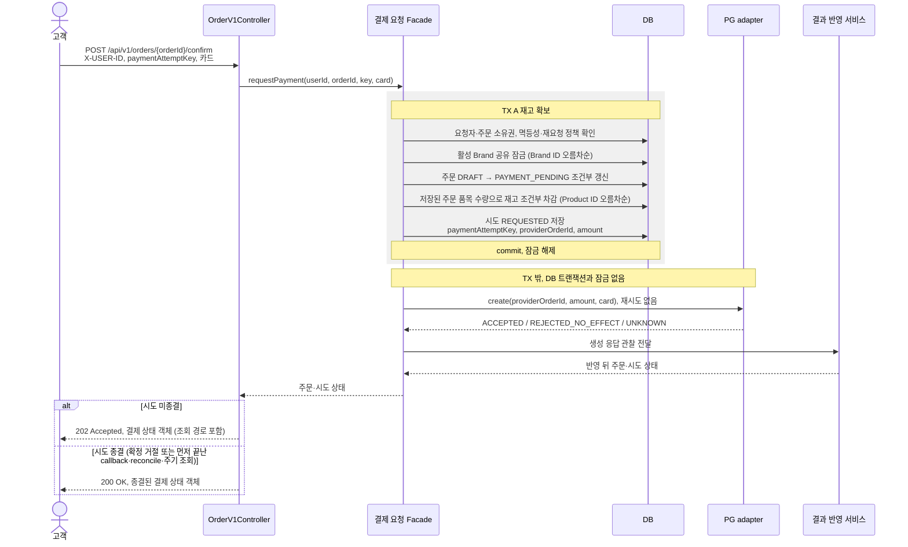

# 주문 결제 요청

> 주문 결제: **1. 결제 요청** → [2. PG 연동](../external-systems/payment-gateway.md) → [3. 결과 반영](order-payment-result.md)

고객이 본인 DRAFT 주문의 결제를 요청하면 재고를 차감하고 테스트 PG에 결제를 보낸다. 포인트는 조회하거나 차감하지 않는다. 
HTTP 입력·응답은 [API 계약](../api-contracts.md), 상태와 불변식은 [도메인 모델](../domain-model.md), 저장 구조와 데이터 전환은 [영속성 매핑 설계](../persistence-mapping.md#저장-모델과-데이터-전환)를 따른다.

주문당 결제 시도는 하나로 제한한다. 
실패 후 새 시도, 환불, 정산·정산 파일 대사, 사용자 취소와 카드 저장은 이번 범위에 포함하지 않는다.

## 멱등성과 재요청 정책

고객의 결제 요청 재전송은 `paymentAttemptKey`로 식별한다. 아래 정책은 이 유스케이스에 적용한다.

키는 고객이 만든 UUID다. 키는 결제 시도의 영구 식별자로 저장되며 만료되지 않는다. 
시스템 전체에서 유일하므로, 짧거나 뻔한 값이 다른 고객의 키와 우연히 겹쳐 이유 없는 `409`가 생기지 않도록 UUID 형식만 받는다. 
입력 형식은 [API 계약](../api-contracts.md#포인트주문)을 따른다.

| 요청 | 처리 |
| --- | --- |
| DRAFT 주문, 처음 보는 키 | 새 시도를 만들고 PG 결제를 시작한다. |
| 같은 주문, 같은 키, 같은 금액 | 같은 요청의 재전송이다. 새 시도·PG 호출 없이 저장된 상태를 응답한다. 미종결 `202`, 종결 `200` |
| 같은 키, 다른 주문 또는 다른 금액 | 충돌이다. `409`, 변경 없음 |
| 시도가 있는 주문, 새 키 | 두 번째 시도를 만들지 않는다. `409`, 변경 없음 |
| 이전 POINT 확정 주문 | 기존 이미 확정된 상태 오류 `409`를 유지한다. |

요청 일치는 주문 ID와 저장된 주문 금액으로 판단한다. 카드 종류(`cardType`)와 카드 번호(`cardNo`)는 비교 대상에서 제외하고 저장하지 않는다. 
같은 키로 다른 카드 입력이 와도 새 시도·PG 호출 없이 기존 시도의 저장된 상태를 응답한다. 재요청에 담긴 카드 입력은 PG로 전달하지 않으며 기존 시도를 변경하지 않는다.

## 책임과 단계

| 단계 | TX | 역할 |
| --- | --- | --- |
| 1. 재고 확보 | TX A | 소유권·상태·상품을 검사하고 주문 전이, 재고 차감, 시도 생성을 원자적으로 저장한다. |
| 2. PG 결제 | TX 밖 | adapter가 생성 요청을 보내고 응답을 관찰 결과로 바꿔 결과 반영 유스케이스에 넘긴다. |
| 3. 결과 반영 | TX B | [결과 반영 유스케이스](order-payment-result.md)가 생성 응답·callback·reconcile·주기 조회를 받아 시도·주문을 갱신하고 확정 실패의 재고를 반환한다. |

PG 거래는 DB rollback으로 되돌릴 수 없으므로 흐름 전체를 트랜잭션으로 감싸지 않는다. TX A를 commit하고 모든 DB 잠금·커넥션을 해제한 뒤 PG를 호출한다. 
application은 외부 연동 포트와 관찰 결과를 사용하고, HTTP 형식은 infrastructure adapter가 맡는다.

## 흐름

새 시도를 만들고 TX A를 commit한 요청만 위 PG 생성 단계를 실행한다. 재전송과 경쟁에서 진 요청은 저장된 상태를 응답한다.

## 1. 재고 확보

- 결제 금액은 현재 상품 가격이 아니라 저장된 주문 총액이다.
- 검사 중 하나라도 실패하면 전체 rollback한다. 시도 생성과 재고 차감은 취소되고 PG도 호출하지 않으며, 주문은 DRAFT로 남는다.
- 같은 주문의 요청이 겹치면 `DRAFT → PAYMENT_PENDING` 조건부 갱신이 한 건만 성공한다. 진 요청은 재고를 차감하기 전에 멈추고 TX A를 끝낸다. 이후 새 조회 경계에서 저장된 시도를 읽어 멱등성과 재요청 정책대로 응답한다.
- TX A에서 `REQUESTED` 시도를 commit한 것을 발송 시작의 영속 기록으로 삼는다. PG 생성 권한은 이번 요청이 이 commit에 성공한 경우에만 반환한다. 재조회한 시도가 `REQUESTED`라는 이유로 발송 권한을 다시 주지 않는다.

### 외부 주문 식별자 생성

Commerce는 결제 시도를 만들 때 `providerOrderId`를 `LP-ORD-{주문 ID}-{UUID 앞 8자리}`로 한 번 만들어 저장한다. 주문 ID는 최소 10자리가 되도록 앞을 0으로 채우며, 10자리를 넘으면 전체 자릿수를 유지한다. 무작위 부분은 소문자 16진수 8자리다. 생성·조회·callback 매칭에는 저장된 값만 쓰고 다시 계산하지 않는다. 예: 주문 42 → `LP-ORD-0000000042-7f3a9c1e`

주문 ID만으로 만들지 않는다. DB 초기화나 환경 분리로 주문 ID가 재사용돼도 PG에 남은 이전 거래와 섞이지 않고, 내부 PK를 그대로 외부 식별자로 쓰지 않는다. 주문 ID는 사람이 추적할 수 있도록 앞부분에 남긴다.

무작위 부분은 application이 주입한 생성기에서 받는다. 테스트는 생성기를 교체해 값을 미리 정한다.

### 재고 차감의 기준

상품 ID와 수량은 DRAFT 생성 시 저장한 `OrderItem` 스냅샷을 사용한다. 같은 상품은 이미 합산된 한 품목이며, 결제 요청 이후 품목과 수량은 변경하지 않는다. 
저장된 주문·시도가 재고 차감 사실을, 주문 품목 스냅샷이 차감·반환 수량을 나타낸다. 
확정 실패의 보상은 [결과 반영의 재고 보상 트랜잭션](order-payment-result.md#재고-보상-트랜잭션)을 따른다.

### 경쟁에서 진 요청의 재조회

주문 조건부 갱신이 0행이면 TX A의 잠금을 해제한 뒤 별도의 읽기 트랜잭션과 영속성 컨텍스트에서 주문·시도를 조회한다. 
같은 키이면 저장된 상태에 따라 미종결 `202`, 종결 `200`을 응답하고, 다른 키이면 `409`다. 이 경로에서는 PG 생성을 호출하지 않는다.

같은 TX A 안에서 일반 SELECT를 반복하거나 `EntityManager.clear()`만 호출하는 방식은 사용하지 않는다. 
MySQL `REPEATABLE READ`의 일반 조회는 트랜잭션의 기존 스냅샷을 사용하므로, 경쟁 요청이 commit한 시도가 보이지 않을 수 있다.

시도 키·주문 ID 유일 제약 경쟁으로 INSERT가 실패한 경우에도 TX A 밖에서 전체 rollback을 확인한 뒤 같은 새 조회 경계를 사용한다. 
이미 차감한 재고와 주문 전이는 rollback된다. 정확히 해당 유일 제약의 충돌만 재요청 판정으로 연결하고, 교착·잠금 시간 초과 등 다른 저장 오류는 기술 오류로 전달한다.

### 동시성 보호

| 대상 | 전략 | 보호하는 규칙 |
| --- | --- | --- |
| Brand | 활성 Brand `PESSIMISTIC_READ` 공유 잠금 | 브랜드 일괄 삭제와 결제 요청의 순서를 정한다. |
| Order | `id`, `user_id`, `status = DRAFT` 조건부 상태 갱신 | 같은 주문의 발송 권한은 하나만 생긴다. |
| Product 재고 | `id`, `deleted_at IS NULL`, `stock >= :quantity` 조건부 차감 | 삭제된 상품과 재고 부족을 막는다. |
| 결제 시도 | `paymentAttemptKey`, `orderId`, `providerOrderId` 유일 제약 | 같은 키의 중복 시도, 주문당 두 번째 시도와 PG 주문 식별자 중복을 막는다. |

Brand는 ID 오름차순으로 잠그고, Product도 ID 오름차순으로 차감한다. 
Brand 공유 잠금과 UPDATE의 쓰기 잠금은 TX A가 끝날 때까지 유지하고, PG 호출 전에 모두 해제된다.

- 브랜드 삭제와의 경합은 [Brand 잠금 규칙](brand-deletion.md#동시성-보호-전략)을 따른다.
- 상품 수정은 이름과 가격만 갱신해 재고 차감을 보존한다. 관리자 재고 설정은 결제 요청에서 이미 차감한 수량을 제외한 가용 수량을 최종 값으로 설정한다.
- 재고 차감 0행이면 업무 오류 `409`로 TX A 전체를 rollback한다. 이미 차감한 다른 품목과 주문 전이도 함께 취소된다.

### 관리자 재고 설정과의 기대값

관리자 재고 설정은 같은 Product 행에서 `id`, `deleted_at IS NULL` 조건으로 `stock`을 입력값으로 바꾼다. 
결제 요청의 차감(`stock = stock - :quantity`, `stock >= :quantity`)과 실패 반환(`stock = stock + :quantity`)은 상대 갱신이다. 
관리자 설정은 주문 품목·시도·주문 상태를 바꾸지 않으므로 예약을 지우지 않는다.

미완료 예약의 합은 `PAYMENT_PENDING`·`PG` 주문의 기존 품목 수량에서 구한다. 상품에 별도 예약 집계 컬럼을 두지 않고, 성공 종결에 상품 행 갱신을 추가하지 않는다.

`가용 재고 + 미완료 예약 합 <= Long.MAX_VALUE`를 유지한다. 관리자 설정은 전용 `READ_COMMITTED` TX에서 상품 행을 배타 잠금한 뒤 최신 commit된 미완료 예약 합을 잠금 없는 조회로 읽는다. 설정값과의 합이 범위를 넘으면 `400`으로 거절하며 기존 값은 유지한다. 예약이 없으면 기존 64비트 비음수 범위를 그대로 허용한다. 상위 TX의 오래된 `REPEATABLE READ` 스냅샷에 합류하지 않도록 Facade는 바깥 TX를 거절한다.

상품 잠금 뒤에는 새로운 예약의 차감과 실패 반환이 commit될 수 없다. 상품 잠금을 기다리는 TX A는 아직 DRAFT로 보이지만, 설정 commit 뒤 가용 수량을 차감하고 같은 수량을 예약하므로 합이 늘지 않는다. 실패 TX B가 상품 잠금을 기다리면 기존 PAYMENT_PENDING 예약이 합계에 남아 반환 여유를 확보한다. 성공이 동시에 commit되면 예약을 보수적으로 더 셀 수 있지만 합을 과소 계산하지 않는다. 예약 조회는 주문 행을 잠그지 않아 TX B의 주문→상품 순서와 역순 잠금을 만들지 않는다.

초기 재고 10, 주문 수량 2 기준이다. 결과는 모든 트랜잭션이 끝난 뒤 새 조회로 확인한다.

| 순서 | 재고 | 기대 결과 |
| --- | --- | --- |
| 결제 요청 → 관리자 5 설정 → 성공 | 10 → 8 → 5 → 5 | 성공은 재고를 다시 차감하지 않는다. 주문 `CONFIRMED` |
| 결제 요청 → 관리자 5 설정 → 실패 | 10 → 8 → 5 → 7 | 관리자 설정 뒤에도 주문 품목 수량 2를 반환한다. |
| 관리자 5 설정 → 결제 요청 | 10 → 5 → 3 | 설정값이 가용 재고이므로 그 값에서 차감한다. |
| 결제 요청 → 관리자 0 설정 → 실패 | 10 → 8 → 0 → 2 | 반환한 수량은 다시 가용 재고가 된다. 판매를 멈추려면 상품을 삭제한다. |
| 결제 요청 → 관리자 5 설정 → 상품 삭제 → 실패 | 8 → 5 → 5 → 7 | 삭제된 상품에도 반환하고 삭제 상태를 유지한다. 삭제 뒤의 관리자 설정은 `404`다. |

같은 행의 두 갱신이 겹치면 행 잠금을 먼저 얻은 쪽이 먼저 반영되고, 각 갱신의 조건으로 결과가 정해진다.

| 겹치는 작업 | 먼저 반영된 쪽 | 기대 결과 |
| --- | --- | --- |
| 결제 요청 차감 2 / 관리자 5 설정 | 차감 | 10 → 8 → 5 |
| | 설정 | 10 → 5 → 3 |
| 결제 요청 차감 2 / 관리자 1 설정 | 설정 | 차감 조건 `stock >= 2`를 만족하지 못해 `409`로 TX A 전체 rollback. PG 호출 없음, 주문 `DRAFT`, 재고 1 |
| 실패 반환 2 / 관리자 5 설정 (차감 뒤 재고 8) | 반환 | 8 → 10 → 5. 예약이 풀린 뒤 관리자가 가용 수량을 정했으므로 설정값이 최종 값이다. |
| | 설정 | 8 → 5 → 7 |
| 성공 종결 / 관리자 5 설정 | 어느 쪽이든 | 성공은 재고를 바꾸지 않으므로 5 |

## 2. PG 결제

- 생성 요청은 재시도하지 않는다. [PG adapter](../external-systems/payment-gateway.md#adapter-관찰-결과)의 관찰을 결과 반영에 넘기고, 미종결이면 `202`, 종결이면 `200`을 응답한다. 생성 전 확정 거절도 TX B에서 종결되면 `200`과 `PAYMENT_FAILED`를 응답한다.
- 결과 반영이 rollback되어도 TX A는 이미 commit됐다. 새 조회가 가능하고 다른 경로의 반영이 없다면 시도는 `REQUESTED`, 주문은 `PAYMENT_PENDING`으로 남으며 `202`와 [결제 상태 객체](../api-contracts.md#결제-상태-객체)를 응답한다. 재조회로 다른 경로의 종결을 확인했다면 저장된 결과를 응답한다. 저장 실패는 서버 로그에 오류로 남긴다. commit 뒤 재조회·응답 실패는 [결과 반영의 실패 처리](order-payment-result.md#실패-처리)를 따른다.
- 실제 거래가 생성됐다면 빠진 `transactionKey`를 `providerOrderId` 조회로 찾을 수 있다. 생성 전 확정 거절의 관찰까지 유실된 경우에는 거래 조회만으로 실패를 복구할 수 없으며, [거절의 복구 한계](order-payment-recovery.md#생성-전-거절의-복구-한계)를 따른다.
- TX A commit 뒤 발송 전에 프로세스가 종료되면 `REQUESTED`로 남는다. 재시작 후에도 생성을 다시 보내지 않고, [주기 조회](order-payment-recovery.md#주기-조회)와 reconcile의 기존 거래 조회로만 확인한다.

## 실패 처리

입력 오류(시도 키·카드 입력 포함)는 재고 확보 전에 `400`, 없는 주문과 타인 주문은 `404`로 거절한다. 시도 키 충돌은 [멱등성과 재요청 정책](#멱등성과-재요청-정책), 상품 사용 불가와 재고 부족은 [동시성 보호](#동시성-보호)의 `409`를 따른다. 어느 경우에도 변경과 PG 호출이 없다. 
TX A의 교착, 잠금 시간 초과와 그 밖의 저장 오류는 전체 rollback 후 기술 오류로 끝내며 PG를 호출하거나 자동 재시도하지 않는다. 
생성 응답 이후의 처리는 [2. PG 결제](#2-pg-결제), 경로별 응답은 [결제 경로의 응답 변환](../error-mapping.md#결제-경로의-응답-변환)을 따른다.

## 검증 기준

결과는 모든 트랜잭션과 요청이 끝난 뒤 새 조회 경계(`flush/clear` 포함)에서 확인한다. 
동시성·제약 검증은 실제 MySQL을 사용하고, 재고는 초기 10·주문 수량 2를 기준으로 한다.

| 영역 | 상황 | 기대값 |
| --- | --- | --- |
| 입력·재고 확보 실패 | 시도 키 누락·UUID 형식 위반, 카드 입력 누락·공백, 소유권·상태·삭제·재고 실패 | `400`·`404`·`409`, 시도 0건, PG 생성 0회, 모든 품목 재고와 주문 `DRAFT` 유지 |
| 키 정규화 | 대소문자만 다른 같은 UUID | 같은 키의 재전송으로 처리 |
| 트랜잭션 경계 | PG 호출 중 | 열린 DB 트랜잭션 없음 |
| 재고 차감 | TX A 뒤, 처리 중·결과 미확인 | 재고 8 유지, 포인트 변화 0 |
| 같은 키 동시 요청 | 두 요청이 시도 생성 전 상태를 읽고 한쪽만 TX A commit | 시도 1건·품목별 차감 1회·생성 1회. 진 요청은 TX A 종료 뒤 새 조회로 같은 시도를 미종결 `202`·종결 `200`으로 응답 |
| 같은 키, 다른 주문 | 서로 다른 상품을 담은 두 주문이 같은 키로 경쟁 | 한쪽만 성공, 진 요청은 주문 전이·재고 차감 rollback 뒤 `409` |
| 같은 키, 다른 카드 | 같은 주문·같은 키로 `cardType` 또는 `cardNo`만 바꿔 재요청 | 기존 시도의 저장된 상태 응답(미종결 `202`, 종결 `200`), 새 시도·PG 생성 0회, 기존 시도 유지 |
| 같은 주문, 새 키 | 시도가 있는 주문 | `409`, 두 번째 시도 없음 |
| 재고 경합 | 재고 5에 서로 다른 주문 8건이 각 1개 | 성공 5건, 재고 부족 `409` 3건, 최종 재고 0 |
| 관리자 재고 설정 | [관리자 재고 설정과의 기대값](#관리자-재고-설정과의-기대값)의 순차 경우와 겹치는 경우의 두 순서 | 표의 재고·주문·시도 |
| 유일 제약 | 시도 키·주문 ID·`providerOrderId` 중복 저장 | DB가 거절 |
| 종결 뒤 재요청 | PG로 종결한 같은 시도 / 이전 POINT 확정 주문 | 저장된 결과 `200`, 생성·차감·반환 증가 없음 / 기존 상태 오류 `409` |
| 중단 뒤 재요청 | 생성 응답 유실·결과 반영 실패·발송 전 프로세스 종료 | 위 규칙의 상태와 응답, 생성 호출 증가 없음 |
| 주문 조회 | 본인 주문 상세 / 타인 주문 | 결제 상태 객체 조회, PG 생성 0회 / `404` |

생성 전 거절과 결과 반영의 검증은 [결과 반영 설계](order-payment-result.md#검증-기준)를 따른다.
