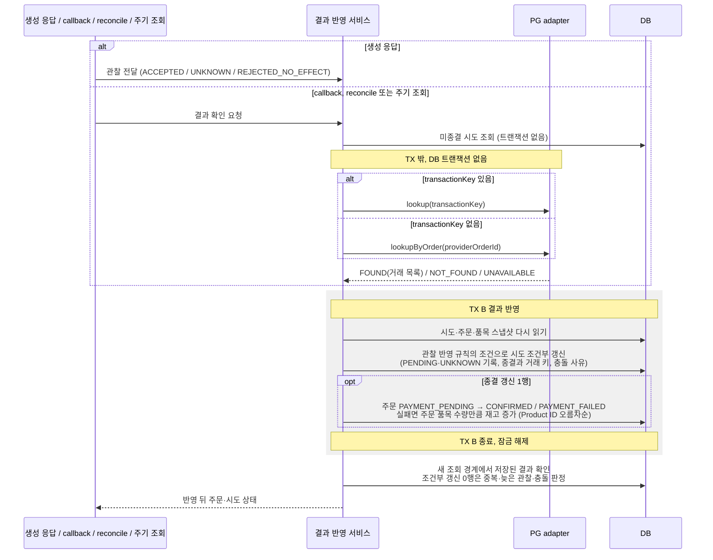

# 주문 결제 결과 반영

> 주문 결제: [1. 결제 요청](order-payment-request.md) → [2. PG 연동](../external-systems/payment-gateway.md) → **3. 결과 반영**

PG의 관찰을 결제 시도·주문에 한 번만 반영하고 확정 실패의 재고를 반환한다. 
상태와 불변식은 [도메인 모델](../domain-model.md), HTTP 계약과 관찰 결과는 [PG 연동 설계](../external-systems/payment-gateway.md)를 따른다.

## 시작하는 경로

| 경로 | 시작 조건 | PG 조회 |
| --- | --- | --- |
| 생성 응답 | 결제 요청이 PG 생성 응답을 관찰 결과로 넘김 (`ACCEPTED`, `UNKNOWN`, `REJECTED_NO_EFFECT`) | 하지 않음. 생성 응답을 그대로 반영한다. |
| callback | `POST /api/v1/payments/callback` 수신 | 알림의 거래를 조회한다. 본문은 신호로만 쓴다. |
| [결제 결과 재확인 (reconcile)](order-payment-recovery.md#결제-결과-재확인) | 고객의 `POST /api/v1/orders/{orderId}/payment/reconcile` | 본인 미종결 시도의 기존 거래를 PG에 조회한다. |
| [주기 조회](order-payment-recovery.md#주기-조회) | 스케줄러가 일정 시간 이상 미종결인 시도를 찾음 | reconcile과 같은 방식으로 기존 거래를 조회한다. |

모든 경로가 같은 결과 반영 경계(TX B)를 사용한다. 이미 종결한 시도는 PG 조회 없이 저장된 결과를 반환한다. 
수동 재확인·주기 조회의 실행 정책과 복구 한계는 [결제 회복](order-payment-recovery.md)을 따른다.

## 결과별 효과

판정은 [관찰 반영 규칙](#관찰-반영-규칙)이 정한다. 아래는 미종결 시도의 효과이며, 이미 종결된 시도는 중복·늦은 관찰·충돌 모두 저장된 종결 상태와 업무 효과를 유지한다.

| 판정 | 시도 | 주문 | 재고 |
| --- | --- | --- | --- |
| 처리 중 | `PENDING` | `PAYMENT_PENDING` | 차감 상태 유지 |
| 미확인 | 마지막 저장 상태 유지 (`REQUESTED`의 생성 응답 유실은 `UNKNOWN`). 조회 불가도 상태를 바꾸지 않으므로 `REQUESTED`·`UNKNOWN`은 결과 미확인, PG가 접수를 확인한 `PENDING`은 결제 대기로 표시 | `PAYMENT_PENDING` | 차감 상태 유지 |
| 성공 | `SUCCEEDED` | `CONFIRMED`, `PG`, 결제액, `SUCCESS` | 추가 차감 없음 |
| 실패 | `FAILED` | `PAYMENT_FAILED`, `PG`, 결제 결과 `FAILED` | 주문 품목 수량만큼 한 번 반환 |
| 충돌 | 미종결 유지, [충돌 사유 기록](#충돌-기록) | `PAYMENT_PENDING` (결과 미확인 표시) | 임의 반환 없음 |

## 핵심 반례

결제 경계를 정할 때 검토한 반례와 각 상태·효과다. 세부 규칙은 링크한 절을 따른다.

| 반례 | 시도 | 주문 | 재고 | 응답과 복구 |
| --- | --- | --- | --- | --- |
| PG가 거래를 만든 뒤 생성 응답 유실 | `REQUESTED → UNKNOWN` | `PAYMENT_PENDING` | 차감 유지 | confirm은 `202`. 생성을 다시 보내지 않고 callback·주기 조회·reconcile이 `providerOrderId`로 기존 거래를 조회해 반영한다. [관찰 반영 규칙](#관찰-반영-규칙) |
| PG 성공을 확인한 뒤 TX B 저장 실패 | 이전 미종결 상태 유지 | `PAYMENT_PENDING` | 차감 유지, 추가 변경 없음 | TX B 전체 rollback. 테스트 PG는 웹훅을 재전송하지 않으므로 주기 조회나 고객 reconcile이 같은 거래를 다시 조회해 한 번 반영한다. [실패 처리](#실패-처리) |
| 같은 결과의 callback 중복, callback·reconcile 동시 반영 | 먼저 조건부 종결한 한 요청만 `SUCCEEDED`·`FAILED` | 한 번만 `CONFIRMED`·`PAYMENT_FAILED` | 성공은 변경 없음, 실패는 한 번 반환 | 나머지는 조건부 갱신 0행으로 업무 변경 없이 끝나고, 새 조회 경계에서 중복으로 판정해 저장된 결과를 반환한다. [중복 방지](#중복-방지) |

## 흐름

PG 조회는 TX 밖에서 수행하고 시도·주문·재고 변경은 TX B에서 함께 commit한다. 결과는 [고객 API 계약](../api-contracts.md#결제-상태-객체)과 [PG callback 응답 규칙](../external-systems/payment-gateway.md#응답-규칙)에 맞춰 반환한다. reconcile은 생성 요청을 보내지 않는다.

### 관찰 반영 규칙

결과 반영 서비스는 거래 수, 시도의 `providerOrderId`·금액과 기존 거래 키를 먼저 검사한다. 검증을 통과한 관찰만 상태 판정과 DB 조건부 갱신에 사용한다.

갱신 조건은 DB의 허용 상태와 거래 키 조건이다. 조건을 만족하지 않으면 0행이 되고 [0행의 판정](#조건부-갱신-0행의-판정)을 따른다.

| 관찰 | 판정 | 갱신 조건 (허용 상태 / 거래 키) | 처리 |
| --- | --- | --- | --- |
| 생성 응답 `ACCEPTED` | 처리 중 | `REQUESTED`·`UNKNOWN` / NULL 또는 관찰과 같은 키 | `PENDING`과 `transactionKey` 기록. 같은 키의 `PENDING`은 중복, 다른 거래 키는 충돌이다. 주문·재고 유지 |
| 생성 응답 `UNKNOWN` | 미확인 | `REQUESTED` / NULL | `UNKNOWN` 기록. 이미 `PENDING`이나 종결이면 바꾸지 않는다. 주문·재고 유지 |
| 생성 응답 `REJECTED_NO_EFFECT` | 실패 | `REQUESTED`·`UNKNOWN` / NULL | PG 조회 없이 `FAILED`로 종결하고 키는 NULL로 둔다. 이미 거래를 확인한 시도와는 충돌, 같은 거절로 종결된 시도는 중복이다. |
| `FOUND`, 거래 1건, 주문·금액·거래 키 검증 통과, `SUCCESS` | 성공 | `REQUESTED`·`PENDING`·`UNKNOWN` / NULL 또는 관찰과 같은 키 | 검증한 `transactionKey`를 종결 상태와 함께 저장하고 성공 반영 |
| `FOUND`, 거래 1건, 주문·금액·거래 키 검증 통과, `FAILED` | 실패 | `REQUESTED`·`PENDING`·`UNKNOWN` / NULL 또는 관찰과 같은 키 | 검증한 `transactionKey`를 종결 상태와 함께 저장하고 실패 반영 |
| `FOUND`, 거래 1건, 주문·금액·거래 키 검증 통과, `PENDING` | 처리 중 | `REQUESTED`·`UNKNOWN` / NULL 또는 관찰과 같은 키 | `PENDING`과 `transactionKey` 기록. 같은 키의 `PENDING`은 중복이다. 주문·재고 유지 |
| `FOUND`, 거래 1건이지만 `orderId`·`amount`가 시도와 다르거나, 저장된 `transactionKey`와 다름 | 충돌 | 상태 갱신 없음 | 미종결 유지, 충돌 기록 |
| `FOUND`, 거래 2건 이상 | 충돌 | 상태 갱신 없음 | 거래를 선택하지 않고 `MULTIPLE_TRANSACTIONS` 기록. 시도·거래 키·주문·재고 유지 |
| `FOUND`, 거래 0건 | 미확인 | 상태 갱신 없음 | 미종결 유지 |
| `NOT_FOUND`, `UNAVAILABLE` | 미확인 | 상태 갱신 없음 | 미종결 유지 |

0건, `404`, 조회 불가는 종결 전이와 재고 반환의 근거가 아니다.

결과 반영은 검증된 단일 거래만 대상으로 한다. 거래가 2건 이상이면 모두 같은 결과여도 첫 거래를 고르지 않고 충돌 기록 규칙에 따라 `MULTIPLE_TRANSACTIONS`를 남긴다. 반복 조회에서도 처음 충돌 사유와 감지 시각을 유지하며 생성 재발송이나 재고 반환은 하지 않는다. 복수 거래의 해소·수동 종결 절차는 이번 범위에 포함하지 않는다.

## 중복 방지

시도의 모든 갱신에 시도 ID와 [관찰 반영 규칙](#관찰-반영-규칙) 표의 갱신 조건을 둔다. 상태와 거래 키는 같은 UPDATE로 저장하며 기록한 키를 바꾸거나 지우지 않는다. 
조건부 갱신 뒤 이전 JPA 엔티티를 다시 저장하지 않는다.

조회로 확인한 거래 키는 비어 있지 않은 값이어야 한다. 종결 갱신이 1행인 요청만 같은 TX B에서 주문을 `PAYMENT_PENDING` 조건으로 종결한다. 
주문 전이가 1행이 아니면 [정합성 오류](#실패-처리)로 전체 rollback한다. 실패 종결에 성공한 요청만 아래 재고 보상을 수행한다.

### 재고 보상 트랜잭션

TX A에서 차감한 상품 ID·수량은 저장된 `OrderItem` 스냅샷에 있다. 결제 요청 이후 품목·수량은 고정되며, 보상 수량을 현재 상품 정보에서 다시 계산하지 않는다. 
시도의 실패 종결에 성공한 요청이 같은 TX B에서 다음 변경을 수행한다.

1. 주문을 `PAYMENT_PENDING → PAYMENT_FAILED`로 조건부 전이한다. 1행이 아니면 정합성 오류로 전체 rollback한다.
2. 저장된 주문 품목을 Product ID 오름차순으로 순회해 각 상품의 `stock`을 스냅샷 수량만큼 증가시킨다.
3. 시도 실패·주문 실패·모든 품목의 재고 반환을 함께 commit한다.

재고 반환은 `stock = stock + :quantity` 갱신으로 수행한다. 이전에 읽은 재고에 수량을 더해 덮어쓰지 않는다. 
논리 삭제된 상품도 반환 대상이므로 `deleted_at IS NULL` 조건을 두지 않으며, 상품의 삭제 상태는 바꾸지 않는다.

상품 행이 없거나 갱신 행 수가 1이 아니면 정합성 오류로 TX B 전체를 rollback한다. 
여러 품목 중 일부를 반환한 뒤 실패해도 앞선 재고 증가와 시도·주문 종결이 모두 취소된다. 다음 결과 반영은 같은 스냅샷으로 전체 보상을 다시 실행할 수 있다.

종결 갱신이 0행인 요청은 재고 반환을 실행하지 않는다. 
시도의 실패 종결이 commit되었다는 것은 재고 보상도 함께 commit되었다는 뜻이며, 프로세스가 재시작되거나 같은 실패 관찰이 반복돼도 이 DB 조건으로 중복 반환을 막는다. 
성공 종결은 재고를 추가로 변경하지 않는다.

### 조건부 갱신 0행의 판정

0행은 이미 종결됐다는 뜻으로 단정하지 않는다. 같은 `PENDING`의 중복, 늦은 `UNKNOWN`, 거래 키 충돌도 0행이 될 수 있다. 
이 요청은 주문·재고를 변경하지 않고 TX B를 끝낸 뒤, 새 읽기 트랜잭션과 영속성 컨텍스트에서 시도를 조회한다. 
기존 TX B에서 SELECT를 반복하거나 영속성 컨텍스트만 비워 판정하지 않는다.

- 같은 종결 상태와 거래 키이면 중복이다. 생성 전 거절의 중복은 `FAILED`와 키 NULL로 확인한다.
- 같은 키의 `PENDING` 중복이나 종결 뒤 도착한 동일 거래의 `PENDING`은 상태를 유지한다. `UNKNOWN` 중복과 `PENDING`·종결 뒤의 `UNKNOWN`도 상태를 유지한다.
- 다른 거래 키, 반대 종결 결과, 거래 존재와 생성 전 거절의 모순은 [충돌 기록](#충돌-기록) 규칙으로 사유를 남긴다. 저장된 상태를 덮어쓰지 않는다.
- 시도가 없거나 위 규칙으로 설명되지 않으면 정합성 오류로 남긴다. 0행이라는 이유만으로 결과를 확정하거나 PG를 재발송하지 않는다.

조건부 갱신 후 응답용 상태도 TX B 종료 뒤 새 조회 경계에서 가져온다. 
이 판정에서 찾은 충돌은 새 경계의 짧은 쓰기 트랜잭션에서 기록하며 주문·재고를 변경하지 않는다. 
새 조회에 필요한 스냅샷 규칙은 [결제 요청의 재조회](order-payment-request.md#경쟁에서-진-요청의-재조회)와 같다.

### 충돌 기록

결과를 판정할 수 없는 관찰은 시도의 `conflict_reason`과 `conflict_detected_at`에 보존한다. 판정을 보류할 뿐 결과를 바꾸지 않는다.

| 사유 | 관찰 |
| --- | --- |
| `MULTIPLE_TRANSACTIONS` | 같은 주문의 조회 결과가 2건 이상이라 하나의 거래를 확정할 수 없음 |
| `TRANSACTION_MISMATCH` | 거래 1건이지만 `orderId`·`amount`가 시도와 다르거나, 저장된 `transactionKey`와 다름 |
| `RESULT_CONTRADICTION` | 종결된 시도와 반대인 종결 결과, 거래를 확인한 시도에 생성 전 거절, 거절로 종결한 시도에 거래 존재 |

- 갱신은 시도 ID와 `conflict_reason IS NULL` 조건으로 사유와 시각을 함께 저장한다. 처음 기록한 사유를 유지하고 지우거나 덮어쓰지 않는다. 0행이면 이미 기록된 충돌로 보고 무시한다.
- 관찰 검증에서 찾은 충돌은 TX B에서, 조건부 갱신 0행의 판정에서 찾은 충돌은 새 경계의 짧은 트랜잭션에서 기록한다. 어느 경우에도 시도 상태·거래 키·주문·재고를 바꾸지 않는다.
- 미종결 시도에 충돌이 있으면 [결제 진행 표시](../api-contracts.md#결제-진행-표시)는 결과 미확인(`UNCONFIRMED`)이다. 종결된 시도의 충돌은 저장된 최종 결과를 유지하고 관리자 응답에서만 확인한다.
- 충돌은 자동으로 해제하지 않는다. 이후 관찰이 같은 모순을 다시 보여도 사유를 추가하지 않고, 해제·수동 종결 절차는 이번 범위에 포함하지 않는다. 충돌 기록은 서버 로그에도 경고로 남기되 카드 정보는 포함하지 않는다.

## 반영 시점의 상품 삭제

재고 차감을 마친 `PAYMENT_PENDING` 주문은 이후 상품이나 Brand가 삭제돼도 저장된 품목·금액으로 마무리한다. 
TX B에서 상품 활성 여부를 다시 확인하거나 Brand 잠금을 얻지 않는다. 논리 삭제된 상품의 반환도 `stock`만 늘리고 삭제 상태는 유지한다. 
삭제 뒤 새 결제 요청은 [재고 확보 단계](order-payment-request.md#1-재고-확보)에서 거절된다.

## 실패 처리

충돌·미확인 관찰은 [관찰 반영 규칙](#관찰-반영-규칙), 종결 전이 0행은 [중복 방지](#중복-방지)를 따른다. 어느 경우에도 생성 요청을 다시 보내지 않는다.

| 결과 | 처리 |
| --- | --- |
| PG 거래 관찰 반영 중 저장 오류 | TX B 전체 rollback. 호출 경계의 처리는 [결제 경로의 응답 변환](../error-mapping.md#결제-경로의-응답-변환)을 따른다. 테스트 PG는 웹훅을 재전송하지 않으므로 주기 조회나 고객 reconcile이 해당 거래를 다시 조회해 반영한다. |
| 생성 전 확정 거절 반영 중 저장 오류 | TX B 전체 rollback. 관찰 보유 여부에 따른 재적용과 복구 한계는 [결제 회복](order-payment-recovery.md#생성-전-거절의-복구-한계)을 따른다. |
| reconcile의 소유권·입력 오류 | [고객 API 계약](../api-contracts.md#포인트주문)으로 거절, 변경 없음 |
| 정합성 오류: 시도 종결 뒤 주문 전이 0행, 재고 반환 행 수가 1이 아님 | TX B 전체 rollback. 업무 충돌(`409`)이 아니라 불변식이 깨진 상태이므로 내부 오류(`INTERNAL_ERROR`)로 처리하고, 시도·주문 ID와 함께 error 로그를 남긴다. 자동 보정하지 않는다. |

저장 오류와 정합성 오류의 경로별 응답은 [결제 경로의 응답 변환](../error-mapping.md#결제-경로의-응답-변환)을 따른다. TX B rollback이 확인된 경우 해당 요청이 수행한 상태·재고 변경은 취소된다.

TX B commit 뒤 응답용 재조회나 응답 전송에 실패한 경우는 rollback과 구분한다. 오류 응답이나 timeout만으로 DB 반영 여부를 단정하지 않으며, 이미 commit된 종결 상태와 재고 효과는 유지한다. 이후 같은 callback·reconcile은 저장된 결과를 확인하고 추가 확정·반환을 하지 않는다.

## 검증 기준

결과는 모든 트랜잭션과 요청이 끝난 뒤 새 조회 경계(`flush/clear` 포함)에서 확인한다. 
재고는 초기 10·주문 수량 2를 기준으로 하며, PG 연동 검증은 실제 adapter와 [로컬 테스트 PG](../external-systems/test-payment-gateway.md)를 연결한다.

| 영역 | 상황 | 기대값 |
| --- | --- | --- |
| 재고·저장 효과 | 성공 / 확정 실패 반영 뒤 재조회 | 재고 8 / 10, 결제수단 `PG`와 상태·결제액·거래 키·품목 스냅샷 확인, 포인트 변화 0 |
| 품목 합산 | 복수 상품과 같은 상품의 중복 입력 | 합산 저장한 수량과 실제 차감·반환 수량이 같고, 결제 요청·결과 반영 뒤에도 스냅샷 불변 |
| 중복·동시 반영 | 중복 callback, callback·reconcile 동시 반영 | 확정·반환 1회 |
| 늦은 관찰 | 조회와 UPDATE 사이에 성공·접수 결과가 먼저 commit, 종결 뒤 늦은 `ACCEPTED` | 늦은 갱신 0행, 새 조회가 상태·거래 키 유지 |
| callback 본문 | 본문만으로 결과 전달 | 주문 확정 안 됨 |
| 확정 거절 | `REJECT_BEFORE_CREATE`, 같은 거절 중복 적용 | 거래 0건, 시도 `FAILED`, 거래 키 NULL, 재고 반환 1회. 거래 키가 비는 종결은 거절뿐 |
| 응답 유실 | `DROP_RESPONSE` 뒤 기존 거래가 `SUCCESS`·`FAILED` | 거래 1건, 시도 `UNKNOWN`, 차감 유지, 생성 추가 0회. 이후 조회로 종결 상태와 거래 키 저장 |
| 충돌 | 복수 거래, 금액 불일치, 반대 종결 결과, 같은 충돌 반복 관찰 | 사유 1회 기록, 처음 사유·시각 유지, 시도 상태·거래 키·주문·재고 불변, 미종결은 결과 미확인 |
| 저장 실패 | 종결 뒤 주문 갱신이나 여러 상품 중간 반환에서 예외 | TX B 전체 rollback, 다음 확인에서 성공·실패 1회 반영 |
| commit 뒤 응답 실패 | 성공·실패 종결 commit 뒤 응답용 재조회 실패 또는 응답 유실, 이후 같은 callback·reconcile | 첫 요청의 종결 상태·재고 효과 유지. 이후 저장된 결과 반환, 추가 확정·반환 0회 |
| 정합성 오류 | 미종결 시도의 주문이 `PAYMENT_PENDING`이 아님 | TX B rollback, reconcile·callback `500`, 주기 조회는 건너뛰고 error 로그, 시도·주문·재고 불변 |
| 상품 삭제 | 재고 차감 뒤 상품·Brand 삭제 | 성공 확정 또는 품목 수량만큼 반환, 삭제 상태 유지 |
