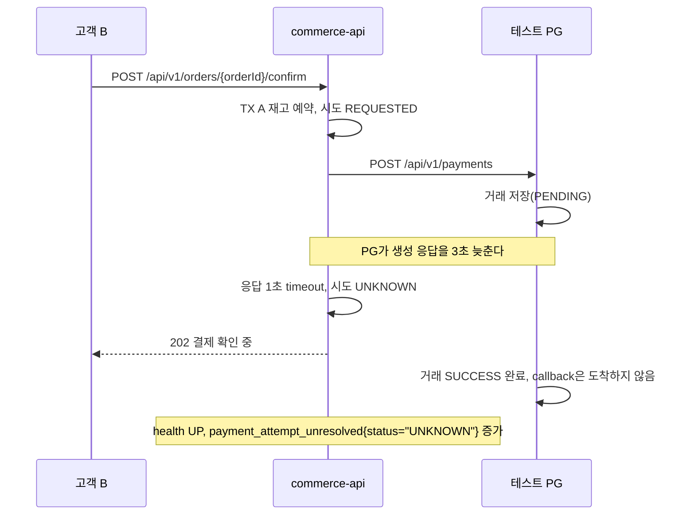
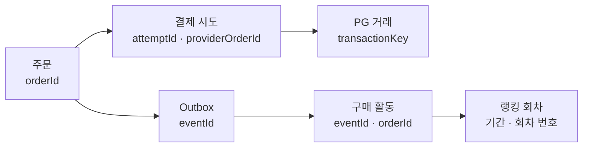

# 결제 응답 유실 사고 대응

> 상태: 구현했다. 이 문서가 최종 설계이고, 운영 절차는 [런북](../../runbook/payment-response-lost.md)에, 실행 결과와 기능별 검증 범위는 [검증 기록](payment-response-lost-verification.md)에 둔다.

PG는 결제를 승인했는데 Commerce가 생성 응답을 받지 못해 결제 시도가 `UNKNOWN`으로 남는 사고를 다룬다. 의존 서비스는 모두 살아 있고 health는 결제 결과를 보지 않으므로 UP으로 남는다. 고객은 "결제 확인 중"인 주문을 본다.

이 문서는 네 가지를 정한다. 사고를 드러내는 관측, 원인을 가리는 진단 규칙, 같은 주문을 추가 결제 없이 되살리는 복구 범위, 그리고 이를 한 번에 재현하는 사고 실험이다. 결제 요청·반영·회복의 기존 규칙은 [결제 요청](order-payment-request.md), [결과 반영](order-payment-result.md), [결제 회복](order-payment-recovery.md)을 따르고 이 문서에서 바꾸지 않는다. 결과 조회, callback 검증, 예약 소비와 반환, 중복 방지는 그대로이고, 결제 요청과 결과 조회 경로에 로그 두 줄만 더한다. 이것은 기존 W5 결제 테스트 전체로 확인한다.

## 범위와 용어

| 용어 | 뜻 |
|---|---|
| 미종결 시도 | 상태가 `REQUESTED`, `PENDING`, `UNKNOWN`인 결제 시도. `SUCCEEDED`와 `FAILED`만 종결이다. |
| 장애 3건 | 사고 실험에서 응답 유실을 넣은 주문 3건. 실행 순서가 아니라 실제 생성한 ID 목록으로 지정한다. |
| 주입 | 테스트 PG에 등록한 사고 시나리오. 거래와 호출 기록과 따로 켜고 끈다. |

실제 카드와 계정, 외부 PG 장애 주입, 운영 DB 변경은 하지 않는다. 분산 추적 수집, PG 호출 지표, 충돌 기록 경보, Commerce 안의 진단 도구, 자동 재결제는 범위 밖이다.

## 요구사항

### 기능 요구사항

| ID | 요구사항 | 수용 기준 |
|---|---|---|
| FR-01 | 미종결 결제 시도 수를 상태별로 Prometheus에 노출한다. label은 상태 하나다. | fault 보존 시점에 `UNKNOWN` 3, 나머지 상태 0. 복구 뒤 모두 0. 주문·사용자·trace ID는 label에 없다. |
| FR-02 | 결과를 잃을 수 있는 두 경계, 곧 PG 생성 응답과 PG 조회 결과를 주문 단위로 이을 수 있는 key-value 로그로 남긴다. 반영 rollback과 충돌은 기존 로그를 쓴다. | 장애 3건마다 생성 관찰 `UNKNOWN`이 남고, 걸린 시간이 응답 timeout 이상이다. 같은 시도의 조회 관찰은 recovery 전까지 없다. |
| FR-03 | 진단용 PG 조회는 읽기만 한다. | 진단 조회 뒤 Commerce의 시도 상태, 주문 상태, `updated_at`이 그대로다. |
| FR-04 | 복구는 기존 본인 주문 reconcile로만 한다. PG 생성 요청을 다시 보내지 않는다. | 복구 중 PG create 수 증가 0. 장애 3건이 `SUCCEEDED`가 되고 주문이 확정된다. |
| FR-05 | 조회 불가, 거래 0건, 복수 거래, 금액·주문 불일치, 계속 `PENDING`은 성공으로 바꾸지 않는다. | 상태와 예약을 보존하고 멈춘다. |
| FR-06 | reconcile과 callback이 반복돼도 같은 업무 사실로 수렴한다. | 확정 1회, 예약 소비 1회, Outbox 1건, 품목당 구매 활동 1건, 확정 시각 불변. |
| FR-07 | 다른 사용자의 주문은 조회하거나 조정할 수 없다. | 사용자 C가 B의 장애 주문을 상세 조회하거나 reconcile하면 `404`이고 PG 조회 수는 그대로다. 주문은 그대로 `PAYMENT_PENDING`이고 시도는 `UNKNOWN`이다. |
| FR-08 | 복구한 주문의 확정 사실이 Outbox, Kafka, 구매 활동을 거쳐 새 랭킹 회차에 들어간다. 이미 공개한 회차는 바꾸지 않는다. | 새 회차 점수 20, 앞 회차 점수 17 그대로. 랭킹 API가 새 회차를 보여 준다. |
| FR-09 | 응답을 잃은 동안 고객은 결제를 확인 중인 주문을 본다. | 장애 주문의 상세 조회에서 `paymentProgress`가 `UNCONFIRMED`이고, 복구 뒤 `COMPLETED`다. |
| FR-10 | 주기 조회가 풀었어야 할 `UNKNOWN`이 남으면 경보로 알리고, 경보 문구가 런북으로 이끈다. | 기한 초과 지표가 baseline 0, fault 3, recovery 0. 경보 쿼리는 한 인스턴스라도 1 이상이면 울리고, 모두 0이면 풀리고, 지표가 없으면 울리지 않는다. |
| FR-11 | 장애 때 한 화면에서 기한 초과 수, 미종결 상태별 추이, 경보 상태를 본다. | Grafana가 기동할 때 결제 대시보드를 불러온다. |

### 비기능 요구사항

| ID | 요구사항 |
|---|---|
| NFR-01 | 지표는 DB 집계를 주기적으로 갱신하므로 갱신 주기와 수집 주기만큼 늦을 수 있다. 지표 설명과 runbook에 적는다. |
| NFR-02 | 관리 endpoint는 기존 설정대로 health와 prometheus만 노출한다. `env`, `heapdump`는 열지 않는다. |
| NFR-03 | 로그에는 사용자 ID, 카드 정보, 결제 시도 키를 남기지 않는다. 증거에는 카드 번호를 남기지 않고, 증거는 로컬 build 폴더에만 둔다. |
| NFR-04 | 실험은 자기가 띄운 프로세스와 컨테이너만 쓰고 정리한다. 공유 로컬 인프라 주소로 자식 프로세스를 띄우지 않는다. |
| NFR-05 | 실험 결과는 실행마다 새로 만든다. UP-TO-DATE로 건너뛴 결과나 이전 실행의 파일을 증거로 쓰지 않는다. 실험 task가 실행한 테스트가 0건이면 실패한다. |

## 사고의 모양

그림의 1초 timeout은 test 프로필 값이고, 3초 지연은 사고 실험이 테스트 PG에 준 값이다.

**PG에는 성공한 거래가 있고 Commerce에는 `UNKNOWN` 시도와 예약된 재고가 남는다. callback이 오지 않고 주기 조회가 아직 돌지 않으면 이 상태가 유지된다.**

## 관측

### health

health는 DB와 Redis 연결, 디스크, ping, ssl, 앱의 liveness·readiness를 본다. Kafka와 PG, 결제 결과는 보지 않는다. 이 사고는 의존 서비스가 모두 살아 있는 채로 결제 결과만 잃으므로 health는 UP으로 남는다. 업무가 끝나지 않은 사실은 지표와 로그로 본다.

실험은 단계마다 health 응답 원문과 관찰 시각을 남긴다. 루트 `/actuator/health`는 구성요소를 보여 주지 않으므로 구성요소가 드러나는 `/actuator/health/readiness` 원문을 함께 남겨 실제 구성요소를 확인한다. UP이 아니면 기대값을 고치지 않고 실제 설정, 의존성, 영향을 확인한다.

### 미종결 결제 지표

| 항목 | 내용 |
|---|---|
| 이름 | `payment_attempt.unresolved`. Prometheus에서는 `payment_attempt_unresolved`로 보인다. |
| 종류 | gauge |
| label | `status`: `REQUESTED`, `PENDING`, `UNKNOWN`. 공통 `application` tag가 함께 붙는다. |
| 값 | 그 상태이고 논리 삭제되지 않은 결제 시도 수. DB 전체가 범위다. 상태별 COUNT는 기존 `(status, last_checked_at)` 인덱스를 써야 하고, 실제 MySQL의 실행 계획으로 확인한다. |
| 갱신 | 10초마다 DB를 집계하고 기동 직후 한 번 갱신한다. 집계가 실패하면 경고 로그를 남기고 직전 값을 유지한다. |
| 설정 | `payment.attempt-metrics.enabled`, `payment.attempt-metrics.interval`. 기본은 켜짐과 10초, `test`는 끈다. |
| 지연 | 상태 변화가 Prometheus에 보이기까지 최대 갱신 주기와 수집 주기를 더한 만큼 걸린다. |
| 여러 인스턴스 | 인스턴스마다 같은 DB를 세므로 값을 더하지 않고 `max`로 본다. |
| 스케줄 스레드 | relay, 결제 주기 조회, Outbox 지표처럼 작업마다 스레드를 두는 기존 방식을 따라 스케줄 pool을 3에서 4로 올린다. |

미종결 세 상태를 이름 하나에 담고 label로 나눈다. `UNKNOWN`만 세면 callback을 잃고 `PENDING`에 머문 시도나 생성 직전에 멈춰 `REQUESTED`에 남은 시도를 놓친다. 이름은 앱 구분을 공통 `application` tag에 맡기는 기존 `order_confirmed_outbox.pending`의 규칙을 따른다.

이 지표로는 충돌 기록 여부, 종결 뒤 결과 모순으로 기록한 시도, 한 상태에 머문 시간을 볼 수 없다. 충돌이 기록된 시도와 생성 후 24시간이 지난 시도도 `UNKNOWN`으로 세므로, 이런 시도가 남아 있으면 평소에도 0이 아니다. 그래서 경보는 이 지표가 아니라 아래 기한 초과 지표로 건다.

### 자동 복구 기한을 넘긴 미확인 지표

| 항목 | 내용 |
|---|---|
| 이름 | `payment_attempt.overdue_unknown`. Prometheus에서는 `payment_attempt_overdue_unknown`으로 보인다. |
| 종류 | gauge. label은 공통 `application` tag뿐이다. |
| 값 | `UNKNOWN`이고, 충돌 기록이 없고, 생성 후 주기 조회 기간 안이며, 마지막 변경 뒤 기한이 지난 결제 시도 수. 논리 삭제는 뺀다. |
| 기준 | 주기 조회 기간은 기존 `payment.periodic-check.lookup-window`(24시간)를 그대로 읽는다. 기한은 `payment.attempt-metrics.overdue-after`(5분)다. |
| 시각 | DB의 현재 시각으로 잰다. 런북 SQL과 같은 기준이다. 운영에서는 업무 시계와 같다. |
| 갱신 | 미종결 지표와 같은 스케줄에서 함께 집계한다. 두 집계가 모두 끝난 뒤에만 값을 바꾸고, 하나라도 실패하면 둘 다 직전 값을 유지한다. |

이 지표는 주기 조회가 풀 수 있었는데 풀지 못한 미확인만 센다. 0보다 크면 자동 복구가 실패해 사람이 나설 일이 있다는 뜻이고, 런북 복구가 끝나면 0으로 돌아온다. 충돌이 기록된 시도는 주기 조회도 런북도 풀지 못하므로 넣지 않는다. 생성 후 24시간이 지난 시도는 그 전 기간에 이미 이 지표에 잡혔으므로 넣지 않는다.

### 경보

| 항목 | 내용 |
|---|---|
| 이름 | 결제 미확인 자동 복구 기한 초과 |
| 조건 | `max(payment_attempt_overdue_unknown) > 0`이 1분 이어진다. 인스턴스마다 같은 DB를 세므로 최댓값으로 본다. |
| 심각도 | `critical` |
| 받는 곳 | 결제용 Slack 연락처. Outbox 경보와 같은 웹훅을 쓴다. Slack 앱 웹훅은 보내는 이름 설정을 쓰지 않아 메시지가 앱 이름으로 보이므로, 결제 경보인지는 제목으로 구분한다. |
| 해결 | 조건이 풀리면 해결 메시지를 보낸다. 충돌이 기록되거나 생성 후 24시간이 지나 지표에서 빠져도 풀리므로, 해결 문구에 남은 미확인을 확인할 런북 질의를 적는다. |
| 지표가 없을 때 | 울리지 않는다. 앱 전체가 내려간 경우는 앱 감시가 맡는다. |
| 문구 | 발생 문구에 런북 경로를 적어, 받은 사람이 런북으로 간다. |

기한 5분에 집계 주기, 수집 주기, 유지 1분이 더해져 사고가 시작되고 약 6~7분 뒤에 울린다. 경보 쿼리는 promtool 테스트가 실제 provisioning 파일을 읽어 확인한다. 유지 조건과 Slack 수신은 promtool 범위 밖이다.

### 대시보드

Grafana가 기동할 때 "Commerce" 폴더에 결제 대시보드를 불러온다.

| 칸 | 내용 |
|---|---|
| 자동 복구 기한을 넘긴 미확인 | 경보와 같은 값. 0이면 초록, 1 이상이면 빨강 |
| 미종결 결제 상태별 추이 | `max by (status) (payment_attempt_unresolved)` |
| 결제 경보 상태 | 위 경보가 지금 울리는지 |

PG 응답 시간과 결제 성공률은 지표가 없어 넣지 않는다.

### 경계 로그

결과를 잃을 수 있는 경계 두 곳에만 새 로그를 둔다. PG에 결제 생성을 보낸 직후와 PG 거래를 조회한 직후다. 응답 유실과 내부 반영 실패는 DB와 PG에 같은 상태를 남기므로, 둘을 가르는 근거는 이 두 로그와 기존 rollback 로그다.

새 로그는 SLF4J key-value로 남긴다. 이벤트 이름은 `event` 필드에 넣는다. dev·qa·prd는 logstash 형식 JSON이라 key-value가 필드로 나간다. local·test 콘솔은 기존 패턴 그대로라 key-value가 보이지 않으므로, 기존 결제 로그처럼 문장에도 `attemptId`와 `orderId`를 넣는다.

| 이벤트 | 남기는 곳 | 필드 | 레벨 |
|---|---|---|---|
| `payment.create.observed` | commerce-api 결제 요청, PG 생성 호출 직후 | `attemptId`, `orderId`, `providerOrderId`, `outcome`, `detail`, `elapsedMs` | `UNKNOWN`은 WARN, 나머지 INFO |
| `payment.lookup.observed` | commerce-api 결과 반영 서비스, PG 조회 직후 | `attemptId`, `orderId`, `outcome`, `pgStatus`, `transactionCount`, `reason` | INFO |

- 생성 관찰의 `outcome`은 [PG 연동의 생성 응답 관찰](../external-systems/payment-gateway.md#생성-응답)과 같은 `ACCEPTED`, `REJECTED_NO_EFFECT`, `UNKNOWN`이다. `detail`은 `UNKNOWN`일 때 adapter가 남긴 이유로, 예외 이름이나 응답 상태다. `elapsedMs`는 생성 호출에 걸린 시간이다. 응답 timeout 이상이면 응답을 기다리다 끊은 것이다.
- 조회 관찰의 `outcome`은 `FOUND`, `NOT_FOUND`, `UNAVAILABLE`이다. `UNAVAILABLE`이면 `reason`에 기존 조회 실패 분류(`TIMEOUT`, `NETWORK`, `TEMPORARY_HTTP` 등)를 넣고, `pgStatus`는 거래가 정확히 1건일 때만 넣는다. 조회 불가는 callback과 주기 조회의 기존 warn도 함께 남는다.
- 반영 rollback과 충돌은 기존 로그를 그대로 쓴다. 결과 반영 TX의 rollback error("결제 결과 반영을 되돌립니다.")와 충돌 warn("결제 관찰 충돌을 기록했습니다.")은 `attemptId`와 `orderId`를 문장에 담는다. 반영이 끝났는지는 DB의 시도 상태로 본다.
- 주문을 잇는 값은 `orderId`, `attemptId`, `providerOrderId`, `transactionKey`다. 그 뒤로는 Outbox의 `eventId`와 구매 활동 테이블을 DB 조회로 잇는다. 사용자는 접근이 제한된 DB 조회로 찾는다.

### 주문 단위 연결

응답을 잃은 시도에는 `transactionKey`가 없다. 그 거래는 PG에 `providerOrderId`로 조회해 찾는다. 랭킹 회차는 상품별 점수만 남기므로 주문 단위로는 구매 활동까지 잇는다.

HTTP 요청 안에서는 traceId가 로그에 붙는다. relay는 스케줄 스레드에서 따로 돌기 때문에 요청 trace가 Outbox에서 끊기고, Kafka 전송과 소비에도 trace를 넘기지 않는다. 분산 추적은 구현하지 않았고 업무 ID로 경계를 잇는다.

## 진단

### 경쟁 가설

조치 전에 아래 세 가설과 예상 관찰을 적는다.

| 가설 | 예상 관찰 | 확인할 것 |
|---|---|---|
| PG 처리 지연 | PG 거래가 아직 `PENDING` | 해당 주문의 PG 거래 조회 |
| PG 응답 유실 | 같은 주문·금액의 PG 거래 1건. 이번 사고에서는 `SUCCESS`. 생성 관찰 `UNKNOWN`, 걸린 시간이 응답 timeout 이상 | PG 거래 조회, `payment.create.observed` |
| 내부 반영 실패 | PG 거래 `SUCCESS`, Commerce가 그 결과를 조회했고 반영이 rollback됨 | `payment.lookup.observed`, 결과 반영 rollback error, 시도 상태 |

### 판정 규칙

가설마다 지지, 기각, 미확정 중 하나로 판정한다.

| 가설 | 지지 | 기각 | 미확정 |
|---|---|---|---|
| PG 처리 지연 | PG 거래가 `PENDING` | PG 거래가 `SUCCESS`나 `FAILED` | PG 조회 실패 |
| PG 응답 유실 | 생성 관찰이 `UNKNOWN`이고 걸린 시간이 응답 timeout 이상, PG에 같은 주문·금액의 거래 1건 | 생성 관찰이 `ACCEPTED`나 `REJECTED_NO_EFFECT`, 또는 같은 주문·금액의 PG 거래 없음 | 생성 관찰 로그 없음, `UNKNOWN`인데 응답 timeout보다 빨리 끝났고 PG 거래가 있음, PG 조회 실패 |
| 내부 반영 실패 | 같은 시도에 조회 관찰 `FOUND`와 rollback error가 있음 | 같은 시도에 조회 관찰 `FOUND`가 없음, 또는 `FOUND` 뒤 rollback 없이 시도가 종결됨 | `FOUND` 뒤 rollback도 없고 시도도 미종결, 로그 수집 구간이 시도의 생성부터 지금까지를 덮지 못함 |

- 표의 어느 칸에도 맞지 않으면 미확정이다. PG 거래가 0건이라 처리 지연을 볼 수 없는 경우가 그 예다.
- 응답 timeout보다 빨리 끝난 `UNKNOWN`은 연결 실패나 계약 밖 응답이다. PG가 요청을 받았는지 생성 관찰만으로는 알 수 없어서, PG 거래가 있으면 미확정, 없으면 기각이다.
- PG 거래가 2건 이상이거나 금액·주문 식별자가 시도와 다르면 가설을 판정하기 전에 멈춘다.
- 가설은 서로 배타적이지 않다. 생성 응답을 잃었는데 PG가 아직 처리 중이면 응답 유실과 PG 처리 지연이 함께 지지된다. PG 처리 지연이 지지되면 다른 가설과 상관없이 조치하지 않고 기다린다.
- 근거는 Commerce 경계 로그, 읽기 전용 PG 조회, DB 상태만 쓴다. 테스트 PG에 등록한 주입 목록은 판정에 쓰지 않는다. 사고 실험은 여기에 테스트 PG의 create 호출이 1회인지를 더 확인한다. 운영에서는 PG의 호출 수를 볼 수 없다.
- 판정은 사람이 이 규칙과 증거로 내린다. 사고 실험은 판정에 쓰는 관찰을 증거로 남기고, 이번 사고의 관찰이 "응답 유실 지지, 나머지 기각" 칸에 맞는지 assertion으로 확인한다.
- PG `SUCCESS`와 Commerce `UNKNOWN`의 조합만으로 응답 유실과 반영 실패를 가르지 않는다. 둘을 가르는 근거는 생성 관찰, 조회 관찰, 기존 rollback 로그다.
- 진단용 PG 조회는 Commerce를 거치지 않고 PG 조회 API를 직접 읽는다. reconcile은 결과를 반영하므로 진단에 쓰지 않는다.

## 복구

### 사람이 맡는 범위

- 운영에서는 주기 조회가 `UNKNOWN` 시도를 보통 2분 안에 복구한다.
- 사람은 [자동 복구 기한 초과 경보](#경보)가 울리고, 런북의 대상 목록 SQL이 한 건 이상일 때 나선다. 기한 5분은 주기 조회가 한 바퀴 도는 2분에 지표 지연과 여유를 더한 값이다.
- 원인이 주기 조회 중단이면 먼저 주기 조회를 되살린다. 그래도 남은 주문과 생성 후 24시간이 지나 자동 조회에서 빠진 주문만 아래 절차로 복구한다. 실행 순서는 [런북](../../runbook/payment-response-lost.md)을 따른다.
- 사고 실험은 주기 조회를 꺼서 자가 복구가 실패한 상황을 재현하므로 5분을 기다리지 않는다. 실험이 검증하는 것은 주기 조회가 풀지 못한 주문을 본인 reconcile로 복구하는 경로다. 주기 조회를 되살려 복구되는 경로는 기존 `PaymentPeriodicCheckIntegrationTest`와 `PaymentRestartRecoveryIntegrationTest`가 맡는다.

복구가 끝났는지는 고정한 대상 목록이 모두 종결됐는지로 판단하고, 기한 초과 지표가 0으로 돌아와 경보가 풀리는 것으로도 확인한다.

### 절차와 중단 조건

조치 전에는 [런북의 조치 전제](../../runbook/payment-response-lost.md#3-조치-전제)를 모두 확인하고, 사람이 대상 목록과 중단 조건을 승인한다. 사고 실험은 설계에 미리 정한 대상과 중단 조건을 테스트 코드에 고정해 이 승인을 대신한다.

대상 주문마다 본인 reconcile(`POST /api/v1/orders/{orderId}/payment/reconcile`)을 한 건씩 호출한다. 성공 종결이면 다음 주문으로 넘어간다. 조회 불가와 충돌 없는 미종결은 순간적인 상태일 수 있어 정해진 횟수만 다시 호출하고, 충돌, 실패 종결, `404`, `500`은 다시 봐도 판정이 바뀌지 않거나 진단과 어긋나므로 바로 멈춘다. 횟수와 간격은 [런북](../../runbook/payment-response-lost.md#4-2-남은-주문-reconcile)을 따른다.

멈추면 상태를 그대로 두고 사람이 판단한다. DB를 직접 고치거나 결제를 다시 요청하지 않는다. 멈춤 조건이 상태를 보존하는지는 기존 테스트가 확인한다. 조회 불가, `PENDING` 유지, 반영 rollback은 `OrderPaymentReconcileV1ApiE2ETest`, 충돌 판정은 `PaymentResultServiceIntegrationTest`다.

복구 뒤에는 대상 목록의 주문을 새 DB 조회로 읽어 [런북의 복구 확인](../../runbook/payment-response-lost.md#6-복구-확인) 항목을 확인한다.

## 사고 실험

결제 응답 유실부터 주간 랭킹까지를 한 테스트 lifecycle에서 잇는다. 주간 랭킹의 실패·재시작과 늦은 회차는 다른 질문이라 이 실험이 대신하지 않는다. 그 회귀는 `WeeklyRankingJobTest`와 `WeeklyRankingOperationsTest`가 계속 맡는다.

### 실행 구성

| 구성 | 방식 |
|---|---|
| 실행 | `commerce-api`의 JUnit 테스트 `CheckoutIncidentTest` 하나. `./gradlew :apps:commerce-api:incidentTest`로 돌리고, `check`에 포함된다. |
| commerce-api | 테스트 컨텍스트에서 돈다. 업무 시계를 고정하고, relay는 테스트가 호출하고, 주기 조회는 끈다. 결제 지표 갱신은 짧은 주기로 켠다. |
| callback | 닿지 않는 주소로 둔다. 모든 주문에서 도착하지 않고, 정상 주문은 본인 reconcile로 확정한다. |
| commerce-streamer | 실제 bootJar를 자식 프로세스로 띄운다. 이 실행 전용 topic과 consumer group을 쓴다. |
| commerce-batch | 실제 bootJar를 Job마다 자식 프로세스로 띄운다. 회차 번호는 그 기간의 마지막 회차 + 1이다. |
| 테스트 PG | 기존 테스트용 테스트 PG 컨테이너(`TestPgContainer`)를 쓴다. 수동 처리 모드와 제어 API를 켠 기존 설정이고, 코드는 바꾸지 않고 [기존 시나리오 제어](../../../apps/test-pg/docs/test-payment-gateway.md#시나리오-제어)와 조회 제어만 쓴다. |
| 인프라 | 기존 Testcontainers MySQL, Redis, Kafka |
| 장애 3건 지정 | PG 주문 식별자의 suffix를 실행마다 무작위로 만들어 stub한다. |

구성별 세부는 다음과 같다.

- `incidentTest`는 tag `incident`만 실행하고, 일반 `test`에서는 빠진다.
- 결제 지표 갱신을 테스트가 직접 호출하지 않고 켜 두는 것은, `refresh()`를 직접 부르면 스케줄 등록과 주기 설정이 검증에서 빠지기 때문이다.
- API의 management port는 빈 포트를 받아 실제 주입된 값을 쓰고, `management.server.address=127.0.0.1`로 loopback에만 연다.
- 스프링 테스트는 metric export를 기본으로 꺼 `/actuator/prometheus`가 없다. 실제 Prometheus 응답을 읽도록 `@AutoConfigureObservability`로 켠다.
- 주입은 같은 주문에 `SUCCESS`를 다시 등록해 해제한다. 해제는 거래와 호출 기록을 지우지 않는다.
- 같은 주문의 create가 두 번 와도 테스트 PG는 거절하지 않고 거래를 하나 더 저장하며 호출 수를 센다. 테스트가 주문별 create 1회와 거래 1건, 전체 20회를 확인해 실패시킨다.
- streamer에는 `local` 프로필에 서버 포트와 관리 포트 `0`, 주소 `127.0.0.1`을 주고, 테스트 컨테이너의 MySQL, Kafka, Redis 주소를 넘긴다.
- API relay와 streamer는 이 실행 전용 topic 하나를 같이 쓴다. streamer는 topic을 자동으로 만들지 않으므로 API의 local·test 시작 작업이 topic을 partition 3개로 먼저 만든다. 테스트는 topic이 없으면 만든 뒤 partition 수를 확인하고, streamer consumer가 partition 3개를 배정받은 뒤에 진행한다.
- batch는 Job마다 종료 코드를 확인한다.
- API에 엔티티가 없는 streamer 테이블은 `docker/mysql/init.sql`로 만든다.
- PG 주문 식별자는 결제 요청 안에서 만들어지고 곧바로 create가 나가서, 그 사이에 주입을 등록할 수 없다. 그래서 결제 요청 전에 suffix를 정하고 그 식별자로 주입을 등록한다. 증거에는 DB에서 다시 읽은 실제 값을 쓴다.

API만 테스트 컨텍스트에 두고 streamer와 batch를 실제 JAR로 띄운다. 세 앱은 모두 `com.loopers`를 스캔하므로 한 JVM에 올리면 빈이 섞이고, production 앱끼리 의존을 더하지 않기 위해서다. 실험을 별도 task로 나눠 다른 앱 JAR에 대한 빌드 의존을 이 task에만 둔다. `incidentTest`는 별도 JVM에서 사고 실험만 돌리므로 테스트 PG에는 이 실험이 만든 거래만 있다. 그래서 실험이 만든 주문의 주문별 집계를 더한 값이 PG 전체 집계가 된다.

기다리는 단계에는 모두 상한을 둔다. 지표가 바뀔 때까지, Outbox가 발행되고 구매 활동이 저장될 때까지, batch가 끝날 때까지 기다리다 상한을 넘으면 그 단계를 실패로 증거에 남긴다. 업무 시계가 고정이라 relay가 발행에 실패하면 재시도 시각이 단계 안에 오지 않는다. 이때도 재시도를 기다리지 않고 Outbox 발행 대기 상한에서 실패한다.

자식 프로세스의 인자는 한 곳에서 만든다. JDBC URL, Kafka bootstrap 주소, Kafka admin 주소, Redis master와 replica 주소 중 하나라도 이 실행의 테스트 컨테이너가 아니면 띄우기 전에 멈춘다. `local` 프로필 기본값이 공유 로컬 인프라를 가리키기 때문이다. streamer는 이 실행이 띄운 PID만 멈춘다. 성공하면 본문에서, 실패하면 `finally`에서, JVM이 끝날 때는 shutdown hook이 멈추고, PID를 증거에 남긴다. batch는 Job마다 끝날 때까지 기다려 종료 코드를 확인한다.

### 데이터 준비

| 대상 | 준비 |
|---|---|
| 사용자 | A는 baseline, B는 fault, C는 타인 확인용이다. 사용자 API가 없어 저장소로 만든다. |
| 상품 | 관리자 API로 브랜드와 공개 상품 하나를 만든다. 가격 7,000원, 재고 30. 상품이 하나라 순위는 늘 1위이고, 순위 규칙은 W9 테스트가 확인한다. |
| 주문 | 주문마다 그 상품 1개. A의 10건이 baseline 집합, B의 10건이 fault 집합이다. |
| 포인트·쿠폰 | A와 B에게 포인트를 충전한다. W8 캠페인 준비 코드로 캠페인을 만들고 발급 API로 쿠폰을 한 장씩 받는다. |
| 결제 입력 | 합성 카드 값, 주문마다 새 `paymentAttemptKey`. |

### 업무 시계와 기간

업무 시계는 Commerce API가 확정 시각, Outbox 시각, 결제 상태 전이 시각에 쓰는 주입 Clock이다. 실험에서는 `2026-11-11T03:00:00Z`(수요일)에서 시작해 고정한다. 기간은 `periodStart=2026-11-09`이고 모든 확정이 이 주에 들어간다. batch는 실제 시계로 돌아 회차의 계산 시각은 기간이 끝난 뒤가 된다. 고정 시각을 쓰면 실행마다 기간, 확정 시각, 점수가 같다. 주가 바뀌는 시간대를 건너뛰는 방식은 테스트를 skip하게 되므로 쓰지 않는다.

| 단계 | 업무 시계 |
|---|---|
| baseline | T = `2026-11-11T03:00:00Z` |
| fault | T+1h |
| recovery | T+2h |
| 수렴 확인 | T+3h |

- 20건의 확정 시각은 모두 `[2026-11-09, 2026-11-16)` 안에 있다.
- 정상 17건의 확정 시각은 recovery와 수렴 확인 뒤에도 그대로다.
- 장애 3건의 확정 시각은 recovery 시각 T+2h다. 결제를 요청한 T+1h와 구분하려고 단계마다 시계를 옮긴다.
- 확정 시각이 주 경계를 넘는 경우는 이 실험에 없다. 경계에 걸린 확정은 `FreezeWeeklyScoresTaskletTest`, 다시 반영해도 첫 확정 시각을 유지하는 것은 `PaymentConfirmedAtIntegrationTest`가 확인한다.

`created_at`은 JPA가 채우는 실제 시각이고, 결제 시도의 조건부 갱신은 `updated_at`과 상태 전이 시각을 업무 시계로 쓴다. 그래서 한 행 안에서 두 시각이 섞인다.

### 단계와 기대값

결제 결과는 단계마다 고정한 대상 주문 10건을 분모로 센다. 대상은 Commerce가 결제 요청을 받아 PG에 생성 요청까지 보낸 주문이고, 입력 오류로 거절된 요청은 넣지 않는다. 관찰 시점은 그 단계의 확인을 마친 때이며 단계 JSON의 `observedAt`에 남는다. 그 시점의 결제 시도 상태를 최종 성공(`SUCCEEDED`), 최종 실패(`FAILED`), 처리 중(`REQUESTED`, `PENDING`), 결과 미확인(`UNKNOWN`)으로 나눠 세고, 넷의 합은 10이다. 최종 실패도 종결이지만 성공으로 세지 않는다.

| 단계 | 대상 주문 | 최종 성공 | 최종 실패 | 처리 중 | `UNKNOWN` | PG `SUCCESS` 거래 | 누적 PG 거래 | 누적 create | 가용 재고 | 지표 `UNKNOWN` | 지표 기한 초과 | 구매 활동 | 랭킹 |
|---|---|---|---|---|---|---|---|---|---|---|---|---|---|
| baseline | A의 10건 | 10 | 0 | 0 | 0 | 10 | 10 | 10 | 20 | 0 | 0 | 10 | - |
| fault | B의 10건 | 7 | 0 | 0 | 3 | 10 | 20 | 20 | 10 | 3 | 3 | 17 | 새 회차 17 |
| recovery | B의 같은 10건 | 10 | 0 | 0 | 0 | 10 | 20 | 20 | 10 | 0 | 0 | 20 | 새 회차 20, 앞 회차 17 그대로 |

랭킹 회차는 fault와 recovery에서 한 번씩 만든다. fault 회차에는 장애 3건이 Outbox, 구매 활동, 점수에서 모두 빠진 상태가 남는다. recovery 뒤에 앞 회차가 그대로인 것으로 공개한 회차를 고치지 않았음을 보인다.

#### baseline

1. A의 주문 10건을 만든다. 이 실험이 등록한 응답 유실 주입이 없고, 테스트 PG의 조회 지연·실패 설정도 없는지 확인한다.
2. 10건의 결제를 요청한다. 모두 `PENDING`으로 접수된다.
3. 테스트 PG에서 각 거래를 완료하고, A가 본인 reconcile로 확정한다.
4. relay를 호출하고 streamer가 구매 활동 10건을 저장할 때까지 기다린다.
5. health, Prometheus 응답, 주문별 상태를 증거로 남긴다. 관리 포트에서 `env`와 `heapdump`가 `404`인지 확인한다.

#### fault

1. B의 주문 10건을 만들고 장애 3건의 PG 주문 식별자에 `DROP_RESPONSE`를 등록한다. 주입한 주문 목록과 조회 설정을 `raw/`에 남긴다.
2. 10건의 결제를 요청한다. 장애 3건은 PG가 거래를 저장하고 생성 응답을 늦춰, Commerce가 응답 timeout으로 시도를 `UNKNOWN`으로 남긴다. `UNKNOWN`을 받은 직후 테스트가 그 거래를 `SUCCESS`로 완료한다. 늦춘 응답은 그 뒤에 나가므로 Commerce에 닿지 않는다. 나머지 7건은 `PENDING`으로 접수된다.
3. B가 장애 주문의 상세를 조회한다. `paymentProgress`는 `UNCONFIRMED`다.
4. 7건의 거래를 완료하고 B가 본인 reconcile로 확정한다.
5. relay를 호출하고 구매 활동 17건을 기다린다.
6. batch Job으로 이 기간의 새 회차를 만든다. 점수는 17이다.
7. 미종결 지표가 `UNKNOWN` 3, 나머지 상태 0이 되고 기한 초과 지표가 3이 될 때까지 정해진 시간 안에서 Prometheus 응답을 다시 읽는다. health는 UP이다. 단계 표의 fault 행 값을 확인한다. 이때 PG `SUCCESS` 거래 수도 읽는다.
8. 가설과 예상 관찰을 `hypotheses.json`으로 쓴다. 장애 3건을 진단하는 9~10단계와 조치보다 먼저 쓴다.
9. 장애 3건의 PG 거래를 PG 조회 API로 직접 읽고, 조회 앞뒤의 Commerce 시도 상태, 주문 상태, `updated_at`을 함께 모은다.
10. 장애 3건마다 판정에 쓰는 관찰을 `diagnosis.json`에 먼저 쓴다. 그 뒤에 진단 조회가 Commerce 상태를 바꾸지 않았는지와 관찰이 응답 유실의 모양인지 확인한다. 생성 관찰은 `UNKNOWN`이고 응답 timeout 이상 걸렸다. PG 거래는 같은 주문·금액의 `SUCCESS` 1건이다. 조회 관찰과 rollback 기록은 없고 시도는 `UNKNOWN`이다. 이 관찰로 판정하면 지연 기각, 응답 유실 지지, 반영 실패 기각이다.
11. fault 집합에서 `UNKNOWN`인 시도가 정확히 장애 3건인지 확인한다.
12. A와 B의 포인트 잔액과 쿠폰 목록을 기록한다.
13. fault 증거를 쓰고 sha256을 기록한다.

#### recovery

1. 새 주문과 결제 요청을 더 만들지 않는다. 장애 3건의 시나리오를 `SUCCESS`로 다시 등록해 주입을 해제하고, 조회 설정이 정상인지 확인한다.
2. fault 집합의 `UNKNOWN` 목록이 fault에서 기록한 장애 3건과 같은지 확인한다. 다르면 멈춘다.
3. [런북의 조치 전제](../../runbook/payment-response-lost.md#3-조치-전제) 중 데이터로 확인할 수 있는 조건을 검사한다. 대상마다 PG 거래가 1건이고 `SUCCESS`이며 금액과 주문 식별자가 같은지, 충돌 기록이 없는지, 시도가 진단 때와 같은 `UNKNOWN`인지 본다. 진단 전후 상태 비교는 fault 10단계에서 했다. 하나라도 어긋나면 reconcile 없이 실패한다.
4. C가 장애 주문 하나의 상세를 조회하고 reconcile을 호출한다. 둘 다 `404`이고 PG 조회 수는 그대로다. 주문은 그대로 `PAYMENT_PENDING`이고 시도는 `UNKNOWN`이다.
5. B가 장애 3건에 reconcile을 호출한다. 모두 성공 종결되고, 상세 조회의 `paymentProgress`가 `COMPLETED`다.
6. B의 같은 10건을 새로 읽어 [런북의 복구 확인](../../runbook/payment-response-lost.md#6-복구-확인)을 따른다. 10건 모두 `SUCCEEDED`와 `CONFIRMED`이고, 거래 키가 PG 거래와 같고, 결제액이 시도 금액과 같다. A·B의 포인트와 쿠폰은 fault에서 기록한 값과 같다.
7. relay를 호출하고 구매 활동 20건을 기다린다. 10건 모두 Outbox 1행과 구매 활동 1행이 있고, 구매 활동의 확정 시각은 주문과 같다. batch Job으로 새 회차를 만들고, 점수 20과 앞 회차 17이 그대로인지 확인한다. 랭킹 API가 새 회차를 보여 준다.
8. 단계 표의 recovery 행 값을 확인한다. 성공 10과 `UNKNOWN` 0, PG 거래 10건 모두 `SUCCESS`, 누적 create 20, 가용 재고 10, 미종결 지표 세 상태와 기한 초과 지표 모두 0, health UP이다. recovery 증거를 쓴다.

#### 수렴 확인

1. 장애 3건의 늦은 성공 알림을 Commerce callback API로 보낸다. 실험에서는 PG의 callback이 도착하지 않으므로 PG가 늦게 보내는 알림을 테스트가 대신 보낸다. 3건 모두 `200`인지 확인하고 결과를 `raw/`에 남긴다.
2. B의 fault 10건에 reconcile을 다시 호출한다.
3. 확정, 예약, Outbox, 구매 활동, 확정 시각, PG create 수, PG 조회 수가 그대로인지 확인한다.

#### 끝

`finally`에서 이 실행이 등록한 주입을 `SUCCESS`로 되돌리고, 남은 streamer를 멈추고, manifest를 쓴다. 정리 단계 하나가 실패해도 나머지는 계속하고, 그 실패는 manifest에 남기며 원래 실패를 가리지 않는다. 테스트 PG 컨테이너는 JVM이 끝날 때 Testcontainers가 정리한다. 테스트 PG의 거래와 호출 기록은 컨테이너와 함께 사라지므로 그 전에 증거에 쓴다.

### 증거

증거는 `apps/commerce-api/build/incident-evidence/<runId>/`에 쓴다. Gradle 테스트가 실행마다 소스 트리에 파일을 쌓지 않도록 build 아래에 둔다. 경로는 `build.gradle.kts`가 system property로 넘긴다. `runId`는 실제 시작 시각에 무작위 값을 붙여 만들고, 폴더가 이미 있으면 실패한다.

| 파일 | 내용 |
|---|---|
| `manifest.json` | runId, 실제 시작·종료 시각, 단계별 업무 시계, 결과와 실패 단계, streamer PID. 테스트가 끝날 때 한 번만 쓴다. |
| `hashes.sha256` | 증거 파일마다 쓴 즉시 sha256을 한 줄씩 덧붙인다. 덧붙이기만 한다. |
| `orders.json` | baseline·fault 집합. 주문마다 orderId, paymentAttemptKey, providerOrderId, transactionKey, 금액. 장애 3건의 거래 키는 복구 뒤에 채워지므로 recovery 다음에 쓴다. |
| `phase-baseline.json`, `phase-fault.json`, `phase-recovery.json` | 분모와 결제 결과 네 분류, 주문별 내부 상태와 상태 시각, 확정 시각, 가용 재고와 결제 확인 중 주문의 예약 수량, PG 거래와 호출 수, 주문별 집계를 더한 PG 전체 집계, Outbox 상태와 eventId, 구매 활동 수, 랭킹 회차, 지표 값. fault와 recovery에는 포인트와 쿠폰. PG 조회 수에는 테스트가 진단과 확인을 위해 직접 읽은 횟수가 들어가므로, Commerce가 PG를 조회했는지는 경계 로그로 본다 |
| `hypotheses.json` | 진단과 조치 전에 쓴 가설과 예상 관찰. fault 증거에 들어간다. |
| `diagnosis.json` | 시도마다 판정에 쓰는 관찰. 생성 관찰, PG 거래, 조회 관찰 수, rollback 기록 수, 진단 조회 앞뒤의 Commerce 상태다. 확인보다 먼저 쓴다. 근거 로그는 `event`, `attemptId`, 시각으로 가리킨다. fault 증거에 들어간다. 판정은 이 관찰로 사람이 내리고 검증 기록에 적는다. |
| `raw/` | 단계별 health 루트와 readiness, Prometheus 응답 원문. 주입한 주문 목록과 조회 설정, 수렴 확인에서 보낸 늦은 callback의 응답 상태 |
| `logs/` | 이번 실행 구간의 API 로그(`commerce-api.jsonl`), streamer 로그, batch 실행별 로그, 테스트 PG 로그 |

- `hashes.sha256` 말고는 증거 기록 도구로 쓰는 파일을 새로 만들기만 하고, 같은 이름의 파일이 있으면 실패한다. 자식 프로세스 로그는 프로세스가 직접 쓴다.
- fault 단계 파일의 sha256은 쓰는 즉시 `hashes.sha256`에 남기고, 테스트 마지막에 다시 계산해 같은지 확인한다. Gradle JVM이 강제로 종료돼도 그때까지의 hash가 남는다.
- 중간에 실패하면 `finally`에서 쓰는 manifest에 실패한 단계와 예외 요약을 담는다. 그때까지 쓴 파일은 지우지 않는다.
- 단계 JSON의 지표 값은 `raw/`의 Prometheus 원문에서 읽은 값이고, 읽은 원문 파일 이름을 함께 적는다. 상태 JSON의 숫자를 Prometheus 원문처럼 따로 만들지 않는다.
- 마지막 확인에서 테스트 PG 로그까지 쓴 뒤, manifest를 뺀 증거 파일 전체에 합성 카드 번호가 없는지 확인한다. manifest는 그 뒤에 쓰고 카드 값을 담지 않는다.
- 파일이 있다는 사실로 통과를 판단하지 않는다. 통과 여부는 같은 식별자, 상태, 효과 수를 검사하는 테스트 assertion이 정한다.
- `clean`하면 build 아래 증거가 지워진다. 제출에 쓸 실행의 폴더는 따로 보관한다.
- 원본 증거는 로컬에 두고 Git에 올리지 않는다. 제출에 쓴 실행의 runId, ID 목록, 단계표, 파일 hash는 [검증 기록](payment-response-lost-verification.md)에 옮긴다. 제출 실행은 `./gradlew :apps:commerce-api:incidentTest --rerun`으로 새로 돌린다.

## 한계와 남은 위험

만들지 않은 것과 실험 장치가 실제와 다른 점이다. 검증하지 않은 범위는 [검증 기록](payment-response-lost-verification.md#확인하지-않은-범위)에 있다.

### 관측

- 지표 집계가 계속 실패하면 직전 값이 정상처럼 보인다.
- PG 호출 지표가 없어, PG가 느려지는 것을 `UNKNOWN`이 쌓이기 전에 보지 못한다.
- 충돌이 기록되거나 생성 후 24시간이 지난 시도는 기한 초과 지표에서 빠진다. 그래서 풀리지 않은 미확인이 남아도 경보가 해결될 수 있고, 충돌을 알리는 경보는 없다.
- 경보 문구에는 런북의 저장소 경로만 있고, 누르면 열리는 링크는 없다.
- rollback과 충돌은 기존 로그 문장에서 찾으므로 필드로 검색하기 어렵다. streamer와 batch에는 새 로그가 없고, 구매 활동과 랭킹은 DB 조회로 확인한다.

### 실험 장치

- Commerce가 timeout을 만나는 순간 PG 거래는 아직 `PENDING`이고, 바로 뒤에 테스트가 `SUCCESS`로 완료한다. 진단은 완료 뒤에 하므로 판정은 같다.
- 실험에서는 모든 주문의 callback이 도착하지 않는다. 정상 주문도 reconcile로 확정하고, 늦은 callback은 테스트가 Commerce에 직접 보낸다.
- 주입 꺼짐은 실험이 등록한 목록과 조회 설정으로 확인한다. 테스트 PG의 등록 상태를 직접 읽지는 않는다.
- 누적 집계는 실험이 만든 주문만 더한다. 다른 PG 주문 식별자로 결제가 새로 생기면 잡지 못한다. 복구 경로인 reconcile은 결제 생성을 하지 않고, 실험은 그 경로만 쓴다.
- 장애 3건을 미리 지정하려고 PG 주문 식별자의 suffix를 stub한다. orderId는 실제 생성값이고 suffix도 실행마다 새로 만든다.
- 업무 시계가 과거 날짜라 기한 초과 지표의 5분 조건은 바로 맞는다. 5분 경계는 지표 테스트가 실제 시각으로 확인한다.
- 업무 시계를 고정하므로 진단 전후 `updated_at` 비교로는 변화를 잡지 못한다. 실험에서 변화를 잡는 것은 시도 상태와 주문 상태 비교다.
- Gradle JVM이 강제로 종료되면 자식 프로세스가 남을 수 있다.

### 기존 동작과 운영 도구

- 기존 설정은 관리 포트(health, prometheus)를 모든 인터페이스에 연다. API의 서비스 포트는 loopback이지만 관리 포트에는 주소 설정이 없고, streamer는 둘 다 주소 설정이 없다. 사고 실험은 자기가 띄운 관리 포트만 loopback으로 막는다. 기존 설정을 좁히는 일은 로컬 모니터링 스택이 `host.docker.internal`로 수집하는 방식과 함께 따로 다룬다.
- 운영자가 PG 거래를 읽기 전용으로 확인할 도구가 Commerce 안에 없다. 운영에서는 PG 조회 권한이 따로 필요하다.
- 운영자 전용 복구 경로가 없다. 운영자가 본인 reconcile을 대신 호출하려면 주문 소유자의 식별값을 넣어야 한다. 실제 서비스라면 관리자 경로가 필요하다.
- PG가 생성 요청을 받지 못해 거래가 0건이면 시도를 종결할 경로가 없다. 런북은 멈추고, 경보는 생성 후 24시간이 지나 지표에서 빠질 때까지 울린다.
