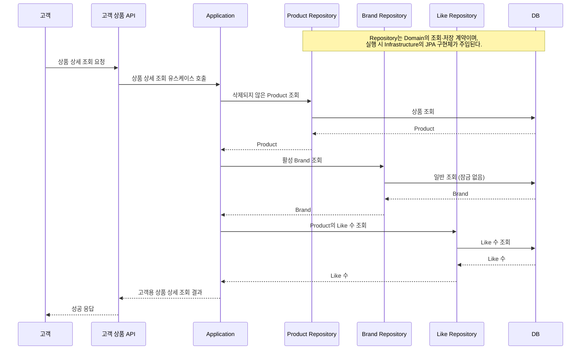

# 고객 상품 상세 조회

고객의 상품 상세 조회 결과를 Application에서 조합하는 책임을 정리한다. HTTP 요청·응답 계약은 [API 계약](../api-contracts.md), 도메인 규칙은 [도메인 모델](../domain-model.md)을 기준으로 한다.

## 조회 흐름

고객이 활성 상품·브랜드 정보와 좋아요 수를 확인하는 흐름이다.

## 결과 조합 책임

상품 상세 조회는 각 도메인의 조회 결과를 Application에서 조합한다.

| 단계 | 담당 | 결과 |
| --- | --- | --- |
| 상품 조회 | `ProductRepository` | `Product` |
| 브랜드 조회 | `BrandRepository` | `Brand` |
| 좋아요 수 조회 | `LikeRepository` | 좋아요 수 |
| 결과 조합 | `ProductFacade` | `CustomerProductInfo` |
| API 응답 변환 | interfaces | 응답 DTO |

`ProductFacade`는 활성 `Product`와 `Brand`, 해당 상품의 좋아요 수로 `CustomerProductInfo`를 만든다. interfaces 계층은 이를 API 응답 DTO로 변환한다.

각 도메인 모델은 자신의 상태와 규칙을 맡고, Repository는 해당 도메인의 조회·저장 계약을 제공한다. 고객 응답에 필요한 조합은 Application에 두므로, 응답 필드가 바뀌면 `CustomerProductInfo`와 응답 DTO를 갱신한다. 브랜드 로고처럼 Brand 자체의 상태를 추가할 때는 Brand 모델도 함께 변경한다.

여러 Repository를 호출하고 Application에서 결과를 조합하는 비용을 감수한다.
