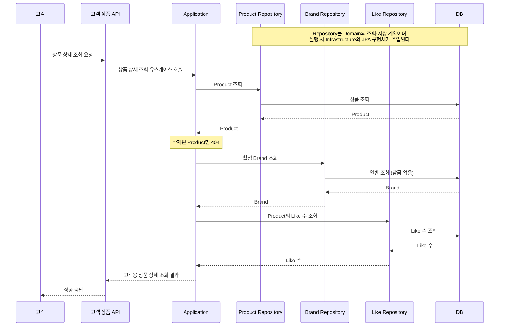

# 고객 상품 상세 조회

고객의 상품 상세 조회 결과를 Application에서 조합하는 책임을 정리한다. HTTP 요청·응답 계약은 [API 계약](../api-contracts.md), 도메인 규칙은 [도메인 모델](../domain-model.md)을 기준으로 한다.

## 조회 흐름

고객이 활성 상품·브랜드 정보와 좋아요 수를 확인하는 흐름이다.

## 결과 조합 책임

| 단계 | 담당 | 결과 |
| --- | --- | --- |
| 상품 조회 | `ProductRepository` | `Product` |
| 브랜드 조회 | `BrandRepository` | `Brand` |
| 좋아요 수 조회 | `LikeRepository` | 좋아요 수 |
| 결과 조합 | `ProductFacade` | `CustomerProductInfo` |
| API 응답 변환 | interfaces | 응답 DTO |

`ProductFacade`가 활성 `Product`·`Brand`와 좋아요 수로 `CustomerProductInfo`를 만들고, interfaces가 응답 DTO로 변환한다. 도메인 모델은 자기 상태와 규칙을, Repository는 해당 도메인의 조회·저장 계약을 맡는다. 여러 Repository 호출과 조합 비용을 감수하는 대신 응답 필드 변경은 `CustomerProductInfo`와 응답 DTO에서 끝나고, 브랜드 로고처럼 Brand 자체 상태를 추가할 때만 Brand 모델을 함께 바꾼다. `CustomerProductInfo`는 목록·내 좋아요와 공유하고 목록 캐시에 그대로 저장되므로, 필드를 바꾸면 [상품 목록 캐시](product-list-cache.md#키-설계)의 저장 형식 버전도 올린다.
