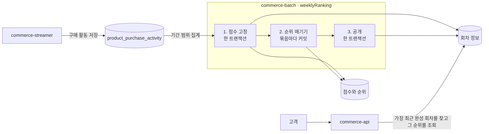
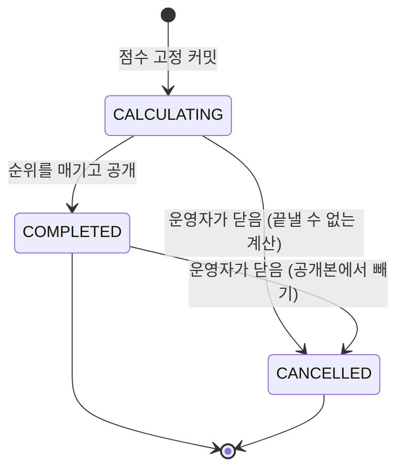

# 주간 구매 랭킹

> 상태: 구현했다. 실행 결과는 [검증 기록의 실행 결과](weekly-ranking-verification.md#실행-결과)에 있다. 이 문서는 기술과 무관한 계약과 규칙을 다룬다. 결정의 맥락과 대안은 [결정 기록](weekly-ranking-decisions.md), Spring Batch 구현은 [주간 랭킹 Job 설계](../../../apps/commerce-batch/docs/weekly-ranking-job.md), API 구현은 [주간 랭킹 조회 설계](../../../apps/commerce-api/docs/weekly-ranking-query.md), 검증 시나리오는 [검증 기록](weekly-ranking-verification.md)을 따른다.

주간 구매 랭킹은 한 주 동안 확정된 상품 구매 수량을 상품별로 더해 순위를 매기고, 계산이 끝난 완성본만 고객에게 보여 주는 기능이다. 입력은 `commerce-streamer`가 저장한 상품 구매 활동이고, 계산은 `commerce-batch`, 조회는 `commerce-api`가 맡는다. 한 주의 한 번 계산(회차)은 세 단계로 한다. 점수를 한 트랜잭션에서 한 번에 고정하고, 고정한 점수로 순위를 매기고, 순위를 확인해 공개한다. 고정한 점수와 공개한 순위는 바꾸지 않는다.

## 범위와 용어

| 용어 | 뜻 |
|---|---|
| 기간 | UTC 월요일 00:00부터 다음 월요일 00:00 전까지의 한 주. `periodStart`는 그 월요일의 날짜, `periodEnd`는 다음 월요일의 날짜다. |
| 점수 | 그 기간에 확정된 상품별 구매 수량의 합. 정수다. 원본 수량은 `INT`라 합이 그 범위를 넘을 수 있으므로 64비트 정수로 저장한다. |
| 회차(revision) | 같은 기간의 몇 번째 계산인지. 1부터 시작하고 1씩 올린다. 한 회차의 점수는 계산하는 순간의 구매 활동으로 한 번에 고정되고, 그 뒤로 바뀌지 않는다. 순위는 고정한 점수로 매긴다. 과제가 말하는 snapshot은 이 설계에서 회차 하나의 고정된 점수다. |
| 회차 정보 | 회차마다 한 행. 상태, 계산 시각, 결과 checksum, 점수를 고정한 실행 ID를 담는다. |
| 계산 시각 | 회차의 점수를 고정한 직후에 읽은 시각. 이 시각 뒤에 도착한 구매는 그 회차에 들어 있지 않다. |
| 공개본 | 그 기간에서 완성(`COMPLETED`)된 회차 중 번호가 가장 큰 회차의 순위. |

쿠폰 발급, 조회수, 좋아요는 점수에 섞지 않는다. 실시간 랭킹과 새 분석 이벤트는 범위 밖이다.

## 요구사항

### 기능 요구사항

| ID | 요구사항 | 수용 기준 |
|---|---|---|
| FR-01 | 구매 활동은 확정 시각(`confirmedAt`, 주문의 최초 확정 시각)으로 기간에 속한다. 시작은 포함하고 끝은 제외한다. | 월요일 00:00:00.000000Z 확정은 그 주, 다음 월요일 00:00:00.000000Z 확정은 다음 주에 들어간다. |
| FR-02 | 점수는 회차의 점수를 고정하는 순간 DB에 있던 그 기간 구매 활동의 상품별 수량 합이다. 논리 삭제된 활동은 넣지 않는다. | 한 주문의 여러 품목이 모두 들어가고, 같은 `(주문, 상품)`은 한 번만 더해진다. 논리 삭제된 활동은 빠진다. |
| FR-03 | 순서는 점수 내림차순, 동점이면 상품 ID 오름차순이다. 계산 순위는 이 순서의 위치(1부터 N)다. | 같은 점수면 순서와 순위가 항상 같다. |
| FR-04 | 한 회차의 점수는 한 트랜잭션에서 한 번에 고정하고, 고정한 뒤로 바꾸지 않는다. 순위는 고정한 점수로만 매긴다. | 점수를 고정한 뒤 도착한 활동은 그 회차에 들어가지 않는다. 점수 고정이 실패하면 아무것도 남지 않는다. |
| FR-05 | 같은 `(기간, 회차)`로 다시 실행하면 같은 작업을 이어서 한다. 고정한 점수는 다시 만들지 않고 끝나지 않은 단계만 이어서 하며, 완성된 회차는 다시 계산하지 않는다. | 순위를 매기다 실패한 회차를 다시 실행하면 고정한 점수로 순위를 처음부터 다시 매기고, 결과는 한 번에 실행한 것과 같다. 완성된 회차의 점수, 순위, 계산 시각, checksum은 바뀌지 않는다. |
| FR-06 | 다시 계산하려면 회차를 올린다. 새 회차는 그 기간의 마지막 회차 + 1이어야 하고, 그 기간에 계산 중인 회차가 없어야 한다. | 이전 회차의 점수와 순위는 바뀌지 않는다. 회차를 건너뛰거나 되돌릴 수 없다. |
| FR-07 | 완성된 회차만 공개한다. 점수를 고정했지만 순위를 매기는 중이거나 실패한 회차는 공개하지 않는다. | 순위가 덜 매겨진 회차가 응답에 나오지 않는다. 그동안 이전 완성 회차가 그대로 보인다. |
| FR-08 | `GET /api/v1/rankings/weekly?periodStart=…&limit=…`로 요청한 기간의 공개본을 조회한다. | 완성된 회차가 없으면 `NOT_PUBLISHED`, 구매가 없던 완성 회차면 `PUBLISHED`와 빈 목록을 준다. 다른 기간의 결과로 대신하지 않는다. |
| FR-09 | 삭제된 상품은 조회할 때 제외하고, 저장된 계산 순위는 그대로 준다. | 제외된 상품 때문에 1위, 3위처럼 간격이 생길 수 있다. 제외한 뒤 `limit`을 적용한다. |
| FR-10 | 운영자는 계산 중이거나 완성된 회차를 닫을 수 있다(`CANCELLED`). 닫은 회차는 다시 계산하지 않고 공개하지 않는다. | 완성 회차를 닫으면 남은 완성 회차 중 가장 큰 회차가 공개본이 되고, 남은 것이 없으면 `NOT_PUBLISHED`다. 계산 중 회차를 닫으면 그 기간의 다음 회차를 시작할 수 있다. |

### 비기능 요구사항

| ID | 요구사항 | 검증 기준 |
|---|---|---|
| NFR-01 · 결정성 | 같은 구매 활동으로 계산하면 언제 계산해도 같은 점수, 순위, 결과 checksum을 만든다. | 정상 실행과 실패 뒤 다시 실행이 같은 기대 checksum과 기대 점수·순위를 만든다. |
| NFR-02 · 멱등성 | 같은 `(기간, 회차)`를 다시 실행해도 결과가 늘거나 바뀌지 않는다. | 순위는 다시 실행할 때마다 처음부터 매기고 절대값으로 쓰므로 같은 값이 된다. 완성된 회차를 다시 실행하면 아무것도 쓰지 않는다. |
| NFR-03 · 원본 영향 | 계산이 구매 활동 저장을 막지 않는다. | 점수를 고정하는 중에도 streamer의 구매 활동 저장이 잠금을 기다리지 않는다. |
| NFR-04 · 보존 | 과거 구매 활동, 회차 정보, 점수와 순위 행을 지우지 않는다. 닫은 회차도 지우지 않는다. | 새 회차를 계산하거나 회차를 닫아도 이전 회차의 행이 남는다. |

## 처리 구조 한눈에 보기



**구매 활동의 원본은 streamer가 쓴다. 배치는 회차마다 그 순간의 구매 활동으로 점수를 고정하고, 그 점수로 순위를 매겨 공개한다. API는 가장 최근에 완성된 회차만 읽는다.**

## 테이블 소유권

세 앱이 같은 MySQL을 쓴다. 테이블을 쓰는 앱이 주인이고, 다른 앱은 아래 표에 적은 테이블만 읽는다.

| 테이블 | 쓰는 앱 | 읽는 앱 |
|---|---|---|
| `product_purchase_activity` | `commerce-streamer` | `commerce-batch` (점수 고정) |
| `weekly_ranking_revisions`, `weekly_ranking_scores` | `commerce-batch` | `commerce-api` (완성 회차의 정보와 순위) |
| 상품, 브랜드 | `commerce-api` | 다른 앱은 읽지 않는다. 랭킹 조회의 공개 조건과 표시 정보는 `commerce-api`가 자기 테이블에서 읽는다 |

읽는 앱은 주인의 테이블에 쓰지 않는다. 테이블 구조를 바꿀 때는 읽는 앱의 매핑도 함께 확인한다.

## 데이터 모델

| 저장 단위 | 테이블 | 주요 값 | 유일성과 제약 |
|---|---|---|---|
| 회차 정보 | `weekly_ranking_revisions` | `period_start`, `revision`, 상태, 계산 시각, 결과 checksum, 점수를 고정한 실행 ID, 닫은 시각, 닫은 사유 | `(period_start, revision)` 기본키. 상태는 `CALCULATING`, `COMPLETED`, `CANCELLED`. 점수를 고정할 때 `CALCULATING`으로 만들고, 공개할 때 결과 checksum을 채워 `COMPLETED`로 바꾼다. |
| 점수와 순위 | `weekly_ranking_scores` | `period_start`, `revision`, 상품 ID, 점수, 계산 순위 | `(period_start, revision, product_id)` 기본키, `(period_start, revision, rank_no)` 유일. 점수는 0보다 크다. 계산 순위는 순위를 매기기 전까지 비어 있다. |

두 테이블 사이에 FK를 두지 않는다. 점수 고정 트랜잭션에서 함께 만들기 때문이다. 원본 `product_purchase_activity`에는 기간 범위로 읽기 위한 `confirmed_at` 인덱스를 추가한다. 스키마 SQL과 전환 순서는 [영속성 매핑 설계](../persistence-mapping.md#저장-모델과-데이터-전환)를 따른다.

## 기간과 시각

- 기간은 UTC로 자른다. `Asia/Seoul` 기준으로는 월요일 09:00에 주가 바뀌므로, 한국 시간 월요일 00:00~09:00의 구매는 지난주에 들어간다. 이 점을 API 계약에도 적는다.
- 시간대는 코드 한 곳의 값으로 두고, JVM 기본 시간대에 기대지 않는다. 앱과 테스트 모두 기본 시간대가 `Asia/Seoul`로 설정돼 있어, 기본 시간대로 날짜를 계산하면 한국 시간으로 잘린다.
- DB의 시각 컬럼에는 UTC 기준 날짜·시각이 들어 있다. 읽고 쓸 때 다른 시간대로 바꾸지 않는다.
- 현재 시각은 주입한 시계에서 읽고, 순간은 UTC로 저장한다. `commerce-api`의 업무 시각 규칙을 `commerce-batch`에도 적용한다.

## 실행 식별과 상태

- 작업은 `(periodStart, revision)`으로 식별한다. 실행 시각이나 실행 번호처럼 매번 달라지는 값을 식별값에 넣지 않는다.
- 식별값은 정해진 한 가지 모양으로만 받는다. `periodStart`는 `yyyy-MM-dd` 형식의 월요일, `revision`은 0으로 시작하지 않는 양의 정수다. `1`과 `01`처럼 같은 뜻의 다른 모양이 서로 다른 작업이 되지 않게 하기 위해서다. 모양이 다르거나 모르는 값이 오면 실행을 시작하지 않는다.
- 같은 식별값으로 다시 실행하면 같은 작업을 이어서 한다. 점수가 이미 고정돼 있으면 다시 만들지 않고, 끝나지 않은 단계만 이어서 한다. 완성된 회차는 다시 계산하지 않는다. 실행 기록이 완료로 남아 있으면 실행 자체를 거절하고, 계산은 끝났는데 실행 기록이 완료로 남지 않았으면 아무것도 쓰지 않고 성공으로 끝낸다. 점수 고정이 실패했으면 남긴 것이 없으므로 처음부터 계산한다.
- 회차를 올리면 재계산이다. 새 회차는 그 순간의 구매 활동으로 점수를 고정하고, 이전 회차는 그대로 남는다.



`CALCULATING` 회차는 순위가 덜 매겨졌을 수 있으므로 공개하지 않는다. 공개 여부는 상태로 두지 않는다. 공개본은 그 기간에서 `COMPLETED`인 회차 중 번호가 가장 큰 회차다.

### 같은 기간의 계산은 하나씩

점수 고정은 같은 트랜잭션 안에서 다음을 확인한다.

| 확인 | 결과 |
|---|---|
| 이 회차의 정보가 이미 있고 `CALCULATING`이다 | 고정한 점수를 그대로 쓴다. 아무것도 쓰지 않고 다음 단계로 간다 |
| 이 회차의 정보가 이미 있고 `COMPLETED`다 | 아무것도 쓰지 않고 성공 |
| 이 회차의 정보가 이미 있고 `CANCELLED`다 | 실패. 닫은 회차는 다시 계산하지 않는다 |
| 이 회차의 정보가 없으면, 회차가 그 기간의 마지막 회차 + 1이다. 닫은 회차도 번호에 포함한다. 첫 계산은 1이다 | 실패. 회차를 건너뛰거나 되돌릴 수 없다 |
| 이 회차의 정보가 없으면, 그 기간에 `CALCULATING` 회차가 없다 | 실패. 계산 중인 회차를 끝내거나 닫은 뒤 시작한다 |

회차 2가 계산 중이면 회차 3은 시작하지 않는다. 회차 2의 점수 고정이 커밋 전이면 마지막 회차가 1로 보여 회차 번호 확인에서 거절되고, 커밋한 뒤면 계산 중 회차 확인에서 거절된다. 같은 회차를 두 실행이 함께 시작하면 같은 식별값이라 실행 기록이 막고, 둘 다 끝까지 가더라도 늦은 쪽은 기본키 충돌로 실패한다.

## 회차 계산 규칙

### 1. 점수 고정

한 트랜잭션이다. 원본 구매 활동을 잠그지 않는다.

1. 위의 확인을 한다.
2. 그 기간의 원본에 수량이 0 이하인 구매 활동이 있는지 본다. 있으면 실패한다.
3. 그 기간의 구매 활동을 상품별로 더해 점수를 내고 한 문장으로 넣는다. 계산 순위는 비워 둔다.
4. 넣은 직후 현재 시각을 읽어 계산 시각으로 쓴다. 넣기 전에 읽으면 그 시각과 넣기 사이에 도착한 구매가 점수에 들어가 "이 시각 뒤에 도착한 구매는 없다"는 약속이 깨진다.
5. 회차 정보를 `CALCULATING`으로, 계산 시각, 이 실행의 ID와 함께 넣는다.
6. 커밋한다. 커밋하는 순간 이 회차의 점수가 고정된다.

2와 3은 논리 삭제된 구매 활동을 보지 않는다. `max(id)` 같은 값으로 읽기 경계를 정하지 않는다. ID는 저장할 때 받지만 보이는 순서는 커밋 순서라, 같은 경계로 나중에 다시 읽으면 늦게 커밋된 행이 끼어든다. 경계는 한 문장의 일관된 읽기가 정한다.

### 2. 순위 매기기

- 시작할 때 그 회차의 순위를 모두 비운다.
- 고정한 점수를 FR-03의 순서(점수 내림차순, 상품 ID 오름차순)로 처음부터 읽어, 읽은 순번을 계산 순위로 쓴다. 순위는 절대값으로 쓴다.
- 일정한 수의 상품을 묶어 묶음마다 커밋한다. 실패하면 그 묶음만 되돌아간다. 다시 실행하면 이어 가지 않고, 순위를 비운 뒤 처음부터 다시 매긴다. 그래서 한 회차의 순위는 한 번의 실행이 모두 매긴다.
- `CALCULATING`인 회차의 점수만 읽고, 그 회차에만 쓴다. 완성되거나 닫힌 회차는 읽을 것이 없어 아무것도 쓰지 않는다. 순위를 매기는 사이 회차가 닫히면 닫힌 회차의 행은 더 바뀌지 않는다. 묶음 사이에 닫히면 다음 묶음이 읽을 행이 없어 순위 단계가 끝나고, 묶음을 읽은 뒤 쓰기 전에 닫히면 그 묶음의 쓰기가 실패한다. 어느 쪽이든 공개 단계가 닫은 회차라 실패한다.
- 원본 구매 활동을 다시 읽지 않는다. 점수를 고정한 뒤 도착한 구매는 순위에 영향을 주지 않는다.

### 3. 공개

한 트랜잭션이다.

1. 회차가 `CALCULATING`인지 본다. `COMPLETED`면 아무것도 쓰지 않고 성공하고, `CANCELLED`면 실패한다.
2. 고정한 점수마다 계산 순위가 있고, 순위가 1부터 상품 수까지 빠짐없이 이어지는지 확인한다. 어기면 실패한다.
3. 순위로 결과 checksum을 만든다.
4. 회차를 `COMPLETED`로 바꾸고 결과 checksum을 채운다. `CALCULATING` 조건을 붙여 바꾼다.
5. 커밋한다. 커밋하는 순간 이 회차가 그 기간의 공개본이 된다.

구매가 0건인 기간도 같은 규칙으로 완성된다. 점수는 0행이고 순위 단계는 읽을 것이 없으며, 결과 checksum은 빈 문자열의 SHA-256이다.

## checksum

checksum은 같은 결과인지 확인하는 값이다. 맞는 결과인지는 기대 점수, 순위와 함께 비교해 확인한다.

| 정렬 | 한 줄 | 계산 시점 |
|---|---|---|
| 계산 순위 오름차순 | `productId TAB score TAB rank` + LF | 공개, 커밋 전 |

- 마지막 줄 뒤에도 LF를 붙이고, 모든 줄을 이은 문자열의 SHA-256을 16진수 소문자로 기록한다. 0건이면 빈 문자열의 SHA-256이다.
- 기간, 회차, 실행 ID, 실행 시각, 계산 시각은 넣지 않는다. 실행 정보는 회차 정보에 소속 기록으로 따로 남긴다.
- 입력 checksum은 두지 않는다. 원본을 복사하지 않으므로 다시 셀 고정 입력이 없다.

## 조회 계약

`GET /api/v1/rankings/weekly?periodStart=2026-08-17&limit=10`

| 입력 | 규칙 | 어기면 |
|---|---|---|
| `periodStart` | 필수. `yyyy-MM-dd` 형식의 월요일 | `400 Bad Request` |
| `limit` | 선택. 기본 10, 1~100 | `400 Bad Request` |

아직 오지 않은 주의 월요일은 오류가 아니라 `NOT_PUBLISHED`다. 응답은 기존 `ApiResponse`의 `data`에 담고, 두 상태 모두 `200 OK`다.

```json
{
  "status": "PUBLISHED",
  "periodStart": "2026-08-17",
  "periodEnd": "2026-08-24",
  "revision": 1,
  "calculatedAt": "2026-08-24T06:00:00Z",
  "items": [
    { "rank": 1, "productId": 7, "productName": "…", "brandId": 3, "brandName": "…", "price": 12000, "score": 5 },
    { "rank": 3, "productId": 8, "productName": "…", "brandId": 5, "brandName": "…", "price": 8000, "score": 1 }
  ]
}
```

| 값 | 뜻 |
|---|---|
| `status` | `PUBLISHED` 또는 `NOT_PUBLISHED`. `NOT_PUBLISHED`면 `revision`, `calculatedAt`은 `null`, `items`는 빈 목록이다. |
| `periodEnd` | 다음 월요일. 그날은 기간에 포함하지 않는다. |
| `revision` | 공개본인 회차 번호 |
| `calculatedAt` | 그 회차의 계산 시각. 이 시각 뒤에 도착한 구매는 이 결과에 들어 있지 않다. |
| `items[].rank` | 저장된 계산 순위. 제외된 상품 때문에 간격이 생길 수 있다. 화면에 위치 번호를 붙일지는 클라이언트가 정한다. |
| `items[].score` | 그 기간 구매 수량의 합 |
| 상품 표시 정보 | 현재 상품 정보. 기존 고객 상품 조회의 공개 조건과 표시 규칙을 따른다. |

- 두 번 나눠 읽는다. 먼저 그 기간에서 가장 최근에 완성된 회차를 찾고, 있으면 그 회차의 순위와 상품 정보를 읽는다. 완성된 회차의 점수와 순위 행은 바뀌지 않으므로, 두 조회 사이에 새 회차가 완성돼도 이 요청은 처음 찾은 회차를 끝까지 온전하게 보여 준다. 순위가 0행이거나 상품이 모두 제외돼도 회차 정보가 남아 `PUBLISHED`와 `NOT_PUBLISHED`가 구분된다.
- 공개 조건으로 상품을 거른 뒤 계산 순위 순서로 `limit`만큼 자른다.
- 다른 기간의 결과를 요청한 기간의 결과로 주지 않는다.

계층 구성, 쿼리, 응답 만들기는 [주간 랭킹 조회 설계](../../../apps/commerce-api/docs/weekly-ranking-query.md)를 따른다.

## 늦은 구매와 재계산

- 정기 실행은 기간이 끝나고 일정 시간이 지난 뒤 회차 1로 한 번 계산해 공개하고, 그 결과를 최종으로 본다. 기다리는 시간은 실행을 띄우는 스케줄러의 설정이며 아직 정하지 않았다.
- 점수를 고정한 뒤에 도착한 같은 기간의 구매는 그 회차에 들어가지 않는다. 응답의 `calculatedAt`이 그 기준 시점이다. 구매가 도착한 주의 점수에 더하지도 않는다.
- 늦은 구매를 넣어야 할 때는 회차를 올려 명시적으로 재계산한다. 새 회차가 완성되기 전까지 이전 회차가 보인다.
- 순위를 매기거나 공개하다 실패해 같은 식별값으로 다시 실행하면, 점수 고정은 건너뛰고 고정한 점수로 끝낸다. 그사이 도착한 구매는 들어가지 않는다.
- 점수 고정 자체가 실패해 다시 실행하면, 남은 것이 없으므로 그 순간의 구매 활동으로 처음부터 계산한다.

## 잘못된 입력

- 입력은 streamer가 수량 양수를 검사해 저장한 내부 사실이다. 이상한 값은 앞 단계가 깨졌다는 신호로 보고 건너뛰지 않는다.
- 점수 고정은 점수를 넣기 전에 그 기간 원본에 수량 0 이하인 행이 있는지 보고, 있으면 실패해 아무것도 남기지 않는다. 합계로 보면 정상 행 사이에 섞인 0을 놓치므로 행 단위로 본다. 원본의 주인인 streamer 쪽에서 그 활동의 수량을 고치거나 논리 삭제한 뒤 같은 식별값으로 다시 실행한다.
- 결과 쪽은 DB 제약과 공개 전 확인이 막는다. 같은 회차 안에서 계산 순위가 겹치거나 점수가 0 이하면 쓰기가 실패하고 그 트랜잭션이 취소된다. 순위가 비거나 끊긴 회차는 공개하지 않는다.

## 실패 뒤 운영 절차

실패한 뒤 사람이 확인하고 처리하는 일을 모은다. 이 판단은 자동으로 하지 않는다. 계산은 실패한 자리에서 스스로 다시 시도하지 않고 건너뛰지도 않는다. 다시 시도는 같은 식별값으로 다시 실행하는 것이고, 다시 실행은 몇 번을 해도 결과가 같다. 자동으로 다시 띄울지는 실행을 띄우는 스케줄러가 정한다.

### 결과와 실행 기록이 어긋날 때

점수 고정, 순위 묶음, 공개의 커밋과 배치 실행 기록의 저장은 따로 일어난다. 실행 기록만 보고 판단하지 않고 회차 정보를 먼저 본다.

| 회차 정보 | 실행 기록 | 실제 상황 | 할 일 |
|---|---|---|---|
| `COMPLETED` | 완료 | 정상 | 없음 |
| 없음 | 실패 | 점수 고정이 커밋 전에 실패 | 원인을 고친 뒤 같은 식별값으로 다시 실행한다. 처음부터 계산한다 |
| `CALCULATING` | 실패 | 점수는 고정됐고 순위나 공개에서 실패 | 원인을 고친 뒤 같은 식별값으로 다시 실행한다. 고정한 점수로 순위를 처음부터 다시 매겨 끝낸다 |
| `COMPLETED` | 실패 | 공개는 커밋됐고 기록만 실패 | 되돌리지 않는다. 같은 식별값으로 다시 실행하면 아무것도 쓰지 않고 완료로 기록된다 |
| 무엇이든 | 결과 불명 또는 실행 중으로 남음 | 기록 저장 중 실패, 프로세스 강제 종료 | 같은 식별값으로 바로 다시 실행할 수 없다. 실행이 정말 끝났는지 확인한 뒤 끝나지 않은 실행 기록만 실패로 정리하고 다시 실행한다 |

### 회차 닫기

운영자는 두 경우에 회차를 닫는다.

- 계산 중인 회차를 끝낼 수 없을 때: 원인을 고쳐도 순위나 공개가 계속 실패하거나, 고정한 점수가 바뀐 점수 규칙과 맞지 않아 그대로 공개하면 안 될 때.
- 완성된 회차를 공개본에서 빼야 할 때: 계산 결과에 문제가 있어 이전 회차로 되돌릴 때.

1. 원인을 확인하고 기록한다. 코드 결함이면 먼저 고친다.
2. `CALCULATING`이나 `COMPLETED`인 그 회차를 `CANCELLED`로 바꾸고, 닫은 시각과 사유를 기록한다. 상태 조건을 붙여 바꾼다.
3. 완성 회차를 닫았으면 남은 완성 회차 중 가장 큰 회차가 공개본이 된다. 새로 계산하려면 다음 회차로 계산한다. 닫은 회차도 번호에 포함한다.

닫은 회차의 행은 지우지 않는다. 닫은 회차를 같은 식별값으로 다시 실행하면 실패한다.

## 불변식 보장 위치

주간 랭킹의 규칙과 불변식은 [도메인 모델](../domain-model.md#weeklyranking)을 기준으로 한다. 아래 표는 각 규칙을 어디서 지키는지 정리한다.

| 규칙 | 최종 보장 위치 |
|---|---|
| 한 회차의 점수는 고정한 뒤 바뀌지 않는다 | 한 트랜잭션 점수 고정, 이미 있는 회차의 점수는 다시 넣지 않는 확인, 수정 경로를 두지 않음 |
| 계산 순위는 고정한 점수로만 매기고, 다시 매겨도 같은 값이 된다 | 순위 단계는 고정한 점수만 읽음, 시작할 때 순위를 비우고 정해진 순서로 처음부터 매김, 절대값 쓰기 |
| 완성된 회차에는 모든 점수의 순위, 계산 시각, 결과 checksum이 있다 | 공개 전 확인, 공개 트랜잭션 |
| 같은 회차의 상품은 하나, 계산 순위는 1부터 이어지고 겹치지 않는다 | `(period_start, revision, product_id)` 기본키, `(period_start, revision, rank_no)` 유일 제약, 공개 전 확인 |
| 점수는 양수, 원본 수량은 양수 | 점수의 DB 제약, 넣기 전 원본 확인 |
| 같은 기간의 `(기간, 회차)`는 하나, 회차는 1씩 증가 | `(period_start, revision)` 기본키, 점수 고정 트랜잭션 안의 확인 |
| 같은 기간에 계산 중인 회차는 하나 이하 | 점수 고정 트랜잭션 안의 확인 |
| 닫은 회차는 다시 계산하거나 공개하지 않는다 | 점수 고정과 공개의 상태 확인, 순위 단계는 계산 중 회차만 읽고 씀, 조회의 `COMPLETED` 조건 |
| 공개본은 완성된 회차뿐이다 | 조회의 `COMPLETED` 조건 |
| 과거 행을 지우지 않음 | 삭제 경로를 두지 않음 |

## 한계와 확장

- 점수 고정은 한 트랜잭션이다. 데이터가 아주 커져 이 트랜잭션이 너무 길어지면, 입력을 따로 고정해 나눠 계산하는 구조로 바꿔야 한다. 지금 규모에서는 한 문장이 충분하다(로컬에서 구매 100만 건, 상품 1,000개를 0.3초 안에 계산했다. 운영 수치가 아니다).
- 회차에는 상품별 점수만 남고, 들어간 주문 목록은 남지 않는다. 어떤 구매가 그 회차에 들어갔는지는 계산 시각과 기간으로 추정할 수 있을 뿐 주문 단위로 정확히 되짚을 수 없다. 랭킹을 보상이나 정산에 쓰게 되면 입력을 회차마다 복사해 두는 구조로 바꾼다.
- 원본 확인과 점수 넣기 사이에 잘못된 행이 새로 들어오면 놓친다. streamer가 수량을 검사해 저장하므로 이상 신호를 보는 수준의 확인이다.
- 점수 고정이 실패한 뒤 다시 실행하면 그 순간의 구매 활동으로 계산한다. 실패와 다시 실행 사이에 도착한 구매도 들어간다.
- 순위 단계는 실패하면 처음부터 다시 한다. 상품 1,000개에 밀리초 단위라 지금은 이어 갈 이득이 없다. 상품이 아주 많아져 순위 단계가 길어지면 저장한 위치부터 이어 가는 방식을 다시 검토한다.
- 계산 규칙 버전은 두지 않는다. 순위는 다시 실행할 때마다 처음부터 매기므로 한 회차 안에서 순위 규칙이 섞이지 않는다. 점수는 고정할 때의 규칙을 따르므로, 점수 규칙을 바꾸는 배포 전에 고정한 계산 중 회차는 옛 규칙의 점수로 끝난다.
- 동점은 상품 ID로만 가른다. 의미 있는 2차 기준으로 좋아요 수를 쓸 수 있지만, 좋아요는 계속 바뀌는 값이라 점수를 고정할 때 함께 고정해야 한다. 필요해지면 그때 넣는다.
- 계산 순위는 상품마다 다른 번호다. 동점이 많아져 공동 순위가 필요해지면 정책을 다시 정한다.
- 조회는 회차 정보와 순위를 두 번 나눠 읽으므로, 그사이 닫힌 회차를 그 요청 한 번은 보여 줄 수 있다. 다음 요청부터는 빠진다.
- 늦은 구매를 자동으로 감지해 재계산하지 않는다. 확장으로 남긴다.
- 잡은 실행 시각을 검사하지 않는다. 진행 중인 기간을 계산하면 그 뒤의 구매는 모두 늦은 구매가 된다. 언제 실행할지는 스케줄러가 정한다.
- 회차를 닫는 일과, 결과 불명이나 실행 중으로 남은 실행 기록을 정리하는 일은 사람이 한다. 자동으로 판단하지 않는다.

## 관련 결정 기록

결정별 맥락, 대안, 근거, 영향은 [주간 랭킹 결정 기록](weekly-ranking-decisions.md)에 정리했다. 이 문서에는 선택된 계약과 규칙을 유지한다.

## 범위 밖

실시간 랭킹, Redis 랭킹, 새 분석 이벤트, 주문 취소·환불의 점수 반영, 랭킹 관리 화면, 페이지 넘김은 이번 범위에서 제외한다.
