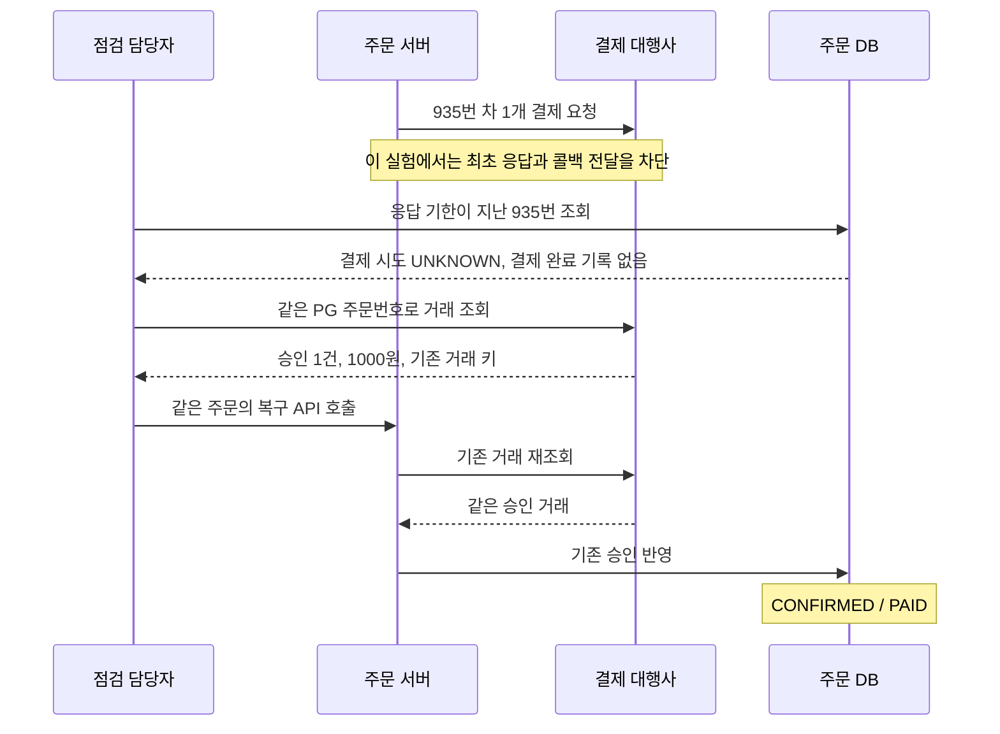
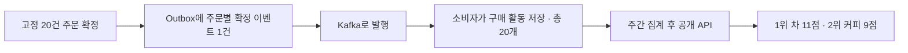

# 둘 다 `UNKNOWN`인데 왜 935번은 복구하고 2번은 기다렸을까?

저장소를 내려받아 브라우저에서 여는 [학습 슬라이드와 미니 실습](learning/observability-workbook.html) · [장애 대응 런북](../runbook/week10.md)

2026년 11월 27일, 로컬 쇼핑몰에서 1,000명이 상품을 탐색하던 중 Grafana의 **미확인 주문이 0건에서 3건으로** 올랐다. 사용자가 결제를 요청했고, 우리 서버는 정해진 시간 안에 결과를 받지 못했다. 지금 다시 결제를 요청하면 이미 승인된 금액을 두 번 청구할 수 있다. 먼저 3건 중 차를 주문한 935번을 따라갔다. 시각은 모두 한국 시각이다. [실제 Grafana 화면과 시간 범위](evidence/2026-11-27-catalog/README.md)

## 숫자 3에서 주문 한 건까지

게이지¹에는 주문번호가 없다. 같은 장애 실행의 DB에서 **PG²로 발송을 시작했고, 응답 기한이 지났고, 결제 시도가 여전히 `UNKNOWN`**인 주문을 찾으니 935·947·960번이었다. 실행 로그에서 `orderId=935`를 찾자 같은 결제 시도 키로 두 기록이 나왔다. **15:52:55.039**에 PG 요청 시간이 초과됐고, **15:52:55.041**에 우리 서버가 결과를 모르는 상태로 DB 트랜잭션을 마쳤다. 차 한 개 값 1,000원이 실제로 승인됐는지는 여전히 알 수 없었다. [주문별 DB·로그·PG 원문](evidence/2026-11-27-catalog/incident/incident-comparison.json)

PG가 여전히 처리 중이라면 같은 거래를 조회했을 때 `PENDING`일 수 있다. 15:53:04에 테스트 가맹점 계정에서 `LP-ORD-0000000935`를 조회한 결과는 **총 1건, 1,000원, 최종 `SUCCESS`**였다. 최초 응답과 콜백을 끊도록 설정한 실험 조건에도 맞았다. 다른 가능한 원인인 ‘성공 응답을 받았는데 DB 저장이 실패했다’를 판정하려면 그 성공 응답과 뒤이은 롤백 기록이 필요하다. 여기서 확인한 로그는 최초 호출의 시간 초과와 `UNKNOWN` 커밋이었다. [장애 설정과 증거 수집 방법](control/incident.py)

## 결정을 바꾼 것은 PG 거래 내역이었다

| 주문 | 우리 DB와 실행 로그 | PG 주문번호로 조회한 결과 | 선택한 조치 |
|---|---|---|---|
| 장애 실행 · 차 935번 | 최초 요청 `TIMEOUT`, 결제 대기 · `UNKNOWN` | 주문번호와 1,000원이 일치하는 거래가 총 1건. 최종 `SUCCESS`, 거래 키 확인 | 주문 소유자의 복구 API로 **기존 승인 반영** |
| 대조 실행 준비 구간 · 물 2번 | 최초 요청 `TRANSPORT_ERROR`, 결제 대기 · `UNKNOWN` | `LP-ORD-0000000002` 조회 결과 **0건**. 승인·거절을 판단할 거래가 없음 | **미확인 유지**. 중단 사유를 남기고 같은 주문번호로 재조회 |

PG 조회가 실패하면 몇 건이 있는지조차 알 수 없다. 물 2번은 조회 결과가 비어 있었던 사례다. 지표에서도 성공적으로 세어 얻은 **0건**과, DB 집계가 실패해 **확인 불가**가 된 표본을 구분한다. [물 2번 원문](evidence/2026-11-27-catalog/control/warmup-order-2.json) · [지표의 실패 표시](adr-0002-payment-metric-refresh.md) · [주문별 복구·중단 결정표](../runbook/week10.md)

15:54:22에 DB와 PG를 새로 읽었다. 935번의 주문은 `CONFIRMED`, 결제 완료 기록은 `PAID` 1,000원이었다. PG에는 복구 전에 본 거래가 여전히 한 건이었고 그 키가 DB에도 저장돼 있었다. 947·960번도 각각 원래 승인으로 확정됐다. 15:54:49까지의 Grafana 화면에서 **장애 실행의 미확인 주문은 다시 0건**이었다. 물 2번은 별도 DB를 쓰는 대조 실행의 주문이라 그 실행에서 계속 추적한다. [복구 API 응답](evidence/2026-11-27-catalog/incident/incident-reconcile.json) · [복구 후 같은 거래 대조](evidence/2026-11-27-catalog/incident/incident-recovery.json)

¹ **게이지**는 현재 건수처럼 올라가고 내려가는 값을 표시하는 지표다. ² **PG**는 결제를 처리하고 거래 결과를 보관하는 결제 대행사다. [업무 지표와 로그의 식별자](adr-0001-payment-observability.md)

## 주문이 확정된 뒤 판매량에도 한 번만 반영됐을까?

이 질문은 주문 수를 고정한 **별도의 20건 통합 실험**으로 확인했다. 처음 10건은 모두 확정됐다. 다음 10건 중 차 주문 **108·109·110번**만 응답이 끊겨, PG에는 10건 모두 승인됐지만 우리 DB에는 7건만 확정됐다. 같은 세 주문을 복구하자 두 번째 집합도 10건 모두 확정됐다. 전체 PG 거래 수는 20건을 유지했다. [20건 연결 테스트](../../apps/commerce-api/src/test/java/com/loopers/application/ordering/facade/TwentyOrderUnknownGaugeIntegrationTest.java)

Outbox는 발행할 이벤트를 주문 확정과 함께 DB에 남기는 테이블이다. 세 주문의 복구 API를 다시 호출하고 보류한 콜백을 전달해도 재고가 더 줄거나 확정 이벤트가 늘지 않았다. Kafka에 같은 메시지 20개를 한 번 더 보낸 뒤에도 세 주문의 구매 수량은 각각 1개였다. [구매 활동 검증](../../apps/commerce-api/src/test/java/com/loopers/application/ordering/facade/PurchaseActivityEvidence.java) · [공개 랭킹 검증](../../apps/commerce-api/src/test/java/com/loopers/application/ordering/facade/WeeklyRankingEvidence.java)

## 어디까지 확인했나

| 범위 | 확인한 근거 | 이번 실험으로 남은 질문 |
|---|---|---|
| 감지·진단 | 20건 실험에서 health는 `UP`일 때도 미확인은 3건. DB 집계 주기 15초, Prometheus 수집 주기 5초. 기한 누락이나 DB 조회 실패는 확인 불가 | 실제 서비스에서 몇 건이 얼마나 지속될 때 알릴지는 관측 기간과 고객 영향을 보고 정해야 한다. |
| 결제·재고·구매·랭킹 | 고정 20건에서 복구 전후 PG 생성 시도와 PG 수신 누계 모두 20회. 재호출·늦은 콜백 이후 차 재고 9개, 주문별 확정 이벤트 1건. 공개 랭킹의 입력은 구매 활동 20건 | 이 주문자의 지갑·포인트 내역·보유 쿠폰은 전후 모두 0건이었다. 기존 잔액·쿠폰을 가진 고객과 실계정 PG의 장애 복구는 별도 검증이 필요하다. |
| 1,000명 쇼핑 부하 | 동일 상대 시각의 정상·장애·복구 각 1분에서 물 주문의 30초 내 확정은 대조·장애 모두 매번 60/60건 | 로컬 대조·장애 각 1회 결과다. 탐색 응답 지연을 차 주문 장애의 효과로 단정하려면 반복 비교가 필요하다. |
| 기존 기능 회귀 | 상품 조회·소유권, 포인트·결제, 이벤트 소비, [쿠폰 동시 발급](../../apps/commerce-api/src/test/java/com/loopers/interfaces/api/coupon/controller/CouponMultiProcessE2ETest.java), [랭킹 배치 재시작](../../apps/commerce-batch/src/test/java/com/loopers/ranking/RankingJobRestartTest.java)을 포함해 당시 로컬 JUnit 보고서 880건에서 실패·오류·건너뜀 0건. ArchUnit 검사 포함, 네 앱의 Checkstyle 보고서에서 위반 0건 | 이 결과는 로컬 테스트에 포함된 계약에 한정된다. |

20건 실험의 단계별 DB·PG 상태, 재전달, 공개 API 응답은 테스트 실행마다 `apps/commerce-api/build/week10/timeout-logs/twenty-orders-*/`에 저장된다. 이 실행에서 저장한 JSON 원문, 미확인 지표 표본과 장애 로그 여섯 줄을 [고정 20건 증거 ZIP](evidence/2026-11-27-twenty-orders.zip)에서 확인할 수 있다. 1,000명 부하 실험의 대시보드와 원장은 별도 보관했다. [부하 실험 재현 방법](load-experiment.md) · [실제 화면·비교 결과·증거 ZIP](evidence/2026-11-27-catalog/README.md)
