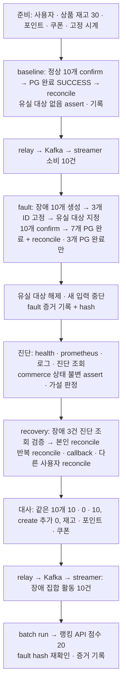

# 10주차 설계: health 가 UP 인 결제 사고를 증거로 가르고, 같은 주문을 추가 결제 없이 복구한다

이 문서는 `docs/week9/design.md` 까지를 기준으로 **10주차에 추가하는 것만** 적는다. 절 번호는 새로 시작하고 결정 번호는 9주차를 이어 D-198부터 쓴다. 결정 번호는 정한 순서대로라 장 순서와 다르다.

## 1. 범위

**PG 는 SUCCESS 인데 생성 응답을 잃어 내부 주문이 UNKNOWN 으로 남는 사고를 로컬에서 재현한다. 관측 신호로 원인을 가르고, W5 의 reconcile 경로로 같은 주문을 create 추가 0회로 복구한 뒤, 그 주문이 Outbox · Kafka · 구매 활동 · 주간 랭킹 API 까지 이어지는지 확인한다.**

| 구분 | 이번 범위 | 범위 밖 |
|---|---|---|
| 추가 | 테스트 PG 의 주문별 응답 유실 제어 · 중복 create 기록(3장), 결제 경계 구조화 로그 · 미종결 결제 gauge(4장), 사고 연결 테스트(5 ~ 7장), 증거 · runbook(8장) | 분산 추적 수집 · backend, 알림, 자동 reconcile 스케줄러, 진단용 관리자 API |
| 유지 | W5 결제 상태 · 전이표 · create 무재시도(D-60), W7 Outbox, W8 쿠폰, W9 주간 랭킹 | |
| 하지 않음 | 실제 카드 · 계정, 외부 PG 장애 주입, 운영 DB 변경, commerce DB 에 상태 직접 쓰기 | |

- 새 제품 기능은 관측(로그 · 지표 · 관리 주소 제한)뿐이다. 사고를 만드는 제어는 테스트 fixture 에만 둔다.
- 복구 경로는 W5 의 `POST /api/v1/orders/{orderId}/payment/reconcile` 그대로다. 새 복구 API 를 만들지 않는다.

## 2. 사고 시나리오와 기대값

### 주문 집합과 단계별 기대값

| 단계 | 대상 주문 | 내부 CONFIRMED | UNKNOWN | PG SUCCESS 거래 | 누적 PG 거래 | 누적 create |
|---|---|---|---|---|---|---|
| baseline | 정상 집합 10개 | 10 | 0 | 10 | 10 | 10 |
| fault | 장애 집합 10개 (정상 집합과 다른 주문) | 7 | 3 | 10 | 20 | 20 |
| recovery | **같은** 장애 집합 10개 | 10 | 0 | 10 | 20 | 20 |

- 분모는 "유효한 PG 결제 요청을 수락한 고정 주문 집합"이다. 입력 오류로 거절된 요청 · 새 주문을 섞어 10을 채우지 않는다.
- 모든 주문은 같은 공개 상품 1개를 수량 1로 담는다. 주문 금액이 같아 대사가 단순하다.
- 상품 재고는 30으로 시작한다. 기대 가용 재고: baseline 뒤 20, fault 뒤 10(UNKNOWN 3건도 예약 유지), recovery 뒤 10(성공 적용 때 추가 차감 없음).
- 주간 랭킹 기대 점수: 그 주 입력이 이 20개 주문뿐이므로 상품 점수 20(baseline 10 + 장애 집합 10).

### 장애 3건은 실제 ID 로 고른다 (D-198)

**장애 집합 10개를 만든 뒤 그중 3개의 `providerOrderId` 를 목록으로 고정하고, fixture 에 그 목록만 응답 유실 대상으로 넘긴다.**

- 생성 순서 · 실행 타이밍의 우연에 기대지 않는다. 목록은 증거(8장)에 그대로 남는다.
- 정상 7건과 장애 3건은 같은 confirm API · 같은 fixture 로 처리된다. 다른 점은 fixture 가 응답을 버리는지뿐이다.

| 검토한 안 | 포기한 이유 |
|---|---|
| 전역 응답 방식(`willDropResponseAfterCreate`)을 3번째 호출 전후로 켜고 끔 | 호출 순서에 기대고, 동시 실행이나 재시도가 끼면 어느 주문이 유실됐는지 테스트 코드만으로 알 수 없다 |
| 주문 ID 를 고정 문자열로 덮어씀 | 실제 생성 ID 와 증거가 어긋나고, 과제가 금지한다 |

## 3. 테스트 PG fixture 변경

### 주문별 응답 유실과 중복 create 기록을 추가한다 (D-199)

**`TestPgServer` 에 "이 `orderId` 목록의 create 는 거래를 저장한 뒤 응답 없이 연결을 끊는다" 제어와, 같은 `orderId` 의 create 수신 횟수 기록을 추가한다.** 기존 응답 방식 · 조회 · 계약은 그대로다.

| 추가 | 동작 |
|---|---|
| `willDropResponseFor(Set<String> orderIds)` · `stopDroppingResponses()` | 목록의 주문만 `ACCEPT_THEN_DROP` 처럼 처리하고, 나머지는 현재 응답 방식을 따른다 |
| `dropTargets()` | 지금 켜진 유실 대상. baseline · recovery 에서 비어 있음을 assert 한다 |
| `createCountOf(orderId)` · `duplicateCreates()` | 같은 주문의 create 수신 수. 2 이상인 주문 목록 |

- **중복 create 를 받아도 거래를 만들고 기록만 한다.** W5 계약(호출자 멱등 키 없음, 중복 제거 없음)을 바꾸지 않는다. 중복이 생기면 거래 수가 늘고 `duplicateCreates()` 가 비지 않아 테스트가 실패한다. 오류로 응답해 두 번째 호출 사실을 지우지 않는다.
- 응답 유실은 연결을 닫는 방식이라 호출자는 timeout 이 아니라 응답 없는 연결 종료를 본다. adapter 는 둘 다 E3(UNKNOWN)로 다룬다(W5 3.3). 로그에는 실제 예외 종류를 남긴다(4장).
- 첫 거래는 PENDING 으로 저장된다. 최종 SUCCESS 는 테스트가 `complete(transactionKey, "SUCCESS")` 로 따로 만든다. 수락(PENDING)과 최종 성공을 구분한다.
- fixture 는 callback 을 보내지 않고, commerce 에 자동 reconcile 스케줄러가 없다(W5 4.2). 그래서 "callback · 자동 조회 보류"는 따로 끌 것이 없다. 테스트는 fault 단계 동안 조회 수가 늘지 않았음을 assert 해 이 전제를 확인한다.

| 검토한 안 | 포기한 이유 |
|---|---|
| 중복 create 를 409 로 거절 | 계약이 바뀌고, 실제 PG 처럼 중복 결제가 생기는 장면을 볼 수 없다 |
| 응답 유실을 지연(timeout)으로 구현 | create read timeout 3초 × 3건만큼 테스트가 느려지고, 결과는 같은 E3 다 |

## 4. 관측

### 질문별 기록

| 질문 | 답하는 기록 | 위치 |
|---|---|---|
| 어떤 주문이 미확인인가 | `payment` 의 `order_id` · `attempt_key` · `status` · `updated_at` | DB 상태 |
| 미확인이 얼마나 쌓였나 | `commerce.payment.unresolved{status}` | 지표 (D-201) |
| PG 에 거래가 생겼나 | 같은 계정 · 주문 · 금액의 거래 키 · 최종 상태 · create 수 | 진단 조회 (D-204) · fixture 기록 |
| 어디서 결과를 잃었나 | create 결과 로그(사건 · 예외 종류), 결과 적용 로그(적용 / rollback) | 구조화 로그 (D-200) |
| 이후 업무는 어디까지 갔나 | Outbox 상태 · eventId, 구매 활동, snapshot · 공개 상태 | DB 상태 · 기존 로그 |

### 결제 경계에 구조화 로그를 남긴다 (D-200)

**PG create 결과 · PG 조회 결과 · 결과 적용 성공 · 결과 적용 실패를 각각 한 줄로 남긴다.** 필드는 `key=value` 형식으로 기존 로그(`OrderOutboxRelay`)와 맞춘다.

| 로그 | 위치 | 필드 |
|---|---|---|
| `PG 생성 결과` | `TestPgPaymentGateway.create` | providerOrderId, amount, result(`ACCEPTED` · `REJECTED` · `UNKNOWN`), transactionKey(있으면), cause(UNKNOWN 일 때 예외 클래스 또는 `status=…`) |
| `PG 조회 결과` | `TestPgPaymentGateway.findByProviderOrderId` | providerOrderId, count, transactions(키:상태:금액), 또는 `UNAVAILABLE` + cause |
| `결제 결과 적용` | `OrderPaymentFacade` (TX B commit 뒤) | orderId, paymentId, providerOrderId, source(`CREATE` · `LOOKUP`), before → after 상태, reservation 효과 |
| `결제 결과 적용 실패` | `OrderPaymentFacade` (TX B 예외) | orderId, providerOrderId, source, 예외 클래스. 예외는 다시 던진다 |

- **카드 번호 · 카드 종류 · 사용자 ID · 인증 헤더는 남기지 않는다.** 주문 · 결제 · 외부 거래 식별자는 합성 값이다.
- create 예외는 지금 `catch (RuntimeException e) → Unknown()` 에서 원인을 버린다. 원인을 도메인 결과 타입에 싣지 않고 adapter 로그에만 남긴다. 상태 전이는 원인과 관계없이 E3 하나라서다.
- 적용 성공 로그는 TX B 의 `Applied` 를 받은 facade 에서 남긴다. TX 안에서 남기면 rollback 된 적용도 "적용함"으로 찍힌다.
- 로그의 `traceId` 는 기존 logging 모듈(brave bridge)이 붙이는 요청 문맥이다. reconcile 은 다른 요청이라 traceId 가 다르다. 같은 업무는 `orderId` · `providerOrderId` 로 잇는다. 분산 추적을 구현했다고 쓰지 않는다.

| 검토한 안 | 포기한 이유 |
|---|---|
| `PaymentCreateResult.Unknown` 에 원인 필드 추가 | 도메인 전이에 쓰지 않는 정보가 도메인 타입에 들어가고, 기존 테스트 · 전이표 매칭을 함께 바꿔야 한다 |
| `PaymentService.apply` 안에서 적용 로그 | 같은 TX 안이라 commit 여부를 모른다. 가설 3(적용 실패)을 가를 수 없다 |
| 결제 사건 테이블(append-only) | 진단에는 충분하지만 테이블 · 보존 정책이 늘어난다. 이번 실험은 로그와 현재 상태로 가를 수 있다 |

### 미종결 결제 수를 상태 태그 gauge 로 노출한다 (D-201)

**`commerce.payment.unresolved` gauge 를 `status` 태그(`REQUESTED` · `UNKNOWN` · `PENDING`)별로 노출한다. 값은 DB 의 미종결 결제 수다.**

- 태그 값은 세 개로 고정한다. `orderId` · `userId` · `traceId` · `providerOrderId` 는 태그로 쓰지 않는다.
- `PENDING` 을 따로 두는 이유: "PG 가 처리 중"(PENDING)과 "우리가 결과를 모름"(REQUESTED · UNKNOWN)은 조치가 다르다(W5 2.2). 합계 하나면 대시보드에서 가를 수 없다.
- 값은 DB 전체 기준이다. 인스턴스가 여럿이면 모두 같은 값을 내므로 합(`sum`)이 아니라 `max` 로 모은다. 지표 설명(description)에 적는다.
- 이름 · 설명: `commerce.payment.unresolved` — "종결되지 않은 PG 결제 시도 수 (DB 기준, 갱신 주기만큼 늦을 수 있음)". Prometheus 에서는 `commerce_payment_unresolved{status="UNKNOWN",application="commerce-api"}` 로 보인다.

| 검토한 안 | 포기한 이유 |
|---|---|
| UNKNOWN 만 | 이번 사고에는 맞지만 REQUESTED 에 멈춘 시도 · 오래된 PENDING 이 보이지 않는다 |
| 태그 없는 합계 | 어느 상태가 늘었는지 DB 를 다시 봐야 한다 |
| 전이 때 증감하는 메모리 counter | 재시작하면 0 으로 돌아가고 인스턴스마다 달라 DB 사실과 어긋난다 |

### gauge 는 주기적으로 DB 를 읽어 캐시한 값이다 (D-202)

**스케줄러가 `payment.metrics.unresolved.refresh-ms`(기본 15000)마다 상태별 count 한 문장을 실행해 메모리 값을 바꾸고, gauge 는 그 값을 읽기만 한다.**

```sql
select status, count(*) from payment where status in ('REQUESTED', 'UNKNOWN', 'PENDING') group by status
```

- 결과에 없는 상태는 0 으로 바꾼다. 이전 값이 남지 않는다.
- 갱신 실패(DB 오류)는 warn 로그만 남기고 이전 값을 유지한다. 값이 얼마나 오래됐는지 알 수 있도록 마지막 성공 시각을 `commerce.payment.unresolved.refreshed` gauge(epoch 초)로 함께 노출한다.
- 기본 15초는 Prometheus 기본 수집 간격과 같은 잠정값이다. 테스트는 짧은 주기(200ms)를 주고 유한한 대기(5초) 안에서 `/actuator/prometheus` 의 실제 값이 바뀌는지 확인한다.
- `payment.status` 에는 인덱스가 없다. 지금 행 수에서는 문제없지만 결제 이력이 쌓이면 count 가 전체를 훑는다(10장).
- 스케줄러는 Outbox relay 처럼 `payment.metrics.unresolved.enabled` 설정을 둔다(기본 켬). 끄면 gauge 도 등록하지 않는다.

| 검토한 안 | 포기한 이유 |
|---|---|
| 수집(scrape)마다 DB 조회 | 항상 최신이지만 수집 수 × 인스턴스 수만큼 쿼리가 늘고, DB 가 느리면 `/actuator/prometheus` 응답 전체가 느려진다 |

### 지표 · 스케줄러의 위치 (D-203)

| 대상 | 위치 |
|---|---|
| 상태별 count 조회 | `domain/payment/repository/PaymentRepository.countUnresolvedByStatus()` + `infrastructure/payment/persistence` 구현 |
| gauge 등록 · 갱신 스케줄러 | `infrastructure/payment/monitoring/UnresolvedPaymentMetrics` |

- Micrometer 는 외부 시스템(지표 수집기)과의 연결이라 infrastructure 에 둔다. domain · application 은 Micrometer 를 모른다.
- infrastructure 하위 패키지에 `monitoring` 이 새로 생긴다. CLAUDE.md 패키지 표에 한 줄 추가한다("지표 등록 · 갱신").

### 관리 endpoint 는 별도 포트 · 로컬 주소에만 연다 (D-205)

**기존 `monitoring.yml`(health · prometheus 만 노출, management port 8081)을 그대로 쓰고, commerce-api 에 `management.server.address: 127.0.0.1` 을 추가한다.**

- 지금 main 서버는 `server.address: 127.0.0.1` 이지만 management 서버는 별도 포트라 이 값을 따르지 않고 모든 주소에 열린다. 로컬 실습 범위(W5 8장)와 맞춘다.
- `env` · `heapdump` 등은 노출 목록에 넣지 않는다. 보안 필터(`/api-admin/**`)는 management 포트에 걸리지 않으므로 주소 제한이 보호 수단이다.
- 테스트는 `webEnvironment = RANDOM_PORT` 와 `management.server.port=0` 으로 띄우고 `@LocalManagementPort` 로 실제 주입된 포트를 읽는다. 8081 이 비어 있다고 가정하지 않는다. MockMvc 는 management 자식 컨텍스트로 가지 않으므로 actuator 는 실제 HTTP 로 부른다.
- health 는 `/actuator/health` · `/actuator/health/liveness` · `/actuator/health/readiness` 를 단계마다 기록한다. 이 실험은 DB · Redis · Kafka · PG 를 내리지 않으므로 세 단계 모두 UP 을 기대한다. UP 이 아니면 출력값을 고치지 않고 원인을 확인한다.

## 5. 경쟁 가설과 판정

### 조치 전에 가설과 예상 관찰을 기록한다 (D-204)

**fault 단계 뒤, 복구 전에 세 가설의 예상 관찰을 증거 파일에 적고, 실제 관찰과 판정(지지 · 반박 · 미확정)을 테스트가 채운다.**

| 가설 | 예상 관찰 | 가르는 증거 |
|---|---|---|
| H1. PG 처리 자체가 지연 | 진단 조회의 거래 상태 PENDING | 장애 3건의 진단 조회 결과 |
| H2. PG 성공 응답 유실 | 거래 1건 SUCCESS, 내부 UNKNOWN, `PG 생성 결과 result=UNKNOWN cause=…` 로그, `결제 결과 적용 source=CREATE` 의 `REQUESTED → UNKNOWN` | create 결과 로그 · 적용 로그 · 진단 조회 |
| H3. 성공 결과의 내부 반영 실패 | 거래 SUCCESS, 내부 UNKNOWN 또는 PENDING, `결제 결과 적용 실패` 로그(TX rollback), 조회는 있었음 | 조회 로그 · 적용 실패 로그 · fault 동안 조회 수 |

- **PG SUCCESS 와 UNKNOWN 만으로는 H2 와 H3 을 가르지 않는다.** H3 도 같은 조합을 만든다. 판정은 "create 결과가 UNKNOWN 이었다"(H2 지지)와 "fault 동안 조회 · 적용 시도가 0건이고 적용 실패 로그가 없다"(H3 반박)를 함께 볼 때만 내린다. 둘 중 하나라도 확인할 수 없으면 "미확정"으로 남긴다.
- **진단 조회는 읽기만 한다.** 테스트는 실제 `PaymentGateway.findByProviderOrderId`(adapter · 같은 계정 헤더)를 직접 불러 거래 목록을 얻고, 조회 전후로 commerce DB(결제 · 주문 · 재고 · Outbox)가 같은지 assert 한다. reconcile 은 결과를 적용하므로 진단에 쓰지 않는다.
- 판정은 주입 코드의 정답이 아니라 위 관찰로 내린다. AI 에게 원문 기록과 가설을 주고 비교를 맡길 수는 있지만, 상태를 바꾸는 조치는 사람이 범위 · 중단 조건을 확인한 뒤 한다(runbook).

| 검토한 안 | 포기한 이유 |
|---|---|
| 진단용 관리자 조회 API 신설 | 운영에 필요할 수 있지만 새 제품 표면(권한 · 감사)이 생긴다. 이번에는 adapter 직접 호출로 같은 읽기를 한다(10장에 남김) |
| fixture 저장소를 진단 근거로 사용 | PG 쪽 진실이지만 우리 adapter 가 그 결과를 같은 방식으로 해석하는지는 보여 주지 않는다. fixture 기록은 대사(create 수 · 거래 수)에만 쓴다 |

## 6. 사고 실험 흐름

### 한 테스트 lifecycle 에서 상태를 이어 간다 (D-206)

**`CheckoutIncidentTest` 하나가 같은 DB · 같은 fixture 상태로 baseline → fault → 증거 보존 → 진단 → recovery → 후속 결과를 잇는다.** W9 `WeeklyRankingFlowTest` 처럼 api 컨텍스트 + streamer · batch bootJar 프로세스를 쓴다.



- 단계 사이에 DB 정리 · `pg.reset()` 을 하지 않는다. 정리는 테스트 끝(`@AfterEach`)에서만 한다.
- `finally` 에서 테스트가 켠 유실 대상만 해제한다. 거래 · 증거 파일은 지우지 않는다.
- 정상 7건의 확정은 기존 경로(reconcile)를 쓴다. 장애 3건은 PG 에 SUCCESS 를 저장할 뿐 reconcile 하지 않는다. commerce DB 에 UNKNOWN · CONFIRMED 를 직접 쓰지 않는다.
- 단계마다 각 주문의 결제 상태 · 예약 상태 · 주문 상태 · 거래 키 · fixture create 수를 새 DB 조회로 기록한다. 이전 단계의 메모리 값을 재사용하지 않는다.

| 검토한 안 | 포기한 이유 |
|---|---|
| 복구 테스트와 후속 결과 테스트로 나눔 | 실패 원인은 좁혀지지만 두 테스트 사이에 같은 DB · 같은 주문을 이어야 하고, 그 근거를 따로 만들어야 한다 |
| 여러 프로세스 · 스크립트로 단계 실행 | 같은 DB · 거래 저장소를 유지한다는 근거가 필요하고, fixture 가 테스트 프로세스 안에 있다 |

### 시계를 고정해 모든 주문을 같은 주에 확정한다 (D-207)

**테스트는 `Clock` bean 을 수동으로 움직이는 시계로 바꾸고, 2026-08-19(수) 12:00Z 에서 시작해 단계마다 몇 분씩 앞으로 옮긴다.** 기간은 2026-08-17 주다.

- `confirmedAt` 은 TX B 가 결과를 반영한 시각(`OrderService` 의 `Clock`)이고, streamer 는 이벤트의 값을 그대로 저장한다. 그래서 api 시계 하나로 주간 소속이 정해진다.
- 복구 주문의 `confirmedAt` 은 reconcile 시각이다. 처음 확정된 시각이므로 그 주에 들어간다. PG 요청 시각으로 바꾸지 않는다.
- W9 연결 테스트는 실제 시계를 쓰므로 같은 주를 쓰지 않는다. batch metadata 는 테스트가 지우지 않아, 같은 JVM 안에서 같은 주 · revision 의 JobInstance 가 겹치면 실행이 거절된다.
- 주 경계를 넘는 복구(확정이 다음 주로 넘어감)는 이 테스트에서 다루지 않는다. 규칙은 W9 D-176 그대로이고, 경계 시각 검증은 batch 입력 고정 테스트가 맡는다.

| 검토한 안 | 포기한 이유 |
|---|---|
| 실제 시계 + 확정 뒤 주 계산(W9 방식) | 실행이 일요일 자정 근처면 주가 갈라져 기대 점수 20이 깨진다 |

## 7. 복구와 대사

### 복구는 검증한 SUCCESS 만, 본인 reconcile 로 한다 (D-208)

**장애 3건마다 진단 조회로 "거래 1건 · SUCCESS · 금액 일치 · providerOrderId 일치"를 확인한 뒤에만 본인 reconcile API 를 실제 controller · adapter · DB 경로로 부른다.** 조건이 하나라도 다르면 reconcile 하지 않고 상태를 그대로 둔 채 테스트를 실패시킨다(runbook 의 중단 조건과 같다).

- reconcile 이 다시 같은 조건을 판정한다(W5 L2). 테스트의 사전 확인은 runbook 절차를 재현하는 것이고, 판정을 대신하지 않는다.
- 0건 · 복수 거래 · 금액 불일치 · 계속 PENDING · 조회 불가 장면은 W5 `PaymentIntegrationTest` 가 이미 확인한다. 이 테스트에 다시 넣지 않는다.

### 대사 항목 (D-209)

| 항목 | 기대 | 근거 |
|---|---|---|
| 장애 집합 내부 CONFIRMED · UNKNOWN | 10 · 0 | 새 DB 조회, 같은 10개 ID |
| 장애 집합 PG 거래 | 주문마다 1건, 모두 SUCCESS, 같은 거래 키 | fixture 저장소 · `payment.transaction_key` |
| 복구 중 create | 추가 0, `duplicateCreates()` 비어 있음 | fixture 기록 |
| 재고 | fault 뒤 10, recovery 뒤 10 | `product.stock` |
| 예약 | UNKNOWN 동안 RESERVED, 복구 뒤 CONSUMED | `payment.reservation_status` |
| 포인트 · 쿠폰 | 시작 값과 같음 | 사용자 포인트 잔액 · 보유 쿠폰 목록 |
| 반복 reconcile · 위조 callback(`status=SUCCESS`) 2회 | 상태 · 재고 · Outbox 행 수 불변 | 같은 조회 |
| 다른 사용자의 reconcile | `ORDER_NOT_FOUND` 404, 상태 불변 | API 응답 · DB |
| Outbox | 장애 집합 주문마다 1행 | `order_confirmed_outbox` |
| 구매 활동 | 장애 집합 주문마다 1행, quantity 1 | `product_purchase_activity` |
| 주간 랭킹 | 새 snapshot r1 공개, 상품 점수 20, 순위 1 | 랭킹 API |

- 포인트 · 쿠폰은 준비 단계에서 사용자에게 포인트를 충전하고 쿠폰 1장을 저장해 둔다. W8 발급 흐름을 다시 돌리지 않는다.
- 메시지 발행 시도 수(relay `attemptCount`)는 재시도로 늘 수 있다. 업무 활동 수와 같은 수로 세지 않는다.
- 랭킹은 relay 를 세 번(baseline 뒤 · fault 뒤 · recovery 뒤) 돌린 뒤 batch 를 한 번 실행한다. 이미 공개된 snapshot 은 만들지 않았으므로 r1 하나가 공개된다. 늦은 구매 · 재계산은 W9 테스트가 맡는다.

## 8. 증거와 runbook

### 증거는 실행마다 build 에 새로 쓰고, 한 번분을 docs 에 남긴다 (D-210)

**테스트는 `build/incident-evidence/{runId}/` 에 단계별 JSON 을 쓴다. `runId` 는 실행 시작 시각 + 임의 접미사라 이전 실행을 덮지 않는다. 제출용으로 실제 실행 한 번의 폴더를 `docs/week10/evidence/` 에 복사해 커밋한다.**

| 파일 | 내용 |
|---|---|
| `run.json` | runId, 시작 · 끝 시각, 고정 시계 값, 커밋 해시(있으면), 결과(통과 · 실패 단계) |
| `baseline.json` · `fault.json` · `recovery.json` | 단계 · 관찰 시각, 대상 주문 ID 목록, 주문마다 attemptKey · providerOrderId · 거래 키 · PG 상태 · 결제 상태 · 예약 · 주문 상태 · create 수, 재고, health 응답, prometheus 의 `commerce_payment_unresolved` 줄 |
| `diagnosis.json` | 가설 · 예상 · 실제 · 판정, 진단 조회 결과, 조회 전후 상태 동일 여부 |
| `logs.txt` | 대상 주문의 `providerOrderId` 를 담은 결제 경계 로그 줄만 |
| `followup.json` | Outbox · 구매 활동 · snapshot · 랭킹 API 응답 |
| `SHA256SUMS` | `fault.json` 은 기록 직후, 나머지는 끝에 계산. 끝에서 `fault.json` 해시가 처음과 같은지 assert |

- 테스트 통과의 근거는 파일이 아니라 assertion 이다. 파일은 같은 식별자 · 상태로 사람이 다시 읽기 위한 기록이다. checksum 은 파일이 바뀌지 않았음만 보여 준다.
- 중간에 실패해도 그때까지 쓴 파일과 `run.json` 의 실패 단계를 남긴다.
- 로그는 테스트용 logback appender(`ListAppender`)로 api 컨텍스트의 결제 로그를 모은다. 사용자 식별자 · 카드 정보는 애초에 로그에 없다(D-200).

### runbook 은 `docs/runbook/week10.md` 에 둔다

| 구간 | 내용 |
|---|---|
| 시작 | 증상("결제 확인 중"이 오래감), 대상 기능(PG 결제 확정), 영향 주문을 찾는 질의 |
| 진단 | 먼저 보존할 기록(결제 · 주문 행, 결제 경계 로그, gauge), 가설 H1 ~ H3, 가르는 질의 |
| 조치 전제 | 본인 reconcile 권한, 대상 주문 목록 고정, 새 결제 시도 금지 |
| 중단 조건 | 진단 조회 0건 · 2건 이상 · 금액 불일치 · PENDING 지속 · 조회 불가 → 상태 보존, 다음 조회 시각 기록 |
| 복구 확인 | 같은 ID 의 결제 · 주문 · 예약, create 수 불변, Outbox · 구매 활동 · 랭킹 |
| 재진입 | 중간에 멈추면 이미 종결된 주문은 reconcile 이 저장 상태만 돌려줌. 남은 주문만 다시 진단 |
| 후속 | 미종결 나이 · 개수 한도 정하기, 빠진 방어 |

- DB 에 상태를 직접 쓰는 명령 · create 를 다시 보내는 명령은 넣지 않는다.

## 9. 회귀와 검증 범위

| 기능 | 확인할 기존 계약 | 테스트 |
|---|---|---|
| 상품 · 브랜드 · 좋아요 · 관리자 | 조회 · 삭제 · 소유권 · 캐시 보호 | 기존 E2E · 통합 |
| 포인트 · 주문 · PG | 포인트 기록 보존, 단일 시도 · 예약 · 조회 조정 | `PaymentIntegrationTest`, `PaymentProviderContractTest` |
| 이벤트 · Outbox | 실제 구매 활동, gap 복구 · 소비 중복 방지 | `OrderOutboxDeliveryE2ETest` |
| 쿠폰 | 총량 · 사용자 중복 · 동시 수용 · 본인 목록 | `CouponIssueFacadeIntegrationTest`, streamer `CouponIssueWorkerIntegrationTest` 등 |
| 랭킹 | 실제 입력 · 재시작 · revision · 공개 API | `WeeklyRankingRestartTest`, `WeeklyRankingFlowTest` |
| 이번 사고 | 응답 유실 진단 · 같은 주문 복구 · 후속 결과 | `CheckoutIncidentTest` |
| 새 관측 | gauge 값 · 태그 · 갱신 실패 시 유지, 로그 필드에 카드 정보 없음 | `UnresolvedPaymentMetricsTest`, `TestPgPaymentGateway` 로그 테스트 |

```
./gradlew :apps:commerce-api:test --tests '*CheckoutIncidentTest'
./gradlew :apps:commerce-api:test --tests '*PaymentIntegrationTest'
./gradlew :apps:commerce-batch:test --tests '*WeeklyRankingRestartTest'
./gradlew :apps:commerce-api:check :apps:commerce-streamer:check :apps:commerce-batch:check
```

- 테스트 0건 · skip · UP-TO-DATE 는 통과로 보지 않는다. 새 실행 결과만 증거로 쓴다.
- 테스트는 자신이 띄운 streamer · batch 프로세스와 fixture 상태만 정리한다.
- 확인한 것은 로컬 통제 사고 1종과 관련 회귀다. 운영 배포 · 실계정 · 부하 · 다른 장애(H3 실제 발생, DB 장애, broker 장애)는 확인하지 않았다.

## 10. 남은 한계

| 한계 | 지금 상태 | 나중에 할 일 |
|---|---|---|
| 미종결 나이 | 개수만 노출한다. 오래된 미확인을 가르지 못한다 | 가장 오래된 미종결 시도의 나이 gauge, 한도 초과 시 runbook 연결 |
| `payment.status` 인덱스 | 없음. gauge 갱신이 전체를 훑는다 | 결제 이력이 늘면 `(status)` 인덱스 |
| 진단 조회 | 테스트가 adapter 를 직접 부른다. 운영자가 쓸 읽기 전용 경로가 없다 | 권한 · 감사가 있는 관리자 진단 API |
| H3 재현 | 이번 실험은 H2 만 주입했다. H3 는 로그로 반박만 했다 | TX B 실패 주입 실험(W5 의 외부 성공 뒤 저장 실패 테스트와 연결) |
| 분산 추적 | 요청 단위 traceId 만 있다. Kafka · batch 로 문맥이 이어지지 않는다 | context propagation · 수집 backend |
| 자동 복구 | 수동 reconcile 만 있다 | 미종결 한도 기반 자동 조회(스케줄러), 중단 조건 그대로 |

## 11. 결정 요약

| 번호 | 결정 |
|---|---|
| D-198 | 장애 3건은 실제 생성한 `providerOrderId` 목록으로 고른다 |
| D-199 | 테스트 PG 에 주문별 응답 유실 제어와 주문별 create 수 기록을 추가한다. 중복 create 는 거래를 만들고 기록만 한다 |
| D-200 | PG create · 조회 결과와 결과 적용 성공 · 실패를 구조화 로그로 남긴다. 적용 로그는 TX 밖 facade 에서, create 원인은 adapter 로그에만 |
| D-201 | `commerce.payment.unresolved` gauge 를 `status` 태그(REQUESTED · UNKNOWN · PENDING)로 노출한다. 인스턴스 사이 집계는 max |
| D-202 | gauge 는 주기적 DB count 로 갱신한 캐시 값이다. 마지막 성공 시각을 함께 노출한다 |
| D-203 | 지표 등록 · 갱신은 `infrastructure/payment/monitoring` 에 두고, count 조회는 domain 저장소 포트로 연다 |
| D-204 | 복구 전에 가설 · 예상 관찰을 기록하고, 읽기 전용 진단 조회로 판정한다. 증거가 모자라면 미확정 |
| D-205 | management 서버를 `127.0.0.1` 에만 연다. 테스트는 주입된 management 포트로 실제 HTTP 를 부른다 |
| D-206 | `CheckoutIncidentTest` 하나가 같은 DB · fixture 상태로 baseline → fault → recovery → 후속 결과를 잇는다 |
| D-207 | 테스트 시계를 고정해 모든 주문을 2026-08-17 주에 확정한다. `confirmedAt` 을 덮어쓰지 않는다 |
| D-208 | 진단 조회로 검증한 SUCCESS 만 본인 reconcile 로 복구한다. 조건이 다르면 상태를 보존하고 멈춘다 |
| D-209 | 복구 뒤 주문 상태뿐 아니라 거래 · create · 재고 · 예약 · 포인트 · 쿠폰 · Outbox · 구매 활동 · 랭킹을 같은 ID 집합으로 대사한다 |
| D-210 | 증거는 `build/incident-evidence/{runId}/` 에 실행마다 새로 쓰고, 한 번분을 `docs/week10/evidence/` 에 커밋한다. fault 파일 해시를 끝에서 재확인한다 |
