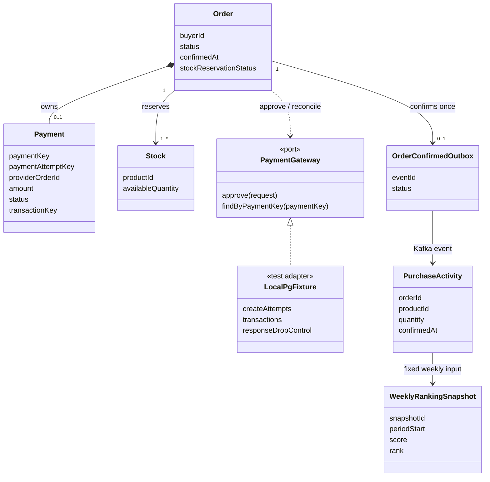
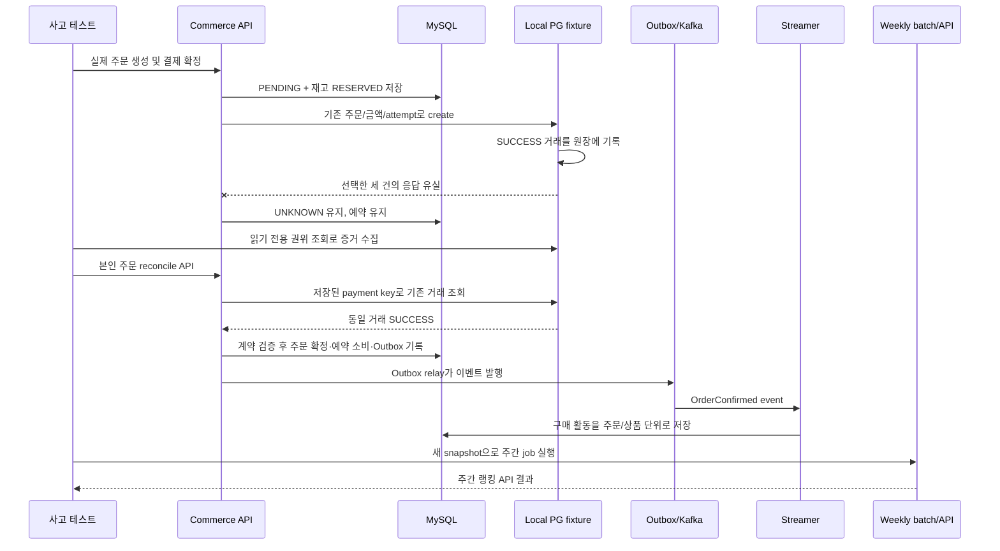

# Week 10 결제 사고 도메인 관계

## 애그리거트와 외부 경계

## 결제 상태와 복구 경계

## 불변 관계

- `Order`는 구매자와 결제 시도 한 건을 소유한다. 재조정은 요청자의 소유 주문만 조회한다.
- `Payment`의 `paymentKey`, `paymentAttemptKey`, `providerOrderId`, 저장 금액은 PG 응답의 동일 거래와 대사한다.
- PG SUCCESS 응답이 유실되면 PG 거래는 SUCCESS일 수 있고 내부 Payment는 UNKNOWN일 수 있다. 이는 서로 다른 저장 경계의 사실이다.
- `PENDING`과 `UNKNOWN` 주문은 성공 반영 전까지 재고 예약을 유지한다. 승인 성공 적용은 예약을 한 번 소비하며 재고를 다시 차감하지 않는다.
- 성공 적용과 주문별 Outbox 기록은 commerce DB 트랜잭션에서 함께 처리한다. 같은 주문의 반복 대사는 추가 Outbox 사실을 만들지 않는다.
- 주간 점수의 기간은 PG 요청 시각이나 복구 시각이 아니라 저장된 `confirmedAt`을 따른다. 기존 공개 snapshot을 직접 수정하지 않고 새 snapshot을 공개한다.
