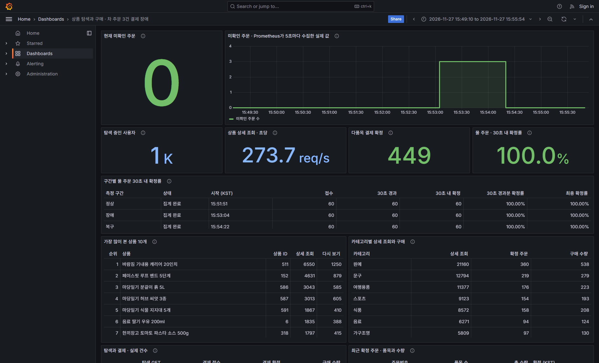

# 상품 600종 쇼핑 부하에서 미확인 주문 3건이 생겼을 때

2026년 11월 27일, 로컬 Commerce와 테스트 PG에서 상품을 탐색하는 사용자 1,000명을 유지하며 차 주문 세 건의 승인 응답을 유실시켰다. **미확인 주문은 0 → 3 → 0건**으로 움직였다. 같은 시간대에 접수된 물 주문의 30초 내 확정률은 장애 없는 대조 실행과 같았다. [실험 설계와 재현 방법](../../load-experiment.md)

## 미확인 주문이 늘고 해소된 시점

세 시점의 원본 화면 · [정상 0건 · 15:52:02](incident/screenshots/normal/overview-20261127T065202Z.png) → [장애 3건 · 15:53:50](incident/screenshots/comparison/overview-20261127T065350Z.png) → [복구 0건 · 15:54:49](incident/screenshots/recovery/overview-20261127T065449Z.png)

시각은 각 **그래프의 조회 종료 시각(KST)**이다. 위 전체 화면의 조회 범위는 15:49:10~15:55:54이고, 브라우저가 캡처한 시각은 15:56:31이다. 원본을 확대하면 상단의 조회 범위와 가운데 구간별 확정률 표를 읽을 수 있다. [원본 크기](incident/screenshots/final/overview-20261127T065554Z.png) · [캡처 시각과 Grafana 주소](incident/screenshots/final/capture-20261127T065554Z.json)

3건이 어떤 주문인지는 DB와 PG를 대조해 확인했다. 935·947·960번은 각각 응답 기한을 넘긴 `UNKNOWN`이었고, PG에는 각 주문과 일치하는 `SUCCESS`가 한 건씩 있었다. 복구 후 세 주문 모두 원래 거래 키로 `CONFIRMED / PAID`가 됐고, 주문별 PG 거래는 한 건씩 유지됐다. [복구 전 DB·PG·로그](incident/incident-comparison.json) · [복구 API 응답](incident/incident-reconcile.json) · [복구 후 DB·PG](incident/incident-recovery.json)

## 같은 시간에 물을 산 사람은 얼마나 기다렸나?

두 실행의 정상 시작점을 맞춰, 이후 같은 경과 시각의 1분 동안 접수된 물 주문끼리 비교했다. 아래는 **30초 내 확정 / 접수**다. 여섯 구간 모두 탐색 사용자 1,000명이 유지됐다.

| 1분 구간 | 대조 실행 | 장애 실행 | 확정률 차이 |
|---|---:|---:|---:|
| 정상 | 60/60 (100%) | 60/60 (100%) | 0%p |
| 차 주문 3건 미확인에 대응하는 시간 | 60/60 (100%) | 60/60 (100%) | 0%p |
| 복구에 대응하는 시간 | 60/60 (100%) | 60/60 (100%) | 0%p |

이 표는 각 구간에 접수된 물 주문에 관한 결과다. 대조 실행에서 사용자를 늘리던 중 접수된 물 주문 2번은 PG 통신 오류가 났고, 이후 조회한 PG 거래가 0건이어서 `UNKNOWN`으로 남았다. 이 주문은 첫 측정 구간 전에 접수됐다. [시간대를 맞춘 주문별 원장 비교](incident/matched-control.json) · [대조 실행 물 주문 2번](control/warmup-order-2.json)

## 실제 쇼핑 트래픽과 응답 시간

600개 상품·40개 브랜드·14개 카테고리에서 목록 탐색, 상세 조회, 재방문, 구매를 섞었다. 아래는 커피·차·물을 제외한 일반 쇼핑의 **전체 실행 합계**다. 장애가 없는 대조 실행은 시간대를 맞출 원장을 확보하려고 더 오래 유지했다. [대조 원장 요약](control/result.json) · [장애 원장 요약](incident/result.json)

| 일반 쇼핑 | 대조 실행 | 장애 실행 |
|---|---:|---:|
| 상세 조회·재방문 성공 / 조회한 서로 다른 상품 | 125,507회 / 597종 | 100,616회 / 597종 |
| 결제 확정 주문 | 1,985건 | 1,550건 |
| 구매된 서로 다른 상품 / 판매 수량 | 474종 / 3,074개 | 413종 / 2,358개 |

**응답 시간.** p95는 요청 100건 중 약 95건이 그 시간 안에 끝났다는 뜻이다. 장애 구간에서 최근 30초 기준 상품 목록 p95의 최고치는 15:53:50에 약 62ms, 상세는 15:53:30에 약 55ms였다. 대조 실행의 복구 대응 구간에서도 목록 p95가 약 63ms까지 올랐다. 두 실행의 각 측정 구간에서 탐색 GET의 서버 오류(5xx) 비율은 0%였다. 실행 한 쌍으로는 지연 원인을 차 주문 장애로 특정할 수 없다. [응답 시간 확대 화면](incident/screenshots/latency/panel-12-20261127T065449Z.png) · [오류율 화면](incident/screenshots/comparison/traffic-20261127T065350Z.png) · [장애 시계열](incident/http-performance.json) · [대조 시계열](control/http-performance.json)

**JMeter 판정 오류.** 대조 실행에서 결제 요청이 바로 확정된 HTTP 200 응답 11건을 JMeter가 오류로 분류했다. 같은 주문번호·결제 시도 키로 DB의 성공을 확인하고 판정식을 수정했다. 당시 JMeter의 원본 집계와 DB 대조 기록을 함께 보존했다. [11건의 판정 근거](control/jmeter-assertions.json)

[제출용 증거 ZIP](raw-evidence.zip)에는 두 실행의 JMeter 표본, 주문·사용자 원장, Prometheus 표본, Grafana 화면과 캡처 정보가 있다. 보관된 모니터링 스택을 실행 중이면 고정 시간 범위의 대시보드도 열 수 있다. [ZIP 무결성 기록](verification.json) · [대조 Grafana](http://127.0.0.1:33311/d/w10-catalog-control/2c97c7c5-7164-5661-99f4-054a86fc4d59?from=1795761366636&to=1795761900465&orgId=1) · [장애 Grafana](http://127.0.0.1:33312/d/w10-catalog-incident/8d448b14-04b1-574f-84e0-bfa51dd7c14d?from=1795762140394&to=1795762591494&orgId=1)

공개용 ZIP에서는 JMeter 로그 4개에 나오는 로컬 작업 폴더의 절대 경로 26곳을 `<WORKSPACE>`로 바꿨다. 나머지 57개 파일은 원본과 바이트 단위로 같으며, 여기에는 대조·장애 실행의 JTL 표본 두 개가 포함된다. [검증 기록](verification.json)의 `sourceArchive.sha256`은 원본 ZIP, 최상위 `sha256`은 제출용 ZIP의 해시다. 각 멤버의 CRC32·SHA-256과 변경한 네 파일의 원본 해시도 함께 기록했다.

이 폴더에서 `Get-FileHash ./raw-evidence.zip -Algorithm SHA256` 결과를 제출용 해시와 대조하고, `python -m zipfile -t raw-evidence.zip`으로 압축 멤버의 CRC를 확인할 수 있다.
