# W10 결제 사고 구현·검증 체크리스트

2026-11-24 `volume-10` / `cd455a3`에서 여섯 단계를 계획했다. 25일 단건 사고를 재현했고, 26일 관리 HTTP와 주문 로그로 응답이 끊긴 3건을 찾아 같은 주문을 복구했다. 주문 20건이 구매 활동 20건과 고객 주간 랭킹 20점으로 이어지는 과정과 세 앱 회귀의 검사 범위는 [6단계 최종 검증](final-verification.md)에 정리했다. [채점 기준](grading-criteria.md) · [과제 원문](assignment-original.md) · [학습 원문](learning-original.md) · [사고 runbook](../runbook/week10.md)

## 이번 주 문제와 범위

**11월 27일 Grafana 열람 화면을 추가했다.** 26일 최종 검사에서 직접 읽은 정상·응답 유실·복구 세 표본을 로그인 없이 보는 화면과, 현재 Prometheus를 조회하는 실시간 화면을 제공한다. [여는 방법과 증상별 판단](../runbook/week10.md#grafana에서-사고-보기)

고객은 결제 확인 중인데 health는 UP일 수 있다. 실제로 PG가 성공한 세 주문의 응답을 잃게 하고, 외부 거래와 내부 상태·경계 기록을 맞춰 원인을 설명한다. 기존 reconcile로 같은 주문을 마무리한 뒤 실제 구매 활동과 새 주간 랭킹까지 확인한다.

```mermaid
flowchart LR
    Request["고객 confirm"] --> Prepare["기존 TX A: 시도·재고 예약"]
    Prepare --> PG["테스트 PG: 거래 SUCCESS 보존"]
    PG -. "대상 3건의 생성 응답 유실" .-> Unknown["결제 UNKNOWN / 주문 PAYMENT_PENDING"]
    Unknown --> Evidence["fault 원문 보존 + 읽기 전용 진단"]
    Evidence --> Reconcile["같은 주문 reconcile: 기존 거래 GET"]
    Reconcile --> Apply["기존 TX B: 확정·예약 소비·Outbox"]
    Apply --> Relay["relay → Kafka → streamer"]
    Relay --> Activity["구매 활동"]
    Activity --> Ranking["새 snapshot/revision → 랭킹 HTTP"]
```



그림은 사고 대상의 흐름이다. 정상 요청과 최초 confirm의 제한 조회·callback 기능은 유지하며, 사고 관찰 전 자동 복구 보류는 테스트 전용 제어로 만든다. 기존 TX·락·HMAC·소유권·쿠폰·W9 재시작/공개 계약은 바꾸지 않는다. 이 주의 복구는 **PG GET을 사용**하므로 W7 backfill의 ‘복구 중 PG 조회도 0’ 조건을 가져오지 않는다. W10은 **PG create 추가 0**이다.

## 단계별 출발점과 확인 범위

| 책임 | 단계별 출발점 | 실험에서 확인할 사항 |
| --- | --- | --- |
| 최초 결제 요청 | [OrderPaymentCoordinator](../../apps/commerce-api/src/main/java/com/loopers/application/order/OrderPaymentCoordinator.java), [PaymentConfirmationWaiter](../../apps/commerce-api/src/main/java/com/loopers/application/order/PaymentConfirmationWaiter.java): create 뒤에도 제한 조회 수행 | 응답만 잃으면 즉시 조회로 복구될 수 있음. 고정 3건의 관찰 전 조회/알림을 테스트 경계에서 제어 |
| 로컬 PG HTTP | 지정한 `providerOrderId`의 거래를 SUCCESS로 저장한 뒤 생성 응답 연결을 닫는다. 다른 주문은 기존 응답을 받는다. [LocalTestPg](../../apps/commerce-api/src/test/java/com/loopers/infrastructure/payment/support/LocalTestPg.java) | 전체 사고에서는 대상 세 주문을 ID로 지정하고 create 횟수와 실제 거래 수를 함께 대조한다. 같은 주문의 두 번째 POST도 새 거래가 되므로 추가 생성이 있으면 테스트에서 드러난다. |
| 외부 응답 해석 | [PaymentGatewayCall](../../apps/commerce-api/src/main/java/com/loopers/application/order/PaymentGatewayCall.java)이 생성·조회 결과, 통신 실패 분류와 소요 시간을 주문·시도에 연결한다. | 전체 사고에서도 PG 거래·금액과 수집 로그를 대조한다. |
| 내부 TX 반영 | [PaymentApplicationLog](../../apps/commerce-api/src/main/java/com/loopers/application/order/PaymentApplicationLog.java)가 결과 적용 시작과 Spring 트랜잭션 종료 통지를 기록한다. | 원인 판단 시 커밋된 주문·예약도 별도로 조회한다. |
| 기존 복구 API | [OrderPaymentRecoveryService](../../apps/commerce-api/src/main/java/com/loopers/application/order/OrderPaymentRecoveryService.java), [controller](../../apps/commerce-api/src/main/java/com/loopers/interfaces/api/order/OrderPaymentRecoveryController.java): 본인 주문의 기존 거래 한 번 조회, create 없음 | 새 복구 API를 만들지 않고 실제 HTTP와 동일 대상 상태를 검증 |
| 결제 상태 시각 | [PaymentAttempt](../../apps/commerce-api/src/main/java/com/loopers/domain/payment/PaymentAttempt.java)는 sendStartedAt만 영속화 | 최초 발송권 시각을 UNKNOWN 발생 시각으로 쓰지 않음. 관찰 시각과 상태 전이 시각의 기록 방법 구분 필요 |
| 관측 기반 | [UnknownPaymentGauge](../../apps/commerce-api/src/main/java/com/loopers/infrastructure/payment/monitoring/UnknownPaymentGauge.java)가 DB의 UNKNOWN 건수를 수집한다. 관리 포트에서 실제 health와 Prometheus 응답을 읽는다. | 장애 집합 10건의 실행별 원문 증거를 보존한다. |
| 관리 접근 | [AdminBoundaryConfig](../../apps/commerce-api/src/main/java/com/loopers/config/AdminBoundaryConfig.java)는 관리자 API 경로를 보호한다. 단건 테스트는 별도 관리 포트를 loopback에 바인딩하고 실제 할당된 주소로 요청했다. | 운영 관리 endpoint의 인증과 배포 네트워크는 검증 범위 밖이다. |
| 전체 연결 | [PgOrderWeeklyRankingEndToEndTest](../../apps/commerce-api/src/test/java/com/loopers/application/order/PgOrderWeeklyRankingEndToEndTest.java), [OwnedStreamerProcess](../../apps/commerce-api/src/test/java/com/loopers/support/kafka/OwnedStreamerProcess.java), [OwnedRankingBatchProcess](../../apps/commerce-api/src/test/java/com/loopers/support/ranking/OwnedRankingBatchProcess.java) | 소유 DB/broker·별도 JVM·고정 Clock 재사용. W10의 실제 생성 ID와 20건 사고 집합, 증거 수집을 새로 연결 |
| 실행 증거 | Batch 실행 helper가 임시 process.log/result.json을 정리함. W9 기록은 과거 검증 | 필요한 허용 원문과 결과를 정리 전에 실행별 증거 위치로 보존. 과거 로그를 W10 실행 결과로 복사하지 않음 |

## 사고 시나리오의 고정 기대값

4단계 시나리오는 고객이 같은 공개 상품을 주문마다 하나씩 구매한다. 두 집합을 기존 HTTP API로 준비하고 응답에서 주문 ID를 수집한다. 아래의 `S`는 두 집합을 만들기 전 해당 상품의 가용 재고다.

| 관찰 시점 | 정상 집합 | 장애 집합 | 누적 PG 거래 / create 호출 | 가용 재고·예약 | health·지표 |
| --- | --- | --- | --- | --- | --- |
| baseline 보존 | 확정 10 | 아직 미실행 | 10 / 10 | S−10, 정상 집합 CONSUMED 10 | UP, UNKNOWN 지표 0 |
| fault 보존 | 기존 10 보존 | 확정 7·UNKNOWN 3 | 20 / 20, 모두 외부 SUCCESS | S−20, 장애 집합 CONSUMED 7·HELD 3 | UP, 갱신 후 3 |
| recovery 보존 | 기존 10 보존 | 같은 ID 10개 확정·UNKNOWN 0 | 같은 거래 20 / 20 | S−20 유지, 장애 집합 CONSUMED 10 | 실제 UP, 갱신 후 0 |

1. 실행별 정상/장애 주문 목록, 각 주문의 attemptKey·providerOrderId·amount와 PG 거래 키를 저장한다. 대상 3건은 HTTP 호출 순서가 아니라 목록으로 지정한다.
2. PG가 SUCCESS 거래를 저장한 뒤 생성 응답을 잃게 한다. 대상 최초 confirm 안의 조회와 callback이 관찰 전에 성공 적용하지 않게 테스트 제어를 둔다. 정상 7건은 PENDING 수락 후 기존 조회/알림으로 최종 성공을 확인한다.
3. fault의 DB·health·Prometheus·경계 로그를 먼저 보존한다. 진단용 PG GET으로 외부 SUCCESS를 확인하되 commerce 상태는 적용하지 않는다.
4. 입력을 멈추고 응답 유실/조회 보류를 해제한 뒤 본인 식별로 같은 3개 주문의 reconcile HTTP를 호출한다. 후속 관찰도 원래 장애 집합 10개를 기준으로 한다.
5. 동일 reconcile/callback을 반복해 주문·시도·최초 confirmedAt·예약·Outbox·활동이 늘거나 바뀌지 않는지 확인한다. PG GET 증가와 create 증가를 구분한다.
6. 실제 relay·consumer 완료 후 20개 주문의 활동을 새 입력으로 고정한다. 같은 주에 이 상품 20개만 있다면 20점·1위다. 기존 snapshot의 입력/결과는 유지한다.

포인트·쿠폰은 존재하는 기록을 준비해 전후 내용과 수를 대조한다. 빈 테이블이 계속 비었다는 것만으로 기존 사실 보존을 입증하지 않는다. UNKNOWN 동안 HELD를 유지하고, 복구 성공은 예약 소비이며 가용 재고를 다시 차감하지 않는다. 고정 Clock은 같은 주의 최초 확정을 만들기 위한 테스트 도구이며 이미 저장된 confirmedAt을 수정하지 않는다.

## 여섯 단계와 TDD 계획

| 단계 | 변경할 책임·파일 후보 | 먼저 실패시켜 확인할 것 | 통과 기준·현재 상태 |
| --- | --- | --- | --- |
| 1. 기준·사고 설계 | 이 문서·원문·채점 기준·runbook·공통 문서 연결 | 문서의 요구와 기존 코드·미정 선택을 대조 | **기준 분석 완료.** 단계별 선택과 검증 범위는 아래 실행 기록 참조 |
| 2. 작은 사고 fixture | 주문 ID별 로컬 PG 장애와 최초 confirm의 테스트용 조회 제어 | 대상 주문의 PG SUCCESS와 commerce UNKNOWN·HELD가 동시에 남는지 확인 | **단건 고객 HTTP·격리 MySQL 검증 완료**. 재조회 시간이 남은 경우도 대조했다. |
| 3. 관측 연결 | UNKNOWN 집계와 주기적 갱신, PG 호출·DB 결과 적용 로그, 별도 관리 HTTP 검증 | DB 상태 변화와 Prometheus 값, 응답 유실과 DB 반영 실패, 집계 실패·오래된 값 구분 | **단건 관측 구현·검증 완료**. 실제 health UP에서 지표 0 → 1 → 0과 같은 주문의 경계 로그를 확인했다. |
| 4. 같은 주문 복구 | [CheckoutIncidentTest](../../apps/commerce-api/src/test/java/com/loopers/interfaces/api/order/CheckoutIncidentTest.java), 기존 고객 reconcile | 정상 10 → 장애 7/3 → 증거 봉인 → 같은 집합 10/0. PG create 추가 0 | **20건의 격리 사고 검증 완료.** 세 대상의 타인 요청 404, 소유자 복구, 반복 reconcile/callback 후 주문·시도·예약·재고·포인트·쿠폰·Outbox 불변 확인 |
| 5. 후속 결과 연결 | 주문별 Outbox·Kafka·streamer·weeklyRanking·고객 HTTP | Outbox 발행 0건에서 실패한 뒤 실제 소비와 새 주간 입력 대조 | **검증 완료.** 원본 20건과 재전송 1건을 소비해 구매 활동 20건, 새 공개본 20점·1위, 이전 공개본 10점 보존 |
| 6. 종료·문서·회귀 | runbook, 중간 실패·최종 실행 원문, 세 앱 전체 검사 | 사고 주문 재대사, 소유 자원 정리, 누적 회귀·Checkstyle·ArchUnit | **완료.** 199개 스위트·2,457개 테스트 통과, W10-C01~10 모두 충족. [최종 판정과 미검증 범위](final-verification.md) |

새 파일 이름은 후보이며 구현 시 실제 구조에 맞게 정한다. 2~5단계는 작은 실패→최소 구현→관련 테스트/정적 검사 순서로 진행한다. 정상 기준선은 먼저 만들되 최종 사고 증거는 같은 lifecycle에서 baseline→fault→recovery를 이어야 한다. 세 독립 실행의 로그를 합치지 않는다.

### 11월 25일 2단계 단건 사고

- **PG fixture Red.** 지정한 주문의 생성 응답이 정상 반환되면서 연결 오류를 기대한 테스트 1건이 실패했다.
- **PG fixture Green.** 실제 로컬 HTTP에서 대상 주문의 SUCCESS를 저장한 뒤 응답 연결을 닫자 클라이언트가 `IOException`을 받았다. 주문 ID로 조회한 거래는 대상 금액의 SUCCESS 1건이었고, 다른 주문은 202 PENDING을 받았다. 장애 해제 후 테스트가 일부러 같은 주문에 보낸 두 번째 POST는 별도 거래가 되어 중복 발송을 발견할 수 있었다. DB를 쓰지 않는 `LocalTestPgTest` 21건 통과, 실패·오류·건너뜀 0건. [fixture 테스트](../../apps/commerce-api/src/test/java/com/loopers/infrastructure/payment/support/LocalTestPgTest.java)
- **고객 confirm Red.** 100원짜리 상품 2개를 주문 생성 API로 주문했다. PG가 승인 응답의 연결을 닫아도 최초 confirm이 기존 거래를 조회해 HTTP 200을 반환했다. 기대한 202와 달라 첫 테스트가 실패했다.
- **고객 confirm Green.** 해당 confirm 요청에서 대상 주문의 PG POST가 관찰된 뒤에만 테스트 시계를 외부 조회 예산만큼 앞당겼다. 이는 최초 요청이 추가 조회를 할 시간이 없는 상황을 재현한다. 실제 HTTP 연결은 PG가 거래를 저장한 직후 끊겼다. 고객 응답은 202였고 요청 종료 후 독립 SQL 조회에서 주문 `PAYMENT_PENDING`, 결제 시도 `UNKNOWN`, 품목 `HELD` 2개, 가용 재고 3개(처음 5개), 포인트 1,000원을 확인했다. 외부 거래 키는 commerce DB에 비어 있었다.
- **읽기 전용 대사.** 결제 시도에 저장된 PG용 주문 ID로 테스트 PG를 직접 한 번 조회했다. 같은 주문·200원의 `SUCCESS` 거래 한 건과 거래 키를 확인했다. 고객 주문을 다시 읽어도 내부 상태와 예약은 유지됐다. PG 생성 POST 총 1회, 최초 confirm의 자동 GET 0회, 진단 GET 1회였다.
- **대조 사례.** 같은 방식으로 승인 응답을 끊고 조회 시간이 남게 두자 최초 confirm의 GET 1회로 HTTP 200, 주문 `CONFIRMED`, 예약 `CONSUMED`가 됐다. 거래 1건과 가용 재고 3개를 유지했다. [두 고객 confirm 통합 테스트](../../apps/commerce-api/src/test/java/com/loopers/interfaces/api/order/PgOrderConfirmApiE2ETest.java)
- **관련 검사.** PG fixture 21건, 고객 confirm 47건, 복구 API 63건, API ArchUnit 1건으로 총 132건 통과. 실패·오류·건너뜀 0건, API 테스트 Checkstyle 위반 0건. 테스트 종료 후 실행 중인 Testcontainers 컨테이너는 0개였다.

이 실행의 범위는 단건 요청 두 경우였다. 두 주문 집합과 동일 주문 복구는 4단계, 후속 랭킹은 5단계에서 다룬다.

### 11월 26일 3단계 관측 결과

- **정상 → 사고 → 복구.** 한 주문의 생성 응답을 끊자 PG 생성 로그에 `UNKNOWN / NETWORK`가 남고 DB의 UNKNOWN 반영이 커밋됐다. 본인 주문 reconcile을 한 번 호출하자 PG 조회 로그에 `OBSERVED / SUCCESS`, 내부 종료 로그에 `COMMITTED`가 남았다. 초기·사고·복구 때마다 실제 관리 HTTP에서 health는 `UP`, `commerce_payment_unknown`은 차례로 `0 → 1 → 0`이었다. 가용 재고 3개와 PG 거래 1건을 유지했다. 고객 포트와 관리 포트가 다름을 확인하고 테스트 전용 DB·Redis·PG를 사용했다. [관리 HTTP 통합 테스트](../../apps/commerce-api/src/test/java/com/loopers/interfaces/api/order/PgOrderConfirmApiE2ETest.java)
- **지표 TDD.** 기본 설정에서 지표가 없어 실패한 뒤 등록과 갱신을 구현했다. 첫 표본 전, DB 읽기 실패, 오래된 표본은 `NaN`으로 나타나고 다음 성공한 조회에서 값이 회복됨을 확인했다. 같은 표본을 여러 번 읽어도 추가 SQL은 발생하지 않는다. [지표 테스트](../../apps/commerce-api/src/test/java/com/loopers/infrastructure/payment/monitoring/UnknownPaymentGaugeTest.java)
- **로그 TDD.** PG 호출 로그가 없어 NETWORK·TIMEOUT 등 네 사례가 실패했고, DB 결과 적용 로그가 없어 실제 SQL 뒤 외부 트랜잭션이 롤백된 두 사례가 실패했다. 구현 후 PG 관찰과 도메인의 적용 판단, 트랜잭션 종료를 분리해서 대조했다. SQL을 실행한 후 부른 쪽이 롤백하면 `decision=APPLIED txOutcome=ROLLED_BACK`, 같은 관찰을 다시 적용해 커밋하면 `APPLIED / COMMITTED`, 완료 후 반복하면 `UNCHANGED / COMMITTED`가 남았다. [PG 관찰 테스트](../../apps/commerce-api/src/test/java/com/loopers/application/order/PaymentGatewayObservationTest.java) · [트랜잭션 테스트](../../apps/commerce-api/src/test/java/com/loopers/application/order/OrderPaymentStockIntegrationTest.java)
- **두 원인의 대조.** 응답 유실 사례는 생성 요청이 `NETWORK`로 끝나고 UNKNOWN을 커밋했다. 별도 복구 HTTP 사례에서는 같은 주문의 기존 PG 거래를 조회해 SUCCESS를 받은 뒤 첫 SQL 변경이 실제로 실행됐고, 다음 쓰기에서 실패해 `ROLLED_BACK`이 기록됐다. 독립 DB 연결에서도 적용 전 상태가 유지됐다. [복구 HTTP 롤백 테스트](../../apps/commerce-api/src/test/java/com/loopers/application/order/PaymentRecoveryRollbackIntegrationTest.java)
- **당시 검사 범위.** API 결제 관련 43개 스위트·1,069개 통과, 실패·오류·건너뜀 0개. API ArchUnit 포함, main/test Checkstyle 위반 0건. 2분 15초, 종료 코드 0. 종료 뒤 실행 중인 Testcontainers 컨테이너는 0개였다. 이 수치는 새 20건 사고 실행과 세 앱 전체 회귀를 포함하지 않는다.

```sh
./gradlew --offline :apps:commerce-api:test --tests '*Payment*Test' --tests '*PgOrderConfirm*Test' \
  --tests '*PgLookupCircuitTest' --tests '*PgHttpTimeoutTest' --tests '*LocalTestPgTest' \
  --tests '*ArchitectureTest' :apps:commerce-api:checkstyleMain :apps:commerce-api:checkstyleTest --console=plain
```

운영 기본값에서는 API 인스턴스마다 같은 DB를 주기적으로 집계한다. 현재 스키마에는 결제 상태 단독 인덱스가 없다. 큰 테이블에서의 조회 비용과 운영 알림 임계값은 이번 격리 사고에서 측정하지 않았다.

### 11월 26일 4단계 사고·복구 결과

[사고 통합 테스트](../../apps/commerce-api/src/test/java/com/loopers/interfaces/api/order/CheckoutIncidentTest.java)는 세 단계 동안 같은 PG와 DB를 유지한다. 장애를 일으킬 세 ID를 fixture에 지정한다. 복구 대상은 전체 장애 집합의 주문별 생성 로그에서 후보를 찾아, 별도 SQL의 UNKNOWN 목록과 읽기 전용 PG GET으로 확인한 거래를 대조해 결정한다. 로그와 DB는 주문 ID·시도 키로 연결하고, PG 거래는 제공자 계정·PG용 주문 ID·금액·거래 키로 식별한다. 목록 또는 거래가 일치하지 않으면 진행을 멈춘다.

- **복구 전** 각 주문의 결제 시도·거래·예약과 가용 재고, 기존 포인트 잔액·발급 쿠폰, Outbox를 조회한다. health·Prometheus 원문과 외부 호출·내부 적용 로그를 기록하고 세 가설의 예상과 실제를 비교한 뒤 fault 파일의 해시를 남긴다. [DB 대사](../../apps/commerce-api/src/test/java/com/loopers/interfaces/api/order/CheckoutIncidentDatabase.java) · [증거 봉인](../../apps/commerce-api/src/test/java/com/loopers/interfaces/api/order/CheckoutIncidentEvidence.java)
- **복구 후** 원래 주문 ID로 기존 권위 거래를 확인한다. 기존 시도·품목과 소비할 예약이 유지됐는지, 이미 확정된 주문의 최초 확정 시각·Outbox가 그대로인지 비교한다. PG 생성 호출 증가량과 가용 재고 변화를 따로 확인한다.
- **실행 결과 확인**은 새 증거 디렉터리의 단계별 값·fault 해시를 사용한다. 실행 방법과 가설별 증거 위치는 [W10 runbook](../runbook/week10.md#격리-환경에서-재현하기)에 있다.

**집합 실험의 Red.** 최초 confirm의 조회 시간을 보류하는 테스트 도구가 마지막 대상 한 건만 기억했다. 실험 주문 12·15는 생성 응답 연결이 끊긴 뒤에도 기존 서비스의 GET으로 SUCCESS를 확인해 스스로 확정됐다. 주문 19만 UNKNOWN으로 남아 기대한 3건 대 실제 1건으로 검사가 실패했다. 세 주문을 모두 미확인으로 유지하려면 테스트 도구가 각 주문의 최초 요청에서만 조회 예산을 소진해야 한다.

**Green.** 조회 예산 보류를 테스트 요청 경로·PG용 주문 ID별로 적용했다. 합성 주문 1~10과 11~20은 각각 실제 주문 HTTP로 생성했다. 초기 재고는 30개, 주문당 상품은 한 개·100원이었다. 정상 10건과 장애 집합 중 7건의 생성 수락은 PENDING이었고 최초 confirm의 GET이 SUCCESS를 확인했다. 업무 Clock은 `2026-11-25T03:00:00Z`에 고정했다.

| 단계 | 해당 집합 확정 / UNKNOWN | 해당 집합 PG SUCCESS | 누적 PG create / 거래 | 가용 재고 | 누적 Outbox | health / UNKNOWN 지표 |
| --- | ---: | ---: | ---: | ---: | ---: | --- |
| baseline · 주문 1~10 | 10 / 0 | 10 | 10 / 10 | 20 | 10 | UP / 0 |
| fault · 주문 11~20 | 7 / 3 | 10 | 20 / 20 | 10 | 17 | UP / 3 |
| recovery · 같은 11~20 | 10 / 0 | 10 | 20 / 20 | 10 | 20 | UP / 0 |

주문 12·15·19의 CREATE 로그에는 `UNKNOWN / NETWORK`, 다음 같은 시도의 DB 적용 종료에는 `UNKNOWN / COMMITTED`가 남았다. 진단용 PG GET으로 주문별 100원의 `TEST-TX-12`, `TEST-TX-15`, `TEST-TX-19`가 모두 SUCCESS임을 확인했다. 이 세 요청에서 수신한 SUCCESS를 적용하다 롤백한 기록은 관찰되지 않았다. 커밋된 재고 예약은 HELD였고 진단 조회 전후 상태가 같았다. 생산 통신 로그 한 건만으로 연결이 끊긴 물리적 위치까지 특정할 수는 없다.

같은 세 주문의 소유자 reconcile은 기존 거래를 조회해 예약을 CONSUMED로 바꿨다. 나머지 17건의 결제 시도·최초 확정 시각·Outbox는 그대로였다. 각 대상에 reconcile과 callback을 한 번씩 더 보낸 뒤에도 PG 거래 20건과 Outbox 20행, 가용 재고 10개, 소유자의 기존 포인트 1,000원·기발급 쿠폰 한 장의 식별자와 내용이 유지됐다. fault 원문 여섯 파일의 해시도 복구 전과 같았다.

**보존한 실행.** `2026-11-26T04-41-11.843924Z-bf7db3b9-dbcd-4ea4-9e9e-f1b7ddfec850`의 관측 자료 20개를 보관했다. 압축 파일 SHA-256은 `48cd4f28e7f24be86eeac5f22719bd4ceeae23d1f96592579f989a981334974b`다. `cohorts.json`에 실제 주문과 시도 키가 있고, `fault/diagnosis.json`에 세 가설의 대조 결과, `verified.json`에 복구·반복 호출 후의 최종 값이 있다. [4단계 사고 증거 ZIP](evidence/checkout-incident-stage4.zip)

**당시 관련 검사.** API 사고·증거 수집·PG fixture·고객 결제/복구·실제 SQL 롤백·업무 지표·ArchUnit을 포함한 9개 스위트에서 149건이 통과했다. 실패·오류·건너뜀 0건, API main/test Checkstyle 보고서의 위반 0건이었다(main 작업은 UP-TO-DATE). 52초에 BUILD SUCCESSFUL·종료 코드 0으로 끝났고 종료 후 실행 중인 Testcontainers 컨테이너는 0개였다. Kafka 소비·배치와 세 앱 전체 검사는 각각 5·6단계에서 실행한다.

### 11월 26일 5단계 구매 활동과 주간 랭킹

**먼저 실패한 검사.** 4단계의 마지막에 주문별 Outbox 20건이 Kafka에 발행됐는지 검사했더니 `PUBLISHED`는 기대 20건에 실제 0건이었다. 결제 복구가 끝나도 relay를 아직 실행하지 않은 시점에는 주문 확정 사실이 DB에만 남아 있었다.

[통합 테스트](../../apps/commerce-api/src/test/java/com/loopers/interfaces/api/order/CheckoutIncidentTest.java)는 새 실행에서 20건의 사고와 복구를 다시 만든 뒤 같은 주문을 추적한다. [Kafka·구매 활동 대사](../../apps/commerce-api/src/test/java/com/loopers/interfaces/api/order/CheckoutIncidentStream.java)는 두 번의 relay 실행으로 정상 집합과 장애 집합의 이벤트를 전달한다. 이어 복구된 주문 하나의 저장된 key와 payload를 Kafka 발행기로 다시 보내, 다른 offset에서 그 사건을 소비하는 경우를 만든다. [배치·랭킹 대사](../../apps/commerce-api/src/test/java/com/loopers/interfaces/api/order/CheckoutIncidentRanking.java)는 각 revision의 고정 입력을 원래 주문 목록·품목·최초 확정 시각과 비교하고 실제 고객 API를 호출한다.

| 관찰 시점 | 구매 활동 | 고객에게 보이는 랭킹 |
| --- | --- | --- |
| 정상 집합의 10건을 소비해 첫 배치 완료 | 서로 다른 정상 주문 10건, 같은 상품 총수량 10개 | `weekly-20261123-r1`에서 상품 1위·10점 |
| 장애 집합의 10건과 재전송 1건까지 소비 | 기존 10건 + 새 10건. 중복은 기존 처리·활동 행의 PK와 수량을 보존 | 다음 배치 전까지 같은 r1의 응답과 10점 유지 |
| 전체 활동으로 새 배치 완료 | 새 입력에 실제 주문 20개의 상품·수량·최초 확정 시각이 각각 일치 | `weekly-20261123-r2`에서 같은 상품 1위·20점 |

첫 공개본은 PG 사고를 복구한 뒤 relay가 정상 주문 10개를 먼저 전달한 시점에 만들었다. 두 번째 배치는 `2026-11-23`부터 다음 월요일 직전까지의 실제 구매 활동을 고정했다. 고객 API가 새 revision을 반환한 뒤에도 첫 공개본의 입력·결과·checksum은 그대로였다. 결제 100원은 랭킹 계산에 쓰이지 않는다. 이번 점수는 같은 상품 수량 1개씩을 산 주문 20개를 합산한 값이다.

**중복이 처리된 증거.** 복구된 12번 주문의 `order-confirmed:v1:12`를 한 번 더 보냈다. 전용 topic의 partition 0에서 offset 8은 `APPLIED`, offset 10은 `DUPLICATE`였다. 같은 group의 최종 커밋 위치는 partition 0에서 11, partition 1에서 10으로 각 파티션의 끝에 도달했다. 발행된 Outbox는 20행, Kafka에 쌓인 레코드는 21건, 소비 DB에는 서로 다른 주문 20건의 구매 활동이 남았다. 모든 활동의 상품·수량·최초 확정 시각이 주문과 일치했다. 후속 처리가 끝난 뒤 PG 추가 조회·추가 생성은 모두 0회였고 복구 전 증거의 해시도 같았다.

**보존한 실행.** `2026-11-26T04-47-45.756414Z-eea3a3b5-211d-4c01-a6a7-537ef176bebb`의 원문 22개를 보관했다. `stream.json`의 orderId로 원본·중복 전달과 소비 행을, `ranking.json`에서 같은 주문의 고정 입력과 두 고객 응답을 확인할 수 있다. 압축 파일 SHA-256은 `2419c88ddbfc90fa7d304898c78a866afc23cec4108ea27c4c27eb53631e629c`다. [5단계 사고·랭킹 증거 ZIP](evidence/checkout-incident-stage5.zip)

**당시 관련 회귀.** API 16건(5개 스위트), streamer 16건(2개), Batch 29건(4개)으로 총 61건이 통과했다. 실패·오류·건너뜀은 모두 0건이었다. 세 앱의 ArchUnit, W9의 실제 주문부터 랭킹까지의 연결, 체크포인트 재시작과 공개 검사를 포함했다. API main/test Checkstyle 보고서의 위반은 0건이었다(main 작업은 UP-TO-DATE). Gradle은 2분 1초에 종료 코드 0으로 완료했고, 종료 후 실행 중인 Testcontainers 컨테이너는 0개였다. 전체 검사와 원문 10항목의 대조는 [6단계 기록](final-verification.md)에 있다.

## 관측·장애 주입에서 선택한 방식

아래는 3·4단계에서 적용한 관측 선택이다.

| ID | 선택·이유 | 적용 범위와 확인할 점 |
| --- | --- | --- |
| W10-Q01 | Micrometer `commerce.payment.unknown`은 API가 보는 DB 전체의 UNKNOWN 결제 시도 수다. Prometheus 이름은 `commerce_payment_unknown`이다. | PENDING·NOT_OBSERVED는 제외한다. 건별 식별자는 주문 로그로 추적한다. |
| W10-Q02 | `commerce.payment-observation.enabled` 기본 true. 전용 스레드가 수집 완료 후 `commerce.payment-observation.refresh-interval`(기본 5초) 간격으로 갱신하고 scrape는 메모리를 읽는다. | 첫 조회 전·읽기 실패·마지막 성공 조회 시작 이후 두 주기가 지난 표본은 NaN이다. 관련 없는 테스트는 수집을 끄고 관리 HTTP 통합 테스트는 명시적으로 켠다. |
| W10-Q03 | 대상 confirm의 PG 생성 이후 조회 예산을 테스트 시계로 소진했다. 세 주문의 경로와 ID를 각각 등록했다. 운영의 대기 정책과 조회 회로는 기존 설정을 사용한다. | 같은 장애 집합의 정상 7건은 기존 조회로 확정됐고 세 대상의 결과는 fault 원문을 남긴 뒤 복구했다. |
| W10-Q04 | 로그 시각은 외부 결과 관찰·결과 적용 시작·트랜잭션 종료를 나타낸다. `txOutcome=UNKNOWN`이면 DB에 커밋된 상태를 다시 읽는다. | 이번 지표는 현재 건수를 제공한다. 최초 발송 시각·로그 관찰 시각을 UNKNOWN 지속 시간으로 사용하지 않는다. |

## 관측·증거 설계의 주의점

- 외부 호출 관찰: 주문·시도·PG용 주문 ID·알려진 거래 키, 작업 CREATE/LOOKUP, 안전한 결과 분류·소요시간·관찰 시각을 연결한다. 전체 요청/응답 객체나 예외 메시지를 무차별 출력하지 않는다.
- 내부 반영: 적용 시도와 TX 실제 완료/rollback을 구분한다. ‘성공 적용 없음’은 로그 한 줄의 부재만으로 단정하지 않고 수집 범위·DB·호출 관측을 함께 확인한다.
- metric은 개수/상태의 집계, 로그/상태 파일은 개별 주문의 근거다. gauge 갱신 시각과 cohort DB 관찰 시각이 다를 수 있으므로 안정된 관찰 구간과 유한 대기를 사용한다.
- 별도 관리 포트는 테스트가 실제 받은 주소로 호출한다. health/prometheus만 사용하며 일반 앱의 loopback 설정만으로 관리 포트도 보호된다고 가정하지 않는다.
- 실행별 증거에 run ID·코드 revision·실제 시각·테스트 업무 Clock·cohort 목록·경계 로그·DB 대사·PG 관찰·원문 HTTP를 구분한다. fault를 덮어쓰지 않고 중간 실패도 남긴다.
- 테스트는 새 실행 디렉터리에만 증거를 작성하고 복구 전후 fault 파일의 SHA-256을 대조한다. 주문·거래의 동일성과 실제 저장값은 DB·HTTP assertion으로 확인한다. 재현 때 생성되는 원문은 로컬 빌드 디렉터리에 있으며 장기 보관분은 별도로 보존한다.

## 현재 판정과 회귀 범위

| 항목 | 현재 상태 |
| --- | --- |
| W10-C01~03 | 20건의 실제 health·Prometheus 원문, 허용한 주문 경계 로그와 PG·DB 대사를 수집하고 세 가설을 비교했다. 귀속과 접근 보호는 격리 실행 범위에서 검토한다. |
| W10-C04~06 | 같은 DB·PG에서 두 집합의 7/3 → 10/0, 기존 거래·업무 효과 보존, 복구 중 create 증가 0을 확인했다. |
| W10-C07 | 동일 20건의 최초 확정 시각과 품목을 Outbox·Kafka·구매 활동·주간 입력으로 연결했다. 재전달 한 건의 추가 업무 효과 0, 새 공개본 20점·1위와 이전 공개본의 보존을 확인했다. |
| W10-C08 | 실제 후속 발행 단계에서 멈춘 실행과 새 전체 검사의 사고 원문을 별도 run ID로 보존했다. 두 실행 모두 fault 원문 6개의 해시를 대조했다. [증거 ZIP](evidence/checkout-incident-stage6.zip) · [중단·재진입 절차](../runbook/week10.md) |
| W10-C09 | 세 앱 2,457개 테스트 통과, 실패·오류·건너뜀 0건. 각 앱 ArchUnit 통과, Checkstyle 보고서 12개 위반 0건. [앱별 결과와 기능별 검증 범위](final-verification.md) |
| W10-C10 | 전용 MySQL·Redis·Kafka와 고유 topic/group을 사용했다. 전체 검사 전후 Testcontainers 라벨의 컨테이너는 0개였고 검사 종료 뒤 테스트 자식 JVM도 0개였다. |

| 기능 | 유지하고 다시 확인할 계약 |
| --- | --- |
| 상품·브랜드·좋아요·관리자 | 조회·삭제·권한·과거 주문 보존·캐시 보호 |
| 포인트·PG·주문 | POINT 기록·충전 분리, HMAC 재요청, 단일 발송, TX/락·예약·권위 조회·소유권 |
| 이벤트·Outbox·소비 | 확정과 공동 저장, 전송 gap 재개, 소비 중복/충돌·commit 뒤 ack |
| 쿠폰 | 총량·사용자 중복·발급 자리·본인 목록·장애 후 명시 재개 |
| 랭킹 | 고정 입력, 같은 instance 재시작·checkpoint 공동 TX, 늦은 revision·완성본 공개·조회 계약 |
| W10 사고 | 실제 원문 관측, 경쟁 가설, 같은 주문 복구, 후속 대사·중단/재진입 |

6단계에서 세 앱의 `check`를 다시 실행해 14분 44초에 종료 코드 0을 확인했다. 이번 실행의 기능별 증거와 운영 환경에서 별도로 확인할 점은 [W10 최종 검증](final-verification.md)에 있다. [W9 최종 검증](../week9/final-verification.md)은 선행 이력으로 보존한다.

- [x] 첨부 두 원문 보존, 원문 10항목·현재 코드·작업 계획 연결
- [x] 단건 PG fixture에서 주문 ID별 SUCCESS 저장 후 생성 응답 유실과 읽기 전용 거래 조회 확인
- [x] 단건 고객 confirm의 HTTP 202·커밋된 UNKNOWN/HELD와 자동 조회가 가능한 대조 사례 확인
- [x] commerce-api에 DB 기반 UNKNOWN 건수와 주문별 PG·DB 로그 연결, 동적 관리 포트에서 단건 사고·복구 관측
- [x] 두 집합 20건의 실제 사고 진단·동일 주문 복구·재승인 0·fault 원문 보존
- [x] 같은 실행을 실제 Outbox relay·Kafka·구매 활동·주간 랭킹까지 연결하고 재전송 후에도 20점·1위임을 확인
- [x] 중간 실패와 복구 전 원문 보존, runbook의 진단·복구 경로와 해시 검산, 세 앱 전체 회귀 및 W10 원문 10항목 대조
- [ ] PR·기술 글·사고 증거 제출 확인

11월 24일 작업은 문서 정리에 한정했다. 11월 25일 단건 사고는 테스트 전용 로컬 PG와 격리 MySQL에서 실행했다. 사용자 DB에는 접근하지 않았다.
