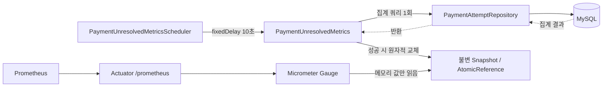

# Week 10 — 결제 미종결 사고 모니터링 설계

## 1. 설계 목적

프로세스가 정상적으로 응답한다는 사실과 사용자의 결제가 완료됐다는 사실은 다르다. 외부 PG에서 거래가 성공했더라도 생성 응답 유실 또는 내부 트랜잭션 실패로 주문이 확정되지 않을 수 있다.

이번 설계는 Health, 업무 Metric, 구조화 로그, PG 거래 원장 및 내부 DB 상태를 연결해 장애를 탐지하고 원인을 구분하는 것을 목적으로 한다. 복구는 새 결제를 생성하지 않고 기존 거래를 조회해 수행하며, 주문뿐 아니라 예약·Outbox·구매 활동·랭킹까지 업무 결과를 확인한다.

**설계 범위:** W5~W9 기존 기능과 S1~S4 구현을 재사용한다. 자동 복구 시스템, 신규 분산 추적 백엔드, 별도 집계 인프라는 이번 추가 범위에 포함하지 않는다.

## 2. 진단할 질문과 관측 신호

주문이 `PAYMENT_PENDING`이고 `PaymentAttempt`가 `UNKNOWN`인 상황에서 다음 가설을 구분한다.

1. PG 거래 자체가 아직 완료되지 않았는가?
2. PG가 SUCCESS 거래를 저장했지만 생성 응답을 전달받지 못했는가?
3. PG의 성공 결과를 확인했지만 내부 결과 적용 트랜잭션이 실패했는가?

| 신호 | 답하는 질문 | 관측 방법 | 한계 |
| --- | --- | --- | --- |
| Actuator Health | 프로세스 및 설정된 의존성 검사가 정상인가? | `/actuator/health` 원문 | 특정 주문의 종결을 보장하지 않는다. |
| 업무 Metric | 미종결 결제 시도가 얼마나 있으며 오래된 시도는 있는가? | `/actuator/prometheus` 원문 | 마지막 성공 집계의 값이며 개별 주문을 식별하지 못한다. |
| 수집 상태 Metric | 업무 지표를 신뢰할 수 있는가? | 마지막 성공 timestamp와 refresh Counter | 수집 성공이 결제 성공을 뜻하지 않는다. |
| 구조화 로그 | 특정 주문에서 외부 요청과 내부 결과 적용이 어디까지 관측됐는가? | 업무 식별자 및 실행 문맥으로 검색 | 로그 부재는 실행 또는 Commit 실패의 증거가 아니다. |
| PG 거래 원장 | 동일 계정·주문·금액의 거래가 존재하며 최종 결과는 무엇인가? | 로컬 HTTP fixture의 거래 조회 및 요청 기록 | 실제 외부 PG 또는 실계정의 상태를 검증하지 않는다. |
| MySQL | 내부 결제·주문·예약·Outbox가 어디까지 반영됐는가? | 새 DB 조회 | 외부 PG 및 Kafka 소비 완료는 별도로 확인한다. |
| Kafka·구매 활동·랭킹 | 확정된 주문의 후속 업무가 반영됐는가? | 실제 relay·consumer·활동 DB·랭킹 API | 발행 횟수와 업무 활동 수는 다른 단위다. |

## 3. 업무 Metric 계약

### 3.1. 집계 대상과 단위

집계의 단위는 주문이 아니라 `PaymentAttempt` 레코드다. 전체 계정의 `payment_attempts`에서 `REQUESTED`, `PENDING`, `UNKNOWN`을 미종결 상태로 집계한다. `SUCCESS`, `FAILED`는 종결 상태이므로 제외한다.

```sql
SELECT status, COUNT(id), MIN(created_at)
FROM payment_attempts
WHERE status IN ('REQUESTED', 'PENDING', 'UNKNOWN')
GROUP BY status;
```

`PaymentAttemptRepository.summarizeUnresolved()`는 `List<UnresolvedStatusSummary>`를 반환한다. 한 번의 집계로 상태별 건수와 가장 오래된 생성 시각을 조회한다. 조회가 성공했으나 특정 상태의 행이 없으면 건수는 0, 시각은 null이다. 조회 실패는 0건과 구분한다.

`created_at`은 결제 시도 최초 생성 시각이다. `recordConflict` 등 상태 변경 없이 `updated_at`을 갱신할 수 있는 경로가 있으므로 `updated_at`을 상태 진입 시각으로 사용하지 않는다. 이 지표가 나타내는 나이는 **현재 미종결인 결제 시도의 생성 이후 경과 시간**이며, 현재 상태에 머문 시간은 아니다.

### 3.2. 노출 지표

Micrometer 등록명과 Prometheus 노출명을 다음과 같이 대응한다. 노출명은 S2의 관리 HTTP 응답 기록과 일치한다.

| Micrometer 등록명 | Prometheus 노출명 | 타입 | 업무 label | 값 및 단위 |
| --- | --- | --- | --- | --- |
| `commerce.payment.unresolved` | `commerce_payment_unresolved` | Gauge | `state` | 마지막 성공 집계의 상태별 시도 수 (건) |
| `commerce.payment.unresolved.oldest.created.timestamp` | `commerce_payment_unresolved_oldest_created_timestamp_seconds` | Gauge | `state` | 해당 상태의 가장 오래된 결제 시도 생성 시각 (Unix epoch 초) |
| `commerce.payment.unresolved.refresh.last.success.timestamp` | `commerce_payment_unresolved_refresh_last_success_timestamp_seconds` | Gauge | 없음 | 마지막 성공 집계의 조회 반환 직후 기록한 시각 (Unix epoch 초) |
| `commerce.payment.unresolved.refresh` | `commerce_payment_unresolved_refresh_total` | Counter | `result` | 프로세스 시작 이후 집계 성공 및 실패 누적 횟수 (회) |

- `state`: `requested`, `pending`, `unknown` 세 가지로 제한한다.
- `result`: `success`, `failure` 두 가지로 제한한다.
- 업무 지표는 네 종류이며 인스턴스당 Gauge 7개, Counter 2개의 업무 시계열을 노출한다. `monitoring.yml`은 공통 `application` 태그를 붙인다.
- `orderId`, `userId`, `attemptKey`, `providerOrderId`, `traceId` 등 고유 식별자는 Metric label로 사용하지 않는다.

### 3.3. 수집 구조



`PaymentUnresolvedMetricsScheduler`는 기존 기본 Scheduler를 사용한다. `payment.metrics.unresolved.enabled=true`, `payment.metrics.unresolved.fixed-delay=PT10S`가 기본 설정이다. 이전 실행이 끝난 뒤 다음 실행까지 지정한 간격을 기다린다. 별도의 초기 지연은 지정하지 않는다. test 프로필에서는 `enabled=false`, `fixed-delay=PT0.2S`이며 스케줄 메서드가 집계 없이 반환한다. 기존 S2 테스트는 `refresh()`를 직접 호출한다. Gauge는 싱글턴 빈이 보관하는 참조에 한 번 등록되며, scrape 시에는 메모리만 읽는다.

10초는 현재 프로젝트의 초기 설정값이지 관측 지연의 상한이나 운영 SLO가 아니다. 공유 Scheduler의 지연, DB 조회 시간, Scrape 주기 및 실패 여부에 따라 실제 관측 지연은 늘어날 수 있다.

### 3.4. 수집 실패 및 미수집 규약

| 상황 | 건수 Gauge | oldest timestamp | 마지막 성공 timestamp | Counter |
| --- | --- | --- | --- | --- |
| 최초 집계 전 | NaN | NaN | NaN | 성공·실패 0 |
| 집계 성공, 해당 상태 0건 | 0 | NaN | 갱신 | 성공 증가 |
| 집계 성공, 해당 상태 N건 | N | 실제 생성 시각 | 갱신 | 성공 증가 |
| 집계 실패 | 마지막 성공값 유지 | 마지막 성공값 유지 | 유지 | 실패 증가 |
| 집계 회복 | 새 집계값 | 새 집계값 | 갱신 | 성공 증가, 실패 누적치 보존 |

첫 집계 전에 실패가 발생하면 Gauge는 NaN을 유지하고 실패 Counter는 증가한다. 미수집 또는 오래된 값을 정상 0건으로 해석하지 않는다.

### 3.5. 운영 해석 및 한계

다음 PromQL은 인스턴스별 진단 예시다. 실제 알림에서는 서비스·환경·인스턴스 범위를 명시하고 수집 최신성을 함께 확인한다.

```promql
# UNKNOWN 결제 시도 수
commerce_payment_unresolved{state="unknown"}

# UNKNOWN인 결제 시도 중 가장 오래된 시도의 생성 후 경과 시간 (초)
time() - commerce_payment_unresolved_oldest_created_timestamp_seconds{state="unknown"}

# 마지막 집계 성공 이후 경과 시간 (초)
time() - commerce_payment_unresolved_refresh_last_success_timestamp_seconds

# 최근 5분 집계 실패 증가량
increase(commerce_payment_unresolved_refresh_total{result="failure"}[5m])
```

- 수집 성공 시각의 경과 시간이 정상적인 갱신 사이에도 증가하는 것은 자연스럽다. 허용 시간 초과, 지속적인 실패, 지표 부재 및 NaN을 구분해 판단한다. 구체적인 알림 임계값은 업무 기대 시간과 측정 근거를 바탕으로 정한다.
- 여러 인스턴스가 동일한 DB 전체를 집계하면 `sum`은 중복 계산한다. 동일 환경·동일 DB의 시계열로 범위를 좁힌 뒤, 마지막 성공 시각으로 인스턴스를 걸러 상태별 `max`를 계산할 수 있다. 이 값은 최근 관측치의 최댓값이며 감소가 늦게 보일 수 있다. 상태별 최댓값의 합도 실제 전체 건수와 다를 수 있다. 유효한 시계열이 없으면 관측 불가다. 현재 저장소의 Prometheus 설정은 로컬 타깃 하나를 scrape한다. 다중 인스턴스 질의는 S9에서 실제 식별 라벨을 확인해 기록하며 운영 임계값은 향후 측정에 따라 정한다.
- `PaymentUnresolvedMetrics`는 `AtomicReference`로 Snapshot을 한 번에 교체하고, Gauge는 각각 `get()`으로 읽는다. Scrape 중 교체 시 이전 값과 새 값이 섞일 수 있다. 연속 실패 후 회복에서는 두 시각의 차이가 여러 집계 간격을 넘을 수 있다. 정확한 업무 대사는 DB에서 수행한다.
- 집계는 DB에 추가 부하를 발생시킨다. 로컬 probe 실험에서는 5만 행의 특정 분포로 인덱스 없음 29.7ms, `status` 인덱스 있음 0.42ms가 보고됐다. 운영 성능을 보장하는 값은 아니다. 이 probe는 `MIN(created_at)`을 추가하기 전 건수 쿼리의 측정이다. 이번 범위에서는 기존 인덱스를 유지하며 데이터 규모, 실행 계획, 읽기·쓰기 비용을 측정해 재검토한다.
- 공유 Scheduler를 사용하고 집계 쿼리 전용 timeout은 현재 추가하지 않았다. 장기 DB 지연은 다른 스케줄 작업에도 영향을 줄 수 있다. 인스턴스 수에 따른 중복 집계 부하, 주기 조정, 제한 시간 및 작업 격리는 향후 운영 개선 대상이다.

## 4. 구조화 로그 계약

### 4.1. 이벤트와 실제 필드

아래 표는 현재 작업 트리의 SLF4J 메시지를 기준으로 한다. 이벤트명은 메시지 앞의 문자열이며 필드는 메시지 안의 `key=value`다.

| 위치 / 이벤트 | 조건과 레벨 | 실제 필드 |
| --- | --- | --- |
| `HttpPaymentGateway` / `pg.create` | INFO `outcome=ACCEPTED` | `providerOrderId`, `transactionKey` |
| 같은 이벤트 | INFO `outcome=REJECTED_NO_EFFECT` | `providerOrderId` |
| 같은 이벤트 | WARN `outcome=UNKNOWN`, 예상 외 응답 | `providerOrderId`, `cause=unexpected-response`, `conflict` |
| 같은 이벤트 | WARN `outcome=UNKNOWN`, HTTP 호출 예외 | `providerOrderId`, `exception`, `causeChain`, `interrupted` |
| `HttpPaymentGateway` / `pg.lookup` | INFO `outcome=FOUND` | 목록 조회는 외부 ID를 담은 `orderId`, 단건 조회는 요청의 `transactionKey`. 두 경우 모두 `count`, `statuses` |
| 같은 이벤트 | WARN `outcome=UNAVAILABLE` | 조회 유형에 따라 위와 같은 식별자, `reason=CALL_FAILED\|CIRCUIT_OPEN` |
| 같은 이벤트 | WARN `outcome=UNAVAILABLE`, HTTP 호출 예외 상세 | `exception`, `causeChain`, `interrupted`. 식별자와 `reason`이 있는 조회 결과 줄이 별도로 남는다. |
| `OrderFacade` / `payment.create` | INFO `outcome=ACCEPTED\|REJECTED_NO_EFFECT`, WARN `outcome=UNKNOWN` | 모두 내부 `orderId`, `attemptId`, `providerOrderId`. 수락 시 `pendingRows`, 미확인 시 `unknownRows`, `conflict` 추가 |
| `PaymentResultService` / `payment.apply` | INFO `phase=attempt` | 내부 `orderId`, `attemptId`, `storedStatus`, `targetStatus`, `settled`. 1행이면 `firstConfirmation`, 0행이면 `result=NOT_APPLIED` |
| 같은 이벤트 | INFO `phase=committed` | 내부 `orderId`, `attemptId`, `appliedStatus`, `confirmedAt`, `outboxEventId`. 최초 주문 확정이 없으면 마지막 두 값은 null이다. |
| 같은 이벤트 | WARN `phase=rolled-back\|completion-unknown` | 내부 `orderId`, `attemptId`, `targetStatus` |
| 같은 이벤트 | ERROR `phase=attempt`, 직렬화 실패 | 내부 `orderId`, `reason=payload-serialize` |
| `PaymentFacade` / `payment.callback` | INFO `decision=APPLIED\|ALREADY_SETTLED`, WARN `decision=LOOKUP_UNAVAILABLE\|CONFLICT` | 내부 `orderId`, `attemptId`, `attemptStatus`. WARN은 `reason` 추가 |
| `PaymentFacade` / `payment.reconcile` | INFO `decision=APPLIED\|ALREADY_SETTLED`, WARN `decision=UNAVAILABLE\|CIRCUIT_OPEN\|CONFLICT` | 내부 `orderId`, `attemptId`, `attemptStatus`. 충돌 상세는 DB의 `conflict_reason`에서 확인한다. |
| 같은 이벤트 | INFO `decision=NOT_OWNED` | 내부 `orderId`, `requesterId` |
| `PaymentUnresolvedMetrics` / `payment.unresolved.refresh` | WARN `phase=failed` | `reason`에 예외 클래스명. 이 경계는 예외 스택도 남긴다. |

Gateway의 호출 예외 상세에는 메시지나 본문 대신 예외 클래스명, 최대 5단계 원인 클래스 목록, 로깅 시점의 스레드 인터럽트 여부가 있다. `HttpTimeoutException`만으로 read timeout을 확정할 수 없고 `ClosedChannelException`은 연결 거부의 고정된 결과가 아니다. `interrupted`는 로깅 당시 스레드의 플래그다. 이 형식은 현재 작업 트리에 이미 있던 CancellationException 대응 변경을 포함한다. 검증 범위는 §8을 따른다.

### 4.2. 주문·결제 시도·PG 거래 연결

1. 내부 `orderId`로 `payment.create`를 찾으면 `attemptId`와 `providerOrderId`를 얻는다. `payment.apply`, `payment.callback`, `payment.reconcile`은 내부 ID로 연결한다. `pg.create`는 `providerOrderId`, 주문별 `pg.lookup`은 외부 ID인 `orderId`로 검색한다.
2. 아래처럼 DB를 새로 읽어 `payment_attempts.id`가 `attemptId`인지 확인한다. 시도 행에 두 주문 ID와 `attempt_key`, `transaction_key`가 함께 있다. `attempt_key`는 API의 `paymentAttemptKey`이며 내부 고객(`user_id`) 범위의 멱등 키다. 현재 경계 로그에는 출력하지 않는다.
3. `transactionKey`는 PG 수락 로그 및 저장된 시도 행에서 확인할 수 있다. 응답 유실로 내부 키가 비어 있으면 동일 PG 계정으로 저장된 `providerOrderId`의 목록을 읽어 실제 거래 키를 얻고, 복구 후 같은 키가 DB에 저장됐는지 확인한다. 목록 조회 로그의 건수와 상태만으로는 거래 키와 금액을 알 수 없다.
4. PG 계정 범위는 어댑터의 고정 `payment.pg.user-id`로 보낸 `X-USER-ID`가 결정한다. 내부 고객 ID와 별개다. S4 fixture는 주문 ID로 거래를 보관하며 계정별 조회를 강제하지 않는다. 사고 실험에서는 create와 조회의 요청 기록에서 같은 합성 PG 계정이 사용됐는지 확인하고 비교 결과를 보존한다.
5. `outboxEventId`는 Outbox 및 구매 활동을 확인할 때 사용하고, `snapshotId`는 배치 결과와 랭킹 API에서 확인한다. 로그에 `traceId`·`spanId`가 있는 실행이면 검색을 보조할 수 있다. 요청이나 TX의 영속 식별자는 아니므로 교차 요청은 업무 ID로 연결한다.

아래 SQL의 `:order_id`는 확인할 실제 주문 ID를 바인딩하는 자리다.

```sql
SELECT p.order_id, p.id AS attempt_id, p.attempt_key, p.provider_order_id,
       p.transaction_key, p.amount AS attempt_amount, p.status AS attempt_status,
       p.conflicted, p.conflict_reason, p.conflicted_at, p.created_at, p.updated_at,
       o.status AS order_status, o.paid_amount, o.confirmed_at
FROM payment_attempts p
JOIN orders o ON o.id = p.order_id
WHERE p.order_id = :order_id;
```

### 4.3. 금액 검증과 대사

- 결제 시작 시 주문 품목의 저장 단가 × 수량 합계를 `payment_attempts.amount`에 저장하고 해당 값으로 PG create를 요청한다. 정상 여부는 이 금액, PG 권위 조회의 거래 금액, 확정 후 `orders.paid_amount`를 대조하고 같은 거래 키의 최종 상태를 확인해 판단한다.
- create의 202 수락과 422 사전 거절에는 요청과 일치하는 문자열 `orderId`와 `long` 범위의 정수 `amount`가 필요하다. 202는 문자열 거래 키와 `PENDING`을, 422는 정해진 거절 코드와 boolean `false`를 추가로 확인한다. 필수 필드가 유효하지 않으면 UNKNOWN으로 수렴한다. 비교 가능한 금액의 불일치는 `pg.create`·`payment.create`의 `conflict=AMOUNT_MISMATCH`와 DB의 `conflict_reason`에서 확인한다. UNKNOWN에서는 거래 키를 수락하지 않고 주문과 예약을 유지한다.
- 주문별 목록과 거래 키 단건 조회는 `toTransaction`에서 `amount`가 `long` 범위의 JSON 정수인지 확인한다. 누락·타입 오류·소수·범위 초과는 `UNAVAILABLE/CALL_FAILED`다. 목록 내 한 건이라도 유효하지 않으면 목록 전체가 조회 실패다. 모든 응답이 유효한 복수 거래는 그대로 전달되며 제품의 목록 대조에서 `MULTIPLE_TRANSACTIONS`를 기록한다.
- callback·수동 reconcile·스케줄 조회는 권위 목록의 단일 거래에서 PG 주문 ID, 이미 저장된 거래 키, 제공된 callback 거래 키, 시도의 저장 금액을 검증한 뒤 상태를 반영한다. 형식이 유효한 거래의 금액이 다르면 `AMOUNT_MISMATCH` 충돌을 기록하고 주문·시도 상태·예약을 유지한다. callback은 `decision=CONFLICT reason=AMOUNT_MISMATCH`와 HTTP 409, reconcile은 `decision=CONFLICT`와 미종결 시 HTTP 202 및 `lookupUnavailable=true`로 관측된다. reconcile과 스케줄 조회의 금액 충돌 사유는 DB에서 확인한다.
- `AMOUNT_MISMATCH`는 비교에서 발견한 불일치 신호다. 이 신호가 없다는 사실만으로 금액 일치나 검증 실행을 판단할 수 없다. 예를 들어 거래가 0건이거나 다른 충돌이 먼저 발견되면 금액 비교까지 도달하지 않는다. DB의 충돌 필드는 마지막 기록이고 정상 비교의 근거는 대사한 실제 값과 반영 결과다.

주문 품목에 저장된 원래 금액이 필요하면 같은 주문으로 조회한다.

```sql
SELECT SUM(unit_price * quantity) AS order_amount
FROM order_items
WHERE order_id = :order_id;
```

### 4.4. 관측 시각과 업무 시각

| 시각 | 해석 |
| --- | --- |
| 로그 timestamp | 이벤트를 애플리케이션이 기록한 시각이다. Gateway의 결과 로그는 HTTP 요청 시작 시각이나 PG 거래 확정 시각을 제공하지 않는다. `local`·`local-dev`·`test`는 일반 콘솔, `dev`·`qa`·`prd`는 Logstash JSON을 사용하므로 원문 형식과 실행 시간대를 확인해 증거에는 UTC 또는 offset을 포함한다. |
| `payment_attempts.created_at` | 시도 최초 저장 시각이며 가장 오래된 미종결 시도 지표의 기준이다. |
| `payment_attempts.updated_at` / `conflicted_at` | 최근 수정 시각과 마지막 충돌 기록 시각이다. `updated_at`은 상태를 유지하는 충돌 처리에도 바뀐다. 현재 상태에 진입한 정확한 시각을 보관하는 별도 필드는 없다. |
| `orders.confirmed_at` / `confirmedAt` | 최초 내부 확정에 부여하는 업무 시각이다. `applyFinal`에서 주입된 `Clock`을 밀리초로 절삭해 주문과 Outbox payload에 같은 값을 넣는다. 최초 내부 확정이 reconcile에서 일어나면 그때 생성되며, 이미 확정된 주문의 값을 다시 쓰지 않는다. 랭킹 주간 소속은 이 값으로 결정한다. |
| 마지막 지표 갱신 성공 시각 | 집계 쿼리 반환 뒤 `Clock`에서 얻은 Unix epoch 초다. Prometheus가 읽은 시각, 개별 결제의 수정 시각과 각각 구분한다. |

테스트의 고정 `Clock`은 `confirmedAt`과 집계 성공 시각에 적용할 수 있다. 로그 timestamp와 `BaseEntity`의 생성 시각은 같은 고정 시계를 사용하지 않는다. 시각 비교 시 각 값의 출처와 시간대를 보존한다.

### 4.5. 로그로 판정할 수 있는 범위

| 관측 내용 | 판단 규칙 |
| --- | --- |
| `pg.create outcome=ACCEPTED` | PG 거래 수락 응답을 받았다. 최종 결과는 권위 조회로 확인한다. |
| `pg.create outcome=UNKNOWN` | 생성 결과를 확인하지 못했다. 거래의 존재와 최종 상태는 PG에서 확인한다. |
| `payment.create pendingRows\|unknownRows` | 별도 상태 갱신의 영향 행 수다. 0이면 해당 UPDATE가 상태를 바꾸지 않았다. |
| `decision=APPLIED` | 조회 경로가 충돌 없이 끝났다. PENDING 처리, 수동 reconcile의 조회 0건, 동시 처리로 조건부 갱신이 0행인 경우에도 남을 수 있다. `attemptStatus`는 조회 전에 읽은 상태다. |
| `phase=attempt` | 내부 TX 안에서 적용 시도를 기록했다. `storedStatus`는 조건부 UPDATE 전에 읽은 값이다. `settled=0 result=NOT_APPLIED`는 0행 갱신을 뜻한다. |
| `phase=committed` | `afterCompletion`에서 `STATUS_COMMITTED`를 관측했다. `appliedStatus=FAILED`도 정상적으로 커밋된 결제 실패다. |
| `phase=rolled-back` / `phase=completion-unknown` | 각각 `STATUS_ROLLED_BACK`과 그 외 미확인 완료 상태를 나타낸다. |
| 완료 로그가 없음 | 실행 중, 완료 콜백 등록 전에 예외가 발생한 경우, 로그 유실, 커밋 직후 종료가 가능하다. 최종 상태는 독립적인 DB 조회로 확인한다. |

`applyFinal`의 최종 상태 적용에만 위 TX 완료 로깅이 등록된다. PENDING·UNKNOWN 기록이나 충돌 기록에는 이 콜백을 등록하지 않는다. 직렬화 실패가 먼저 발생하면 ERROR는 남지만 완료 로그는 등록되기 전일 수 있다.

## 5. 경쟁 가설과 판정 기준

| 가설 | 예상 관찰 | 구분에 필요한 증거 |
| --- | --- | --- |
| PG 처리 지연 | 권위 조회가 PENDING | 동일 거래의 조회 결과와 관측 시각 |
| PG 성공 응답 유실 | PG SUCCESS, 내부 UNKNOWN, 생성 응답 확인 실패 | 동일 거래 원장, create 경계 로그, 주문·시도·예약 상태 |
| 내부 적용 TX 실패 | 같은 거래의 PG SUCCESS 조회와 내부 rollback 또는 적용 실패가 관측됨 | 조회 결과, `phase=rolled-back` 또는 업무 적용 실패의 직접 기록, 주문·예약·Outbox 재조회 |

PG SUCCESS와 내부 UNKNOWN의 조합은 두 가설 모두에서 관측될 수 있다. 생성 결과 미확인 로그를 동일 거래의 원장과 대조해 응답 유실 가설을 평가한다. `transaction_key IS NULL`은 내부에 키가 저장되지 않았음을 보여 준다. 적용·롤백 로그의 부재와 함께 보이더라도 응답 유실이나 TX 미실행을 확정할 수 없다. 직접 증거가 부족하면 원인 미확정으로 남긴다. 장애 주입 코드의 사전 지식은 진단 증거에서 제외한다.

진단용 PG 조회는 읽기 전용이며 실제 reconcile과 구분한다. 진단 전후 동일 주문 집합을 DB에서 다시 읽고 상태가 변경됐으면 원인을 단정하지 않고 현재 상태를 기준으로 재진단한다.

## 6. 장애 재현과 업무 복구 검증

S4의 `TestPaymentPgServer` 거래 보관 모드를 사용한다. 장애 대상의 거래를 SUCCESS로 저장한 후 생성 응답을 쓰지 않으며 실제 HTTP Adapter를 거친다. 정상 신규 주문은 PENDING 거래를 생성하고 202로 응답한다. `markSuccess`는 거래 상태만 바꾸므로 테스트에서 callback을 따로 호출한다. 주문 단위로 장애를 제어하고 중복 create도 호출 수에 포함한다. 장애 해제 뒤에도 거래와 호출 기록은 보존된다. 보관된 거래는 주문별 목록 API로 조회하며 개별 키 조회는 기존 지정 응답을 사용한다.

| 단계 | 대상 | 내부 성공 | UNKNOWN | 대상 PG SUCCESS 거래 | 누적 PG 거래 |
| --- | --- | ---: | ---: | ---: | ---: |
| BASELINE | 정상 주문 10건 | 10 | 0 | 10 | 10 |
| FAULT | 별도 장애 집합 10건 | 7 | 3 | 10 | 20 |
| RECOVERY | 같은 장애 집합 10건 | 10 | 0 | 10 | 20 |

S5 실행에서 BASELINE과 FAULT의 기대값을 충족했다. RECOVERY와 후속 행위의 검증은 이후 단계에서 진행한다.

- 동일한 테스트 lifecycle과 DB·PG 저장소에서 단계들을 이어간다. 장애 대상 3건의 callback은 관찰 시점까지 보내지 않고, 테스트의 자동 결제 조회는 `payment.lookup.enabled=false`로 유지한다. 지표 자동 집계는 별도 설정인 `payment.metrics.unresolved.enabled=true`로 켠다.
- Health와 Prometheus 원문 및 실제 주문·결제 시도·PG 거래 식별자, 상태, 경계 로그를 보존한 후 진단한다.
- 신규 실험 입력을 중단하고 기존 `POST /api/v1/orders/{orderId}/payment/reconcile`을 사용한다. 계정·주문·금액·거래를 검증하고 새 PG create를 호출하지 않는다.
- 조회 실패, 거래 0건·복수 거래, 금액 불일치, 계속 PENDING에서는 확정하지 않고 유한한 확인 후 중단한다. 검증을 통과한 PENDING 거래는 시도가 REQUESTED 또는 UNKNOWN이면 PENDING과 거래 키를 기록할 수 있다. 복구 응답을 받지 못하면 DB 및 거래 상태부터 다시 확인한다.
- 수동 reconcile은 종결이면 HTTP 200을 반환하므로 `orderStatus`와 `attemptStatus`로 성공과 실패를 확인한다. 미종결이면 HTTP 202다. 조회 불가·서킷 차단·충돌에서는 `lookupUnavailable=true`, 조회 0건 또는 검증된 PENDING에서는 `false`다. 이는 반영과 응답 사이에 다른 요청이 종결하지 않은 경우의 판정이다. 타인 주문은 404이며, 충돌 409는 callback 경로의 계약이다.
- `202 + lookupUnavailable=true`에서는 해당 요청 시각의 `payment.reconcile` 결정을 먼저 확인한다. `UNAVAILABLE`과 `CIRCUIT_OPEN`은 `pg.lookup outcome=UNAVAILABLE`의 `reason=CALL_FAILED` 또는 `CIRCUIT_OPEN`과 대조한다. `CONFLICT`이면 DB의 `conflicted_at`과 `conflict_reason`을 조회해 이번 요청의 충돌 기록인지 확인한다. 이전 요청의 충돌 기록이 남을 수 있으므로 현재 장애를 DB의 사유만 보고 분류하지 않는다. 요청에 대응하는 기록을 확인할 수 없으면 세부 원인은 미확정이다.
- 복구 중 전체 및 주문별 create 증가가 0인지, 예약 유지·소비와 재고 추가 차감 없음, 포인트·쿠폰 불변, Outbox 및 구매 활동의 중복 방지를 확인한다.
- 동일 상품을 주문당 한 개 구매하고 동일 주의 다른 입력이 없는 시나리오에서 복구 이전 활동 17건으로 r1을 공개하고 복구 후 활동 20건으로 r2를 공개한다. 기존 r1은 수정하지 않고 최초 `confirmedAt`의 주간 소속을 유지한다.

사고 대응 종료 상태는 원인 미확정 중단, 복구 미완료, 주문 복구 완료·후속 미완료, 후속까지 확인 완료로 구분한다. 안전하게 중단한 것과 과제의 전체 성공 조건을 충족한 것은 다르다.

## 7. 접근 보호와 증거 보존

- `monitoring.yml`의 관리 HTTP 노출 목록은 포트 8081의 health·prometheus 두 종류다. health의 liveness·readiness는 기존 그룹이다. `env`, `heapdump`, `configprops`는 노출 목록에 없다.
- 관리 포트에는 바인드 주소 제한과 Actuator 전용 인증 설정이 없다. `AdminBoundaryConfig`의 관리자 역할 규칙은 `/api-admin/**`에 적용되며 다른 경로는 허용한다. Prometheus의 `access: read_only`는 엔드포인트 작업 범위를 제한한다. 기존 관리 HTTP 테스트는 인증 없이 두 경로에서 200을 확인했다. 따라서 네트워크에서 접근 가능한 대상은 인증 없이 읽을 수 있으며 실제 배포의 방화벽·프록시 제한은 확인되지 않았다.
- 테스트에서는 `management.server.port=0`과 실제 주입 주소를 사용한다. Prometheus export를 활성화하는 테스트 설정(`@AutoConfigureObservability(tracing = false)` 등)을 기존 검증에 맞춰 적용한다.
- 사고 증거에는 카드 정보, 인증 헤더, 비밀키, 개인정보, 환경 변수 값 및 PG 요청·응답 원문을 보존하지 않는다. Gateway의 본문 미기록과 합성 카드 번호 미노출은 기존 경계 테스트가 확인한다.
- `ApiControllerAdvice`는 `CoreException`과 일반 예외의 메시지 및 Throwable을 로그로 전달하며 공통 마스킹이 없다. 일반 500 응답은 기본 메시지를 쓰지만 일부 바인딩 오류 응답에는 입력값이나 Jackson 오류 메시지가 들어간다. Gateway 테스트의 카드 번호 미노출 결과는 이 경계 전체에 적용되지 않는다. 실제 카드나 비밀값이 유출된 사례는 확인하지 않았다.
- 이번 검증 범위는 업무 ID를 이용한 구조화 로그 상관관계다. 실제 PG·Kafka에 걸친 분산 추적은 검증 범위 밖이다.
- 실행별 `apps/commerce-api/build/incident-evidence/<runId>/`에 원문과 실제 조회 결과를 저장하는 계획을 유지한다. 제출 대상은 `docs/week10/evidence/`에 별도로 보존하며 기존 fault 원문을 덮어쓰지 않는다. 실패 실행도 보존하고 Gradle clean으로 삭제되지 않도록 필요한 기록을 별도 관리한다.

## 8. 구현 및 검증 범위

### 8.1. 구현과 실행 근거

S1~S4의 계약과 기존 실행 기록을 현재 소스·테스트와 대조했다. S5 착수 전 PG create 응답 검증과 호출 경계 회귀 결과는 §8.2에 기록한다.

| 항목 | 상태 |
| --- | --- |
| S1/S1b 상태별 건수·생성 시각 집계 | 구현됨. `PaymentAttemptRepositoryIntegrationTest`가 0건·종결 제외·최소 시각을 확인한다. |
| S2 Snapshot, Gauge 및 수집 실패 처리 | 구현됨. `PaymentUnresolvedMetricsTest`는 `refresh()` 직접 호출로 NaN·0건·실패 유지·회복과 Gauge 읽기의 DB 비호출 등을 확인한다. |
| S2 실제 관리 HTTP Health·Prometheus 노출 | `PaymentUnresolvedMetricsPrometheusTest`는 DB에 테스트 시도를 준비하고 직접 갱신한 뒤 Health UP과 네 지표 이름을 확인한다. 9개 시계열은 계획서 §3-1-3의 기존 응답 원문에서 확인된다. |
| Scheduler 자동 갱신 | S5에서 직접 갱신 호출 없이 BASELINE의 0과 FAULT의 3, 두 단계 완료 시각 이후의 마지막 성공 시각, 5초 이내 최신성을 실제 관리 HTTP 응답으로 확인했다. 비활성 전환 및 DB 집계 실패 후 다음 tick 회복은 미검증이다. |
| S3 경계 로그와 TX 완료 상태 | 구현됨. `PaymentApplyLogIntegrationTest`에 SUCCESS·FAILED 커밋, 롤백 후 DB 불변·committed 로그 부재, 0행 로그 검증이 있다. `HttpPaymentGatewayContractTest`의 민감정보 검사는 해당 테스트가 캡처한 로그 범위에 한정된다. |
| TX `STATUS_UNKNOWN` 실제 발생 경로 | 분기 구현됨. 실제 완료 불명 발생은 미검증이다. |
| S4 PG 거래 저장 후 주문별 응답 유실 | 구현됨. `TestPaymentPgServerIncidentTest`의 기존 XML에서 6건 통과를 확인했다. 실제 HTTP Adapter와 fixture 수준의 증거다. |
| 금액 불일치 | create 계약·주문 통합 테스트, callback API 테스트, 수동 reconcile 통합 테스트에 대표 불일치 검증이 있다. 사고 집합의 정상 금액 대사는 S5~S7의 증거로 남긴다. |
| 동일 실행의 기준선과 사고 재현 | S5의 한 lifecycle에서 완료했다. 실행별 JSON에 대상 주문·PG 원장·관리 HTTP 응답·경계 로그를 남겼다. S6 진단, S7 복구, S8 r1/r2 연결은 진행 예정이다. |
| Runbook, 전체 누적 기능 검증 | S9~S10 예정 |

### 8.2. S5 착수 전 결함 확인 및 검증

- **Create 응답 주문·금액 검증:** 수정 전 실제 HTTP fixture에서 누락·타입 오류·정수 범위 초과가 있는 202 다섯 건이 `ACCEPTED`, 422 다섯 건이 `REJECTED_NO_EFFECT`가 되는 것을 재현했다. 수정 후 모두 UNKNOWN으로 수렴한다. 형식이 유효한 불일치는 기존 충돌 사유를 유지한다. `transactionCreated` 누락·문자열·true는 UNKNOWN이며 정상 사전 거절은 `REJECTED_NO_EFFECT`다. 422가 잘못된 업무 종결로 연결될 위험은 종결 경로의 소스에서 확인했다.
- **권위 조회 금액 변환:** 수정 전 실제 HTTP에서 범위 밖 정수의 `asLong()` 변환이 값을 잘랐다. 단건과 목록에서 `±2^64 + 7000`이 7000으로 읽혔으며, MySQL 통합 테스트의 범위 초과 응답은 SUCCESS와 FAILED를 각각 잘못 커밋했다. 양·음 범위 초과, 혼합 목록, 잘못된 종결로 테스트 56건 중 5건이 실패했다. 수정 후 두 조회 경로 모두 정수 여부와 `canConvertToLong()`을 확인한다.
- **업무 회귀:** `OrderPaymentHttpRecoveryIntegrationTest`는 실제 HTTP fixture와 MySQL에서 불완전한 422, 조회 503, 범위 밖 금액 이후 UNKNOWN·PAYMENT_PENDING·RESERVED와 재고를 확인한다. 범위 내 금액 불일치는 DB에 `AMOUNT_MISMATCH`로 기록한다. 정상 금액으로 같은 거래 키를 조회하면 확정되며 추가 재고 차감과 추가 create는 각각 0회다.
- **수정 후 실행:** HTTP 계약·주문 복구·수동 및 스케줄 reconcile·결제 API·ArchUnit 회귀 96건에서 실패와 skip은 각각 0건이다. `checkstyleMain`과 `checkstyleTest`도 통과했다.
- **CancellationException 처리:** Spring Boot 3.4.4, spring-web 6.2.5, 테스트 JDK 23.0.2 및 제한적 catch의 근거는 계획서 §3-3-2에 있다. 기존 결정적 예외 주입은 create의 UNKNOWN, 두 조회의 UNAVAILABLE/CALL_FAILED 및 일반 런타임 예외 전파를 확인했다. 조회의 CALL_FAILED는 Circuit Breaker 실패 표본이다. 별도의 실제 HTTP fixture에서는 응답 유실과 timeout을 검증했다. JDK HTTP 클라이언트가 직접 `CancellationException`을 발생시키는 경로는 미검증이다.

### 8.3. 과제 필수 단계와 운영 개선

과제의 필수 후속 단계는 S5 기준선·장애 재현·Scheduler 자동 갱신, S6 경쟁 가설·주문별 대사, S7 동일 거래 복구·업무 정합성, S8 Outbox·Kafka·구매 활동·랭킹 r1/r2 연결 검증(S6b에서 복구 전 r1 공개), S9 Runbook, S10 전체 회귀다.

운영 알림 임계값, 대규모 집계 비용·격리·전용 timeout, 별도 집계 시스템 및 분산 추적은 향후 개선이다. 운영 배포, 실 PG, 금융 정산, 운영 부하, 월간 SLO 및 모든 기간의 랭킹 정확성은 검증 범위 밖이다.

## 9. 관련 문서

- [implementation-plan.md](implementation-plan.md)는 단계별 계획과 기존 실행 기록이다. S5는 §3의 지표를, S6는 §5의 진단 기준을, S7은 §6의 응답·복구 계약을 따른다.
- [checklist.md](checklist.md)는 단계별 확인 항목이다. 현재 구현과 실행 증거의 범위는 §8에 기록한다.
- [../runbook/week10.md](../runbook/week10.md)는 운영자용 대응 절차다. 증상 탐지, 진단 질의, 중단 조건, 복구 절차, 재진입을 담는다.
- [experiment-results.md](experiment-results.md)는 실제 실행의 관측값이다. 최종 제출 실행은 `20261127-064920-a0cedcfa`다.
- `evidence/<runId>/`에 실행별 원문 증거가 있다. 최종 제출 실행은 [evidence/20261127-064920-a0cedcfa](evidence/20261127-064920-a0cedcfa)다.
- [W5 결제 계약](../week5/commerce-payment.md)
- 과제 학습·실습·요구사항 자료(`reference/learning.md`, `reference/practice.md`, `reference/requirements.md`)는 수업에서 받은 원본이라 저장소에 커밋하지 않는다. 이 설계서를 읽는 데 필요한 내용은 본문에 옮겨 적었다.
