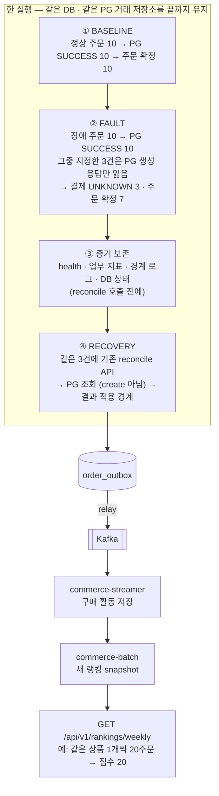
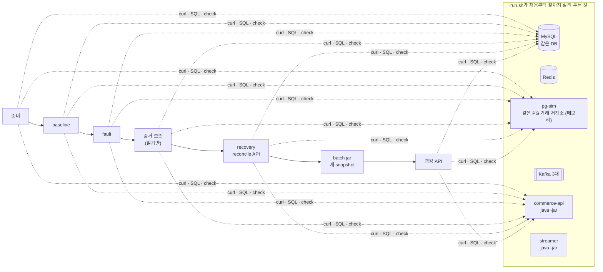

# 10주차 설계 — 결제 사고를 증거로 진단하고 같은 주문으로 복구하기

> - 표기: ✅ 합의 · 🔧 AI 기본값 · 🤔 결정 필요
> - 과제 원문: Notion 10주차 발제·실습 (비공개). 아래 "과제 요약"이 원문 정리본 (2026-11-23 읽음). 원문 export: `~/Downloads/Private & Shared*/10주차*.md`
> - 진행: D-1부터 하나씩 정한다.
> - 브랜치: `volume-10-claude` (기준 `a76bd0a6` = volume-9, upstream PR #150). 이 브랜치는 push하지 않는다.
> - 마감: 2026-11-27(금)

## 한눈에 보기



| 단계 | 대상 | 주문 확정 | 결제 UNKNOWN | PG SUCCESS 거래 | 누적 PG 거래 · create 호출 |
|---|---|---|---|---|---|
| baseline | 정상 집합 10 | 10 | 0 | 10 | 10 |
| fault | 장애 집합 10 | 7 | 3 | 10 | 20 |
| recovery | **같은** 장애 집합 10 | 10 | 0 | 10 | **20 그대로** (create 추가 0) |

| 핵심 구분 | 뜻 |
|---|---|
| health UP ≠ 주문 종결 | health는 "프로세스와 설정한 검사가 괜찮다"까지만 말한다. 주문 하나가 끝났는지는 말하지 않는다 |
| 완화 vs 복구 | 완화 = 새 피해를 막는다 (새 주문 중단). 복구 = 이미 영향받은 주문을 올바른 상태로 (같은 거래 조회·적용) |
| 조회 재시도 vs 결제 재시도 | UNKNOWN에 create를 다시 보내면 중복 결제다. 복구는 조회만 한다 |
| 대사(reconciliation) | 다른 경계(PG·결제·주문·예약·Outbox·구매 활동)에 저장된 같은 사실을 맞춰 보는 것 |

## 용어집 🔧 (11-23, 이 문서와 코드는 이 말만 쓴다)

| 말 | 코드·테이블 | 뜻 |
|---|---|---|
| 정상 집합 | baseline | 응답 유실을 끈 채 만든 서로 다른 주문 10개 |
| 장애 집합 | fault | 정상 집합과 겹치지 않는 주문 10개. 이 중 3개가 응답 유실 주문 |
| 응답 유실 주문 | | 장애 집합 중 **실제 ID로 미리 지정한** 3개. PG가 거래를 SUCCESS로 저장했지만 commerce-api는 생성 응답을 받지 못했다 |
| 결제 UNKNOWN | `payments.status = UNKNOWN` | "보냈을 수 있으나 결과를 모른다". 이때 주문은 `PAYMENT_PENDING`, 재고 선점은 `RESERVED` |
| PG 거래 | fixture의 transaction | PG 쪽에 저장된 거래. 생성 응답을 잃어도 거래는 남는다 |
| create 호출 수 | fixture `createCalls()` | PG가 받은 거래 생성 요청 수. 복구 중 늘면 안 된다 |
| 권위 조회 | `PaymentGatewayPort.findBy*` | PG에 "이 거래의 실제 상태"를 묻는 읽기. commerce 상태를 바꾸지 않는다 |
| reconcile | `POST /api/v1/orders/{orderId}/payment/reconcile` | PG 장부와 commerce DB를 맞춰 보기. 권위 조회(생성 아님) → 결과 적용 경계. W5의 고객용 결제 확인 API이고, 같은 일을 자동 스케줄러·PG callback도 부른다 (D-7) |
| 결과 적용 경계 | `PaymentResultApplier` | 결제·주문·재고 선점을 한 트랜잭션에서 바꾸는 유일한 곳 |
| 업무 지표 | (D-4에서 정함) | 미종결 결제 수처럼 "업무가 끝났는가"를 세는 Prometheus 지표 |
| 경계 로그 | (D-5에서 정함) | 주문·결제 시도·PG 거래·이벤트를 잇는 식별자를 남긴 구조화 로그 |
| 증거 위치 | `docs/week10/results/<실행 ID>/` | 실행마다 새로 만드는 기록 폴더. 실패한 실행도 남긴다 (D-9) |

## 과제 요약 (원문 정리)

<details>
<summary>발제 — 개념 (펼치기)</summary>

- **어디까지 끝났나**: 상품 조회 → 주문·재고 확보 → PG 거래 → 내부 확정 → Outbox → Kafka → 구매 활동 → 주간 랭킹. 앞 경계의 성공은 다음 경계를 보장하지 않는다.

  | 관찰 | 알 수 있는 것 | 아직 모르는 것 |
  |---|---|---|
  | health UP | 설정한 상태 검사 통과 | 특정 주문 종결 |
  | PG SUCCESS | 외부 거래 최종 성공 | 내부 TX 반영 |
  | 주문 CONFIRMED | 내부 결제·예약 적용 | 구매 활동 도착 |
  | Outbox PUBLISHED | broker 발행 확인 | consumer DB commit |
  | Batch COMPLETED | 실행 metadata 완료 | 기간·공개본의 업무 정확성 |

- 쿠폰은 PG 할인에 쓰지 않았으므로 Redis 쿠폰 실패를 결제 미확인의 원인으로 설명하지 않는다.
- **로그·지표·추적**: 로그 = 이 주문에 무슨 일이 / 지표 = 얼마나 늘었나 / 추적 = 어느 경계에서 기다렸나. traceId만으로 같은 업무라고 판단하지 않는다 (나중의 reconcile·배치는 다른 trace). 로그에 traceId 글자만 붙인 것은 분산 추적이 아니다.
- **비용**: orderId·userId를 metric label로 넣지 않는다 (시계열 폭증). 카드·인증 헤더·비밀키·개인정보는 남기지 않는다.
- **SLI/SLO**: 분모 = "유효한 PG 결제 요청을 수락한 고정 주문 집합". 최종 성공·최종 실패·처리 중·미확인을 구분해 정한 시점에 센다. 10건 통제 실험으로 99.9% SLO를 주장하지 않는다.
- **같은 증상, 다른 원인**

  | 가설 | 예상 관찰 | 구분 근거 |
  |---|---|---|
  | PG가 아직 처리 중 | 권위 조회도 PENDING | 같은 거래의 실제 최종 상태 |
  | PG 성공 응답을 잃음 | PG SUCCESS · 내부 UNKNOWN · 생성 응답 timeout | adapter 결과 · 같은 거래 조회 · 내부 상태 |
  | 성공 조회 뒤 내부 TX 실패 | PG SUCCESS · 적용 시도 · DB rollback | 조회 성공 로그 · TX 실패 · 예약/Outbox 상태 |

  PG SUCCESS + 내부 UNKNOWN만으로 2번과 3번은 구분되지 않는다. 주입 코드를 알아도 관측 증거가 같은 결론을 지지하는지 확인한다.
- **완화·복구**: 새 주문 중단(범위 고정) / 같은 거래 조회·조정(기존 주문 종결) / 재시작(외부 거래는 안 없어짐) / 코드 rollback(DB·PG 사실은 안 돌아감). DB를 직접 성공으로 바꾸지 않는다.
- **조회 재시도**: timeout ≠ 거래 없음. 조회 0건·복수 거래·금액 불일치·계속 PENDING이면 미확인 상태를 보존하고 멈춘다.
- **대사 질문**: 복구 중 create·거래 수가 늘지 않았나 / 재고를 다시 차감하지 않았나 / UNKNOWN 동안 예약을 반환하지 않았나 / 확정 주문마다 Outbox 사실이 있고 활동이 한 번인가 / 포인트·쿠폰이 바뀌지 않았나. 발행 횟수(재시도로 늘 수 있음)와 업무 활동 수를 같은 수로 보지 않는다.
- **주간 랭킹**: 늦게 저장된 활동이 이미 공개된 snapshot을 바꾸지 않는다 (W9 frozen input·revision). 주간 소속은 **내부에 처음 저장한 confirmedAt**. PG 요청 시각으로 바꾸지 않는다.
- **재현 가능한 기록**: 단계 사이에 DB·PG 거래를 초기화하면 같은 주문 복구가 아니다. 여러 프로세스면 같은 DB·거래 저장소·식별자를 썼다는 근거가 필요하다. checksum은 "안 바뀌었다"만 증명한다.
- **Runbook**: 시작(증상·영향 주문) / 진단(보존할 기록·가설·구분 질의) / 조치(권한·범위·한도·중단 조건) / 복구(같은 ID의 상태·효과·후속) / 재진입(실패 상태 보존·다음 조회) / 후속(원인·빠진 방어·검증 가능한 개선). "모니터링 강화" 대신 "미확인 주문의 나이·개수가 한도를 넘으면 같은 거래 조회 절차로 연결"처럼 쓴다.
- **설명할 질문**: health UP인데 왜 실패를 겪었나 / 두 가설이 같은 관찰을 예측할 때 무엇을 더 찾았나 / 어떤 식별자를 metric이 아닌 로그에 남기나 / 재시작·새 결제를 먼저 하지 않은 이유 / 복구한 주문과 검증 안 한 기능을 어떻게 구분했나.
- 참고: Spring Boot 3.4 Actuator Endpoints · Micrometer High Cardinality Tags · OpenTelemetry Context Propagation.

</details>

### §1 사고 범위와 정상 기준선

- 상황: 고객은 "결제 확인 중"을 보고, 프로세스 health는 UP. 통제할 경계 = **PG는 SUCCESS인데 응답을 잃어 내부 결제가 UNKNOWN으로 남음**.
- 기존 상품·사용자·주문 API와 실제 DB를 쓴다. W5 로컬 PG HTTP fixture와 같은 계정·주문·금액 계약을 재사용한다.
- fixture에 "거래 저장 뒤 응답 유실" 기능이 없으면 작은 제어를 추가한다. W5의 결과 조회·callback 검증·예약 소비/반환·중복 방지는 약화하지 않는다.
- 실제 카드·계정·외부 PG 장애·운영 DB 변경은 하지 않는다.
- 정상 10 · 장애 10, 서로 다른 주문. 실제 생성한 ID·paymentAttemptKey·providerOrderId·거래 키를 목록으로 묶는다 (ID를 정해진 값으로 덮어쓰지 않는다). 주문별 저장 금액을 대사한다.
- 예: 같은 공개 상품 1개씩. 재고는 두 집합의 예약을 감당하게 준비하고 기대 가용 수량을 시작 전에 계산한다.
- 단계마다 health 응답과 관찰 시점을 기록한다. health가 예상과 다르면 출력값을 고치지 말고 실제 설정·의존성을 확인한다.

### §2 필요한 관측 연결

- 이미 있음: `supports/monitoring`의 Actuator·Prometheus registry, `monitoring.yml`(health·prometheus 노출, management port 8081). **업무 지표·사고 fixture·분산 추적은 없다.**

  | 질문 | 필요한 기록 |
  |---|---|
  | 어떤 주문이 미확인인가 | orderId · attemptKey · 상태 · 상태 시각 |
  | PG에서 거래가 생겼나 | 같은 계정/주문/금액의 거래 키 · 최종 상태 · create 수 |
  | 어디서 결과를 잃었나 | adapter timeout 또는 조회 결과, 내부 적용·rollback 기록 |
  | 이후 업무는 어디까지 | Outbox 상태 · eventId · 구매 활동 · snapshot/publication |

- 실제 경계에 주문을 잇는 구조화 로그 + **업무 지표 하나** (예: `commerce.payment.unresolved` gauge를 DB 미종결 상태에서 갱신). UNKNOWN만 세면 PENDING 포함 지표와 이름·설명으로 구분한다.
- 지표의 관찰 범위·갱신 주기를 명시한다. 주기 갱신 gauge면 지연을 인정하고, 테스트는 유한한 대기 안에서 실제 값 변화를 확인한다. 상태 JSON 숫자를 Prometheus 원문처럼 저장하지 않는다.
- label은 유한한 상태·결과만. orderId·userId·traceId label 금지. 개별 식별자는 접근 제한된 로그·상태 기록에서 잇는다.
- 실제 Actuator health·Prometheus 응답을 받아 업무 지표의 존재·변화를 확인한다. 테스트 management port는 빈 포트로 정하고 실제 주입된 주소를 쓴다 (8081 가정 금지).
- 관리 endpoint를 인터넷에 열거나 `env`·`heapdump`를 열지 않는다.
- 분산 trace 수집은 선택. 했다면 PG/Kafka 문맥 연결과 끊기는 구간을 확인하고, 안 했다면 "분산 추적 완료"라고 쓰지 않는다.

### §3 같은 상태를 유지하는 사고 실험

- 한 테스트 lifecycle에서 **baseline → fault → 증거 보존 → recovery**. 같은 DB·테스트 PG 거래 상태를 유지하는 단일 통합 테스트가 간단한 선택이다. 클래스·메서드 이름은 자유.

  ```
  BASELINE  응답 유실 OFF · 정상 10 수락 → fixture SUCCESS → 정상 조회/알림 → 내부 확정 · 증거 보존
  FAULT     장애 10 중 고정한 3개만 거래 SUCCESS 저장 뒤 생성 응답 유실
            그 3개의 callback·자동 reconcile은 관찰 시점까지 보류 · 나머지 7개는 정상 적용
            fault 상태·health·metric·경계 로그 보존
  RECOVERY  응답 유실 OFF, 같은 거래·DB 유지 · 같은 3개에 기존 reconcile API
            → 같은 거래 권위 조회 → 내부 적용 → Outbox/소비 → 새 랭킹 snapshot
            → create 추가 0과 같은 주문의 결과 확인
  ```

- callback·자동 조회 보류는 테스트 경계의 제어다 (제품 기능 삭제가 아님). W5 수동 reconcile에 새 scheduler를 요구하지 않는다.
- 3개는 실행 순서의 우연이 아니라 **실제 ID 목록**으로 지정한다. fixture는 거래 수·생성 호출 수·상태를 유지하고, **중복 create 시도를 기록해 테스트를 실패시킨다** (오류를 반환했다고 호출 사실을 지우지 않는다).
- 첫 수락 PENDING과 최종 SUCCESS를 구분한다. commerce DB에 UNKNOWN·CONFIRMED를 직접 쓰지 않는다.
- baseline·recovery에서 응답 유실이 꺼져 있음을 assert한다. 실패해도 finally로 자기가 켠 주입·보류를 해제하되, 거래·원문 증거를 초기화해 성공으로 바꾸지 않는다.

### §4 경쟁 가설을 증거로 판단

- 조치 전에 가설 최소 두 개와 예상 관찰을 적는다 (발제의 세 가설 표).
- PG SUCCESS + UNKNOWN 조합만으로 응답 유실과 DB 적용 실패를 구분하지 않는다. 경계 로그·TX 결과까지 잇고, 증거가 부족하면 **"미확정"** 이라고 적는다.
- 진단용 거래 조회는 읽기만 한다. reconcile은 결과를 적용하므로 **fault 상태 보존 전에 호출하지 않는다.**
- AI에게 합성 식별자의 원문 기록과 가설을 주고 예상·실제·판정을 비교시킬 수 있다. 주입 코드의 정답이나 AI의 확신으로 원인을 확정하지 않고, 상태 변경은 사람이 범위·중단 조건을 확인한 뒤 한다.

### §5 같은 주문을 제한적으로 복구

- 새 입력을 멈추고 영향받은 3개 목록을 고정 → response-drop 해제 → W5 **본인 주문 reconcile API**를 실제 controller·adapter·DB 경로로 호출.
- PG create를 다시 부르지 않는다. 같은 계정·주문·금액·거래를 검증한 SUCCESS만 기존 결과 적용 경계로.
- 조회 실패·0건·복수 거래·금액 불일치·계속 PENDING은 성공으로 바꾸지 않는다. 유한한 조회 뒤 상태 보존·중단.
- callback·재조회가 반복돼도 확정·예약 소비·Outbox 사실이 늘지 않는다. 남의 주문 조회·조정 금지는 유지.
- 복구 뒤 **같은 장애 집합 10개**를 새 DB 조회로 확인한다 (baseline·새 주문으로 10건을 채우지 않는다).

  | 검증 | 기대 |
  |---|---|
  | 장애 집합 내부 성공 · UNKNOWN | 10 · 0 |
  | 장애 집합 PG 거래 | 같은 10개, 모두 검증한 SUCCESS |
  | 복구 중 create 증가 | 0 |
  | 재고 | UNKNOWN 동안 예약 유지, 성공 때 추가 차감 없음 |
  | 기존 포인트·쿠폰 | PG 복구로 변하지 않음 |
  | 반복 reconcile/알림 | 같은 업무 사실로 수렴 |

### §6 복구된 사실의 후속 결과

- 같은 장애 집합 주문의 Outbox를 실제 relay·Kafka·consumer로 처리 → 주문의 품목 수·quantity에 맞는 활동이 **한 번씩** 저장. 발행 retry 수와 활동 수를 혼동하지 않는다.
- 그 활동을 W9 **새 snapshot**으로 고정해 주간 job 실행 → 랭킹 API 점수·순위 확인. 공개된 snapshot을 직접 고치지 않는다.
- 주문들이 같은 주에 처음 확정되도록 테스트 clock·기간을 정한다. baseline 활동도 같은 주면 기대 점수에 넣는다 (예: 같은 상품 정상 10 + 장애 10 → 점수 20). 주간 집계가 baseline을 몰래 빼지 않게 한다.
- 최초 confirmedAt이 주 경계를 넘으면 그 값의 주를 따른다. 저장된 confirmedAt을 PG 요청 시각·복구 시각으로 덮어쓰지 않는다.
- 이 연결 테스트가 W9 chunk restart·늦은 revision 회귀를 대신하지 않는다.

### §7 증거와 Runbook

- 실행마다 새 증거 위치. 연결할 수 있어야 하는 것: 실행·시각·단계와 두 주문 집합 / 주문별 시도·PG 거래·내부 상태·예약·생성 호출 수 / 실제 health·Prometheus 응답과 가설을 가르는 경계 로그 / 복구 전후 같은 ID 집합·create 추가 0·후속 활동·랭킹 결과 / fault 기록을 덮어쓰지 않았다는 확인·중간 실패 기록.
- marker·파일 존재로 통과시키지 않는다. assertion이 같은 식별자·상태·효과 수를 검증한다. fault 파일을 쓰면 hash를 함께 남긴다.
- `docs/runbook/week10.md`: 증상 · 진단 질의 · 조치 전제 · 중단 조건 · 복구 확인 · 재진입. 외부 거래가 불확실한데 DB를 강제로 바꾸거나 재결제하는 명령은 넣지 않는다.

### §8 누적 기능과 검증 범위

| 기능 | 확인할 기존 계약 |
|---|---|
| 상품·브랜드·좋아요·관리자 | 조회·삭제·소유권·과거 주문 보존·캐시 보호 |
| 포인트·주문·PG | 포인트 기록 보존, PG 단일 시도·예약·조회 조정 |
| 이벤트·Outbox | 실제 구매 활동, 발행 gap 복구·소비 중복 방지 |
| 쿠폰 | 총량·사용자 중복·동시 실행 수용·본인 목록 |
| 랭킹 | 실제 입력·같은 instance 재시작·revision·공개 API |
| 이번 사고 | 응답 유실 진단·같은 주문 복구·후속 결과 |

- 검사 예: `:apps:commerce-api:test --tests '*CheckoutIncidentTest'`, `'*PaymentIntegrationTest'`, `'*CouponIssueConcurrencyTest'`, `:apps:commerce-batch:test --tests '*RankingJobRestartTest'`, `:apps:commerce-api:check :apps:commerce-streamer:check :apps:commerce-batch:check` (이름은 실제 테스트에 맞춘다).
- 연결 테스트의 배치 코드는 테스트 구성으로 재사용하거나 별도 실행을 조율한다. **production application끼리 의존성을 억지로 추가하지 않는다.**
- 테스트 0건·skip·연결 실패는 통과가 아니다. 예전 UP-TO-DATE 기록을 새 증거로 쓰지 않는다.
- 끝날 때 **이번 실행이 소유한** 서버·consumer·스레드·컨테이너만 정리한다.
- **제출**: 관측·사고 fixture·연결 테스트 코드와 PR, 사고 증거, runbook, 기능별 검증 범위·남은 위험, 기술 글. 로컬 통제 사고·회귀 성공과 운영 배포·실계정·부하·모든 장애 검증을 구분한다.

### Checklist (원문)

**관측과 진단**
- [ ] 실제 health·업무 지표·식별자별 경계 기록으로 증상을 설명한다.
- [ ] 최소 두 가설의 예상과 실제를 비교하고 부족한 증거도 표시한다.
- [ ] 비밀값·개인정보를 남기지 않고 metric label의 무한 증가를 피한다.

**동일 업무 복구**
- [ ] 같은 DB·PG 거래 상태를 유지해 baseline→fault→recovery를 이어 간다.
- [ ] 장애 집합은 7·UNKNOWN 3·PG 성공 10이며 같은 집합을 10·0·10으로 복구했다.
- [ ] create 추가 0, 예약·재고·포인트·쿠폰 불변 조건과 중복 적용 방지를 확인했다.
- [ ] 복구 주문의 실제 Outbox·Kafka·구매 활동·주간 랭킹 API를 연결했다.

**증거와 종료**
- [ ] fault 원문을 보존하고 runbook에 중단·재진입 조건을 남겼다.
- [ ] 관련 누적 회귀·lint·ArchUnit 결과와 미검증 위험을 구분했다.
- [ ] 자신이 시작한 테스트 자원만 정리했으며 운영 완료를 주장하지 않는다.

### 기술 글 (원문)

- "어떤 증거가 판단을 바꿨고, 어디까지 복구했다고 말할 수 있는지" — 저장소 Markdown·Issue·블로그 중 하나.
- 주제 예: health와 주문 결과가 다르게 말한 이유 / 응답 유실과 DB 적용 실패를 구분한 관찰 / 로그·업무 지표·추적의 역할과 남은 공백 / 새 create 없이 같은 주문을 복구한 방법 / 예약·Outbox·구매 활동 대사에서 발견한 문제 / 복구 시점과 confirmedAt을 구분한 이유 / 운영자용 중단·재진입 조건 / AI의 원인 추측을 증거로 검증한 과정.
- 기준: 상황·예시(같은 주문의 장애·복구 상태와 실제 관측) / 개념(관측·가설·완화·대사를 자기 말로) / 판단·이유(조치, 지킨 불변 조건, 검증 안 한 위험).

## 기존 자산과 함정 (코드 확인 2026-11-23)

| # | 사실 | 이번 과제에 주는 뜻 |
|---|---|---|
| 1 | reconcile API 있음: `POST /api/v1/orders/{orderId}/payment/reconcile` → `PaymentReconcileService` → `PaymentResultApplier.reconcile`. 본인 결제만 (`getMyPayment(userId, orderId)`) | 복구는 새 코드가 아니라 **이 API를 3번 부르는 것** |
| 2 | `reconcile`은 create를 부르지 않는다. 거래 키가 있으면 단건 조회, 없으면 providerOrderId 목록 조회. 0건 → `NOT_FOUND`, 여러 건 → `MULTIPLE:n`, 조회 불가 → `UNAVAILABLE`을 `lastCheckResult`에 남기고 상태는 그대로 | §5 중단 조건(0건·복수·조회 실패)이 이미 코드에 있다. 식별·금액이 다르면 `MISMATCH`로 반영하지 않는다 |
| 3 | 응답 유실 1건 시나리오가 이미 있음: `S04ResponseLostScenarioTest` — `delayNextCreateResponse(1s)` > 생성 읽기 timeout → 결제 UNKNOWN · 거래 키 null · 주문 `PAYMENT_PENDING` · 선점 `RESERVED` · `createCalls()` 1 | 이번 과제는 사실상 **S04를 10건 중 3건으로 키우고, 관측과 후속(랭킹)까지 잇는 것** |
| 4 | `LocalTestPgServer`(테스트 안 HTTP 서버) 제어는 "다음 create 1번"짜리 큐. 주문 ID로 지정하는 제어 없음. 중복 create를 실패로 만드는 장치 없음 (카운터만) | §3 요구에 맞게 **주문 ID 지정 응답 유실 + 중복 create 감지**를 추가해야 함 (D-2) |
| 5 | PG HTTP 클라이언트는 JDK `HttpClient` — HttpURLConnection의 POST 몰래 재전송(`retryPost`) 함정은 W5에서 이미 피함 | 응답 유실이 create 2번이 되지 않는다는 근거. 테스트에서 create 수로 다시 확인 |
| 6 | test 프로필은 `payment.scheduler.enabled=false` → 자동 reconcile·정리·만료 스케줄러 빈이 없다. 운영 설정은 reconcile 5s · 만료 60s 주기, **30분 넘게 모르는 결제는 `FAILED(EXPIRED)` + 재고 반환** | JUnit이면 "자동 조회 보류"가 저절로 된다. 진짜 프로세스로 돌리면 스케줄러를 끄거나 30분 안에 끝내야 한다 |
| 7 | 확정 시각은 결과 적용 시점의 `ZonedDateTime.now()` (Clock 주입 없음) | 응답 유실 주문 3건의 confirmedAt = **reconcile한 시각**. 실행이 UTC 월요일 00:00을 넘기면 다른 주가 된다 (D-3·D-8) |
| 8 | Actuator health·prometheus 노출, management port 8081, liveness·readiness probe. main 코드에 `MeterRegistry` 사용 0 | 업무 지표는 처음부터 만든다 (D-4). 테스트는 빈 management port 필요 |
| 9 | 후속 경로: `OrderConfirmedRecorder` → `order_outbox` → relay → Kafka → commerce-streamer 구매 활동 consumer → `product_purchase_activity` UNIQUE(order_id, product_id) → commerce-batch weeklyRanking → `GET /api/v1/rankings/weekly` | W7·W9 그대로 재사용 |
| 10 | W9 `docs/week9/c7/run.sh`가 진짜 프로세스를 이어 붙인다: MySQL 1 · Kafka 3대 · python `pg-sim`(`docs/week6/k6/pg-sim.py`) · streamer jar · batch jar, commerce-api 막은 `isolatedRun` Gradle task. `pg-sim`에는 auto/hold 모드와 `/_stats`만 있고 응답 유실 제어는 없다 | `pg-sim`에 응답 유실·중복 create 감지를 넣어야 한다 (D-2) |
| 11 | 과제 원문: production application끼리 의존성 금지 | commerce-api 테스트가 commerce-batch·streamer 코드를 바로 import할 수 없다 (D-1) |

## 설계 항목

> 이번 주 핵심은 **무엇을 보고 어떻게 판단했나** (관측 → 가설 → 확인 → 복구 → 대사)다. 사고를 만드는 무대(D-1·D-2·D-3)는 기본값으로 빨리 끝내고, 시간은 핵심 항목에 쓴다.
>
> - **같이 정함 (핵심)**: D-4 업무 지표 · D-5 경계 로그 · D-6 가설·진단 · D-7 복구·중단 조건 · D-10 runbook · D-12 분산 추적(선택, 도전)
> - **초안 보고 확인만**: D-8 대사 목록 · D-9 증거 기록 · D-11 회귀 범위
> - **무대 (정함)**: D-1 · D-2 · D-3

| ID | 정할 것 | 상태 |
|---|---|---|
| D-1 | **연결 방식** — 모든 앱 진짜 프로세스, run.sh가 curl·SQL로 실행하고 `check`로 검증 | ✅ 11-23 |
| D-2 | **응답 유실 제어** — `docs/week10/pg-sim.py`(복사), 주문 ID로 지정 · callback 보관 · 중복 create 기록 | ✅ 11-24 |
| D-3 | **주문 집합과 기대값** — 사용자 1 · 상품 1(SQL) · 20주문 × 1개, 2·5·8번째가 응답 유실 | ✅ 11-23 |
| D-4 | **업무 지표** — `commerce.payment.unresolved{status=PENDING\|UNKNOWN}` gauge, 읽을 때 DB에서 셈 | ✅ 11-23 |
| D-5 | **경계 로그** — 결제 경계 ①~⑤에 `orderId`·`paymentId`·`providerOrderId`를 함께 | ✅ 11-23 |
| D-6 | **가설과 진단** — DB만으로는 가설 2·3이 같다 → 로그 ②⑤·trace로 가른다. PG 조회는 curl 직접 | ✅ 11-23 |
| D-7 | **복구 절차와 중단 조건** — 응답 유실 주문 3건에 고객 reconcile API 1번씩 + 반복 1번, SUCCESS 아님·create 증가면 중단 | ✅ 11-24 |
| D-8 | **대사 목록** — create 0 · 재고 · 예약 · 포인트·쿠폰 · Outbox · 구매 활동 · 랭킹 점수 | ✅ 11-24 |
| D-9 | **증거 기록** — 위치·형식·hash·실패 실행 보존 | ✅ 11-24 |
| D-10 | **runbook** (`docs/runbook/week10.md`) 구성 | ✅ 11-24 |
| D-11 | **회귀 범위와 정리** — 기능별 확인·미검증 위험 표, 자기 자원만 정리 | ✅ 11-24 |
| D-12 | **분산 추적 (선택 과제, 도전)** — Tempo(OpenTelemetry · OTLP), (가) 설정·1줄로 HTTP·발송 풀·PG·Kafka 잇기 → 끝나면 (나) Outbox 문맥 저장 | ✅ 11-24 |

### D-1. 연결 방식 ✅ 11-23

**결정**: `docs/week10/run.sh` 하나가 모든 프로세스의 수명을 소유하고, 사용자·운영자처럼 **curl로 호출하고 SQL로 확인**한다. commerce-api도 streamer·batch처럼 `java -jar` 진짜 프로세스다. 연결 실행용 JUnit 막은 만들지 않는다 (W9 `isolatedRun` 막 방식은 쓰지 않음).



| 파일 | 역할 |
|---|---|
| `docs/week10/run.sh` | 자원 띄우기 → 준비 → baseline → fault → 증거 보존 → recovery → batch → 랭킹 → 검사 결과 요약 → 자기 자원 정리 |
| `docs/week10/sql/*.sql` | 진단·확인 질의. run.sh와 runbook(D-10)이 **같은 파일**을 쓴다 |
| JUnit | 새로 만든 코드의 단위만 (예: 업무 지표가 DB 상태를 세는지). 평소 `./gradlew test`에 들어간다 |

**검사 규칙** (과제 "marker·파일 존재로 통과시키지 않는다"):
- 모든 확인은 `check "이름" 기대값 실제값` 함수 하나로 한다. 틀리면 그 자리에서 멈추고, 조사할 수 있게 자원·기록을 남긴다.
- 검사 결과를 `checks.tsv`(이름 · 기대 · 실제 · 통과)로 남기고, 끝에 "검사 N개 중 N개 통과"를 출력한다. 값은 같은 ID 목록을 기준으로 비교한다.
- PR 본문에 "연결 테스트 = `docs/week10/run.sh`, 검사 N개"라고 적는다 (과제 예시 이름 `CheckoutIncidentTest` 대신).

| 이 방식이 주는 것 | 이 방식이 요구하는 것 |
|---|---|
| 모든 앱이 진짜 프로세스 → production application끼리 의존하지 않는다 (§8) | "같은 DB·같은 PG 거래 저장소"의 근거를 남긴다 — MySQL 컨테이너 ID, pg-sim PID·시작 시각, 단계 사이 ID 목록 파일 (D-9) |
| health·Prometheus가 **진짜 서버의 management 포트** 응답이다 (§2) | management 포트를 빈 포트로 정해 넘기고, 그 주소로 부른다 (8081 가정 금지) |
| runbook 명령(curl·SQL)을 실제로 돌려 본 셈이다 | commerce-api에 `--payment.scheduler.enabled=false`를 준다. 안 주면 5초마다 자동 reconcile이 3건을 먼저 고친다 (자산 #6). relay 스케줄러는 켜 둔다 (진짜 relay) |
| W9의 "월요일 00:00 UTC 근처면 실행 거부"를 그대로 가져온다 → 복구한 3건이 다른 주로 갈리지 않는다 (자산 #7) | Redis 컨테이너 1개 추가 (commerce-api가 cache·쿠폰에 쓴다). api 테이블은 W9처럼 `ddl-auto=update`, 랭킹 테이블은 `docs/week9/schema.sql` |
| pg-sim은 run.sh 동안 계속 살아 있다 → 단계가 바뀌어도 거래가 남는다 | pg-sim에 응답 유실 지정 · callback 보류 · 중복 create 감지를 넣는다 (D-2). `LocalTestPgServer`는 이 실행에서 쓰지 않는다 |

### D-2. 응답 유실 제어 ✅ 11-23 (복사) · 11-24 (제어 구성)

**결정**: `docs/week6/k6/pg-sim.py`를 `docs/week10/pg-sim.py`로 복사해 고친다 (W6·W9 실행 도구는 그대로 둔다). 실행 때 쓴 파일의 sha256을 증거에 남긴다.

| 추가할 제어 | 이유 |
|---|---|
| `POST /test/drop {"orderIds": [...]}` — PG 주문 식별자(`LP-ORD-…`)로 응답 유실 지정, `[]`면 해제 | 과제: 실행 순서의 우연이 아니라 실제 ID 목록으로 |
| 지정한 주문의 create: 거래 저장 → 1초 뒤 SUCCESS, **callback은 보관**, 응답은 **5초 늦게** | 생성 읽기 timeout 3초를 넘겨 commerce-api가 "읽기 실패" 로그를 남긴다 (가설 2의 증거, W5 S04와 같은 방식). callback을 보관하지 않으면 3건이 저절로 복구된다 |
| `POST /test/callbacks/release` — 보관한 callback 전송 | 복구 뒤 "callback이 반복돼도 같은 사실로 수렴"(§5) 확인 |
| `GET /test/stats` — 주문별 create 수 · 중복 create 수 · 응답 유실 목록 · 시작 시각 · PID · create의 `traceparent`(D-12) | create 추가 0 · 중복 0 · baseline·recovery에서 "유실 꺼짐" · 같은 거래 저장소의 근거. 중복 create는 거절하지 않고 **기록**한다 |
| `GET /test/transactions` — 거래 전부 (거래 키 · PG 주문 식별자 · 금액 · 상태) | D-8 "PG 거래 = 같은 10개, 거래 키 같음" |

- 경로: PG 계약(`/api/v1/payments`)은 commerce-api가, **실험용 경로(`/test/...`)는 run.sh만** 부른다. 진짜 PG에는 없는 경로라는 표시다. W6 전용 기능(hold 모드 · complete-all · `_pending`)은 뺐다.
- 함정: PG 생성 회로는 최근 10번 중 50% 실패면 열린다. baseline 10건 성공 뒤 timeout 3건은 30%라 닫혀 있다 → **baseline을 반드시 먼저** 돌린다.

### D-3. 주문 집합과 기대값 ✅ 11-23

**결정**: 가장 단순하게. 준비 데이터에 시간을 쓰지 않는다.

| 준비 데이터 | 만드는 방법 |
|---|---|
| 사용자 1명 | **SQL INSERT 한 줄** — 회원가입 API가 없다 (X-USER-ID 식별만, USR-01) |
| 브랜드 1 · 상품 1 (재고 100, 가격 10,000) | **SQL INSERT** (`docs/week10/sql/seed.sql`) — 관리자 API는 ADMIN 역할 인증이 필요한데 진짜 프로세스에는 로그인 수단이 없다 (항상 403). 11-24 구현 중 바꿈 |
| 주문 20건 | 주문마다 그 상품 1개, PG 결제. `POST /api/v1/orders` → `POST /api/v1/orders/{id}/confirm` |

- 사용자가 1명이라 reconcile의 "본인 주문만" 조건이 저절로 맞는다.
- 응답 유실 주문 = 장애 집합에서 **만든 순서 2·5·8번째**. run.sh가 장애 주문 10건을 먼저 만들고(ID 확정), 그 3건의 실제 orderId를 파일에 남긴 뒤 pg-sim에 알려 주고, 그다음 10건을 확정한다. PG 주문 식별자는 `LP-ORD-%010d`(orderId)라 미리 계산할 수 있다.
- 단계마다 다음 값을 기대한다. 재고는 선점할 때 이미 빠지므로 복구 뒤에도 80이다 (79면 이중 차감).

| 시점 | 상품 재고 | 선점 RESERVED · CONSUMED | 주문 확정 | 결제 UNKNOWN | PG 거래 · create 호출 |
|---|---|---|---|---|---|
| 시작 | 100 | 0 · 0 | 0 | 0 | 0 · 0 |
| baseline 뒤 | 90 | 0 · 10 | 10 | 0 | 10 · 10 |
| fault 뒤 | 80 | **3** · 17 | 17 | **3** | 20 · 20 |
| recovery 뒤 | **80** | 0 · 20 | 20 | 0 | **20 · 20** |
| 랭킹 API | 상품 점수 **20** (정상 10 + 장애 10, baseline을 빼지 않는다) | | | | |

### D-4. 업무 지표 ✅ 11-23

**목적**: health는 "서버가 살아 있나"에만 답한다. "사용자 결제가 끝났나"에 답하는 숫자를 내보내, 사고 중 **health UP인데 결과 모르는 결제 3건**이라는 대비를 보인다.

**결정**: `commerce.payment.unresolved` gauge, label `status` = `PENDING` | `UNKNOWN` 두 값. `/actuator/prometheus`를 **읽을 때마다** DB에서 `SELECT COUNT(*) FROM payments WHERE status = ?`로 센다 (주기 없음).

```
GET /actuator/prometheus  (run.sh curl · 운영에서는 Prometheus 서버가 주기적으로)
  → Micrometer가 등록된 함수 실행 → COUNT(*) 2번 (UNKNOWN · PENDING)
  → commerce_payment_unresolved{status="UNKNOWN"} 3.0
    commerce_payment_unresolved{status="PENDING"} 0.0
```

| 결정 | 이유 |
|---|---|
| gauge (counter 아님) | counter는 누적이라 늘기만 한다. 이 값은 사고 때 3, 복구 뒤 0으로 **줄어야** 한다 |
| PENDING · UNKNOWN 나눔 | PENDING만 늘면 PG 지연 쪽(가설 1), UNKNOWN이 늘면 응답 유실 쪽(가설 2)이라는 첫 힌트. 확정은 D-6에서 증거로 |
| 읽을 때 센다 | 정할 주기 숫자가 없고 값이 늦지 않다. 비용은 읽을 때마다 count 2번 — `(status, next_check_at)` 인덱스로 가볍다 |
| label에 orderId·userId 없음 | label 값이 2개로 고정 → 시계열이 늘지 않는다. 어느 주문인지는 로그·SQL에서 찾는다 (D-5) |
| 숫자를 바꾸는 것은 DB 결제 상태뿐 | 주소를 열어도 값은 안 바뀐다. 사고(→ UNKNOWN)와 복구(→ SUCCESS)만 바꾼다 |

- 서버가 여러 대면 모든 서버가 같은 전체 숫자를 보고한다 → 합(sum)이 아니라 최댓값(max)으로 본다. 지표 description에 적는다.
- 기대: baseline 뒤 UNKNOWN 0 · fault 뒤 3 · recovery 뒤 0 (health는 세 번 모두 UP).
- JUnit: 결제 상태별 행을 만든 뒤 지표 값이 그 개수와 같은지 (평소 `./gradlew test`).
- 선택 실험: 저장소의 `docker/monitoring-compose.yml`(Prometheus :9090, 5초마다 `host.docker.internal:8081` 수집 + Grafana :3000)을 띄워 3 → 0을 그래프로 본다. 과제 필수는 아니다.

### D-5. 경계 로그 ✅ 11-23

**목적**: 지표는 "3건이 막혔다"까지만 말한다. 로그는 **어느 3건이고, 어느 경계까지 갔나**를 말한다.

**지금의 문제** (코드 확인): 경계마다 남기는 식별자가 다르다 — adapter는 `providerOrderId`만, sender는 `paymentId`만. "주문 12번"으로 한 번에 grep되지 않고, 결과 반영 성공 줄·반영 TX 실패 줄이 없다.

**결정**: 결제 경계마다 한 줄, **같은 열쇠(`orderId` · `paymentId` · `providerOrderId`)를 항상 함께** 남긴다. 메시지 안에 `key=value`로 쓴다 (로컬 plain·운영 JSON 둘 다 grep된다).

```
① payment.requested      orderId=12 paymentId=5 attemptKey=… providerOrderId=LP-ORD-0000000012 amount=10000
② payment.create.result  orderId=12 paymentId=5 providerOrderId=… result=UNKNOWN cause=READ_TIMEOUT elapsedMs=3002 transactionKey=-
③ payment.lookup.result  orderId=12 paymentId=5 providerOrderId=… by=PROVIDER_ORDER_ID found=1 pgStatus=SUCCESS transactionKey=… source=RECONCILE_API
④ payment.apply          orderId=12 paymentId=5 providerOrderId=… from=UNKNOWN to=SUCCESS outcome=APPLIED source=RECONCILE_API
⑤ payment.apply.failed   orderId=12 paymentId=5 providerOrderId=… source=… error=…        ← 반영 TX가 실패했을 때만
⑥ (기존) relay · streamer 로그  eventId · orderId
```

| 가설 | 그 주문을 grep하면 보이는 것 |
|---|---|
| 1. PG가 아직 처리 중 | ③ `pgStatus=PENDING` |
| 2. PG 성공 응답을 잃음 | ② `UNKNOWN cause=READ_TIMEOUT elapsedMs≈3000`, ⑤ **없음** |
| 3. 성공 조회 뒤 내부 반영 실패 | ③ `SUCCESS`인데 ④ 대신 ⑤ **있음** |

- `source` = 결과를 반영한 경로 `DISPATCH`(생성 응답·발송 실패) · `CALLBACK` · `RECONCILE_API` · `SCHEDULER` · `DISPATCH_CLEANUP`(멈춘 발송 정리). "3건은 reconcile API로 복구했다"가 로그로 남는다.
- ② `result` = `ACCEPTED` · `SUCCESS` · `FAILED` · `REJECTED` · `NOT_SENT` · `UNKNOWN`, `UNKNOWN`의 `cause` = `READ_TIMEOUT`(기다리다 포기) · `READ_FAILED`(읽다 끊김) · `SERVER_ERROR`(5xx) · `UNREADABLE`.
- ④는 반영 트랜잭션이 **commit된 뒤**에 남긴다 — 안에서 남기면 commit이 실패해도 "반영했다"는 줄이 남는다. 발송 전·중(REQUESTED·SENDING)이라 조회를 건너뛰면 `payment.lookup.skipped`.
- 남기지 않는다: 카드 번호, 요청 헤더, PG 계정값. 사용자는 `paymentId`로 DB에서 찾는다.
- traceId는 같은 업무의 열쇠로 쓰지 않는다 — 발송은 다른 스레드, reconcile은 나중 요청이라 같은 주문이라도 trace가 다르다 (D-12).

### D-6. 가설·진단 ✅ 11-23

**핵심**: DB만 보면 가설 2와 3이 **같은 모양**이다 (코드 확인: 생성 응답을 받았는데 반영 TX가 실패하면 결제가 SENDING으로 남고, 정리 스케줄러가 UNKNOWN으로 넘긴다 — `PaymentSender.send`). 그래서 경계 로그(D-5)와 추적(D-12)이 필요하다.

| | 가설 1: PG 처리 중 | 가설 2: 응답 유실 | 가설 3: 응답은 받았는데 반영 TX 실패 |
|---|---|---|---|
| DB 결제 | PENDING · 거래 키 있음 | UNKNOWN · 거래 키 NULL | UNKNOWN · 거래 키 NULL (**2와 같음**) |
| PG 조회 | PENDING | SUCCESS | SUCCESS (**2와 같음**) |
| 로그 ② | `result=ACCEPTED` | `result=UNKNOWN cause=READ_TIMEOUT` | `result=ACCEPTED` |
| 로그 ⑤ | 없음 | 없음 | `payment.apply.failed` 있음 |
| trace PG 호출 span | 빠름 · 성공 | 약 3초 · timeout | 빠름 · 성공 |

**진단 순서** (모두 읽기만 — reconcile은 결과를 반영하므로 진단에 쓰지 않는다)

```
① 지표    UNKNOWN 3 · health UP                                → 서버는 살았는데 업무가 막혔다
② SQL     미종결 결제 목록 (orderId·paymentId·PG 주문 식별자·상태·거래 키·sent_at)  → 3건
③ PG 조회  PG 조회 API를 curl로 직접 (GET /api/v1/payments?orderId=LP-ORD-…, X-USER-ID: PG 계정)
          → SUCCESS 1건씩 · 금액 일치                            → 가설 1 기각
④ 로그    orderId로 grep → ② READ_TIMEOUT · ⑤ 없음              → 가설 2 지지 · 가설 3 기각
⑤ 추적    ② 줄의 traceId로 Tempo → PG 호출 span 약 3초 timeout    → 가설 2 보강
⑥ 판정표  가설 · 예상 · 실제 · 판정(지지/기각/미확정) → 증거 파일
```

- ③ PG 조회 = **PG 조회 API를 curl로 직접** (운영이라면 PG 관리 화면·조회 API). commerce-api 코드는 추가하지 않는다. PG 계정값은 증거 파일에 남기지 않는다.
- **미확정**: 증거가 빠지거나(예: 로그 ② 없음) 서로 어긋나면 원인을 "미확정"으로 적는다. 조치는 같다 — reconcile은 조회 뒤 반영이라 가설 2·3 어느 쪽이든 안전하다. 재결제·DB 직접 수정은 원인을 알아도 하지 않는다.
- AI 활용(과제 §4, 선택): 합성 식별자의 원문 기록과 판정표를 주고 예상·실제를 비교시킬 수 있다. AI의 판정은 증거와 대조한 뒤에만 쓴다.

### D-7. 복구 절차와 중단 조건 ✅ 11-24

**reconcile이 하는 일** — PG 장부와 commerce DB를 맞춰 본다. PG에 **조회만** 하고(생성 아님), 그 답을 결과 적용 경계가 반영한다. 응답 유실 주문 하나(PG 주문 식별자 `LP-ORD-0000000002`)로 보면:

```
                     PG 장부                          commerce DB
fault 뒤             LP-ORD-…02  SUCCESS · 주문 금액   결제 UNKNOWN · 거래 키 NULL · 주문 PAYMENT_PENDING · 선점 RESERVED
                          ▲
reconcile         PG 조회  GET /api/v1/payments?orderId=LP-ORD-…02   (거래 키가 없으니 PG 주문 식별자로 목록 조회)
                          │ 1건 · SUCCESS · 금액 같음
                          ▼
                  결과 적용 경계 (한 트랜잭션)
복구 뒤              (그대로)                          결제 SUCCESS · 거래 키 저장 · 주문 CONFIRMED · 선점 CONSUMED · Outbox 1줄
```

| PG 조회 결과 | 결과 적용 경계가 하는 일 | 결제 상태 |
|---|---|---|
| 1건 · 금액·식별자 같음 | 그 결과(SUCCESS/FAILED)를 반영 | 종결 |
| 1건 · 금액·식별자 다름 | 반영하지 않고 `MISMATCH:…` 기록 · 경고 로그 | 그대로 |
| 0건 | `NOT_FOUND` 기록 — 0건을 실패로 확정하지 않는다 | 그대로 |
| 2건 이상 | `MULTIPLE:n` 기록 · 경고 로그 | 그대로 |
| PG 응답 없음 | `UNAVAILABLE` 기록 | 그대로 |
| (이미 종결) | 같은 결과면 `ALREADY_APPLIED`, 반대면 `CONFLICT` | 그대로 |

- **왜 다시 결제(create)하지 않나**: PG는 이미 돈을 받았다. create를 다시 보내면 거래가 2건이 된다(이중 결제). reconcile은 "이미 있는 거래"를 찾기만 한다.
- **두 번 불러도 안전**: 두 번째는 결제가 이미 SUCCESS라 `ALREADY_APPLIED` — 주문·재고·Outbox가 다시 바뀌지 않는다.

**reconcile을 부르는 쪽 셋** (모두 같은 `PaymentResultApplier.reconcile`로 간다)

| 경로 | 부르는 쪽 | 이번 실험 |
|---|---|---|
| ① 자동 스케줄러 | commerce-api 자신. 미종결 결제를 5s→10s→30s→1m→5m 간격으로 다시 조회, 30분 넘으면 만료(FAILED + 재고 반환) | **끔** (`--payment.scheduler.enabled=false`). 켜 두면 3건을 먼저 고쳐 장애 상태를 볼 수 없다 |
| ② reconcile API | **고객 앱**의 [결제 확인] 버튼. X-USER-ID 본인 주문만. 종결 200 · 미종결 202 | **복구 경로.** run.sh가 주문 주인의 X-USER-ID로 부른다 |
| ③ PG callback | PG | **보관** → 복구 뒤 보내서 아무것도 안 바뀌는지 본다 |

**실험 복구 절차** (run.sh RECOVERY 막)

```
0. 전제    장애 집합 입력 끝 · 증거 보존 끝 · 응답 유실 주문 ID 파일(D-3) 있음
          응답 유실 해제(POST /test/drop []) · create 호출 수 기록 → C0 (= 20)
1. 복구    ID 파일의 3건만, 한 건씩 POST /api/v1/orders/{orderId}/payment/reconcile (X-USER-ID: 주문 주인)
          check  응답 200 · 결제 SUCCESS
          check  create 호출 수 = C0
2. 반복    같은 3건에 한 번 더 → 결제·주문·선점·Outbox 줄 수 그대로
3. callback 보관한 callback 보내기(POST /test/callbacks/release) → 그대로
```

| 중단 조건 (실험) | 할 일 |
|---|---|
| reconcile 결과가 SUCCESS가 아님 (202 · NOT_FOUND · MULTIPLE · MISMATCH · UNAVAILABLE) | 그 자리에서 run.sh 종료. 상태·증거를 지우지 않는다 — "실패한 실행"으로 남긴다 (D-9) |
| create 호출 수가 C0보다 늘었다 | 즉시 종료. 이중 결제 위험 — 원인을 찾기 전에는 다시 돌리지 않는다 |

**운영 runbook** — 다시 조회하는 일은 ① 스케줄러가 이미 한다. 사람이 나설 때만 적는다 (D-10).

| 상황 | 사람이 할 일 |
|---|---|
| 업무 지표 UNKNOWN > 0, `lastCheckResult` 없음·UNAVAILABLE | 기다린다 — 스케줄러가 간격을 늘리며 다시 조회한다. 지표가 줄어드는지 본다 |
| `NOT_FOUND`·`MULTIPLE:n`·`MISMATCH:…` | 스케줄러가 다시 조회해도 안 풀린다. PG 관리 화면·조회 API로 어느 거래가 맞는지 확인 |
| UNAVAILABLE이 계속되고 30분 만료가 다가온다 | 만료되면 FAILED + 재고 반환. 그 뒤 PG가 SUCCESS면 "만료 뒤 성공 — 환불 필요" 로그 → 환불 |

**하지 않는 것**: 결제 다시 생성 · DB에 UNKNOWN·CONFIRMED 직접 쓰기 · ID 파일 밖 주문 reconcile · 증거 보존 전 reconcile.

**알게 된 빈틈**: 운영자 전용 reconcile 경로가 없다. 운영자가 바로 고치려면 고객 X-USER-ID로 부르거나 스케줄러를 기다려야 한다. 이번에 만들지 않고 runbook "후속 개선"·"남은 위험"에 적는다.

### D-8. 대사 목록 ✅ 11-24

**대사** = 두 기록이 같은 사실을 말하는지 맞춰 보기. 범위는 **장애 집합 10개**(ID 파일 기준, §5 "baseline·새 주문으로 채우지 않는다"). 랭킹만 정상 집합을 더한 20. 질의는 `docs/week10/sql/reconcile-check.sql` 하나로, runbook "복구 확인"도 같은 파일을 쓴다.

| 대사 | 맞춰 보는 두 쪽 | fault 뒤 | recovery 뒤 |
|---|---|---|---|
| 결제 상태 | `payments.status` | SUCCESS 7 · UNKNOWN 3 | **10 · 0** |
| PG 거래 | pg-sim `/test/transactions` | SUCCESS 10 | **같은 10개** (거래 키가 fault 뒤와 같다) |
| 거래 키 | `payments.transaction_key` ↔ pg-sim 거래 키 | 7 일치 · 3 NULL | 10 일치 |
| 금액 | `orders.total_amount` ↔ `payments.amount` ↔ PG 거래 금액 | 같음 | 같음 · `orders.paid_amount`도 같음 |
| create 호출 | pg-sim `/test/stats` | 20 · 중복 0 | **20 · 중복 0** |
| 상품 재고 | `products` | 80 | **80** (79면 이중 차감) |
| 재고 선점 | `stock_reservations` | RESERVED 3 · CONSUMED 7 | 0 · 10 |
| 포인트·쿠폰 | `point_histories` · `user_coupon` 줄 수 | fault 뒤 값 기록 | **fault 뒤와 같음** |
| Outbox | `order_outbox` | 7줄 | 10줄 · 주문당 1줄 · 모두 발행됨 |
| 구매 활동 | `product_purchase_activity` | 7줄 | 10줄 · 주문당 1줄 · quantity 1 |
| 확정 시각 | `orders.confirmed_at` ↔ 구매 활동 `confirmed_at` | 3건 NULL | 같음 · 3건 = reconcile 시각 · 20건 모두 같은 주 |
| 반복 뒤 | reconcile 한 번 더 · 보관 callback 전송 뒤 위 전부 | — | **변화 없음** |
| 새 snapshot | `ranking_snapshot` | — | batch 1회 → 입력 20건 |
| 랭킹 API | `GET /api/v1/rankings/weekly` | — | 상품 점수 **20** · 1위 |

- 포인트·쿠폰: 이번 주문은 카드(PG)만 쓴다 → 둘 다 0 = 0인 약한 증거다. "포인트·쿠폰을 섞은 주문의 복구는 검증 안 함"을 남은 위험에 적는다 (D-11).
- Outbox `attempt_count`(발행 재시도 수)와 구매 활동 줄 수를 섞지 않는다 (§6).
- batch는 recovery 뒤 1번만 돈다. fault 뒤에 돌려 17을 먼저 보려면 같은 주 재실행(`--recompute`)이 필요해 단계가 늘어난다.

### D-9. 증거 기록 ✅ 11-24

**위치**: `docs/week10/results/<실행 ID>/` (W9 c7과 같은 방식, 실행 ID = `w10-YYYYMMDD-HHMMSS`). 커밋은 마지막 성공 실행 1개 + 글에서 쓴 실패 실행.

```
docs/week10/results/w10-20261124-231516/
├─ run.txt           실행 ID · 시작/끝 시각 · git commit · 쓴 jar 이름 · pg-sim.py sha256 · pg-sim PID · MySQL 컨테이너 ID · 포트
├─ ids/              baseline-orders.txt · fault-orders.txt · lost-orders.txt (3건)
├─ 1-baseline/       health.json · prometheus.txt(원문) · db.tsv(대사) · unresolved.tsv · pg-stats.json · pg-transactions.json · observed-at.txt
├─ 2-fault/          (같은 7개) + pg-lookup-<orderId>.json (진단 ③) · lost-orders-logs.txt (진단 ④) · traces/ (진단 ⑤) · hypotheses.tsv
├─ fault.sha256      2-fault/ 파일들의 sha256 (보존 직후 계산)
├─ 3-recovery/       (같은 7개) + reconcile-<orderId>.json · reconcile-again-<orderId>.json · callbacks-release.json · traces/ (Kafka 구간)
├─ 4-ranking/        batch.log · ranking.json
├─ logs/             api.log · streamer.log · pg-sim.log (Spring Security 임시 비밀번호 줄은 가림)
├─ checks.tsv        이름 · 기대 · 실제 · 통과
└─ summary.txt       "검사 N개 중 N개 통과" + 단계별 표 + 가설 판정, 또는 "실패: <검사 이름>"
```

| 규칙 | 어떻게 |
|---|---|
| 원문 그대로 | `prometheus.txt`는 `/actuator/prometheus` 응답 원문. 숫자만 뽑아 JSON으로 바꾸지 않는다 (§2) |
| fault 증거를 덮어쓰지 않았다 | 끝에서 `shasum -c fault.sha256` → check "fault 증거 그대로" |
| 같은 DB·같은 PG 거래 저장소 | 단계마다 pg-stats의 PID·시작 시각과 MySQL 컨테이너 ID가 run.txt와 같다 → check |
| 가설 판정 | `hypotheses.tsv` = 가설 · 예상 · 실제 · 판정. run.sh가 로그 ②⑤·trace에서 실제 값을 채운다 (D-6) |
| 실패해도 남긴다 | check가 틀리면 summary.txt에 실패한 검사 이름을 쓰고 멈춘다. 폴더·자원을 지우지 않는다 |
| 비밀값 | 카드 번호·PG 계정값은 run.sh 변수에만. 끝에서 증거 폴더 전체를 그 값으로 grep → 0건 check |

### D-10. runbook 구성 ✅ 11-24

`docs/runbook/week10.md` — 읽는 사람은 당직 개발자. 과제가 정한 6칸에 2칸을 더한다. 명령은 run.sh가 실제로 돌린 **같은 curl·같은 SQL 파일**이다.

| # | 칸 | 들어갈 것 | 출처 |
|---|---|---|---|
| 1 | 증상 | 고객 "결제 확인 중" · health UP · `commerce_payment_unresolved{status="UNKNOWN"}` > 0 | D-4 |
| 2 | 진단 질의 | 미종결 결제 목록 SQL → PG 조회 curl → 로그 grep → Tempo. 가설 판정표 양식 | D-5 · D-6 · D-12 |
| 3 | 조치 전제 | 영향 목록 고정 · 증거 보존 끝 · PG 조회로 SUCCESS·금액 일치 확인 · create 호출 수 기록 | D-7 |
| 4 | 조치 | 기본은 기다리기(자동 스케줄러). 바로 고쳐야 하면 reconcile API (지금은 고객용뿐) | D-7 |
| 5 | 중단 조건 | SUCCESS가 아님 · create 증가 · NOT_FOUND·MULTIPLE·MISMATCH · 30분 만료 임박 | D-7 |
| 6 | 복구 확인 | `reconcile-check.sql` · 지표 0 · 랭킹 점수 | D-8 |
| 7 | 재진입 | 중간에 멈춘 뒤 다시 해도 되는 이유(이미 종결이면 `ALREADY_APPLIED`)와 다시 시작 전 확인할 것(목록 파일 · create 호출 수) | D-7 |
| 8 | 하지 않는 것 · 후속 개선 · 남은 위험 | 재결제 · DB 직접 수정 금지 / 운영자 reconcile 경로 · 만료 뒤 성공 환불 자동화 / D-11 미검증 위험 | D-7 · D-11 |

### D-11. 회귀 범위와 정리 ✅ 11-24

**회귀 명령** (테스트 전부 + Checkstyle, ArchitectureTest 포함):

```bash
./gradlew --rerun-tasks :apps:commerce-api:check :apps:commerce-streamer:check :apps:commerce-batch:check
```

- 결과는 모듈별 `build/test-results/test/TEST-*.xml`에서 테스트 수·실패·skip을 세어 PR에 적는다. 0건·skip·UP-TO-DATE는 통과가 아니다 (§8) → `--rerun-tasks`.
- 고른 테스트만 돌리지 않고 세 앱 전부 돈다 — 고르는 판단이 틀릴 위험이 없다.

**기능별 검증 범위** (PR에 그대로 옮긴다)

| 기능 (§8) | 기존 대표 테스트 | 이번 run.sh |
|---|---|---|
| 상품·브랜드·좋아요·관리자 | `ProductAdminApiE2ETest` · `BrandDeleteFlowE2ETest` · `LikeConcurrencyTest` | 브랜드·상품은 SQL로 넣음 (관리자 API는 안 씀) · 주문 API가 상품을 재검증 |
| 포인트·주문·PG | `PaymentResultApplierIntegrationTest` · `S04ResponseLostScenarioTest` · `PointChargeConcurrencyTest` | 응답 유실 → reconcile, create 0 |
| 이벤트·Outbox | `OutboxInterruptionIntegrationTest` · `ConsumedOrderConfirmationTest` | 진짜 relay·Kafka·구매 활동 |
| 쿠폰 | `CouponQueueFlowE2ETest` · `CouponIssueServiceIntegrationTest` | 쓰지 않음 (줄 수 불변만) |
| 랭킹 | `WeeklyScoreRestartTest` · `RankingApiE2ETest` | 새 snapshot → 랭킹 API 20 |
| 이번 사고 | 새 JUnit: 업무 지표가 DB 상태를 센다 | run.sh 전체 (검사 N개) |

**미검증 위험** (남은 위험 — "운영 완료"라고 쓰지 않는다)

| 검증 안 함 | 왜 |
|---|---|
| 운영 배포 · 실제 PG · 부하 | 로컬 통제 사고만 |
| 포인트·쿠폰을 섞은 주문의 복구 | 이번 주문은 카드만 (D-8) |
| 서버 여러 대의 업무 지표 | 한 대만 띄움 (D-4는 max로 합친다고만 정함) |
| 복구 중 Kafka·DB 장애 | 이번 사고 범위 밖 |
| 월요일 00:00 UTC를 넘는 복구 | run.sh가 그 근처 실행을 거부해 피했을 뿐이다 |
| 운영자 reconcile 경로 | 없음 (D-7 빈틈) |

**정리**: run.sh가 띄운 것만 — 기록한 PID와 `$RUN-` 이름의 컨테이너·네트워크(MySQL · Redis · Kafka 3 · Tempo · Prometheus · Grafana). 성공이면 지우고, 실패면 남긴 채 지우는 명령을 출력한다 (W9 c7과 같음). `KEEP=1`이면 성공해도 남겨 Grafana로 본다. 원래 떠 있던 로컬 docker는 건드리지 않는다. trace는 Tempo를 지우기 전에 증거 폴더로 받는다.

### D-12. 분산 추적 (선택 과제) ✅ 11-23 — (가) 먼저, 끝나면 (나)

**목적**: 지표 = 몇 건이 막혔나, 로그 = 어느 주문인가, 추적 = **어디서 기다렸나**. 응답 유실 주문 하나의 trace를 열면 "PG 호출 구간이 약 3초 걸리고 timeout"이 보이게 한다.

```
trace 7f3a…   POST /api/v1/orders/12/confirm
├─ commerce-api  POST /api/v1/orders/{orderId}/confirm      45ms
└─ commerce-api  http post → pg-sim /api/v1/payments      3002ms  ✗ timeout
```

**수집 서버 = Grafana Tempo** (11-24 Zipkin에서 바꿈 — 요즘 많이 쓰는 쪽. 과제는 도구를 지정하지 않는다. 참고 문서는 OpenTelemetry Context Propagation):

```
commerce-api ─┐  OTLP HTTP        ┌─ Tempo :3200 ──┐
streamer ─────┴──────────▶ Tempo ─┤                ├─ Grafana (Explore: trace · 업무 지표)
                         :4318    └─ run.sh curl   │
commerce-api /actuator/prometheus ◀── Prometheus ──┘
```

- 보내는 쪽: `supports/logging`의 bridge를 Brave → **OpenTelemetry bridge + OTLP exporter**로 바꿨다. Tempo가 기본으로 받는 형식이 OTLP다.
- `management.otlp.tracing.endpoint`를 주지 않으면 exporter가 만들어지지 않는다 → 평소 실행·테스트는 아무 데도 보내지 않는다 (Zipkin reporter는 기본 주소로 계속 보내려 해 경고가 쌓인다).
- Tempo는 자체 화면이 없다 → run.sh가 Grafana를 같이 띄우고 Prometheus·Tempo를 데이터 소스로 넣는다. 업무 지표(3 → 0)와 trace를 한 화면에서 본다.
- 전파 형식은 그대로 W3C `traceparent` 헤더다. 로그의 `[traceId-spanId]`(Spring Boot 기본 형식)로 로그 줄과 trace를 잇는다.

**(가) 이번에 잇는 것** — 설정·1줄 코드

| 구간 | 지금 (코드 확인) | 할 일 |
|---|---|---|
| 고객 → commerce-api (HTTP 들어옴) | 자동 | — |
| 확정 → 발송 스레드 풀 | 끊김 (스레드가 바뀜) | `PaymentDispatchConfig` 풀에 `ContextPropagatingTaskDecorator` |
| commerce-api → PG (HTTP 나감) | 기록 안 됨 (`RestClient.builder()` 직접 생성) | adapter의 RestClient에 `observationRegistry` 연결 → `traceparent` 헤더가 PG로 나감 |
| relay → Kafka → streamer | 기록 안 됨 (KafkaTemplate · listener factory를 직접 만들어 `spring.kafka.*.observation-enabled`가 안 먹음) | `KafkaConfig` 템플릿, streamer listener factory에 `setObservationEnabled(true)` |
| 수집 | 전송처 없음, 샘플링 기본 10% | `micrometer-tracing-bridge-otel` + `opentelemetry-exporter-otlp`. run.sh가 Tempo 컨테이너를 띄우고 `--management.otlp.tracing.endpoint=…`를 준다. 샘플링 1.0은 `docs/week10/run.yml` |
| pg-sim | — | 받은 `traceparent`를 기록 → "헤더가 실제로 나갔다"는 증거 |

**잇지 않는 것 (끊김을 증거·문서에 남긴다)**

| 구간 | 왜 |
|---|---|
| PG → callback | PG는 우리 trace를 모른다 (실제 PG도 같다). callback은 새 trace |
| 확정 → `order_outbox` → relay | relay는 스케줄러가 따로 돈다 → 새 trace. **(나)에서 잇는다** |
| reconcile API | 고객(run.sh)의 나중 요청 → 새 trace. `orderId`로 연결 |
| batch | 다른 프로세스·나중 실행 → 새 trace. `snapshotId`로 연결 |

**run.sh check** (로그 → 추적 연결):
- 응답 유실 주문의 ② 로그 줄에서 traceId를 꺼내 Tempo API(`/api/traces/{traceId}`)로 받는다 → PG 호출 span이 3초 이상 · error, 같은 trace에 확정 요청 span.
- pg-sim이 그 create에서 받은 `traceparent`의 traceId가 같다.
- relay 발행 span(commerce-api)과 구매 활동 소비 span(commerce-streamer)이 같은 trace에 있다.

**(나) (가)가 끝나면** — Outbox에 trace 문맥 저장: 주문 확정 때 `order_outbox`에 `traceparent`를 같이 저장하고, relay가 그 문맥을 부모로 발행한다 → [결과 반영(reconcile) → Outbox → Kafka → streamer]가 한 trace. 비용: 컬럼 추가 · relay 코드 · 테스트.

## 실행 결과 (2026-11-24, `docs/week10/results/w10-20261124-231516/`)

**검사 135개 중 135개 통과** — `bash docs/week10/run.sh` 한 번, jar는 커밋 `f00c01f1`.

| 단계 | 재고 | 선점 RESERVED·CONSUMED | 확정 | 결제 UNKNOWN | 업무 지표 UNKNOWN | PG 거래·create | health |
|---|---|---|---|---|---|---|---|
| baseline | 90 | 0·10 | 10 | 0 | 0.0 | 10·10 | UP |
| fault | 80 | **3**·17 | 17 | **3** | **3.0** | 20·20 | **UP** |
| recovery | **80** | 0·20 | 20 | 0 | 0.0 | **20·20** | UP |
| 랭킹 | periodStart 2026-11-23 · 상품 1 점수 **20** · 1위 | | | | | | |

| 가설 | 실제 | 판정 |
|---|---|---|
| 1. PG가 아직 처리 중 | PG 조회 SUCCESS 3/3 | 기각 |
| 2. PG 성공 응답을 잃음 | ② `cause=READ_TIMEOUT` 3/3 · ⑤ 0줄 · PG 호출 span ≥ 3초 3/3 | 지지 |
| 3. 성공 조회 뒤 내부 반영 실패 | ② ACCEPTED 0/3 · ⑤ 0줄 | 기각 |

- 추적: 응답 유실 주문의 확정 요청 trace에 PG 호출 span(약 3초 · 오류)이 있고, pg-sim이 받은 `traceparent`의 traceId가 같다. (나)로 reconcile 요청 → relay 발행 → streamer 소비가 **한 trace**다.
- 반복 reconcile 3번 + 보관 callback 3건 전송 뒤 Outbox · 구매 활동 · 선점 · 재고 · create 수가 그대로다.

**성공 전에 멈춘 실행 4번** (실패 실행 폴더는 커밋하지 않았다 — 원인은 아래와 변경 이력)

| 실행 | 멈춘 곳 | 원인 | 고친 것 |
|---|---|---|---|
| 1 | commerce-api 시작 | 명령줄 `--datasource.redis.replicas[0].port`가 목록 항목을 통째로 바꿔 host가 빠짐 | host도 함께 준다 |
| 2 | 복구 뒤 Outbox 발행 대기 | `shedlock` 테이블(엔티티 아님)이 없어 relay가 매번 실패 — fault 단계 검사는 다 통과 | W7·W9·W10 DDL 파일을 차례로 적용 |
| 3 | fault: PG 호출 span | trace를 너무 일찍 읽었다 — 24ms짜리 확정 span만 먼저 도착하고 3초짜리 PG span은 아직 오는 중 | 기다린 span이 들어올 때까지 다시 받는다 |
| 4 | recovery: 구매 활동 로그의 traceId | `ls … \| head -1`이 이름 순으로 **지난주 streamer jar**를 골랐다 (Brave bridge, 전송처 없음) | jar를 지금 HEAD hash 이름으로 고른다 |

## 변경 이력

- 2026-11-23: 과제 요약·기존 자산과 함정·설계 항목 목록 작성 (브랜치 `volume-10-claude`, 기준 `a76bd0a6`).
- 2026-11-23: D-1 ✅ 연결 방식 = run.sh. commerce-api도 java -jar, curl·SQL로 실행, 검증은 쉘 `check` 함수. 처음 적은 '막마다 api JUnit'에서 바꿨다 — JUnit 안에서 JPA로 직접 저장하는 실행 도구가 어색하다는 지적.
- 2026-11-23: D-2 ✅ pg-sim은 `docs/week10/pg-sim.py`로 복사해 고친다 (제어 구성은 🔧). 설계 항목을 핵심·확인만·무대로 나눴다 — 데이터 세팅이 아니라 관측·판단이 이번 주 핵심이라는 지적.
- 2026-11-23: D-3 ✅ 사용자 1(SQL) · 상품 1(관리자 API) · 20주문 × 1개, 응답 유실 = 장애 집합 2·5·8번째.
- 2026-11-23: D-4 ✅ 업무 지표 = 결과 모르는 결제 수(PENDING·UNKNOWN), 읽을 때 DB COUNT. 처음 제안한 '5초마다 갱신'은 근거 없는 임시값이라 버렸다.
- 2026-11-23: D-5 ✅ 결제 경계 로그 ①~⑤ (같은 열쇠 orderId·paymentId·providerOrderId). 분산 추적(선택)에 도전하기로 해 D-12를 추가.
- 2026-11-23: D-12 ✅ 분산 추적 = Zipkin. (가) 먼저, 끝나면 (나) Outbox에 trace 문맥 저장.
- 2026-11-23: D-6 ✅ 진단 순서 ①~⑥, PG 진단 조회는 PG 조회 API를 curl로 직접 (commerce-api 코드 0줄).
- 2026-11-24: D-7 ✅ 복구 = 응답 유실 주문 3건에 고객 reconcile API를 1번씩 + 반복 1번 + 보관 callback. SUCCESS가 아니거나 create 호출 수가 늘면 중단. 처음 제안한 "3번·10초 다시 시도" 규칙은 자동 스케줄러와 겹쳐 뺐다. reconcile API를 운영자용으로 잘못 적었던 곳(D-12 표)을 고객용으로 고쳤다.
- 2026-11-24: D-8 대사 목록 · D-9 증거 기록 · D-10 runbook 구성 · D-11 회귀 범위와 정리 초안(🔧).
- 2026-11-24: D-2 제어 구성 · D-8 · D-9 · D-10 · D-11 ✅ — 설계 항목 12개 모두 합의. 구현 순서: pg-sim → 업무 지표 → 경계 로그 → run.sh → 분산 추적 (가) → runbook → 회귀·PR.
- 2026-11-24: 구현 ① pg-sim — 실험용 경로 이름을 `/_control/…`·`/_stats`에서 `/test/…`로 바꿨다 (`_`가 무슨 뜻인지 읽히지 않는다는 지적). `/test/transactions` 추가.
- 2026-11-24: 구현 ② 업무 지표 `commerce.payment.unresolved` (MeterBinder · 읽을 때 COUNT) + JUnit 3개.
- 2026-11-24: 구현 ③ 경계 로그 ①~⑤. 결과 적용 경계의 reconcile·apply·recordUnknown·closeUnclaimed에 `source` 인자를 더했다 — 기존 테스트의 호출 32곳은 인자만 더하고 기대값은 그대로. `PgUnknownResultException`에 이유(READ_TIMEOUT 등)를 담고 adapter 테스트 4개에 이유 확인을 더했다.
- 2026-11-24: D-12 수집 서버를 Zipkin → **Tempo**로 바꿨다 (요즘 많이 쓰는 쪽이라는 의견). bridge를 Brave → OpenTelemetry + OTLP로, run.sh에 Tempo · Prometheus · Grafana. (가) 발송 풀 문맥 전달 · PG RestClient 관측 · Kafka template·listener 관측.
- 2026-11-24: D-12 (나) 구현 — `order_outbox.trace_parent` (+ `docs/week10/schema.sql`), relay가 그 문맥을 부모로 발행.
- 2026-11-24: D-3 브랜드·상품을 관리자 API → SQL(`docs/week10/sql/seed.sql`)로 바꿨다 — 관리자 API는 ADMIN 인증이 있어 진짜 프로세스에서 부를 수 없다.
- 2026-11-24: run.sh 첫 두 실행은 준비 단계에서 멈췄다 — ① Redis replica 목록을 명령줄로 주면 항목이 통째로 바뀌어 host가 빠졌다 ② `shedlock` 테이블(엔티티 아님)이 없어 relay가 돌지 않았다 → W7·W9·W10 DDL 파일을 차례로 적용하게 고쳤다.
- 2026-11-24: run.sh 3·4번째 실행 실패 원인(trace를 너무 일찍 읽음 · 지난 jar를 고름)을 고쳐 5번째 실행에서 검사 135개 통과. 증거 `docs/week10/results/w10-20261124-231516/`.
