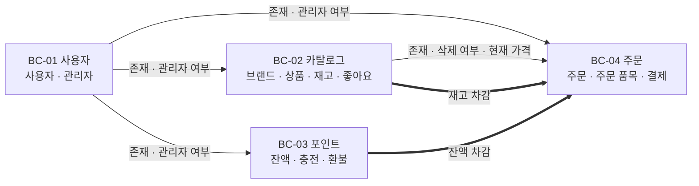
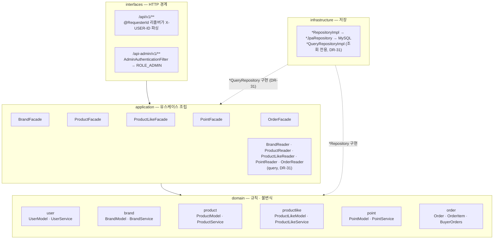

# 설계 문서 — 브랜드·상품·좋아요 / 포인트·주문 / 관리자

입력: 요구사항 정의서 (5장 정합성 검사 통과 상태)
작성 기준: 「설계 문서 작성 가이드」
진행 상태: **1~5장·부록 작성 완료. W6 주문 확정 이벤트·구매 활동은 6장, DR-39~45. 코드 구현 완료, 5-8 완료 조건 검사 완료.** 요구사항 정의서에 설계 피드백 반영 완료(requirements.md). 구현 중 확정한 판단은 DR-23~28.
사전 확정: 모든 테이블의 식별자는 Long 자동 증가, 공통 컬럼 `created_at`·`updated_at`·`deleted_at` (DR-01, DR-16)

---

## 0. 버드뷰

본문에 들어가기 전에 전체를 한 장으로 본다. 상세와 근거는 각 장에 있고, 여기는 지도만 둔다.

### 0-1. 도메인 지도

바운디드 컨텍스트 4개와 의존 방향. 실선은 조회, 굵은 선은 상태 변경. 표는 2-3, 컨텍스트 정의는 2-1.



순환 없음. BC-04 주문이 유일한 하류 종점이고, 재고·잔액을 바꾸는 쓰기 의존은 주문 확정(FR-ORDER-02) 한 곳에서만 일어난다.

### 0-2. 계층 지도

각 층에 놓인 것과 의존 방향. 패키지는 `com.loopers.{interfaces,application,domain,infrastructure}.<ag>`, `<ag>`는 AG 단위(5-0). BC는 패키지가 아니라 문서와 `ArchitectureTest`의 BC→AG 매핑으로만 존재한다(DR-29). 실선은 호출·의존, 점선은 구현(의존성 역전). domain은 아무것도 의존하지 않고, infrastructure가 domain의 Repository 인터페이스를 구현하며 domain 쪽으로 의존한다(ArchUnit `ArchitectureTest`). 조회 전용 Repository만 예외로 인터페이스가 `application.<ag>.query`에 있어 infrastructure가 application 쪽으로 의존한다(DR-31).



- 관리자 판정은 두 번 일어난다. 필터가 HTTP 경계에서 막고, Facade·Reader가 `UserService.getAdmin`으로 다시 확인한다(DR-25).
- Facade는 BC 경계를 넘는 조립을 맡고, 도메인 서비스는 자기 BC 안의 규칙만 가진다(같은 BC의 다른 AG Service·Repository는 부를 수 있다). BC 간 호출 허용 표는 5-6, AG 간 의존 규칙은 5-1~5-3.
- 조회는 Facade가 아니라 Reader가 맡는다(DR-31). Reader는 조회 Repository로 같은 BC 안 AG를 조인해 전용 조회 DTO로 돌려준다. Facade는 명령(쓰기)만 가진다.
- 요청은 interfaces → application → domain 순으로 내려가고, 저장이 필요하면 domain의 Repository 인터페이스를 통해 infrastructure 구현체가 실행된다. 도메인은 JPA를 모른다.

### 0-3. 범위

| 구분 | 내용 |
|---|---|
| 이번 주차에 다루는 것 | 고객 API 13개(브랜드·상품 조회, 좋아요, 포인트 충전·조회·환불, 주문 생성·확정·조회) + 관리자 API(브랜드·상품·재고·포인트·주문). 목록은 4-2 |
| 다루지 않는 것 | 배송, 주문 취소·수정, 쿠폰·할인, 외부 결제, 가입·로그인·인증, 관리자 권한 관리, 키워드 검색, 동시성 하의 불변식 유지(주문 확정의 재고·잔액 차감은 예외, 요구 변경 DR-34). 근거는 요구사항 정의서 1-3 |
| 설계에서만 고려한 것 | 포인트 이력, 충전금 단위·유효기간 (요구사항 정의서 1-3, 부록 A) |

---

## 1. 시스템 (Level 1)

### 1-1. 제약 입력

| CON-ID | 제약 | 근거 |
|---|---|---|
| CON-01 | API 경로·메서드는 원문 표에 적힌 것을 그대로 쓴다. 원문에 없는 추가 기능의 경로는 ASM-23에서 정한다 | 과제 조건 |
| CON-02 | 고객 API는 `/api/v1`, 관리자 API는 `/api-admin/v1`로 분리한다 | 과제 조건 |
| CON-03 | 고객 API·관리자 API 모두 요청자를 HTTP 헤더 `X-USER-ID`로 식별한다. 관리자 API도 같은 헤더의 값으로 관리자를 확정한다. 값의 형식·검증 방식·식별 실패의 세분화는 설계에서 정한다 (ASM-01, ASM-26) | 과제 조건 |
| CON-04 | 모든 테이블의 식별자는 Long 자동 증가이고, 공통 컬럼 `created_at`·`updated_at`·`deleted_at`을 가진다 | 팀 조건 (DR-01, DR-16으로 요구사항에 올림) |

### 1-2. 팀 고정 결정

가이드 1-2와 동일. 벗어나는 항목 없음. 여기에 더해 이번 프로젝트에서 확정한 것:

| 항목 | 결정 | 근거 |
|---|---|---|
| 식별자 형식 | 모든 테이블의 PK는 Long 자동 증가. `X-USER-ID` 헤더 값 = 사용자 PK. 경로·바디의 모든 ID도 같은 형식 | CON-04, DR-01 |
| 공통 컬럼 | 모든 테이블에 `created_at`, `updated_at`, `deleted_at` | CON-04, DR-16 |

### 1-3. 계약 공통 규약에서 벗어나거나 확정하는 항목

4-1에서 적는다. 1장 시점에 이미 드러난 것만 미리 표시한다.

| 항목 | 1-3 기본값 | 이 프로젝트 | 근거 |
|---|---|---|---|
| 버전 표기 | `/api/v1` | 고객 `/api/v1`, 관리자 `/api-admin/v1` | CON-02 |
| 인증 전달 | 헤더 (헤더명 확정 필요) | 헤더 `X-USER-ID`, 값은 사용자 PK(Long). 시스템이 넣는 값이라 형식 오류를 따로 구분하지 않는다 | CON-03, DR-01 |
| 식별자 | 내부 PK 노출 | 동일. Long 자동 증가 | DR-01 |
| 페이징 · 검증 에러 형식 | 확정 필요 | 4-1에서 확정 | — |

---

## 2. 컨텍스트 (Level 2)

### 2-1. 바운디드 컨텍스트

용어집 22개 단어의 배치: 사용자·관리자 → BC-01 / 브랜드·상품·가격·재고·좋아요·좋아요 수 → BC-02 / 포인트·잔액·충전·환불·운영자 충전/운영자 차감·표현 범위 → BC-03 / 주문·주문 품목·단가·항목 금액·합계·결제액·결제 결과 → BC-04

### BC-01 사용자 (user)

- 유형: 지원
- 책임: 요청자가 누구이며 관리자인지를 결정한다

#### 소유 개념
| 명사 | 이 컨텍스트 안에서의 정의 | 출처 |
|---|---|---|
| 사용자 | 요청자 식별의 단위. 관리자 권한 여부를 가진다. 잔액은 갖지 않는다(잔액의 정의는 BC-03) | 용어집 |
| 관리자 | 관리자 권한을 가진 사용자. 별개의 대상이 아니다 (ASM-26) | 용어집 |

#### 참조 개념
없음

#### 용어 충돌
없음

### BC-02 카탈로그 (catalog)

- 유형: 코어
- 책임: 고객에게 보이는 판매 대상을 결정한다

#### 소유 개념
| 명사 | 이 컨텍스트 안에서의 정의 | 출처 |
|---|---|---|
| 브랜드 | 상품이 속하는 단위. ACTIVE/DELETED 상태를 가진다 | 용어집 |
| 상품 | 하나의 브랜드에 속하며 현재 가격·재고·ACTIVE/DELETED 상태를 가진 판매 대상 | 용어집 |
| 가격 | 상품의 현재 값. 관리자가 바꿀 수 있다 | 용어집 |
| 재고 | 상품의 현재 수량. 관리자가 설정하고 주문 확정이 차감한다 (DR-03). 저장은 현재 재고(TB-10)와 원장(TB-11)으로 나눈다 (DR-38) | 용어집 |
| 좋아요 | 사용자–상품 관계. 같은 쌍에 하나 (DR-02) | 용어집 |
| 좋아요 수 | 한 상품에 대한 좋아요 관계의 개수. 저장해 두고 관계 생성·삭제 때 함께 갱신한다 (DR-36) | 용어집 |

#### 참조 개념
| 명사 | 소유 컨텍스트 | 참조 이유 |
|---|---|---|
| 사용자 | BC-01 | 요청자 식별. 좋아요 관계의 한쪽 |

#### 용어 충돌
| 단어 | 여기서의 뜻 | 다른 컨텍스트에서의 뜻 |
|---|---|---|
| 상품 | 현재 가격·재고·삭제 상태를 가진 판매 대상 | BC-04 주문: 주문 시점 단가가 고정된 구매 대상(주문 품목이 가리키는 것) |

### BC-03 포인트 (point)

- 유형: 지원
- 책임: 사용자의 잔액을 결정한다

#### 소유 개념
| 명사 | 이 컨텍스트 안에서의 정의 | 출처 |
|---|---|---|
| 포인트 | 유일한 결제 수단. 1포인트 = 1원. 사용자마다 하나의 포인트 계정이 있다 | 용어집 |
| 잔액 | 사용자가 보유한 포인트의 저장값. 단일 값이며 충전 건·이력으로 나누지 않는다 (DR-07) | 용어집 |
| 충전 | 잔액에 `amount`를 더하는 행위 | 용어집 |
| 환불 | 잔액에서 `amount`를 빼는 행위. 돈의 이동 없음 | 용어집 |
| 운영자 충전 / 운영자 차감 | 관리자가 특정 사용자의 잔액에 `amount`를 더하거나 빼는 행위. 사유 없음 (ASM-25) | 용어집 |
| 표현 범위 | 금액을 저장·표현할 수 있는 정수 범위. 값은 3장에서 정한다 (ASM-05) | 용어집 |

#### 참조 개념
| 명사 | 소유 컨텍스트 | 참조 이유 |
|---|---|---|
| 사용자 | BC-01 | 잔액의 주인. 요청자 식별. 운영자 충전·차감의 대상 |

#### 용어 충돌
없음

### BC-04 주문 (order)

- 유형: 코어
- 책임: 주문의 확정 여부를 결정한다

#### 소유 개념
| 명사 | 이 컨텍스트 안에서의 정의 | 출처 |
|---|---|---|
| 주문 | 사용자가 만든 주문 품목의 묶음. DRAFT/CONFIRMED 상태, 합계, 결제액, 결제 결과를 가진다 | 용어집 |
| 주문 품목 | 주문 안의 한 줄. 상품 ID·수량·단가·항목 금액. 한 주문에 같은 상품은 하나 (ASM-11) | 용어집 |
| 단가 | 주문 생성 시점 상품 가격의 사본. 이후 가격 변경에 영향받지 않는다 (ASM-10) | 용어집 |
| 항목 금액 | 단가 × 수량 | 용어집 |
| 합계 | 항목 금액의 합 | 용어집 |
| 결제액 | 확정 시 잔액에서 차감된 금액 = 합계. 확정 후에만 존재 | 용어집 |
| 결제 결과 | 확정 시 차감이 이루어졌다는 기록. 필드는 3장 (ASM-13) | 용어집 |

#### 참조 개념
| 명사 | 소유 컨텍스트 | 참조 이유 |
|---|---|---|
| 사용자 | BC-01 | 요청자 식별. 주문의 주인(원문 "구매자", DR-09) |
| 상품 | BC-02 | 주문 품목의 대상. 생성 시 존재·삭제 여부·가격(단가 원천) 조회, 확정 시 존재·삭제 여부·재고 차감 |
| 잔액 | BC-03 | 확정 시 결제액 차감 |
| 표현 범위 | BC-03 | 합계의 상한 (ASM-05). 상수이므로 동기 호출은 없다 |

#### 용어 충돌
| 단어 | 여기서의 뜻 | 다른 컨텍스트에서의 뜻 |
|---|---|---|
| 상품 | 주문 시점 단가가 고정된 구매 대상. 주문 품목이 ID로 가리킨다 | BC-02 카탈로그: 현재 가격·재고·삭제 상태를 가진 판매 대상 |
| 사용자 | 주문을 만든 자(구매자) | BC-01: 식별과 권한의 주체 |

### 2-2. 불변식 배치와 애그리거트 후보

#### 2-2-A. 불변식 배치

| INV-ID | 대상 용어 (요구사항 3-1) | 소속 AG-ID | 위반 시 |
|---|---|---|---|
| INV-01 | 잔액 | AG-05 | 거부 (AG 내) |
| INV-02 | 잔액, 표현 범위 | AG-05 | 거부 (AG 내) |
| INV-03 | 재고 | AG-03 | 거부 (AG 내) |
| INV-04 | 좋아요 | AG-04 | 거부 (AG 내). 검증 위치는 DR-05 |
| INV-05 | 좋아요 수, 좋아요, 상품 | AG-04 | 거부 (AG 내). 관계를 실제로 만들거나 지운 트랜잭션에서 저장된 좋아요 수를 1씩 함께 바꿔 지킨다 (DR-36) |
| INV-06 | 주문, 주문 품목, 단가, 항목 금액, 합계 | AG-06 | 거부 (AG 내) |
| INV-07 | 주문 품목 | AG-06 | 거부 (AG 내) |
| INV-08 | 주문, 주문 품목 | AG-06 | 거부 (AG 내) |
| INV-09 | 주문, 결제액, 합계 | AG-06 | 거부 (AG 내) |
| INV-10 | 상품, 브랜드 | AG-02, AG-03 | 거부 (FR 트랜잭션: FR-ADMIN-BRAND-05, FR-ADMIN-PRODUCT-02, DR-04). FR-ADMIN-BRAND-05는 소속 상품을 함께 삭제해 지킨다 (DR-33). 동시 요청 창은 OQ-02 |
| INV-11 | 상품, 브랜드 | AG-03 | 거부 (AG 내). 상품이 브랜드 ID를 불변으로 들고, 수정 시 입력받지 않는다 (ASM-16) |
| INV-12 | 주문, 주문 품목 | AG-06 | 거부 (AG 내) |
| INV-13 | 상품, 가격 | AG-03 | 거부 (AG 내) |
| INV-14 | 브랜드 | AG-02 | 거부 (AG 내) |
| INV-15 | 사용자, 관리자 | AG-01 | 거부 (AG 내). 설계 피드백으로 요구사항 3-1에 추가, DR-06 |

#### 2-2-B. 애그리거트 후보

| AG-ID | BC-ID | 루트 | 포함 개념 | 근거 INV-ID | 상태 전이 (요구사항 3-2 용어) |
|---|---|---|---|---|---|
| AG-01 | BC-01 | 사용자 | 관리자 (권한 속성) | INV-15 (DR-06) | 없음 |
| AG-02 | BC-02 | 브랜드 | 없음 | INV-14, INV-10 | 브랜드 |
| AG-03 | BC-02 | 상품 | 가격, 재고 | INV-03, INV-11, INV-13, INV-10 | 상품 |
| AG-04 | BC-02 | 좋아요 | 좋아요 수 (상품별 저장값, DR-36) | INV-04, INV-05 | 없음 |
| AG-05 | BC-03 | 포인트 | 잔액 | INV-01, INV-02 | 없음 |
| AG-06 | BC-04 | 주문 | 주문 품목, 단가, 항목 금액, 합계, 결제액, 결제 결과 | INV-06, INV-07, INV-08, INV-09, INV-12 | 주문 |

메모
- 충전·환불·운영자 충전/차감은 AG-05 루트의 행위(메서드)이지 포함 개념이 아니다. 표현 범위는 BC-03의 값 정의이며 AG에 속하지 않는다.
- 브랜드와 상품을 별개 AG로 둔 이유와 재고를 상품 AG에 넣은 이유는 DR-04, DR-03.

### 2-3. 컨텍스트 맵

| 상류 BC | 하류 BC | 관계 유형 | 교환 개념 | 목적 |
|---|---|---|---|---|
| BC-01 사용자 | BC-02 카탈로그 | Conformist | 사용자 ID → 존재 여부·관리자 여부 | 조회 |
| BC-01 사용자 | BC-03 포인트 | Conformist | 사용자 ID → 존재 여부·관리자 여부 (요청자, 운영자 충전·차감 대상) | 조회 |
| BC-01 사용자 | BC-04 주문 | Conformist | 사용자 ID → 존재 여부·관리자 여부 | 조회 |
| BC-02 카탈로그 | BC-04 주문 | Conformist | 상품 ID → 존재·삭제 여부·현재 가격 | 조회 |
| BC-02 카탈로그 | BC-04 주문 | Conformist | 주문 품목 수량 → 재고 차감 | 변경 (FR-ORDER-02, 2-4 참조) |
| BC-03 포인트 | BC-04 주문 | Conformist | 합계 → 잔액 차감 | 변경 (FR-ORDER-02, 2-4 참조) |
| BC-03 포인트 | BC-04 주문 | Conformist | 표현 범위 → 합계 상한 (상수 공유, 호출 없음) | 조회 |

순환 없음. 방향은 BC-01 → {02, 03, 04}, BC-02 → 04, BC-03 → 04.

### 2-4. FR × 컨텍스트 매핑

BC-01 사용자는 모든 FR의 공통 사전 조건(요청자 식별·관리자 판정)으로 참여한다. 아래 표에서 "사용자"는 그 참여를 뜻하며, 그 외 목적이 있으면 근거에 적는다.

| FR-ID | 진입 BC | 참여 BC | 변경 AG-ID | 일관성 | 근거 |
|---|---|---|---|---|---|
| FR-BRAND-01 | BC-02 | 사용자 | 없음 | 즉시 | 조회 |
| FR-PRODUCT-01 | BC-02 | 사용자 | 없음 | 즉시 | 조회. 좋아요 수는 같은 BC의 AG-04 저장값 (DR-02, DR-36). latest 첫 페이지는 목록 revision 기반 캐시 (DR-37) |
| FR-PRODUCT-02 | BC-02 | 사용자 | 없음 | 즉시 | 조회. 상품·브랜드 revision 기반 캐시 (DR-37) |
| FR-LIKE-01 | BC-02 | 사용자 | AG-04 | 즉시 | 상품 존재·삭제 여부는 같은 BC의 AG-03 조회. 관계와 좋아요 수를 함께 바꾼다 (DR-36) |
| FR-LIKE-02 | BC-02 | 사용자 | AG-04 | 즉시 | 상품 존재 여부는 같은 BC의 AG-03 조회. 관계와 좋아요 수를 함께 바꾼다 (DR-36) |
| FR-LIKE-03 | BC-02 | 사용자 | 없음 | 즉시 | 조회 |
| FR-POINT-01 | BC-03 | 사용자 | AG-05 | 즉시 | |
| FR-POINT-02 | BC-03 | 사용자 | 없음 | 즉시 | 조회 |
| FR-POINT-03 | BC-03 | 사용자 | AG-05 | 즉시 | |
| FR-ORDER-01 | BC-04 | 사용자, 카탈로그 | AG-06 | 즉시 | 카탈로그는 상품 존재·삭제 여부·가격 조회(단가 스냅샷 원천). 재고·잔액 변화 없음 |
| FR-ORDER-02 | BC-04 | 사용자, 카탈로그, 포인트 | AG-03 (품목별 상품), AG-05, AG-06 | 즉시 (다중 AG) | ASM-14 전부 또는 전무. 근거 DR-08. 참여 BC 3개 → OQ-01. 실패 케이스는 전부 "유지"라 실패 경로 쓰기 없음 |
| FR-ORDER-03 | BC-04 | 사용자 | 없음 | 즉시 | 조회 |
| FR-ORDER-04 | BC-04 | 사용자 | 없음 | 즉시 | 조회 |
| FR-ADMIN-BRAND-01 | BC-02 | 사용자 | 없음 | 즉시 | 조회 |
| FR-ADMIN-BRAND-02 | BC-02 | 사용자 | AG-02 | 즉시 | |
| FR-ADMIN-BRAND-03 | BC-02 | 사용자 | 없음 | 즉시 | 조회 |
| FR-ADMIN-BRAND-04 | BC-02 | 사용자 | AG-02, AG-03 (목록 revision) | 즉시 (다중 AG) | 상품 응답에 브랜드 이름이 실리므로 고객 목록 캐시의 revision을 함께 올린다 (DR-37) |
| FR-ADMIN-BRAND-05 | BC-02 | 사용자 | AG-02, AG-03 (소속 상품 전부), AG-04 (소속 상품의 좋아요 수 행) | 즉시 (다중 AG) | 브랜드와 삭제되지 않은 소속 상품을 한 트랜잭션에서 삭제해 INV-10을 지킨다. 전부 또는 전무 (DR-04, DR-33). 좋아요 수 행의 삭제 여부도 함께 바꾼다 (DR-36). 목록 revision을 올린다 (DR-37). 좋아요 관계·주문 품목(AG-06)은 건드리지 않는다 |
| FR-ADMIN-PRODUCT-01 | BC-02 | 사용자 | 없음 | 즉시 | 조회 |
| FR-ADMIN-PRODUCT-02 | BC-02 | 사용자 | AG-03, AG-04 (좋아요 수 행) | 즉시 (다중 AG) | 같은 트랜잭션에서 AG-02(브랜드 존재·삭제 여부) 조회로 INV-10 검증 (DR-04). 좋아요 수 행을 0으로 함께 만든다 (DR-36). 목록 revision을 올린다 (DR-37) |
| FR-ADMIN-PRODUCT-03 | BC-02 | 사용자 | 없음 | 즉시 | 조회 |
| FR-ADMIN-PRODUCT-04 | BC-02 | 사용자 | AG-03 | 즉시 | 상품 revision과 목록 revision을 함께 올린다 (DR-37) |
| FR-ADMIN-PRODUCT-05 | BC-02 | 사용자 | AG-03, AG-04 (좋아요 수 행) | 즉시 (다중 AG) | 좋아요 수 행의 삭제 여부를 함께 바꾼다 (DR-36). 목록 revision을 올린다 (DR-37). 좋아요 관계·주문 품목(AG-06)은 건드리지 않는다 (ASM-07, 원문) |
| FR-ADMIN-PRODUCT-06 | BC-02 | 사용자 | AG-03 | 즉시 | |
| FR-ADMIN-ORDER-01 | BC-04 | 사용자 | 없음 | 즉시 | 조회. 구매자별 묶음은 주문이 가진 사용자 ID로 묶는다 |
| FR-ADMIN-ORDER-02 | BC-04 | 사용자 | 없음 | 즉시 | 조회 |
| FR-ADMIN-POINT-01 | BC-03 | 사용자 | AG-05 | 즉시 | 사용자 BC는 요청자 판정과 대상 사용자 존재 조회 두 목적 |
| FR-ADMIN-POINT-02 | BC-03 | 사용자 | AG-05 | 즉시 | 위와 같음 |

### 2-5. 완료 조건

- [x] 용어집 22개 단어가 각각 정확히 하나의 BC 소유 개념에 있다 (2-1 머리 배치표)
- [x] 출처 "설계 도입"인 소유 개념: 없음
- [x] 모든 참조 개념(사용자, 상품, 잔액, 표현 범위)의 소유 컨텍스트가 2-3에 상류로 있다
- [x] 모든 INV의 위반 시가 정해져 있다. 최종 일관성: 없음. 거부(FR 트랜잭션): INV-10, DR-04
- [ ] 거부(FR 트랜잭션)인 INV-10의 관련 FR이 2-4에서 "즉시 다중 AG"인가 — **절반만.** FR-ADMIN-BRAND-05는 DR-33으로 AG-02·AG-03을 함께 바꾸는 "즉시 (다중 AG)"가 됐다. FR-ADMIN-PRODUCT-02는 DR-36으로 AG-03·AG-04를 바꾸게 됐지만 INV-10의 상대인 AG-02는 여전히 조회로만 검증한다. 가이드의 문자에서 벗어나며 DR-04에 기록. 동시성 창은 OQ-02
- [x] 모든 AG가 근거 INV를 가진다 (AG-01은 설계 피드백으로 추가된 INV-15, DR-06)
- [x] 요구사항 3-2의 상태 전이 용어(주문, 브랜드, 상품)가 모두 AG 루트다
- [x] 2-3에 순환이 없다 (DR-02로 카탈로그↔좋아요 순환 해소)
- [x] 2-3 "변경" 행 2개가 모두 2-4 FR-ORDER-02에 변경 AG와 일관성으로 적혀 있다
- [x] 요구사항 2절 FR 28개가 전부 2-4에 있고 진입 BC가 하나다
- [x] 즉시 다중 AG FR(FR-ORDER-02, FR-ADMIN-BRAND-05, FR-ADMIN-PRODUCT-02/05)에 근거가 있다 (DR-08, DR-33, DR-36)
- [x] 참여 BC 3개 이상 FR(FR-ORDER-02)이 OQ-01에 있다
- [x] 금지어 없음 (영문 식별자 user/catalog/point/order는 BC 식별자, brand/product/productlike는 AG 패키지 식별자로 허용)

체크 안 된 항목 하나(INV-10)는 DR-04와 OQ-02로 처리하고 넘어간다 (동시성을 이번 범위에서 다루지 않기로 결정).

3장으로 인계되는 것
- 소유 개념 → 테이블 후보: 사용자, 브랜드, 상품, 좋아요, 포인트, 주문, 주문 품목 (가격·재고·잔액·단가·항목 금액·합계·결제액·결제 결과는 컬럼 후보, 좋아요 수는 상품별 행을 갖는 별도 테이블의 컬럼 — DR-36)
- 참조 개념 → ID 컬럼만, FK 금지: 사용자 ID(좋아요·포인트·주문), 상품 ID(좋아요·주문 품목)
- AG → FK 허용 범위: 주문–주문 품목만
- 2-4 일관성 → 모두 즉시이므로 "같은 트랜잭션 금지" 쌍 없음

---

## 3. 데이터 (Level 4)

컬럼 타입은 논리 타입으로 적는다. `bigint`(64비트 부호 있는 정수), `int`(32비트), `varchar(n)`, `boolean`, `timestamp`. 모든 테이블은 공통 컬럼 `id`(bigint, 자동 증가 PK), `created_at`, `updated_at`, `deleted_at`(NULL 허용)을 가진다 (DR-01, DR-16). 아래 표에서 이 넷은 각 테이블 첫 줄과 끝 줄에 두고 의미는 쓰이는 곳에만 적는다. 원문에 없는 값(길이·범위·정렬 보조 기준)은 DR-11에 모아 두고 요구사항 1-4에 되돌려 보낸다.

### 3-1. 소유 매핑

| TB-ID | 테이블명 | 소유 BC | 소속 AG | 대응 소유 개념 |
|---|---|---|---|---|
| TB-01 | `user` | BC-01 | AG-01 | 사용자 (관리자는 컬럼) |
| TB-02 | `brand` | BC-02 | AG-02 | 브랜드 |
| TB-03 | `product` | BC-02 | AG-03 | 상품 (가격은 컬럼. 재고는 TB-10·TB-11, DR-38) |
| TB-04 | `product_like` | BC-02 | AG-04 | 좋아요 (DR-10) |
| TB-05 | `point` | BC-03 | AG-05 | 포인트 (잔액은 컬럼) |
| TB-06 | `orders` | BC-04 | AG-06 | 주문 (합계·결제액·결제 결과는 컬럼, DR-10, DR-13) |
| TB-07 | `order_item` | BC-04 | AG-06 | 주문 품목 (단가는 컬럼, 항목 금액은 계산값) |
| TB-08 | `product_stat` | BC-02 | AG-04 | 좋아요 수 (상품별 한 행, DR-36) |
| TB-09 | `catalog_revision` | BC-02 | AG-03 | 고객 상품 목록 캐시의 revision (캐시하는 목록마다 한 행, DR-37) |
| TB-10 | `product_stock` | BC-02 | AG-03 | 재고의 현재 값 (상품당 한 행, DR-38) |
| TB-11 | `product_stock_ledger` | BC-02 | AG-03 | 재고 원장. 재고의 진실 (append-only, DR-38) |

충전·환불·운영자 충전/차감·표현 범위는 테이블이 없다. 행위 또는 값 정의다.

### 3-2. 테이블 정의

### TB-01 `user`

- 소유 BC: BC-01 / 소속 AG: AG-01 / 대응 개념: 사용자
- 기본키: `id`
- 고유 제약: 없음

| 컬럼 | 타입 | NULL | 제약 | 의미 | 출처 |
|---|---|---|---|---|---|
| `id` | bigint | N | PK, 자동 증가 | 사용자 식별자 = `X-USER-ID` 값 | 시스템 |
| `is_admin` | boolean | N | | 관리자 권한 여부 (INV-15) | 소유 |
| `created_at` | timestamp | N | | | 시스템 |
| `updated_at` | timestamp | N | | | 시스템 |
| `deleted_at` | timestamp | Y | | 삭제 시각. 삭제되지 않았으면 NULL | 시스템 |

fixture로만 채워진다. 런타임에 이 테이블에 쓰는 FR은 없다. `deleted_at`은 항상 NULL (삭제 FR 없음).

### TB-02 `brand`

- 소유 BC: BC-02 / 소속 AG: AG-02 / 대응 개념: 브랜드
- 기본키: `id`
- 고유 제약: 없음
- 상태: `deleted_at`이 ST-01을 담는다 (NULL = ACTIVE, NOT NULL = DELETED. DR-16)

| 컬럼 | 타입 | NULL | 제약 | 의미 | 출처 |
|---|---|---|---|---|---|
| `id` | bigint | N | PK, 자동 증가 | 브랜드 식별자 | 시스템 |
| `name` | varchar(100) | N | 길이 1~100 (INV-14, DR-11) | 브랜드 이름 | 소유 |
| `revision` | bigint | N | ≥ 0, 생성 시 0 | 고객 상품 상세 캐시 키의 일부. 이름 수정·삭제 때만 1 오른다 (DR-37) | 소유 |
| `created_at` | timestamp | N | | 관리자 목록 최신순 기준 | 시스템 |
| `updated_at` | timestamp | N | | | 시스템 |
| `deleted_at` | timestamp | Y | ST-01 | 브랜드 상태. NULL = ACTIVE, NOT NULL = DELETED(삭제 시각) | 소유 |

### TB-03 `product`

- 소유 BC: BC-02 / 소속 AG: AG-03 / 대응 개념: 상품
- 기본키: `id`
- 고유 제약: 없음
- 상태: `deleted_at`이 ST-02를 담는다 (NULL = ACTIVE, NOT NULL = DELETED. DR-16)

| 컬럼 | 타입 | NULL | 제약 | 의미 | 출처 |
|---|---|---|---|---|---|
| `id` | bigint | N | PK, 자동 증가 | 상품 식별자 | 시스템 |
| `brand_id` | bigint | N | FK 없음 (AG 간, 3-3) | 소속 브랜드. 생성 후 불변 (INV-11) | 소유 |
| `name` | varchar(200) | N | 길이 1~200 (INV-13, DR-11) | 상품 이름 | 소유 |
| `price` | bigint | N | ≥ 0, 표현 범위 안 (INV-13, ASM-04) | 가격. 현재 값이며 관리자가 바꾼다 | 소유 |
| `revision` | bigint | N | ≥ 0, 생성 시 0 | 고객 상품 상세 캐시 키의 일부. 이름·가격 수정과 삭제 때만 1 오른다. 재고 변경은 올리지 않는다 (DR-22, DR-37) | 소유 |
| `created_at` | timestamp | N | | `latest` 정렬 기준 (ASM-08) | 시스템 |
| `updated_at` | timestamp | N | | | 시스템 |
| `deleted_at` | timestamp | Y | ST-02 | 상품 상태. NULL = ACTIVE, NOT NULL = DELETED(삭제 시각) | 소유 |

### TB-04 `product_like`

- 소유 BC: BC-02 / 소속 AG: AG-04 / 대응 개념: 좋아요
- 기본키: `id`
- 고유 제약: (`user_id`, `product_id`) — INV-04

| 컬럼 | 타입 | NULL | 제약 | 의미 | 출처 |
|---|---|---|---|---|---|
| `id` | bigint | N | PK, 자동 증가 | 좋아요 식별자 | 시스템 |
| `user_id` | bigint | N | FK 없음 | 좋아요를 누른 사용자 | 참조: BC-01 |
| `product_id` | bigint | N | FK 없음 (AG 간, 3-3) | 대상 상품. 상품이 DELETED여도 유지 (ASM-07) | 소유 |
| `created_at` | timestamp | N | | 내 좋아요 목록 최신순 기준 (FR-LIKE-03) | 시스템 |
| `updated_at` | timestamp | N | | | 시스템 |
| `deleted_at` | timestamp | Y | | 삭제 시각. 삭제되지 않았으면 NULL | 시스템 |

### TB-05 `point`

- 소유 BC: BC-03 / 소속 AG: AG-05 / 대응 개념: 포인트
- 기본키: `id`
- 고유 제약: (`user_id`) — 사용자마다 포인트 계정 하나 (DR-12)

| 컬럼 | 타입 | NULL | 제약 | 의미 | 출처 |
|---|---|---|---|---|---|
| `id` | bigint | N | PK, 자동 증가 | 포인트 계정 식별자 | 시스템 |
| `user_id` | bigint | N | FK 없음, 고유 | 잔액의 주인 | 참조: BC-01 |
| `balance` | bigint | N | ≥ 0 (INV-01), 표현 범위 안 (INV-02) | 잔액. 단일 저장값 (DR-07) | 소유 |
| `created_at` | timestamp | N | | | 시스템 |
| `updated_at` | timestamp | N | | | 시스템 |
| `deleted_at` | timestamp | Y | | 삭제 시각. 삭제되지 않았으면 NULL | 시스템 |

### TB-06 `orders`

- 소유 BC: BC-04 / 소속 AG: AG-06 / 대응 개념: 주문
- 기본키: `id`
- 고유 제약: 없음

| 컬럼 | 타입 | NULL | 제약 | 의미 | 출처 |
|---|---|---|---|---|---|
| `id` | bigint | N | PK, 자동 증가 | 주문 식별자 | 시스템 |
| `user_id` | bigint | N | FK 없음 | 주문을 만든 사용자(구매자, DR-09) | 참조: BC-01 |
| `status` | varchar(10) | N | ST-03 | DRAFT / CONFIRMED | 소유 |
| `total_amount` | bigint | N | ≥ 0, 표현 범위 안 (ASM-05) | 합계. 생성 시 1회 계산해 저장, 이후 불변 (DR-13) | 소유 |
| `paid_amount` | bigint | Y | CONFIRMED이면 = `total_amount` (INV-09) | 결제액. DRAFT에는 결제액이 존재하지 않으므로 NULL | 소유 |
| `confirmed_at` | timestamp | Y | | 결제 결과: 차감이 이루어진 시각 (ASM-13). DRAFT에는 없으므로 NULL | 소유 |
| `created_at` | timestamp | N | | 내 주문 목록·관리자 목록 최신순 기준 | 시스템 |
| `updated_at` | timestamp | N | | | 시스템 |
| `deleted_at` | timestamp | Y | | 삭제 시각. 삭제되지 않았으면 NULL | 시스템 |

결제 결과(ASM-13)는 `paid_amount` + `confirmed_at` 두 컬럼으로 표현한다. 별도 테이블을 두지 않는다 (DR-13).

### TB-07 `order_item`

- 소유 BC: BC-04 / 소속 AG: AG-06 / 대응 개념: 주문 품목
- 기본키: `id`
- 고유 제약: (`order_id`, `product_id`) — INV-08

| 컬럼 | 타입 | NULL | 제약 | 의미 | 출처 |
|---|---|---|---|---|---|
| `id` | bigint | N | PK, 자동 증가 | 주문 품목 식별자 | 시스템 |
| `order_id` | bigint | N | FK → TB-06 (같은 AG) | 소속 주문 | 소유 |
| `product_id` | bigint | N | FK 없음 | 대상 상품. 상품이 DELETED여도 유지 (원문, ASM-22) | 참조: BC-02 |
| `quantity` | int | N | > 0 (INV-07) | 수량. 같은 상품은 합산된 값 (ASM-11) | 소유 |
| `unit_price` | bigint | N | ≥ 0 | 단가. 주문 생성 시점의 상품 가격 사본 (ASM-10) | 스냅샷: BC-02 |
| `created_at` | timestamp | N | | | 시스템 |
| `updated_at` | timestamp | N | | | 시스템 |
| `deleted_at` | timestamp | Y | | 삭제 시각. 삭제되지 않았으면 NULL | 시스템 |

항목 금액(= `unit_price` × `quantity`)은 저장하지 않는다 (DR-13). TB-04·TB-05·TB-06·TB-07의 `deleted_at`은 공통 컬럼으로 존재하지만 이를 채우는 FR이 없어 항상 NULL이다 (3-5).

### TB-08 `product_stat`

- 소유 BC: BC-02 / 소속 AG: AG-04 / 대응 개념: 좋아요 수 (DR-36)
- 기본키: `id`
- 고유 제약: (`product_id`) — 상품 하나에 한 행
- 상품이 생성될 때 `like_count` 0으로 함께 만들어지고(FR-ADMIN-PRODUCT-02), 상품이 지워지지 않으므로 행도 지워지지 않는다
- `brand_id`·`deleted_at`은 TB-03의 사본이다. `likes_desc` 정렬·브랜드 필터·삭제 상품 제외를 이 테이블만으로 하기 위해 둔다

| 컬럼 | 타입 | NULL | 제약 | 의미 | 출처 |
|---|---|---|---|---|---|
| `id` | bigint | N | PK, 자동 증가 | 행 식별자 | 시스템 |
| `product_id` | bigint | N | 고유, FK 없음 (AG 간, 3-3) | 대상 상품. 생성 후 불변 | 소유 |
| `brand_id` | bigint | N | FK 없음 | 대상 상품의 브랜드. 생성 후 불변 (INV-11) | 사본: TB-03.`brand_id` |
| `like_count` | bigint | N | ≥ 0 | 좋아요 수. 관계가 실제로 생기거나 지워질 때만 1씩 바뀐다 (INV-05) | 소유 |
| `created_at` | timestamp | N | | | 시스템 |
| `updated_at` | timestamp | N | | | 시스템 |
| `deleted_at` | timestamp | Y | | 대상 상품이 삭제된 시각. 상품 삭제(FR-ADMIN-PRODUCT-05, FR-ADMIN-BRAND-05)와 같은 트랜잭션에서 채운다 | 사본: TB-03.`deleted_at` |

### TB-09 `catalog_revision`

- 소유 BC: BC-02 / 소속 AG: AG-03 / 대응 개념: 고객 상품 목록 캐시의 revision (DR-37)
- 기본키: `id`
- 고유 제약: (`name`) — 캐시하는 목록 하나에 한 행
- 행은 배포 SQL로 `revision` 0인 채 만든다(`docs/week4/cache-revision.sql`). 런타임에 행을 만들거나 지우는 FR은 없다. 행이 없으면 목록 revision을 올리는 쓰기와 고객 목록 조회가 실패한다
- 지금 행은 `product_list_latest`(brandId 없는 `latest` 첫 페이지, size 20) 하나다

| 컬럼 | 타입 | NULL | 제약 | 의미 | 출처 |
|---|---|---|---|---|---|
| `id` | bigint | N | PK, 자동 증가 | 행 식별자 | 시스템 |
| `name` | varchar(50) | N | 고유 | 캐시하는 목록의 이름. 생성 후 불변 | 소유 |
| `revision` | bigint | N | ≥ 0 | 목록 캐시 키의 일부. 목록 결과를 바꿀 수 있는 쓰기마다 같은 트랜잭션에서 1 오른다 | 소유 |
| `created_at` | timestamp | N | | | 시스템 |
| `updated_at` | timestamp | N | | | 시스템 |
| `deleted_at` | timestamp | Y | | 항상 NULL (삭제 FR 없음) | 시스템 |

### TB-10 `product_stock`

- 소유 BC: BC-02 / 소속 AG: AG-03 / 대응 개념: 재고의 현재 값 (DR-38)
- 기본키: `id`
- 고유 제약: (`product_id`) — 상품 하나에 한 행
- 상품이 생성될 때 `available` 0으로 함께 만들어지고 초기 재고까지 조정된다(FR-ADMIN-PRODUCT-02). 상품이 삭제돼도 행은 그대로다
- `available`은 같은 상품의 TB-11 `quantity` 합이다. 원장 행을 남기는 트랜잭션이 같은 트랜잭션에서 함께 바꾼다

| 컬럼 | 타입 | NULL | 제약 | 의미 | 출처 |
|---|---|---|---|---|---|
| `id` | bigint | N | PK, 자동 증가 | 행 식별자 | 시스템 |
| `product_id` | bigint | N | 고유, FK 없음 (3-3) | 대상 상품. 생성 후 불변 | 소유 |
| `available` | int | N | ≥ 0 (INV-03) | 현재 재고 | 계산: Σ TB-11.`quantity` |
| `created_at` | timestamp | N | | | 시스템 |
| `updated_at` | timestamp | N | | | 시스템 |
| `deleted_at` | timestamp | Y | | 항상 NULL (삭제 FR 없음) | 시스템 |

### TB-11 `product_stock_ledger`

- 소유 BC: BC-02 / 소속 AG: AG-03 / 대응 개념: 재고 원장 (DR-38)
- 기본키: `id`
- 고유 제약: (`order_id`, `product_id`, `type`) — 한 주문의 한 상품은 예약·반환이 각각 최대 한 번 (INV-08로 주문 안 상품은 품목 하나). `ADJUSTMENT`는 `order_id`가 NULL이라 걸리지 않는다
- append-only. 만든 행은 고치거나 지우지 않는다. 행은 `ProductStockModel`의 변경 메서드만 만든다

| 컬럼 | 타입 | NULL | 제약 | 의미 | 출처 |
|---|---|---|---|---|---|
| `id` | bigint | N | PK, 자동 증가 | 행 식별자. 쌓인 순서 | 시스템 |
| `product_id` | bigint | N | FK 없음 (3-3) | 대상 상품 | 소유 |
| `type` | varchar(20) | N | `ADJUSTMENT` / `RESERVE` / `RELEASE` | 변동 종류. `ADJUSTMENT`는 관리자 설정·상품 생성·기존 재고 이관에서 차이만큼, `RESERVE`는 주문 확정의 품목별 차감, `RELEASE`는 주문 취소의 반환(취소 FR이 없어 아직 쓰지 않는다) | 소유 |
| `quantity` | int | N | ≠ 0 | 부호 있는 변동량. 입고 +, 차감 − | 소유 |
| `order_id` | bigint | Y | FK 없음 (3-3) | `RESERVE`·`RELEASE`의 주문. `ADJUSTMENT`는 NULL | 소유 |
| `created_at` | timestamp | N | | 변동 시각 | 시스템 |
| `updated_at` | timestamp | N | | 항상 `created_at`과 같다 | 시스템 |
| `deleted_at` | timestamp | Y | | 항상 NULL | 시스템 |

### 3-3. 관계와 참조 무결성

| 자식 TB | 자식 컬럼 | 부모 TB | 부모 컬럼 | FK 여부 | 삭제 시 | 근거 |
|---|---|---|---|---|---|---|
| TB-07 `order_item` | `order_id` | TB-06 `orders` | `id` | 예 | CASCADE | AG-06. 실제로 주문을 삭제하는 FR은 없다 |
| TB-03 `product` | `brand_id` | TB-02 `brand` | `id` | 아니오 | 없음 | AG 간 참조. 검증 FR-ADMIN-PRODUCT-02 (존재·ACTIVE). 브랜드는 삭제되지 않고 상태만 바뀌므로 고아는 생기지 않는다 (INV-10) |
| TB-04 `product_like` | `product_id` | TB-03 `product` | `id` | 아니오 | 없음 | AG 간 참조. 검증 FR-LIKE-01 (존재·ACTIVE). DELETED 상품 참조는 의도된 유지 (ASM-07) |
| TB-04 `product_like` | `user_id` | TB-01 `user` | `id` | 아니오 | 없음 | BC 간 참조. 값이 요청자 ID이므로 공통 사전 조건(요청자 식별)이 검증한다 |
| TB-08 `product_stat` | `product_id` | TB-03 `product` | `id` | 아니오 | 없음 | AG 간 참조. 상품 생성 트랜잭션이 함께 만들므로 고아도 누락도 생기지 않는다 (DR-36) |
| TB-08 `product_stat` | `brand_id` | TB-02 `brand` | `id` | 아니오 | 없음 | TB-03.`brand_id` 사본. 상품 생성 때 그 값을 그대로 복사하고, 원본이 불변이라 다시 맞출 일이 없다 (INV-11) |
| TB-10 `product_stock` | `product_id` | TB-03 `product` | `id` | 아니오 | 없음 | AG 안이지만 엔티티 연관 없이 ID로 든다. 상품 생성 트랜잭션이 함께 만들므로 고아도 누락도 생기지 않는다 (DR-38) |
| TB-11 `product_stock_ledger` | `product_id` | TB-03 `product` | `id` | 아니오 | 없음 | 위와 같다. 상품은 삭제되지 않고 상태만 바뀌므로 고아는 생기지 않는다 (DR-38) |
| TB-11 `product_stock_ledger` | `order_id` | TB-06 `orders` | `id` | 아니오 | 없음 | BC 간 참조. 값은 확정 중인 주문의 ID라 FR-ORDER-02가 이미 존재·소유를 검증했다 (DR-38) |
| TB-05 `point` | `user_id` | TB-01 `user` | `id` | 아니오 | 없음 | BC 간 참조. fixture에서 사용자와 함께 준비, 런타임 생성 없음 (DR-12) |
| TB-06 `orders` | `user_id` | TB-01 `user` | `id` | 아니오 | 없음 | BC 간 참조. 값이 요청자 ID이므로 공통 사전 조건이 검증한다 (FR-ORDER-01) |
| TB-07 `order_item` | `product_id` | TB-03 `product` | `id` | 아니오 | 없음 | BC 간 참조. 검증 FR-ORDER-01 (존재·ACTIVE), FR-ORDER-02 재검증. DELETED 상품 참조는 의도된 유지 |

### 3-4. 상태 컬럼

| ST-ID | 요구사항 3-2 용어 | TB.컬럼 | 상태값 목록 | 종료 상태 | 실패로 인한 전이 |
|---|---|---|---|---|---|
| ST-01 | 브랜드 | TB-02.`deleted_at` (NULL / NOT NULL) | ACTIVE, DELETED | DELETED | 없음 |
| ST-02 | 상품 | TB-03.`deleted_at` (NULL / NOT NULL) | ACTIVE, DELETED | DELETED | 없음 |
| ST-03 | 주문 | TB-06.`status` | DRAFT, CONFIRMED | CONFIRMED | 없음 (ASM-12: 모든 실패가 "유지") |

### 3-5. 삭제와 이력

| TB-ID | 삭제 방식 | 이력 보존 | 근거 FR-ID |
|---|---|---|---|
| TB-01 `user` | 삭제 없음 | 아니오 | — |
| TB-02 `brand` | 논리 삭제 (`deleted_at`, ST-01. DR-16) | 아니오 | FR-ADMIN-BRAND-05 |
| TB-03 `product` | 논리 삭제 (`deleted_at`, ST-02. DR-16) | 아니오 | FR-ADMIN-PRODUCT-05, FR-ADMIN-BRAND-05 (소속 상품 함께, DR-33) |
| TB-04 `product_like` | 물리 삭제 (`deleted_at` 미사용, DR-17) | 아니오 | FR-LIKE-02 |
| TB-05 `point` | 삭제 없음 | 아니오 (DR-07) | — |
| TB-06 `orders` | 삭제 없음 (DRAFT 삭제·만료는 범위 밖) | 아니오 | — |
| TB-07 `order_item` | 삭제 없음 (부모 CASCADE 정의만) | 아니오 | — |
| TB-08 `product_stat` | 논리 삭제 (`deleted_at`). 대상 상품의 삭제를 따라간다 (DR-36) | 아니오 | FR-ADMIN-PRODUCT-05, FR-ADMIN-BRAND-05 |
| TB-09 `catalog_revision` | 삭제 없음 (DR-37) | 아니오 | — |
| TB-10 `product_stock` | 삭제 없음. 상품 삭제 뒤에도 남는다 (DR-38) | 아니오 | — |
| TB-11 `product_stock_ledger` | 삭제 없음 (append-only, DR-38) | 예. 재고 변동 이력 자체다 | — |

메모
- 모든 테이블에 `deleted_at`이 공통으로 있으므로, 브랜드·상품의 상태(요구사항 3-2 ACTIVE/DELETED)는 별도 `status` 컬럼 없이 `deleted_at`의 NULL 여부로 표현한다. 둘 다 두면 같은 사실이 두 곳에 산다 (DR-16).
- 삭제 FR이 없는 테이블의 `deleted_at`은 항상 NULL이다. 조회 조건에 `deleted_at IS NULL`을 넣지 않는다(3-7-A). 넣으면 "삭제될 수 있다"는 거짓 신호가 된다.
- "모든 조회에서 삭제 행 제외"는 고객 FR에만 적용된다. 관리자 FR은 삭제 행을 포함하고 상태를 함께 돌려준다 (ASM-15). 3-7-A 조건 컬럼에 그대로 반영했다.

### 3-6. 동시성 제어

요구 변경(DR-34): FR-ORDER-02 주문 확정이 동시에 와도 INV-01(잔액)·INV-03(재고)을 지킨다.

| 대상 | 방식 | 잠그는 시점·순서 | 경합에서 진 요청 |
|---|---|---|---|
| AG-03 재고 (TB-10, DR-38) | 비관적 행 잠금 (쓰기) | 확정 트랜잭션에서 재고·상품을 처음 읽을 때. 품목 상품의 재고 행 전부를 `product_id` 오름차순으로. 재고 변경(FR-ADMIN-PRODUCT-06)도 같은 행을 쓰기 잠금으로 읽는다 | 앞 요청 커밋 뒤 최신 재고로 검사. 부족하면 기존 `INSUFFICIENT_STOCK` |
| AG-03 상품 (TB-03, DR-38) | 비관적 행 잠금 (읽기, `FOR SHARE`) | 확정에서 재고 다음. 품목의 상품 전부를 식별자 오름차순으로 | 진 요청이 없다. 확정 중 같은 상품의 수정·삭제가 확정 커밋 뒤로 밀린다. 확정끼리는 이 잠금으로 서로 기다리지 않는다 |
| AG-05 포인트 (잔액) | 비관적 행 잠금 (쓰기) | 차감할 때. 확정에서는 상품 다음 | 앞 요청 커밋 뒤 최신 잔액으로 검사. 부족하면 기존 `INSUFFICIENT_POINT` |
| AG-04 좋아요 수 (DR-36) | 원자적 갱신 (`like_count = like_count ± 1`) | 관계를 실제로 만들거나 지운 직후, 같은 트랜잭션에서 | 진 요청이 없다. 갱신이 줄을 서서 차례로 반영된다 |
| AG-03 목록 revision (TB-09, DR-37) | 원자적 갱신 (`revision = revision + 1`) | 상품 생성·수정·삭제, 브랜드 수정·삭제 Facade의 마지막 호출에서 | 진 요청이 없다. 관리자 쓰기끼리 이 행에서 줄을 선다 |

좋아요 수 갱신의 조건 (DR-36)
- 등록: 관계를 새로 저장했을 때만 +1. 같은 쌍의 동시 등록은 고유 제약(INV-04) 위반으로 한쪽 트랜잭션이 롤백되므로 +1도 함께 취소된다.
- 취소: 쌍 조건 삭제의 지운 행 수가 1일 때만 -1. 같은 쌍의 동시 취소에서 둘 다 관계를 읽었더라도 실제로 지운 쪽만 줄인다.

- 잠금 순서는 재고(`product_id` 오름차순) → 상품(식별자 오름차순) → 포인트로 고정한다. 여러 품목 주문끼리, 확정과 다른 차감 사이에 교착이 생기지 않게 한다 (DR-34, DR-38). 재고 변경은 재고 행만 잠그고 상품 행은 잠그지 않아 확정과 엇갈리지 않는다.
- 목록 revision(TB-09)은 코드상 관리자 쓰기의 마지막 호출이다. 다만 조건 갱신은 호출 즉시 실행되고 엔티티 변경(상품·브랜드 행과 그 `revision`)은 커밋 직전 flush 때 나가므로, 실제로 잠그는 순서는 TB-08 조건 갱신 → TB-09 → (flush) TB-02·TB-03이다. 주문 확정·좋아요는 TB-09를 잠그지 않으므로 DR-34의 상품 → 포인트 순서와 엇갈리지 않는다. 관리자 쓰기끼리는 TB-09에서 먼저 줄을 서므로 서로 교착하지 않는다. 명시적 flush로 실제 순서를 코드 순서와 맞추는 것은 하지 않았다 (DR-37).
- 상품·브랜드 `revision`은 이미 그 행을 쓰는 수정·삭제가 엔티티 메서드 안에서 올리므로 잠금이 늘지 않는다 (DR-37).
- 포인트 잠금은 차감 전부(FR-POINT-03 환불, FR-ADMIN-POINT-02 운영자 차감, FR-ORDER-02 결제)에 걸린다. 충전은 잠그지 않는다 (OQ-03 남은 항목).
- 버전 컬럼은 두지 않는다. 새 ER도 없다.
- INV-10의 동시 요청 창(브랜드 일괄 삭제와 상품 생성·수정·재고 변경·주문 확정의 경합, DR-33)은 OQ-02에 그대로 열려 있다.

### 3-7. 조회 패턴과 인덱스

#### 3-7-A. 조회 패턴

공통: 모든 FR은 TB-01 `user`를 `id`(PK)로 한 건 읽어 요청자를 식별한다(관리자 FR은 `is_admin`까지). 아래 표의 "읽는 TB"와 "걸치는 BC 수"에서는 이 공통 조회를 뺐다 (OQ-01과 같은 결).

예상 빈도는 비기능이 없어 상대 추정이다 (DR-14).

| FR-ID | 읽는 TB | 조건 컬럼 | 정렬/페이징 | 예상 빈도 | 걸치는 BC 수 |
|---|---|---|---|---|---|
| FR-BRAND-01 | TB-02 | `id`, `deleted_at` IS NULL | — | 중간 | 1 |
| FR-PRODUCT-01 | TB-03, TB-02, TB-08 | TB-03.`deleted_at` IS NULL; TB-03.`brand_id` = ? (선택, DR-35); TB-02.`id`=TB-03.`brand_id`; TB-08.`product_id`=TB-03.`id`. `likes_desc`는 TB-08.`deleted_at` IS NULL, TB-08.`brand_id` = ? (선택)로 페이지를 먼저 고른다 (DR-36) | `latest`: `created_at` desc, `id` desc / `price_asc`: `price` asc, `id` desc / `likes_desc`: TB-08.`like_count` desc, `product_id` desc. `page`, `size` (ASM-08) | 높음 | 1 |
| FR-PRODUCT-02 | TB-03, TB-02, TB-08 | TB-03.`id`, `deleted_at` IS NULL; TB-02.`id`; TB-08.`product_id` | — | 높음 | 1 |
| FR-LIKE-01 | TB-03, TB-04, TB-08 | TB-03.`id`, `deleted_at` IS NULL; TB-04.(`user_id`, `product_id`); TB-08.`product_id` (갱신, DR-36) | — | 중간 | 1 |
| FR-LIKE-02 | TB-03, TB-04, TB-08 | TB-03.`id`; TB-04.(`user_id`, `product_id`); TB-08.`product_id` (갱신, DR-36) | — | 중간 | 1 |
| FR-LIKE-03 | TB-04, TB-03 | TB-04.`user_id`; TB-03.`id`=TB-04.`product_id`, TB-03.`deleted_at` IS NULL | TB-04.`created_at` desc, `id` desc. `page`, `size` (ASM-20) | 중간 | 1 |
| FR-POINT-01 | TB-05 | `user_id` | — | 중간 | 1 |
| FR-POINT-02 | TB-05 | `user_id` | — | 중간 | 1 |
| FR-POINT-03 | TB-05 | `user_id` | — | 낮음 | 1 |
| FR-ORDER-01 | TB-03 | `id` IN (품목 상품), `deleted_at` IS NULL | — | 중간 | 1 (BC-02만. 진입 BC-04의 Facade가 BC-02 Service를 조회, 5-6) |
| FR-ORDER-02 | TB-06, TB-07, TB-03, TB-05 | TB-06.`id`; TB-07.`order_id`; TB-03.`id` IN, `deleted_at` IS NULL; TB-05.`user_id` | — | 중간 | 3 (BC-04, BC-02, BC-03. Facade 조합, 5-6) |
| FR-ORDER-03 | TB-06, TB-07 | TB-06.`user_id`; TB-07.`order_id` IN | TB-06.`created_at` desc, `id` desc. `page`, `size` (ASM-20) | 중간 | 1 |
| FR-ORDER-04 | TB-06, TB-07 | TB-06.`id`; TB-07.`order_id` | — | 중간 | 1 |
| FR-ADMIN-BRAND-01 | TB-02 | — | `created_at` desc, `id` desc. `page`, `size` (ASM-20) | 낮음 | 1 |
| FR-ADMIN-BRAND-02 | 없음 | — | — | 낮음 | 0 |
| FR-ADMIN-BRAND-03 | TB-02 | `id` | — | 낮음 | 1 |
| FR-ADMIN-BRAND-04 | TB-02 | `id`, `deleted_at` IS NULL | — | 낮음 | 1 |
| FR-ADMIN-BRAND-05 | TB-02, TB-03, TB-08 | TB-02.`id`, `deleted_at` IS NULL; TB-03.`brand_id`, `deleted_at` IS NULL (소속 미삭제 상품 전부, 이어서 행마다 갱신. DR-33); TB-08.`brand_id`, `deleted_at` IS NULL (일괄 갱신, DR-36) | — | 낮음 | 1 |
| FR-ADMIN-PRODUCT-01 | TB-03, TB-02, TB-08 | TB-02.`id`=TB-03.`brand_id`; TB-08.`product_id` | TB-03.`created_at` desc, `id` desc. `page`, `size` (ASM-20) | 낮음 | 1 |
| FR-ADMIN-PRODUCT-02 | TB-02 | `id`, `deleted_at` IS NULL | — | 낮음 | 1 |
| FR-ADMIN-PRODUCT-03 | TB-03, TB-02, TB-08 | TB-03.`id`; TB-02.`id`; TB-08.`product_id` | — | 낮음 | 1 |
| FR-ADMIN-PRODUCT-04 | TB-03 | `id`, `deleted_at` IS NULL | — | 낮음 | 1 |
| FR-ADMIN-PRODUCT-05 | TB-03, TB-08 | TB-03.`id`, `deleted_at` IS NULL; TB-08.`product_id` (갱신, DR-36) | — | 낮음 | 1 |
| FR-ADMIN-PRODUCT-06 | TB-03 | `id`, `deleted_at` IS NULL | — | 낮음 | 1 |
| FR-ADMIN-ORDER-01 | TB-06, TB-07 | 1단계: distinct TB-06.`user_id`를 페이지로 자름 / 2단계: TB-06.`user_id` IN, TB-07.`order_id` IN | 묶음 순서: `user_id` asc (DR-11). 묶음 안: TB-06.`created_at` desc, `id` desc. `page`, `size`는 묶음 단위 (ASM-19, ASM-20) | 낮음 | 1 |
| FR-ADMIN-ORDER-02 | TB-06, TB-07 | TB-06.`id`; TB-07.`order_id` | — | 낮음 | 1 |
| FR-ADMIN-POINT-01 | TB-01(대상 사용자), TB-05 | TB-01.`id`=바디 userId; TB-05.`user_id` | — | 낮음 | 2 (BC-01, BC-03. Facade 조합, 5-6) |
| FR-ADMIN-POINT-02 | TB-01(대상 사용자), TB-05 | TB-01.`id`=바디 userId; TB-05.`user_id` | — | 낮음 | 2 (BC-01, BC-03. Facade 조합, 5-6) |

메모
- FR-PRODUCT-01/02, FR-ADMIN-PRODUCT-01/03은 TB-03·TB-02·TB-08이 모두 같은 BC(BC-02)이므로 상품·브랜드·좋아요 수를 한 조회(1:1 조인, 집계 없음)로 읽는다. DR-02가 이걸 위해 있었고, 조회 경로는 DR-31. 좋아요 수는 TB-04를 세지 않고 TB-08에서 읽는다 (DR-36).
- FR-PRODUCT-01은 정렬·필터 조건이 한 테이블에 모여 있을 때 페이지(상품 ID `size`개)를 먼저 고르고 그 상품에만 조인한다. `latest`·`price_asc`는 TB-03에서, `likes_desc`는 TB-08에서 고른다. TB-08에 `brand_id`·`deleted_at` 사본을 둔 이유다 (DR-36).
- FR-LIKE-03은 TB-04·TB-03·TB-02를 한 조회(조인)로 읽는다. 응답에 좋아요 수가 없어 집계는 없다 (DR-31).
- FR-ORDER-03/04, FR-ADMIN-ORDER-01/02는 TB-06을 읽은 뒤 TB-07을 `order_id` IN으로 한 번에 읽어 붙인다(주문 1 : 품목 N).
- 걸치는 BC 수 2 이상인 FR-ORDER-02, FR-ADMIN-POINT-01/02는 여러 BC 기준의 정렬·페이징이 없다. 각 BC를 ID로 한 건씩 조회하므로 Facade 조합으로 충분하다. OQ에 올릴 것 없음.
- FR-ADMIN-ORDER-01의 2단계 조회는 한 BC 안이다. 묶음 순서는 원문에 없어 DR-11에서 정했다.

#### 3-7-B. 인덱스

| IX-ID | TB-ID | 컬럼 (순서대로) | 유형 | 근거 FR-ID |
|---|---|---|---|---|
| IX-01 | TB-04 | `user_id`, `product_id` | 고유 | INV-04 고유 제약. FR-LIKE-01/02 (쌍 조회), FR-LIKE-03 (`user_id` 접두) (DR-15) |
| ~~IX-02~~ | TB-04 | `product_id` | 일반 | 삭제 (DR-36). 좋아요 수를 TB-04에서 세지 않게 되어 쓰는 조회가 없다 |
| IX-03 | TB-03 | `deleted_at`, `created_at`, `id` | 복합 | FR-PRODUCT-01 `latest` (DR-15) |
| IX-04 | TB-03 | `deleted_at`, `price`, `id` | 복합 | FR-PRODUCT-01 `price_asc` (DR-15) |
| IX-05 | TB-05 | `user_id` | 고유 | 사용자당 하나 (DR-12). FR-POINT-01/02/03, FR-ORDER-02, FR-ADMIN-POINT-01/02 |
| IX-06 | TB-06 | `user_id`, `created_at`, `id` | 복합 | FR-ORDER-03 (내 주문 최신순), FR-ADMIN-ORDER-01 (구매자 묶음) (DR-15) |
| IX-07 | TB-07 | `order_id`, `product_id` | 고유 | INV-08 고유 제약. FK `order_id` 조회(접두)도 겸한다 |
| IX-08 | TB-03 | `brand_id`, `deleted_at`, `created_at`, `id` | 복합 | FR-PRODUCT-01 `brandId` 필터 + `latest` (DR-35). `brand_id`·`deleted_at` 접두로 브랜드 상품 수 집계, FR-ADMIN-BRAND-05 소속 상품 조회도 겸한다 |
| IX-09 | TB-03 | `brand_id`, `deleted_at`, `price`, `id` | 복합 | FR-PRODUCT-01 `brandId` 필터 + `price_asc` (DR-35) |
| IX-10 | TB-08 | `product_id` | 고유 | 상품당 한 행. FR-PRODUCT-01/02, FR-ADMIN-PRODUCT-01/03 조인, FR-LIKE-01/02 갱신, FR-ADMIN-PRODUCT-05 삭제 반영 (DR-36) |
| IX-11 | TB-08 | `deleted_at`, `like_count`, `product_id` | 복합 | FR-PRODUCT-01 `likes_desc` (DR-36) |
| IX-12 | TB-08 | `brand_id`, `deleted_at`, `like_count`, `product_id` | 복합 | FR-PRODUCT-01 `brandId` 필터 + `likes_desc` (DR-36). `brand_id`·`deleted_at` 접두로 FR-ADMIN-BRAND-05 일괄 삭제 반영도 겸한다 |
| IX-13 | TB-10 | `product_id` | 고유 | 상품당 한 행. FR-ORDER-02·FR-ADMIN-PRODUCT-06 잠금 조회(이 순서로 잠근다), FR-ADMIN-PRODUCT-01/03 조인 (DR-38) |
| IX-14 | TB-11 | `order_id`, `product_id`, `type` | 고유 | 주문·상품별 예약·반환 최대 한 번 (DR-38). 원장을 상품별로 읽는 FR은 없어 `product_id` 인덱스는 두지 않는다 |

만들지 않은 것
- TB-02 `created_at`: 관리자 목록만 쓰고 빈도 낮음.

메모
- IX-11·IX-12는 정렬 `like_count` desc, `product_id` desc가 두 키 모두 같은 방향이라 오름차순 인덱스를 역방향으로 읽으면 그 순서가 그대로 나온다. 등록·취소마다 `like_count`가 바뀌어 두 인덱스도 함께 갱신되는 쓰기 비용은 감수한다 (DR-36).

### 3-8. 트랜잭션 경계 확인

2-4와 전부 일치.

- FR-ORDER-02가 TB-03(AG-03)·TB-05(AG-05)·TB-06(AG-06)을 한 트랜잭션에서 쓴다 → 2-4에 "즉시 (다중 AG), DR-08"이 있다.
- FR-ADMIN-BRAND-05는 TB-02와 TB-03(소속 미삭제 상품), TB-08(그 상품들의 행)을 한 트랜잭션에서 쓴다 → 2-4에 "즉시 (다중 AG), DR-33, DR-36"이 있다. FR-ADMIN-PRODUCT-02는 TB-03·TB-08을 쓰고 TB-02는 읽는다 → 2-4와 같다 (DR-04, DR-36).
- FR-ADMIN-PRODUCT-05는 TB-03·TB-08을 한 트랜잭션에서 쓴다 → 2-4에 "즉시 (다중 AG), DR-36"이 있다.
- FR-LIKE-01/02는 같은 AG의 TB-04·TB-08을 쓴다 (DR-36).
- FR-ADMIN-PRODUCT-02/04/05와 FR-ADMIN-BRAND-05는 위 테이블에 더해 TB-09(AG-03)를 같은 트랜잭션에서 쓴다. FR-ADMIN-BRAND-04는 TB-02와 TB-09를 쓴다 → 2-4에 "즉시 (다중 AG), DR-37"이 있다.
- 나머지 명령 FR은 전부 테이블 하나(FR-ORDER-01은 같은 AG의 TB-06·TB-07)를 쓴다.
- 최종 일관성 FR 없음. 3-4 실패로 인한 전이 없음.

### 3-9. 완료 조건

- [x] 모든 TB가 정확히 하나의 소유 BC를 가진다
- [x] 모든 TB의 대응 소유 개념이 2-1에 있다
- [x] 모든 TB가 정확히 하나의 소속 AG를 가진다
- [x] 출처 `소유`인 컬럼이 두 테이블에 같은 사실로 존재하지 않는다 (단가는 `스냅샷`, 결제액과 합계는 같은 테이블 안의 서로 다른 개념 — DR-13. TB-08의 `brand_id`·`deleted_at`은 `사본`이고 원본은 TB-03 — DR-36)
- [x] 모든 FK가 같은 AG 안에 있다 (TB-07→TB-06 하나뿐)
- [x] FK 없는 참조마다 검증 FR 또는 준비 방식이 명시되어 있다
- [x] 요구사항 3-2의 세 용어가 각각 ST- 하나를 가진다 (브랜드·상품은 `deleted_at`, 주문은 `status`)
- [x] 3-6은 FR-ORDER-02의 재고·잔액 차감을 비관적 행 잠금으로(DR-34), 좋아요 수를 원자적 갱신으로(DR-36) 다루고 버전 컬럼은 없다
- [x] 28개 FR이 전부 3-7-A에 있다
- [x] 걸치는 BC 수 2 이상인 조회가 SQL 조인으로 처리되지 않는다 (Facade 조합. 조회 Repository의 조인도 같은 BC 안만, DR-31)
- [x] 모든 IX-에 근거 FR이 있다
- [x] 3-8이 "전부 일치"다
- [x] 금지어 없음 (클래스·패키지·URL·ORM 설정 없음. DB 제품명 없음)

4장으로 인계되는 것
- 3-1 소유 매핑 → 각 EP가 노출하는 데이터의 소유 BC
- 3-4 ST-01/02/03 → 상태 변경 EP의 허용 전이와 ER
- 3-6 비관적 행 잠금 → 동시성 ER 없음 (경합에서 진 요청은 기존 `INSUFFICIENT_*`)
- 3-7-A 정렬/페이징 → 목록 EP의 정렬 옵션(상품 목록만)과 `page`, `size`
- 요청·응답 필드는 컬럼명이 아니라 개념 언어로 다시 쓴다

## 4. 계약 (Level 5)

경로는 원문(CON-01)과 ASM-23이 정한 것을 그대로 쓴다. 필드명은 camelCase. 모든 EP는 헤더 `X-USER-ID`(Long, 필수, 출처 개념: 사용자)를 받으며 4-3 블록에서 반복하지 않는다. 공통 응답 형태는 4-3-0에 한 번 정의하고 EP 블록에서 이름으로 참조한다 (DR-21).

### 4-1. 공통 규약

| 항목 | 1-3 기본값 | 이 프로젝트 | 근거 |
|---|---|---|---|
| 버전 표기 | `/api/v1` | 고객 `/api/v1`, 관리자 `/api-admin/v1` | CON-02 |
| 에러 코드 체계 | 범용 `ErrorType` | **도메인별 코드.** 요구사항 실패 케이스 이름 그대로 `errorCode`에 싣는다 | FR-POINT-01 (`BALANCE_LIMIT_EXCEEDED` 구분), FR-POINT-03 (`INVALID_AMOUNT` vs `INSUFFICIENT_POINT`), FR-ORDER-02 (`INSUFFICIENT_STOCK` vs `INSUFFICIENT_POINT`)에 "클라이언트가 구분해야 함" 명시 |
| HTTP 상태 고정 매핑 | 검증 400 / 권한 403 / 참조 없음 404 / INV·ST 409 / 서버 500 | 동일. 요청자 식별 실패(`USER_NOT_FOUND`)도 참조 없음 404로 둔다 | DR-18 |
| 검증 에러 형식 | 400 + `message` (확정 필요) | 확정: 400 + `message`에 실패 필드와 이유 한 문장. `details` 미사용 | — |
| 페이징 | 오프셋 (확정 필요) | 확정: 쿼리 `page`(0~100, 기본 0), `size`(1~100, 기본 20). 페이지 정보는 `meta`가 아니라 `data` 안 (`items`, `page`, `size`, `totalCount`) | DR-19, DR-30 |
| 인증 전달 | 헤더 | `X-USER-ID`. 시스템이 넣는 값이라 형식 오류를 구분하지 않는다 | CON-03, DR-01 |
| 식별자 | 내부 PK 노출 | 동일. Long | DR-01 |
| 나머지 (응답 봉투, 시간 ISO 8601 UTC, 금액 정수, 멱등 키 미사용, 계약 변경) | | 1-3과 동일 | — |

### 4-2. 엔드포인트 목록

| EP-ID | 메서드 | 경로 | 종류 | 근거 FR-ID | 소유 BC |
|---|---|---|---|---|---|
| EP-01 | GET | `/api/v1/brands/{brandId}` | 조회 | FR-BRAND-01 | BC-02 |
| EP-02 | GET | `/api/v1/products` | 조회 | FR-PRODUCT-01 | BC-02 |
| EP-03 | GET | `/api/v1/products/{productId}` | 조회 | FR-PRODUCT-02 | BC-02 |
| EP-04 | POST | `/api/v1/products/{productId}/likes` | 명령 | FR-LIKE-01 | BC-02 |
| EP-05 | DELETE | `/api/v1/products/{productId}/likes` | 명령 | FR-LIKE-02 | BC-02 |
| EP-06 | GET | `/api/v1/users/{userId}/likes` | 조회 | FR-LIKE-03 | BC-02 (경로 리소스 `users`는 참조 개념, DR-20) |
| EP-07 | POST | `/api/v1/points/charge` | 명령 | FR-POINT-01 | BC-03 |
| EP-08 | GET | `/api/v1/points` | 조회 | FR-POINT-02 | BC-03 |
| EP-09 | POST | `/api/v1/points/refund` | 명령 | FR-POINT-03 | BC-03 |
| EP-10 | POST | `/api/v1/orders` | 명령 | FR-ORDER-01 | BC-04 |
| EP-11 | POST | `/api/v1/orders/{orderId}/confirm` | 명령 | FR-ORDER-02 | BC-04 |
| EP-12 | GET | `/api/v1/orders` | 조회 | FR-ORDER-03 | BC-04 |
| EP-13 | GET | `/api/v1/orders/{orderId}` | 조회 | FR-ORDER-04 | BC-04 |
| EP-14 | GET | `/api-admin/v1/brands` | 조회 | FR-ADMIN-BRAND-01 | BC-02 |
| EP-15 | POST | `/api-admin/v1/brands` | 명령 | FR-ADMIN-BRAND-02 | BC-02 |
| EP-16 | GET | `/api-admin/v1/brands/{brandId}` | 조회 | FR-ADMIN-BRAND-03 | BC-02 |
| EP-17 | PUT | `/api-admin/v1/brands/{brandId}` | 명령 | FR-ADMIN-BRAND-04 | BC-02 |
| EP-18 | DELETE | `/api-admin/v1/brands/{brandId}` | 명령 | FR-ADMIN-BRAND-05 | BC-02 |
| EP-19 | GET | `/api-admin/v1/products` | 조회 | FR-ADMIN-PRODUCT-01 | BC-02 |
| EP-20 | POST | `/api-admin/v1/products` | 명령 | FR-ADMIN-PRODUCT-02 | BC-02 |
| EP-21 | GET | `/api-admin/v1/products/{productId}` | 조회 | FR-ADMIN-PRODUCT-03 | BC-02 |
| EP-22 | PUT | `/api-admin/v1/products/{productId}` | 명령 | FR-ADMIN-PRODUCT-04 | BC-02 |
| EP-23 | DELETE | `/api-admin/v1/products/{productId}` | 명령 | FR-ADMIN-PRODUCT-05 | BC-02 |
| EP-24 | PUT | `/api-admin/v1/products/{productId}/stock` | 명령 | FR-ADMIN-PRODUCT-06 | BC-02 |
| EP-25 | GET | `/api-admin/v1/orders` | 조회 | FR-ADMIN-ORDER-01 | BC-04 |
| EP-26 | GET | `/api-admin/v1/orders/{orderId}` | 조회 | FR-ADMIN-ORDER-02 | BC-04 |
| EP-27 | POST | `/api-admin/v1/points/charge` | 명령 | FR-ADMIN-POINT-01 | BC-03 (ASM-23 경로 변경, DR-20) |
| EP-28 | POST | `/api-admin/v1/points/deduct` | 명령 | FR-ADMIN-POINT-02 | BC-03 (ASM-23 경로 변경, DR-20) |

FR 28개 ↔ EP 28개, 1:1.

### 4-3. 엔드포인트 정의

#### 4-3-0. 공통 형태

**페이지 `Page<T>`** (모든 목록 조회)

| 필드 | 타입 | NULL | 의미 | 출처 |
|---|---|---|---|---|
| `items` | T[] | N | 이 페이지의 항목 | (T의 출처) |
| `page` | int | N | 요청한 페이지 번호 | 계산 |
| `size` | int | N | 요청한 크기 | 계산 |
| `totalCount` | long | N | 전체 항목 수 (EP-25는 구매자 묶음 수) | 계산 |

**`BrandSummary`** (고객) — 근거 FR-BRAND-01, FR-PRODUCT-01/02 "브랜드 정보"

| 필드 | 타입 | NULL | 의미 | 출처 |
|---|---|---|---|---|
| `id` | long | N | 브랜드 식별자 | TB-02.`id` |
| `name` | string | N | 브랜드 이름 | TB-02.`name` |

**`BrandAdmin`** (관리자) — 근거 FR-ADMIN-BRAND-01/02/03/04 "삭제 여부 표시"

| 필드 | 타입 | NULL | 의미 | 출처 |
|---|---|---|---|---|
| `id` | long | N | 브랜드 식별자 | TB-02.`id` |
| `name` | string | N | 브랜드 이름 | TB-02.`name` |
| `deleted` | boolean | N | 삭제 여부 (ST-01) | 계산 (TB-02.`deleted_at` IS NOT NULL) |

**`ProductSummary`** (고객 목록·상세 공통) — 근거 FR-PRODUCT-01/02 "상품 정보 + 브랜드 정보 + 좋아요 수". 재고는 요구사항 출력에 없어 넣지 않는다 (OQ-04)

| 필드 | 타입 | NULL | 의미 | 출처 |
|---|---|---|---|---|
| `id` | long | N | 상품 식별자 | TB-03.`id` |
| `name` | string | N | 상품 이름 | TB-03.`name` |
| `price` | long | N | 가격 | TB-03.`price` |
| `brand` | BrandSummary | N | 소속 브랜드 | TB-02 (같은 BC) |
| `likeCount` | long | N | 좋아요 수 (INV-05) | TB-08.`like_count` (DR-36) |

**`ProductAdmin`** (관리자) — 근거 FR-ADMIN-PRODUCT-01/02/03/04 "브랜드 정보·재고·삭제 여부·좋아요 수"

| 필드 | 타입 | NULL | 의미 | 출처 |
|---|---|---|---|---|
| `id` | long | N | 상품 식별자 | TB-03.`id` |
| `name` | string | N | 상품 이름 | TB-03.`name` |
| `price` | long | N | 가격 | TB-03.`price` |
| `stock` | int | N | 재고 | TB-10.`available` (DR-38) |
| `brand` | BrandSummary | N | 소속 브랜드 | TB-02 (같은 BC) |
| `likeCount` | long | N | 좋아요 수 | TB-08.`like_count` (DR-36) |
| `deleted` | boolean | N | 삭제 여부 (ST-02) | 계산 (TB-03.`deleted_at` IS NOT NULL) |

**`LikeItem`** — 근거 FR-LIKE-03 "각 항목에 상품 정보"

| 필드 | 타입 | NULL | 의미 | 출처 |
|---|---|---|---|---|
| `likedAt` | datetime | N | 좋아요 등록 시각 (정렬 기준) | TB-04.`created_at` |
| `product` | object | N | 상품 정보 | — |
| `product.id` | long | N | 상품 식별자 | TB-03.`id` |
| `product.name` | string | N | 상품 이름 | TB-03.`name` |
| `product.price` | long | N | 가격 | TB-03.`price` |
| `product.brand` | BrandSummary | N | 소속 브랜드 | TB-02 |

**`PointBalance`** — 근거 FR-POINT-01/02/03, FR-ADMIN-POINT-01/02 "잔액"

| 필드 | 타입 | NULL | 의미 | 출처 |
|---|---|---|---|---|
| `userId` | long | N | 잔액의 주인 | TB-05.`user_id` |
| `balance` | long | N | 잔액 | TB-05.`balance` |

**`OrderItemResponse`**

| 필드 | 타입 | NULL | 의미 | 출처 |
|---|---|---|---|---|
| `productId` | long | N | 상품 식별자 (참조 ID만) | TB-07.`product_id` |
| `quantity` | int | N | 수량 | TB-07.`quantity` |
| `unitPrice` | long | N | 단가 (생성 시점 사본) | TB-07.`unit_price` |
| `lineAmount` | long | N | 항목 금액 = 단가 × 수량 (INV-06) | 계산 |

**`OrderResponse`** (고객) — 근거 FR-ORDER-01/02/03/04 "품목·수량·금액·상태·결제액"

| 필드 | 타입 | NULL | 의미 | 출처 |
|---|---|---|---|---|
| `id` | long | N | 주문 식별자 | TB-06.`id` |
| `status` | string | N | DRAFT / CONFIRMED (ST-03) | TB-06.`status` |
| `totalAmount` | long | N | 합계 | TB-06.`total_amount` |
| `paidAmount` | long | Y | 결제액. DRAFT면 null | TB-06.`paid_amount` |
| `confirmedAt` | datetime | Y | 결제 결과(확정 시각). DRAFT면 null | TB-06.`confirmed_at` |
| `items` | OrderItemResponse[] | N | 주문 품목 | TB-07 |
| `createdAt` | datetime | N | 생성 시각 (목록 정렬 기준) | TB-06.`created_at` |

**`AdminOrderResponse`** — `OrderResponse` + 아래. 근거 FR-ADMIN-ORDER-01/02 "구매자·결제 결과"

| 필드 | 타입 | NULL | 의미 | 출처 |
|---|---|---|---|---|
| `userId` | long | N | 구매자 (참조 ID만, DR-09) | TB-06.`user_id` |

**`AdminOrderGroup`** — 근거 FR-ADMIN-ORDER-01 "구매자별 묶음" (ASM-19)

| 필드 | 타입 | NULL | 의미 | 출처 |
|---|---|---|---|---|
| `userId` | long | N | 구매자 | TB-06.`user_id` |
| `orders` | AdminOrderResponse[] | N | 이 구매자의 주문, 최신순 | TB-06, TB-07 |

**`StockResponse`** — 근거 FR-ADMIN-PRODUCT-06 "변경된 재고"

| 필드 | 타입 | NULL | 의미 | 출처 |
|---|---|---|---|---|
| `productId` | long | N | 상품 식별자 | TB-10.`product_id` |
| `stock` | int | N | 재고 | TB-10.`available` (DR-38) |

공통 요청 제약 (경로 ID): 모든 `{…Id}`는 long. 형식이 아닌 값은 해당 `*_NOT_FOUND`로 처리한다 (DR-01).

---

### EP-01 GET `/api/v1/brands/{brandId}`
- 근거 FR: FR-BRAND-01 / 소유 BC: BC-02 / 종류: 조회 / 권한: 고객 / 멱등성: 예
- 요청: 경로 `brandId` (long, 필수, 출처: 브랜드)
- 응답 200: `BrandSummary`
- 상태 전이: 해당 없음
- 에러: ER-01 (요청자 없음) / ER-03 (브랜드 없음 또는 삭제됨)

### EP-02 GET `/api/v1/products`
- 근거 FR: FR-PRODUCT-01 / 소유 BC: BC-02 / 종류: 조회 / 권한: 고객 / 멱등성: 예
- 요청

| 위치 | 필드 | 타입 | 필수 | 제약 | 의미 | 출처 개념 |
|---|---|---|---|---|---|---|
| 쿼리 | `brandId` | long | 아니오 | 하나. 없으면 전체. 없는·삭제된 브랜드는 빈 목록 (DR-35) | 브랜드 필터 | 브랜드 |
| 쿼리 | `sort` | string | 아니오 | `latest` \| `price_asc` \| `likes_desc`. 정확히 하나. 기본 `latest` (ASM-08) | 정렬 | 상품, 가격, 좋아요 수 |
| 쿼리 | `page` | int | 아니오 | 0~100, 기본 0 (DR-19, DR-30) | 페이지 번호 | — |
| 쿼리 | `size` | int | 아니오 | 1~100, 기본 20 (DR-19) | 페이지 크기 | — |

- 응답 200: `Page<ProductSummary>` (삭제되지 않은 상품만. `brandId`가 있으면 그 브랜드만)
- 상태 전이: 해당 없음
- 에러: ER-01 / ER-03 (`brandId` 형식 오류만. 없는·삭제된 브랜드는 에러가 아니라 빈 목록, DR-35) / ER-07 (sort가 허용 목록 밖 또는 둘 이상) / ER-08 (page·size 범위·타입 오류)

### EP-03 GET `/api/v1/products/{productId}`
- 근거 FR: FR-PRODUCT-02 / 소유 BC: BC-02 / 종류: 조회 / 권한: 고객 / 멱등성: 예
- 요청: 경로 `productId` (long, 필수, 출처: 상품)
- 응답 200: `ProductSummary`
- 상태 전이: 해당 없음
- 에러: ER-01 / ER-04 (상품 없음 또는 삭제됨)

### EP-04 POST `/api/v1/products/{productId}/likes`
- 근거 FR: FR-LIKE-01 / 소유 BC: BC-02 / 종류: 명령 / 권한: 고객 / 멱등성: 예 (ASM-06)
- 요청: 경로 `productId` (long, 필수, 출처: 상품). 바디 없음
- 응답 200: `data` null (FR 출력 없음, DR-21)
- 상태 전이: 해당 없음 (좋아요는 상태 없음)
- 에러: ER-01 / ER-04 (상품 없음 또는 삭제됨, ASM-07)

### EP-05 DELETE `/api/v1/products/{productId}/likes`
- 근거 FR: FR-LIKE-02 / 소유 BC: BC-02 / 종류: 명령 / 권한: 고객 / 멱등성: 예 (ASM-06)
- 요청: 경로 `productId` (long, 필수, 출처: 상품)
- 응답 200: `data` null
- 상태 전이: 해당 없음
- 에러: ER-01 / ER-04 (상품 없음. 삭제된 상품은 허용)

### EP-06 GET `/api/v1/users/{userId}/likes`
- 근거 FR: FR-LIKE-03 / 소유 BC: BC-02 / 종류: 조회 / 권한: 고객 / 멱등성: 예
- 요청

| 위치 | 필드 | 타입 | 필수 | 제약 | 의미 | 출처 개념 |
|---|---|---|---|---|---|---|
| 경로 | `userId` | long | 예 | 요청자와 같아야 함 (ASM-09) | 대상 사용자 | 사용자 (참조) |
| 쿼리 | `page`, `size` | int | 아니오 | EP-02와 같음 | | — |

- 응답 200: `Page<LikeItem>` (상품이 삭제되지 않은 것만, 등록 최신순)
- 상태 전이: 해당 없음
- 에러: ER-01 / ER-06 (userId ≠ 요청자) / ER-08

### EP-07 POST `/api/v1/points/charge`
- 근거 FR: FR-POINT-01 / 소유 BC: BC-03 / 종류: 명령 / 권한: 고객 / 멱등성: 아니오
- 요청

| 위치 | 필드 | 타입 | 필수 | 제약 | 의미 | 출처 개념 |
|---|---|---|---|---|---|---|
| 바디 | `amount` | long | 예 | 정수, > 0, 표현 범위 안 (DR-11) | 충전액 | 충전 |

- 응답 200: `PointBalance` (충전 후 잔액)
- 상태 전이: 해당 없음
- 에러: ER-01 / ER-09 (amount 누락·정수 아님·≤ 0·범위 초과) / ER-10 (잔액 + amount 범위 초과)

### EP-08 GET `/api/v1/points`
- 근거 FR: FR-POINT-02 / 소유 BC: BC-03 / 종류: 조회 / 권한: 고객 / 멱등성: 예
- 요청: 헤더만
- 응답 200: `PointBalance`
- 상태 전이: 해당 없음
- 에러: ER-01

### EP-09 POST `/api/v1/points/refund`
- 근거 FR: FR-POINT-03 / 소유 BC: BC-03 / 종류: 명령 / 권한: 고객 / 멱등성: 아니오
- 요청: 바디 `amount` (long, 필수, 정수 > 0, 표현 범위 안, 출처: 환불)
- 응답 200: `PointBalance` (환불 후 잔액)
- 상태 전이: 해당 없음
- 에러: ER-01 / ER-09 / ER-11 (잔액 < amount)

### EP-10 POST `/api/v1/orders`
- 근거 FR: FR-ORDER-01 / 소유 BC: BC-04 / 종류: 명령 / 권한: 고객 / 멱등성: 아니오
- 요청

| 위치 | 필드 | 타입 | 필수 | 제약 | 의미 | 출처 개념 |
|---|---|---|---|---|---|---|
| 바디 | `items` | object[] | 예 | 1개 이상 | 주문 품목 | 주문 품목 |
| 바디 | `items[].productId` | long | 예 | | 상품 (ID만) | 상품 (참조) |
| 바디 | `items[].quantity` | int | 예 | 정수 > 0 | 수량. 같은 productId는 합산 (ASM-11) | 주문 품목 |

- 응답 201: `OrderResponse` (status DRAFT, paidAmount·confirmedAt null)
- 상태 전이: ST-03 — (없음) → DRAFT
- 에러: ER-01 / ER-12 (items 없음·빈 배열) / ER-04 (어느 productId의 상품이 없거나 삭제됨) / ER-13 (어느 quantity가 누락·정수 아님·≤ 0) / ER-14 (합계가 표현 범위 초과)

### EP-11 POST `/api/v1/orders/{orderId}/confirm`
- 근거 FR: FR-ORDER-02 / 소유 BC: BC-04 / 종류: 명령 / 권한: 고객 / 멱등성: 아니오 (두 번째 호출은 ER-15)
- 요청: 경로 `orderId` (long, 필수, 출처: 주문). 바디 없음
- 응답 200: `OrderResponse` (status CONFIRMED, paidAmount = totalAmount, confirmedAt 채워짐)
- 상태 전이: ST-03 — DRAFT → CONFIRMED
- 에러 (검사 순서대로): ER-01 / ER-05 (주문 없음) / ER-06 (요청자의 주문 아님) / ER-15 (DRAFT 아님) / ER-04 (어느 품목의 상품이 삭제됨) / ER-16 (어느 품목 재고 < 수량. `message`에 부족한 productId) / ER-11 (잔액 < 합계). 실패 시 재고·잔액·상태 전부 변화 없음 (ASM-14)

### EP-12 GET `/api/v1/orders`
- 근거 FR: FR-ORDER-03 / 소유 BC: BC-04 / 종류: 조회 / 권한: 고객 / 멱등성: 예
- 요청: 쿼리 `page`, `size` (EP-02와 같음)
- 응답 200: `Page<OrderResponse>` (요청자의 주문 전부, 최신순)
- 상태 전이: 해당 없음
- 에러: ER-01 / ER-08

### EP-13 GET `/api/v1/orders/{orderId}`
- 근거 FR: FR-ORDER-04 / 소유 BC: BC-04 / 종류: 조회 / 권한: 고객 / 멱등성: 예
- 요청: 경로 `orderId` (long, 필수, 출처: 주문)
- 응답 200: `OrderResponse`
- 상태 전이: 해당 없음
- 에러: ER-01 / ER-05 / ER-06

### EP-14 GET `/api-admin/v1/brands`
- 근거 FR: FR-ADMIN-BRAND-01 / 소유 BC: BC-02 / 종류: 조회 / 권한: 관리자 / 멱등성: 예
- 요청: 쿼리 `page`, `size`
- 응답 200: `Page<BrandAdmin>` (삭제 포함, 최신순)
- 상태 전이: 해당 없음
- 에러: ER-01 / ER-02 / ER-08

### EP-15 POST `/api-admin/v1/brands`
- 근거 FR: FR-ADMIN-BRAND-02 / 소유 BC: BC-02 / 종류: 명령 / 권한: 관리자 / 멱등성: 아니오
- 요청: 바디 `name` (string, 필수, 길이 1~100, 출처: 브랜드)
- 응답 201: `BrandAdmin` (deleted false)
- 상태 전이: ST-01 — (없음) → ACTIVE
- 에러: ER-01 / ER-02 / ER-17 (name 누락·빈 값·길이 밖)

### EP-16 GET `/api-admin/v1/brands/{brandId}`
- 근거 FR: FR-ADMIN-BRAND-03 / 소유 BC: BC-02 / 종류: 조회 / 권한: 관리자 / 멱등성: 예
- 요청: 경로 `brandId`
- 응답 200: `BrandAdmin` (삭제 여부 무관)
- 상태 전이: 해당 없음
- 에러: ER-01 / ER-02 / ER-03 (존재하지 않음만)

### EP-17 PUT `/api-admin/v1/brands/{brandId}`
- 근거 FR: FR-ADMIN-BRAND-04 / 소유 BC: BC-02 / 종류: 명령 / 권한: 관리자 / 멱등성: 예
- 요청: 경로 `brandId`. 바디 `name` (string, 필수, 길이 1~100)
- 응답 200: `BrandAdmin`
- 상태 전이: 해당 없음 (ACTIVE 유지)
- 에러: ER-01 / ER-02 / ER-03 (없음 또는 삭제됨) / ER-17

### EP-18 DELETE `/api-admin/v1/brands/{brandId}`
- 근거 FR: FR-ADMIN-BRAND-05 / 소유 BC: BC-02 / 종류: 명령 / 권한: 관리자 / 멱등성: 아니오 (두 번째 호출은 ER-03)
- 요청: 경로 `brandId`
- 응답 200: `data` null
- 상태 전이: ST-01 — ACTIVE → DELETED. 소속 미삭제 상품(재고 0 포함) 각각 ST-02 — ACTIVE → DELETED. 전부 또는 전무 (DR-33)
- 에러: ER-01 / ER-02 / ER-03 (없음 또는 이미 삭제됨, ASM-18). 연결된 상품은 에러 조건이 아니다 (DR-33)

### EP-19 GET `/api-admin/v1/products`
- 근거 FR: FR-ADMIN-PRODUCT-01 / 소유 BC: BC-02 / 종류: 조회 / 권한: 관리자 / 멱등성: 예
- 요청: 쿼리 `page`, `size`
- 응답 200: `Page<ProductAdmin>` (삭제 포함, 최신순)
- 상태 전이: 해당 없음
- 에러: ER-01 / ER-02 / ER-08

### EP-20 POST `/api-admin/v1/products`
- 근거 FR: FR-ADMIN-PRODUCT-02 / 소유 BC: BC-02 / 종류: 명령 / 권한: 관리자 / 멱등성: 아니오
- 요청

| 위치 | 필드 | 타입 | 필수 | 제약 | 의미 | 출처 개념 |
|---|---|---|---|---|---|---|
| 바디 | `brandId` | long | 예 | 존재하고 삭제되지 않은 브랜드 | 소속 브랜드 (ID만) | 브랜드 |
| 바디 | `name` | string | 예 | 길이 1~200 | 상품 이름 | 상품 |
| 바디 | `price` | long | 예 | 정수 ≥ 0, 표현 범위 안 (ASM-04) | 가격 | 가격 |
| 바디 | `stock` | int | 예 | 정수 ≥ 0 (ASM-17) | 재고 | 재고 |

- 응답 201: `ProductAdmin`
- 상태 전이: ST-02 — (없음) → ACTIVE
- 에러: ER-01 / ER-02 / ER-03 (brandId 브랜드 없음 또는 삭제됨) / ER-19 / ER-20 / ER-21

### EP-21 GET `/api-admin/v1/products/{productId}`
- 근거 FR: FR-ADMIN-PRODUCT-03 / 소유 BC: BC-02 / 종류: 조회 / 권한: 관리자 / 멱등성: 예
- 요청: 경로 `productId`
- 응답 200: `ProductAdmin` (삭제 여부 무관)
- 상태 전이: 해당 없음
- 에러: ER-01 / ER-02 / ER-04 (존재하지 않음만)

### EP-22 PUT `/api-admin/v1/products/{productId}`
- 근거 FR: FR-ADMIN-PRODUCT-04 / 소유 BC: BC-02 / 종류: 명령 / 권한: 관리자 / 멱등성: 예
- 요청: 경로 `productId`. 바디 `name` (string, 필수, 1~200), `price` (long, 필수, ≥ 0). `brandId`·`stock`은 받지 않는다 (ASM-16, FR-ADMIN-PRODUCT-06 전용)
- 응답 200: `ProductAdmin`
- 상태 전이: 해당 없음
- 에러: ER-01 / ER-02 / ER-04 (없음 또는 삭제됨) / ER-19 / ER-20

### EP-23 DELETE `/api-admin/v1/products/{productId}`
- 근거 FR: FR-ADMIN-PRODUCT-05 / 소유 BC: BC-02 / 종류: 명령 / 권한: 관리자 / 멱등성: 아니오 (두 번째 호출은 ER-04)
- 요청: 경로 `productId`
- 응답 200: `data` null
- 상태 전이: ST-02 — ACTIVE → DELETED
- 에러: ER-01 / ER-02 / ER-04 (없음 또는 이미 삭제됨, ASM-18)

### EP-24 PUT `/api-admin/v1/products/{productId}/stock`
- 근거 FR: FR-ADMIN-PRODUCT-06 / 소유 BC: BC-02 / 종류: 명령 / 권한: 관리자 / 멱등성: 예 (최종 수량 설정)
- 요청: 경로 `productId`. 바디 `stock` (int, 필수, 정수 ≥ 0, 출처: 재고)
- 응답 200: `StockResponse`
- 상태 전이: 해당 없음
- 에러: ER-01 / ER-02 / ER-04 (없음 또는 삭제됨) / ER-21

### EP-25 GET `/api-admin/v1/orders`
- 근거 FR: FR-ADMIN-ORDER-01 / 소유 BC: BC-04 / 종류: 조회 / 권한: 관리자 / 멱등성: 예
- 요청: 쿼리 `page`, `size` (묶음 단위, ASM-20)
- 응답 200: `Page<AdminOrderGroup>` (구매자 ID 오름차순, 묶음 안 주문 최신순. DR-11)
- 상태 전이: 해당 없음
- 에러: ER-01 / ER-02 / ER-08

### EP-26 GET `/api-admin/v1/orders/{orderId}`
- 근거 FR: FR-ADMIN-ORDER-02 / 소유 BC: BC-04 / 종류: 조회 / 권한: 관리자 / 멱등성: 예
- 요청: 경로 `orderId`
- 응답 200: `AdminOrderResponse`
- 상태 전이: 해당 없음
- 에러: ER-01 / ER-02 / ER-05

### EP-27 POST `/api-admin/v1/points/charge`
- 근거 FR: FR-ADMIN-POINT-01 / 소유 BC: BC-03 / 종류: 명령 / 권한: 관리자 / 멱등성: 아니오
- 요청

| 위치 | 필드 | 타입 | 필수 | 제약 | 의미 | 출처 개념 |
|---|---|---|---|---|---|---|
| 바디 | `userId` | long | 예 | 존재하는 사용자 | 충전 대상 사용자 (ID만) | 사용자 (참조) |
| 바디 | `amount` | long | 예 | 정수 > 0, 표현 범위 안 | 충전액 | 운영자 충전 |

- 응답 200: `PointBalance` (대상 사용자의 충전 후 잔액)
- 상태 전이: 해당 없음
- 에러: ER-01 (요청자 없음 **또는** 바디 `userId`의 사용자 없음. `message`로 구분) / ER-02 / ER-09 (amount 오류. `userId` 누락·타입 오류는 ER-22) / ER-10

### EP-28 POST `/api-admin/v1/points/deduct`
- 근거 FR: FR-ADMIN-POINT-02 / 소유 BC: BC-03 / 종류: 명령 / 권한: 관리자 / 멱등성: 아니오
- 요청: EP-27과 같음 (`userId`, `amount`. 출처 개념: 사용자 참조, 운영자 차감)
- 응답 200: `PointBalance` (차감 후 잔액)
- 상태 전이: 해당 없음
- 에러: ER-01 (EP-27과 같음) / ER-02 / ER-09 / ER-11 (대상 잔액 < amount)

### 4-4. 에러 규약

| ER-ID | 코드 | HTTP | 메시지 (사용자 노출) | 근거 FR 실패 케이스 | 유형 | 상태 변화 |
|---|---|---|---|---|---|---|
| ER-01 | `USER_NOT_FOUND` | 404 | 사용자를 찾을 수 없습니다 | 공통 (모든 FR, ASM-01) / FR-ADMIN-POINT-01, 02 (대상 사용자) | 참조 | 없음 |
| ER-02 | `NOT_ADMIN` | 403 | 관리자만 사용할 수 있습니다 | 공통 (모든 관리자 FR, ASM-26) | 권한 | 없음 |
| ER-03 | `BRAND_NOT_FOUND` | 404 | 브랜드를 찾을 수 없습니다 | FR-BRAND-01 (없음·삭제됨) / FR-ADMIN-BRAND-03 / 04 (없음·삭제됨) / 05 (없음·이미 삭제됨) / FR-ADMIN-PRODUCT-02 | 참조 | 없음 |
| ER-04 | `PRODUCT_NOT_FOUND` | 404 | 상품을 찾을 수 없습니다 | FR-PRODUCT-02 / FR-LIKE-01 / FR-LIKE-02 / FR-ORDER-01 / FR-ORDER-02 (삭제됨) / FR-ADMIN-PRODUCT-03 / 04 / 05 / 06 | 참조 | 없음 |
| ER-05 | `ORDER_NOT_FOUND` | 404 | 주문을 찾을 수 없습니다 | FR-ORDER-02 / FR-ORDER-04 / FR-ADMIN-ORDER-02 | 참조 | 없음 |
| ER-06 | `NOT_OWNER` | 403 | 본인의 것만 조회·확정할 수 있습니다 | FR-LIKE-03 / FR-ORDER-02 / FR-ORDER-04 (ASM-09) | 권한 | 없음 |
| ER-07 | `INVALID_SORT` | 400 | 정렬 값이 올바르지 않습니다 | FR-PRODUCT-01 | 검증 | 없음 |
| ER-08 | `INVALID_PAGE` | 400 | 페이지 값이 올바르지 않습니다 | FR-PRODUCT-01 / FR-LIKE-03 / FR-ORDER-03 / FR-ADMIN-BRAND-01 / FR-ADMIN-PRODUCT-01 / FR-ADMIN-ORDER-01 | 검증 | 없음 |
| ER-09 | `INVALID_AMOUNT` | 400 | 금액이 올바르지 않습니다 | FR-POINT-01 (4건) / FR-POINT-03 / FR-ADMIN-POINT-01 / 02 | 검증 | 없음 |
| ER-10 | `BALANCE_LIMIT_EXCEEDED` | 409 | 잔액 한도를 초과합니다 | FR-POINT-01 / FR-ADMIN-POINT-01 | INV (INV-02) | 없음 |
| ER-11 | `INSUFFICIENT_POINT` | 409 | 포인트가 부족합니다 | FR-POINT-03 / FR-ORDER-02 / FR-ADMIN-POINT-02 | INV (INV-01) | 없음 |
| ER-12 | `EMPTY_ORDER_ITEMS` | 400 | 주문 품목이 없습니다 | FR-ORDER-01 | 검증 (INV-12) | 없음 |
| ER-13 | `INVALID_QUANTITY` | 400 | 수량이 올바르지 않습니다 | FR-ORDER-01 | 검증 (INV-07) | 없음 |
| ER-14 | `AMOUNT_OUT_OF_RANGE` | 400 | 주문 금액이 표현 범위를 초과합니다 | FR-ORDER-01 | 검증 (ASM-05) | 없음 |
| ER-15 | `ORDER_NOT_DRAFT` | 409 | 확정할 수 없는 주문입니다 | FR-ORDER-02 | ST (ST-03) | 없음 (CONFIRMED 유지) |
| ER-16 | `INSUFFICIENT_STOCK` | 409 | 재고가 부족합니다 | FR-ORDER-02 | INV (INV-03) | 없음 (DRAFT 유지) |
| ER-17 | `INVALID_BRAND` | 400 | 브랜드 정보가 올바르지 않습니다 | FR-ADMIN-BRAND-02 / 04 | 검증 (INV-14) | 없음 |
| ER-18 | (삭제, DR-33) | — | 이전 `BRAND_HAS_PRODUCTS`. 브랜드 삭제가 소속 상품을 함께 삭제하게 되어 발생 조건이 없다. 번호는 재사용하지 않는다 | — | — | — |
| ER-19 | `INVALID_PRODUCT_NAME` | 400 | 상품 이름이 올바르지 않습니다 | FR-ADMIN-PRODUCT-02 / 04 | 검증 (INV-13) | 없음 |
| ER-20 | `INVALID_PRODUCT_PRICE` | 400 | 상품 가격이 올바르지 않습니다 | FR-ADMIN-PRODUCT-02 / 04 | 검증 (INV-13) | 없음 |
| ER-21 | `INVALID_STOCK` | 400 | 재고 수량이 올바르지 않습니다 | FR-ADMIN-PRODUCT-02 / 06 | 검증 (INV-03) | 없음 |
| ER-22 | `BAD_REQUEST` | 400 | 요청 형식이 올바르지 않습니다 | 없음 (요구사항 밖: JSON 파싱 불가, 바디 누락 등) | 검증 | 없음 |

메모
- 요구사항 2절의 실패 케이스 이름 20개(`USER_NOT_FOUND`, `NOT_ADMIN`, `BRAND_NOT_FOUND`, `PRODUCT_NOT_FOUND`, `ORDER_NOT_FOUND`, `NOT_OWNER`, `INVALID_SORT`, `INVALID_PAGE`, `INVALID_AMOUNT`, `BALANCE_LIMIT_EXCEEDED`, `INSUFFICIENT_POINT`, `EMPTY_ORDER_ITEMS`, `INVALID_QUANTITY`, `AMOUNT_OUT_OF_RANGE`, `ORDER_NOT_DRAFT`, `INSUFFICIENT_STOCK`, `INVALID_BRAND`, `INVALID_PRODUCT_NAME`, `INVALID_PRODUCT_PRICE`, `INVALID_STOCK`)가 각각 ER- 하나에 있다. 재작명 없음. `BRAND_HAS_PRODUCTS`(ER-18)는 요구 변경으로 삭제했다 (DR-33).
- 상태 변화는 전부 "없음"이다(ASM-12: 실패 상태 없음). 따라서 5-4 예외 규칙 대상 FR은 없다.
- 경로·바디 ID의 형식 오류(long 아님)는 해당 `*_NOT_FOUND`로 나간다 (DR-01). EP-02 쿼리 `brandId`도 같다 (DR-35). 값의 타입 오류 중 요구사항이 이름을 준 것(`amount`, `quantity`, `stock`, `price`, `page`, `size`)은 그 이름으로, 준 적 없는 것은 ER-22.
- 매핑되지 않은 예외는 1-3 기본값대로 500 `INTERNAL_ERROR`. ER-로 세지 않는다.
- 동시성 ER 없음 (3-6: 잠금 대기 뒤 기존 `INSUFFICIENT_STOCK`·`INSUFFICIENT_POINT`로 거절).

### 4-5. 계약 변경

1-3과 동일. 변경은 DR로만.

### 4-6. 완료 조건

- [x] 4-1 에러 코드 체계(도메인별)가 정해져 있고 근거 FR이 있다
- [x] EP 28개가 각각 정확히 하나의 근거 FR을 가진다
- [x] FR 28개가 각각 EP 하나를 가진다 (시스템 행위자 FR 없음)
- [x] 모든 EP의 소유 BC가 2-4 진입 BC와 같다
- [x] 모든 EP의 권한이 요구사항 1-2와 일치한다 (고객 13, 관리자 15)
- [ ] 모든 경로 리소스명이 소유 BC의 소유 개념이다 — **EP-06의 `users`만 참조 개념.** 원문 경로(CON-01)라 CON이 이긴다. EP-27·28은 경로를 바꿔 해소 (DR-20)
- [x] 모든 응답 필드의 출처가 소유 BC의 TB·`조합`·계산이다 (참조 개념은 ID만: `productId`, `userId`, `brandId`는 요청에서만 ID고 응답의 `brand`는 같은 BC)
- [x] 모든 요청의 참조 개념(사용자, 상품, 브랜드)이 ID만 받는다
- [x] 상태를 바꾸는 명령 EP(EP-10, 11, 15, 18, 20, 23)가 ST- 허용 전이를 명시한다
- [x] 요구사항 2절의 모든 실패 케이스가 정확히 하나의 ER-에 있다
- [x] ST-01(ER-03, 18), ST-02(ER-04), ST-03(ER-15) 각각 ER-를 가진다
- [x] LK- 없음
- [x] 모든 ER-의 HTTP가 1-3 고정 매핑을 따른다
- [x] 모든 ER-의 상태 변화가 요구사항 결과 상태(전부 "변화 없음"/"유지")와 일치한다
- [x] 금지어 없음 (클래스·DTO·프레임워크 이름 없음. TB는 출처 칸에서 ID로만)

5장으로 인계되는 것
- 4-3-0 공통 형태와 각 EP 요청·응답 → Dto. 필드명·타입·NULL 그대로
- 4-4 ER-01~22(ER-18 제외, DR-33) → 도메인 예외와 `ApiControllerAdvice` 매핑
- 4-1 페이징(`page`, `size`, `Page<T>` 형태)과 봉투 → 한 곳에 구현

## 5. 객체 (Level 3)

가이드 5-1~5-5, 5-7의 규칙을 그대로 따른다. 이 장에 쓰는 것은 이 프로젝트에 적용한 이름(5-0), 5-4·5-5의 적용 결과, 5-6 BC 간 호출 표다. 클래스 다이어그램은 없다.

### 5-0. AG별 패키지와 클래스 (이름만)

패키지 `com.loopers.{interfaces.api, application, domain, infrastructure}.<ag>`. `<ag>`는 2-2의 AG 루트를 소문자로 붙인 식별자이고 계층마다 같은 이름을 쓴다. BC는 패키지가 아니다 — 아래 표의 BC 열과 `ArchitectureTest.AGGREGATES_BY_BC` 매핑이 BC 소속의 유일한 기록이다(DR-29).

| BC | AG | `<ag>` | domain (Model / Service / Repository) | application (Facade / Reader) | interfaces.api |
|---|---|---|---|---|---|
| BC-01 사용자 | AG-01 | `user` | `UserModel` / `UserService` / `UserRepository` | 없음 (EP를 갖지 않는다. 다른 BC의 Facade·Reader가 `UserService`를 부른다) | 없음 |
| BC-02 카탈로그 | AG-02 | `brand` | `BrandModel` / `BrandService` / `BrandRepository` | `BrandFacade` / `BrandReader` | `BrandV1*`, `BrandAdminV1*` |
| BC-02 카탈로그 | AG-03 | `product` | `ProductModel` (루트), `ProductStockModel`·`ProductStockLedgerModel` (포함, DR-38), `CatalogRevisionModel` (포함, DR-37) / `ProductService` / `ProductRepository` | `ProductFacade` / `ProductReader`, `ProductSort` | `ProductV1*`, `ProductAdminV1*` |
| BC-02 카탈로그 | AG-04 | `productlike` | `ProductLikeModel` (루트), `ProductStatModel` (포함, DR-36) / `ProductLikeService` / `ProductLikeRepository` | `ProductLikeFacade` / `ProductLikeReader` | `ProductLikeV1*` |
| BC-03 포인트 | AG-05 | `point` | `PointModel` / `PointService` / `PointRepository` | `PointFacade` / `PointReader` | `PointV1*`, `PointAdminV1*` |
| BC-04 주문 | AG-06 | `order` | `OrderModel` (루트), `OrderItemModel` (포함) / `OrderService` / `OrderRepository` | `OrderFacade` / `OrderReader` | `OrderV1*`, `OrderAdminV1*` |

`*` = `ApiSpec`, `Controller`, `Dto`. Repository는 AG 루트 단위(6개)만 있다. `OrderItemRepository`는 만들지 않는다 (5-3). `ProductStatRepository`도 만들지 않고 `ProductLikeRepository`가 TB-08을 함께 맡는다 (DR-36). 같은 이유로 `ProductRepository`가 TB-10·TB-11을 함께 맡는다 (DR-38). 조회 전용 Repository는 이 수에 넣지 않는다(DR-31).

조회 전용 (DR-31): `application.<ag>.query`에 `<Ag>Reader`, `<Ag>QueryRepository`(인터페이스), `<Ag>View`(조회별 중첩 record)를 두고, `infrastructure.<ag>.query`에 `<Ag>QueryRepositoryImpl`을 둔다. `user`를 뺀 AG 5개에 있다. View record: `BrandView.Summary`·`Admin` / `ProductView.Summary`(목록·상세 공용)·`Admin` / `ProductLikeView.Item` / `PointView.Balance` / `OrderView.Detail`·`Item`·`BuyerGroup`.

Facade·Reader public 메서드 ↔ FR (28:28)

| Facade / Reader | 메서드 → FR |
|---|---|
| `BrandReader` | `getBrand` FR-BRAND-01 · `listBrandsForAdmin` FR-ADMIN-BRAND-01 · `getBrandForAdmin` 03 |
| `BrandFacade` | `createBrand` FR-ADMIN-BRAND-02 · `updateBrand` 04 · `deleteBrand` 05 |
| `ProductReader` | `listProducts` FR-PRODUCT-01 · `getProduct` 02 · `listProductsForAdmin` FR-ADMIN-PRODUCT-01 · `getProductForAdmin` 03 |
| `ProductFacade` | `createProduct` FR-ADMIN-PRODUCT-02 · `updateProduct` 04 · `deleteProduct` 05 · `updateStock` 06 |
| `ProductLikeReader` | `listMyLikes` FR-LIKE-03 |
| `ProductLikeFacade` | `like` FR-LIKE-01 · `unlike` 02 |
| `PointReader` | `getBalance` FR-POINT-02 |
| `PointFacade` | `charge` FR-POINT-01 · `refund` 03 · `chargeByAdmin` FR-ADMIN-POINT-01 · `deductByAdmin` 02 |
| `OrderReader` | `listMyOrders` FR-ORDER-03 · `getMyOrder` 04 · `listOrdersForAdmin` FR-ADMIN-ORDER-01 · `getOrderForAdmin` 02 |
| `OrderFacade` | `createOrder` FR-ORDER-01 · `confirmOrder` 02 |

### 5-1 ~ 5-3. 계층·역할·애그리거트

가이드와 동일. 이 프로젝트에서 특히 지키는 것:

- BC 간: `domain.<A>`는 다른 BC에 속한 `domain.<B>`를 import하지 않는다. `domain.order`는 `domain.brand`·`domain.product`·`domain.productlike`·`domain.point`·`domain.user`를 모른다. `OrderItemModel`은 `productId`(Long)만 든다. 단가는 Facade가 `ProductService`에서 받은 값을 꺼내 `OrderModel.create(...)`에 넘긴다.
- AG 간 (같은 BC 안, DR-29):
  - Model은 다른 AG를 모른다. 다른 AG의 Model을 필드로 들지 않고 메서드 파라미터로도 받지 않는다. 참조가 필요하면 Long ID만 든다 (`ProductModel.brandId`, `ProductLikeModel.productId`).
  - 도메인 Service는 같은 BC에 속한 다른 AG의 Repository나 Service를 사용해도 된다. 여러 AG에 걸친 규칙을 검증하기 위해서다. 현재 코드에는 쓰는 곳이 없다 — INV-10은 DR-04대로 Facade가 두 Service를 부르고, INV-04·05는 `ProductLikeService` 안에서 ID로만 끝난다.
  - Repository 인터페이스(domain)는 시그니처에 다른 AG의 Model을 넣지 않는다. 조인한 결과가 필요하면 자기 패키지에 읽기용 record를 두고 그것을 반환한다.
  - Repository 구현체(infrastructure)는 조회 쿼리를 짤 때 같은 BC의 다른 Q클래스를 조인해도 된다. 결과는 자기 AG의 Model 또는 프로젝션으로 반환한다 다른 BC의 domain은 import하지 않는다. 현재 쓰는 곳은 없다 — 다른 AG와 조인하는 조회는 모두 조회 Repository로 옮겼다 (DR-31).
- 조회 경로 (DR-31): 위 AG 간 규칙은 쓰기(명령) 경로에 적용한다. 조회는 AG 경계를 넘어도 된다.
  - 조회 FR 13개는 전부 Facade가 아니라 `application.<ag>.query`의 Reader가 맡고, Controller가 Reader를 직접 부른다. 명령의 응답(`*Info`, `ProductInfoAssembler`)은 이 규칙 밖이라 그대로 둔다.
  - 없음·소유 판정(`*_NOT_FOUND`, `NOT_OWNER`)은 조회 Repository가 `Optional`로 돌려준 결과를 보고 Reader가 던진다. 코드와 순서는 명령 쪽 Service와 같다.
  - Reader는 요청자 확인(`UserService`) 외에는 조회 Repository만 부른다. 다른 BC 데이터가 필요하면 쿼리에 섞지 않고 그 BC의 Service를 부른다.
  - 조회 Repository 구현체는 같은 BC 안의 AG 테이블을 조인·집계해도 된다. BC 간 조인은 하지 않는다.
  - 조회 Repository와 Reader는 엔티티(Model)를 반환하지 않는다. 결과는 `<Ag>View`의 중첩 record(전용 조회 DTO)로만 돌려준다. 조회마다 record 하나를 두되, 파일은 AG당 `View` 하나로 모은다.
- `OrderItemModel`을 만드는 코드는 `OrderModel` 안에만 있다. 같은 상품 합산(ASM-11, INV-08)과 합계 계산(INV-06)도 거기서.
- 거부(AG 내) INV-의 위치: INV-01·02 `PointModel` / INV-03·11·13 `ProductModel` / INV-14 `BrandModel` / INV-06·07·08·09·12 `OrderModel` / INV-15 `UserModel` / INV-04·05 `ProductLikeService`(DR-05, 여러 Model에 걸친 같은 BC 규칙).
- 좋아요 수(TB-08, DR-36)는 `ProductLikeService`만 바꾼다. 등록·취소는 같은 Service 안에서 관계와 함께, 상품 생성·삭제와 브랜드 삭제는 `ProductFacade`·`BrandFacade`가 `ProductLikeService`를 같은 트랜잭션에서 불러 반영한다. `ProductStatModel`은 `productId`·`brandId`를 Long으로만 든다.
- 고객 상품 조회 캐시(DR-37): 포트 `ProductCache`와 캐시 값 `ProductCacheValue`는 `application.product.query`에, Redis 구현 `RedisProductCache`는 `infrastructure.product.cache`에 둔다. `ProductReader`는 hit 경로에서 조회 Repository로 revision을 읽고 `ProductCache`를 부르며, miss 경로는 `ProductCacheLoader`에 맡긴다. 상품·브랜드 `revision`은 `ProductModel`·`BrandModel`의 수정·삭제 메서드가 올리고, 목록 revision은 `ProductService.bumpListRevision`이 조건 갱신으로 올린다. 쓰기 경로는 캐시를 지우지 않는다.
- INV-10(거부·FR 트랜잭션, DR-04)은 어느 Model도 직접 검증하지 않는다. `BrandFacade.deleteBrand`가 `ProductService.deleteAllOfBrand`(소속 미삭제 상품을 읽어 각각 `delete()`, DR-33)를, `ProductFacade.createProduct`가 `BrandService.getActive`를 같은 트랜잭션에서 부른다.
- 3-2 전이 메서드: `BrandModel.delete()`, `ProductModel.delete()`, `OrderModel.confirm(...)`. `deletedAt`·`status`에 setter 없음. 복구·`fail()` 메서드 없음.
- ID는 DB 자동 증가(DR-01). Model 생성자에서 ID를 만들지 않는다.

### 5-4. 실패 표현

전부 기본 규칙이다. 4-4의 ER-01~22 모두 상태 변화 "없음"이므로 예외 규칙(실패 상태 저장)에 해당하는 FR이 없다.

- 도메인 예외 하나(`CoreException`)에 `ErrorType`을 실어 던진다. `ErrorType`은 4-4의 코드 21개(ER-18 삭제, DR-33)를 값으로 가지며 각 값이 HTTP 상태를 안다. 4-4에 없는 값을 추가하지 않는다. (구현: 기존 범용 값 `INTERNAL_ERROR`·`NOT_FOUND`·`CONFLICT`는 example 모듈과 500 처리용으로 남긴다. code 문자열은 enum 이름. DR-23)
- 요청자 식별 실패(ER-01)·관리자 아님(ER-02)은 `UserService`가 던진다. 나머지 참조 실패(ER-03·04·05)는 해당 BC의 Service, INV·ST 위반(ER-10·11·15·16·18)은 Model, 검증(ER-07·08·09·12·13·14·17·19·20·21)은 Model 생성자 또는 값 객체. ER-22와 500은 `ApiControllerAdvice` 기본 처리.

### 5-5. 트랜잭션

- 2-4가 전부 "즉시"이므로 Facade public 메서드 하나 = 트랜잭션 하나. 분리 없음. Reader public 메서드도 같다(읽기 전용).
- 예외(DR-37): `ProductReader.getProduct`·`listProducts`는 트랜잭션이 없다. hit 경로에서 Redis를 기다리는 동안 커넥션을 잡지 않기 위해서다. revision과 결과를 함께 읽어야 하는 miss 경로와, 캐시 대상이 아닌 목록(목록과 `totalCount`)은 `ProductCacheLoader`의 읽기 전용 트랜잭션 하나에서 읽는다. MySQL 기본 격리 수준(REPEATABLE READ)이 트랜잭션의 첫 읽기에서 스냅샷을 정하므로 revision을 먼저 읽는다.
- 상품·브랜드 쓰기 Facade는 목록 revision 올리기(`ProductService.bumpListRevision`)를 마지막에 부른다. 실패해서 롤백되면 revision도 함께 롤백되어, 새 revision의 키를 읽는 독자가 생기지 않는다 (DR-37).
- 조회 FR 15개(FR-BRAND-01, PRODUCT-01/02, LIKE-03, POINT-02, ORDER-03/04, ADMIN-BRAND-01/03, ADMIN-PRODUCT-01/03, ADMIN-ORDER-01/02, 그리고 요청자 식별만 하는 조회)는 읽기 전용 트랜잭션. 요청자 식별을 뺀 13개는 Reader 메서드다(DR-31).
- `OrderFacade.confirmOrder`는 한 트랜잭션에서 `ProductService.getActiveProductsForReserve`(재고·상품 잠금과 삭제 검증) → `ProductService.reserveStock`(품목 수만큼, DR-38) → `PointService.deduct` → `OrderModel.confirm` 순으로 부른다. 어느 하나가 예외를 던지면 전부 롤백 (ASM-14, DR-08). 순서는 검사 비용이 싼 것부터가 아니라 요구사항 FR-ORDER-02 실패 케이스 순서(상품 삭제 → 재고 → 잔액)를 따른다.
- `BrandFacade.deleteBrand`는 한 트랜잭션에서 `BrandService.getActive` → `ProductService.deleteAllOfBrand` → `ProductLikeService`의 브랜드 단위 삭제 반영(DR-36) → `BrandService.delete` 순으로 부른다. 브랜드가 없거나 이미 삭제됐으면 상품을 읽기 전에 거절한다. 어느 하나가 예외를 던지면 브랜드·상품·좋아요 수 행 변경이 전부 롤백된다. 상품마다 따로 커밋하지 않는다 (DR-33).
- `ProductService.create`·`updateStock`·`reserveStock`은 현재 재고 행과 원장 행을 같은 트랜잭션에서 함께 바꾼다 (DR-38).
- `ProductFacade.createProduct`는 상품 저장 뒤 같은 트랜잭션에서 좋아요 수 행을 만들고, `deleteProduct`는 상품 삭제 뒤 같은 트랜잭션에서 그 행의 삭제를 반영한다 (DR-36).
- LK- 없음.

### 5-6. BC 간 호출 표

| 호출하는 Facade.메서드 | 근거 FR-ID | 호출받는 Service.메서드 | 목적 | 2-3 행 |
|---|---|---|---|---|
| 모든 Facade·Reader public 메서드 (28개) | 전부 (공통 사전 조건) | `UserService.getUser(requesterId)` — 관리자 FR은 `UserService.getAdmin(requesterId)` | 조회 | BC-01 → BC-02/03/04 |
| `PointFacade.chargeByAdmin`, `deductByAdmin` | FR-ADMIN-POINT-01, 02 | `UserService.getUser(targetUserId)` (대상 사용자 존재) | 조회 | BC-01 → BC-03 |
| `OrderFacade.createOrder` | FR-ORDER-01 | `ProductService.getActiveProducts(productIds)` → 존재·ACTIVE·가격 | 조회 | BC-02 → BC-04 |
| `OrderFacade.confirmOrder` | FR-ORDER-02 | `ProductService.getActiveProductsForReserve(productIds)` → 재고·상품 잠금, 삭제 여부 재검증 (DR-34, DR-38) | 조회 | BC-02 → BC-04 |
| `OrderFacade.confirmOrder` | FR-ORDER-02 | `ProductService.reserveStock(orderId, productId, quantity)` (품목마다, DR-38) | **변경** (DR-08) | BC-02 → BC-04 |
| `OrderFacade.confirmOrder` | FR-ORDER-02 | `PointService.deduct(userId, totalAmount)` | **변경** (DR-08) | BC-03 → BC-04 |

같은 BC 안의 AG 간 호출(`BrandFacade` → `ProductService`, `ProductFacade` → `BrandService`·`ProductLikeService` 등)은 BC 간이 아니므로 이 표에 없다. 허용 범위는 5-1~5-3의 AG 간 규칙. 2-3의 "표현 범위" 행은 상수 공유라 호출이 없다.

### 5-7. 테스트

가이드 표 그대로. 이 프로젝트의 대상 수:

| 대상 | 수 | 이름에 포함할 ID |
|---|---|---|
| FR 성공 경로 (Facade 통합) | 28 | `FR-XX` |
| FR 실패 케이스 (결과 상태까지) | 요구사항 2절 실패 케이스 행 전부 + 공통 2(`USER_NOT_FOUND`, `NOT_ADMIN`) | `FR-XX` + 실패 케이스 이름 |
| 거부 INV (Model/Service 단위) | 15 (INV-01~15. INV-10은 Facade 통합으로) | `INV-XX` |
| ST 금지 전이 | 3: ST-01 DELETED→ACTIVE, ST-02 DELETED→ACTIVE, ST-03 CONFIRMED→DRAFT / CONFIRMED→CONFIRMED (구현: ST-03만. ST-01/02는 DR-26) | `ST-XX` |
| LK | 0 | — |
| ER (ApiSpec 수준, HTTP·코드) | 22 | `ER-XX` |

### 5-8. 완료 조건

코드 작성 후 검사한 결과. 검사 수단은 각 항목 끝에 적었다.

- [x] BC 간: `domain.<A>` → 다른 BC의 `domain.<B>` import 없음 — `ArchitectureTest.domainDoesNotDependOnOtherBoundedContextDomain`
- [x] BC 간: `application.<A>` → 다른 BC의 `domain.<B>.Repository` import 없음 — `ArchitectureTest.applicationDoesNotDependOnOtherBoundedContextRepository`
- [x] BC 간: `infrastructure.<A>` → 다른 BC의 `domain.<B>` import 없음 — `ArchitectureTest.infrastructureDoesNotDependOnOtherBoundedContextDomain`
- [x] AG 간: `*Model` → 다른 AG의 `domain` import 없음 (같은 BC 포함) — `ArchitectureTest.modelDoesNotDependOnOtherAggregate`
- [x] AG 간: `*Repository` 인터페이스 → 다른 AG의 `*Model` 의존 없음 (시그니처 포함) — `ArchitectureTest.repositoryDoesNotExposeOtherAggregateModel`
- [x] `interfaces` → `domain`·`infrastructure` import 없음 — `ArchitectureTest.interfacesDoNotDependOnDomain`, `respectsLayerDependencies`
- [x] 조회 Repository → `*Model` 의존 없음 — `ArchitectureTest.queryRepositoryDoesNotExposeModel` (DR-31)
- [x] 조회 전용 DTO(`*View`와 중첩 record) → `*Model` 의존 없음 — `ArchitectureTest.queryViewDoesNotHoldModel` (DR-31)
- [x] Facade·Reader public 메서드 28개 ↔ FR 28개, 주석에 FR-ID — Reader 13(`BrandReader` 3, `ProductReader` 4, `ProductLikeReader` 1, `PointReader` 1, `OrderReader` 4) + Facade 15(`BrandFacade` 3, `ProductFacade` 4, `ProductLikeFacade` 2, `PointFacade` 4, `OrderFacade` 2)
- [x] EP 28개 ↔ ApiSpec 메서드 28개 — `BrandV1` 1, `ProductV1` 2, `ProductLikeV1` 3, `PointV1` 3, `OrderV1` 4, `BrandAdminV1` 5, `ProductAdminV1` 6, `PointAdminV1` 2, `OrderAdminV1` 2. 각 메서드 주석에 EP-ID
- [x] 거부(AG 내) INV 14개가 Model/Service 안에서 검증됨 — INV-01·02 `PointModel` / INV-03·11·13 `ProductModel` / INV-14 `BrandModel` / INV-06·07·08·09·12 `OrderModel` / INV-15 `UserService` / INV-04·05 `ProductLikeService` + 고유 제약. INV-10 은 `BrandFacade.deleteBrand`(소속 상품 함께 삭제, DR-33)·`ProductFacade.createProduct` 트랜잭션 (DR-04)
- [x] 전이 메서드 3개만 존재, setter 없음 — `BrandModel.delete()`, `ProductModel.delete()`(둘 다 `BaseEntity` 상속), `OrderModel.confirm()`. `ensureDraft()` 는 전이가 아니라 사전 조건 검사. 단 `BaseEntity.restore()` 는 공유 모듈에 남아 있다 (DR-26)
- [x] `ApiControllerAdvice` 가 ER-01~22(ER-18 제외) 매핑, 매핑 없는 예외 밖으로 안 나감 — `CoreException` → `ErrorType` 21개 + 범용, 형식 오류는 파라미터·필드 이름 매핑 (DR-24), `Throwable` → 500
- [x] 5-4 DR 대상 FR 없음 (해당 없음)
- [x] 5-6 표 = 코드의 BC 간 호출 — 모든 Facade·Reader → `UserService.getUser/getAdmin`; `PointFacade.chargeByAdmin/deductByAdmin` → `UserService.getUser(target)`; `OrderFacade.createOrder` → `ProductService.getActiveProducts`; `OrderFacade.confirmOrder` → `ProductService.getActiveProductsForReserve`, `ProductService.reserveStock`, `PointService.deduct`. 표 밖 호출 없음
- [x] Repository 6개 (AG 루트 단위) — `User, Brand, Product, ProductLike, Point, Order`. `OrderItemRepository` 없음. 조회 전용은 별도로 `Brand, Product, ProductLike, Point, Order` 5개 (`*QueryRepository`, DR-31)
- [x] 5-7 대상 전부 테스트 있음 — 296개 통과. FR 성공/실패: 명령은 `*FacadeIntegrationTest`, 조회는 `*ReaderIntegrationTest` 5개(`Brand`·`Product`·`ProductLike`·`Point`·`Order`). INV: `*ModelTest` 4개 + `UserServiceIntegrationTest`(INV-15) + `ProductLikeFacadeIntegrationTest`(INV-04·05) + `ProductLikeConcurrencyTest`(INV-05 동시 등록·취소, DR-36). ST: ST-03 `OrderModelTest`, ST-01/02 는 DR-26 으로 미작성. ER: `*ApiE2ETest` 5개(`Brand`·`Product`·`ProductLike`·`Point`·`Order`) + 공통 ER-01·02 `RequesterV1ApiE2ETest`

---

## 6. 주문 확정 이벤트와 상품 구매 활동 (W6)

PG 로 확정된 주문의 구매 사실을 Kafka 로 전달해 `commerce-streamer` 가 상품 구매 활동으로 저장한다. 주문·재고·결제 규칙은 바꾸지 않고, 소비자는 결제·재고 차감을 다시 하지 않는다. 구매 활동은 이후 주간 랭킹의 입력이다. 이번 범위에 랭킹 API·Outbox 는 없다.

### 6-1. 흐름과 경계

```
[commerce-api]  applyResult TX (주문 행 락)
                  검증된 PG SUCCESS, 금액 = 합계 → OrderModel.confirm(now) → OrderConfirmedEvent 등록
                COMMIT ────────────────────────────── ① 여기서 멈추면 주문은 CONFIRMED, 이벤트는 없다 (누락)
                AFTER_COMMIT listener → OrderConfirmedPublisher.publish (비동기 send)
                  ② send 실패(재시도·delivery.timeout 소진): 로그 + order.confirmed.publish{result=failure}. 주문은 그대로
[Kafka]         order-events (key = orderId 문자열, partition 3) ─ acks=all 확인 = 기록 위치(topic·partition·offset)
[commerce-streamer] OrderConfirmedConsumer (group purchase-activity, record listener, concurrency 1)
                  parse·계약 검증 → PurchaseActivityFacade
                  DB TX: 완료 기록 + 품목별 활동 → COMMIT ── ③ 여기서 멈추면 DB 효과는 있고 offset 은 n (재전달 → no-op)
                  ack (MANUAL_IMMEDIATE) → committed offset n+1
```

| 경계 | 원자성 | 실패 시 결과 | 다루는 곳 |
|---|---|---|---|
| 주문 확정 TX ↔ broker 기록 (①②) | 없음. DB commit 과 send 는 따로 | 확정 주문은 남고 이벤트가 빠질 수 있다. 주문을 되돌리거나 PG 를 다시 부르지 않는다 | 이번 주는 관찰만(로그·메트릭·누락 재현 테스트). W7 Outbox 로 개선 |
| broker ↔ 구매 활동 DB (③) | 없음. at-least-once (DB 저장 → offset commit) | 재전달된다. 같은 사실은 no-op | 완료 기록 유일 제약 + 같은 TX (6-4) |
| 구매 활동 DB TX 내부 | 있음 | 품목 하나라도 실패하면 완료 기록·앞선 품목까지 rollback | `PurchaseActivityProcessor.record` |

- 이벤트가 필요한 이유: 주문 확정이 구매 활동·통계·알림을 직접 부르면 그 기능의 지연·장애가 이미 성공한 결제 응답을 바꾼다. 확정은 사실(OrderConfirmed)만 남기고, 후속 기능은 각자 group 으로 읽는다.
- 발행 조건: `applyResult` 안에서 `confirm()` 이 실행된 경우에만 이벤트를 등록한다. 동기 응답·callback·결제 대기 해소가 같은 경계를 쓰므로 어느 경로가 먼저 와도 같다. 이미 종결된 주문의 반복 적용, PENDING·UNKNOWN·FAILED·NOT_SENT·ERROR·금액 불일치, 확정 TX rollback 에서는 발행하지 않는다. 이전 POINT 확정 주문은 소급 발행하지 않는다.
- payload 는 확정 TX 안에서 저장된 품목·수량·확정 시각으로 미리 만든다(lazy 엔티티를 commit 뒤에 읽지 않는다). 소비 시점에 상품을 다시 조회하지 않는다.
- AFTER_COMMIT listener 의 예외는 삼키고 로그만 남긴다. 올려 보내면 commit 한 호출자에게 전달돼 이미 확정된 주문의 응답이 실패가 된다.

### 6-2. 이벤트 계약 (OrderConfirmed v1)

| 항목 | 값 |
|---|---|
| topic | `order-events` (설정 `kafka.topics.order-events.name`). 테스트는 클래스별 이름 |
| key | 내부 orderId 의 문자열. payload `orderId` 와 같아야 한다 (소비자가 확인) |
| eventType / schemaVersion | `OrderConfirmed` / `1` |
| eventId | `order-confirmed:v1:{orderId}`. 주문당 확정은 한 번이라 orderId 에서 유도. 재발행·재전달에도 같다. 시도 횟수·현재 시각·UUID 를 넣지 않는다 |
| orderId | 확정 주문 ID |
| confirmedAt | 최초 확정 시각. `orders.confirmed_at` 과 같은 값. UTC ISO-8601 문자열(`...Z`). 확정 때 마이크로초로 잘라 저장하므로 DB(datetime(6))와 메모리 값이 같다 |
| items | `[{productId, quantity}]`. 같은 상품은 주문 생성 때 합산돼 하나(INV-08), 수량 > 0, productId 오름차순 |
| 넣지 않는 것 | 카드·PG 거래 정보·사용자 정보·가격 |

- 비교 규칙: JSON 속성 순서·items 순서는 의미가 없다. 소비자는 eventId·orderId·confirmedAt(Instant)·정규화한 items 로 SHA-256 지문을 만들어 비교한다.
- 공개 발행 endpoint 는 없다. 합성 이벤트는 테스트 코드에서만 broker 에 직접 보낸다.

### 6-3. 발행 설정 (producer)

| 설정 | 값 | 의미와 한계 |
|---|---|---|
| `acks` | all | 현재 ISR 의 기록 확인. 로컬은 broker 1대·replica 1 이라 복제 장애 내구성은 확인하지 못한다 |
| `enable.idempotence` | true | 전송 재시도 중 broker 쪽 중복 기록 방지. 애플리케이션이 같은 업무를 새로 send 하는 중복은 막지 않는다 (소비자 멱등이 필요한 이유) |
| `max.block.ms` | 5000 | broker 에 못 붙을 때 `send()` 호출 자체가 막히는 최대 시간 (기본 60s). AFTER_COMMIT 은 요청 스레드에서 돌아 응답 지연이 된다 |
| `delivery.timeout.ms` | 30000 | 재시도 포함 최종 실패까지 (기본 120s) |
| send 방식 | 비동기 | 결과는 콜백에서 관찰: 성공은 topic·partition·offset 로그 + `order.confirmed.publish{result=success}`, 최종 실패는 예외 로그 + `{result=failure}`. 발행 상태를 DB 에 남기지 않는다 (남기려면 확정 TX 안에 써야 하고 그것이 W7 Outbox) |
| topic | commerce-api 의 `NewTopic` (partition 3, replica 1) | broker 자동 생성(partition 1)에 맡기지 않는다. partition 을 늘리면 key → partition 매핑이 바뀐다 |

### 6-4. 소비와 DB 정합성 (commerce-streamer)

#### TB-12 `processed_order_confirmation`

- 소비 완료한 주문 확정 사실 (중복 방지 기록). 구매 활동과 같은 TX 에서 저장한다
- 고유 제약: `event_id`, `order_id` 각각

| 컬럼 | 타입 | NULL | 제약 | 의미 |
|---|---|---|---|---|
| `id` | bigint | N | PK | |
| `event_id` | varchar(100) | N | UNIQUE | 확정 사실 ID |
| `order_id` | bigint | N | UNIQUE | 같은 주문을 다른 eventId 로 보내도 새 구매가 되지 않는다 |
| `confirmed_at` | datetime(6) | N | | 최초 확정 시각 (소비 시각 아님) |
| `fingerprint` | varchar(64) | N | | 고정 payload 의 SHA-256 (6-2 비교 규칙) |
| `created_at`·`updated_at`·`deleted_at` | | | | 공통 (DR-01) |

#### TB-13 `product_purchase_activity`

- 확정 주문 하나의 상품별 구매 수량. 주간 랭킹 입력
- 고유 제약: (`order_id`, `product_id`)
- productId 는 과거 주문의 식별자로 보존한다. 상품 행의 존재·현재 가격에 의존하지 않고, 삭제·비노출 상품을 다시 노출하지 않는다 (상품을 읽지 않는다)

| 컬럼 | 타입 | NULL | 제약 | 의미 |
|---|---|---|---|---|
| `id` | bigint | N | PK | |
| `order_id` | bigint | N | (`order_id`,`product_id`) UNIQUE | 확정 주문 |
| `product_id` | bigint | N | | 구매 상품 |
| `quantity` | int | N | > 0 | 구매 수량 |
| `confirmed_at` | datetime(6) | N | | 주문 확정 시각 |
| `created_at`·`updated_at`·`deleted_at` | | | | 공통 |

예) 주문 42 (상품 7×2, 8×1) → 활동 2행. 같은 이벤트 재전달 → 여전히 2행. 주문 43 (상품 7×3) → 총 3행, 상품 7 수량 합 5.

#### 처리 순서

| 단계 | 담당 | 실패 표현 |
|---|---|---|
| 메시지 계약: JSON, eventType, schemaVersion=1, key = orderId, confirmedAt 형식 | `OrderConfirmedMessageParser` (interfaces) | `InvalidOrderConfirmedMessageException` (재시도 안 함) |
| 사실 계약: eventId = `order-confirmed:v1:{orderId}`, 품목 1개 이상·상품 중복 없음·수량 > 0, 정규화 | `OrderConfirmation` (domain) | `OrderConfirmationContractException` (재시도 안 함) |
| TX1: eventId 또는 orderId 로 완료 기록 조회 → 같은 사실이면 no-op(ALREADY_PROCESSED), 다르면 계약 위반, 없으면 완료 기록 + 품목별 활동 저장(flush) | `PurchaseActivityProcessor.record` → `PurchaseActivityService` | 유일 제약 위반(`DataIntegrityViolationException`)은 TX1 rollback 뒤 Facade 로 |
| 유일 제약 경쟁: 새 읽기 TX 에서 다시 조회 → 같으면 ALREADY_PROCESSED, 다르면 계약 위반, 기록이 없으면 원래 예외 (다른 무결성 오류를 중복으로 바꾸지 않는다) | `PurchaseActivityFacade` | |
| ack | `OrderConfirmedConsumer` | Facade 가 반환한 뒤에만 (= DB commit 뒤) |

- 중복 판단은 조회만으로 하지 않는다. 조회는 빠른 길이고, 동시 소비의 최종 보호는 DB 유일 제약이다. 유일 제약 예외가 난 TX 를 삼키고 commit 하지 않는다.

### 6-5. listener 설정

| 설정 | 값 | 확인 |
|---|---|---|
| factory | `orderActivityKafkaListenerContainerFactory` (record listener, concurrency 1, `MANUAL_IMMEDIATE`). 기존 batch factory 는 그대로 | |
| `enable.auto.commit` | false (공용 kafka.yml `consumer.enable-auto-commit`) | `KafkaClientConfigTest` 가 Kafka `ConsumerConfig` 파싱값으로 확인 |
| value 역직렬화 | `ByteArrayDeserializer` (공용 kafka.yml 의 `value-serializer` 오타를 `value-deserializer` 로 수정) | 같은 테스트 |
| `auto.offset.reset` | earliest (이 listener 만) | 새 group 이 붙기 전에 발행된 확정을 건너뛰지 않는다 |
| error handler | `RetryThenStopErrorHandler`: DefaultErrorHandler 로 1초 간격 2회 재시도 → 소진(계약 위반·형식 오류는 바로) 시 컨테이너 중단. recoverer 는 record 를 건너뛰지 않으므로 offset 이 진행하지 않는다. `commitRecovered=false`, `ackAfterHandle=false` | `OrderConfirmedConsumerTest`, `OrderConfirmedConsumerContractViolationTest` 가 실제 committed offset 으로 확인 |
| fetch | Kafka 기본값 (`fetch.min.bytes=1`, `fetch.max.wait.ms=500`) | batch factory 의 1MiB·5s 대기를 쓰지 않아 작은 메시지가 바로 읽힌다. 테스트 profile override 불필요 |
| 복구 | 원인 제거 후 같은 group 으로 컨테이너 재시작 → committed offset(실패 record)부터 다시 읽는다 | |

### 6-6. 테스트와 실험

| 검증 | 테스트 | 기대 결과 |
|---|---|---|
| PG 확정 → broker record | `OrderConfirmedPublicationTest` (api) | key·payload 가 저장된 주문의 품목·수량·confirmedAt 과 같다. 성공 메트릭 +1 |
| 대기·UNKNOWN·실패·금액 불일치·rollback | 같은 클래스 | 발행 없음, log end offset 불변 |
| 중복 callback·reconcile | 같은 클래스 | 이벤트 1건, 재고·원장 변화 없음 |
| commit 후 send 직전 중단 (누락 사례) | 같은 클래스 | 주문 CONFIRMED·재고 예약 유지, broker record 없음, 확정 응답은 성공 |
| 구매 활동 저장·재전달 no-op·충돌·동시 중복·유일 제약 경쟁·품목 중간 실패 | `PurchaseActivityIntegrationTest` (streamer) | 6-4 |
| listener ack·DB 오류 재시도·중단·재시작 | `OrderConfirmedConsumerTest` | committed offset n → n → n+1, 시도 3회 + 재시작 후 1회 |
| 계약 위반 즉시 중단 | `OrderConfirmedConsumerContractViolationTest` | 1회 시도, offset 진행 없음, 활동 불변 |
| 배정 1→2→3, 명시 partition, key 매핑, DB commit 뒤 offset 미커밋 재전달 | `KafkaDeliveryTest` | 관찰값은 `docs/week6/kafka-observations.md` |
| 계층 규칙 | streamer `ArchitectureTest` | domain·application 은 Kafka 를 모른다 |

한계: 단일 broker(Testcontainers, replica 1)·통제된 종료(close·컨테이너 stop)만 다룬다. OS 강제 종료·broker 장애·네트워크 분할은 시험하지 않았다. 누락 실험은 hook 에서 send 직전에 예외를 던진 것이지 프로세스 강제 종료가 아니다.

## 부록 A. 설계 판단 기록과 열린 질문

### A-1. 결정

| DR-ID | 장 | 관련 ID | 결정 | 버린 대안 | 이유 | 되돌릴 조건 | 요구사항 반영 |
|---|---|---|---|---|---|---|---|
| DR-01 | 1 | CON-03, ASM-01, ASM-26, TB-01~07 | 모든 테이블의 PK를 Long 자동 증가로 한다. `X-USER-ID` 값과 경로의 모든 `{…Id}`는 이 PK다 | (a) UUIDv7 (처음 검토했던 안) (b) 사용자만 UUID, 나머지 정수 (c) 헤더 형식 오류를 `INVALID_USER_ID`로 분리 | 팀 제약으로 확정. ID 생성은 DB가 맡으므로 코드에 생성 책임이 없다 | 팀 제약이 바뀌면 재검토. 그때 TB 컬럼 타입과 4장 요청 필드 타입이 함께 바뀐다 | 없음. ASM-01 유지 — `X-USER-ID`는 클라이언트가 아니라 시스템(앞단)이 넣는 값이므로 누락·형식 오류·없는 사용자를 나눌 실익이 없다. 셋 다 `USER_NOT_FOUND`. 같은 결로 경로·바디의 ID 형식 오류도 "그 ID가 가리키는 대상이 없다"로 보아 해당 `*_NOT_FOUND`로 처리한다(4장). 요구사항 6장 5번 항목은 이 결정으로 닫힌다 |
| DR-02 | 2 | 좋아요, 좋아요 수, INV-05, FR-PRODUCT-01, FR-LIKE-01 | 좋아요·좋아요 수를 BC-02 카탈로그의 소유 개념으로 둔다. 별도 좋아요 BC를 만들지 않는다 | 좋아요 BC 분리 | 분리하면 카탈로그→좋아요(상품 존재 확인)와 좋아요→카탈로그(좋아요 수 조회)가 동시에 생겨 2-3 순환이 된다. 또 FR-PRODUCT-01의 `likes_desc` 정렬이 두 BC에 걸친 정렬·페이징이 되어 3-7-A에서 설계 불가로 떨어진다. 같은 BC 안에서는 AG-03과 AG-04를 한 조회로 정렬할 수 있다 | 좋아요가 상품 외 대상(브랜드 등)으로 확장되거나 팀이 갈리면 재검토한다 | 없음 |
| DR-03 | 2 | 재고, INV-03, FR-ORDER-02, FR-ADMIN-PRODUCT-06 | 재고를 상품 AG(AG-03)의 포함 개념으로 둔다 | 재고를 별도 AG 또는 별도 BC로 | INV-03은 재고 단독 규칙이라 어디든 갈 수 있지만, 원문이 "상품은 이름·가격·재고를 가진다"로 못 박았고 재고를 참조하는 FR이 전부 상품 ID로 접근한다. 분리하면 FR-ORDER-02의 변경 AG가 하나 더 늘 뿐 얻는 게 없다 | 재고가 창고·위치 단위로 나뉘거나 상품 수정과 재고 변경의 잠금 경합이 문제되면 재검토한다 (갱신: DR-38로 AG는 그대로 두고 저장만 TB-10·TB-11로 나눴다. 상품 수정과 재고 변경은 이제 다른 행을 잠근다) | 없음 |
| DR-04 | 2 | INV-10, AG-02, AG-03, FR-ADMIN-BRAND-05, FR-ADMIN-PRODUCT-02 | 브랜드와 상품을 별개 AG로 두고 INV-10을 거부(FR 트랜잭션)로 배치한다. 두 FR은 변경 AG 하나 + 다른 AG 조회를 같은 트랜잭션에서 수행해 검증한다 | (a) 브랜드 AG 안에 상품을 포함 (b) 최종 일관성 | (a)는 상품이 3-2 상태 전이를 가진 루트 후보이고, 상품 하나를 수정할 때 브랜드와 소속 상품 전체를 읽게 된다. (b)는 원문이 "삭제된 브랜드에 상품 생성 불가"를 거절로 적었으므로 완화가 아니다. 가이드의 거부(FR 트랜잭션)는 "다중 AG 변경"을 전제하지만 여기서는 한쪽이 조회다. 문자에서 벗어나는 지점이며, 단일 요청 안에서는 트랜잭션 원자성으로 지켜지고 동시 요청 사이의 창은 OQ-02 | 요구사항에 동시성 비기능이 추가되면 3-6에서 잠금 방식을 정하고 이 DR을 갱신한다. (갱신: DR-33으로 FR-ADMIN-BRAND-05는 AG-02·AG-03을 함께 바꾸게 되어 "한쪽이 조회"인 이탈은 FR-ADMIN-PRODUCT-02에만 남는다) | 없음 |
| DR-05 | 2 | INV-04, AG-04, ASM-06, FR-LIKE-01 | INV-04(같은 쌍 최대 하나)는 루트 Model 하나가 검증할 수 없으므로 같은 BC의 Service가 "있으면 반환, 없으면 생성"으로 지키고, 3장에서 (사용자 ID, 상품 ID) 고유 제약을 함께 둔다 | 사용자별 좋아요 묶음을 AG 루트로 | ASM-06이 멱등이라 거절이 아니라 조회 후 생성이면 충분하다. 묶음 루트는 좋아요 수(상품 기준 집계)와 방향이 맞지 않는다 | ASM-06이 거절(`ALREADY_LIKED`)로 뒤집히면 검증이 예외를 던지도록 바꾸되 위치는 같다 | 없음 |
| DR-06 | 2 | AG-01, ASM-26, 관리자 | 사용자 AG를 두되 근거 INV가 없으므로 요구사항 3-1에 INV-15 "관리자는 관리자 권한을 가진 사용자다(관리자 ⊂ 사용자)"를 추가하도록 피드백한다 | INV 없이 AG 유지 | 가이드 "근거 INV 없는 AG는 자격 없음"과 "모든 TB는 어느 AG 소속"이 충돌한다. ASM-26이 이미 이 규칙을 말하고 있으므로 INV로 올리는 것이 0-4에 맞다 | ASM-26이 "관리자를 별개 대상"으로 뒤집히면 AG-01을 둘로 나누고 INV-15를 다시 쓴다 | 요구사항 3-1에 INV-15 "관리자는 관리자 권한을 가진 사용자다" 추가 (확정) |
| DR-07 | 2 | 잔액, AG-05, ASM-24, ASM-25, 요구사항 1-3 | 잔액을 단일 저장값으로 둔다. 포인트 이력·충전 건 테이블은 만들지 않는다 | 충전·차감마다 이력 행을 남기고 잔액을 합으로 계산 | 이력을 읽는 FR이 없다(가이드 3-5 "읽는 FR 없으면 만들지 않는다"). 요구사항 1-3이 요구한 "여지"는 AG 경계로 남긴다: 이력·충전 건이 들어와도 AG-05의 포함 개념이지 새 AG가 아니다 | ASM-25가 뒤집혀 사유 기록이 필요해지거나 포인트 이력 조회 FR이 생기면 AG-05에 이력 포함 개념을 추가한다 | 없음 |
| DR-08 | 2 | FR-ORDER-02, AG-03, AG-05, AG-06, ASM-14, INV-01, INV-03 | FR-ORDER-02는 품목별 상품 AG(N개)·포인트 AG·주문 AG를 한 트랜잭션에서 변경한다 | (a) 재고 차감과 잔액 차감을 별도 트랜잭션으로(최종) | ASM-14가 전부 또는 전무를 요구한다. 최종 일관성은 이벤트·재시도 없이 보상 호출뿐이고 보상 실패 시 상태를 정의할 수 없다 | 주문 확정 지연이나 재고 잠금 경합이 측정으로 확인되면 재검토한다 | 없음 |
| DR-09 | 2 | 사용자, ASM-19, FR-ADMIN-ORDER-01/02 | 원문 "구매자"는 주문 BC에서의 사용자(주문의 주인)를 가리키는 말로 본다. 새 개념을 만들지 않고 용어 충돌 표에만 적는다 | 용어집에 "구매자" 별도 등재 | 별개 속성이 없다. 이름만 다르다 | 구매자에게 주문 외 속성(배송지 등)이 붙으면 소유 개념으로 올린다 | 요구사항 1-1에 "구매자 = 주문을 만든 사용자" 별칭 한 줄 추가 권고 (선택) |

| DR-10 | 3 | TB-04, TB-06 | 테이블명 `product_like`, `orders`. 소유 개념 이름(좋아요, 주문)과 어긋나는 물리 이름 | `like`, `order` | 둘 다 SQL 예약어라 모든 DB에서 따옴표가 필요하다. 개념 이름은 2-1과 5장 Model 이름에서 유지된다 | 없음 | 없음 |
| DR-11 | 3 | ASM-03, ASM-04, ASM-05, ASM-20, INV-02, INV-13, INV-14 | 원문에 없는 값을 확정한다. 표현 범위 = 64비트 부호 있는 정수(0 ~ 9,223,372,036,854,775,807). 브랜드 이름 1~100자, 상품 이름 1~200자. 재고·수량은 32비트 정수(0 또는 1 ~ 2,147,483,647). 관리자 주문 목록의 구매자 묶음 순서 = 사용자 ID 오름차순 | 표현 범위를 업무 상한(예: 1억)으로 / 이름 상한 255 | 금액은 64비트면 오버플로 검사가 타입 경계와 일치해 별도 상수가 필요 없다. 이름 상한은 화면·저장에 무리 없는 값. 묶음 순서는 자동 증가 ID라 사용자 ID 순 = 사용자 생성 순이 되어 안정적이고 별도 정렬 컬럼이 필요 없다 | 업무 상한이 정해지거나 화면 요구가 생기면 값을 바꾼다. 값만 바뀌고 구조는 안 바뀐다 | ASM-03·04·05에 값 확정 표시 `(설계 결정 DR-11)`, ASM-20에 묶음 순서 한 줄 추가 |
| DR-12 | 3 | TB-05, TB-01, FR-POINT-02, FR-ADMIN-POINT-01 | 포인트 계정(TB-05)은 사용자와 1:1이며 fixture에서 사용자와 함께 잔액 0으로 준비한다. 런타임에 생성하지 않는다 | (a) 첫 충전·조회 때 없으면 생성 (b) 사용자 PK를 포인트 PK로 겸용 | (a)는 조회 FR(FR-POINT-02)에 쓰기가 섞인다. (b)는 공통 컬럼 규칙(모든 테이블 자동 증가 `id`)에 어긋난다. 사용자 가입이 범위 밖이라 fixture가 둘을 같이 만드는 게 가장 단순하다 | 사용자 가입 FR이 들어오면 가입 트랜잭션에서 포인트 계정을 함께 만드는 것으로 바꾼다 | 없음 |
| DR-13 | 3 | TB-06, TB-07, INV-06, INV-09, ASM-13, FR-ORDER-03 | 합계(`total_amount`)는 생성 시 계산해 저장한다. 항목 금액은 저장하지 않는다. 결제액(`paid_amount`)과 확정 시각(`confirmed_at`)을 결제 결과로 두고 별도 테이블은 만들지 않는다 | (a) 합계도 매번 품목에서 집계 (b) 결제 결과를 별도 테이블로 | 주문 품목은 생성 후 불변(주문 수정 범위 밖)이라 저장된 합계가 어긋날 갱신 경로가 없고, 내 주문 목록(FR-ORDER-03)이 주문마다 합계를 보여줘 집계를 피할 가치가 있다. 항목 금액은 같은 행의 두 컬럼 곱이라 저장 이득이 없다. 결제 결과는 필드 둘뿐이라 테이블로 뺄 이유가 없다 | 주문 수정이 범위에 들어오면 합계 갱신 책임을 루트 Model에 두고 다시 검토한다. 결제 결과에 외부 결제 정보가 붙으면 테이블로 뺀다 | 없음 |
| DR-14 | 3 | 3-7-A 예상 빈도 | 비기능이 없으므로 빈도는 상대 추정: 고객 상품 조회 높음, 그 외 고객 FR 중간(환불만 낮음), 관리자 FR 낮음 | 전부 미정 | 인덱스 생성 판단(3-7-B)에 기준이 필요하다. 고객 목록·상세가 가장 많이 불리고 관리자 행위는 드물다는 통상 가정 | 부하 측정치가 생기면 값을 바꾸고 3-7-B를 다시 본다 | 없음 |
| DR-15 | 3 | IX-01, IX-02, IX-03, IX-04, IX-06, IX-08, IX-09 | 복합 인덱스 컬럼 순서. IX-01은 `user_id` 먼저(FR-LIKE-03이 사용자로 거르고, 쌍 조회는 두 컬럼 다 씀). 상품 기준 집계는 IX-02가 따로 맡는다(DR-36으로 삭제). IX-03·IX-04는 `status`(등호) → 정렬 키 → `id`(동률 보조). IX-08·IX-09는 그 앞에 `brand_id`(등호, DR-35). IX-06은 `user_id`(등호) → `created_at` → `id` | IX-01을 `product_id` 먼저로 하고 IX-02 대신 `user_id` 단독 | 등호 조건을 앞에, 정렬 키를 뒤에 두면 필터 후 정렬을 인덱스 순서로 읽는다. 좋아요는 사용자 기준 목록과 상품 기준 집계가 둘 다 있어 인덱스 둘이 필요하다 | `likes_desc`나 좋아요 집계가 병목이면 좋아요 수 계산값 컬럼(3-2 규칙상 DR 필요)을 검토한다 | 없음 |
| DR-16 | 3 | TB-01~07, ST-01, ST-02, ASM-02, ASM-15 | 모든 테이블에 공통 컬럼 `created_at`·`updated_at`·`deleted_at`을 둔다(팀 제약). 브랜드·상품의 상태(요구사항 3-2 ACTIVE/DELETED)는 별도 `status` 컬럼 없이 `deleted_at`의 NULL 여부로 표현한다. 고객 조회는 `deleted_at IS NULL`만, 관리자 조회는 전부. 삭제 FR이 없는 테이블의 `deleted_at`은 항상 NULL이며 조회 조건에 쓰지 않는다 | `deleted_at` + `status` 둘 다 / 상태 컬럼만 두고 `deleted_at` 미사용 | 공통 컬럼이 제약이므로 `deleted_at`은 어차피 존재한다. 그 위에 `status`를 또 두면 같은 사실이 두 곳에 산다. 삭제 시각이 곧 전이 시각이라 ST-의 정보도 잃지 않는다 | 브랜드·상품에 DELETED 외 상태(판매 중지 등)가 생기면 `status` 컬럼을 추가하고 `deleted_at`은 시각만 담는 시스템 컬럼으로 되돌린다 | 없음 |
| DR-17 | 3 | TB-04, FR-LIKE-01, FR-LIKE-02, INV-04, ASM-06 | 좋아요 취소는 물리 삭제. `deleted_at`은 공통 컬럼으로 존재하지만 쓰지 않는다 | 논리 삭제 후 재등록 시 `deleted_at`을 NULL로 되돌림 | (`user_id`, `product_id`) 고유 제약(INV-04)과 멱등 등록(ASM-06)을 그대로 두려면 취소한 행이 남아 있으면 안 된다. 논리 삭제로 가면 "있으면 성공"이 "있고 삭제 안 됐으면 성공, 있고 삭제됐으면 복구"로 갈라진다. 좋아요 이력을 읽는 FR이 없다 | 좋아요 이력·통계가 범위에 들어오면 논리 삭제 + 복구로 바꾸고 고유 제약을 유지한다 | 없음 |
| DR-18 | 4 | ER-01, ER-06, ASM-01, ASM-09 | 요청자 식별 실패 `USER_NOT_FOUND`는 404(참조 없음). 소유자 아님 `NOT_OWNER`는 403으로 노출한다(존재를 숨기지 않음) | `USER_NOT_FOUND`를 401로 / `NOT_OWNER`를 404로 숨김 | 1-3 고정 매핑에 401이 없고, 헤더 값이 가리키는 사용자가 없는 것은 문자 그대로 참조 실패다. ASM-09가 노출을 기본으로 정했다 | 인증(자격 증명 검증)이 범위에 들어오면 401을 매핑에 추가하고 ER-01을 재분류한다. ASM-09가 뒤집히면 ER-06을 `*_NOT_FOUND`로 합친다 | 없음 |
| DR-19 | 4 | ASM-20, EP-02·06·12·14·19·25 | 페이징 확정: `page` 0부터 기본 0, `size` 1~100 기본 20, 페이지 정보(`items`·`page`·`size`·`totalCount`)는 `data` 안 | `meta`에 `totalCount` / 1부터 시작 / 상한 없음 | `meta`는 result·errorCode·message를 담는 공통 봉투라 목록 전용 값을 섞지 않는다. 0부터 시작은 오프셋 계산이 그대로다. 상한 100은 한 페이지 응답 크기 제한 | 무한 스크롤(커서)이 필요해지면 재검토 | ASM-20에 기본값·상한 확정 표시 `(설계 결정 DR-19)` |
| DR-20 | 4 | CON-01, ASM-23, EP-06, EP-27, EP-28 | EP-27·28 경로를 ASM-23의 `/api-admin/v1/users/{userId}/points/{charge|deduct}`에서 `/api-admin/v1/points/{charge|deduct}` + 바디 `userId`로 바꾼다. EP-06 `/users/{userId}/likes`는 원문 경로(CON-01)라 그대로 둔다 | ASM-23 경로 유지 (EP-06과 같은 모양) | 리소스 `points`는 BC-03 소유 개념이고 깊이 1단계라 4-2 규칙을 만족한다. ASM-23이 "설계에서 바꿔도 된다"고 열어뒀다. EP-06은 CON이 이기므로 남는 이탈은 하나뿐 | 원문이 관리자 포인트 경로를 정하면 그것을 따른다 | ASM-23의 경로를 위와 같이 고치고 `(설계 피드백 DR-20)` 표시 |
| DR-21 | 4 | 4-3-0, EP-04, EP-05, EP-18, EP-23 | 공통 응답 형태를 4-3-0에 한 번 정의하고 EP 블록에서 이름으로 참조한다. FR 출력이 없는 명령(좋아요 등록·취소, 브랜드·상품 삭제)은 200 + `data` null | EP마다 응답 표 반복 / 삭제·좋아요 응답에 대상 요약 반환 | 같은 형태를 28번 반복하면 불일치가 생긴다. 출력 없는 FR에 필드를 만들면 "근거 못 쓰는 필드" | 클라이언트가 좋아요 후 좋아요 수를 바로 필요로 하면 EP-04 응답에 `likeCount`를 추가하고 FR-LIKE-01 출력에 반영한다 | 없음 |
| DR-22 | 4 | OQ-04, FR-PRODUCT-01, FR-PRODUCT-02, ProductSummary | 고객 상품 응답에 재고를 넣지 않는다. 재고 부족은 확정 시 `INSUFFICIENT_STOCK`으로만 알린다 | `stock` 또는 `soldOut` 필드 추가 | 요구사항 FR-PRODUCT-01/02 출력에 재고가 없다. 설계가 임의로 넣을 수 없다 | 요구사항 출력에 재고가 추가되면 `ProductSummary`에 필드를 넣는다 | 없음 |
| DR-23 | 5 | 4-1, ER-01~22, week1 `ContractClassificationTest` | `ErrorType.code` 를 HTTP reason phrase(`"Not Found"`)에서 enum 이름(`NOT_FOUND`, `USER_NOT_FOUND`)으로 바꾼다. 범용 4개(`INTERNAL_ERROR`, `BAD_REQUEST`, `NOT_FOUND`, `CONFLICT`)는 example 모듈과 ER-22·500 처리용으로 남긴다 | (a) 범용 4개만 reason phrase 유지, 새 21개만 enum 이름 (b) 5-4 문자 그대로 22개만 | (a)는 ER-22 `BAD_REQUEST` 의 code 가 `"Bad Request"` 가 되어 4-4 표와 어긋난다. (b)는 example 모듈이 깨진다. week1 계약 테스트·`docs/week1` 표의 기대값을 함께 고쳤다(승인) | 없음 | 없음 |
| DR-24 | 5 | DR-01, EP-27, ER-22, 4-4 메모 | 요청 형식 오류의 코드 매핑: **경로** ID 형식 오류는 파라미터 이름으로 해당 `*_NOT_FOUND`(`brandId`·`productId`·`orderId`·`userId`), `page`·`size` 는 `INVALID_PAGE`(DR-30 으로 대체: 리졸버가 직접 던진다). **바디** 필드 타입 오류는 필드 이름으로 `amount`→`INVALID_AMOUNT`, `quantity`→`INVALID_QUANTITY`, `stock`→`INVALID_STOCK`, `price`→`INVALID_PRODUCT_PRICE`, 바디 ID(`userId`·`brandId`·`productId`)와 그 밖은 ER-22 | 바디 ID 형식 오류도 `*_NOT_FOUND` (DR-01 문자 그대로) | DR-01 은 "경로·바디 ID" 라 했고 EP-27 은 "바디 `userId` 는 ER-22" 라 해 서로 어긋났다. 바디는 Jackson 파싱 실패라 필드 하나만 골라 도메인 실패로 바꾸기 어렵고, 요구사항이 이름을 준 값(`amount` 등)만 그 이름으로 낸다. 숫자 범위 초과는 원인 사슬에서 경로를 가진 `JsonMappingException` 을 찾아 같은 규칙을 적용한다. example 의 `/examples/abc` 는 매핑 표에 없어 기존 400 유지 | 바디 ID 를 도메인 실패로 내야 하는 클라이언트 요구가 생기면 Dto 를 문자열로 받아 Facade 앞에서 변환한다 | 없음 |
| DR-25 | 5 | CON-03, ASM-26, ER-01, ER-02, 5-4 | `/api-admin/**` 는 Spring Security 체인이 HTTP 경계다. `AdminAuthenticationFilter` 가 `X-USER-ID` 로 사용자를 조회해 관리자면 `ROLE_ADMIN` 인증을 세우고, 실패는 `ApiResponse` 봉투로 404 `USER_NOT_FOUND` / 403 `NOT_ADMIN` 을 쓴다. CSRF 는 끄고 세션은 STATELESS. Facade 는 5-6 대로 `UserService.getAdmin` 을 다시 부른다(이중 조회). 고객 API 는 체인 없이 `@RequesterId` 리졸버가 헤더를 파싱한다 | (a) 체인 제거, Facade 에서만 판정 (b) 필터만 판정하고 Facade 호출 생략 | 이전 커밋의 체인은 인증을 세우는 곳이 없어 모든 관리자 요청이 봉투 없는 403 이었고 CSRF 로 쓰기가 막혔다. (a)는 경계를 잃고, (b)는 웹 계층 없이(Facade 통합 테스트) 규칙이 안 지켜진다. 이중 조회는 PK 조회 한 번이라 비용이 작다 | 인증(자격 증명)이 범위에 들어오면 필터를 인증 방식에 맞게 바꾸고 DR-18 의 401 재분류와 함께 본다 | 없음 |
| DR-26 | 5 | 5-3, 5-7, ST-01, ST-02 | `modules/jpa` 의 `BaseEntity.restore()` 는 그대로 둔다. `BrandModel`·`ProductModel` 에서 오버라이드해 막지 않으며, ST-01/02 DELETED→ACTIVE 금지 전이 테스트는 작성하지 않는다 | 두 Model 에서 `restore()` 를 오버라이드해 예외 | 공유 모듈은 손대지 않고, 선언만 있고 부르는 FR 이 없다. 5-3 "3-2 에 없는 전이 메서드를 만들지 않는다" 는 이 프로젝트가 만든 메서드에 대한 규칙으로 읽는다(승인) | 복구 FR 이 들어오거나 호출이 발견되면 오버라이드로 막고 ST 테스트를 추가한다 | 없음 |
| DR-27 | 5 | ER-09, ER-13, ER-20, ER-21, `supports/jackson` | Jackson 기본값 `ACCEPT_FLOAT_AS_INT` 를 유지한다. `amount: 1.5` 는 `1` 로 들어오며 "정수 아님" 으로 거절되지 않는다 | `JacksonConfig` 에서 비활성화 | 공유 모듈이라 다른 앱에도 영향이 간다. 정수 필드에 소수를 보내는 클라이언트는 상정하지 않는다(승인) | 정수 강제가 필요해지면 `supports/jackson` 에서 끄고 ER-09/13/20/21 테스트에 소수 케이스를 추가한다 | 없음 |
| DR-28 | 5 | 4-1 페이징, 4-3-0 Page, ER-08 | 페이징 검증(`INVALID_PAGE`)과 결과 형태는 BC 밖 공통 값 객체 `support.paging.PageQuery`·`PageResult` 에 둔다. `page`·`size` 의 타입 오류는 DR-24 매핑으로 같은 코드(DR-30 으로 대체) | 각 BC Service 에서 검증 | 6개 EP 가 같은 규칙을 쓴다. `support` 는 `error` 처럼 모든 계층이 참조하는 공통 패키지다 | 커서 페이징(DR-19 되돌릴 조건)이 오면 여기서만 바꾼다 | 없음 |
| DR-29 | 5 | 5-0, 5-1~5-3, 5-8, 2-1, 2-2 | 패키지를 BC가 아니라 AG 단위로 나눈다(`brand`·`product`·`productlike`·`user`·`point`·`order`). BC는 문서(5-0 표)와 `ArchitectureTest.AGGREGATES_BY_BC` 매핑으로만 존재하고, BC 간 import 금지 규칙은 그 매핑으로 계속 검사한다. 같은 BC 안 AG 간 규칙은 5-1~5-3: Model·Repository 시그니처는 다른 AG를 모르고(ID만), Service·RepositoryImpl은 같은 BC의 다른 AG를 써도 된다 | (a) BC 단위 패키지 `catalog` 아래 Brand·Product·ProductLike를 접두사로 나열(이전 구조) (b) `catalog.brand`처럼 BC/AG 2단 패키지 | (a)는 카탈로그 패키지 하나에 AG 3개의 Model·Service·Repository 9개가 섞여 AG 경계가 이름 접두사로만 보였다. (b)는 BC 하나짜리 패키지(`user.user`)가 생기고 ArchUnit 패턴도 2단이 된다. AG 단위로 펴면 패키지 = AG 루트가 되고 BC 규칙은 매핑 한 곳에서 관리된다 | AG가 늘어 BC 안에서 묶어 볼 필요가 커지면 (b)로 옮긴다. 그때도 `AGGREGATES_BY_BC` 만 고치면 규칙은 유지된다 | 없음 |
| DR-30 | 5 | DR-19, DR-24, DR-28, ER-08, EP-02·06·12·14·19·25 | (1) `page` 상한 100 (`PageQuery.MAX_PAGE`), 초과는 ER-08. (2) 컨트롤러는 `page`·`size` 를 `Integer` 둘로 받지 않고 `PageQuery` 하나로 받는다. `PageQueryArgumentResolver`(`@RequesterId` 와 같은 `HandlerMethodArgumentResolver`)가 쿼리 파라미터를 읽어 `PageQuery.of` 로 만들고, 형식 오류(`page=abc`)도 리졸버가 `INVALID_PAGE` 를 직접 던진다. `ApiControllerAdvice` 의 `page`·`size` 타입 오류 매핑(DR-24)은 제거 | (a) Spring Data `Pageable` + `max-page-size` (b) `@ModelAttribute` DTO + Bean Validation | (a)는 상한 초과·음수를 에러가 아니라 보정(clamp)해 ER-08 요구와 어긋나고 interfaces 가 Spring Data 타입에 묶인다. (b)는 검증 규칙이 `PageQuery` 생성자와 어노테이션 두 곳에 생기고 `BindException` 매핑을 새로 둬야 한다. 리졸버는 검증을 `PageQuery` 한 곳에 두고 예외 경로(`CoreException` → advice)가 기존과 같다. `page` 상한은 오프셋(`page*size` ≤ 10,000) 폭주를 막는 값이며 `size` 와 같은 100 으로 단순화 | 깊은 페이지가 실제로 필요해지면 커서 페이징(DR-19 되돌릴 조건)으로 간다. 값만 바꿀 때는 `MAX_PAGE` 만 고친다 | ASM-20에 `page` 상한 확정 표시 `(설계 결정 DR-30)` |
| DR-31 | 5 | 0-2, 3-7-A, 5-0, 5-1~5-3, 5-5, 5-6, 5-8, DR-02, DR-29, 조회 FR 13개 | 조회는 AG 경계를 넘어도 된다. 조회 FR은 `application.<ag>.query`의 Reader가 맡고 Controller가 Reader를 직접 부른다. Reader는 조회 Repository(인터페이스는 `application.<ag>.query`, 구현은 `infrastructure.<ag>.query`)를 부르고, 조회 Repository는 같은 BC 안 AG 테이블을 한 쿼리로 조인·집계해 전용 조회 DTO(`<Ag>View`의 중첩 record)로 바로 반환한다. 엔티티를 반환하지 않는다. BC 간 조인은 하지 않는다. 쓰기 경로의 AG 간 규칙(5-1~5-3)은 그대로. 조회 FR 13개를 전부 옮겼다(AG마다 `<Ag>Reader`). 명령과 그 응답(`*Info`, `ProductInfoAssembler`)은 바꾸지 않는다 | (a) 기존대로 Facade가 AG별 Service를 불러 Assembler로 조립 (b) 조회 Repository 인터페이스를 `domain`에 둔다 (c) 조회마다 DTO 파일을 따로 만든다 | (a)는 상품 목록 한 번에 쿼리가 3번(상품·브랜드·좋아요 수), 내 좋아요 목록은 4번 나가고, `likes_desc`의 좋아요 수를 정렬과 표시에서 두 번 센다. 조립이 없는 단일 AG 조회도 같은 경로로 모아 조회·명령의 경계를 한 가지로 둔다. (b)는 화면 모양의 조회 DTO가 도메인 규칙이 아닌데 domain에 들어간다. 대신 infrastructure → application 의존이 새로 생긴다(0-2). (c)는 조회가 늘수록 클래스가 폭발한다. AG당 `View` 하나에 중첩 record로 모은다. 엔티티 반환 금지는 ArchUnit 두 규칙으로 강제한다(5-8) | 조회가 다른 BC 데이터와 섞인 정렬·페이징을 요구하면(BC 간 조인 필요) 읽기 모델 분리나 BC 경계 재검토로 간다. 새 조회 FR도 같은 방식으로 Reader에 둔다 | 없음 |
| DR-32 | 5 | ASM-08, ER-07, EP-02, FR-PRODUCT-01, DR-30, DR-31 | 정렬값 `sort` 의 문자열 → `ProductSort` 변환은 interfaces 가 한다. `ProductV1Controller` 가 `ProductSort.from` 으로 바꿔 `ProductReader.listProducts` 에 넘기고, 허용 목록 밖·둘 이상 지정은 거기서 `INVALID_SORT`. `ProductSort` 는 조회 경로에서만 쓰이므로 `domain.product` 가 아니라 `application.product.query` 에 둔다 | (a) Reader 가 `String` 을 받아 변환 (b) Spring `Converter<String, ProductSort>` (c) `PageQuery` 처럼 `HandlerMethodArgumentResolver` | 요청 값의 형식 검증·변환은 `page`·`size` 와 같은 자리(DR-30, interfaces)에 둔다. (a)는 Reader 가 HTTP 문자열을 알게 되고, 잘못된 sort 와 없는 요청자가 함께 오면 `page` 와 달리 `USER_NOT_FOUND` 가 먼저 나간다. (b)는 변환 예외가 `MethodArgumentTypeMismatchException` 으로 감싸져 advice 매핑을 새로 둬야 한다. (c)는 `PageQuery` 가 6개 EP 공통이라 둔 것이고 sort 는 EP-02 하나뿐이다. `sort` 를 둘 이상 주면 Spring 이 쉼표로 이어 붙인 한 문자열이 되어 그대로 거절된다 | 정렬을 받는 EP 가 늘면 (c) 리졸버로 옮긴다 | 없음 |
| DR-33 | 2, 3, 4, 5 | FR-ADMIN-BRAND-05, INV-10, ST-01, ST-02, EP-18, ER-18, DR-04, DR-21, OQ-02 | 요구 변경: 브랜드 삭제는 연결된 삭제되지 않은 상품(재고 0 포함)을 같은 트랜잭션에서 함께 논리 삭제한다. 이미 삭제된 상품·다른 브랜드는 바꾸지 않는다. `ProductService.deleteAllOfBrand`가 소속 미삭제 상품을 엔티티로 읽어 각각 `delete()`를 부르고 변경 감지로 반영한다. `BRAND_HAS_PRODUCTS`(ER-18)는 발생 조건이 없어 `ErrorType`과 4-4에서 삭제한다. 응답은 DR-21 그대로 200 + `data` null | (a) JPQL 벌크 `UPDATE product SET deleted_at = ? WHERE brand_id = ? AND deleted_at IS NULL` (b) `ER-18`을 정의만 남김 (c) 응답에 삭제된 상품 수·ID 반환 | (a)는 쿼리 한 번이지만 `@PreUpdate`를 거치지 않아 `updated_at`을 직접 넣어야 하고 영속성 컨텍스트와 어긋난다. 브랜드당 상품 수에 대한 요구가 없어 `BaseEntity.delete()`를 그대로 쓰는 쪽을 택했다. (b)는 쓰이지 않는 실패 이름이 계약에 남는다. (c)는 FR 출력에 없는 필드다(DR-21). 중간 실패 시 전부 롤백은 Facade 트랜잭션 하나로 지켜지며 상품마다 커밋하지 않는다. 동시 요청 창(상품 생성·수정·재고 변경·주문 확정과의 경합)은 OQ-02에 넣고 잠금은 두지 않는다 | 브랜드당 상품 수가 커져 삭제가 느려지면 (a)로 바꾸고 TB-03.`brand_id` 인덱스를 재검토한다. 동시성 비기능이 추가되면 OQ-02와 함께 잠금을 정한다 | FR-ADMIN-BRAND-05 사전 조건·결과·실패 케이스, FR-ADMIN-PRODUCT-05 부수 효과, INV-10 메모, 3-2 전이, 1-3 동시성 항목에 `(요구 변경 DR-33)` |
| DR-34 | 3, 5 | FR-ORDER-02, FR-POINT-03, FR-ADMIN-POINT-02, INV-01, INV-03, AG-03, AG-05, DR-08, DR-33, OQ-03 | 요구 변경: 주문 확정이 동시에 와도 INV-01·INV-03을 지킨다. 상품·포인트 행을 비관적 쓰기 잠금(`SELECT ... FOR UPDATE`)으로 읽는다. 상품은 `ProductService.getActiveProductsForUpdate`가 품목 상품 전부를 id 오름차순으로 한 번에 잠그며, 확정 트랜잭션에서 상품을 처음 읽는 조회가 이것이어야 한다. 포인트는 `PointService.deduct`가 잠금 조회를 써서 차감 경로 전부가 잠근다. 잠금 순서는 상품 → 포인트. 경합에서 진 요청은 앞 요청 커밋 뒤 최신 값으로 검사해 기존 `INSUFFICIENT_STOCK`·`INSUFFICIENT_POINT`로 거절된다 | (a) 낙관적 잠금(`@Version`) (b) 조건부 원자 갱신 `UPDATE ... SET stock = stock - ? WHERE stock >= ?` (c) 확정 전용 포인트 차감만 잠금 | (a)는 재고·잔액이 남아 있어도 충돌로 실패하므로 재시도가 필요하고, 인기 상품 한 행에 확정이 몰리는 구조라 충돌이 잦다. 버전 컬럼도 새로 생긴다. (b)는 재고 검증이 도메인 모델 밖 SQL로 나가고 `@PreUpdate`·영속성 컨텍스트와 어긋난다(DR-33 (a)와 같은 이유). (c)는 환불·운영자 차감이 여전히 경합에 노출된다. 락 없이 먼저 읽은 엔티티는 이후 잠금 조회에서도 1차 캐시의 옛 값이 반환되므로, 기존 `getActiveProducts` 뒤에 잠그는 방식은 쓰지 않는다. 검증은 `OrderConfirmConcurrencyTest` (같은 상품 5건 동시 확정, 같은 사용자 5건 동시 확정) | 확정 지연이나 잠금 대기가 측정으로 문제가 되면 (b) 또는 재고 분리 저장을 재검토한다. (갱신: DR-38로 상품 행 쓰기 잠금은 재고 행(TB-10) 쓰기 잠금 + 상품 행 읽기 잠금으로 바뀌었고, `getActiveProductsForUpdate`는 `getActiveProductsForReserve`가 됐다) | 요구사항 1-3 동시성 항목, FR-ORDER-02 비기능에 `(요구 변경 DR-34)` |
| DR-35 | 1, 3, 4, 5 | FR-PRODUCT-01, EP-02, ER-03, TB-03, DR-01, DR-31, DR-33 | 요구 변경: 상품 목록에 브랜드 필터를 둔다. 쿼리 `brandId` 하나, 선택. 없으면 전체, 있으면 TB-03.`brand_id` = ? 를 목록과 `totalCount` 조회 양쪽에 건다. 없는·삭제된 브랜드는 확인하지 않고 빈 목록 200. `brandId` 형식 오류(long 아님)는 DR-01 규칙대로 ER-03 `BRAND_NOT_FOUND`. `ProductReader.listProducts` → `ProductQueryRepository.findActivePage`에 `Long brandId`(null 허용)를 그대로 넘긴다 | (a) 없는·삭제된 브랜드는 ER-03 404 (b) 형식 오류만 ER-22 400 (c) 여러 브랜드 동시 지정 (d) `sort`와 묶은 조회 조건 객체 | (a)는 브랜드 존재 확인 조회가 한 번 더 붙는다. 삭제된 브랜드의 상품은 함께 삭제되므로(DR-33) 조건만 걸어도 결과는 비어 있다. (b)는 쿼리의 `brandId`만 경로·바디와 다르게 다뤄야 해 advice에 경로 구분을 새로 둬야 한다. 형식 오류는 404, 없는 ID는 200이 되는 비대칭은 감수한다. (c)는 요구가 없다. (d)는 필터가 하나뿐이라 이르다 | 필터가 늘면 (d)로 묶는다. 없는 브랜드를 클라이언트가 구분해야 하면 (a) | FR-PRODUCT-01 사전 조건·출력, 1-3 브랜드 필터 항목 삭제에 `(요구 변경 DR-35)` |
| DR-36 | 2, 3, 4, 5 | 좋아요 수, INV-05, AG-04, TB-08, IX-02, IX-10~12, FR-PRODUCT-01/02, FR-LIKE-01/02, FR-ADMIN-PRODUCT-01/02/03/05, FR-ADMIN-BRAND-05, DR-02, DR-15, DR-31, DR-33, DR-34 | 좋아요 수를 관계에서 세지 않고 저장한다. 저장 위치는 TB-03이 아니라 상품당 한 행인 별도 테이블 TB-08 `product_stat`(AG-04 포함 개념)이다. TB-08은 정렬·필터용으로 TB-03의 `brand_id`·`deleted_at` 사본을 든다. (1) 행은 상품 생성 트랜잭션에서 `like_count` 0으로 만든다. (2) 등록은 관계를 새로 저장했을 때만, 취소는 쌍 조건 삭제의 지운 행 수가 1일 때만 같은 트랜잭션에서 `like_count = like_count ± 1` 원자적 갱신을 한다. (3) 상품 삭제·브랜드 삭제는 같은 트랜잭션에서 TB-08.`deleted_at`도 채운다. TB-08은 만든 뒤 엔티티로 읽어 고치지 않고 조건 갱신(`UPDATE ... WHERE product_id = ?` / `brand_id = ?`)으로만 바꾼다. 변경 감지로 저장하면 행 전체를 쓰므로 그 사이 반영된 좋아요 수를 읽은 시점 값으로 덮는다. (4) 고객·관리자의 좋아요 수 조회와 `likes_desc` 정렬 모두 TB-08에서 읽는다. `likes_desc`는 TB-08만으로 페이지를 먼저 고르고 그 상품에만 조인한다. (5) TB-04 `product_id` 인덱스(IX-02)는 지운다. Repository는 늘리지 않고 `ProductLikeRepository`가 TB-08을 함께 맡는다 | (a) 그대로 관계 개수를 집계 (b) TB-03에 `like_count` 컬럼 (c) 첫 좋아요 때 행 생성 (d) 엔티티를 읽어 값을 바꾸는 갱신, 또는 비관적 잠금 (e) 이벤트·배치로 비동기 갱신 (f) 정렬에만 저장값을 쓰고 표시는 집계 유지 (g) 불일치 보정 배치 | (a)는 정렬 키가 집계값이라 대상 상품 전부를 집계한 뒤에야 정렬·페이징할 수 있다. 상품 500만·좋아요 760만에서 전체 목록이 수십 초였다(week4 `product-list-performance.md` 7장). (b)는 등록·취소마다 상품 행과 상품 인덱스 4개를 갱신하게 되고 재고 잠금(DR-34)과 같은 행을 두고 다툰다. 자주 바뀌는 값을 따로 떼어(수직 분할) 상품 쓰기와 분리한다. 사본 컬럼은 둘 다 상품 삭제 외에는 바뀌지 않는다(`brand_id`는 INV-11로 불변). (c)는 좋아요 0인 상품의 행이 없어 `likes_desc` 목록에서 빠지거나 TB-03과 다시 조인해야 한다. (d)는 동시 등록에서 갱신이 유실되거나 잠금 대기가 생긴다. 검증할 규칙이 없는 증감이라 DR-34 (b)를 버린 이유(검증이 SQL로 나감)가 해당하지 않는다. (e)는 정렬값과 관계 수가 한동안 어긋난다. (f)는 같은 화면에서 정렬 순서와 표시값이 어긋날 수 있다. (g)는 정상 경로에서 어긋날 곳이 없어 두지 않는다. 남는 경로는 DB 직접 수정뿐이다 | 인기 상품 한 행에 갱신이 몰려 대기가 문제되면 (e) 또는 행 분할 카운터로 간다. 좋아요 수 외의 상품 통계가 생기면 TB-08에 컬럼을 더한다 | 용어집 좋아요 수, FR-LIKE-01/02 결과에 `(설계 결정 DR-36)` |
| DR-37 | 2, 3, 5 | FR-PRODUCT-01/02, FR-ADMIN-PRODUCT-02/04/05/06, FR-ADMIN-BRAND-04/05, FR-ORDER-02, FR-LIKE-01/02, TB-02, TB-03, TB-09, AG-03, DR-22, DR-31, DR-34, DR-36 | 고객 상품 상세와 고객 목록의 latest 첫 페이지(brandId 없음, page 0, size 20, `totalCount` 포함)를 Redis에 revision 기반으로 캐시한다. 좋아요 수는 캐시에 담지 않고 읽을 때 TB-08에서 붙인다. (1) revision은 DB에 둔다. 상세 키는 `product:detail:v1:{상품 id}:{TB-03.revision}:{TB-02.revision}`, 목록 키는 `product:list:latest:v1:s20:{TB-09.revision}`이다. `v1`은 캐시 값의 모양 버전이다. (2) 상품 `revision`은 이름·가격 수정과 삭제, 브랜드 `revision`은 이름 수정과 삭제가 엔티티 메서드 안에서 올린다. 목록 revision은 상품 생성·수정·삭제, 브랜드 수정·삭제 Facade가 같은 트랜잭션의 마지막에 조건 갱신으로 올린다. 첫 페이지에 실제로 영향이 있는지는 따지지 않는다. 재고 변경·주문 확정·좋아요·브랜드 생성은 어떤 revision도 올리지 않는다. (3) 독자는 매번 DB에서 현재 revision을 읽고 그 키만 읽는다(상세는 상품·브랜드 revision과 좋아요 수를 쿼리 하나로). revision 자체는 캐시하지 않는다. (4) miss는 `ProductCacheLoader`가 한 읽기 전용 트랜잭션에서 revision을 다시 읽은 뒤 결과를 읽어, 그 revision의 키에 쓴다. (5) 쓰기는 캐시를 지우지 않는다. 옛 키는 TTL(상세 30분, 목록 10분)로 정리된다. (6) Redis 장애는 던지지 않는다. 읽기는 miss, 쓰기는 무시다. 명령 대기 상한은 `datasource.redis.timeout` 300ms다. GET은 replica 우선, SET은 master로 보낸다 | (a) 쓰기 커밋 뒤 키 삭제(cache-aside 무효화) (b) 카탈로그 전체에 revision 하나 (c) 상품 `@Version`을 revision으로 사용 (d) 브랜드 수정 때 소속 상품 revision 일괄 갱신 (e) 좋아요 수까지 캐시 (f) 현재 revision도 Redis에 캐시 (g) 스탬피드 방지(단일 실행·분산 락) (h) 404 캐시 (i) 목록 revision 갱신 전 명시적 flush | (a)는 커밋과 삭제 사이, 삭제 실패, 늦게 끝난 이전 조회의 재삽입에서 옛 값이 남는다. revision 키는 한 번 쓰면 내용이 바뀌지 않아 이 경우가 모두 "옛 키에 남은 값"이 되고 새 독자는 그 키를 읽지 않는다. (b)는 관리자 쓰기 한 번에 모든 상세 캐시가 깨진다. (c)는 재고 차감마다 올라가 주문이 몰리는 상품일수록 상세 캐시가 깨진다. (d)는 브랜드 수정이 소속 상품 행을 잠그는데, 그 순서가 주문 확정의 상품 id 오름차순 잠금(DR-34)과 달라 교착 위험이 생긴다. 브랜드 revision을 키에 넣으면 상품 행을 건드리지 않는다. (e)는 좋아요마다 revision이 올라 hit가 거의 없다. (f)는 Redis의 revision이 DB와 어긋나면 옛 키를 계속 읽는다. (g)는 revision이 올라간 직후 miss가 몰리면 count(MySQL 약 0.86초, week4 `product-list-performance.md` 4-2)가 겹쳐 돌지만, 관리자 쓰기가 드물어 측정 전에는 두지 않는다. (h)는 삭제가 revision을 올려 바로 404가 되므로 이득이 적다. (i)는 실제 잠금 순서를 코드 순서와 맞추지만, 관리자 쓰기끼리는 TB-09에서 먼저 줄을 서고 주문 확정·좋아요는 TB-09를 잠그지 않아 지금 순서로도 교착이 없다(3-6). 검증은 `ProductCacheIntegrationTest`(DB-only·miss·hit 일치와 hit의 결과 조회 0회, 쓰기별 반영, 롤백, 늦은 채움, miss 스냅샷), `ProductCacheRedisOutageTest`(Redis 일시정지·복구), Facade 통합 테스트의 revision 증가 표 | 관리자 쓰기 직후 count 동시 실행이 측정으로 문제가 되면 (g). 캐시 대상이 늘면 TB-09에 행을, 상세 캐시 값이 다른 테이블의 값을 담게 되면 키에 그 revision을 더한다. PostgreSQL로 운영하면 miss 트랜잭션에 REPEATABLE READ를 명시해야 한다(기본 READ COMMITTED는 문장마다 스냅샷) (갱신: DR-38로 옛 `stock` 컬럼을 지운 뒤에는 재고 차감이 상품 행을 바꾸지 않아 (c)의 근거가 사라졌다. revision을 `@Version`으로 바꿀 이유도 없어 그대로 둔다) | FR-PRODUCT-01/02 비기능에 `(설계 결정 DR-37)` |
| DR-38 | 2, 3, 5 | 재고, INV-03, AG-03, TB-03, TB-10, TB-11, IX-13, IX-14, FR-ORDER-02, FR-ADMIN-PRODUCT-01/02/03/06, DR-03, DR-08, DR-34, DR-36 | 주문 구조 변경에 대비해 재고에 변동 종류(상태)를 남긴다. AG는 그대로(DR-03) 두고 저장만 둘로 나눈다. (1) TB-11 `product_stock_ledger`는 재고의 진실인 append-only 원장이다. 행 종류는 `ADJUSTMENT`(관리자 설정·상품 생성·기존 재고 이관에서 차이만큼, 같은 수량이면 행 없음) / `RESERVE`(주문 확정의 품목별 차감, 음수) / `RELEASE`(주문 취소의 반환, 양수. 취소 FR이 없어 아직 쓰지 않는다). (`order_id`, `product_id`, `type`) 고유. (2) TB-10 `product_stock`은 상품당 한 행인 현재 값 `available` 하나다. 상품별 원장 합과 같고, 원장 행을 남기는 트랜잭션이 함께 바꾼다. INV-03은 `available ≥ 0`으로 `ProductStockModel`이 지킨다. (3) 잠금: 확정은 재고 행 쓰기 잠금(`product_id` 오름차순) → 상품 행 읽기 잠금(`FOR SHARE`, 식별자 오름차순) → 포인트. 재고 변경도 재고 행을 쓰기 잠금으로 읽는다. (4) 옛 TB-03.`stock` 컬럼의 값은 이관 스크립트 `docs/week5/product-stock.sql`(`-pg.sql`)이 TB-10·TB-11로 옮기고, 검증이 맞을 때만 컬럼을 지운다. 앱은 이 컬럼을 읽지도 쓰지도 않는다 | (a) 재고를 별도 AG로 (b) 원장 행에 상태 컬럼을 두고 갱신(예약 → 확정/해제) (c) 원장만 두고 매번 합산 (d) TB-10에 `on_hand`·`reserved` 두 값 (e) 상품 생성·이관 전용 행 종류(`INITIAL`·`OPENING`) (f) 원장 고유 키를 (`order_id`, `type`)로 (g) 확정이 상품 행만 쓰기 잠금(DR-34 그대로) (h) 상품 행을 잠그지 않음 (i) 옛 컬럼을 엔티티 변경 감지로 함께 씀 (j) 옛 컬럼을 바로 버림(NULL 허용 후 갱신 중단) | (a)는 원장이 늘어도 재고를 참조하는 FR이 전부 상품 ID로 들어오고 확정의 변경 AG만 늘어난다(DR-03). (b)는 원장이 이력이 아니라 상태가 되어 지난 변동을 잃는다. (c)는 확정마다 원장을 합산하고, 잠글 행이 없다. (d)는 지금 흐름(확정 = 즉시 차감)에서 `reserved`를 쓰는 곳이 없다. (e)는 0에서 시작해 차이만큼 맞춘 것으로 보면 `ADJUSTMENT` 하나로 같은 원장 합이 나온다. (f)는 상품이 둘 이상인 주문의 두 번째 `RESERVE`가 고유 제약에 걸린다. (g)는 재고가 상품 행 밖으로 나갔는데 상품 행으로 줄을 세우면, 옛 컬럼을 지운 뒤에도 재고 변경과 상품 수정이 같은 행에서 다툰다. (h)는 확정이 상품 삭제 여부를 읽은 직후 상품이 삭제될 수 있는 창이 새로 생긴다(DR-34가 막던 것). (i)는 `@DynamicUpdate`가 없어 행 전체를 쓰므로, 확정이 읽은 뒤 삭제된 상품의 `deleted_at`을 NULL로 되돌리고, 관리자 수정이 옛 재고로 덮는다(분리 전에도 있던 덮어쓰기다). (j)는 컬럼을 지우기 전까지 이관 결과를 옛 값과 맞춰 보고 되돌릴 수 있게 값을 맞춰 둔다 | 주문 생성 시 예약·결제 후 확정 같은 흐름이 들어오면 `RESERVE`·`RELEASE`의 시점과 (d)를 다시 본다. 옛 컬럼을 지우면 (4)와 `ProductModel` 생성자의 재고 검증, 이관 스크립트 안내를 걷어 내고 3-6 메모의 잠금 상향 문단을 지운다 (갱신: 옛 컬럼을 지웠다. 이관 기간에 함께 쓰던 사본은 확정의 상품 행 읽기 잠금을 쓰기 잠금으로 올려 재고 변경·확정이 상품 수정과 같은 행에서 다투게 했고, 되돌릴 운영 데이터가 없어 남겨 둘 이유가 작았다. (4)를 바꾸고 생성자의 재고 검증과 잠금 상향 문단을 걷어 냈다. 이관 스크립트는 검증이 맞을 때만 컬럼을 지운다) | 없음 |
| DR-39 | 6 | OrderConfirmed, TB-06, FR-ORDER-02 | 주문 확정 사실을 commit 뒤 Kafka `order-events` 로 직접 발행한다. 발행 위치는 `applyResult` 의 최초 `confirm()` 에서 등록한 이벤트의 AFTER_COMMIT listener | (a) 같은 TX 안에서 send (b) 각 Facade 경로에서 send (c) 이번 주에 Outbox | (a)는 rollback 된 확정의 이벤트를 남긴다. (b)는 "최초 전이" 여부를 경로마다 다시 판단해야 한다. listener 는 rollback 시 불리지 않고 최초 전이 조건이 한 곳에 있다. 남는 누락 구간은 관찰 대상으로 남긴다 | W7 Outbox 로 확정 TX 안에 발행할 사실을 기록할 때 | 없음 |
| DR-40 | 6 | OrderConfirmed | eventId 를 `order-confirmed:v1:{orderId}` 로 유도하고 컬럼을 두지 않는다. 확정 시각은 Clock 으로 받아 마이크로초로 잘라 저장한다 | (a) 확정 때 UUID 를 저장 (b) 발행 때마다 UUID | 주문당 확정은 한 번이라 orderId 로 충분히 고정된다. (b)는 재발행마다 새 사건이 된다. 자르지 않으면 메모리 나노초와 DB 값이 달라 payload 가 DB 사실과 어긋난다 | 한 주문에 확정이 여러 번 생기는 업무(부분 확정 등)가 생기면 | 없음 |
| DR-41 | 6 | OrderConfirmed | send 는 비동기, 결과는 로그·메트릭으로만 남긴다. producer 는 acks=all·idempotence, `max.block.ms`=5s·`delivery.timeout.ms`=30s | (a) 동기 대기 (b) 발행 상태를 DB 에 기록 | 재시도는 producer 가 한다. 최종 실패에 할 수 있는 일(주문 유지, 실패 표시)은 비동기 콜백과 같고, 동기 대기는 확정 응답을 broker 지연만큼 늦춘다. (b)를 빈틈 없이 하면 Outbox 다 | W7 Outbox relay 는 ack 를 기다린 뒤 발행 완료를 기록한다 | 없음 |
| DR-42 | 6 | TB-12, TB-13 | 구매 활동은 완료 기록(eventId·orderId 각각 UNIQUE + 지문)과 품목별 활동((order_id, product_id) UNIQUE)을 같은 TX 에 저장한다. 유일 제약 위반은 rollback 뒤 새 TX 에서 같은 사실인지 비교한다 | (a) 메모리 Set·조회만으로 중복 판단 (b) `INSERT IGNORE` (c) 완료 기록을 별도 TX | (a)는 동시 소비·재시작에 무력하다. (b)는 같은 ID 의 다른 수량(계약 위반)을 숨긴다. (c)는 둘 사이에서 멈추면 누락 또는 중복이 생긴다 | 없음 | 없음 |
| DR-43 | 6 | OrderConfirmedConsumer | 구매 활동 listener 는 별도 record factory(concurrency 1, MANUAL_IMMEDIATE)로 DB commit 뒤 ack 한다. 일시 오류는 1초 간격 2회 재시도 후, 계약 위반·형식 오류는 바로 컨테이너를 멈추고 offset 을 넘기지 않는다 | (a) 기존 batch factory 전역 변경 (b) DefaultErrorHandler 기본 recoverer (c) DLQ | (a)는 다른 listener 에 영향. (b)는 로그만 남기고 건너뛰어 offset 이 진행한다. (c)는 DLQ 이후 처리 책임이 아직 없다 | 처리량 요구로 concurrency 를 늘릴 때, DLQ 처리 주체가 생길 때 | 없음 |
| DR-44 | 6 | kafka.yml | 공용 kafka.yml 의 consumer `value-serializer` 오타를 `value-deserializer` 로, `properties.enable-auto-commit` 을 Spring 속성 `enable-auto-commit` 으로 고치고, local·test 의 admin 주소를 bootstrap 과 통일한다. client 에 효과 없는 `auto.create.topics.enable`·schema registry 항목은 그대로 둔다 | 이번 factory 에서만 덮어쓰기 | 오타·잘못된 키는 조용히 무시돼 value 가 String, auto commit 이 Kafka 기본(true)이 된다. low-level consumer 실험에서 그대로 드러난다 | 없음 | 없음 |
| DR-45 | 6 | commerce-streamer | streamer 에도 Checkstyle·ArchUnit(계층 규칙, 업무 계층의 Kafka 비의존)을 적용한다 | 적용하지 않음 | 새 업무 코드가 생겼다 | 없음 | 없음 |

### A-2. 열린 질문

| OQ-ID | 관련 ID | 질문 | 상태 |
|---|---|---|---|
| OQ-01 | FR-ORDER-02, BC-01, BC-02, BC-03 | 참여 BC가 3개(사용자·카탈로그·포인트)라 규칙상 자동 등록. 다만 셋 중 사용자는 모든 FR의 공통 식별 절차다. 이를 참여 BC 수에서 제외하는 규칙을 DR로 두고 닫을지, 경계 재조정 대상으로 볼지 | 열림 |
| OQ-02 | INV-10, DR-04, DR-33 | 브랜드 삭제와 그 브랜드 상품 생성이 동시에 오면 INV-10이 깨질 수 있다. 브랜드 삭제가 소속 상품을 함께 삭제하게 된 뒤(DR-33)에는 같은 브랜드 상품의 수정·재고 변경, 그 상품을 포함한 주문 확정과도 경합한다(확정이 삭제 직전의 상품을 읽고 재고를 차감한 채 커밋할 수 있다). 요구사항에 동시성 비기능이 없어 3-6에 넣을 수 없다. 요구사항에 비기능을 추가할지(→ 3-6 잠금), 이 창을 허용할지 | 열림 — 이번 요구사항은 동시성을 다루지 않기로 결정. 창을 허용하고 DR-04의 이탈 기록을 유지한다. 비기능이 추가되는 시점에 재개 |
| OQ-03 | FR-ORDER-02, INV-01, INV-03 | 같은 상품에 대한 동시 확정, 같은 사용자의 동시 확정에서 재고·잔액이 음수가 될 수 있다. 위와 같은 이유로 3-6 대상이 아니다. 요구사항 FR-ORDER-02에 비기능 "동시 요청 하에서도 INV-01·INV-03 유지"를 추가할지 | 확정 경로는 DR-34로 닫힘. 남은 항목: (1) 포인트 충전은 잠그지 않아 충전과 차감이 동시에 오면 충전이 유실될 수 있다 (2) 잠그지 않는 상품 쓰기(관리자 수정·재고 변경, 브랜드 삭제의 일괄 논리 삭제)가 확정과 겹치면 확정 전에 읽은 값으로 행 전체를 덮어 재고 차감이 유실될 수 있다 (OQ-02와 함께) |
| OQ-04 | FR-PRODUCT-01/02, ProductSummary | 고객 상품 응답에 재고(또는 품절 여부)를 넣을지. 요구사항 출력에 없어 뺐지만, 없으면 고객이 확정 시점에야 `INSUFFICIENT_STOCK`을 본다. 넣으려면 FR-PRODUCT-01/02 출력에 재고를 추가해야 한다 | DR-22로 닫힘 |

## 부록 B. 추적성 매트릭스

| FR-ID | 진입 BC | 변경 AG | 쓰는 TB | EP | ER (실패 케이스별) | 테스트 |
|---|---|---|---|---|---|---|
| FR-BRAND-01 | BC-02 | 없음 | 없음 | EP-01 | ER-01, ER-03 | `FR-BRAND-01`, `FR-BRAND-01_BRAND_NOT_FOUND` |
| FR-PRODUCT-01 | BC-02 | 없음 | 없음 | EP-02 | ER-01, ER-07, ER-08 | `FR-PRODUCT-01` (+ sort 3종, `likes_desc` 페이지 구간·동률·삭제 상품 제외 DR-36), `ER-07 INVALID_SORT` (EP-02 E2E, `ProductSortTest`, DR-32), `_INVALID_PAGE` |
| FR-PRODUCT-02 | BC-02 | 없음 | 없음 | EP-03 | ER-01, ER-04 | `FR-PRODUCT-02`, `_PRODUCT_NOT_FOUND` |
| FR-LIKE-01 | BC-02 | AG-04 | TB-04, TB-08 | EP-04 | ER-01, ER-04 | `FR-LIKE-01` (+ 멱등, 좋아요 수 +1·중복 등록 시 불변, 동시 등록 DR-36), `_PRODUCT_NOT_FOUND`, `INV-04`, `INV-05` |
| FR-LIKE-02 | BC-02 | AG-04 | TB-04, TB-08 | EP-05 | ER-01, ER-04 | `FR-LIKE-02` (+ 없는 관계는 좋아요 수 불변, 삭제된 상품, 같은 쌍 동시 취소 시 한 번만 감소 DR-36), `_PRODUCT_NOT_FOUND` |
| FR-LIKE-03 | BC-02 | 없음 | 없음 | EP-06 | ER-01, ER-06, ER-08 | `FR-LIKE-03` (+ 삭제 상품 제외), `_NOT_OWNER`, `_INVALID_PAGE` |
| FR-POINT-01 | BC-03 | AG-05 | TB-05 | EP-07 | ER-01, ER-09, ER-10 | `FR-POINT-01`, `_INVALID_AMOUNT` ×4, `_BALANCE_LIMIT_EXCEEDED`, `INV-01`, `INV-02` |
| FR-POINT-02 | BC-03 | 없음 | 없음 | EP-08 | ER-01 | `FR-POINT-02` |
| FR-POINT-03 | BC-03 | AG-05 | TB-05 | EP-09 | ER-01, ER-09, ER-11 | `FR-POINT-03`, `_INVALID_AMOUNT`, `_INSUFFICIENT_POINT` |
| FR-ORDER-01 | BC-04 | AG-06 | TB-06, TB-07 | EP-10 | ER-01, ER-12, ER-04, ER-13, ER-14 | `FR-ORDER-01` (+ 합산), `_EMPTY_ORDER_ITEMS`, `_PRODUCT_NOT_FOUND`, `_INVALID_QUANTITY`, `_AMOUNT_OUT_OF_RANGE`, `INV-06`~`INV-08`, `INV-12` |
| FR-ORDER-02 | BC-04 | AG-03, AG-05, AG-06 | TB-03, TB-05, TB-06 | EP-11 | ER-01, ER-05, ER-06, ER-15, ER-04, ER-16, ER-11 | `FR-ORDER-02`, `_ORDER_NOT_FOUND`, `_NOT_OWNER`, `_ORDER_NOT_DRAFT`, `_PRODUCT_NOT_FOUND`, `_INSUFFICIENT_STOCK`, `_INSUFFICIENT_POINT` (각각 롤백 검증), `INV-09`, `ST-03` |
| FR-ORDER-03 | BC-04 | 없음 | 없음 | EP-12 | ER-01, ER-08 | `FR-ORDER-03`, `_INVALID_PAGE` |
| FR-ORDER-04 | BC-04 | 없음 | 없음 | EP-13 | ER-01, ER-05, ER-06 | `FR-ORDER-04`, `_ORDER_NOT_FOUND`, `_NOT_OWNER` |
| FR-ADMIN-BRAND-01 | BC-02 | 없음 | 없음 | EP-14 | ER-01, ER-02, ER-08 | `FR-ADMIN-BRAND-01` (+ 삭제 포함), `_NOT_ADMIN`, `_INVALID_PAGE` |
| FR-ADMIN-BRAND-02 | BC-02 | AG-02 | TB-02 | EP-15 | ER-01, ER-02, ER-17 | `FR-ADMIN-BRAND-02`, `_INVALID_BRAND`, `INV-14` |
| FR-ADMIN-BRAND-03 | BC-02 | 없음 | 없음 | EP-16 | ER-01, ER-02, ER-03 | `FR-ADMIN-BRAND-03` (+ 삭제된 것 조회), `_BRAND_NOT_FOUND` |
| FR-ADMIN-BRAND-04 | BC-02 | AG-02 | TB-02 | EP-17 | ER-01, ER-02, ER-03, ER-17 | `FR-ADMIN-BRAND-04`, `_BRAND_NOT_FOUND` ×2, `_INVALID_BRAND` |
| FR-ADMIN-BRAND-05 | BC-02 | AG-02, AG-03, AG-04 | TB-02, TB-03, TB-08 | EP-18 | ER-01, ER-02, ER-03 | `FR-ADMIN-BRAND-05` (+ 소속 상품 함께·이미 삭제된 상품 유지·다른 브랜드 유지·중간 실패 롤백·삭제 후 연결 8건. 각각 좋아요 수 행 포함 DR-36), `_BRAND_NOT_FOUND` ×2, `_NOT_ADMIN`, `INV-10`, `ST-01`, `ST-02` |
| FR-ADMIN-PRODUCT-01 | BC-02 | 없음 | 없음 | EP-19 | ER-01, ER-02, ER-08 | `FR-ADMIN-PRODUCT-01`, `_INVALID_PAGE` |
| FR-ADMIN-PRODUCT-02 | BC-02 | AG-03, AG-04 | TB-03, TB-08 | EP-20 | ER-01, ER-02, ER-03, ER-19, ER-20, ER-21 | `FR-ADMIN-PRODUCT-02` (+ 좋아요 수 0 행 생성 DR-36), `_BRAND_NOT_FOUND`, `_INVALID_PRODUCT_NAME`, `_INVALID_PRODUCT_PRICE`, `_INVALID_STOCK`, `INV-10`, `INV-11`, `INV-13` |
| FR-ADMIN-PRODUCT-03 | BC-02 | 없음 | 없음 | EP-21 | ER-01, ER-02, ER-04 | `FR-ADMIN-PRODUCT-03`, `_PRODUCT_NOT_FOUND` |
| FR-ADMIN-PRODUCT-04 | BC-02 | AG-03 | TB-03 | EP-22 | ER-01, ER-02, ER-04, ER-19, ER-20 | `FR-ADMIN-PRODUCT-04` (+ 기존 주문 단가 불변), `_PRODUCT_NOT_FOUND` ×2, `_INVALID_PRODUCT_NAME`, `_INVALID_PRODUCT_PRICE` |
| FR-ADMIN-PRODUCT-05 | BC-02 | AG-03, AG-04 | TB-03, TB-08 | EP-23 | ER-01, ER-02, ER-04 | `FR-ADMIN-PRODUCT-05` (+ 좋아요·주문 품목 유지, 좋아요 수 행 삭제 반영 DR-36), `_PRODUCT_NOT_FOUND` ×2, `ST-02` |
| FR-ADMIN-PRODUCT-06 | BC-02 | AG-03 | TB-03 | EP-24 | ER-01, ER-02, ER-04, ER-21 | `FR-ADMIN-PRODUCT-06`, `_PRODUCT_NOT_FOUND` ×2, `_INVALID_STOCK`, `INV-03` |
| FR-ADMIN-ORDER-01 | BC-04 | 없음 | 없음 | EP-25 | ER-01, ER-02, ER-08 | `FR-ADMIN-ORDER-01` (+ 구매자 묶음), `_INVALID_PAGE` |
| FR-ADMIN-ORDER-02 | BC-04 | 없음 | 없음 | EP-26 | ER-01, ER-02, ER-05 | `FR-ADMIN-ORDER-02`, `_ORDER_NOT_FOUND` |
| FR-ADMIN-POINT-01 | BC-03 | AG-05 | TB-05 | EP-27 | ER-01, ER-02, ER-09, ER-10 (+ ER-22 `userId` 누락·타입 오류) | `FR-ADMIN-POINT-01`, `_USER_NOT_FOUND`, `_BAD_REQUEST`, `_INVALID_AMOUNT`, `_BALANCE_LIMIT_EXCEEDED` |
| FR-ADMIN-POINT-02 | BC-03 | AG-05 | TB-05 | EP-28 | ER-01, ER-02, ER-09, ER-11 (+ ER-22 `userId` 누락·타입 오류) | `FR-ADMIN-POINT-02`, `_USER_NOT_FOUND`, `_BAD_REQUEST`, `_INVALID_AMOUNT`, `_INSUFFICIENT_POINT` |

공통 실패(`USER_NOT_FOUND`, `NOT_ADMIN`)는 ER 칸에 전부 적었고 테스트는 Facade·Reader마다 하나씩(중복 생략). `INV-15`는 `UserService.getAdmin` 단위 테스트. 빈 칸 없음.