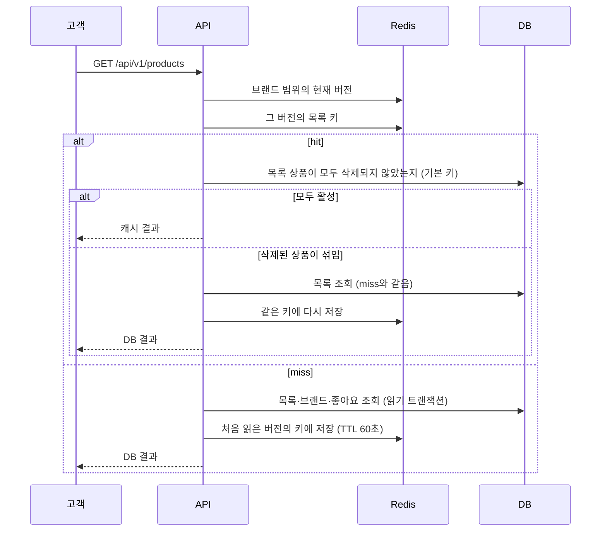
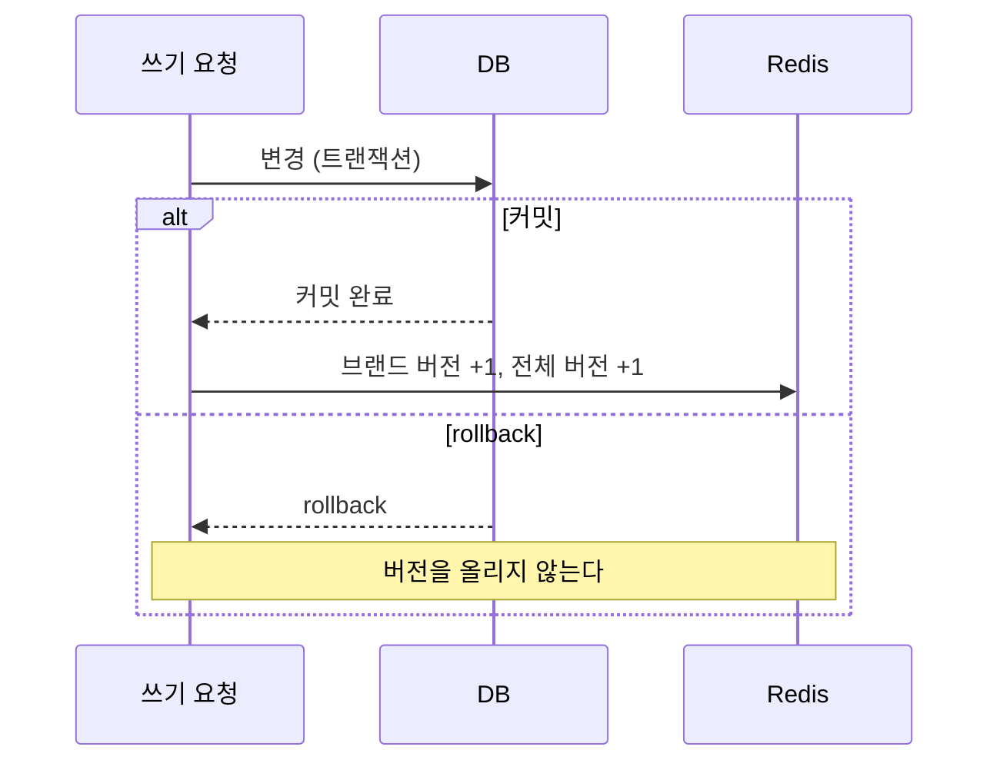
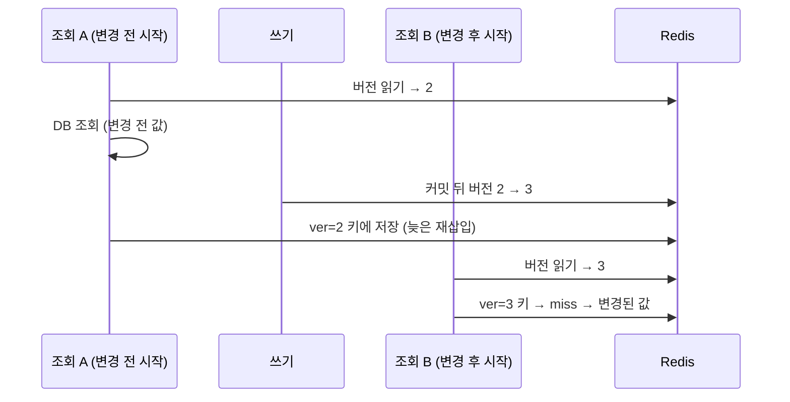

# 상품 목록 캐시 설계

고객 상품 목록 `GET /api/v1/products`의 공통 응답을 Redis에 cache-aside로 저장한다.<br>
변경 직후의 최신성, Redis 장애 중의 동작, 삭제 상품 비노출을 함께 지키는 것을 목표로 한다.

## 1. 캐시 범위

### 왜 목록인가

쿼리·인덱스 개선 뒤 요청당 SQL 실행 시간은 약 1 ms까지 줄었지만, 100 VU에서 평균 지연은 60 ms에 머물렀다.<br>
남은 지연의 대부분은 SQL이 아니라 DB 커넥션을 기다리고 쥐고 있는 시간이었다([성능 개선 기록](product-query-improvements.md) 2절).<br>
요청마다 커넥션을 잡지 않게 하려면 DB 조회 자체를 줄여야 해서, 가장 자주 호출되는 고객 상품 목록에 캐시를 붙였다.

### 무엇을 저장하나

| 항목 | 결정 | 이유 |
| --- | --- | --- |
| 저장 단위 | 요청한 한 페이지의 결과 | 페이지 단위로 조회하므로 다른 페이지를 미리 계산하지 않는다. |
| 필드 | `id`, `brandId`, `brandName`, `name`, `price`, `likeCount` | 모든 고객에게 같은 공통 응답만 저장한다. |
| 제외 | 사용자별 정보 | 목록 응답에 사용자별 필드가 없고 사용자 식별도 쓰지 않는다. 공용 캐시에 개인 정보가 섞이지 않는다. |
| 유효 시간 | 60초 | 이전 버전 키를 정리하는 수단이다. 최신성은 TTL이 아니라 무효화로 보장한다. |

## 2. 키 설계

```
product:list:v1:ver=2:brand=7:sort=price_asc:page=0:size=20
             │    │     │       │              │      │
             │    │     │       │              └──────┴─ 페이지·크기
             │    │     │       └─ 정렬
             │    │     └─ 브랜드 필터 (없으면 all)
             │    └─ 캐시 버전: 무효화하면 올라간다
             └─ 응답 형식 버전: 응답 필드가 바뀌면 올린다
```

- 조회 조건이 하나라도 다르면 다른 키가 된다.
- 정렬 기본값(`latest`)과 미지정·빈 값은 같은 키로 정규화한다.
- 입력 검증은 캐시보다 먼저 해, 잘못된 입력은 기존처럼 `400`이고 캐시에 저장하지 않는다.

## 3. 조회 흐름



### hit에도 DB 확인을 하나 남긴 이유

삭제 상품 비노출은 오래된 값을 허용할 수 있는 표시 데이터가 아니다.<br>
무효화가 누락되는 장애에서도 삭제 상품이 보이지 않도록, hit마다 목록의 상품이 모두 활성인지 기본 키로 확인한다.<br>
브랜드를 삭제하면 같은 트랜잭션에서 연결 상품도 삭제하므로 상품 확인만으로 함께 걸러진다.

이 확인은 기본 키로 한 페이지 분량(최대 100행)을 읽는 쿼리 하나이고, 트랜잭션을 열지 않는다.<br>
그래서 hit은 목록 정렬·브랜드 조회·좋아요 집계와 트랜잭션 설정 왕복을 모두 건너뛴다. 이 비용은 hit 측정에 포함했다.

## 4. 최신성: 버전 키 무효화

### 키를 지우지 않고 버전을 올린다

한 상품이 바뀌면 그 상품이 들어 있을 수 있는 목록 키는 정렬·페이지·크기 조합만큼 많아, 어떤 키를 지울지 알기 어렵다.<br>
그래서 목록 키에 버전을 넣고, 쓰기가 커밋되면 버전만 1 올린다. 이후 조회는 새 버전 키를 찾아 miss가 되고 DB 결과를 읽는다.<br>
이전 버전 키는 아무도 읽지 않다가 TTL로 사라진다.

### 무효화 범위: 브랜드별 + 전체

| 버전 | 대상 목록 |
| --- | --- |
| `product:list:version:{brandId}` | 해당 브랜드로 필터한 목록 |
| `product:list:version:all` | 브랜드 필터 없는 목록 |

상품은 한 브랜드에만 속하므로, 한 상품의 변경은 그 브랜드 버전과 전체 버전만 올린다. 다른 브랜드의 목록 캐시는 그대로 쓴다.<br>
버전을 하나만 두면 어느 상품의 좋아요 한 번에도 모든 목록 캐시가 비워진다.

### 무효화하는 쓰기

| 쓰기 | 무효화 | 이유 |
| --- | --- | --- |
| 상품 등록·이름·가격 수정·삭제 | O | 목록 구성과 표시 필드가 바뀐다. |
| 브랜드 이름 수정 | O | `brandName`이 바뀐다. |
| 브랜드 삭제 (연결 상품 일괄 삭제) | O | 연결 상품이 목록에서 빠진다. |
| 좋아요 등록·취소 | O (관계가 실제로 바뀐 경우만) | `likeCount`와 `likes_desc` 순서가 바뀐다. |
| 재고 변경·주문 확정 | X | 재고는 목록 응답 필드가 아니다. |

- 무효화는 쓰기와 같은 기존 서비스 메서드에서 하므로, 관리자 API도 별도 경로 없이 같은 규칙을 따른다.
- 좋아요 수를 캐시에서 분리하고 무효화하지 않는 방식도 검토했다. `likes_desc`는 순서 자체가 바뀌어 여전히 무효화가 필요하고, hit에 집계가 추가돼 채택하지 않았다.

### 커밋된 뒤에만 올린다



rollback된 변경으로 캐시를 비우지 않고, 캐시에는 커밋된 DB에서 읽은 결과만 저장한다.

### 늦게 끝난 조회가 옛 결과를 덮어쓰지 않는다



조회는 시작할 때 읽은 버전의 키에만 저장한다. 늦게 끝난 조회 A는 이전 버전 키에 쓰므로, 변경 뒤 시작한 조회 B는 영향을 받지 않는다.<br>
버전은 replica가 아니라 master에서 읽는다. replica에서 읽으면 복제 지연 동안 무효화 이전 버전을 읽을 수 있다.

### DB revision과 비교

| | 버전 키 (선택) | DB revision |
| --- | --- | --- |
| 정상 순차 조회 최신성 | 보장 | 보장 |
| 늦은 재삽입 | 영향 없음 | 영향 없음 |
| 장애 중 최신성 | 무효화가 실패하면 표시 필드가 만료 전까지 오래될 수 있음 | 보장 |
| hit에 남는 DB 조회 | 삭제 확인 | revision 조회 |
| 쓰기 경로 | 커밋 뒤 Redis 버전 증가만 추가 | 모든 쓰기 트랜잭션에 revision 행 갱신 추가 |
| 쓰기 경합 | 없음 | 좋아요마다 같은 revision 행 잠금 |

hit에 DB 조회가 하나 남는 점은 같다. 장애 중 표시 필드의 일시적 오래된 값을 허용하는 대신, 좋아요 쓰기에 새 잠금 경합을 만들지 않는 버전 키를 선택했다.

## 5. 장애 설계

### 정상과 장애를 나눈다

- **정상:** 장애·동시 채움이 없으면, 변경이 끝난 뒤 시작한 조회는 변경된 결과를 반환한다.
- **장애:** Redis가 실패하면 응답은 DB 결과로 지키고, 표시 데이터만 정해진 범위에서 오래될 수 있다.

TTL이나 커밋 뒤 캐시 삭제만으로 모든 경쟁·장애에서 최신성을 보장한다고 하지 않는다.

### 실패 지점별 처리

| 실패 지점 | 처리 | 결과 |
| --- | --- | --- |
| 버전 읽기 | DB 결과만 반환하고 저장하지 않는다 | 어느 버전 키에 저장할지 모르므로 저장을 포기한다. |
| 목록 키 조회 | miss로 보고 DB를 읽은 뒤 저장을 시도한다 | 응답은 DB 결과와 같다. |
| 저장 | 경고만 남긴다 | 응답은 DB 결과와 같다. |
| 커밋 뒤 버전 증가 | 경고만 남긴다 | 커밋된 변경의 응답을 실패로 바꾸지 않는다. 표시 필드가 오래될 수 있다. |

Redis 연결·명령 대기는 각각 100 ms로 제한한다. 제한이 없으면 응답하지 않는 Redis 앞에서 요청이 약 60초 동안 멈췄다.<br>
이 값은 공통 Redis 설정에 항목만 추가하고 고객 API 애플리케이션에서만 지정해, 다른 애플리케이션의 동작은 바꾸지 않는다.<br>
각 timeout은 개별 Redis 작업의 대기 제한이며 전체 요청 시간의 상한이 아니다.

### 허용하는 신선도와 복구

| 구분 | 내용 |
| --- | --- |
| 오래될 수 있는 값 | 상품명, 브랜드명, 표시 가격, 좋아요 수, 목록 순서 |
| 허용하지 않는 값 | 삭제 상품 노출 (hit마다 확인), 사용자별 정보 (저장하지 않음), 주문 금액·재고·포인트 (캐시를 쓰지 않음) |
| 오래되는 조건 | 커밋 뒤 버전 증가가 실패한 경우 |
| 복구 판정 | 오래된 항목이 만료되거나 무효화된 뒤 DB 결과로 다시 채워져 원본과 일치하면 복구된 것으로 본다. |

## 6. 캐시가 비는 순간

캐시가 비는 순간에는 그때 들어온 요청이 모두 miss가 돼 같은 조회를 동시에 DB로 보낸다. 비는 시점은 세 가지다.

| 시점 | 대응 |
| --- | --- |
| 배포·Redis 재시작 직후 | 기동 시 워밍업 |
| TTL 만료 | 대응하지 않음 (만료 시점이 키마다 다르다) |
| 쓰기에 따른 버전 무효화 | 대응하지 않음 (무효화마다 동시 miss가 생긴다) |

### 기동 시 워밍업

- 정렬 3가지 × (전체 + 활성 브랜드 전부)의 첫 페이지(크기 20)를 고객 조회와 같은 경로로 미리 채운다. 이미 캐시된 조건은 다시 읽지 않는다.
- 워밍업이 끝난 뒤 readiness가 트래픽 수신 상태로 바뀌어, 빈 캐시로 트래픽을 받지 않는다.
- 일부 조건을 채우지 못해도 기동을 막지 않고, 그 조건은 첫 요청에서 채운다.
- 테스트 환경에서는 실행하지 않는다. 빈 DB로 채운 캐시가 다른 테스트에 남지 않게 하기 위해서다.

## 7. 측정으로 본 효과

| 상황 (100 VU) | 평균 | p99 | 커넥션 획득 대기 |
| --- | ---: | ---: | ---: |
| 캐시 없음 | 60.431 ms | 116.059 ms | 23.051 ms (지속 측정) |
| hit | 18.475 ms | 51.876 ms | 0.053 ms |
| 초당 무효화 10회 | 44.191 ms | 189.528 ms | 15.118 ms |
| 배포 직후, 워밍업 끔 | 40.4~59.0 ms | 85.8~142.6 ms | 7.2~8.7 ms |
| 배포 직후, 워밍업 켬 | 26.6~33.8 ms | 67.8~71.8 ms | 0.03~0.98 ms |

- hit에서 커넥션 대기가 사라져 자체 목표(평균 20 ms 이하)를 달성했다.
- 무효화가 잦으면 동시 miss로 커넥션 대기가 다시 늘어난다.
- 워밍업은 배포 직후의 동시 miss를 없앴고, 대신 readiness까지 약 20초가 더 걸린다.

측정 조건과 원본은 [성능 개선 기록](product-query-improvements.md) 8절에 있다.
