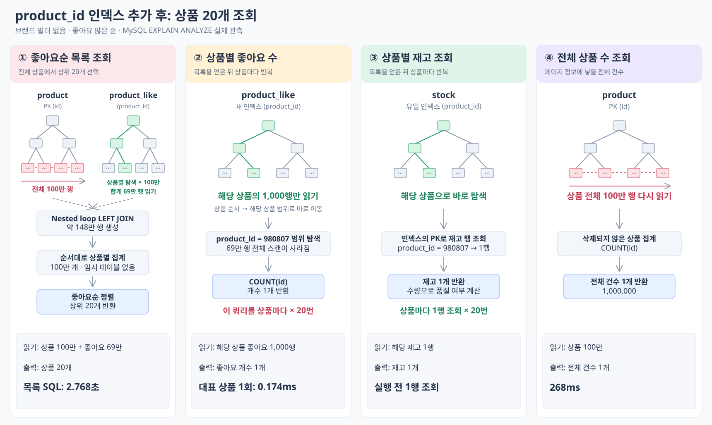
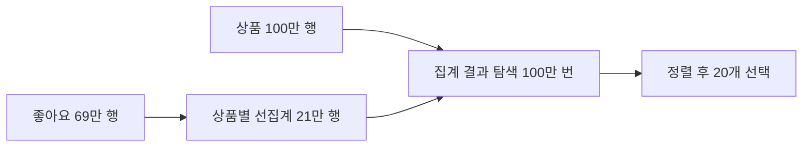
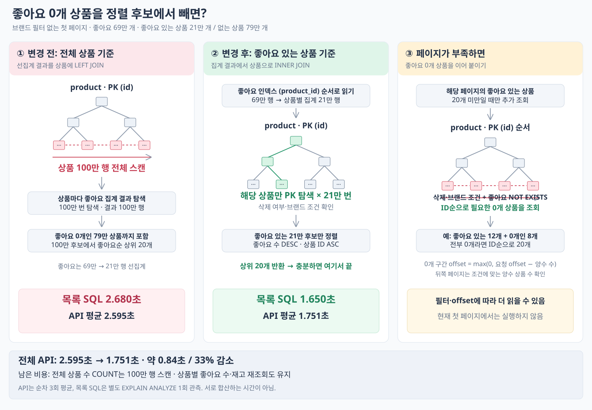
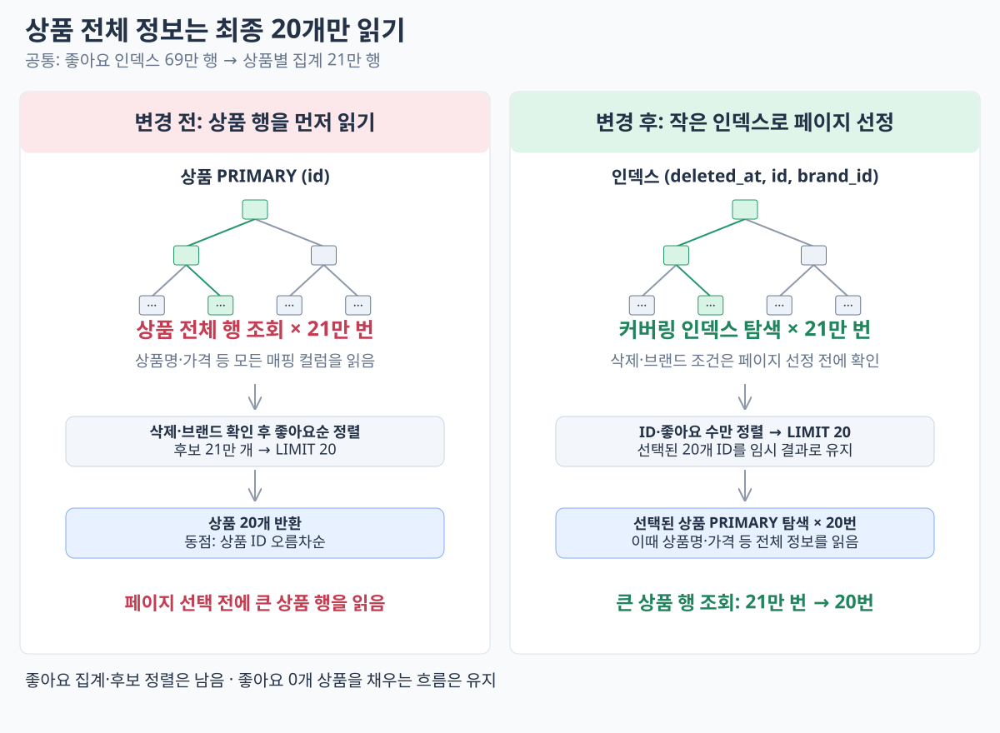
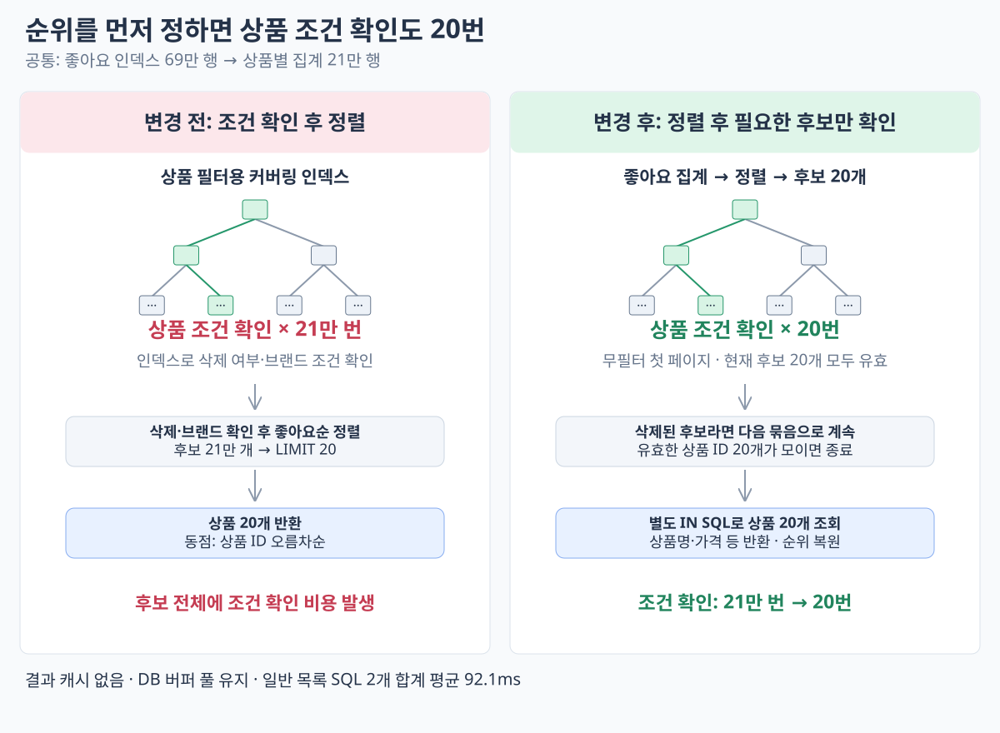
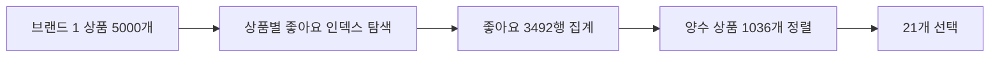

# 좋아요순 쿼리 개선

[목록으로](README.md)

**무필터 좋아요순 첫 페이지 20개의 API 평균 응답을 최초 10.568초에서 마지막 쿼리 개선 단계의 138.4ms로 줄였다.** 좋아요 탐색 범위·상품 조인 비용을 줄이고, N+1과 중복 집계를 제거한 결과다.

각 수치는 당시 순차 3회 평균이다.

## 먼저 내린 결정은 좋아요 수를 상품에 저장하지 않는 것이었다

좋아요 변경 시 상품 행의 잠금 경합과 카운트 정합성 관리 부담을 피하려고 비정규화를 선택하지 않았다. 대신 조회 시 집계를 유지하면서 조인 순서와 상품 접근 범위를 줄였다.

## 1. 상품 하나의 좋아요 집계부터 인덱스로 줄였다

**실행계획** — `SELECT COUNT(id) FROM product_like WHERE product_id = 980807`.

| 단건 집계의 ANALYZE | 전 | 후 |
| --- | ---: | ---: |
| 실제 읽은 좋아요 | 690,000행 | 1,000행 |
| 실행 시간 | 126ms | 0.174ms |

인덱스 추가 후 실제 출력:

```text
Aggregate: count(product_like.id) (actual time=0.174..0.174 rows=1 loops=1)
  Covering index lookup on product_like using idx_product_like_product_id
  (product_id=980807) (actual time=0.0205..0.132 rows=1000 loops=1)
```

**분석:** 한 상품의 좋아요를 세는데 전체 69만 행을 읽었다. 이 쿼리가 상품마다 반복되므로 먼저 탐색 범위를 줄여야 했다.

**읽기 흐름** — 아래는 같은 인덱스가 목록 조인에 적용된 흐름이다.



**판단과 변경:** `product_like(product_id)` 인덱스를 추가했다. 단건 집계는 해당 상품 범위만 읽고, 목록 조인도 상품별 인덱스 탐색으로 바뀌었다.

**결과 분석:** 목록 ANALYZE는 9.12 → 2.768초, 전체 API 평균은 10.568087 → 2.638316초였다. 하지만 목록에서 상품 100만 행과 좋아요 인덱스 탐색 100만 번은 남았다. 다음에는 조인 구조를 바꿨다.

[일반 EXPLAIN·SQL](../experiments/04-optimize-likes-query/explain-traditional/770c082.txt) · [원본 분석](../experiments/04-optimize-likes-query/report.md)

## 2. 선집계만으로는 상품 100만 행 접근이 줄지 않았다

**실행계획** — 좋아요를 상품별로 집계한 뒤 상품과 LEFT JOIN한 ANALYZE 핵심 발췌다.

```text
Sort: coalesce(l.like_count,0) DESC, p.id
  (actual time=2680..2680 rows=20 loops=1)
Nested loop left join
  (actual time=443..2183 rows=1e+6 loops=1)
Table scan on p
  (actual time=0.113..437 rows=1e+6 loops=1)
Index lookup on l using <auto_key0> (product_id=p.id)
  (actual time=0.00149..0.00153 rows=0.21 loops=1e+6)
Materialize
  (actual time=443..443 rows=210000 loops=1)
```

**분석:** 조인 결과는 약 148만 → 100만 행으로 줄었지만, 상품 100만 행을 읽고 집계 결과를 100만 번 찾는 비용은 남았다.

**읽기 흐름**



**판단과 변경:** 선집계 결과를 임시로 만들어 조인했다. 실행계획을 보고, 집계 결과 크기보다 여전히 전체 상품을 읽는 것이 문제라고 판단했다.

**결과 분석:** 목록 ANALYZE 2.768 → 2.680초, API 평균 2.638316 → 2.595312초로 비슷했다. 확실한 개선으로 세지 않고 다음 단계로 넘어갔다.

[일반 EXPLAIN·SQL](../experiments/04-optimize-likes-query/explain-traditional/a4a5ec8.txt) · [원본 분석](../experiments/04-optimize-likes-query/report-preaggregate.md)

## 3. 좋아요가 있는 상품만 먼저 읽었다

**실행계획** — EC2 ANALYZE에서 확인한 접근량 요약이다.

```text
좋아요 인덱스 690,000행
→ 상품별 집계 210,000행
→ 상품 PK 탐색 210,000번
→ 좋아요 수 DESC, 상품 ID ASC 정렬
→ 20개 반환
```

**분석:** 좋아요순에서는 양수 상품이 0개 상품보다 항상 앞선다. 첫 페이지를 고르기 위해 좋아요 0개 상품까지 처음부터 조인할 필요가 없었다.

**읽기 흐름**



**판단과 변경:** 양수 상품을 INNER JOIN으로 먼저 조회하고, 페이지가 부족하면 `NOT EXISTS`로 0개 상품을 ID순으로 채웠다. 뒤쪽 페이지는 양수 구간에서 건너뛴 개수를 반영해 0개 구간의 offset을 계산했다.

**결과 분석:** 상품 100만 행 스캔을 PK 탐색 21만 번으로 줄였다. 목록 ANALYZE는 2.680 → 1.650초, API 평균은 2.595312 → 1.750905초였다. 0개·혼합 페이지의 결과를 유지했지만 상품 21만 개의 실제 행 접근은 여전히 비쌌다.


## 4. 상품 전체 정보는 페이지 선정 뒤에 읽었다

**실행계획** — 변경 후 ANALYZE 3회 평균은 약 884ms였다. 누적 시간 차이로 근사 분해한 핵심 구간:

| 구간 | 처리량 | 근사 시간 |
| --- | --- | ---: |
| 좋아요 읽기·집계 | 69만 행 → 21만 상품 | 약 122ms |
| 상품 조건 확인·조인 | 커버링 인덱스 탐색 21만 번 | 약 678ms |
| 최종 상품 전체 정보 | PK 탐색 20번 | 약 0.12ms |

**분석:** 후보 전부의 상품 전체 정보를 읽을 필요는 없다. 다만 전체 정보를 뒤로 미룬 이후에도 조건 확인·조인이 약 77%를 차지했다.

**읽기 흐름**



**판단과 변경:** 후보 단계는 ID·좋아요 수만 정렬하고, 선택된 20개 상품만 상세 조회했다. 필터용 `(deleted_at, id, brand_id)` 커버링 인덱스를 추가하고 후보 조회에 `FORCE INDEX`를 지정했다.

**결과 분석:** API 평균 1.750905 → 1.106113초. 인덱스 생성 후 최초 지정 ANALYZE는 2.756초, 반복 실행은 0.860초여서  영향을 구분했다. 인덱스와 조회 순서를 함께 바꾼 결과다. 다음 목표는 남은 조건 확인 21만 번이었다.

## 5. 상위 후보부터 조건을 확인했다

**실행계획** — 상위 후보 우선 조회의 ANALYZE에서 상품 조건 확인은 `loops=20`, 후보 SQL 전체는 155ms였다.

```text
좋아요 69만 행 → 집계 21만 행 → 좋아요 수 DESC·ID ASC 정렬
→ 상위 후보 20개 → 상품 조건 확인 20번
→ 유효 상품 상세 IN 조회
```

**분석:** 좋아요 집계·정렬보다 상품 조건을 21만 번 확인하는 것이 더 큰 비용이었다. 무필터에서는 상위 후보부터 조건을 확인하고, 탈락한 수만큼 더 읽는 방식이 유리했다.

**읽기 흐름**



**판단과 변경:** 후보 묶음을 순위순으로 읽고 유효 상품이 부족하면 다음 묶음을 조회했다. 유효 상품만 페이지 offset에서 차감하고, 양수 후보가 끝나면 0개 구간으로 이어갔다.

**결과 분석:** 첫 페이지의 상품 조건 확인은 21만 → 20번이었다. 일반 SELECT 프로파일 3회 평균은 후보 91.700ms + 상세 0.390ms = **92.091ms**였고, 별도 API 평균은 1.106113 → 0.462491초였다. ANALYZE의 155ms와 일반 SELECT의 92ms는 서로 다른 측정이다.

[일반 EXPLAIN·SQL](../experiments/04-optimize-likes-query/explain-traditional/1eed148.txt) · [원본 분석](../experiments/04-optimize-likes-query/report-rank-first.md)

## 6. 브랜드 필터가 있으면 상품부터 좁혔다

**실행계획** — 브랜드 1의 변경 후 ANALYZE 핵심이다.

```text
Index lookup on candidate using uk_product_active_name (brand_id=1)
  actual rows=5000 loops=1
Covering index lookup on l using idx_product_like_product_id
  actual rows=0.698 loops=5000
Nested loop inner join: rows=3492
Aggregate using temporary table: rows=1036
Limit: 21 rows
```

**분석:** 브랜드 필터가 있는데 전체 좋아요를 먼저 집계하면 다른 브랜드의 데이터까지 읽는다. 무필터의 조회 순서를 그대로 사용할 이유가 없었다.

**읽기 흐름**



**판단과 변경:** 브랜드 필터 경로만 `STRAIGHT_JOIN`으로 상품 → 좋아요 순서를 지정했다. 기존 브랜드 선두 인덱스와 좋아요 product_id 인덱스를 활용했다.

**결과 분석:** SQL 수는 6회로 같고 집계 범위가 줄었다.

| 조건 | 후보 SQL 전 → 후 | API 평균 전 → 후 |
| --- | ---: | ---: |
| 브랜드 1, 상품 5,000개 | 548.9 → 39.9ms | 590.9 → 88.7ms |
| 브랜드 601, 상품 333개 | 547.6 → 3.8ms | 587.7 → 44.2ms |

무필터 후보 SQL은 92.2 → 93.2ms로 비슷했다. 브랜드가 전체 상품 대부분을 차지하는 분포에서는 조인 순서를 다시 확인해야 한다.

## 남은 한계

깊은 페이지에서는 후보 묶음마다 전체 집계·정렬이 반복된다. 마지막 페이지 단건 측정은 **집계 206회, 전체 SQL 210회, API 29.347초**였다. 첫 페이지 최적화가 전체 페이지의 성능 개선은 아니었다. 한 요청 안에서 집계 결과를 재사용하는 것이 후속 검토 대상이다.
