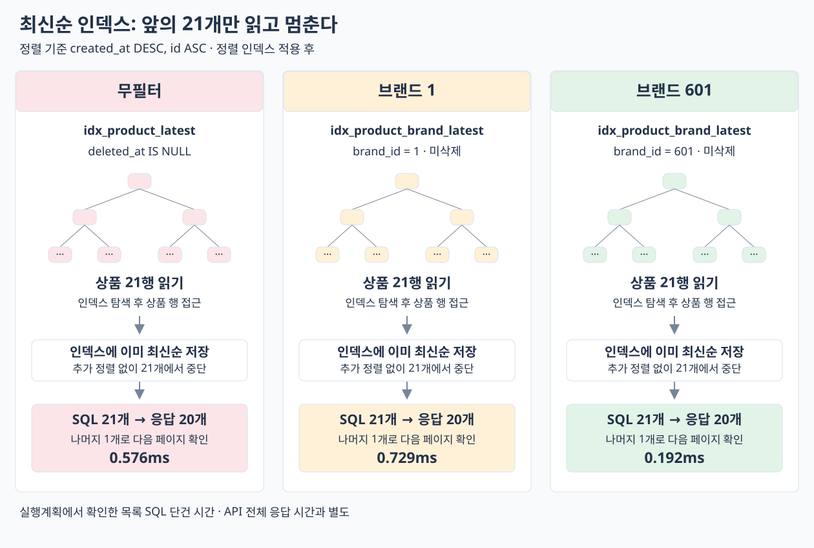

# 최신순 목록 쿼리 개선

[목록으로](README.md)

**무필터 최신순 첫 페이지 20개의 API 평균 응답을 3,988.4ms에서 32.1ms로 줄였다.** 필터·정렬에 맞는 복합 인덱스를 추가해 읽은 상품을 100만 행에서 21행으로 줄이고, 별도 정렬을 없앴다.


## 1. 인덱스를 사용해도 전체 후보를 읽고 정렬했다

**실행계획** — 무필터 첫 페이지의 변경 전 일반 EXPLAIN 요약이다. 아래 rows는 추정값이다.


| table | type | key                      | 추정 rows | Extra                                 |
| ----- | ---- | ------------------------ | -------: | ------------------------------------- |
| p     | ref  | idx_product_likes_filter | 497127  | Using index condition; Using filesort |


EC2 ANALYZE에서 확인한 실제 흐름은 다음과 같다. 원본을 핵심 노드만 남겨 요약했다.

```text
Limit: 21 rows (actual time=3907..3907 rows=21 loops=1)
  Sort: created_at DESC, id ASC
    Index lookup using idx_product_likes_filter (deleted_at=NULL)
      actual rows=1e+6 loops=1
```

**분석:** 삭제 조건용 인덱스를 사용했지만 생성일 순서를 제공하지 못했다. 상품 100만 행을 읽고 정렬하는 목록 SQL 하나에 대부분의 시간이 들었다. `Limit 21`은 최종 반환량이고 입력 21행만 읽었다는 뜻이 아니었다.

**읽기 흐름**


**판단과 변경:** 등치 조건 뒤에 실제 정렬 컬럼을 배치했다. 무필터와 브랜드 필터에 맞는 인덱스를 각각 추가했다.

```sql
-- 무필터
(deleted_at, created_at DESC, id ASC)
-- 브랜드 필터
(brand_id, deleted_at, created_at DESC, id ASC)
```

**결과 분석:** 무필터 목록 SQL은 3920.0 → 1.2ms로 줄었다. 아래에서 접근 경로와 실제 읽기 감소를 확인했다.

## 2. 정렬된 인덱스에서 21행만 읽고 멈췄다

**실행계획** — 변경 후 일반 EXPLAIN이다.


| table | type | key                | 추정 rows | Extra                 |
| ----- | ---- | ------------------ | -------: | --------------------- |
| p     | ref  | idx_product_latest | 496395  | Using index condition |


EC2 ANALYZE 핵심 요약:

```text
Limit: 21 rows (actual completion=0.576ms, rows=21, loops=1)
  Index lookup using idx_product_latest (deleted_at=NULL)
    actual rows=21 loops=1
```

**분석:** 일반 EXPLAIN의 추정 rows는 여전히 크지만, ANALYZE에서는 실제로 21행만 읽고 종료했다. 별도 Sort도 사라졌다. 선택 인덱스 이름만 보는 대신 실제 rows와 정렬 단계를 함께 확인했다.

**읽기 흐름**



**판단과 변경:** 해당 인덱스를 채택하고 JPA 매핑에도 반영했다. 상품명 등 응답 전체를 담은 covering index는 아니지만, 실제 상품 행 접근이 21개로 제한되어 목적을 충족했다.


| 조건      | 실제 읽은 상품 전 → 후 | 목록 SQL 전 → 후    | API 평균 전 → 후     |
| ------- | --------------: | ---------------: | ----------------: |
| 무필터     | 1,000,000 → 21 | 3,920.0 → 1.2ms | 3,988.4 → 32.1ms |
| 브랜드 1   | 5,000 → 21     | 132.9 → 2.5ms   | 168.1 → 27.6ms   |
| 브랜드 601 | 333 → 21       | 3.5 → 0.8ms     | 42.3 → 25.7ms    |


&nbsp;
