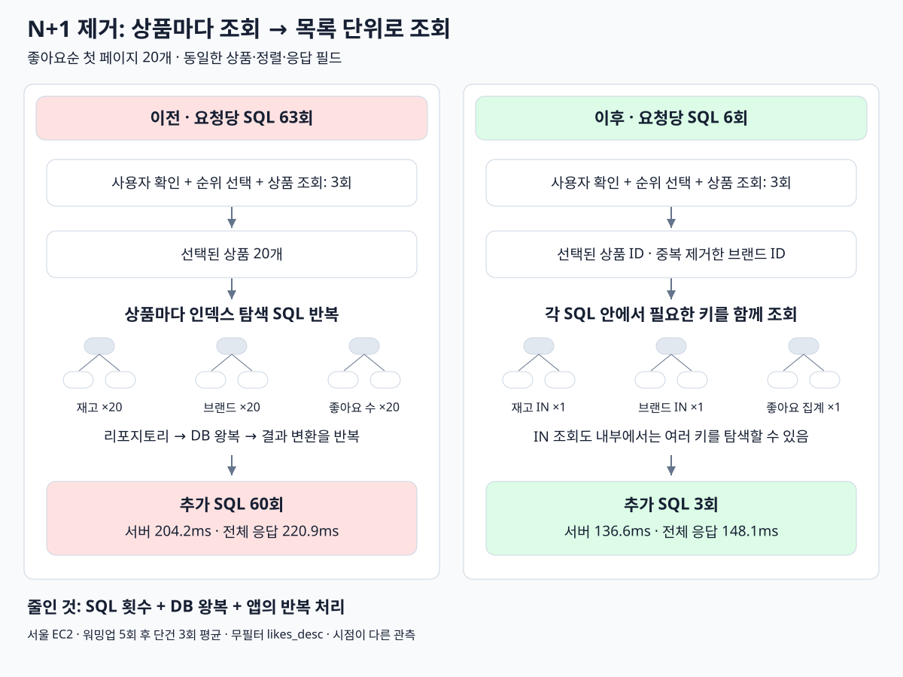

# 목록 N+1 개선

[목록으로](README.md)

## 상품별 브랜드·재고·좋아요 조회를 묶었다

**실행계획과 요청 계측** — 재고 단건 조회는 인덱스로 1행을 찾았지만, 요청마다 반복됐다. 당시 무필터 좋아요순 첫 페이지 계측:


| 항목           | 관측                           |
| ------------ | ----------------------------: |
| 전체 SQL       | 63회                          |
| 상품별 부가 조회    | 재고 20회 + 브랜드 20회 + 좋아요 수 20회 |
| 위 세 조회 구간 합계 | 91.5ms, SQL/JDBC 포함          |
| 서버 처리 평균     | 204.2ms                      |


**분석:** 단건 조회가 빨라도 60번 반복하면 SQL 실행 비용과 서버 내부 처리 비용이 쌓였다. 요청 계측에서 SQL 실행은 132.2ms, SQL/JDBC를 제외한 리포지토리 처리는 51.9ms였다. 쿼리 자체뿐 아니라 반복 호출에 따른 객체 변환 등의 비용도 줄여야 한다고 판단했다.

**읽기 흐름**



**판단과 변경:** 선택된 상품 ID를 모아 재고·브랜드는 IN 조회, 좋아요 수는 GROUP BY 조회로 묶었다. 브랜드 ID는 중복 제거했다.

```sql
-- 좋아요 수 일괄 조회의 형태
SELECT product_id, COUNT(id)
FROM product_like
WHERE product_id IN (...)
GROUP BY product_id;
```

**결과 분석:** 요청당 SQL은 63 → 6회, 부가 조회 구간은 91.5 → 18.1ms로 줄었다. 상품 1개와 20개 모두 일괄 조회하도록 검증했다.


| 측정                     | 이전      | 이후      |
| ---------------------- | -------: | -------: |
| SQL 실행 합계              | 132.2ms | 101.2ms |
| 리포지토리 처리 — SQL/JDBC 제외 | 51.9ms  | 17.7ms  |
| 서버 처리 평균               | 204.2ms | 136.6ms |
| API 평균                 | 220.9ms | 148.1ms |
