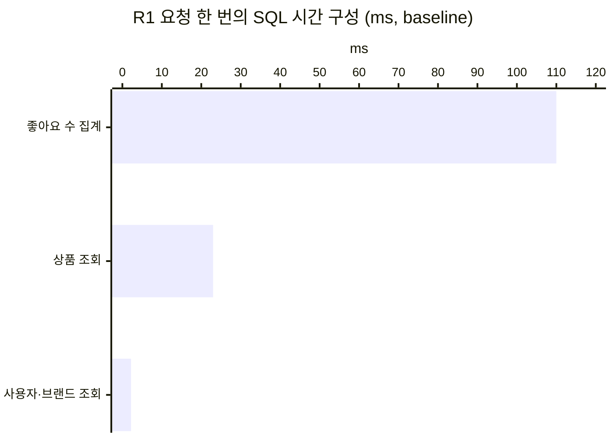
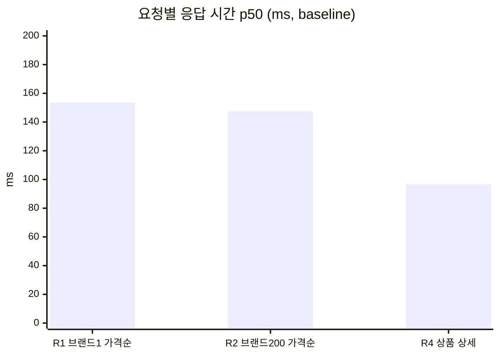
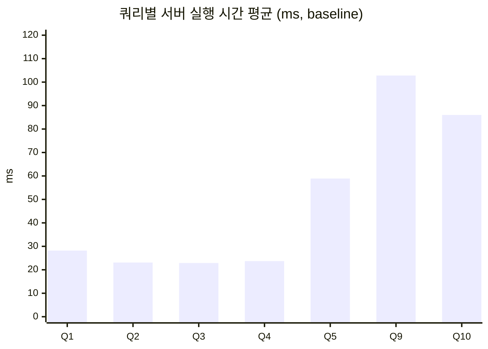

# 상품 조회 쿼리 성능 측정 보고서

> 측정 기록 전용 문서다. 설계·구현 기준이 아니므로 개발 작업 중에는 참고하지 않는다.
> 측정 원본(EXPLAIN 전문 포함)은 [query-performance-raw.md](query-performance-raw.md)에 쌓인다.


## 1. 한눈에 보기

> 2절 baseline(실제 앱) 기준. 개선 전후 비교는 같은 규모의 baseline끼리 한다 (2.1 10만 / 2.2 1,000만).

**과제 측정 대상 R1** (`GET /api/v1/products?brandId=1&sort=price_asc&page=0&size=20`)

| 항목 | 10만 | 1,000만 |
| --- | ---: | ---: |
| 응답 시간 p50 / p95 | **153.6ms / 170.9ms** | **3,771.0ms / 3,941.0ms** |
| 표본 (워밍업 / 측정) | 20 / 200 | 3 / 30 |
| 요청당 SQL | 14개 (SELECT 4 + 트랜잭션 제어문 10) | 14개 (SELECT 4 + 트랜잭션 제어문 10)¹ |
| 요청당 SQL 시간 | 135.2ms | 3,745.3ms |

¹ 측정 중 커넥션 1개가 새로 열리며 초기화 문장이 섞여 집계값은 14.2였다. 요청이 실행한 문장은 같다.

**R1의 SQL 시간은 어디에 쓰이나**

| SQL | 10만 (비율) | 1,000만 (비율) | 원인 |
| --- | ---: | ---: | --- |
| 좋아요 수 집계 (Q9 형태) | 약 110ms (80%) | 약 1,191ms (32%) | `product_id`로 시작하는 인덱스가 없어 좋아요 전체(97만 / 997만 건)를 읽음 (3.3) |
| 상품 조회 (Q4 형태) | 약 23ms (17%) | 약 2,552ms (68%) | 인덱스 없이 상품 전체(10만 / 1,000만 건) 스캔 + 정렬 (3.1) |
| 사용자 확인·브랜드 조회 | 약 2ms (2%) | 약 1ms (0%) | PK 조회 |

> 1,000만 규모에서는 **주원인이 좋아요 수 집계에서 상품 조회로 바뀐다.** 다만 이것은 규모 자체보다 seed의 **상품 대비 좋아요 비율** 때문이다.
> 상품은 100배(10만 → 1,000만), 좋아요는 약 10배(97만 → 997만) 늘어 상품당 평균 좋아요가 약 10개 → 약 1개로 줄었다. 좋아요를 상품과 같은 비율로 늘렸다면 1,000만에서도 좋아요 집계가 클 수 있다.
> 그래서 결론은 "상품 대비 좋아요 비율에 따라 주원인이 달라지므로 **두 경로(좋아요 수 집계, 상품 목록 조회)를 모두 고친다**"이다.



**핵심 발견**

1. **10만 규모에서 R1을 느리게 만드는 주원인은 상품 조회가 아니라 좋아요 수 집계다.** 과제 측정 대상인 "브랜드 필터 + 가격순" 상품 조회만 고치면 R1은 최대 23ms(약 15%)밖에 줄지 않는다. 반면 1,000만 규모에서는 상품 조회가 SQL 시간의 68%(약 2.6초)를 차지해, 상품 조회 개선 효과가 크게 드러난다.
2. **좋아요순 정렬은 사실상 동작하지 않는다.** 상품 232개인 작은 브랜드도 약 19.5초(R3), 큰 브랜드와 전체는 60초 안에 끝나지 않는다. 1,000만 규모에서는 작은 브랜드(미삭제 23,756개)도 60초 안에 끝나지 않는다. 상품마다 좋아요 테이블 전체를 다시 읽는 구조다 (3.2).
3. **상세 조회(R4)도 대부분이 좋아요 수 1건 집계다.** 10만: 96ms 중 Q10 86ms, 1,000만: 1,036ms 중 약 998ms.

**다음 개선 대상** (우선순위): 좋아요 수 집계 → 좋아요순 정렬 → 상품 목록 조회. 결과는 4절에 채운다.

**캐시** (4.4절, 2026-10-16): 목록 캐시 hit는 R1 SQL을 14 → 12개·SQL 시간 2.4 → 1.2ms로 줄였지만 응답 시간은 10만에서 14.9 → 13.1ms(약 2ms)만 줄었다. 인덱스로 SQL이 이미 2ms대라 남은 시간 대부분이 SQL 밖에 있기 때문이다. miss는 캐시 없음보다 약 +3ms(R1 +4~7ms) 느리고, Redis 장애 시에는 응답이 정확하지만 요청마다 약 1초(명령 타임아웃)가 더해진다.

## 2. baseline 결과 (2026-10-14, 클라우드, 실제 앱)

### 2.1 baseline-100k


- 환경: Linux x86_64, Intel Xeon 2.10GHz 2코어, 메모리 8GB, MySQL 8.0.46(기본 설정), Java 21.0.12, Redis 7(마스터 6379·복제 6380)
- 앱: `commerce-api` 소스(`83d186a`) bootJar를 local 프로필 + 5.3절 인자(root, `ddl-auto=none`, `show-sql=false`)로 기동
- 데이터: 10만 규모 seed (users 50,000 / 미삭제 상품 92,859 / 좋아요 974,368), 측정 전후 products 100,000건 유지
- `ddl-check`: 실제 Hibernate가 만든 스키마와 `seed.sql` 스키마의 컬럼·인덱스 차이 없음 (컬럼 순서·유일 제약 이름만 다름)
- 원본: [query-performance-raw.md](query-performance-raw.md)의 `측정: baseline`·`API 측정: baseline`, 스냅샷 `perf-results/baseline/`

**요청 단위** (curl 순차 1개, `X-USER-ID: 1`, 모든 응답 200)

| 요청 | 워밍업 / 표본 | p50 | p95 | p99 | 최대 | 요청당 SQL (SELECT) | 요청당 SQL 시간 |
| --- | ---: | ---: | ---: | ---: | ---: | ---: | ---: |
| **R1** 브랜드 1 가격순 (과제 대상) | 20 / 200 | **153.6ms** | **170.9ms** | 183.6ms | 1,053.4ms | **14 (4)** | 135.2ms |
| R2 브랜드 200 가격순 | 20 / 200 | 147.5ms | 167.2ms | 175.7ms | 194.5ms | 14 (4) | 134.5ms |
| R3 브랜드 200 좋아요순 | 1 / 3 | 19,459ms | 19,737ms | 19,737ms | 19,737ms | 14 (4) | 19,411ms |
| R4 상품 1 상세 | 20 / 200 | 96.5ms | 109.1ms | 121.5ms | 132.2ms | 14 (4) | 85.9ms |

- R1 최대 1,053ms는 200회 중 1회의 튐이다(p99 183.6ms). 기동 직후 JIT·커넥션 생성 영향으로 보이며, 비교는 p50·p95로 한다.
- 요청당 SQL 14개 = SELECT 4개(사용자 존재 확인, 상품 조회, 브랜드 일괄 조회, 좋아요 수 집계) + 트랜잭션 제어문 10개.
  트랜잭션 제어문은 요청마다 트랜잭션이 2개(사용자 확인, 조회)라 `SET autocommit` 4·`SET SESSION TRANSACTION READ ONLY/READ WRITE` 각 2·`COMMIT` 2가 나간 것이다.
- R1의 SQL 시간 135ms 중 좋아요 수 집계(Q9 형태)가 약 110ms, 상품 조회(Q4 형태)가 약 23ms다. **R1을 느리게 만드는 주원인은 상품 조회가 아니라 좋아요 수 집계**다.

**SQL 단위** (서버 실행 시간 평균)

| 쿼리 | 실행 횟수 | 평균 | 비고 |
| --- | ---: | ---: | --- |
| Q1 최신순 (전체) | 10 | 28.2ms | ALL + filesort |
| Q2 최신순 (브랜드 1) | 10 | 23.1ms | ALL + filesort |
| Q3 가격순 (전체) | 10 | 22.9ms | ALL + filesort |
| **Q4** 가격순 (브랜드 1) | 10 | **23.7ms** | ALL + filesort, R1의 상품 조회 |
| Q5 깊은 페이지 | 10 | 58.9ms | ALL + filesort |
| Q6 좋아요순 (전체) | - | TIMEOUT(>60s) | 하한값, EXPLAIN만 |
| Q7 좋아요순 (브랜드 1) | - | TIMEOUT(>60s) | 하한값, EXPLAIN만 |
| Q8 좋아요순 (브랜드 200) | 3 | 19,213ms | R3의 상품 조회 |
| **Q9** 좋아요 수 20개 | 10 | **102.8ms** | 인덱스 전체 스캔, R1·R2의 좋아요 수 집계 |
| Q10 좋아요 수 1개 | 10 | 86.0ms | 인덱스 전체 스캔, R4의 좋아요 수 집계 |

- 결과 일치 확인: R1 응답(id·price)은 Q4 스냅샷과, R3 응답(id·좋아요 수)은 Q8 스냅샷과 같다. 같은 seed를 두 번 만들어 bench한 결과도 compare에서 차이가 없었다(Q6·Q7은 비교 불가).

**그림으로 보기** (R3 좋아요순 19.5초와 Q6~Q8은 눈금이 달라 그림에서 뺐다. 값은 위 표 참고)





### 2.2 baseline-10m

- 환경: 2.1과 같은 클라우드 VM (Linux x86_64, Intel Xeon 2.10GHz 2코어, 메모리 8GB), MySQL 8.0.46 기본 설정(buffer pool 128MB), Java 21.0.12, Redis 7. 측정 시작 시 디스크 여유 26GB
- 앱: 2.1과 같은 bootJar(`83d186a`)와 같은 인자(root, `ddl-auto=none`, `show-sql=false`)
- 데이터: 1,000만 규모 seed를 현재 규칙으로 새로 생성 (부록 B의 1,000만 참고 데이터는 규칙 보강 전이라 쓰지 않음)

| 항목 | 값 |
| --- | ---: |
| users | 500,000 |
| brands (삭제) | 200 (5) |
| products (미삭제) | 10,000,000 (9,293,588) |
| product_likes | 9,969,594 |
| 삭제 브랜드의 미삭제 상품 / users에 없는 좋아요 사용자 | 0 / 0 |
| 브랜드 1 / 브랜드 200 미삭제 상품 | 670,748 / 23,756 |
| 상품 1 좋아요 수 | 151,236 |
| 테이블 크기 (데이터+인덱스) | products 724MB / product_likes 720MB / users 15MB / brands 0MB |

- 소요 시간: seed 1분 55초, bench 7분 14초, api-bench 6분 2초 (총 15분 11초)
- 측정 전후 products 10,000,000건 유지, R1·R2·R4 응답 모두 200
- 원본: [query-performance-raw.md](query-performance-raw.md)의 `측정: baseline-10m (2026-10-14 10:47)`·`API 측정: baseline-10m (2026-10-14 10:53)`, 스냅샷 `perf-results/baseline-10m/`.
  규칙 보강 전 1,000만 참고 측정(부록 B)의 원본은 같은 문서의 `측정: reference-10m (2026-10-14 01:23)`이다.

**요청 단위** (curl 순차 1개, `X-USER-ID: 1`, 워밍업 3 + 측정 30 고정, R3는 curl 60초 제한)

| 요청 | 워밍업 / 표본 | p50 | p95 | p99¹ | 최대 | 요청당 SQL (SELECT) | 요청당 SQL 시간 |
| --- | ---: | ---: | ---: | ---: | ---: | ---: | ---: |
| **R1** 브랜드 1 가격순 (과제 대상) | 3 / 30 | **3,771.0ms** | **3,941.0ms** | 3,993.9ms | 3,993.9ms | **14 (4)**² | 3,745.3ms |
| R2 브랜드 200 가격순 | 3 / 30 | 3,716.6ms | 3,980.1ms | 4,032.9ms | 4,032.9ms | 14 (4) | 3,720.0ms |
| R3 브랜드 200 좋아요순 | 1 / 0 | TIMEOUT(>60s) | - | - | - | - | - |
| R4 상품 1 상세 | 3 / 30 | 1,036.2ms | 1,104.8ms | 1,135.8ms | 1,135.8ms | 14 (4) | 1,000.2ms |

¹ 표본 30이라 p99는 기록만 하고 비교는 p50·p95로 한다.
² 집계값 14.2(SELECT 4.1)는 측정 중 커넥션 1개가 새로 열리며 초기화 문장이 섞인 것이다.

- R3는 첫 요청이 60초 안에 끝나지 않아 TIMEOUT으로 기록하고 더 보내지 않았다(측정 실패로 보지 않음). 남은 앱 쿼리는 `KILL QUERY`로 끊었다.
- 요청당 SQL 시간 구성 (digest 총 시간 ÷ 요청 수)

| SQL | R1 | R2 | R4 |
| --- | ---: | ---: | ---: |
| 상품 조회 (R1·R2: Q4 형태 / R4: PK 조회) | 2,552.3ms | 2,465.6ms | 0.3ms |
| 좋아요 수 집계 (R1·R2: Q9 형태 / R4: Q10 형태) | 1,191.0ms | 1,252.8ms | 997.9ms |
| 사용자 확인 + 브랜드 조회 | 1.0ms | 0.7ms | 0.7ms |
| 트랜잭션 제어문 10개 | 0.9ms | 0.9ms | 1.3ms |

**SQL 단위** (서버 실행 시간 평균)

| 쿼리 | 실행 횟수 | 10만 평균 | 1,000만 평균 | 비고 |
| --- | ---: | ---: | ---: | --- |
| Q1 최신순 (전체) | 10 | 28.2ms | 3,303.8ms | ALL + filesort |
| Q2 최신순 (브랜드 1) | 10 | 23.1ms | 2,591.5ms | ALL + filesort |
| Q3 가격순 (전체) | 10 | 22.9ms | 3,166.1ms | ALL + filesort |
| **Q4** 가격순 (브랜드 1) | 10 | 23.7ms | **2,545.8ms** | ALL + filesort, R1의 상품 조회 |
| Q5 깊은 페이지 | 10 | 58.9ms | 6,456.3ms | ALL + filesort |
| Q6 좋아요순 (전체) | - | TIMEOUT(>60s) | TIMEOUT(>60s) | 하한값, EXPLAIN만 |
| Q7 좋아요순 (브랜드 1) | - | TIMEOUT(>60s) | TIMEOUT(>60s) | 하한값, EXPLAIN만 |
| Q8 좋아요순 (브랜드 200) | - | 19,213ms | TIMEOUT(>60s) | 1,000만은 하한값, EXPLAIN만 |
| **Q9** 좋아요 수 20개 | 10 | 102.8ms | **1,247.1ms** | 인덱스 전체 스캔, R1·R2의 좋아요 수 집계 |
| Q10 좋아요 수 1개 | 10 | 86.0ms | 1,016.6ms | 인덱스 전체 스캔, R4의 좋아요 수 집계 |

- 1,000만 규모의 Q1~Q5는 1회가 10초를 넘지 않아 모두 10회 실행했다.
- 결과 일치 확인: R1 응답(id·price)은 Q4 스냅샷과, R4 응답(좋아요 수)은 Q10 스냅샷과 같다.
  Q8·R3가 TIMEOUT이라 **좋아요순 결과 비교는 10만 규모(2.1의 Q8·R3)로만 한다.**

## 3. 원인 분석

> 실행 계획 예시는 원인이 더 뚜렷하게 보이는 1,000만 규모 참고 측정(부록 B)에서 가져왔다. 10만 규모 baseline에서도 계획(type·key)은 같다.

### 3.1 최신순·가격순: 전체 스캔 + filesort (Q1~Q5)

`products`에 `brand_id`·`created_at`·`price` 인덱스가 없다. 그래서 1페이지 20건을 위해 매번 다음을 한다.

1. 1,000만 행을 전부 읽는다 (`type: ALL`).
2. `deleted = false`(와 `brand_id`) 조건으로 거른다.
3. 남은 행을 정렬한다 (`Using filesort`).
4. 앞의 20건만 돌려준다.

```text
-> Limit: 20 row(s)  (actual time=5633..5633 rows=20)
    -> Sort: p.created_at DESC, p.id DESC, limit input to 20 row(s) per chunk
        -> Filter: (p.deleted = false)
            -> Table scan on p  (actual time=0.129..3363 rows=10e+6)   ← 20건을 위해 1,000만 행 읽음
```

- 브랜드 필터(Q2·Q4)가 있어도 빨라지지 않는다. 브랜드 1의 70만 행을 찾으려고 결국 전체를 읽기 때문이다.
- 깊은 페이지(Q5)가 가장 느리다. 정렬하면서 20건이 아니라 50,020건을 유지해야 하고(`limit input to 50020 row(s)`), 그중 앞의 50,000건은 버린다.

### 3.2 좋아요순: 상품마다 반복되는 종속 서브쿼리 (Q6~Q8)

```sql
ORDER BY (SELECT count(*) FROM product_likes l WHERE l.product_id = p.id) DESC
```

```text
id  select_type         table  type   key                              rows
1   PRIMARY             p      ALL    NULL                             9,960,468   Using filesort
2   DEPENDENT SUBQUERY  l      index  uk_product_likes_user_product    9,752,871   Using where; Using index
```

- `DEPENDENT SUBQUERY`는 바깥 행(상품) 하나마다 서브쿼리를 다시 실행한다는 뜻이다.
- 서브쿼리는 `product_id`로 찾아야 하는데, 유일 인덱스가 `(user_id, product_id)` 순서라 `product_id`만으로는 찾을 수 없다. 그래서 매번 인덱스 전체(`type: index`)를 훑는다.
- 비용은 대략 "상품 수 × 좋아요 수"다. 10만 규모에서도 약 9.5만 × 97만 ≈ 920억 건을 비교하므로 30초 안에 끝나지 않는다. 상품이 250개뿐인 작은 브랜드(Q8)도 25초가 걸렸다.

### 3.3 좋아요 수 집계: 선두 컬럼이 아닌 인덱스 (Q9·Q10)

```sql
SELECT product_id, count(*) FROM product_likes WHERE product_id IN (...) GROUP BY product_id
```

```text
-> Covering index scan on product_likes using uk_product_likes_user_product
   (actual time=0.607..1639 rows=9.97e+6)   ← 상품 1개의 좋아요 수를 위해 997만 건 전체 읽음
```

- 복합 인덱스는 맨 앞 컬럼(`user_id`) 기준으로 먼저 정렬되어 있다. 그래서 두 번째 컬럼(`product_id`)만으로는 범위를 좁힐 수 없다.
- 그래도 테이블보다 작은 인덱스만 읽으면 되므로(`Using index`, 커버링 인덱스), 옵티마이저는 테이블 대신 인덱스 전체 스캔을 고른다.
- 목록 조회 때마다 이 집계가 실행되므로, 목록 API 한 번에 Q1~Q4 중 하나와 Q9의 비용이 함께 든다. 상세 조회도 마찬가지로 Q10 비용이 든다.

## 4. 개선 후 결과 (2026-10-15, 인덱스 + like_count)

> 2절 baseline과 같은 클라우드 환경·계정·인자로 측정했다. 비교 전에 `run.sh compare`로 결과가 같은지 먼저 확인했고, 결과가 다른 항목은 없었다.

- 적용한 것: 설계 문서 17절 인덱스(products 보조 인덱스 6개, `product_likes(product_id)`)와 18절 좋아요 수 비정규화(`products.like_count`). 코드 `ede83af`
- 앱: `commerce-api` bootJar(`ede83af`)를 2절과 같은 인자(root, `ddl-auto=none`, `show-sql=false`)로 기동
- `ddl-check`: Hibernate가 만든 스키마와 `seed.sql` 스키마 차이 없음. **`@Index`의 `DESC`가 실제 DDL에 반영됨을 확인**(`id DESC`, `created_at DESC` 등, 설계 20절 미확인 사항 해소)
- 데이터: 2절과 같은 seed(고정 시드) + `like_count` 초기 채우기. 검증: `like_count`와 실제 좋아요 수가 다른 상품 0건 (10만·1,000만 모두)
- SQL 단위 쿼리: Q1~Q5는 그대로, **Q6~Q10은 현재 앱 SQL로 바뀌었다**(좋아요순 → `ORDER BY like_count DESC, id DESC`, 좋아요 수 → `SELECT id, like_count FROM products WHERE id IN (...)`). 이름·스냅샷 형식은 유지해 개선 전 결과와 비교한다. 개선 전 SQL은 원본 기록의 baseline 섹션에 남아 있다.
- 원본: [query-performance-raw.md](query-performance-raw.md)의 `측정: after-index`·`API 측정: after-index`(10만), `측정: after-index-10m`·`API 측정: after-index-10m`(1,000만). 스냅샷 `perf-results/after-index/`, `perf-results/after-index-10m/`

### 4.1 after-index (10만)

**요청 단위** (curl 순차 1개, `X-USER-ID: 1`, 모든 응답 200, 측정 전후 products 100,000건 유지)

| 요청 | 워밍업 / 표본 | p50 | p95 | p99 | 최대 | 요청당 SQL (SELECT) | 요청당 SQL 시간 |
| --- | ---: | ---: | ---: | ---: | ---: | ---: | ---: |
| **R1** 브랜드 1 가격순 (과제 대상) | 20 / 200 | **14.6ms** | **25.5ms** | 35.7ms | 37.7ms | **14 (4)** | 2.2ms |
| R2 브랜드 200 가격순 | 20 / 200 | 9.6ms | 15.8ms | 18.9ms | 33.5ms | 14 (4) | 1.7ms |
| R3 브랜드 200 좋아요순 | 20 / 200 | 7.8ms | 14.1ms | 17.3ms | 25.1ms | 14 (4) | 1.6ms |
| R4 상품 1 상세 | 20 / 200 | 6.8ms | 11.6ms | 23.4ms | 29.9ms | 14 (4) | 1.3ms |

- R3는 baseline에서 1회 약 19.5초라 워밍업 1 + 측정 3이었지만, 이제 5초 기준에 걸리지 않아 R1과 같은 20 + 200으로 측정됐다.
- 요청당 SQL 수는 14개(SELECT 4개 + 트랜잭션 제어문 10개)로 그대로다. 좋아요 수 집계 SELECT가 `like_count` 조회 SELECT로 **바뀌었을 뿐 개수는 같다**.

**SQL 단위** (서버 실행 시간 평균, 모두 10회)

| 쿼리 | 평균 | type | key | Extra |
| --- | ---: | --- | --- | --- |
| Q1 최신순 (전체) | 0.19ms | index | idx_products_created | Using where |
| Q2 최신순 (브랜드 1) | 0.64ms | index | idx_products_created | Using where |
| Q3 가격순 (전체) | 0.26ms | index | idx_products_price | Using where |
| **Q4** 가격순 (브랜드 1) | **0.72ms** | ref | idx_products_brand_price | Using where |
| Q5 깊은 페이지 | 77.96ms | ALL | NULL | Using where; Using filesort |
| Q6 좋아요순 (전체) | 0.22ms | index | idx_products_likes | Using where |
| Q7 좋아요순 (브랜드 1) | 0.65ms | ref | idx_products_brand_likes | Using where |
| Q8 좋아요순 (브랜드 200) | 0.23ms | ref | idx_products_brand_likes | Using where |
| **Q9** 좋아요 수 20개 | **0.19ms** | range | PRIMARY | Using where |
| Q10 좋아요 수 1개 | 0.09ms | const | PRIMARY | - |

- 테이블 크기(데이터+인덱스): products 27MB(인덱스 18MB), product_likes 95MB(인덱스 52MB), users 2MB

### 4.2 after-index-10m (1,000만)

**요청 단위** (워밍업 3 + 측정 30 고정, R3는 curl 60초 제한, 모든 응답 200, 측정 전후 products 10,000,000건 유지)

| 요청 | 워밍업 / 표본 | p50 | p95 | p99¹ | 최대 | 요청당 SQL (SELECT) | 요청당 SQL 시간 |
| --- | ---: | ---: | ---: | ---: | ---: | ---: | ---: |
| **R1** 브랜드 1 가격순 (과제 대상) | 3 / 30 | **24.6ms** | **43.8ms** | 51.3ms | 51.3ms | **14 (4)** | 3.1ms |
| R2 브랜드 200 가격순 | 3 / 30 | 19.6ms | 34.6ms | 37.4ms | 37.4ms | 14 (4) | 3.4ms |
| R3 브랜드 200 좋아요순 | 3 / 30 | 15.3ms | 28.5ms | 33.4ms | 33.4ms | 14 (4) | 3.5ms |
| R4 상품 1 상세 | 3 / 30 | 12.3ms | 19.9ms | 22.4ms | 22.4ms | 14 (4) | 1.3ms |

¹ 표본 30이라 p99는 기록만 한다.

**SQL 단위** (서버 실행 시간 평균, 모두 10회, Q6~Q8 제한 60초)

| 쿼리 | 평균 | type | key | rows(예상) | Extra |
| --- | ---: | --- | --- | ---: | --- |
| Q1 최신순 (전체) | 0.18ms | index | idx_products_created | 20 | Using where |
| Q2 최신순 (브랜드 1) | 1.17ms | index | idx_products_created | 981 | Using where |
| Q3 가격순 (전체) | 0.26ms | index | idx_products_price | 20 | Using where |
| **Q4** 가격순 (브랜드 1) | **1.12ms** | ref | idx_products_brand_price | 1,420,280 | Using where |
| Q5 깊은 페이지 | 445.35ms | index | idx_products_created | 50,020 | Using where |
| Q6 좋아요순 (전체) | 0.17ms | index | idx_products_likes | 20 | Using where |
| Q7 좋아요순 (브랜드 1) | 0.77ms | ref | idx_products_brand_likes | 1,420,280 | Using where |
| Q8 좋아요순 (브랜드 200) | 1.39ms | ref | idx_products_brand_likes | 50,556 | Using where |
| **Q9** 좋아요 수 20개 | **0.16ms** | range | PRIMARY | 20 | Using where |
| Q10 좋아요 수 1개 | 0.13ms | const | PRIMARY | 1 | - |

- `rows(예상)`은 옵티마이저가 조건에 맞는다고 추정한 행 수다. `LIMIT 20`이라 실제로는 정렬된 인덱스에서 앞의 20건만 읽고 멈춘다(실제 읽은 행은 원본의 `EXPLAIN ANALYZE` 참고).
- 테이블 크기(데이터+인덱스): products 2,504MB(인덱스 1,694MB), product_likes 957MB(인덱스 522MB), users 15MB
- seed 5분 52초(인덱스 6개를 데이터 적재 후 한 번에 생성, 부록 A.3), bench 12초, api-bench 26초

### 4.3 개선 전후 비교

**결과 일치** (`run.sh compare`)

| 비교 | 같음 | 다름 | 비교 불가 |
| --- | ---: | ---: | --- |
| `baseline` ↔ `after-index` (10만) | 12 | 0 | 2 (Q6·Q7: 개선 전 TIMEOUT) |
| `baseline-10m` ↔ `after-index-10m` (1,000만) | 10 | 0 | 4 (Q6·Q7·Q8·R3: 개선 전 TIMEOUT) |

- **좋아요순 결과는 10만 규모 Q8·R3로 같음을 확인했다.** 종속 서브쿼리로 매번 센 순서와 `like_count`로 정렬한 순서·좋아요 수가 같다.

**요청 단위** (p50 / p95)

| 요청 | 10만 개선 전 | 10만 개선 후 | 배율(p50) | 1,000만 개선 전 | 1,000만 개선 후 | 배율(p50) |
| --- | ---: | ---: | ---: | ---: | ---: | ---: |
| **R1** 브랜드 1 가격순 | 153.6 / 170.9ms | **14.6 / 25.5ms** | 10.5배 | 3,771.0 / 3,941.0ms | **24.6 / 43.8ms** | 153배 |
| R2 브랜드 200 가격순 | 147.5 / 167.2ms | 9.6 / 15.8ms | 15배 | 3,716.6 / 3,980.1ms | 19.6 / 34.6ms | 190배 |
| R3 브랜드 200 좋아요순 | 19,459 / 19,737ms (표본 3) | 7.8 / 14.1ms | 약 2,500배 | TIMEOUT(>60s) | 15.3 / 28.5ms | 측정 불가 → 15ms |
| R4 상품 1 상세 | 96.5 / 109.1ms | 6.8 / 11.6ms | 14배 | 1,036.2 / 1,104.8ms | 12.3 / 19.9ms | 84배 |

**요청당 SQL 시간** (요청당 SQL 수는 전후 모두 14개)

| 요청 | 10만 전 → 후 | 1,000만 전 → 후 |
| --- | ---: | ---: |
| R1 | 135.2 → 2.2ms | 3,745.3 → 3.1ms |
| R2 | 134.5 → 1.7ms | 3,720.0 → 3.4ms |
| R3 | 19,411 → 1.6ms | - → 3.5ms |
| R4 | 85.9 → 1.3ms | 1,000.2 → 1.3ms |

**R1의 SQL 시간 구성** (요청당)

| SQL | 10만 전 → 후 | 1,000만 전 → 후 |
| --- | ---: | ---: |
| 상품 조회 (Q4 형태) | 약 23 → 0.84ms | 약 2,552 → 1.53ms |
| 좋아요 수 (집계 → `like_count` 조회) | 약 110 → 0.29ms | 약 1,191 → 0.30ms |
| 사용자 확인·브랜드 조회 | 0.58 → 0.49ms | 1.01 → 0.58ms |
| 트랜잭션 제어문 10개 | 0.87 → 0.54ms | 0.94 → 0.65ms |

> 개선 전 값은 baseline 원본의 digest 총 시간 ÷ 요청 수다(1절 표의 "사용자 확인·브랜드 조회 약 2ms"는 트랜잭션 제어문까지 묶은 값).

**SQL 단위** (서버 실행 시간 평균)

| 쿼리 | 10만 전 → 후 | 1,000만 전 → 후 | 실행 계획 변화 (1,000만 기준) |
| --- | ---: | ---: | --- |
| Q1 최신순 (전체) | 28.2 → 0.19ms | 3,303.8 → 0.18ms | ALL + filesort → index `idx_products_created` |
| Q2 최신순 (브랜드 1) | 23.1 → 0.64ms | 2,591.5 → 1.17ms | ALL + filesort → index `idx_products_created`² |
| Q3 가격순 (전체) | 22.9 → 0.26ms | 3,166.1 → 0.26ms | ALL + filesort → index `idx_products_price` |
| **Q4** 가격순 (브랜드 1) | **23.7 → 0.72ms** | **2,545.8 → 1.12ms** | ALL + filesort → ref `idx_products_brand_price`, filesort 없음 |
| Q5 깊은 페이지 | 58.9 → 77.96ms | 6,456.3 → 445.35ms | 10만: 그대로 ALL + filesort³ / 1,000만: index `idx_products_created` |
| Q6 좋아요순 (전체) | TIMEOUT → 0.22ms | TIMEOUT → 0.17ms | 종속 서브쿼리 → index `idx_products_likes` |
| Q7 좋아요순 (브랜드 1) | TIMEOUT → 0.65ms | TIMEOUT → 0.77ms | 종속 서브쿼리 → ref `idx_products_brand_likes` |
| Q8 좋아요순 (브랜드 200) | 19,213 → 0.23ms | TIMEOUT → 1.39ms | 종속 서브쿼리 → ref `idx_products_brand_likes` |
| **Q9** 좋아요 수 20개 | **102.8 → 0.19ms** | **1,247.1 → 0.16ms** | product_likes 인덱스 전체 스캔 → products PK range |
| Q10 좋아요 수 1개 | 86.0 → 0.09ms | 1,016.6 → 0.13ms | product_likes 인덱스 전체 스캔 → products PK const |

² Q2는 브랜드용 `idx_products_brand_created`가 아니라 전체용 `idx_products_created`를 골랐다(10만·1,000만 모두). 결과는 같고 1ms 안팎으로 빠르다.
³ Q5는 개선 대상이 아니다(설계 15절, 깊은 페이지는 선택 심화). 10만의 77.96ms는 최대 193ms 튐이 평균을 올린 값이고 중앙값은 64.9ms(개선 전 57.1ms)로 비슷하다.

**공간 비용** (테이블 데이터+인덱스)

| 테이블 | 10만 전 → 후 | 1,000만 전 → 후 |
| --- | ---: | ---: |
| products | 8 → 27MB (인덱스 18MB) | 724 → 2,504MB (인덱스 1,694MB) |
| product_likes | 71 → 95MB (인덱스 52MB) | 720 → 957MB (인덱스 522MB) |

- 1,000만 기준 인덱스 때문에 약 2GB가 늘었다. products는 데이터(약 810MB)보다 보조 인덱스 6개(1,694MB)가 두 배 크다.
- 이 크기는 데이터를 다 넣은 뒤 인덱스를 한 번에 만든(정렬 후 순서대로 쌓은) 값이다. 운영처럼 행이 하나씩 들어오며 인덱스가 자라면 페이지가 덜 채워져 더 크다. 같은 10만 데이터에서 행마다 끼워 넣어 만든 첫 시도는 products 45MB(인덱스 37MB)로, 한 번에 만든 경우(27MB, 인덱스 18MB)의 약 2배였다.

**정리**

- R1(과제 대상)은 10만에서 153.6 → 14.6ms, 1,000만에서 3,771 → 24.6ms(p50)로 줄었다. SQL 시간은 2~3ms로 데이터 규모와 거의 무관해졌다(1,000만: 3,745 → 3.1ms).
- 이제 R1 응답 시간(10만 14.6ms)에서 SQL은 2.2ms(약 15%)뿐이다. **나머지 약 12ms는 SQL 밖**(HTTP 처리·JSON 변환·트랜잭션 2개와 SQL 14번의 왕복)이라, 인덱스를 더 손봐도 줄일 여지가 거의 없다.
- 1,000만의 p50(24.6ms)이 10만(14.6ms)보다 큰 차이는 SQL 시간 차이(약 1ms)로는 설명되지 않는다. 1,000만은 워밍업 3회·표본 30이라 JIT·커넥션이 덜 데워진 영향이 섞여 있다. SQL과 무관한 R4도 같은 비율(6.8 → 12.3ms)로 차이가 난다.

### 4.4 목록 캐시 (cache-aside, 2026-10-16)

> 설계 문서 19절의 고객 상품 목록 캐시(버전 키 + 목록 키, TTL 1분, 재고·삭제는 요청마다 PK로 DB 확인, 상세는 캐시하지 않음)를 측정했다.
> 4.1·4.2와 같은 클라우드 환경·계정·인자, 같은 seed(like_count 포함)다. Redis는 마스터 6379·복제 6380(7.0.15).

- 앱: 캐시 없음 = `ede83af`(4.1·4.2와 같은 코드, 브랜치 작업 트리를 바꾸지 않고 별도 작업 사본에서 빌드), 캐시 있음 = `84efa97`
- **캐시 없음을 같은 세션에서 다시 쟀다**(`cache-off`). 캐시 코드가 들어간 앱은 도구가 Redis를 건드리지 않아도 캐시를 쓰므로 "캐시 없음"이 될 수 없고, miss와 캐시 없음의 차이는 수 ms라 세션이 바뀌면 묻히기 때문이다.
- hit = 워밍업이 채운 캐시를 측정 구간 내내 읽음 / miss = 측정·워밍업 요청마다 직전에 `INCR products:list:version`(요청 시간 밖)으로 항상 새 키를 보게 함
- R4(상세)는 캐시 대상이 아니라 cache-off·cache-hit에서만 참고로 쟀다(miss는 R1~R3만).
- 원본: [query-performance-raw.md](query-performance-raw.md)의 `API 측정: cache-off`·`cache-hit`·`cache-miss`(10만), `cache-off-10m`·`cache-hit-10m`·`cache-miss-10m`(1,000만), `캐시 장애 측정: cache-redis-stop`·`cache-redis-pause`. 스냅샷 `perf-results/<라벨>/`

#### 10만 (워밍업 20 + 측정 200, 모든 응답 200)

| 요청 | off p50 / p95 | hit p50 / p95 | miss p50 / p95 | hit − off (p50) | miss − off (p50) |
| --- | ---: | ---: | ---: | ---: | ---: |
| **R1** 브랜드 1 가격순 | 14.9 / 28.6ms | **13.1 / 25.9ms** | 21.8 / 38.3ms | −1.8ms | **+6.9ms** |
| R2 브랜드 200 가격순 | 10.2 / 18.2ms | 9.1 / 17.0ms | 13.0 / 22.6ms | −1.1ms | +2.8ms |
| R3 브랜드 200 좋아요순 | 8.2 / 14.0ms | 6.3 / 11.6ms | 10.9 / 19.0ms | −1.9ms | +2.7ms |
| R4 상품 상세 (참고) | 5.9 / 10.6ms | 6.1 / 11.7ms | - | +0.2ms | - |

**요청당 SQL·Redis 명령** (R1 기준, R2·R3도 개수는 같음)

| 상태 | 요청당 SQL (SELECT) | 요청당 SQL 시간 | 목록 검색 SELECT | 요청당 Redis 명령 |
| --- | ---: | ---: | ---: | --- |
| off | 14 (4) | 2.4ms | 1 | - |
| hit | **12 (2)** | **1.2ms** | **0** | GET 2 (버전, 목록) |
| miss | 15 (5) | 3.5ms | 1 | GET 2 + SET 1 |

- **hit였다는 증거**: 측정 구간 SQL digest에 목록 검색 SELECT(`SELECT p.* FROM products p WHERE …`)가 0건이다. 빠진 SELECT는 목록 검색·브랜드 조회·like_count 조회 3개이고, **재고·삭제 확인용 PK 조회 1개가 새로 남는다**(`SELECT … FROM products WHERE id IN (…)`, 설계대로). 사용자 확인 1개는 그대로라 SELECT 4 → 2.
- **miss는 off보다 SELECT가 1개 많다**: 목록을 DB에서 만든 뒤에도 재고·삭제 확인 PK 조회를 똑같이 하기 때문이다. 여기에 Redis 왕복 3번(버전 GET, 목록 GET, SET)이 더해진다.
- R4(상세)는 Redis 명령 0, SQL 14개로 off와 같다(캐시 대상 아님 확인).
- Redis 상태: hit 측정 후 목록 키 3개(R1~R3), miss 측정 후 버전 660·목록 키 663개(요청마다 새 키, TTL 1분 뒤 사라짐).

**miss − off 차이의 크기.** R2·R3는 +2.7~2.8ms로 일정하고, R1만 +6.9ms로 컸다. 같은 세션에서 기록하지 않은 확인 측정(miss 2회, off 1회)을 더 해 보니 R1 miss 22.0·23.5ms, off 18.4ms였다. R1은 앱 기동 직후 가장 먼저 측정되는 요청이라 데워지지 않은 영향이 섞여 흔들린다. **miss의 추가 비용은 대략 +3ms(R2·R3), R1은 +4~7ms 범위**로 본다.

#### 1,000만 (워밍업 3 + 측정 30, after-index-10m과 같은 인자, 모든 응답 200)

| 요청 | off p50 / p95 | hit p50 / p95 | miss p50 / p95 | 요청당 SQL 시간 off / hit / miss |
| --- | ---: | ---: | ---: | ---: |
| **R1** 브랜드 1 가격순 | 24.4 / 47.1ms | 27.7 / 40.6ms | 34.4 / 58.7ms | 3.2 / 1.6 / 3.1ms |
| R2 브랜드 200 가격순 | 18.3 / 29.7ms | 21.5 / 31.4ms | 28.7 / 38.5ms | 2.8 / 1.3 / 3.3ms |
| R3 브랜드 200 좋아요순 | 17.4 / 25.6ms | 18.8 / 30.9ms | 24.5 / 42.4ms | 2.9 / 1.5 / 3.8ms |
| R4 상품 상세 (참고) | 13.3 / 31.1ms | 16.6 / 27.3ms | - | 1.4 / 1.6 / - |

- 요청당 SQL·Redis 명령 수는 10만과 같다(hit 12·GET 2, miss 15·GET 2+SET 1, 목록 검색 SELECT hit 0).
- **1,000만에서는 hit가 off보다 p50이 오히려 1~3ms 컸다.** 그러나 캐시와 상관없는 R4도 같은 세션에서 13.3 → 16.6ms로 3ms 흔들렸다. 표본 30·워밍업 3이라 앱이 덜 데워진 영향이 SQL 절감(약 1.5ms)보다 크다. 1,000만의 hit·off 지연 차이는 이 측정으로 판단할 수 없고, **SQL 시간이 절반(3.2 → 1.6ms)으로 준 것만 확인된다.**
- miss는 off보다 7~10ms 컸다. 10만보다 차이가 큰 것도 같은 이유(덜 데워진 상태에서 miss 경로의 JSON 직렬화·Redis 저장 코드가 처음 실행됨)가 섞인 것으로 본다.

#### Redis 장애 (10만, R1, 워밍업 없이 20회)

| 상태 | 200 응답 | cache-off와 같은 응답 | p50 | p95 | 최대 | 복구 후 재채움 |
| --- | ---: | ---: | ---: | ---: | ---: | --- |
| Redis 중지 (`cache-redis-stop`) | 20/20 | 20/20 | 1,036.6ms | 1,047.8ms | 1,056.6ms | 복구 후 9번째 요청에서 목록 키 다시 생김 |
| Redis 일시 정지 (`cache-redis-pause`) | 20/20 | 20/20 | 1,038.3ms | 1,075.0ms | 1,087.3ms | 복구 후 1번째 요청에서 목록 키 다시 생김 |

- **장애 중에도 모든 응답이 200이고 cache-off와 같은 목록**(빈 목록·가격 0 없음)이다. 설계대로 Redis 실패를 캐시 미사용(DB 조회)으로 처리했다. 앱 로그에 캐시 경고가 중지 28줄·일시 정지 20줄 남았다.
- **대신 요청마다 약 1초가 더 걸렸다**(14.9 → 약 1,037ms). 버전 GET이 명령 타임아웃(1초)을 다 기다린 뒤 DB로 넘어가기 때문이다. 일시 정지(응답 없음)뿐 아니라 **중지(연결 거부)에서도 1초씩 기다렸다**. 연결이 끊긴 동안 Lettuce가 명령을 바로 실패시키지 않고 재연결을 기다리며 보관하는 동작으로 보인다(추정).
- 중지 후 재채움이 9번째 요청에야 일어난 것은 Lettuce의 재연결 간격이 장애 동안 점점 늘어난 영향으로 보인다(추정). 일시 정지는 연결이 끊기지 않아 바로 회복됐다.
- 측정 환경 차이: 클라우드에는 docker가 없어 **redis-server 프로세스를 직접** 멈췄다(중지 = `redis-cli shutdown nosave`, 일시 정지 = `SIGSTOP`/`SIGCONT`). 이 Redis는 영속화가 꺼져 있어 **중지·재시작 후 버전 키가 사라졌다**(660 → 없음, 이후 v0 키 사용). compose의 redis-master는 AOF(`appendonly yes`)라 재시작해도 버전이 남는다.

#### 결과 비교 (`run.sh compare`)

| 비교 | 결과 | 비고 |
| --- | --- | --- |
| cache-off ↔ cache-hit (10만) | 같음 4 / 다름 0 | R1~R4 응답 동일 |
| cache-off ↔ cache-miss (10만) | 같음 3 / 다름 0 | miss는 R4를 재지 않아 `api-R4` 없음으로 표시됨 |
| after-index ↔ cache-off (10만) | API 4개 같음 | cache-off는 SQL 단위(`bench`)를 재지 않아 `sql-*` 10개가 없음으로 표시됨 |
| cache-off-10m ↔ cache-hit-10m | 같음 4 / 다름 0 | |
| cache-off-10m ↔ cache-miss-10m | 같음 3 / 다름 0 | R4 없음 |
| after-index-10m ↔ cache-off-10m | API 4개 같음 | `sql-*` 없음 |

**같은 코드의 세션 간 차이** (after-index ↔ cache-off, `ede83af`, p50): 10만 R1 14.6 / 14.9ms, R2 9.6 / 10.2ms, R3 7.8 / 8.2ms, R4 6.8 / 5.9ms. 1,000만 R1 24.6 / 24.4ms, R2 19.6 / 18.3ms, R3 15.3 / 17.4ms, R4 12.3 / 13.3ms. 세션이 달라도 1ms 안팎(1,000만은 2ms 안팎)으로 비슷하다.

#### 전체 흐름 (R1, p50 / p95)

| 단계 | 10만 | 1,000만 | 요청당 SQL (SELECT) | 요청당 SQL 시간 10만 / 1,000만 |
| --- | ---: | ---: | ---: | ---: |
| baseline | 153.6 / 170.9ms | 3,771.0 / 3,941.0ms | 14 (4) | 135.2 / 3,745.3ms |
| after-index | 14.6 / 25.5ms | 24.6 / 43.8ms | 14 (4) | 2.2 / 3.1ms |
| cache-hit | 13.1 / 25.9ms | 27.7 / 40.6ms | 12 (2) | 1.2 / 1.6ms |

**정리**

- 캐시 hit는 R1 SQL을 14 → 12개, SQL 시간을 절반으로 줄였지만 **응답 시간 이득은 10만에서 약 2ms(약 12%)**뿐이다. 인덱스 이후 SQL 시간이 이미 2ms대라, 남은 시간(HTTP·JSON·트랜잭션 2개·SQL 12번 왕복·재고 PK 조회)은 캐시로 줄지 않는다.
- miss는 off보다 약 +3ms(R1은 +4~7ms) 느리다. Redis 왕복 3번과 PK 조회 1번이 더해지기 때문이다. **목록 변경이 잦아 hit 비율이 낮으면 캐시가 오히려 손해**다.
- Redis 장애 시 응답은 정확하지만 요청마다 약 1초(명령 타임아웃)가 더해진다.

## 5. 측정 환경과 방법

### 5.1 측정 환경


| 항목 | 값 |
| --- | --- |
| 장비 | 클라우드 리눅스 VM (2 vCPU, 메모리 8GB) |
| DB | MySQL 8.0.46, 기본 설정 (`innodb_buffer_pool_size` 128MB, `innodb_redo_log_capacity` 100MB) |
| 스키마 | 애플리케이션 JPA 엔티티와 같은 형태. 인덱스는 PK와 `product_likes (user_id, product_id)` 유일 인덱스뿐 |
| 측정 DB | `loopers_perf` (애플리케이션 local DB `loopers`와 분리) |

> 부록 B와 3절의 1,000만 규모 수치는 seed 규칙 보강(부록 A.1) 전에 클라우드에서 잰 참고값(reference-cloud)이다.
> 개선 전후 비교의 기준은 2절의 baseline이다. 맥의 Docker MySQL에 측정 도구가 접속할 수 없어, 사용자 승인 후 **위 표와 같은 클라우드 환경에서 실제 앱(commerce-api)으로** 측정했다.
> 개선 후(after) 측정도 같은 클라우드 환경·계정·인자로 다시 실행해 비교한다. 장비가 바뀌면 baseline부터 다시 잰다.
> **1,000만 규모 개선 후 측정도 baseline-10m과 같은 환경(buffer pool 128MB 기본값 포함)과 같은 인자로 다시 잰다** (5.5의 1,000만 명령 그대로).


### 5.2 SQL 단위 (`run.sh bench`)

| 이름 | 쿼리 | 대응 코드 |
| --- | --- | --- |
| Q1 / Q2 | 최신순 1페이지 (전체 / 브랜드 1) | `ProductPersistenceAdapter.search` (`latest`) |
| Q3 / Q4 | 가격 낮은순 1페이지 (전체 / 브랜드 1) | 같음 (`price_asc`) |
| Q5 | 최신순 깊은 페이지 (offset 50,000) | 같음 |
| Q6 / Q7 / Q8 | 좋아요순 1페이지 (전체 / 브랜드 1 / 브랜드 200) | 같음 (`likes_desc`) |
| Q9 | 목록 상품 20개의 좋아요 수 일괄 집계 | `LikePersistenceAdapter.countByProductIds` |
| Q10 | 상품 상세의 좋아요 수 (인기 상품 1) | 같음 (ID 1개) |

- 쿼리마다 워밍업 1회 후 `RUNS`회(기본 10) 실행한다. 첫 실행에는 디스크에서 데이터를 읽어 오는 비용이 섞이기 때문이다.
- 워밍업이 `SLOW_MS`(기본 10초)를 넘는 느린 쿼리는 `SLOW_RUNS`회(기본 3)만 실행하고, 표에 실제 실행 횟수를 적는다. `QUERY_RUNS`로 쿼리별 횟수를 직접 정할 수도 있다.
- 시간은 `SHOW PROFILES`의 서버 실행 시간이다. 클라이언트·네트워크 시간이 빠지므로 쿼리 자체의 비용만 비교된다.
- 1회가 제한 시간(`TIMEOUT_MS`, 기본 30초)을 넘으면 `TIMEOUT`으로 기록하고 반복을 건너뛴다. `QUERY_TIMEOUTS`로 쿼리별 제한을 정한다.
- **Q6·Q7은 제한 60초(기본 `QUERY_TIMEOUTS`)로 두고 `TIMEOUT(>60000)`을 하한값으로, `EXPLAIN`만 기록한다.** 클라우드 10만 규모에서 Q7 1회가 722초였고 Q6은 그보다 훨씬 길어 실측하지 않는다. 결과가 없으므로 스냅샷 비교도 할 수 없다.
- **좋아요순(`likes_desc`) 결과 비교는 Q8(SQL)과 R3(API) 스냅샷으로 한다.** 둘 다 같은 정렬을 작은 브랜드(200)로 끝까지 실행하므로 결과 순서와 좋아요 수를 비교할 수 있다.
- 1,000만 규모에서는 Q8도 60초 제한으로 TIMEOUT 하한값과 EXPLAIN만 남는다(작은 브랜드도 상품 약 2.4만 개). **좋아요순 결과 비교는 10만 규모(Q8·R3)로만 한다.**
- 쿼리마다 `EXPLAIN`(예상 계획)과 `EXPLAIN ANALYZE`(실제 실행 결과)를 함께 남긴다.

### 5.3 요청 단위 (`run.sh api-bench`)

앱(commerce-api)을 `loopers_perf`에 연결해 띄우고 실제 API 응답 시간과 요청당 SQL 수를 잰다. 설정 파일은 바꾸지 않고 local 프로필 위에 명령행 인자로만 덮어쓴다.

| 인자 | 이유 |
| --- | --- |
| `--spring.jpa.hibernate.ddl-auto=none` | local 기본값 `create`면 기동 시 측정 DB 테이블이 지워진다 |
| `--datasource.mysql-jpa.main.jdbc-url=jdbc:mysql://localhost:3306/loopers_perf` | 측정 DB 연결 |
| `--datasource.mysql-jpa.main.username/password` (기본 root) | compose의 `application` 계정은 `loopers` DB 권한만 있다 |
| `--spring.jpa.show-sql=false` | SQL 콘솔 출력 비용을 응답 시간에서 뺀다 |

**측정 조건: 개선 후(after) 측정도 같은 계정(root)·같은 인자로 실행한다.** 계정이나 옵션이 다르면 연결·로깅 비용이 달라져 비교할 수 없다. 섹션에 실제 인자를 함께 기록한다.

| 요청 | 경로 (`X-USER-ID: 1`) |
| --- | --- |
| R1 (과제 측정 대상) | `GET /api/v1/products?brandId=1&sort=price_asc&page=0&size=20` |
| R2 | `GET /api/v1/products?brandId=200&sort=price_asc&page=0&size=20` |
| R3 | `GET /api/v1/products?brandId=200&sort=likes_desc&page=0&size=20` |
| R4 | `GET /api/v1/products/1` |

- 지연: curl 순차 1개로 워밍업 20회 + 측정 200회, `time_total`의 p50·p95·p99·최대(ms). 첫 요청이 5초(`API_SLOW_MS`)를 넘으면 워밍업 1회 + 측정 3회로 줄인다. 표의 '워밍업'·'표본' 열이 요청별 실제 횟수다.
- 데이터 보존: 앱 기동 전후로 `loopers_perf.products` 건수를 출력하고 기록한다. 시작 전 0건이면 측정하지 않고, 전후 건수가 다르면 측정 실패로 본다(인자가 빠져 `ddl-auto=create`로 뜨는 사고를 막기 위해서다).
- 요청당 SQL 수: 측정 직전 `performance_schema.events_statements_summary_by_digest`를 비우고, 측정 후 앱 커넥션(기본 DB가 `loopers_perf`)이 실행한 문장을 digest별 실행 수·총 시간으로 집계해 요청 수로 나눈다. 측정용 mysql 클라이언트는 기본 DB 없이 접속하므로 집계에서 빠진다.
- 워밍업을 포함한 모든 응답이 200이어야 한다. 401·500 등이 섞이거나 데이터 건수가 바뀌면 섹션 제목에 실패를 표시하고 종료 코드 1로 끝나며, 그 측정은 비교에 쓰지 않는다.
- 측정이 끝나거나 중간에 실패해도 띄운 앱 프로세스는 종료한다.
- `API_REQUEST_TIMEOUTS`로 요청별 curl 제한(`--max-time`)을 둘 수 있다(예: `R3=60`). 제한을 넘으면 그 요청은 `TIMEOUT(>60s)`로 기록하고 더 보내지 않으며 측정 실패로 보지 않는다. 클라이언트가 끊겨도 앱의 SQL은 계속 돌기 때문에, 측정 DB에서 5초 넘게 실행 중인 앱 쿼리를 `KILL QUERY`로 끊어 다음 요청 측정에 영향이 없게 한다.

**캐시 측정 도구 (2026-10-16 추가).** `API_CACHE_MODE=off|hit|miss`. 기본 `off`는 지금까지와 같은 동작·출력이며, "캐시 없음"이 아니라 **"도구가 Redis를 건드리지 않음"**이라는 뜻이다(캐시 코드가 있는 앱이면 off여도 캐시를 쓴다). `hit`·`miss`는 측정 전후 Redis 상태(버전 값, `SCAN`으로 센 목록 키 수)와 요청당 Redis 명령 수(측정 구간 전후 `INFO commandstats` 차이, 도구가 보낸 명령 제외), 목록 검색 SELECT 수(hit 증거)를 함께 기록한다. `miss`는 측정·워밍업 요청마다 직전에 `INCR products:list:version`을 보낸다(요청 시간 밖). `API_ONLY`로 측정할 요청을 고른다. `run.sh cache-fault <라벨> stop|pause`는 R1을 워밍업 없이 20회 보내며 Redis 장애 중 응답·지연을 재고, 복구 후 첫 요청이 캐시를 다시 채우는지 확인하며, 끝나면(실패해도) Redis를 복구한다. Redis 조작 명령은 `REDIS_CLI`·`REDIS_*_CMD`로 바꿀 수 있다(기본: compose의 `redis-master`·`redis-readonly` 컨테이너). `KEYS`·`FLUSHALL`은 쓰지 않고 측정용 키만 다룬다.

### 5.4 결과 스냅샷과 비교 (`run.sh compare`)

성능 비교는 **같은 결과를 내는 쿼리끼리**만 의미가 있다. 인덱스나 쿼리를 바꾼 뒤 결과 순서·값이 달라졌다면 더 빨라진 것이 아니라 다른 일을 한 것이다.

- `bench`는 쿼리별 결과를 `docs/week4/perf-results/<label>/sql-<쿼리>.tsv`로 저장한다. 목록 쿼리는 순서대로 `id·price·created_at`, 좋아요순은 좋아요 수까지, 집계 쿼리는 `product_id·total`(product_id 순 정렬)이다. TIMEOUT이면 결과 없음으로 표시한다.
- `api-bench`는 요청별 마지막 응답의 `id·price·likeCount`를 `api-<요청>.tsv`로 저장한다.
- `run.sh compare <기준> <비교>`는 두 스냅샷을 비교해 다른 쿼리·요청과 실제로 다른 행을 출력한다. **결과가 다른 쿼리·요청은 성능 비교 대상에서 제외한다.** 한쪽이 TIMEOUT이면 비교 불가로 표시한다.

### 5.5 실행

```bash
# 저장소 루트에서, docker/infra-compose.yml의 mysql·redis가 떠 있는 상태
scripts/perf/run.sh ddl-check                          # (처음 한 번) seed 스키마가 앱 스키마와 같은지 확인
scripts/perf/run.sh seed                               # 10만 규모 (users 5만 포함)
scripts/perf/run.sh bench baseline                     # SQL 단위. Q6·Q7은 60초 TIMEOUT 하한값과 EXPLAIN만
scripts/perf/run.sh api-bench baseline                 # 요청 단위 (bootJar 빌드 후 앱을 띄우고 끝나면 종료)
scripts/perf/run.sh compare baseline after-index       # 개선 후 결과가 같은지 확인

# 1,000만 규모 (baseline-10m과 같은 인자로)
PRODUCTS=10000000 LIKES=10000000 USERS=500000 scripts/perf/run.sh seed
QUERY_TIMEOUTS="Q6_likes_all=60000 Q7_likes_brand=60000 Q8_likes_small_brand=60000" \
    scripts/perf/run.sh bench baseline-10m
API_WARMUP=3 API_REQUESTS=30 API_SLOW_MS=99999999 API_REQUEST_TIMEOUTS="R3=60" \
    scripts/perf/run.sh api-bench baseline-10m
```

## 부록 A. 측정 데이터 생성


### A.1 규모와 분포

| 테이블 | 10만 규모 (기본값) | 1,000만 규모¹ | 분포·규칙 |
| --- | ---: | ---: | --- |
| users | 50,000 | - | 1~N번. 고객 조회 API가 `X-USER-ID` 사용자의 존재를 확인하므로 만든다 |
| brands | 200 (삭제 5) | 200 (삭제 5) | 20·60·100·140·180번 삭제. 측정에 쓰는 브랜드 1·200은 삭제하지 않는다 |
| products | 100,000 (미삭제 92,859) | 10,000,000 | 약 5% 무작위 삭제 + **삭제된 브랜드의 상품은 전부 삭제**(3주차 계약). 앞 번호 브랜드에 몰림 |
| product_likes | 974,368 | 9,969,594 | 앞 번호 상품에 몰림. 같은 사용자-상품 쌍은 제외. 모든 user_id가 users에 있다 |
| 좋아요 사용자 | 50,000명 | 500,000명 | 사용자당 평균 약 20건 |

| 쏠림 정도 | 10만 규모 | 1,000만 규모¹ |
| --- | ---: | ---: |
| 상품이 가장 많은 브랜드 (1, 미삭제 기준) | 6,694개 | 약 70만 개 |
| 측정용 작은 브랜드 (200, 미삭제 기준) | 232개 | 약 2.5만 개 |
| 좋아요가 가장 많은 상품 (1) | 34,627건 | 151,236건 |

¹ 1,000만 규모는 seed 규칙 보강(users 생성, 삭제 브랜드 상품 삭제) 전에 만든 데이터 기준이다.

**스키마.** `seed.sql`의 `CREATE TABLE`은 각 `JpaEntity`를 Hibernate가 MySQL에 매핑하는 형태와 컬럼명·타입·NULL 여부를 맞췄다
(`Long @Id IDENTITY` → `bigint auto_increment`, `boolean` → `bit`, `Instant` → `datetime(6)`, `String(length=100)` → `varchar(100)`, 모든 컬럼 NOT NULL).
`product_likes` 유일 제약 이름만 다르다(Hibernate는 임의 이름 `UK...`).
실제 Hibernate DDL과의 대조는 `run.sh ddl-check`로 한다. 빈 임시 DB에 앱을 `ddl-auto=create`로 띄운 스키마와 `seed.sql`의 `CREATE TABLE`을 `SHOW CREATE TABLE`로 나란히 출력하고,
컬럼(이름·타입·NULL·auto_increment)과 인덱스(유일 여부·컬럼)를 비교한다. 컬럼 순서와 유일 제약 이름은 비교에서 뺀다. 임시 DB는 끝나면 지운다.

**검증.** seed 마지막에 테이블별 건수와 규칙 위반 건수(삭제 브랜드의 미삭제 상품, users에 없는 좋아요 사용자)를 출력한다. 위반은 0이어야 한다.

**분포를 쏠리게 만든 이유.** 값이 고르게 퍼져 있으면 어떤 브랜드로 필터해도 결과 수가 비슷해서, 인덱스 효과가 실제와 다르게 보일 수 있다. 실제 쇼핑몰처럼 큰 브랜드와 인기 상품에 데이터가 몰린 상태를 만들고, 큰 브랜드(1)와 작은 브랜드(200)를 둘 다 측정한다.

- `created_at`: 2025년 1년 안에서 무작위. ID 순서와 최신순이 다르게 해서, PK 순서 덕분에 우연히 정렬되는 일을 막는다.
- 가격: 1,000~500,000원 (100원 단위)

### A.2 생성 방법

애플리케이션 API를 반복 호출하거나 한 줄씩 INSERT하지 않는다. DB 안에서 `INSERT ... SELECT` 한 문장으로 10만 행씩 만든다.

**① 숫자 시퀀스 테이블**: 0~9를 담은 테이블을 6번 크로스 조인해 0~99,999 번호를 만든다. 이 번호가 "행 생성기" 역할을 한다.

```sql
INSERT INTO perf_seq (n)
SELECT t.n FROM (
    SELECT a.d + b.d*10 + c.d*100 + d.d*1000 + e.d*10000 + f.d*100000 AS n
    FROM perf_digits a, perf_digits b, perf_digits c, perf_digits d, perf_digits e, perf_digits f
) t WHERE t.n < 100000;
```

**② 시퀀스에서 행 만들기**: 컬럼 값은 `RAND()`로 만들고, 거듭제곱(`POW(RAND(), 2)`)을 씌워 값이 앞 번호로 몰리게 한다. `{base}`·`{limit}`·`{seed}`는 청크마다 바뀌는 값이다.

```sql
INSERT INTO products (id, brand_id, created_at, deleted, name, price, stock)
SELECT {base} + n + 1,
       1 + FLOOR(200 * POW(RAND({seed1}), 2)),                       -- 앞 번호 브랜드에 몰림
       TIMESTAMP('2025-01-01') + INTERVAL FLOOR(RAND({seed2}) * 365*24*3600) SECOND,
       RAND({seed3}) < 0.05,                                         -- 약 5% 삭제
       CONCAT('상품-', {base} + n + 1),
       (10 + FLOOR(RAND({seed4}) * 4991)) * 100,
       ({base} + n) % 1000
FROM perf_seq WHERE n < {limit};
```

**③ 고정 시드**: `RAND(42)`처럼 시드를 SQL 리터럴로 고정한다. 몇 번을 다시 만들어도 같은 데이터가 나오므로, 개선 전후를 같은 데이터로 비교할 수 있다.

### A.3 대량 삽입 부하 줄이기

1,000만 건을 처음 넣었을 때 24분 넘게 걸렸고, MySQL 로그에 redo 로그 공간 부족 경고가 이어졌다. 두 가지를 바꿨다.

1. **10만 건씩 나눠 넣고 바로 커밋한다.** 한 트랜잭션으로 1,000만 건을 넣으면 undo 로그(롤백용)와 버퍼 풀 사용량이 한꺼번에 불어난다. 청크 사이에 쉬는 시간(`CHUNK_SLEEP`)도 줄 수 있다.
2. **좋아요를 유일 인덱스 `(user_id, product_id)` 순서로 정렬해 넣는다.** 이 인덱스는 버퍼 풀(128MB)보다 훨씬 크다. 무작위 순서로 넣으면 B-Tree 곳곳의 페이지를 디스크에서 읽어 와 중간에 끼워 넣어야 한다. 정렬해 넣으면 인덱스 끝에 이어 붙기만 하므로 필요한 페이지가 메모리에 머문다. 이를 위해 사용자를 1번부터 차례로 배정했다.

| 1,000만 건 생성 방식 | 소요 시간 |
| --- | ---: |
| 청크 커밋, 좋아요 무작위 순서 | 24분 34초 |
| 청크 커밋 + 좋아요 정렬 삽입 | 1분 56초 |
| 위 방식 + 청크 사이 0.3초 휴식 | 2분 57초 |

> 기본 설정에서는 정렬 삽입을 해도 redo 로그 경고가 일부 남는다. 에러가 아니라 MySQL이 쓰기 속도를 잠시 조절한다는 뜻이다. 생성된 데이터 크기는 약 1.5GB다 (products 724MB, product_likes 720MB).

**보조 인덱스는 적재 후 한 번에 만든다 (2026-10-15 추가).** 인덱스 6개를 붙인 채 1,000만 건을 넣으면 행마다 인덱스 6개의 무작위 위치에 끼워 넣어야 해서, 인덱스가 버퍼 풀(128MB)보다 커진 뒤로 청크당 50초 넘게 걸렸다(1시간 이상 예상).
그래서 seed는 테이블을 새로 만든 뒤 보조 인덱스를 떼고 데이터를 넣고, `like_count`를 채운 뒤 `ALTER TABLE ... ADD INDEX`로 한 번에 만든다(정렬 후 순서대로 쌓기). 1,000만 seed가 5분 52초로 끝났다. 최종 스키마는 `CREATE TABLE`과 같고 `ddl-check`로 확인한다.

## 부록 B. 참고 측정: seed 규칙 보강 전 10만·1,000만 규모

> 데이터 규모가 커질 때 비용이 어떻게 늘어나는지 보여 주는 참고값이다. seed 규칙 보강 전 데이터라 2절 baseline과 직접 비교하지 않는다.
> 원본은 [query-performance-raw.md](query-performance-raw.md)의 `측정: reference-100k (2026-10-14 01:41)`(10만)과 `측정: reference-10m (2026-10-14 01:23)`(1,000만)이다.

### B.1 요약


- 상품 목록·좋아요 조회 쿼리는 모두 인덱스를 쓰지 못하고 테이블·인덱스 전체를 읽는다. 그래서 실행 시간이 데이터 양에 비례해 늘어난다.
- 상품을 10만 → 1,000만 개로 100배 늘리면, 최신순·가격순 목록 1페이지는 **약 40ms → 3.4~4.5초**로 100배 가까이 느려진다.
- 좋아요순 정렬은 상품마다 좋아요 테이블 전체를 다시 읽는 구조라 **10만 개에서도 30초 안에 끝나지 않는다**.
- 상품 상세의 좋아요 수 1건 조회도 1,000만 건 기준 **1.3초**가 걸린다. `product_id`로 찾을 수 있는 인덱스가 없기 때문이다.

| 구분 | 10만 개 | 1,000만 개 | 원인 |
| --- | ---: | ---: | --- |
| 최신순 1페이지 | 45ms | 4,510ms | 전체 스캔 + filesort |
| 좋아요순 1페이지 | 30초 초과 | 30초 초과 | 상품마다 좋아요 전체 스캔 |
| 상품 상세 좋아요 수 | 101ms | 1,318ms | `product_id` 선두 인덱스 없음 |

### B.2 쿼리별 결과 (평균, ms)


| 쿼리 | 10만 개 | 1,000만 개 | 배율 | type | Extra |
| --- | ---: | ---: | ---: | --- | --- |
| Q1 최신순 (전체) | 45 | 4,510 | 100배 | ALL | Using where; Using filesort |
| Q2 최신순 (브랜드 1) | 35 | 3,467 | 99배 | ALL | Using where; Using filesort |
| Q3 가격순 (전체) | 43 | 4,046 | 93배 | ALL | Using where; Using filesort |
| Q4 가격순 (브랜드 1) | 33 | 3,425 | 105배 | ALL | Using where; Using filesort |
| Q5 깊은 페이지 | 73 | 7,600 | 104배 | ALL | Using where; Using filesort |
| Q6 좋아요순 (전체) | TIMEOUT | TIMEOUT | - | ALL + DEPENDENT SUBQUERY | Using filesort |
| Q7 좋아요순 (브랜드 1) | TIMEOUT | TIMEOUT | - | 같음 | 같음 |
| Q8 좋아요순 (브랜드 200) | 25,177 | TIMEOUT | - | 같음 | 같음 |
| Q9 좋아요 수 20개 | 148 | 1,526 | 10배 | index | Using index; Using temporary |
| Q10 좋아요 수 1개 | 101 | 1,318 | 13배 | index | Using index |

> Q9·Q10이 10배 남짓만 늘어난 이유: 좋아요 수는 두 규모 사이에 약 100만 → 1,000만으로 10배만 늘었다.
