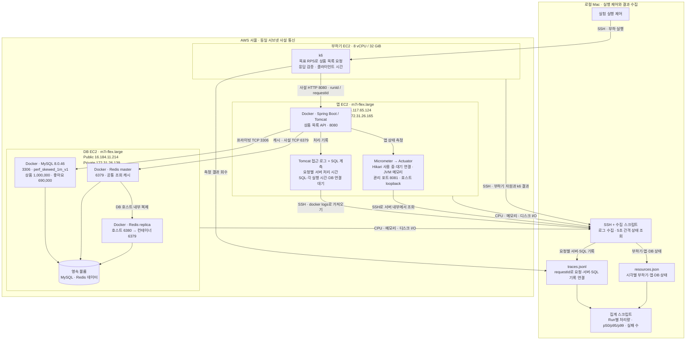

# 조회 성능 실험 시스템 구성

작성일: 2026-10-13 · 수정일: 2026-10-16

**서울 EC2 3대에 부하기·앱·DB를 분리한다.** k6는 별도 EC2에서 같은 서브넷의 앱 사설 IP로 요청하고, 앱은 DB 서버의 사설 IP로 MySQL·Redis에 연결한다. 로컬 Mac은 실행 제어와 결과 수집을 담당한다.

**측정 데이터는 상품 1,000,000개·재고 1,000,000개·브랜드 1,000개·사용자 240,000명·좋아요 690,000개다.** DB는 `perf_skewed_1m_v1`을 사용한다. 아래는 EC2 부하기로 전환한 후속 캐시 부하 실험의 구성이다. 앞선 쿼리 튜닝의 순차 API 측정과 부하 실험은 구분한다.

## 서비스와 실험 도구

서비스 연결 화살표는 요청 방향이며 응답은 같은 연결로 돌아온다. 수집 화살표는 기록이 이동하는 방향이다. 서버가 로컬에 접속하는 것이 아니라 로컬 수집기가 SSH로 가져온다. 캐시 실험에서는 Redis를 사용하며, 캐시를 끈 쿼리 기준선은 MySQL로 조회한다. Redis replica는 DB 호스트에 함께 구성되어 있지만, 캐시 읽기 endpoint는 각 실험의 연결 설정을 기준으로 확인한다.

## 도구별 역할

| 도구 | 담당 | 남기는 기록 |
| --- | --- | --- |
| k6 | 별도 EC2에서 부하 발생·응답 검증. HTTP 호출 직전부터 본문 수신 완료까지 측정 | 요청별 클라이언트 시간·상태, Run별 부하 결과 |
| Tomcat 접근 로그 | 요청 처리 시작부터 응답 처리 완료까지 측정 | 요청별 서버 처리 시간·HTTP 상태·requestId |
| SQL 계측 | JDBC 실행 호출과 DB 연결 획득 대기 측정 | 요청별 SQL·각 실행 시간·연결 대기 시간 |
| Micrometer | Hikari 연결 사용·대기, JVM 메모리 등 앱 상태 측정 | 앱 전체의 상태 지표 |
| Actuator | Micrometer 지표를 관리 HTTP API로 제공 | 수집기가 주기적으로 조회하는 지표 응답 |
| SSH + 수집 스크립트 | 앱 지표·앱/DB/부하기 자원·Docker 로그·k6 결과를 수집 | 요청별 Trace와 시각별 자원 파일 |
| 집계 스크립트 | 요청별 기록을 Run 단위로 집계 | 처리량·지연 분포·실패 건수·보고서 |

**요청별 서버 시간은 Tomcat 로그에서, 그 시각의 앱 전체 상태는 Actuator·Micrometer에서 확인한다.** 예를 들어 “이 요청은 DB 연결을 2초 기다림”과 “당시 연결 40개 사용 중·20개 요청 대기”를 시간대로 맞춰 보는 방식이다. 숫자는 설명용 예시다.

Tomcat 로그만으로 개별 SQL 시간을 알 수 없으므로 별도 SQL 계측을 연결한다. JDBC 실행 시간에는 결과를 객체로 만드는 비용이 전부 포함되지 않는다. 클라이언트 시간과 서버 시간의 차이도 모두 네트워크 지연으로 단정하지 않는다.

## 장비와 연결 설정

| 항목 | 부하기 서버 | 앱 서버 | DB 서버 |
| --- | --- | --- | --- |
| 확인된 사양 | 8 vCPU · RAM 32 GiB | m7i-flex.large · 2 vCPU · RAM 8 GiB | m7i-flex.large · 2 vCPU · RAM 8 GiB |
| 실행 역할 | k6 부하 생성·응답 검증 | Docker · Spring Boot | Docker · MySQL·Redis master·replica |
| 측정 트래픽 | 앱 사설 IP의 8080으로 요청 | DB 사설 IP로 접속 | MySQL 3306·Redis master 6379, replica 호스트 포트 6380 |

관리 포트 8081은 앱 호스트 `127.0.0.1`에만 공개하고 SSH로 지표를 수집한다. 앱은 `ddl-auto=none`으로 연결하며, MySQL과 Redis는 같은 EC2의 CPU·메모리·디스크를 공유한다.

## 측정 범위

EC2 부하기 전환 후 캐시 부하 실험은 고정 데이터의 최신순·무브랜드·첫 페이지 20개, 캐시 hit 중심으로 진행했다. 대표 조건은 1,700 RPS·VU 3,000·60초·3회다. 사용자 인터넷 경로 또는 현재 revision 설계의 혼합 읽기·쓰기 부하 성능으로 해석하지 않는다.

로컬 부하기를 사용한 초기 결과와 EC2 부하기 결과는 장비·네트워크 경로·k6 빌드가 달라 구분한다. 이 문서는 측정 당시 구성이며 현재 실행 중인 AWS 자원을 실시간 확인한 결과는 아니다.
