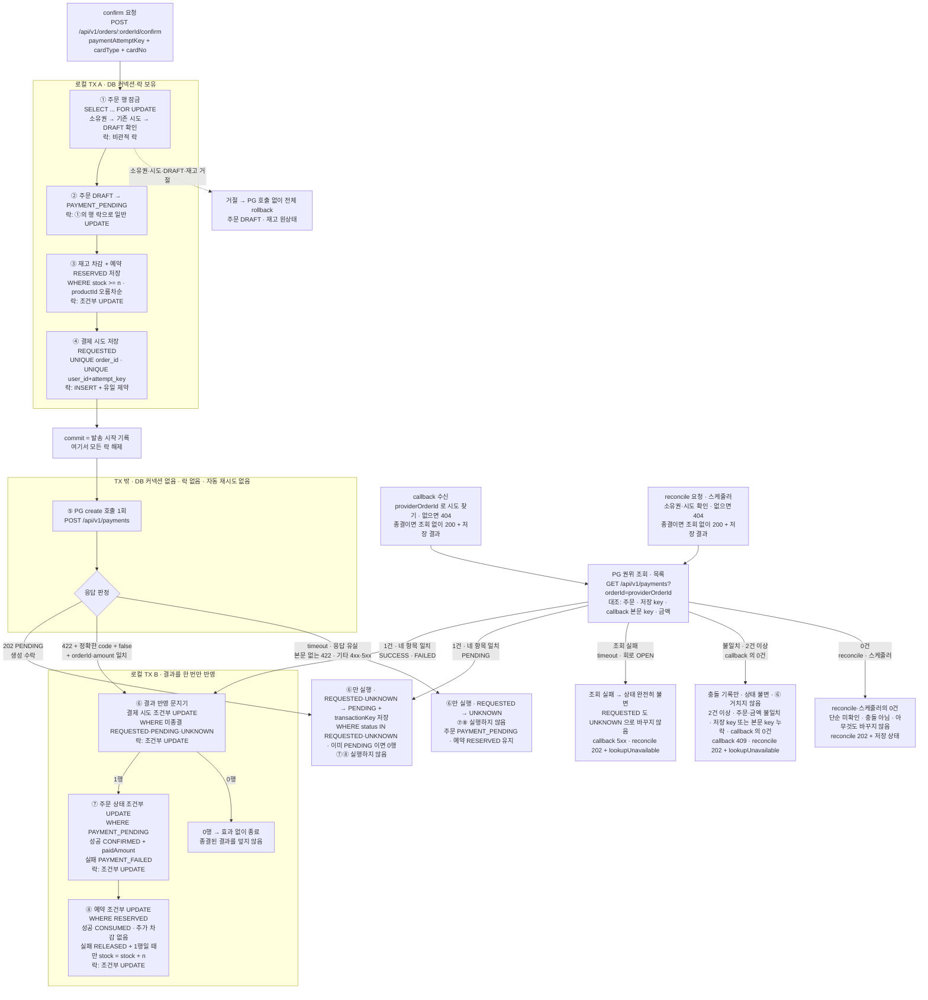

# 5주차 설계 · 포인트 결제 → 로컬 테스트 PG 교체

- 이 문서 범위: 0장 이름 대조표 · 1장 트랜잭션 경계(예약 저장 형태, 결제 시도 식별자, create 응답 매핑 포함) · 2장 동시성 방식 · 3장 발송 시작 기록 · 4장 같은 주문의 confirm 재요청(202·200 응답 본문 포함) · 5장 PG 성공 뒤 내부 저장(TX B) 실패 · 6장 조율 위치 · 7장 PG 조회 결과가 0건·2건 이상·불일치일 때 · 8장 상태 모델(결제 시도·주문·예약 상태 전이) · 부록 결정 필요(현재 없음)
- 이 문서 범위 밖: PG adapter의 HTTP 요청·응답 매핑 세부, circuit breaker·retry 수치, 테스트 구성. 과제 2·5·6장에 해당하며 별도 문서로 다룬다. callback·reconcile 의 상세 계약은 이 문서에서 정했다. 조율 위치는 6장, 202·200 응답 모양은 4-6, callback 입구 검사·인증은 7-5 결정 ⑲, reconcile 입구 검사·조회 실패 응답은 5-6 결정 ⑳, 스케줄러의 조회 한도 계산 범위·설정값은 5-3 결정 ⑫다. 3단계 HTTP adapter 의 클라이언트·고정 설정·timeout 자리·202 불일치·계약 테스트 방식은 1-6 결정 ㉑~㉖에서, 4단계의 timeout 값·서킷브레이커(위치·실패 기준·차단 구분·숫자)·재조회 없음은 5-7 결정 ㉗~㉜에서 정했다. 요청·응답 매핑 세부는 여전히 범위 밖이다.
- 표기 규칙: **과제 근거**는 원문 섹션명과 문장을 인용한다. **판단:** 은 과제가 정하지 않아 내가 고른 것이다. **결정 필요** 는 이 문서에서 정하지 않고 선택지만 남긴 것이다.

---

## 0. 이름 대조표

현재 코드를 읽고 맞춘 이름이다. 기존에 없는 이름은 `신규` 로 표시한다.

| 역할 | 이름 | 상태 |
|---|---|---|
| 주문 상태 (기존 2개) | `Order.OrderStatus.DRAFT`, `CONFIRMED` | 기존 |
| 주문 상태 (결제 대기·실패) | `Order.OrderStatus.PAYMENT_PENDING`, `PAYMENT_FAILED` | **신규** (enum 값 추가) |
| 주문 금액 스냅샷 | `Order.getTotalAmount()`, `Order.paidAmount` | 기존 |
| 주문 결제수단 | `Order.paymentMethod`, `Order.PaymentMethod.POINT`·`PG` | **신규** (8-2 결정 ⑮ 참조) |
| 주문 품목 | `OrderItem` (productId, quantity, unitPrice) | 기존 |
| 주문 소유권 판정 | `Order.isOwnedBy(userId)` | 기존 |
| 주문 행 잠금 조회 | `OrderRepository.findByIdForUpdate(orderId)` | **신규** (`@Lock(PESSIMISTIC_WRITE)`) |
| 주문 결제 시작 | `Order.startPayment()` | **신규** (잠긴 행의 상태 변경) |
| 주문 결과 반영 | `OrderRepository.finishIfPaymentPending(orderId, status, paidAmount)` | **신규** |
| 결제 시도 | `PaymentAttempt` | **신규** |
| 결제 시도 상태 | `REQUESTED`, `PENDING`, `UNKNOWN`, `SUCCESS`, `FAILED` | **신규** (미종결 3개 + 종결 2개, 전이는 8-1) |
| 재고 예약 | `StockReservation` | **신규** |
| 예약 상태 | `RESERVED`, `CONSUMED`, `RELEASED` | **신규** |
| 재고 차감 | `ProductRepository.deductStockIfEnough(productId, quantity)` | 기존 (그대로 재사용) |
| 재고 복원 | `ProductRepository.restoreStock(productId, quantity)` | **신규** (`stock = stock + n`) |
| 재고 최종 설정 | `ProductRepository.updateStock(productId, quantity)` | 기존 |
| 오류 타입 | `ErrorType.BAD_REQUEST`, `UNAUTHORIZED`, `NOT_FOUND`, `CONFLICT` | 기존 (신규 타입 불필요, 4장 참조) |
| 예외 | `CoreException(ErrorType, customMessage)` | 기존 |
| 응답 포맷 | `ApiResponse<T>` | 기존 |
| 상태 코드 분기 (202/200) | `ResponseEntity<ApiResponse<T>>` | **신규** (기존 컨트롤러는 `@ResponseStatus` 고정값만 사용) |
| 예약 테이블 | `stock_reservations` (order_id, product_id, quantity, status) | **신규** (1-4 참조) |
| 결제 시도의 외부 주문 식별자 | `PaymentAttempt.providerOrderId` | **신규** (컬럼으로 저장, 1-5 참조) |
| callback·reconcile 조율 | `PaymentFacade` | **신규** (6장 참조) |
| TX B 공용 서비스 | `PaymentResultService` | **신규** (별도 `@Transactional` 빈, 6장 참조) |
| PG 조회 포트 | `PaymentGateway` (domain 인터페이스, infrastructure 구현) | **신규** (7장 참조) |
| PG 목록·단건 조회 | `PaymentGateway.findAllByOrderId(providerOrderId)`, `findByTransactionKey(transactionKey)` | **신규** (판정은 목록 조회만 사용, 7-3 참조) |
| 충돌 기록 | `PaymentAttempt.conflicted`, `conflictReason`, `conflictedAt` | **신규** (상태 컬럼과 별개, 7-2 참조) |
| 실패 사유 | `PaymentAttempt.failureReason`, `FailureReason.REJECTED_BEFORE_CREATE`·`PG_FAILED` | **신규** (1-6 결정 ⑰ 참조) |
| 스케줄러 조회 추적 | `PaymentAttempt.lookupCount`, `nextLookupAt`, `manualCheckRequired` | **신규** (상태 컬럼과 별개, 5-3 결정 ⑫ 참조) |
| TX A 서비스 | `PaymentStartService.start(userId, orderId, PaymentStartCommand)` | **신규** (1단계-B 구현. ①~④를 한 TX 로 실행) |
| TX A 입력·결과 | `PaymentStartCommand(attemptKey, cardType)`, `PaymentStart(kind STARTED/EXISTING, attemptId, providerOrderId, amount, cardType)` | **신규** (카드 번호는 TX A 에 들어가지 않는다) |
| TX B 입력 | `PaymentFinalResult(status SUCCESS/FAILED, failureReason, transactionKey)` | **신규** (`PaymentResultService.applyFinal` 의 인자) |
| TX B 비종결 기록 | `PaymentResultService.recordPending(attemptId, transactionKey)`, `recordUnknown(attemptId)` | **신규** (⑥만 실행) |
| 합성 카드 입력 | `PaymentCard(cardType, cardNo)` | **신규** (허용 목록: cardType `TEST`, 번호 `0000-0000-0000-0000`. 그 외 `BAD_REQUEST`) |
| PG 생성 요청·관찰 결과·거래 | `PaymentCreateCommand`, `PaymentCreateResult(outcome ACCEPTED/REJECTED_NO_EFFECT/UNKNOWN)`, `PaymentTransaction` | **신규** (포트의 입출력. 카드 번호는 `toString` 에서 가린다) |
| confirm 응답 재료 | `OrderConfirmInfo(order, attemptStatus, settled, lookupUnavailable)` | **신규** (`settled` 로 202/200 을 가른다. `lookupUnavailable` 은 2단계 reconcile 용, confirm 은 항상 false) |
| PG 조회 관찰 결과 | `PaymentLookupResult(outcome FOUND/UNAVAILABLE, transactions)` | **신규** (2단계. 목록·단건 조회 공통 반환형. 단건 404 는 FOUND + 0건, timeout·4단계 회로 차단은 UNAVAILABLE. 7-3 참조) |
| 조회 불가 이유 | `PaymentLookupResult.UnavailableReason` (`CALL_FAILED` 호출 실패 / `CIRCUIT_OPEN` 서킷 차단) | **신규** (4단계. 스케줄러가 차단 주기를 세지 않기 위해 구분. 5-7 결정 ㉙ 참조) |
| PG 조회 서킷 설정값 | `payment.pg.circuit-breaker.*` (표본 방식·크기, 최소 호출 수, 실패율, OPEN 대기, HALF_OPEN 시험 호출 수) | **신규** (4단계. `resilience4j-circuitbreaker` core 모듈을 `HttpPaymentGateway` 안에서 코드로 감싼다. 5-7 결정 ㉛·㉜ 참조) |
| PG 포트 운영 껍데기 | `UnavailablePaymentGateway` | 1·2단계에만 있었음. 3단계-B 에서 `HttpPaymentGateway` 로 교체하며 **삭제함** (1-6 결정 ㉓) |
| PG 실제 HTTP adapter | `HttpPaymentGateway` (infrastructure `@Component`. `RestClient` + JDK `HttpClient` 를 안에서 조립, HTTP/1.1·프록시 없음. 생성자에 `Clock` 주입 → 4단계 서킷의 시계) | **신규** (3단계-B 구현, 4단계에서 조회 서킷 추가. 1-6 결정 ㉑, 5-7 결정 ㉗ 참조) |
| PG adapter 설정값 | `PaymentGatewayProperties` ← `payment.pg.*` (`enabled`, `base-url`, `callback-url`, `user-id`, `connect-timeout`, `read-timeout`) | **신규** (3단계. 1-6 결정 ㉒·㉓·㉔ 참조) |
| create 응답의 불일치 표시 | `PaymentCreateResult.conflictReason`, `unknownWithConflict(reason)` | **신규** (3단계. UNKNOWN + 충돌 사유. 1-6 결정 ⑱·㉕ 참조) |
| 계약 테스트용 PG 서버 | `TestPaymentPgServer` (테스트 소스, JDK `HttpServer`) | **신규** (3단계. 1-6 결정 ㉖ 참조) |
| 테스트 전용 가짜 PG | `FakePaymentGateway` + `FakePaymentGatewayConfig`(`@TestConfiguration`, `@Primary`) | **신규** (테스트 소스. `@Import` 한 테스트에서만 등록) |
| 스케줄러 조회 설정값 | `payment.lookup.*` (`@ConfigurationProperties`. 등록은 기존 `@ConfigurationPropertiesScan` 이 맡는다) | **신규** (2단계. 5-3 결정 ⑫ 설정값 표 참조) |
| reconcile 응답의 확인 불가 표시 | 4-6 응답 `data` 의 `lookupUnavailable` | **신규** (2단계. 5-6 결정 ⑳ 참조) |

이번 변경으로 쓰이지 않게 되는 기존 코드 (1단계-B 에서 삭제함)

| 대상 | 이유 |
|---|---|
| `OrderRepository.confirmIfDraft`, `OrderService.confirmOrder`, `OrderRepository.reload` | DRAFT → CONFIRMED 직행 전이가 없어지고, ② DRAFT → PAYMENT_PENDING 과 ⑦ PAYMENT_PENDING → CONFIRMED 로 쪼개진다. `reload` 는 `confirmOrder` 만 썼다 |
| `PointService.deduct`, `PointRepository.deductIfEnough`, `Point.validateDeductAmount` | 주문 확정에서 포인트를 차감하지 않는다. 호출자가 `OrderFacade.confirmOrder` 뿐이었다 |

> **과제 근거** (1. 교체 범위와 상태 설계)
> "신규 PG 결제 시도·외부 거래·결과 확인 경계 추가 / 포인트 차감 0회"
> "포인트 충전·조회 기존 API를 유지하되 주문 결제에서 분리"

> **과제 근거** (4. 재고 확보와 결과 반영)
> "상태 이름은 위 의미를 유지하는 범위에서 기존 모델에 맞게 정합니다. 외부 PENDING을 CONFIRMED로 바꾸지 않습니다."

---

## 1. 트랜잭션 경계

### 1-1. 원칙

> **과제 근거** (1. 교체 범위와 상태 설계)
> "설계 문서에 로컬 TX 전후, 외부 HTTP 호출, 결과 적용 경계를 표시합니다. PG 호출 동안 DB 트랜잭션·재고 잠금을 계속 보유하지 않습니다."

> **과제 근거** (4. 재고 확보와 결과 반영)
> "1. 로컬 TX A: 주문·상품을 검사하고 필요한 재고를 확보합니다. 시도·예약·결제 대기 상태를 같은 TX에 저장합니다. 부족·삭제·잘못된 입력이면 PG 호출 없이 전체 rollback합니다."
> "2. TX 밖: 발송 권한을 가진 실행이 PG를 호출합니다. 다른 실행은 이미 저장된 상태를 조회합니다."
> "3. 로컬 TX B: 검증한 PG 결과를 시도·주문·예약에 한 번만 적용합니다."

4주차까지는 주문 확정 전체가 `OrderFacade.confirmOrder` 의 단일 `@Transactional` 안에 있었다. 이번에는 그 하나를 TX A / TX 밖 / TX B 세 구간으로 쪼갠다.

### 1-2. 단계별 경계

**로컬 TX A** (DB 커넥션·락 보유, commit 으로 종료)

| 단계 | 동작 | 락 방식 |
|---|---|---|
| ① | 주문 행 잠금. 소유권 → 기존 시도 → DRAFT 순으로 확인하고, 기존 시도가 있으면 키·요청 일치를 본다 | 비관적 락 (`SELECT … FOR UPDATE`) |
| ② | 주문 `DRAFT` → `PAYMENT_PENDING` | ①의 행 락을 그대로 쓰는 일반 UPDATE |
| ③ | 재고 차감 + 예약 `RESERVED` 저장. 품목을 `productId` 오름차순으로 처리 | 조건부 UPDATE (`WHERE stock >= n`) |
| ④ | 결제 시도 저장 (`status = REQUESTED`) | INSERT + `UNIQUE(order_id)` |

④까지 끝나고 **commit 하는 순간을 발송 시작 기록으로 본다** (3장에서 상세히 다룬다). 어느 단계든 거절되면 PG 호출 없이 전체 rollback 되어 주문은 `DRAFT` 로 남고 재고도 원상태다.

**TX 밖** (DB 커넥션 없음, 락 없음, 자동 재시도 없음)

| 단계 | 동작 |
|---|---|
| ⑤ | PG `POST /api/v1/payments` 호출 1회 |

> **과제 근거** (3. 기존 주문 확정에 PG 연결)
> "발송 시작을 영속 기록한 뒤에는 자동으로 create를 다시 보내지 않습니다. … 생성 HTTP client·프록시·회복 라이브러리의 숨은 재시도도 끕니다."

**로컬 TX B** (결과 반영, 세 입구가 공유)

| 단계 | 동작 | 락 방식 |
|---|---|---|
| ⑥ | 결과 반영 문지기. 결제 시도를 미종결(`REQUESTED`·`PENDING`·`UNKNOWN`)일 때만 갱신. **0행이면 아무 효과 없이 종료** | 조건부 UPDATE `WHERE status IN ('REQUESTED', 'PENDING', 'UNKNOWN')` |
| ⑦ | 주문 상태 갱신. `WHERE status = PAYMENT_PENDING`, 성공이면 `CONFIRMED` + `paidAmount`, 실패면 `PAYMENT_FAILED` | 조건부 UPDATE |
| ⑧ | 예약 갱신. `WHERE status = RESERVED`, 성공이면 `CONSUMED`, 실패면 `RELEASED` + **1행일 때만** `stock = stock + n` | 조건부 UPDATE |

⑥이 단독 승자를 정하므로 ⑦⑧은 한 TX 안에서 한 번만 실행된다. 그래도 조건을 WHERE 에 두는 이유는 과거에 종결된 상태를 덮어쓰지 않기 위한 이중 안전망이다.

**TX B 의 세 입구**

| 입구 | 들어오는 결과 | 비고 |
|---|---|---|
| create 응답 | ⑤의 동기 응답 | 생성 수락(`PENDING`) 또는 효과 0건 확정 거절 |
| callback | PG 알림 수신 → **PG 권위 조회 후** | 알림 본문의 상태 문자열만으로는 반영하지 않는다 |
| reconcile | 사용자 요청 → **PG 권위 조회 후** | 콜백이 없을 때의 기본 복구 경로. 스케줄러(5-3 결정 ⑫)도 같은 조회·반영 경로를 쓴다 |

> **과제 근거** (5. callback·조회·회복 전략)
> "알림의 성공 문자열만으로 주문을 확정하지 않습니다. 고정한 PG adapter의 조회 결과에서 제공자 계정 범위·주문·transactionKey·저장 금액을 확인한 뒤 적용합니다."
> "같은 거래의 callback-first와 lookup-first가 같은 최종 상태로 수렴합니다."

**생성 수락(PENDING) 처리**

create 응답이 `PENDING` 이면 ⑥에서 `REQUESTED` → `PENDING` 으로 바꾸고 `transactionKey` 를 저장한다. 조건은 `WHERE status IN ('REQUESTED', 'UNKNOWN')` 이다. 조회로 거래를 확인한 경우(결정 ⑪, 8-1)도 같은 UPDATE 를 쓴다. **⑦⑧은 실행하지 않는다.**

**미확인(UNKNOWN) 처리**

create 의 timeout·응답 유실·증거 없는 오류는 ⑥에서 `REQUESTED` → `UNKNOWN` 만 기록하고 **⑦⑧을 실행하지 않는다.** 조건은 `WHERE status = 'REQUESTED'` 로, 이미 `PENDING` 인 시도는 되돌리지 않는다. 주문은 `PAYMENT_PENDING`, 예약은 `RESERVED` 로 유지된다.

callback·reconcile·스케줄러의 **조회 실패**는 여기에 해당하지 않는다. 거래가 있는지에 대해 새로 안 것이 없으므로 시도 상태를 전혀 바꾸지 않는다. `REQUESTED` 도 `UNKNOWN` 으로 바꾸지 않는다 (5-6 결정 ⑳, 7-6 표).

> **과제 근거** (2. 로컬 테스트 PG 계약과 adapter)
> "반대로 timeout, 본문 없는 422, 다른 오류 code의 4xx·5xx, 잘못된 JSON·식별·금액은 효과 0건의 증거가 아닙니다. 다른 확정 결과가 없는 해당 시도는 UNKNOWN·예약 유지로 두고 기존 거래 조회 경로를 사용합니다."

> **과제 근거** (4. 재고 확보와 결과 반영)
> "timeout만으로 실패·예약 반환을 결정하지 않습니다."

`PENDING`·`UNKNOWN` 은 종결 상태가 아니다. 이후 callback·reconcile 이 권위 조회로 `SUCCESS`·`FAILED` 를 확인하면 ⑥의 WHERE 에 걸려 종결된다.

### 1-3. 전체 흐름



create 응답에서 `SUCCESS` 는 오지 않는다. 과제 계약이 생성 수락을 `202 PENDING` 으로 고정했기 때문이고, 검증된 `SUCCESS` 는 callback·reconcile 입구로만 들어온다.

> **과제 근거** (2. 로컬 테스트 PG 계약과 adapter)
> "생성 수락 응답은 HTTP 202로 둡니다."
> "PENDING, SUCCESS, FAILED. 생성 수락과 최종 성공을 구분"

### 1-4. 예약 저장 형태 (확정)

예약은 **별도 테이블 `stock_reservations`** 에 둔다. 컬럼은 `order_id`, `product_id`, `quantity`, `status`(`RESERVED` / `CONSUMED` / `RELEASED`) 다. 기존 `Product.stock.quantity` 는 **"지금 팔 수 있는 가용 재고"** 의 의미로 그대로 쓴다. ③에서 차감하면 그 즉시 가용 재고가 줄고, ⑧의 실패 반환에서만 다시 늘어난다.

> **과제 근거** (4. 재고 확보와 결과 반영)
> "PG 성공 뒤 재고 부족을 발견하는 일을 피하기 위해 PG 호출 전에 기존 재고를 주문에 확보합니다. 기존 가용 재고를 차감하고 주문별 확보 수량·상태를 저장하는 최소 예약 방식으로 구현할 수 있습니다."

**판단:** 과제가 "주문별 확보 수량·상태"를 요구하므로 주문 단위의 상태 전이를 담을 행이 필요하다. ⑧의 `WHERE status = RESERVED` 가 예약 행 하나에 걸리므로, 같은 실패 알림이 두 번 와도 두 번째는 0행이 되어 반환이 한 번으로 끝난다. 4주차의 상품 조회·정렬·캐시는 `Product.stock.quantity` 를 그대로 읽으므로 변경이 없다.

기각한 대안

| 대안 | 기각 이유 |
|---|---|
| `products` 에 `reserved_quantity` 컬럼 추가 | 주문별 반환 여부를 기록할 곳이 없다. 같은 실패 알림이 두 번 오면 두 번 모두 "예약을 돌려준다"가 되어 재고 5 → 7 반례를 막을 수 없다 |
| `order_items` 에 예약 상태 컬럼 추가 | 주문 당시의 수량·단가 기록이던 `OrderItem` 에 가변 상태가 섞인다. 과거 주문을 "기존 사실을 그대로 조회"해야 한다는 과제 표와 충돌한다 |

> **과제 근거** (1. 교체 범위와 상태 설계)
> "이전 포인트 결제 주문 → 기존 사실을 그대로 조회 / 결제수단 POINT·금액·결과·당시 품목 정보"
> "접근 구분과 과거 주문 보호"

**관리자 재고 설정과의 관계.** 기존 재고 설정 API(`ProductRepository.updateStock`)는 `Product.stock.quantity` 만 바꾸고 `stock_reservations` 는 건드리지 않는다. 관리자가 설정하는 값은 "예약을 뺀 가용 수량"이고, 이미 확보된 예약은 PG 결과가 나올 때까지 그대로 남는다.

> **과제 근거** (4. 재고 확보와 결과 반영)
> "기존 재고 설정 API는 예약을 제외한 가용 수량을 최종 설정하는 의미로 연결하고, 관리자 변경도 같은 재고 행의 보호 규칙을 사용합니다. 예약 수량을 관리자 설정 때문에 지우거나 PG 성공 때 다시 차감하지 않습니다."

**주문 품목과 겹치는 정보.** `product_id` 와 `quantity` 는 `OrderItem` 에도 있다. 그래도 예약은 주문 기록의 복사가 아니라 **재고 쪽 기록**이다. 주문 품목은 "무엇을 얼마에 샀는가"를 주문 시점에 고정한 기록이고, 예약은 "재고에서 얼마를 빼 두었고 지금 어느 상태인가"를 재고 관점에서 추적하는 행이다. 수명도 다르다. 주문 품목은 영구 보존되지만, 예약은 종결(`CONSUMED`·`RELEASED`)되면 역할이 끝난다.

### 1-5. 결제 시도에 보존하는 식별자

결제 시도 한 행에 세 식별자를 역할별로 나눠 저장한다.

| 식별자 | 역할 | 정해지는 시점 |
|---|---|---|
| `attemptKey` | 고객이 보낸 멱등 키. 같은 요청인지 판별한다 (4장) | confirm 요청 |
| `providerOrderId` | PG 에 보내는 주문 식별 문자열 (예: 주문 42 → `LP-ORD-0000000042`). 생성과 조회에 같은 값을 쓴다 | TX A ④ |
| `transactionKey` | PG 가 발급한 거래 키. 거래 단건 조회에 쓴다 | ⑤ 응답 또는 callback |

`providerOrderId` 는 **컬럼으로 저장한다.** 과제가 보존을 요구하므로 결정 필요 항목이 아니다.

> **과제 근거** (3. 기존 주문 확정에 PG 연결)
> "내부 시도 키·providerOrderId·외부 transactionKey의 역할을 나눠 DB에 보존합니다."

> **과제 근거** (2. 로컬 테스트 PG 계약과 adapter)
> "내부 주문 42를 LP-ORD-0000000042 로 매핑했다면 생성과 조회에 동일하게 사용합니다."

보충: 포맷 함수로만 파생하면 포맷을 바꾼 순간 진행 중인 미확인 시도를 orderId 조회(`GET /api/v1/payments?orderId=`)로 찾지 못한다. 저장해 두면 과거 시도는 저장된 값으로 조회된다.

### 1-6. create 응답 매핑과 효과 0건 확정 거절

⑤의 create 응답 하나를 내부 상태로 옮기는 규칙이다. 핵심은 **"PG 에 거래가 아예 안 생겼다"를 확정할 수 있는 응답과, 그냥 모르는 응답을 가르는 것**이다. 앞의 것만 실패로 종결하고 예약을 되돌린다.

#### 효과 0건 확정 거절의 조건

`REJECTED_NO_EFFECT` 로 매핑하는 조건은 네 가지이며 **모두** 충족해야 한다.

| 조건 | 확인 대상 |
|---|---|
| HTTP 상태 422 | 응답 상태 코드 |
| 정확한 code | 본문 `code` 가 `TEST_PG_REJECTED_BEFORE_CREATE` |
| `transactionCreated` 가 boolean `false` | 본문 `transactionCreated` |
| 요청 `orderId`·`amount` 일치 | 본문 `orderId`·`amount` 가 우리가 보낸 값과 같은지 |

> **과제 근거** (2. 로컬 테스트 PG 계약과 adapter · 공통 · 거래 생성 전 확정 거절과 UNKNOWN 구분)
> "adapter는 고정한 로컬 PG의 생성 응답에서 422 + 정확한 code + boolean false + 요청 orderId·amount 일치를 모두 확인한 경우에만 REJECTED_NO_EFFECT 로 매핑합니다. 이 내부 관찰은 결제 FAILED·예약 한 번 반환으로 연결하고, 거래가 없으므로 transactionKey를 꾸며 저장하지 않습니다."

> **과제 근거** (2. 로컬 테스트 PG 계약과 adapter · 공통 · 거래 생성 전 확정 거절과 UNKNOWN 구분)
> "반대로 timeout, 본문 없는 422, 다른 오류 code의 4xx·5xx, 잘못된 JSON·식별·금액은 효과 0건의 증거가 아닙니다. 다른 확정 결과가 없는 해당 시도는 UNKNOWN·예약 유지로 두고 기존 거래 조회 경로를 사용합니다. 일반 조회 404·빈 목록도 이 생성 거절과 다릅니다."

**구현 주의 두 가지.**

- `transactionCreated` 가 문자열 `"false"` 이면 통과시키지 않는다. 과제가 boolean `false` 를 명시했다.
- `code` 는 정확히 일치로 비교한다. 대소문자 무시나 부분 일치(`contains`·`startsWith`)를 쓰지 않는다.

#### create 응답별 표

| create 응답 | adapter 관찰 | 결제 시도 | 주문 | 예약 |
|---|---|---|---|---|
| 202 + 본문 `status: PENDING` | 생성 수락 | `PENDING` + `transactionKey` 저장 | `PAYMENT_PENDING` 유지 | `RESERVED` 유지 |
| 422, 네 조건 모두 충족 | `REJECTED_NO_EFFECT` | `FAILED` + 사유 `REJECTED_BEFORE_CREATE`. `transactionKey` 없음 | `PAYMENT_FAILED` | `RELEASED` + `stock = stock + n` 1회 |
| 본문 없는 422 | 증거 아님 | `UNKNOWN` | `PAYMENT_PENDING` 유지 | `RESERVED` 유지 |
| 422 지만 `code` 가 다름 | 증거 아님 | `UNKNOWN` | `PAYMENT_PENDING` 유지 | `RESERVED` 유지 |
| 그 밖의 4xx·5xx | 증거 아님 | `UNKNOWN` | `PAYMENT_PENDING` 유지 | `RESERVED` 유지 |
| 잘못된 JSON | 증거 아님 | `UNKNOWN` | `PAYMENT_PENDING` 유지 | `RESERVED` 유지 |
| timeout·응답 유실 | 증거 아님 | `UNKNOWN` | `PAYMENT_PENDING` 유지 | `RESERVED` 유지 |
| 422 + 정확한 code + `false` 인데 `orderId`·`amount` 불일치 | 증거 아님 + 이상 신호 | `UNKNOWN` + 충돌 표시 (결정 ⑱) | `PAYMENT_PENDING` 유지 | `RESERVED` 유지 |
| 202 인데 본문 `orderId`·`amount` 가 요청과 불일치 | 접수 증거 아님 + 이상 신호 | `UNKNOWN` + 충돌 표시. `transactionKey` 저장 안 함 (결정 ㉕) | `PAYMENT_PENDING` 유지 | `RESERVED` 유지 |

**중복 적용도 반환을 늘리지 않는다.** create 응답도 callback·reconcile 과 같은 TX B 문지기(⑥, 미종결일 때만)를 거친다. 같은 거절이 두 번 적용되면 두 번째는 0행이 되어 ⑦⑧이 실행되지 않는다.

> **과제 근거** (2. 로컬 테스트 PG 계약과 adapter · 공통 · 거래 생성 전 확정 거절과 UNKNOWN 구분)
> "작은 HTTP 계약 테스트에서 위 응답은 거래 0건·예약 반환 1회, 거래 생성 뒤 응답 유실은 거래 1건·UNKNOWN·예약 유지·create 추가 0회로 대조합니다. 동일한 거절의 중복 적용도 반환을 늘리지 않아야 합니다."

#### 결정 ⑰ 실패 사유를 결제 시도에 저장 (확정)

결제 시도에 실패 사유(`PaymentAttempt.failureReason`, **신규**)를 저장한다. 값은 `REJECTED_BEFORE_CREATE`(생성 전 확정 거절)와 `PG_FAILED`(조회로 확인된 `FAILED`) 두 개다.

**판단:** `FAILED` 에 도달하는 경로가 둘이고(조회 결과 `FAILED`, create 의 생성 전 거절) 성격이 다르다. 데이터로 구분해 두면 주문 조회·테스트·PR 설명에서 "어느 쪽 실패인가"를 바로 말할 수 있다.

기각: "`FAILED` 인데 `transactionKey` 가 없으면 생성 전 거절"로 추론. 의미가 암묵적이고, `transactionKey` 없이 `FAILED` 가 되는 다른 경로가 생기면 추론이 깨진다.

#### 결정 ⑱ orderId·amount 불일치 422 (확정 · **3단계에서 구현**)

구현 시점: 1·2단계에서는 구현하지 않았다. 충돌 컬럼은 2단계에서 생기고, create 응답 본문을 실제로 읽는 HTTP adapter 가 3단계에 생기므로 그때 함께 구현한다. **3단계가 이 결정의 구현 단계다.** 아래 결정 ㉕(202 접수 응답의 불일치)와 같은 기준이며, 둘 다 3단계 adapter 의 응답 매핑에서 함께 구현한다.

네 조건 중 `orderId`·`amount` 일치만 어긋난 422 는 `UNKNOWN` 으로 두고 **충돌 표시**(7-2 의 `conflicted`·`conflictReason`·`conflictedAt`)를 함께 기록한다. 예약은 유지한다.

**판단:** 7장에서 조회 결과의 금액·식별 불일치를 충돌로 기록하기로 정했다. 같은 기준을 create 응답에도 적용한다. 우리가 보낸 값과 다른 값이 돌아온 것은 어느 경로든 이상 신호다.

기각: `UNKNOWN` 만 기록. 이상 신호가 평범한 미확인에 묻혀 사라진다.

#### 결정 ㉑ HTTP 클라이언트 (확정 · **3단계에서 구현**)

`RestClient` + JDK `HttpClient`(`JdkClientHttpRequestFactory`) 를 쓴다. create(`POST`)·목록 조회·단건 조회 모두 같은 클라이언트다.

> **과제 근거** (Java·Kotlin · 클라이언트와 회복 도구 연결)
> "두 트랙의 기존 Spring Web 의존성을 바탕으로 HTTP client를 선택합니다. RestClient 같은 동기 client를 사용할 수 있으며 Feign·WebClient를 새 필수로 만들지 않습니다."

> **과제 근거** (3. 기존 주문 확정에 PG 연결)
> "생성 HTTP client·프록시·회복 라이브러리의 숨은 재시도도 끕니다."

**판단:** 추가 의존성이 없고, JDK `HttpClient` 는 `POST` 를 몰래 다시 보내지 않는다. 1-2 의 "TX 밖 · 자동 재시도 없음"과 3장의 "create 는 1회"가 클라이언트 계층에서도 지켜진다.

기각한 대안

| 대안 | 기각 이유 |
|---|---|
| `SimpleClientHttpRequestFactory` (`HttpURLConnection`) | 특정 연결 오류에서 `POST` 를 한 번 다시 보내는 기본 동작이 있어 create 가 두 번 나갈 수 있다. 과제가 금지한 "숨은 재시도"에 해당한다 |
| Apache HttpClient 5 | 의존성이 추가되고, 기본 재시도 전략을 따로 꺼야 한다 |

#### 결정 ㉒ adapter 고정 설정과 로그 (확정 · **3단계에서 구현**)

base URL, callback URL, 제공자 계정 헤더(`X-USER-ID: 135135`)는 설정 파일(`payment.pg.*`, **신규**)에 고정한다. 고객 입력으로 바꿀 수 없다. 프록시를 거치지 않도록 클라이언트에 명시한다. HTTP 요청·응답 본문은 로그에 남기지 않는다.

> **과제 근거** (2. 로컬 테스트 PG 계약과 adapter · 공통 · 거래 생성 전 확정 거절과 UNKNOWN 구분)
> "카드 값은 위와 같은 합성 값만 사용하고 DB·로그에 카드 번호를 남기지 않습니다. base URL·callback URL은 로컬 설정으로 고정하며 고객이 임의의 외부 주소를 주입하게 하지 않습니다. 외부의 고정 X-USER-ID 는 내부 고객 인증을 대신하지 않습니다."

**판단:** create 요청 본문에 카드 번호가 들어가므로 본문 로그는 곧 카드 번호 로그다. 1단계의 "카드 번호는 DB·로그에 남기지 않음"(4-4, `PaymentCreateCommand.toString` 마스킹)을 HTTP 계층까지 연장한 것이다. 프록시를 명시적으로 끄는 이유는 결정 ㉑과 같다. 프록시가 끼면 재시도·버퍼링이 우리 통제 밖에서 생긴다. 설정 키 이름 `payment.pg.*` 는 2단계의 `payment.lookup.*` 과 나란히 두기 위한 선택이다.

#### 결정 ㉓ 테스트에서 실제 adapter 차단 (확정 · **3단계에서 구현**)

adapter 에 `enabled` 설정을 두고 test 프로필에서 `false` 로 둔다. `false` 면 어떤 호출이든 즉시 예외를 던진다. 지금의 `UnavailablePaymentGateway` 는 3단계에서 삭제하고, 이 설정이 그 역할을 이어받는다. 가짜 PG(`FakePaymentGateway`, `@Primary`)를 `@Import` 한 테스트는 지금처럼 가짜를 쓴다.

**판단:** 가짜 PG 를 등록하지 않은 테스트가 실제 HTTP 를 보내면, PG 가 없는 환경에서는 timeout → `UNKNOWN` 으로 조용히 통과한다. 실패가 "미확인"으로 위장되는 것이다. 1단계에서 `UnavailablePaymentGateway` 로 얻은 "크게 실패"를 실제 adapter 가 들어온 뒤에도 유지한다.

기각: `UnavailablePaymentGateway` 를 남기고 프로필로 빈을 바꿔 끼움. 같은 포트의 구현이 운영용·껍데기·가짜 셋이 되어 어느 빈이 떴는지 읽기 어렵다.

#### 결정 ㉔ timeout 설정 자리 (확정 · 값은 **4단계에서 확정**)

연결 timeout 과 응답 대기 timeout 을 설정값(`payment.pg.*`)으로 두고 request factory 에 건다. 3단계는 자리와 임시값만 둔다. **0(무한 대기)은 금지한다.** 값의 확정은 4단계(회로 차단과 함께)에서 한다.

> **과제 근거** (Java·Kotlin · 클라이언트와 회복 도구 연결)
> "timeout은 실제 사용하는 request factory·하위 HTTP client에 설정합니다."

> **과제 근거** (5. callback·조회·회복 전략)
> "Timeout·fallback: 실제 PG HTTP 연결·응답 대기를 제한하고, 조회 실패·회로 차단에는 저장된 상태와 확인 불가를 반환합니다."

**판단:** 무한 대기는 TX 밖 구간이라 DB 락은 잡지 않지만, 요청 스레드가 돌아오지 않아 confirm 응답이 영영 안 나간다. 임시값이라도 유한해야 한다.

#### 결정 ㉕ 202 접수 응답의 orderId·amount 불일치 (확정 · **3단계에서 구현**)

202 응답인데 본문의 `orderId`·`amount` 가 우리가 보낸 값과 다르면 `UNKNOWN` 으로 두고 충돌 표시(7-2)를 기록한다. 응답의 `transactionKey` 는 저장하지 않는다. 주문 `PAYMENT_PENDING`·예약 `RESERVED` 는 유지한다.

> **과제 근거** (2. 로컬 테스트 PG 계약과 adapter · 공통 · 거래 생성 전 확정 거절과 UNKNOWN 구분)
> "반대로 timeout, 본문 없는 422, 다른 오류 code의 4xx·5xx, 잘못된 JSON·식별·금액은 효과 0건의 증거가 아닙니다."

**판단:** 결정 ⑱(422 불일치)과 같은 기준이다. 불일치는 효과 0건의 증거도, 정상 접수의 증거도 아니다. 다른 주문·금액에 붙은 `transactionKey` 를 저장하면 이후 7-4 의 "저장된 key 가 목록에 없음" 검사가 엉뚱한 거래를 기준으로 돌아간다. 저장하지 않으면 reconcile 의 목록 조회가 실제 거래 유무를 처음부터 다시 확인한다.

기각: `PENDING` + key 저장. 우리가 보낸 것과 다른 거래를 "접수됨"으로 믿는 것이라 과제의 "알림의 성공 문자열만으로 확정하지 않는다"와 같은 이유로 맞지 않다.

#### 결정 ㉖ 계약 테스트용 서버 (확정 · **3단계에서 구현**)

adapter 의 HTTP 계약 테스트는 JDK 내장 `HttpServer`(`com.sun.net.httpserver`)를 테스트 안에서 띄워 실제 네트워크로 검증한다. 메서드·경로·헤더(`X-USER-ID`)·JSON 타입·금액과 응답 매핑(202, 네 조건 422, 본문 없는 422, 다른 code, 잘못된 JSON, 연결 끊김)을 본다.

> **과제 근거** (2. 로컬 테스트 PG 계약과 adapter · 공통 · 거래 생성 전 확정 거절과 UNKNOWN 구분)
> "실제 adapter가 보내는 HTTP의 메서드·경로·헤더·JSON 타입·금액과 응답 매핑을 테스트합니다. query는 URI builder로 인코딩하고 transactionKey 조회를 연결합니다."

**판단:** 의존성 추가가 없고, 진짜 소켓을 거치므로 4단계의 timeout·연결 끊김 테스트에 같은 서버를 재사용할 수 있다.

기각한 대안

| 대안 | 기각 이유 |
|---|---|
| WireMock | 의존성 추가 |
| `MockRestServiceServer` | 진짜 네트워크를 거치지 않아 timeout·연결 끊김을 만들 수 없다. 4단계에서 다시 바꿔야 한다 |

---

## 2. 동시성 방식

**원칙:** 읽고 따질 게 많으면 비관적 락, WHERE 한 줄로 승자가 정해지면 조건부 UPDATE, 유일 제약은 안전망.

| 대상 | 시점 | 방식 | 이유 |
|---|---|---|---|
| 주문 행 | TX A ① | 비관적 락 `SELECT … FOR UPDATE` | 소유권·기존 시도 유무·키 일치·`DRAFT` 여부를 **순서대로 따져 응답을 달리 해야** 해서 한 WHERE 로 승자를 못 정한다. 주문은 주인 1명만 건드려 경합이 낮아 락 비용이 작다. 잠근 뒤 읽으면 최신 커밋 값이라 REPEATABLE READ 스냅샷 함정(먼저 읽은 스냅샷으로 판정해 중복 시도를 놓치는 일)을 피한다 |
| 주문 상태 `DRAFT`→`PAYMENT_PENDING` | TX A ② | 잠긴 행에 일반 UPDATE | ①이 이미 단독 접근을 보장하므로 WHERE 조건을 중복으로 걸 이유가 없다 |
| 재고 | TX A ③ | 조건부 UPDATE `WHERE stock >= n`, `productId` 오름차순 | 인기 상품은 여러 주문이 같은 행에 몰려 경합이 높고, 판정이 "충분한가" 한 줄이다. 4주차 방식을 그대로 유지한다. 오름차순 고정으로 교차 데드락을 피한다 |
| 결제 시도 생성 | TX A ④ | 주문 락 안에서 INSERT + `UNIQUE(order_id)`, `UNIQUE(user_id, attempt_key)` | 락이 이미 1건을 보장하지만, 락 경로를 거치지 않는 코드가 생기면 DB가 마지막으로 막아주는 안전망이다 |
| 결과 반영 문지기 (결제 시도) | TX B ⑥ | 조건부 UPDATE `WHERE status IN (REQUESTED, PENDING, UNKNOWN)` | create 응답·callback·reconcile 세 입구가 동시에 와도 **1행을 얻는 쪽은 하나뿐**이다. 탈락한 쪽은 락을 기다리지 않고 바로 종료한다. 종결 뒤 늦게 온 상충 응답이 상태를 되돌리지 못한다 |
| 주문 결과 상태 | TX B ⑦ | 조건부 UPDATE `WHERE status = PAYMENT_PENDING` | 이미 `CONFIRMED`·`PAYMENT_FAILED` 가 된 주문을 다시 쓰지 않는다 |
| 예약 소비·반환과 재고 복원 | TX B ⑧ | 조건부 UPDATE `WHERE status = RESERVED` + 1행일 때만 `stock = stock + n` | 중복 실패 알림이 재고를 5 → 7 로 늘리지 못하게 한다. 재고 복원이 예약 상태 전이와 같은 조건·같은 TX 에 묶인다 |

> **과제 근거** (3. 기존 주문 확정에 PG 연결)
> "주문당 한 시도와 시도 키의 요청 일치를 유일 제약·상태 전이로 보호합니다. 메모리 잠금만 사용하지 않습니다."
> "같은 시도의 동시 confirm은 실제 발송 권한을 얻은 실행 하나만 PG POST를 호출합니다."

> **과제 근거** (4. 재고 확보와 결과 반영)
> "성공·반환 상태와 재고 변경을 같은 TX에서 보호해 중복 callback·동시 reconcile이 두 번 확정·반환하지 못하게 합니다."

> **과제 근거** (6. 결정적 검증과 제출)
> "재고 5개에서 수량 2개를 확보했다면 가용 재고는 3개입니다. PG 성공 후에도 3개이며, 확정 실패 후에는 5개입니다. 중복 실패 알림으로 7개가 되거나 UNKNOWN에서 5개로 돌아가면 잘못된 처리입니다."

### 락 순서와 데드락

| 트랜잭션 | 락 획득 순서 |
|---|---|
| TX A | 주문 → 재고 (`productId` 오름차순) |
| TX B | 결제 시도 → 주문 → 예약 → 재고 |

주문과 결제 시도의 순서가 두 TX에서 서로 반대다. 그래도 교차 데드락이 생기지 않는 근거는 **같은 주문의 TX A와 TX B가 시간상 겹치지 않는다**는 것이다.

- TX B 는 결제 시도 행이 커밋된 뒤에만 1행을 얻는다. 그 커밋이 곧 TX A 의 종료다.
- callback 은 `transactionKey` 를 알아야 오고, 그 키는 TX A commit 이후의 ⑤ 호출로 처음 생긴다. TX A 보다 먼저 올 수 없다.
- reconcile 이 TX A 커밋 전에 들어오면 결제 시도가 아직 보이지 않아 조회에서 걸러지고 TX B 에 진입하지 않는다.

**판단:** 격리 수준은 MySQL 8.0 기본값 REPEATABLE READ 를 그대로 둔다. 모든 판정이 잠긴 행 읽기 또는 조건부 UPDATE 라 스냅샷 기반 판정이 없기 때문이다.

---

## 3. 발송 시작 기록

### 결정 (확정)

**TX A 안에서 결제 시도를 `REQUESTED` 로 저장하고, 그 commit 을 발송 시작 기록으로 본다.** 즉 별도의 "선점" 트랜잭션을 두지 않고, 시도 저장과 주문·예약 저장이 같은 TX 에서 한 번에 커밋된다.

> **과제 근거** (3. 기존 주문 확정에 PG 연결)
> "발송 시작을 영속 기록한 뒤에는 자동으로 create를 다시 보내지 않습니다. 발송 기록 이후 프로세스가 멈추면 실제 발송 여부가 불확실할 수 있으므로 재시작 후 기존 거래를 조회합니다."

### 검토한 대안

`READY` 상태로 저장한 뒤, 별도 TX 에서 `WHERE status = READY` 조건부 UPDATE 로 `REQUESTED` 를 선점한 실행만 PG 를 호출하는 방식.

### 반례 비교

| 장면 | 확정안 (REQUESTED 커밋 = 발송 시작) | 대안 (READY 저장 후 별도 TX 선점) |
|---|---|---|
| **호출 전 사망** (TX A commit 직후, ⑤ 전에 프로세스 종료) | 시도가 `REQUESTED` 로 남는다. 실제 거래는 0건인데 상태는 미확인이다. reconcile 의 조회 0건으로 확인되며 자동 재발송은 하지 않는다 | `READY` 로 남아 "아직 안 보냈다"가 명확하다. 다만 과제가 create 자동 재시도를 금지하므로 그 정보로 할 수 있는 일이 없다 |
| **호출 중 사망** (⑤ 전송 후 응답 전 종료) | `REQUESTED` 로 남고, 거래는 1건 있을 수 있다. reconcile 의 권위 조회로 종결한다 | 선점이 끝난 뒤이므로 상태가 `REQUESTED` 로 같다. **차이 없음** |
| **동시 confirm** (같은 주문·같은 키 2건) | 주문 비관적 락 + `UNIQUE(order_id)` 로 INSERT 가 하나만 성공하고, 그 실행만 ⑤를 호출한다 | 선점 UPDATE 에서 1행을 얻은 하나만 ⑤를 호출한다. **차이 없음**. 대신 TX 가 2개라 중간 상태가 하나 더 생긴다 |
| **READY 방치** (READY 저장 후 선점 TX 전에 종료) | 해당 상태가 없다 | `READY` 가 영구 잔류한다. 주문은 `PAYMENT_PENDING`, 예약은 `RESERVED` 인데 PG 에는 거래가 없고 자동 재발송도 금지라 reconcile 조회는 0건이다. **수동 정리 대상 상태가 하나 더 늘어난다** |

**판단:** 대안이 이득을 주는 장면은 "호출 전 사망"뿐이고, 그 이득(재발송 가능 판단)은 과제가 자동 재발송을 금지해 쓸 수 없다. 반대로 대안은 `READY` 방치라는 새 잔류 상태와 TX 1개를 추가한다. 그래서 단일 TX 안을 택했다.

### 남은 한계

TX A commit 직후 ⑤ 호출 전에 프로세스가 죽으면, **실제로는 PG 에 아무것도 보내지 않았는데도 미확인 시도로 남는다.** 이 상태에서 자동 재발송은 하지 않는다. 해소 경로는 reconcile 의 권위 조회이며, 조회가 0건이어도 그것만으로 실패로 확정하지 않고 미확인을 유지한다.

> **과제 근거** (5. callback·조회·회복 전략)
> "조회 0건·PENDING·조회 실패에는 미완료 상태를 유지합니다. 조회 한도 소진은 새 결제 허용 근거가 아닙니다."

> **과제 근거** (6. 결정적 검증과 제출)
> "발송 기록 뒤 재시작 → 저장된 시도·예약 유지, 미확인 시도 자동 재발송 0"

---

## 4. 같은 주문에 confirm 이 다시 올 때

### 4-1. 경우별 응답

`POST /api/v1/orders/{orderId}/confirm` 입력은 `paymentAttemptKey`, `cardType`, `cardNo` 이고 금액은 저장된 주문에서 결정한다. **모든 재요청은 PG 호출 0회다.**

| 경우 | 응답 | ErrorType |
|---|---|---|
| 사용자 미식별 | 401 | `UNAUTHORIZED` (기존) |
| 남의 주문 | 404, 존재를 알리지 않는다 | `NOT_FOUND` (기존, 현재 `OrderFacade.findOwnOrder` 와 동일) |
| 이전 POINT 확정 주문 (`CONFIRMED`, 시도 없음) | 409 "이미 확정된 주문입니다" | `CONFLICT` (기존) |
| 같은 키 + 같은 요청 + 진행 중 (`REQUESTED`·`PENDING`·`UNKNOWN`) | **202** + 주문·시도 상태 + reconcile 조회 경로 | 오류 아님 |
| 같은 키 + 같은 요청 + 종결 (`SUCCESS`·`FAILED`) | **200** + 저장된 결과 | 오류 아님 |
| 같은 키 + 다른 주문·금액·요청 | 409 | `CONFLICT` (기존) |
| 다른 키 + 이미 시도가 있는 주문 | 409 | `CONFLICT` (기존) |
| 처음 오는 `DRAFT` 주문 | **202** + 시도 생성 후 TX A 진행 | 오류 아님 |
| 입력 누락·형식 오류 (`paymentAttemptKey`·`cardType` 없음 등) | 400 | `BAD_REQUEST` (기존) |

**신규 ErrorType 은 필요하지 않다.** 네 가지 거절이 모두 기존 `ErrorType` 에 대응하고, `CoreException` 이 `customMessage` 를 받아 사유를 구분할 수 있다. 반면 202 와 200 을 같은 핸들러에서 나눠 반환하려면 `ResponseEntity<ApiResponse<T>>` 가 필요하다 (기존 컨트롤러는 `@ResponseStatus` 고정값만 쓴다).

> **과제 근거** (3. 기존 주문 확정에 PG 연결)
> "대기·결과 미확인인 confirm/reconcile 응답은 HTTP 202와 주문·시도 상태 및 조회 경로를 반환합니다. 같은 PG 시도의 완료 결과는 HTTP 200으로 조회·반환할 수 있습니다. 소유권·잘못된 입력·상충하는 시도는 기존 오류 계약에 맞춰 구분합니다."
> "같은 키의 다른 주문·금액·요청은 충돌입니다. 같은 주문에 새 키를 보내도 두 번째 PG 시도를 만들지 않습니다."
> "PG로 이미 종결한 같은 시도의 재요청은 저장 결과를 반환하며 추가 효과를 만들지 않습니다. 이전 POINT 확정 주문에는 기존 이미 확정된 상태 오류를 유지합니다."

### 4-2. 결정 ① 검사 순서 (확정)

**소유권 → 기존 시도 확인 → `DRAFT` 확인** 순서로 ①에서 판정한다.

이유: 같은 키 재요청이 오류가 아니라 202·200 을 받아야 하기 때문이다. 소유권을 가장 먼저 봐서, 남의 주문에 시도가 있다는 사실이 응답 차이로 새지 않는다.

검토한 대안: 소유권 → `DRAFT` → 기존 시도. 반례는 같은 키 재요청이다. 첫 confirm 으로 주문이 이미 `PAYMENT_PENDING` 이므로 `DRAFT` 검사에서 먼저 걸려 "이미 진행 중" 오류를 받는다. 과제가 요구한 "저장 결과를 반환하며 추가 효과를 만들지 않는다"를 지킬 수 없다.

### 4-3. 결정 ② attemptKey 유일 범위 (확정)

`UNIQUE(user_id, attempt_key)` 로 두고, `UNIQUE(order_id)` 는 별도로 유지한다.

이유: 다른 사용자와 키 문자열이 겹쳐도 충돌하지 않고, 남의 키 사용 여부가 응답으로 드러나지 않는다. `UNIQUE(order_id)` 는 "주문당 한 시도"를 담당하므로 역할이 다르고 함께 필요하다.

> **과제 근거** (1. 교체 범위와 상태 설계)
> "이번 범위는 주문당 한 결제 시도이며, 실패 후 새 결제 시도·환불·정산·사용자 취소·실제 카드 저장은 구현하지 않습니다."

### 4-4. 결정 ③ "같은 요청" 비교 기준 (확정)

**주문 ID + 금액 + `cardType`** 으로 비교한다. 카드 번호는 비교하지도, 저장하지도 않는다.

이유: 과제의 카드 번호 비영속 규칙 때문이다. 카드 번호만 다른 재요청은 "같은 요청"으로 통과하지만, 그 경로에서는 PG 를 다시 호출하지 않으므로 결제가 늘지 않는다.

검토한 대안

| 대안 | 문제 |
|---|---|
| 주문 ID + 금액만 | `cardType` 이 바뀐 재요청을 같은 요청으로 본다. 저장하는 필드로 구분할 수 있는데 굳이 버릴 이유가 없다 |
| 카드 번호 해시까지 포함 | 해시는 카드 번호에서 파생된 영속 데이터라 비영속 규칙과 충돌할 여지가 있다. 얻는 것은 "번호만 다른 재요청 거절"인데, 그 경로도 PG 호출이 0회라 실익이 없다 |

> **과제 근거** (3. 기존 주문 확정에 PG 연결)
> "시도에는 금액과 필요한 식별 관계만 보존하고 합성 카드 번호도 영속화하지 않습니다."

> **과제 근거** (2. 로컬 테스트 PG 계약과 adapter)
> "카드 값은 위와 같은 합성 값만 사용하고 DB·로그에 카드 번호를 남기지 않습니다."

### 4-5. 결정 ④ 진행 중 재요청 (확정)

저장된 상태만 반환한다. 202 + 주문·시도 상태 + reconcile 경로를 돌려주고 **PG 조회·호출을 0회** 한다.

이유: 외부 조회는 reconcile 의 역할이다. confirm 이 PG 를 건드리지 않으면 "confirm 재요청 N번에도 외부 호출은 1회"를 테스트로 바로 셀 수 있다.

> **과제 근거** (6. 결정적 검증과 제출)
> "같은 주문·시도의 동시 요청 → 시도·예약 각 1, 실제 create 1, 다른 키·불일치 요청은 효과 없이 거절"

> **과제 근거** (5. callback·조회·회복 전략)
> "콜백이 없어도 본인의 reconcile API로 기존 시도를 확인합니다."
> "create 자동 재시도는 하지 않습니다. 상시 스케줄러는 선택이며 수동 reconcile이 기본 복구 경로입니다."

### 4-6. 202·200 응답 본문 (확정)

> **과제 근거** (3. 기존 주문 확정에 PG 연결)
> "대기·결과 미확인인 confirm/reconcile 응답은 HTTP 202와 주문·시도 상태 및 조회 경로를 반환합니다. 같은 PG 시도의 완료 결과는 HTTP 200으로 조회·반환할 수 있습니다."

주문 상태, 시도 상태, 조회 경로 세 가지는 필수다.

**판단:** 조회 경로는 주문 조회(`GET /api/v1/orders/{orderId}`)와 reconcile(`POST /api/v1/orders/{orderId}/payment/reconcile`) 둘 다 담는다. 하나는 "상태 보기", 하나는 "결과 갱신 요청"으로 역할이 달라서, 호출자가 응답만 보고 다음 행동을 고를 수 있어야 하기 때문이다.

규칙

- `meta.result` 는 202 에서도 `SUCCESS` 다. 요청 처리에 성공했다는 뜻이고, 결제 결과는 `data` 가 표현한다.
- `transactionKey` 는 응답에 넣지 않는다. 외부 거래 키는 서버 안에서만 쓴다.
- 카드 번호는 절대 넣지 않는다.
- 200 응답(종결)도 같은 모양이다. 시도 상태가 `SUCCESS`·`FAILED`, 주문 상태가 `CONFIRMED`·`PAYMENT_FAILED` 로 바뀌어 담긴다.

예시: 처음 오는 `DRAFT` 주문의 confirm, HTTP 202. 기존 `ApiResponse<T>` 의 `meta`·`data` 형식을 그대로 따른다. `data` 안의 필드 이름은 신규 DTO 에서 정한다. create 응답이 `PENDING` 이라 시도 상태는 `PENDING` 이고, create 가 timeout 이었다면 `UNKNOWN` 으로 담긴다.

```json
{
  "meta": { "result": "SUCCESS", "errorCode": null, "message": null },
  "data": {
    "orderId": 42,
    "orderStatus": "PAYMENT_PENDING",
    "attemptStatus": "PENDING",
    "links": {
      "order": "/api/v1/orders/42",
      "reconcile": "/api/v1/orders/42/payment/reconcile"
    }
  }
}
```

---

## 5. PG 성공 뒤 내부 저장(TX B) 실패

### 5-1. 장면

PG 는 `SUCCESS` 인데, TX B 에서 ⑥⑦⑧ 을 반영하는 중 DB 오류가 나서 **TX B 전체가 rollback 된** 경우다.

rollback 뒤 상태는 TX B 에 들어가기 직전과 같다.

| 항목 | rollback 뒤 상태 |
|---|---|
| 결제 시도 | 미종결 그대로 (`REQUESTED`·`PENDING`·`UNKNOWN`) |
| 주문 | `PAYMENT_PENDING` |
| 예약 | `RESERVED` |
| 재고 | 변화 없음 (TX A 의 확보분만 반영된 상태) |

외부 PG 의 `PENDING` 은 내부 결제 시도에서도 `PENDING` 이다 (결정 ⑪, 8-1). 거래가 있다는 것은 확인됐지만 결과를 기다리는 상태이고, `REQUESTED`(아직 응답을 못 받음)·`UNKNOWN`(거래가 있는지 모름)과 구분한다.

> **과제 근거** (4. 재고 확보와 결과 반영)
> "최종 성공·실패 반영이 DB 오류로 rollback되면 동일한 외부 결과를 다시 조회해 적용할 수 있어야 합니다."

> **과제 근거** (6. 결정적 검증과 제출)
> "외부 성공 뒤 내부 저장 실패 → 내부 TX rollback, 같은 거래 재조회로 한 번 확정, create 추가가 0"

PG 에는 성공한 거래가 남아 있고 내부에는 아무 흔적이 없다. 이 어긋남을 **같은 외부 결과를 다시 조회해 TX B 를 다시 실행하는 것으로** 해소한다. 외부 거래를 새로 만들어 맞추지 않는다.

### 5-2. 지켜야 할 규칙

**⑥ 문지기, ⑦ 주문 상태, ⑧ 예약·재고는 반드시 하나의 TX B 안에 둔다.**

반례: ⑥만 먼저 commit 되고 ⑦에서 실패하면, 문지기가 이미 닫혀(`REQUESTED` → `SUCCESS`) 있어 재반영 시도가 영원히 0행이 된다. 결제 시도는 종결인데 주문은 `PAYMENT_PENDING` 에, 예약은 `RESERVED` 에 갇히고, 어떤 복구 경로로도 꺼낼 수 없다. 문지기를 통과한 실행이 ⑦⑧까지 끝내거나 아무것도 하지 않거나, 둘 중 하나여야 한다.

> **과제 근거** (4. 재고 확보와 결과 반영)
> "성공·반환 상태와 재고 변경을 같은 TX에서 보호해 중복 callback·동시 reconcile이 두 번 확정·반환하지 못하게 합니다."

**복구할 때 create 는 다시 보내지 않는다.** 같은 거래를 조회해서 TX B 를 다시 실행한다.

> **과제 근거** (3. 기존 주문 확정에 PG 연결)
> "발송 시작을 영속 기록한 뒤에는 자동으로 create를 다시 보내지 않습니다."

### 5-3. 결정 ⑤ 복구 경로 (확정)

**기본 복구 경로는 reconcile API(수동)다.** 스케줄러도 도입하되(아래 결정 ⑫), reconcile 과 **같은 서비스 메서드를 호출만** 한다.

**판단:** 과제가 수동 reconcile 을 기본 복구 경로로 지정했고, 반영 로직이 한곳에 있으면 TX B 문지기 하나로 중복이 막히기 때문이다.

> **과제 근거** (5. callback·조회·회복 전략)
> "create 자동 재시도는 하지 않습니다. 상시 스케줄러는 선택이며 수동 reconcile이 기본 복구 경로입니다."

조회 한도를 다 써도 **상태는 그대로 둔다.** `FAILED` 로 바꾸지 않고, 예약을 반환하지 않고, 새 결제를 만들지 않는다.

> **과제 근거** (5. callback·조회·회복 전략)
> "조회 0건·PENDING·조회 실패에는 미완료 상태를 유지합니다. 조회 한도 소진은 새 결제 허용 근거가 아닙니다."
> "OPEN 동안 실제 외부 조회가 차단돼도 결제 결과를 FAILED로 확정하지 않습니다."

#### 결정 ⑫ 스케줄러 세부 (확정)

전제: 스케줄러를 도입한다. 스케줄러는 reconcile 과 같은 서비스 메서드를 호출만 하고(결정 ⑤), 반영은 TX B 문지기가 맡는다.

**조회 한도.** 결제 시도에 조회 횟수(`PaymentAttempt.lookupCount`, **신규**)와 다음 조회 시각(`PaymentAttempt.nextLookupAt`, **신규**)을 저장하고, 간격을 늘려 가며 조회한다. 한도에 도달하면 "수동 확인 필요"(`PaymentAttempt.manualCheckRequired`, **신규**)로 표시하고 조회를 멈춘다. 결제 시도·주문 상태와 예약은 그대로 둔다. 한도·간격의 구체 숫자는 설정값으로 두고, 테스트 설정은 작게 한다.

> **과제 근거** (5. callback·조회·회복 전략)
> "제한된 재조회: 조회 횟수·간격·총 대기 예산을 정합니다. 자동 retry를 추가하면 조회에만 적용하고 실제 호출 수를 검증합니다."
> "조회 한도 소진은 새 결제 허용 근거가 아닙니다."

**판단:** 영원히 0건인 시도(TX A commit 직후 PG 호출 전에 서버가 죽은 경우, 3장 남은 한계)를 끝없이 조회하지 않기 위해서다.

기각: 한도 없이 매 주기 전부 조회. 끝없는 조회가 되고, 과제의 횟수·예산 요구를 채우지 못한다.

**서킷 OPEN.** 이번 주기를 통째로 건너뛰고 조회 횟수를 깎지 않는다. **실제로 PG 에 물어본 횟수만 센다.** (과제 근거는 위 인용 "OPEN 동안 실제 외부 조회가 차단돼도 결제 결과를 FAILED로 확정하지 않습니다.")

**판단:** PG 장애 동안 한도만 소진되어 회복 뒤 조회가 안 되는 일을 막는다.

기각: 차단된 것도 1회로 셈.

**다중 인스턴스.** 중복 실행을 허용한다. 반영은 TX B 문지기가 1회로 보장하고, 중복될 수 있는 것은 PG 조회만이다.

> **과제 근거** (6. 결정적 검증과 제출)
> "기존 로컬 사용자 식별·관리자 MockMvc 설정과 127.0.0.1 실행 범위를 유지합니다."

**판단:** 과제가 단일 실행 범위이므로 추가 도구 없이 둔다.

기각: ShedLock 등 실행 락. 이번 범위에서 과하다.

**구현 규칙.**

- 스케줄러 메서드 전체에 `@Transactional` 을 걸지 않는다. PG 조회가 TX 안에 들어가지 않고, 반영 TX 는 건별 TX B 하나다.
- 건별로 예외를 잡아 다음 건으로 넘어간다. 한 건의 실패가 나머지 조회를 막지 않는다.
- 마지막 변경 후 일정 시간이 지난 시도만 대상으로 한다. 막 생성·갱신된 시도를 create 응답·callback 과 경쟁하며 조회하지 않는다.

**조회 한도의 계산 범위.** `lookupCount` 는 **스케줄러가 실제로 PG 에 물어본 횟수**만 센다. 물어봤는데 timeout 이 난 것도 1회다. 사용자의 reconcile 요청은 세지 않고 `nextLookupAt` 도 건드리지 않는다. 서킷 OPEN 으로 건너뛴 주기도 세지 않는다 (위 "서킷 OPEN").

**판단:** 한도는 영원히 0건인 시도를 끝없이 조회하지 않기 위한 **스케줄러의 예산**이다. 사용자 조회까지 세면 사용자가 reconcile 을 연타할수록 스케줄러가 먼저 멈춘다. 과제가 수동 reconcile 을 기본 복구 경로로 두었으므로 사용자 요청은 한도와 무관해야 한다.

**판단:** 조회 중 예상 못 한 예외가 난 건도 실제로 PG 에 물어본 것이므로 `lookupCount` 를 1 올리고 `nextLookupAt` 을 갱신한다. 매번 예외가 나는 시도가 한도에 걸리지 않으면 끝없이 재시도되어 한도를 둔 목적과 어긋나기 때문이다. 서킷 OPEN 으로 조회 자체를 하지 않은 경우(세지 않음)와 구분한다.

**판단:** 충돌 기록(`recordConflict`)은 `updatedAt` 을 갱신하고, 조회 기록(`recordLookup`)은 갱신하지 않는다. min-age 는 "마지막 업무 변경 후 경과 시간"인데, 조회 기록까지 변경으로 치면 매 조회마다 min-age 가 다시 걸려 `nextLookupAt` 과 이중으로 간격이 생기기 때문이다.

기각: 모든 조회(사용자 reconcile 포함)를 셈. 사용자 연타로 한도가 소진되어 스케줄러가 멈추고, 그 뒤 사용자가 조회를 그치면 아무도 그 시도를 보지 않는다.

**설정값.** 주기·최소 경과 시간·최대 조회 횟수·간격 증가 방식을 설정값(`payment.lookup.*`, **신규**)으로 둔다. 기본값은 확정이다. 기본 테스트 설정(아래 "테스트" 열)은 간격을 전부 0 으로 두어 "한도 소진 → 수동 확인 필요"를 짧은 테스트로 확인한다. 간격 증가 계산을 검증하는 테스트 하나만 0 이 아닌 값(예: 첫 간격 1분, 배수 2, 상한 4분)으로 설정을 덮어쓰고, `Clock` 을 움직여 `nextLookupAt` 이 1·2·4·4분으로 늘어나는지 확인한다. 그러려면 스케줄러가 현재 시각을 `Clock` 빈에서 읽어야 한다 (**신규**. 현재 코드에 `Clock` 빈은 없다).

| 설정 | 뜻 | 기본값 | 테스트 | 근거 |
|---|---|---|---|---|
| `enabled` | 스케줄러 **자동 실행** 여부. `false` 여도 스케줄러 빈은 만들어지고 `@Scheduled` 주기 실행만 꺼진다 | `true` | `false` | 테스트는 주기 실행을 끄고 같은 빈의 메서드를 직접 호출해 결정적으로 검증한다. 빈 자체를 없애면 직접 호출할 대상이 없다. 과제의 "상시 스케줄러는 선택"과도 맞는다 |
| `fixed-delay` | 실행 주기 | 30초 | (직접 호출) | 스케줄러는 보조 경로라 빠를 필요가 없고, 대상이 된 시도는 30초 안에 첫 조회를 받는다 |
| `min-age` | 마지막 변경(`BaseEntity.updatedAt`, 기존) 후 최소 경과 시간 | 60초 | 0초 | create 응답·callback 은 보통 수 초 안에 온다. 1분이 지나도 미종결인 시도만 본다 (구현 규칙 셋째 줄) |
| `initial-interval` | 첫 조회 뒤 다음 조회까지 간격 | 1분 | 0초 | 처음 몇 번은 짧게 봐서 callback 유실을 빨리 메운다 |
| `multiplier` | 조회마다 간격에 곱하는 배수 | 2 | 1 | 간격을 두 배씩 늘려 오래 미확인인 시도의 PG 조회를 줄인다. 테스트는 1 로 두어 계산을 단순하게 한다 |
| `max-interval` | 간격 상한 | 30분 | 0초 | 배수가 커져도 30분보다 뜸하게는 보지 않는다 |
| `max-lookups` | 최대 조회 횟수 | 10회 | 2회 | 간격 1·2·4·8·16·30·30·30·30·30분 = 약 3시간이 총 대기 예산이다. 로컬 테스트 PG 는 수 분 안에 종결되므로 3시간 뒤에도 미확인이면 사람이 봐야 한다. 테스트는 2회면 한도 소진을 바로 확인할 수 있다 |

> **과제 근거** (5. callback·조회·회복 전략)
> "제한된 재조회: 조회 횟수·간격·총 대기 예산을 정합니다. 자동 retry를 추가하면 조회에만 적용하고 실제 호출 수를 검증합니다."

`nextLookupAt` 은 스케줄러가 PG 에 물어본 직후 `now + min(initial-interval × multiplier^(lookupCount − 1), max-interval)` 로 갱신한다. 조회 결과가 0건·`PENDING`·조회 실패 중 무엇이든 같다. `lookupCount` 가 `max-lookups` 에 닿으면 `manualCheckRequired` 를 켜고 더 조회하지 않는다. 서킷 OPEN 으로 건너뛴 경우는 `lookupCount`·`nextLookupAt` 모두 그대로다.

**남은 한계.** 다중 인스턴스로 운영하면 ShedLock 같은 실행 락이 필요하다. 지금은 PG 조회가 인스턴스 수만큼 중복될 수 있다.

### 5-4. 결정 ⑥ TX B 실패 시 응답 (확정)

| 경로 | 응답 |
|---|---|
| callback | 5xx |
| reconcile | 5xx |

**판단:** rollback 으로 DB 상태는 깨끗하므로, 응답은 반영에 실패했다는 사실을 정직하게 알린다. 로컬 테스트 PG 계약에 callback 재전송 규칙이 없어 PG 의 재전송에 기대지 않고, 복구는 reconcile 로 한다.

검토한 대안

| 대안 | 문제 |
|---|---|
| callback 에 200 응답 | 반영 실패를 숨긴다. PG 는 알림이 처리된 줄 알고, 내부에는 아무 기록도 없다 |
| reconcile 에 202 + 저장 상태 반환 | 호출자가 "아직 미확인이구나"로 읽는다. 실제로는 외부 결과를 알았는데 저장만 실패한 것이라 사실과 다르다 |

### 5-5. 상태 흐름

재고 5개인 상품을 수량 2개로 주문해 TX A 에서 확보를 마친 상태를 예로 든다. 가용 재고는 3개다.

| 시점 | 결제 시도 | 주문 | 예약 | 가용 재고 | create 호출 누적 |
|---|---|---|---|---|---|
| PG `SUCCESS` 확인 직후 (TX B 진입 전) | `REQUESTED`·`PENDING`·`UNKNOWN` 중 하나 | `PAYMENT_PENDING` | `RESERVED` | 3 | 1 |
| TX B 실패 후 (rollback) | 그대로 (`REQUESTED`·`PENDING`·`UNKNOWN`) | `PAYMENT_PENDING` | `RESERVED` | 3 | 1 (추가 0) |
| reconcile 1회 후 | `SUCCESS` | `CONFIRMED` + `paidAmount` | `CONSUMED` | 3 (추가 차감 없음) | 1 (추가 0) |
| 같은 결과로 callback·reconcile 이 또 와도 | `SUCCESS` 유지 | `CONFIRMED` 유지 | `CONSUMED` 유지 | 3 유지 | 1 (추가 0) |

마지막 행은 ⑥의 WHERE 가 미종결만 고르기 때문에 0행이 되어 ⑦⑧이 실행되지 않는 경우다. 성공 쪽에서는 재고가 다시 차감되지 않고, 실패 쪽에서는 예약이 두 번 반환되지 않는다.

> **과제 근거** (6. 결정적 검증과 제출)
> "재고 5개에서 수량 2개를 확보했다면 가용 재고는 3개입니다. PG 성공 후에도 3개이며, 확정 실패 후에는 5개입니다. 중복 실패 알림으로 7개가 되거나 UNKNOWN에서 5개로 돌아가면 잘못된 처리입니다."

### 5-6. 결정 ⑳ reconcile 입구 검사와 응답 (확정)

`POST /api/v1/orders/{orderId}/payment/reconcile` 은 PG 를 조회하기 **전에** 아래 순서로 검사한다. 1~4 에서 끝나면 PG 조회는 0회다.

| 순서 | 검사 | 응답 | ErrorType |
|---|---|---|---|
| 1 | 사용자 미식별 | 401 | `UNAUTHORIZED` (기존) |
| 2 | 남의 주문 | 404, 존재를 알리지 않는다 | `NOT_FOUND` (기존. 4-1 의 confirm·`OrderFacade.findOwnOrder` 와 같은 문구) |
| 3 | 결제 시도가 없는 주문 (`DRAFT`, 이전 POINT 확정 주문) | 404 | `NOT_FOUND` (기존) |
| 4 | 이미 종결된 시도 (`SUCCESS`·`FAILED`) | **200** + 저장 결과 | 오류 아님 |
| 5 | 미종결 시도 → PG 목록 조회 (7-3) | 7-6 표를 따른다. 종결되면 200, 종결되지 않으면 202 + 저장 상태, 충돌은 기록 뒤 202 + 저장 상태 + `lookupUnavailable=true` (7-6 끝의 판단) | — |
| 5′ | 5 에서 PG 조회 실패 (timeout, 회로 OPEN) | **202** + 저장 상태 + 확인 불가 표시 | 오류 아님 |

> **과제 근거** (3. 기존 주문 확정에 PG 연결)
> "POST /api/v1/orders/{orderId}/payment/reconcile → 본인 미완료 시도의 기존 외부 거래 조회·결과 적용"

> **과제 근거** (5. callback·조회·회복 전략)
> "콜백이 없어도 본인의 reconcile API로 기존 시도를 확인합니다."
> "종결 뒤 상충하는 응답은 덮어쓰지 않습니다."
> "Timeout·fallback: 실제 PG HTTP 연결·응답 대기를 제한하고, 조회 실패·회로 차단에는 저장된 상태와 확인 불가를 반환합니다. 금액 0·가짜 성공·포인트 대체 결제로 바꾸지 않습니다."

**판단 (순서 2·3):** 소유권을 가장 먼저 봐서 남의 주문에 시도가 있는지가 응답 차이로 새지 않는다 (4-2 와 같은 이유). 시도가 없는 주문은 과제가 말한 "본인 미완료 시도"라는 대상 자체가 없으므로 404 다. 이전 POINT 확정 주문도 시도가 없어 같은 404 다. confirm 이 409 "이미 확정된 주문입니다"(4-1)인 것과 다른 이유는, confirm 은 "결제를 시작하겠다"는 요청이라 상태 충돌이고 reconcile 은 "시도를 확인하겠다"는 요청이라 대상 부재이기 때문이다.

**판단 (순서 4):** 종결 뒤에는 조회 결과가 무엇이든 ⑥ 문지기가 0행이라 바뀌는 것이 없다 (8-1 금지 전이). 조회를 생략해도 결과가 같고, PG 조회 한도·회로 상태를 소모하지 않는다. 4-1 의 "같은 키 + 종결 → 200 + 저장된 결과" 와 같은 모양이다.

**판단 (순서 5′, callback 과의 차이):** 조회 실패에 callback 은 5xx(7-5 결정 ⑬), reconcile 은 202 다. callback 의 응답 상대는 PG 라 "처리하지 못했다"를 알리는 것이 맞고, reconcile 의 응답 상대는 사용자라 과제가 "저장된 상태와 확인 불가를 반환"하라고 정했기 때문이다. 확인 불가 표시는 4-6 응답 `data` 에 한 칸(`lookupUnavailable`, **신규**. PG 조회 실패와 4단계 회로 차단 모두에서 `true`, 그 외 `false`)을 더해 담는다. 이름은 과제 문구 "확인 불가"에 맞췄다. "실패(failed)"로 두지 않은 이유는 회로 차단은 조회를 시도조차 하지 않은 경우라 실패가 아니기 때문이다. 조회 실패에 시도 상태는 완전히 불변이다. `REQUESTED` 도 `UNKNOWN` 으로 바꾸지 않는다. 8-1 전이 표에서 `UNKNOWN` 의 계기는 create 의 timeout·응답 유실뿐이고, 조회 실패는 거래 유무에 대해 새로 아는 것이 없기 때문이다. 5-4 결정 ⑥의 5xx 는 PG 조회는 됐는데 TX B 가 DB 오류로 rollback 된 경우라 이것과 다르다.

**연타 제한은 두지 않는다.** reconcile 호출 횟수를 제한하지 않고, 스케줄러의 조회 한도에 합산하지도 않는다 (5-3 결정 ⑫). PG 보호는 4단계의 서킷브레이커가 맡는다.

**판단:** 사용자 reconcile 은 과제가 정한 기본 복구 경로다. 연타해도 반영은 ⑥ 문지기가 1회로 막고, PG 호출 폭주는 회로 차단이 막는다. 제한 규칙을 하나 더 두면 "몇 번부터 거절"이라는 새 정책과 새 오류 응답이 생긴다.

**남은 한계.** 회로가 CLOSED 인 동안은 사용자 연타 수만큼 PG 조회가 나간다. 운영이라면 사용자별 호출 제한이 필요하다. 7-8 에도 적었다.

### 5-7. timeout·서킷브레이커·재조회 (확정 · **4단계에서 구현**)

4단계는 PG 조회 경로의 보호 장치다. 3단계가 자리만 두었던 timeout 값을 확정하고, 조회에 서킷브레이커를 붙이며, 자동 재조회는 두지 않는다. 결제 결과 판정(7장)과 상태 전이(8장)는 바뀌지 않는다. 어떤 보호 장치도 결과를 `FAILED` 로 바꾸거나 새 결제를 만들지 않는다.

> **과제 근거** (5. callback·조회·회복 전략)
> "Timeout·fallback: 실제 PG HTTP 연결·응답 대기를 제한하고, 조회 실패·회로 차단에는 저장된 상태와 확인 불가를 반환합니다. 금액 0·가짜 성공·포인트 대체 결제로 바꾸지 않습니다."
> "Circuit breaker: PG 조회 한 경로에 적용하고 CLOSED→OPEN→HALF_OPEN→회복 또는 재차단을 확인합니다. 최소 표본·실패 조건·대기·탐색 호출 수를 정합니다. OPEN 동안 실제 외부 조회가 차단돼도 결제 결과를 FAILED로 확정하지 않습니다."
> "제한된 재조회: 조회 횟수·간격·총 대기 예산을 정합니다. 자동 retry를 추가하면 조회에만 적용하고 실제 호출 수를 검증합니다. create 자동 재시도는 하지 않습니다. 상시 스케줄러는 선택이며 수동 reconcile이 기본 복구 경로입니다."

> **과제 근거** (6. 결정적 검증과 제출)
> "timeout·회로 OPEN·복구 대기·호출 수 제한, 기존 상태 유지, 회복 뒤 조회 재개"

#### 결정 ㉗ 서킷브레이커 위치 (확정)

`HttpPaymentGateway` 안쪽, HTTP 호출 바로 바깥에 둔다. **조회(목록·단건)에만** 적용하고 두 조회가 서킷 하나를 같이 쓴다. create 에는 적용하지 않는다.

**판단:** adapter 는 네트워크 예외를 밖으로 던지지 않고 `UNAVAILABLE` 결과로 바꿔 돌려준다 (3단계 결정). 서킷을 adapter 바깥(Facade)에 두면 예외가 없으니 실패를 볼 수 없어 영원히 열리지 않는다. 실패가 보이는 유일한 자리는 HTTP 호출을 직접 감싸는 지점이다. 목록·단건 조회는 같은 PG 의 같은 경로라 건강 상태가 하나이므로 서킷도 하나다. create 는 과제가 "PG 조회 한 경로에 적용" 이라 정했고, create 의 timeout·실패는 이미 `UNKNOWN` + 조회 경로로 넘어가므로 차단이 추가로 지키는 것이 없다.

기각: adapter 바깥에서 `UNAVAILABLE` 결과를 실패로 세도록 서킷을 설정. 설정이 복잡해지고, 바깥 계층이 adapter 의 결과 타입을 해석해야 한다.

#### 결정 ㉘ 실패 기준 (확정)

| 조회 결과 | 서킷 표본 |
|---|---|
| timeout, 연결 거부, 5xx, 잘못된 JSON | 실패 |
| 200 목록, 빈 목록, 단건 404 | 성공 |

**판단:** "내역 없음" 은 PG 가 정상적으로 답한 것이다. 실패로 세면 create 응답 유실·미생성 거래(3장 "호출 전 사망")를 조회하는 것만으로 서킷이 열려, 멀쩡한 PG 를 장애로 오판한다. 7-4 의 "0건은 단순 미확인" 과 같은 선이다.

#### 결정 ㉙ 차단 구분과 입구별 처리 (확정)

`PaymentLookupResult` 의 `UNAVAILABLE` 에 이유(`PaymentLookupResult.UnavailableReason`, **신규**. `CALL_FAILED` 호출 실패 / `CIRCUIT_OPEN` 서킷 차단)를 둔다. 세 입구는 결과 타입만 보고 서킷 라이브러리는 모른다.

| 입구 | 서킷 차단(`CIRCUIT_OPEN`) 처리 |
|---|---|
| 스케줄러 | 조회 횟수(`lookupCount`)·`nextLookupAt` 을 올리지 않고 **그 주기를 중단**한다. 5-3 결정 ⑫ 의 "서킷 OPEN 으로 건너뛴 주기는 세지 않는다" 의 구현이다. 다음 주기에 다시 시도한다 |
| reconcile | 조회 실패와 같다. 202 + 저장 상태 + `lookupUnavailable=true` (5-6 결정 ⑳ 순서 5′) |
| callback | 조회 실패와 같다. 5xx, 상태 불변 (7-5 결정 ⑬) |

**판단:** 스케줄러만 차단을 구분해야 한다. 차단된 주기에 대상 전부의 `lookupCount` 를 올리면 PG 장애 동안 한도가 소진되어 회복 뒤 아무도 조회하지 않는다 (5-3 의 "서킷 OPEN" 판단). 한 건이 차단이면 같은 서킷을 쓰는 나머지도 차단이므로 주기를 끝내는 것이 맞다. reconcile·callback 은 호출자에게 "지금은 확인 불가" 라는 같은 사실을 알리면 되므로 구분이 필요 없다.

기각: Facade 가 서킷 상태를 직접 확인. application 계층이 Resilience4j 를 알게 되고, 상태 조회와 실제 호출 사이에 상태가 바뀌는 틈이 생긴다.

#### 결정 ㉚ 자동 재조회(retry) 없음 (확정)

조회에 즉시 재시도를 넣지 않는다. 재조회는 스케줄러(5-3 결정 ⑫)와 사용자 reconcile(5-6 결정 ⑳)이 맡는다. create 는 어떤 경우에도 재시도하지 않는다 (3장, 결정 ㉑ 유지).

> **과제 근거** (Java·Kotlin · 클라이언트와 회복 도구 연결)
> "조회 retry와 circuit breaker를 중첩하면 어느 호출을 실패 표본으로 세는지 확인합니다."

**판단:** 과제가 자동 retry 를 선택 사항("추가하면")으로 두었다. 스케줄러가 이미 횟수·간격·한도를 가진 제한된 재조회라, 즉시 재시도까지 넣으면 같은 일을 두 겹으로 하고 서킷 표본 계산(재시도 3회 중 1회 성공은 실패 2회인가 성공 1회인가)이 복잡해진다. 실패한 조회의 다음 기회는 어차피 30초 뒤 스케줄러 주기나 사용자의 다음 reconcile 이다.

기각: 조회에 짧은 retry 1~2회. 사용자 체감 지연이 늘고, 표본 계산을 따로 정해야 한다.

#### 결정 ㉛ 붙이는 방식 (확정)

Resilience4j 의 core 모듈 `resilience4j-circuitbreaker` 만 의존성에 추가하고, `HttpPaymentGateway` 안에서 `CircuitBreaker.decorateSupplier` 같은 decorator 로 **코드로 직접 감싼다.** 애너테이션(`@CircuitBreaker`)·AOP·Spring Boot 스타터는 쓰지 않는다. 버전은 Spring Boot 3 / JDK 21 에 맞는 것을 의존성 관리(`gradle` 버전 카탈로그 또는 `build.gradle.kts` 의 명시 버전)에 적는다.

> **과제 근거** (Java·Kotlin · 클라이언트와 회복 도구 연결)
> "Resilience4j를 선택하면 현재 Spring Boot 3/JDK 21에 맞는 모듈·버전을 의존성 관리에 명시합니다. 스타터에 이미 설치돼 있다고 가정하지 않습니다."
> "직접 decorator를 연결하거나 Spring integration을 사용합니다. annotation 방식이면 필요한 AOP 연결·자기 호출·실제 proxy 적용을 확인합니다."

**판단:** AOP 프록시·자기 호출 함정이 없고, 어느 호출이 감싸였는지 코드에 그대로 드러나 계약 테스트(결정 ㉖ 의 서버 재사용)로 CLOSED→OPEN→HALF_OPEN 을 바로 검증할 수 있다. 결정 ㉗ 이 "HTTP 호출 바로 바깥" 을 요구하므로 메서드 단위 애너테이션으로는 자리를 맞추기도 어렵다.

기각: `@CircuitBreaker` 애너테이션 + 스타터. AOP 연결·자기 호출·프록시 적용 여부를 따로 확인해야 하고, 의존성이 스타터·AOP 까지 늘어난다.

#### 결정 ㉜ 숫자 (확정 · 운영 기본값)

전부 설정값으로 둔다. timeout 은 3단계의 `payment.pg.connect-timeout`·`read-timeout` 을 그대로 쓰고 임시값을 확정한다. 서킷 설정은 `payment.pg.circuit-breaker.*`(**신규**) 아래에 둔다. 키 이름은 Resilience4j 의 설정 이름을 따른다.

| 설정 | 값 | 고른 이유 |
|---|---|---|
| 연결 timeout (`connect-timeout`) | 1초 | 로컬 PG(127.0.0.1) 연결은 수십 ms 다. 1초가 지나도 안 되면 프로세스가 없거나 멈춘 것이라 더 기다릴 이유가 없다 |
| 응답 timeout (`read-timeout`) | 3초 | 테스트 PG 의 응답은 보통 1초 안이다. 3초는 confirm 요청 스레드가 PG 때문에 묶이는 시간의 상한이다 |
| 표본 방식 (`sliding-window-type`) | COUNT (최근 N회 호출) | 조회는 보조 경로라 호출이 드물다. 시간 창으로는 표본이 안 모여 서킷이 판단을 못 한다 |
| 표본 크기 (`sliding-window-size`) | 10 | 스케줄러 한두 주기 + 사용자 몇 번의 reconcile 정도다. 더 크면 장애 감지가 늦고, 더 작으면 한두 번의 우연에 흔들린다 |
| 최소 호출 수 (`minimum-number-of-calls`) | 5 | 1~2회 실패만으로 열리지 않게 한다. 5회 중 3회 실패가 첫 OPEN 조건이다 |
| 실패율 기준 (`failure-rate-threshold`) | 50% | 절반이 실패하면 간헐 오류가 아니라 PG 장애로 본다 |
| OPEN 대기 (`wait-duration-in-open-state`) | 10초 | 스케줄러 주기(30초)보다 짧아, 차단된 다음 주기에는 HALF_OPEN 시험이 가능하다. 사용자 reconcile 도 10초 뒤면 다시 실제 조회를 받는다 |
| HALF_OPEN 시험 호출 (`permitted-number-of-calls-in-half-open-state`) | 2회 | 한 번의 운으로 닫히지 않게 하되, 시험을 오래 끌지도 않는다 |

테스트 설정은 표본·대기를 작게 두어 CLOSED→OPEN→HALF_OPEN→회복·재차단을 짧은 테스트로 확인한다.

**판단:** 위 숫자는 실측 근거가 없는 초기값이다. 로컬 테스트 PG 의 응답 특성과 스케줄러 주기(30초)·min-age(60초)와 어긋나지 않는 선에서 골랐다.

**남은 한계.** 서킷·timeout 숫자는 운영에서 PG 응답 시간·실패율 지표를 보고 조정해야 한다. 서킷은 인스턴스마다 따로 열리고 닫힌다. 다중 인스턴스에서는 한 인스턴스가 열려도 다른 인스턴스는 계속 조회한다 (5-3 의 다중 인스턴스 한계와 같은 선). 7-8 에도 적었다.

---

## 6. 조율 위치 (확정)

| 진입점 | 조율 담당 | 하는 일 |
|---|---|---|
| `POST /api/v1/orders/{orderId}/confirm` | `OrderFacade` (기존) | TX A 실행 → ⑤ PG create 호출 → create 응답을 TX B 서비스에 전달 |
| `POST /api/v1/payments/callback` | `PaymentFacade` (신규) | PG 권위 조회·검증 → TX B 서비스에 전달 |
| `POST /api/v1/orders/{orderId}/payment/reconcile` | `PaymentFacade` (신규) | 본인 시도 확인 → PG 권위 조회·검증 → TX B 서비스에 전달 |
| 스케줄러 주기 실행 (HTTP 진입점 없음, 결정 ⑫) | `PaymentFacade` (신규) | 대상 시도 선별 → reconcile 과 같은 메서드 호출. 요청한 사용자가 없으므로 본인 시도 확인만 건너뛴다 |

reconcile 과 스케줄러는 `PaymentFacade` 의 같은 메서드(PG 권위 조회·검증 → TX B 전달)를 공유한다. 차이는 reconcile 이 그 앞에 본인 시도 확인을 한 번 더 하는 것뿐이다.

**판단:** 스케줄러 빈은 컨트롤러와 같은 "진입점"이므로 `interfaces` 계층에 두고 `PaymentFacade` 만 호출한다. 6장의 진입점 기준과 맞고, ArchUnit 의 interfaces → application 의존은 허용 방향이다.

두 Facade 는 **서로 호출하지 않는다.** 둘 다 공용 TX B 서비스 `PaymentResultService`(신규, 별도 `@Transactional` 빈)를 호출하고, ⑥⑦⑧은 그 안에서만 실행된다. reconcile 의 경로는 `/orders` 아래에 있지만 하는 일이 결제 복구이므로 `PaymentFacade` 가 맡는다.

**판단:** API 진입점과 역할 기준으로 나누면 Facade 의 책임이 이름과 맞고, Facade 간 호출이 생기지 않는다. confirm 은 주문을 확정하는 일이므로 `OrderFacade` 에, callback·reconcile 은 이미 시작된 결제의 결과를 맞추는 일이므로 `PaymentFacade` 에 둔다.

기각한 대안

| 대안 | 기각 이유 |
|---|---|
| `OrderFacade` 에 전부 | 주문 지휘자가 PG 의 결제 콜백까지 받는다. 주문과 무관한 외부 알림 검증 책임이 주문 Facade 에 섞인다 |
| `PaymentFacade` 에 전부 | 주문 확정의 위치가 주문 Facade 가 아니라 결제 Facade 가 되어 헷갈린다. confirm 이 주문 소유권·DRAFT 검사를 하려면 `OrderFacade` 를 부르게 되어 Facade → Facade 호출이 생길 수 있다 |

**ArchUnit 확인 결과: 걸리지 않는다.** 현재 `ArchitectureTest` 의 규칙은 세 개다.

| 규칙 | 이 구조에서의 적용 |
|---|---|
| domain 은 interfaces·application·infrastructure 에 의존하지 않는다 | `PaymentResultService` 가 쓰는 것은 모두 domain 의 Repository 인터페이스다. PG 포트도 domain 인터페이스 → infrastructure 구현으로 두면(4주차 `ProductListCache` 와 같은 방식) 위반이 없다 |
| application 은 interfaces·infrastructure 에 의존하지 않는다 | `OrderFacade`·`PaymentFacade` 는 domain 서비스·Repository 인터페이스·PG 포트만 호출한다 |
| interfaces 는 infrastructure 에 의존하지 않는다 | 컨트롤러는 Facade 만 호출한다 |

Facade 간 호출이나 같은 계층 안의 의존을 막는 규칙은 없다. 따라서 "두 Facade 는 서로 호출하지 않는다"는 ArchUnit 이 강제하는 규칙이 아니라 이 문서의 설계 약속이다. Checkstyle 도 `AvoidStarImport`·`UnusedImports` 두 가지뿐이라 패키지 간 import 를 제한하지 않는다.

**판단:** `PaymentResultService` 는 `domain/payment` 에 둔다. 기존 `OrderService`·`ProductService` 처럼 `@Transactional` 을 가진 domain 서비스 자리이고, 다른 도메인 패키지의 Repository(`OrderRepository`·`ProductRepository`)를 쓰는 것은 `LikeService` 가 `ProductRepository` 를 쓰는 기존 선례와 같다.

---

## 7. PG 조회 결과가 0건·2건 이상·불일치일 때

callback 과 reconcile 은 모두 PG 를 권위 조회한 뒤 TX B 에 들어간다(1장). 이 장은 그 조회 결과가 "정상 1건 일치"가 아닐 때 무엇을 하고 무엇을 하지 않는지 정한다.

### 7-1. 과제가 정한 것

**하지 않는 것 세 가지.** 결제 시도·주문 상태를 바꾸지 않는다. create 를 다시 보내지 않는다. 예약을 반환하지 않는다.

> **과제 근거** (4. 재고 확보와 결과 반영)
> "0건·2건 이상·금액/식별 불일치 → 미확인·충돌 보존, 재발송 금지, 임의 반환 없음"

> **과제 근거** (5. callback·조회·회복 전략)
> "다른 주문·금액·거래의 응답은 거절·충돌 기록하며 기존 상태를 바꾸지 않습니다."
> "조회 0건·PENDING·조회 실패에는 미완료 상태를 유지합니다. 조회 한도 소진은 새 결제 허용 근거가 아닙니다."

> **과제 근거** (6. 결정적 검증과 제출)
> "조회 0건·복수 거래·금액/주문 불일치 → 임의 성공·실패·재결제 없음, 미확인·충돌 보존"

**비교 항목 네 가지.** 조회 결과 한 건을 저장된 결제 시도와 아래 네 항목으로 대조한다. 하나라도 어긋나면 불일치다.

| 비교 항목 | PG 쪽 값 | 우리 쪽 값 |
|---|---|---|
| 제공자 계정 범위 | adapter 가 고정 헤더 `X-USER-ID: 135135` 로 조회한 결과인가 | adapter 설정값 (고객 입력이 아님) |
| 주문 | 응답의 `orderId` | `PaymentAttempt.providerOrderId` (1-5) |
| 거래 | 응답의 `transactionKey` | `PaymentAttempt.transactionKey` (저장돼 있을 때) |
| 금액 | 응답의 `amount` | `PaymentAttempt.amount` (= 주문의 `getTotalAmount()`) |

> **과제 근거** (5. callback·조회·회복 전략)
> "고정한 PG adapter의 조회 결과에서 제공자 계정 범위·주문·transactionKey·저장 금액을 확인한 뒤 적용합니다."

### 7-2. 결정 ⑦ 충돌 기록 (확정)

결제 시도의 **상태는 그대로 두고**, 시도 행에 충돌 표시·마지막 충돌 사유·충돌 시각을 기록한다. 이 기록은 ⑥ 문지기를 거치지 않는다. 상태 컬럼을 건드리지 않으므로 종결 여부와 무관하게 남길 수 있고, 이후 올바른 결과가 오면 ⑥이 평소처럼 통과한다.

**판단:** 과제의 "기존 상태를 바꾸지 않음"과 "충돌 기록"을 동시에 지킬 수 있고, 테스트에서 "충돌이 기록됐는가"를 행 하나로 확인할 수 있다.

기각한 대안

| 대안 | 기각 이유 |
|---|---|
| 상태를 `CONFLICT` 로 변경 | 상태 변경 금지를 어긴다. 이를 종결로 보면 이후 올바른 결과가 와도 ⑥ 문지기가 0행이 되어 영영 반영하지 못한다 |
| 별도 이력 테이블 | 이번 범위에서 과하다. 주문당 시도가 하나라 시도 행에 마지막 충돌만 남겨도 충분하다 |
| 로그만 남김 | 테스트로 검증할 수 없다 |

### 7-3. 결정 ⑧ 조회 경로 (확정)

결과 판단은 **항상 orderId 목록 조회**(`GET /api/v1/payments?orderId={providerOrderId}`)로 하고, **거래 개수까지 확인**한다.

**판단:** 테스트 PG 는 같은 orderId 의 중복 POST 를 걸러 주지 않는다. 숨은 재시도 등으로 거래가 2건 생긴 경우(이중 결제 의심)를 항상 검출하려는 보수적 선택이다.

> **과제 근거** (2. 로컬 테스트 PG 계약과 adapter)
> "테스트 PG는 호출자 멱등 키를 받지 않으며 같은 orderId의 새 POST를 중복 제거한다고 가정하지 않습니다."
> "GET /api/v1/payments?orderId={providerOrderId} → 같은 주문의 거래 목록 반환. 빈 목록도 표현"

기각한 대안: `transactionKey` 가 저장돼 있으면 단건 조회만 한다. 그 거래 하나는 확인되지만 같은 주문의 추가 거래를 영영 보지 못한다.

adapter 의 `transactionKey` 단건 조회(`GET /api/v1/payments/{transactionKey}`)는 과제 요구대로 구현하고 계약 테스트도 하되, **결과 판단에는 목록을 쓴다.**

**판단:** 단건 조회도 목록 조회와 같은 결과 타입(`PaymentLookupResult`)을 쓴다. 200 은 FOUND + 1건, 404 는 FOUND + 0건, 5xx·잘못된 JSON·timeout 은 UNAVAILABLE 이다. `Optional` 로 두면 "거래 없음"과 "확인 불가"가 같은 empty 로 보여 구분되지 않는다.

> **과제 근거** (2. 로컬 테스트 PG 계약과 adapter)
> "query는 URI builder로 인코딩하고 transactionKey 조회를 연결합니다."

비용: 2건 이상이면 그중 우리 거래가 명확해 보여도 확정하지 않고 미확인 + 충돌로 둔다. 7-8 남은 한계에 기록한다.

### 7-4. 결정 ⑨ 0건과 저장된 key 의 구분 (확정)

| 상황 | 판정 |
|---|---|
| 목록이 0건 (reconcile·스케줄러 입구) | 단순 미확인. 충돌 아님 |
| 목록이 0건 (callback 입구) | 충돌 기록. callback 이 가져온 `transactionKey` 의 거래가 없다는 뜻이다 (결정 ⑬, 7-5) |
| 우리가 저장한 `transactionKey` 또는 callback 본문의 `transactionKey` 가 목록에 없음 (목록은 1건 이상) | 충돌 기록 (사유: 거래 누락 `TRANSACTION_KEY_MISSING`) |

**판단:** reconcile·스케줄러의 0건은 create 가 PG 에 닿지 않은 경우(3장 "호출 전 사망")에 정상적으로 생기는 상태다. 반면 PG 가 접수 key 를 발급해 줬는데 그 거래가 목록에 없다는 것은 이상 신호이므로 둘을 구분한다. callback 의 0건은 PG 가 보낸 key 자체가 목록에 없는 것이라 뒤쪽과 같은 성격이다.

### 7-5. 결정 ⑩ 불일치 callback 응답 (확정)

불일치(2건 이상·금액·주문·저장 key 누락)로 충돌을 기록한 callback 에는 **4xx 거절**로 응답한다. 오류 타입은 기존 `ErrorType.CONFLICT`(409) 를 쓴다. 신규 타입은 필요하지 않다.

**판단:** 과제 문구 "거절·충돌 기록"과 일치한다. 5장의 TX B 실패 5xx 와 구분되어, 응답 코드만으로 "내 쪽 저장 오류"(5xx)와 "보낸 쪽 내용 이상"(4xx)을 나눌 수 있다.

> **과제 근거** (6. 결정적 검증과 제출)
> "callback 경로도 실제 controller를 거쳐 검증하며, 조작한 callback 본문만으로 성공하지 않는지 확인합니다."

#### 결정 ⑬ 종결되지 않는 callback 응답 (확정)

시도가 종결되지 않는 세 경우는 성격이 서로 달라 응답 코드를 나눈다. 기준은 세 줄이다. **4xx** 는 보낸 쪽이 이상하다. **5xx** 는 우리가 처리·확인을 못 했다. **202** 는 우리는 정상 처리했고 PG 가 아직 진행 중이다.

| 경우 | callback 응답 | 판단 |
|---|---|---|
| 조회 0건 | 4xx 거절 (`ErrorType.CONFLICT`, 409) + 충돌 기록 (사유: 거래 없음) | callback 본문은 `transactionKey` 를 담고 온다. 그런데 목록에 거래가 0건이면 "존재하지 않는 거래를 알려 온 것"이다. reconcile 의 0건(단순 미확인, 7-4)과 성격이 다르고, 결정 ⑨의 "저장된 key 가 목록에 없으면 충돌"과 같은 성격이다 |
| 조회 실패 (timeout, 회로 OPEN) | 5xx | PG 에 확인하지 못했다. 5-4 의 "처리 못 했으면 정직하게 실패" 근거와 같다 |
| PG `PENDING` (1건, 네 항목 일치) | 202 + 저장 상태. 시도는 결정 ⑪대로 `PENDING` 전이 + key 저장 | 우리 쪽 처리는 정상으로 끝났고 PG 가 진행 중이다. reconcile 의 202 와 맞춘다 |

0건 거절의 과제 근거는 위 결정 ⑩의 인용("조작한 callback 본문만으로 성공하지 않는지 확인합니다")과 같다.

> **과제 근거** (3. 기존 주문 확정에 PG 연결)
> "대기·결과 미확인인 confirm/reconcile 응답은 HTTP 202와 주문·시도 상태 및 조회 경로를 반환합니다."

기각한 대안

| 대안 | 기각 이유 |
|---|---|
| 전부 202 | 조작된 callback 을 정상처럼 받아 주고, 조회 실패를 숨긴다 |
| 전부 5xx | 정상 처리한 `PENDING` 까지 실패로 응답한다 |

#### 결정 ⑲ 조회 전 callback 입구 검사와 인증 (확정)

`POST /api/v1/payments/callback` 본문은 `providerOrderId`, `transactionKey`, `status` 다. PG 를 조회하기 **전에** 아래 순서로 검사한다. 1~2 에서 끝나면 PG 조회는 0회다.

| 순서 | 검사 | 응답 | ErrorType |
|---|---|---|---|
| 1 | `providerOrderId` 에 해당하는 결제 시도가 없음 | 404 | `NOT_FOUND` (기존) |
| 2 | 이미 종결된 시도 (`SUCCESS`·`FAILED`) | **200** + 저장 결과 | 오류 아님 |
| 3 | 미종결 시도 → PG 목록 조회 (7-3) | 7-6 표·결정 ⑬을 따른다 | — |

> **과제 근거** (5. callback·조회·회복 전략)
> "callback 본문은 providerOrderId, transactionKey, status 를 전달하는 알림으로 사용합니다. 알림의 성공 문자열만으로 주문을 확정하지 않습니다. 고정한 PG adapter의 조회 결과에서 제공자 계정 범위·주문·transactionKey·저장 금액을 확인한 뒤 적용합니다."
> "중복 알림은 추가 재고·결제 효과가 없습니다."
> "종결 뒤 상충하는 응답은 덮어쓰지 않습니다."

**판단 (순서 1):** 결제 시도가 없으면 조회에 쓸 `providerOrderId` 도, 반영할 대상도 없다. 결정 ⑬의 0건 409 는 "시도는 있는데 PG 에 거래가 없다"이고, 이 404 는 "시도 자체가 없다"로 구분한다. 존재하지 않는 주문을 가리키는 조작된 본문은 여기서 걸린다.

**판단 (순서 2):** 종결 뒤에는 조회 결과가 무엇이든 ⑥ 문지기가 0행이라 바뀌는 것이 없다 (8-1 금지 전이). 조회를 생략해도 결과가 같고, PG 조회 한도·회로 상태를 소모하지 않는다. 우리는 정상 처리했고 결과가 이미 있으므로 200 이다. 과제의 "중복 알림"이 대부분 여기에 해당한다. 5-6 결정 ⑳의 reconcile 순서 4 와 같은 규칙이다.

**보낸 쪽 인증은 하지 않는다.** callback 요청에 서명·토큰 검증을 두지 않는다. 방어선은 PG 권위 조회다. 본문의 `status` 는 신뢰하지 않고, `providerOrderId` 로 저장된 시도를 찾은 뒤 PG 목록 조회 결과를 네 항목(7-1)과 대조해서만 반영한다. 본문을 조작해도 PG 에 그 거래가 없거나 금액·주문이 다르면 7-6 표대로 409 + 충돌 기록이고 상태는 바뀌지 않는다.

> **과제 근거** (6. 결정적 검증과 제출)
> "callback 경로도 실제 controller를 거쳐 검증하며, 조작한 callback 본문만으로 성공하지 않는지 확인합니다."

**판단:** 로컬 테스트 PG 계약에 서명 규칙이 없다. 실행 범위가 127.0.0.1 이라(`application.yml` local 프로필의 `server.address`) 외부에서 callback 을 보낼 수도 없다. 조작된 알림으로 할 수 있는 최악은 PG 조회 1회를 유발하는 것이다.

**남은 한계.** 운영 PG 라면 서명(HMAC 등) 검증이 필요하다. 지금 구조에서 권위 조회가 결과를 지키지만, 조작된 알림이 PG 조회를 유발하는 것 자체는 막지 못한다. 7-8 에도 적었다.

### 7-6. 경우별 표

조회 결과 한 가지에 대해 어디까지 바뀌는지 한 줄로 본다. "그대로"는 조회 직전 상태(`REQUESTED`·`PENDING`·`UNKNOWN`, `PAYMENT_PENDING`, `RESERVED`)를 유지한다는 뜻이다.

| 조회 결과 | 결제 시도 상태 | 충돌 기록 | 주문 | 예약·재고 | create 재발송 | callback 응답 |
|---|---|---|---|---|---|---|
| 1건, 네 항목 모두 일치, PG 상태 `SUCCESS`·`FAILED` | TX B ⑥에서 `SUCCESS`·`FAILED` 로 종결 | 없음 | ⑦ `CONFIRMED`·`PAYMENT_FAILED` | ⑧ 소비 / 반환 1회 | 없음 | 200 (TX B 실패 시 5xx, 5장) |
| 1건, 네 항목 모두 일치, PG 상태 `PENDING` | `PENDING` 으로 전이 + `transactionKey` 저장 (결정 ⑪, 8-1). 이미 `PENDING` 이면 그대로 | 없음 | 그대로 | 유지 | 없음 | 202 + 저장 상태 (결정 ⑬) |
| 0건 (reconcile·스케줄러 입구) | 그대로 | 없음 | 그대로 | 유지 | 없음 | 해당 없음 (reconcile 은 202 + 저장 상태) |
| 0건 (callback 입구) | 그대로 | 기록 (사유: 거래 없음) | 그대로 | 유지 | 없음 | 409 `CONFLICT` (결정 ⑬) |
| 2건 이상 | 그대로 | 기록 (사유: 복수 거래) | 그대로 | 유지 | 없음 | 409 `CONFLICT` |
| 금액 불일치 | 그대로 | 기록 (사유: 금액) | 그대로 | 유지 | 없음 | 409 `CONFLICT` |
| 주문(`providerOrderId`) 불일치 | 그대로 | 기록 (사유: 주문) | 그대로 | 유지 | 없음 | 409 `CONFLICT` |
| 저장된 `transactionKey` 또는 callback 본문의 `transactionKey` 가 목록에 없음 | 그대로 | 기록 (사유: 거래 누락) | 그대로 | 유지 | 없음 | 409 `CONFLICT` |
| 조회 실패 (timeout, 회로 OPEN) | 그대로 (완전히 불변. `REQUESTED` 도 `UNKNOWN` 으로 바꾸지 않는다, 5-6 결정 ⑳) | 없음 | 그대로 | 유지 | 없음 | 5xx (결정 ⑬) |

reconcile 입구도 같은 표를 따르되, 응답은 다르다. 과제가 reconcile 응답을 "저장된 상태와 확인 불가"로 정했으므로(5장 인용) 종결되지 않는 행(reconcile 입구의 0건, 조회 실패, `PENDING` 전이)은 202 + 저장 상태이고, 충돌 행(2건 이상·금액 불일치·저장 key 누락)도 충돌을 기록한 뒤 **202 + 저장 상태 + `lookupUnavailable=true`** 다. 예외를 던지지 않는다. callback 의 0건이 409 이고 조회 실패가 5xx 인 것과 다른 이유는 결정 ⑬의 판단 열에 있다.

**판단 (reconcile 충돌은 409 가 아니라 202):** callback 의 4xx 는 "보낸 쪽이 이상하다"는 뜻인데, reconcile 은 사용자가 잘못 보낸 것이 아니라 PG 데이터가 이상한 경우다. 사용자에게는 "지금은 확인할 수 없다"와 같은 상황으로 보이고, 충돌은 DB 에 남아 사람 확인으로 넘어간다.

### 7-7. 신규 이름

이 장에서 처음 나오는 이름이다. 0장 이름 대조표에도 같은 이름을 넣었다.

| 역할 | 이름 | 상태 |
|---|---|---|
| PG 조회 포트 | `PaymentGateway` (domain 인터페이스, infrastructure 구현) | **신규** |
| 목록 조회 | `PaymentGateway.findAllByOrderId(providerOrderId)` | **신규** |
| 단건 조회 | `PaymentGateway.findByTransactionKey(transactionKey)` | **신규** |
| 충돌 표시 | `PaymentAttempt.conflicted` | **신규** |
| 마지막 충돌 사유 | `PaymentAttempt.conflictReason` | **신규** |
| 충돌 시각 | `PaymentAttempt.conflictedAt` | **신규** |

충돌 표시 세 칸은 조회 결과뿐 아니라 create 응답에서도 쓴다. `orderId`·`amount` 가 불일치하는 422 가 같은 기준으로 충돌을 기록한다 (1-6 결정 ⑱). 실패 사유(`PaymentAttempt.failureReason`)는 1-6 에서 정의했다.

### 7-8. 남은 한계

같은 주문에 거래가 2건 이상이면, 그중 우리가 저장한 `transactionKey` 와 일치하는 거래가 명확히 있어도 확정하지 않는다. 미확인 + 충돌로 두고 사람 확인으로 넘긴다. 자동으로 풀 수 있는 경우를 일부 놓치는 대신, 이중 결제 의심 상황을 기계가 임의로 판단하지 않는다.

callback 은 보낸 쪽을 인증하지 않는다 (7-5 결정 ⑲). 결과는 권위 조회가 지키지만, 조작된 알림이 PG 조회를 유발하는 것은 막지 못한다. 운영이라면 서명 검증이 필요하다.

reconcile 은 연타 제한이 없다 (5-6 결정 ⑳). 회로가 CLOSED 인 동안은 연타 수만큼 PG 조회가 나간다. 운영이라면 사용자별 호출 제한이 필요하다.

서킷·timeout 숫자(5-7 결정 ㉜)는 실측 근거가 없는 초기값이다. 운영에서는 PG 응답 시간·실패율 지표를 보고 조정한다. 서킷은 인스턴스별로 따로 열리고 닫힌다.

---

## 8. 상태 모델

### 8-1. 결제 시도 상태 전이

결제 시도 상태는 다섯 개다. `REQUESTED`, `PENDING`, `UNKNOWN`, `SUCCESS`, `FAILED`. 이 중 `PENDING` 은 결정 ⑪에서 새로 둔 내부 상태다 (**신규**, 0장 이름 대조표에도 반영했다).

> **과제 근거** (✅ Checklist)
> "생성 수락·처리 중·최종 성공·실패·결과 미확인을 구분한다."

#### 결정 ⑪ UNKNOWN → PENDING 전이 허용 (확정)

**장면.** create 가 timeout 으로 끝나 시도가 `UNKNOWN` 이 됐다. 그 뒤 reconcile 또는 callback 의 orderId 목록 조회에서 거래 1건이 네 항목(7-1) 모두 일치하고 PG 상태가 `PENDING` 으로 확인됐다.

**결정.** 시도를 `UNKNOWN` → `PENDING` 으로 바꾸고 `transactionKey` 를 저장한다.

> **과제 근거** (4. 재고 확보와 결과 반영)
> "생성 수락 PENDING → 결제 처리 중, 주문 PAYMENT_PENDING, 예약 유지"
> "timeout·응답 유실·조회 불가 → 결과 UNKNOWN, 주문 PAYMENT_PENDING, 예약 유지"

**판단:** "거래가 있는지 모름"(`UNKNOWN`)과 "거래는 있고 결과를 기다림"(`PENDING`)은 아는 정보가 다르므로 구분한다. `transactionKey` 가 저장되면 7-4 의 "저장된 key 가 목록에 없으면 충돌" 검사가 가능해진다.

기각한 대안

| 대안 | 기각 이유 |
|---|---|
| `UNKNOWN` 유지 + key 만 저장 | 사용자가 주문을 조회하면 실제(거래 있음, 결과 대기)와 다른 "결과 미확인"이 보인다 |
| 아무것도 바꾸지 않음 | key 가 없어 이후 충돌 검사(7-4)를 할 수 없다 |

주문(`PAYMENT_PENDING`)과 예약(`RESERVED`)은 `UNKNOWN` 과 `PENDING` 에서 같다. 달라지는 것은 결제 시도 상태 하나다.

#### 전이 표

| 지금 상태 | 다음 상태 | 계기 |
|---|---|---|
| `REQUESTED` | `PENDING` | create 응답 `PENDING`, 또는 조회로 거래 확인 |
| `REQUESTED` | `UNKNOWN` | create timeout·응답 유실 |
| `UNKNOWN` | `PENDING` | 조회로 거래 확인 (결정 ⑪) |
| `REQUESTED` | `FAILED` + 사유 `REJECTED_BEFORE_CREATE` | 효과 0건 확정 거절(`REJECTED_NO_EFFECT`). create 응답, TX B ⑥ (1-6) |
| `REQUESTED` / `PENDING` / `UNKNOWN` | `SUCCESS` / `FAILED` + 사유 `PG_FAILED` | 검증된 최종 결과. TX B ⑥ 문지기 |
| `SUCCESS` / `FAILED` | 없음 | 종결. 어떤 응답도 덮어쓰지 않는다 |

**금지 전이.** `PENDING` → `UNKNOWN`, 그리고 어떤 상태에서든 → `REQUESTED`.

> **과제 근거** (5. callback·조회·회복 전략)
> "종결 뒤 상충하는 응답은 덮어쓰지 않습니다. callback이 먼저 종결한 뒤 늦게 돌아온 생성 응답·timeout handler도 PENDING·UNKNOWN으로 되돌리지 않습니다."
> "조회 0건·PENDING·조회 실패에는 미완료 상태를 유지합니다."

금지 전이를 지키는 방법은 UPDATE 의 WHERE 다. `UNKNOWN` 기록은 `WHERE status = 'REQUESTED'` 로만 하고, `PENDING` 기록은 `WHERE status IN ('REQUESTED', 'UNKNOWN')` 으로, 종결 기록(⑥)은 `WHERE status IN ('REQUESTED', 'PENDING', 'UNKNOWN')` 으로 한다.

반례 두 가지

1. reconcile 이 시도를 `PENDING` 으로 바꾼 직후, 늦게 돌아온 create timeout 처리가 `UNKNOWN` 기록을 시도한다. `WHERE status = 'REQUESTED'` 에 걸려 0행이고 `PENDING` 이 유지된다.
2. `PENDING` 시도를 다시 조회했는데 timeout 이 났다. `UNKNOWN` 기록은 `REQUESTED` 에만 걸리므로 0행이고 `PENDING` 이 유지된다.

충돌 표시(7-2 의 `conflicted`·`conflictReason`·`conflictedAt`)는 상태와 별개 칸이다. 어떤 상태에서도 붙을 수 있고 상태를 바꾸지 않는다.

### 8-2. 주문 상태 전이

주문 상태는 네 개다. 기존 `DRAFT`·`CONFIRMED` 에 `PAYMENT_PENDING`·`PAYMENT_FAILED` 가 더해진다 (0장 대조표).

#### 전이 표

| 지금 상태 | 다음 상태 | 계기 |
|---|---|---|
| `DRAFT` | `PAYMENT_PENDING` | TX A ②. 잠긴 행에 일반 UPDATE |
| `PAYMENT_PENDING` | `CONFIRMED` + `paidAmount` | 검증된 `SUCCESS`. TX B ⑦ |
| `PAYMENT_PENDING` | `PAYMENT_FAILED` | 검증된 `FAILED` 또는 효과 0건 확정 거절. TX B ⑦ |
| `CONFIRMED` / `PAYMENT_FAILED` | 없음 | 종결 |

> **과제 근거** (4. 재고 확보와 결과 반영)
> "생성 수락 PENDING → 결제 처리 중, 주문 PAYMENT_PENDING 예약 유지"
> "검증한 SUCCESS → 결제 SUCCESS, 주문 CONFIRMED / 예약 소비, 추가 차감 없음"
> "검증한 FAILED 또는 효과 0건 확정 거절 → 결제 FAILED, 주문 PAYMENT_FAILED / 예약 한 번 반환"

**`PAYMENT_PENDING` 이 유지되는 경우.** 결제 시도가 `PENDING`·`UNKNOWN` 인 동안, 충돌이 기록된 동안(7-2), 조회 한도가 소진돼 "수동 확인 필요"로 표시된 동안(5-3 결정 ⑫) 모두 주문은 `PAYMENT_PENDING` 그대로다. 주문 상태를 바꾸는 것은 TX B ⑦뿐이고, ⑦은 검증된 최종 결과에서만 실행된다.

#### 결정 ⑭ PAYMENT_FAILED 는 종결 (확정)

`PAYMENT_FAILED` 에서 나가는 전이는 없다. 실패한 주문을 `DRAFT` 로 되돌려 다시 결제하게 하지 않는다.

> **과제 근거** (1. 교체 범위와 상태 설계)
> "이번 범위는 주문당 한 결제 시도이며, 실패 후 새 결제 시도·환불·정산·사용자 취소·실제 카드 저장은 구현하지 않습니다."

기각: `PAYMENT_FAILED` → `DRAFT` 복귀. `UNIQUE(order_id)`(TX A ④) 때문에 두 번째 결제 시도를 만들 수 없다. 되돌려도 결제할 수 없는 `DRAFT` 가 되어 상태가 거짓말을 한다.

#### 결정 ⑮ 결제수단 구분 (확정)

주문 상태는 공유한다. POINT 로 확정한 과거 주문도 PG 로 확정한 주문도 `CONFIRMED` 다. 대신 주문에 결제수단 값(`Order.paymentMethod`, **신규**. `POINT` / `PG`)을 둔다.

| 주문 | 결제수단 값 |
|---|---|
| 교체 전에 이미 `CONFIRMED` 인 주문 | `POINT` |
| 교체 전에 `DRAFT` 로 남아 있던 주문 | 비움(`null`). 아직 결제하지 않았다 |
| confirm 으로 TX A 에 들어가는 주문 | `PG` 로 기록 |

> **과제 근거** (1. 교체 범위와 상태 설계)
> "이전 포인트 결제 주문 → 기존 사실을 그대로 조회 / 결제수단 POINT·금액·결과·당시 품목 정보"
> "기존 DRAFT도 아직 결제하지 않았으므로 교체 후 시작하는 결제는 PG를 사용합니다. 이미 결제된 주문을 다시 처리하지 않습니다."

> **과제 근거** (3. 기존 주문 확정에 PG 연결)
> "GET /api/v1/orders/{orderId} → 본인 주문·결제수단·시도 상태·최종 결과 조회. 새 결제 요청을 만들지 않음"

**판단:** 상태와 결제수단은 서로 다른 축이다. 상태는 "어디까지 진행됐는가", 결제수단은 "무엇으로 결제했는가"다. 두 축을 하나의 enum 으로 합치면 상태 전이 표가 결제수단 수만큼 늘어난다.

기각한 대안

| 대안 | 기각 이유 |
|---|---|
| 상태를 분리 (`POINT_CONFIRMED` / `PG_CONFIRMED`) | 상태와 결제수단이라는 다른 개념이 한 enum 에 섞인다. "확정됐는가"를 묻는 모든 조건문이 값 두 개를 나열해야 한다 |
| 결제 시도 유무로 추론 | 결제 시도가 없는 주문이 POINT 로 보인다. 교체 전 `DRAFT` 주문은 결제 시도가 없지만 POINT 로 결제한 적도 없다 |

**기존 주문의 값 채우기 — 구현 시 확인.** 이 저장소에는 Flyway·Liquibase 같은 마이그레이션 도구가 없고, 스키마는 Hibernate `ddl-auto` 로 관리한다 (`modules/jpa/src/main/resources/jpa.yml`). local·test 프로필은 `ddl-auto: create` 라 실행마다 스키마를 다시 만들고, 그 외 프로필은 `none` 이다. 따라서 "교체 전 주문에 `POINT` 를 채운다"를 수행할 위치가 현재 코드에 없다. 과제 검증 환경(local·test)에서는 기존 데이터가 남지 않으므로 테스트에서 POINT 주문을 직접 만들어 보존을 확인하는 방식이 된다. 운영 데이터가 있는 환경의 채우기 방법은 구현 시 확인한다.

### 8-3. 예약 상태 전이

#### 전이 표

| 지금 상태 | 다음 상태 | 계기 | 재고 |
|---|---|---|---|
| `RESERVED` | `CONSUMED` | 검증된 `SUCCESS`. TX B ⑧ | 그대로. 추가 차감 없음 |
| `RESERVED` | `RELEASED` | 검증된 `FAILED` 또는 효과 0건 확정 거절. TX B ⑧ | `stock = stock + n` 을 **1회만** |
| `CONSUMED` / `RELEASED` | 없음 | 종결 | 변화 없음 |

재고를 되돌리는 것은 `RELEASED` 전이 한 번뿐이다. `WHERE status = 'RESERVED'` 가 1행일 때만 복원하므로(1-2 ⑧), 같은 실패 알림이 두 번 와도 두 번째는 0행이 되어 재고가 5 → 7 로 늘지 않는다.

> **과제 근거** (6. 결정적 검증과 제출)
> "재고 5개에서 수량 2개를 확보했다면 가용 재고는 3개입니다. PG 성공 후에도 3개이며, 확정 실패 후에는 5개입니다. 중복 실패 알림으로 7개가 되거나 UNKNOWN에서 5개로 돌아가면 잘못된 처리입니다."

**`RESERVED` 가 유지되는 경우.** create timeout, 조회 0건, 충돌 기록, 조회 한도 소진 모두 `RESERVED` 그대로다. 예약을 되돌릴 근거는 검증된 실패뿐이다.

> **과제 근거** (4. 재고 확보와 결과 반영)
> "timeout만으로 실패·예약 반환을 결정하지 않습니다."
> "0건·2건 이상·금액/식별 불일치 → 미확인·충돌 보존, 재발송 금지, 임의 반환 없음"

#### 결정 ⑯ 삭제된 상품의 예약 (확정)

상품 삭제는 **소프트 삭제**를 전제로 한다. 현재 코드가 이미 그렇다. `ProductService.deleteProduct` 가 `BaseEntity.delete()` 를 호출해 `deletedAt` 에 시각만 기록하고 행은 남기며, 조회·주문 경로는 `deletedAt IS NULL` 로 걸러 낸다.

실패 반환 시 재고는 `stock = stock + n` 으로 되돌리지만 `deletedAt` 은 건드리지 않는다. 그래서 반환이 삭제된 상품을 다시 노출시키지 않는다. 재고가 늘어나도 목록·상세·새 주문에서는 여전히 제외된다.

예약 중인 `PAYMENT_PENDING` 주문은 상품이 삭제돼도 저장된 품목·금액·예약으로 PG 결과를 마무리한다. TX B ⑦⑧은 `OrderItem` 의 스냅샷과 예약 행만 보고 동작하며, 상품의 `deletedAt` 을 조건으로 쓰지 않는다. 삭제 뒤 새로 시작하는 `DRAFT` 확정은 다르다. TX A ③의 `deductStockIfEnough` 가 `deletedAt IS NULL` 을 조건에 두므로 0행이 되어 거절된다.

> **과제 근거** (4. 재고 확보와 결과 반영)
> "삭제된 상품은 계속 새 조회·새 주문에서 제외합니다. 이미 재고 확보를 마친 PAYMENT_PENDING 주문은 저장된 품목·금액·예약으로 기존 PG 결과를 마무리합니다. 삭제 후 새로 시작하는 DRAFT 확정과 구분합니다."
> "실패 반환이 삭제 상품을 다시 노출하게 해서는 안 됩니다."

**판단:** 과제가 "물리 삭제가 미완료 예약의 참조·반환을 깨뜨린다면 종결까지 실제 행 제거를 미루고 비노출만 적용"하라고 조건부로 열어 두었지만, 현재 코드가 이미 소프트 삭제라 추가 장치가 필요하지 않다.

---

## 부록. 결정 필요

현재 결정 필요 항목 없음. 스케줄러 세부는 5-3 결정 ⑫, 종결되지 않는 callback 응답은 7-5 결정 ⑬으로 확정했다.
