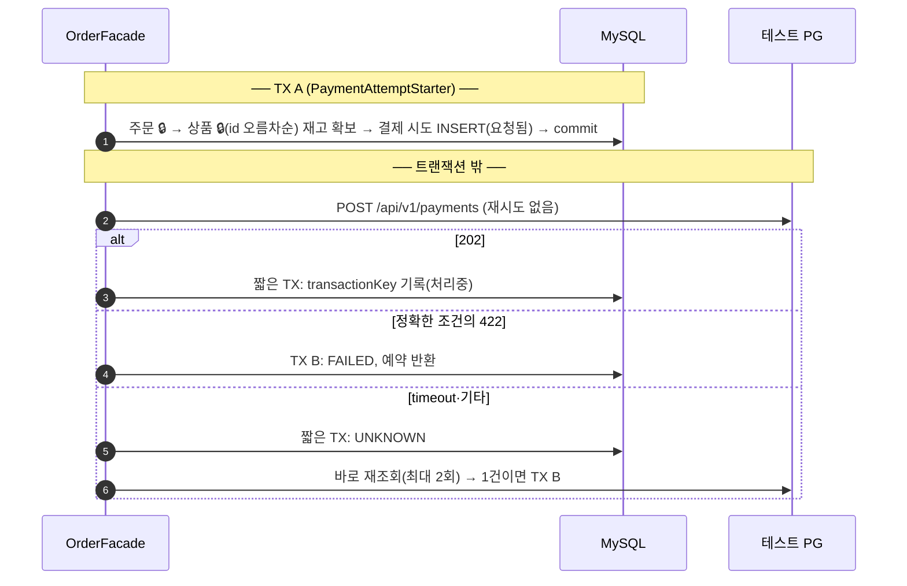
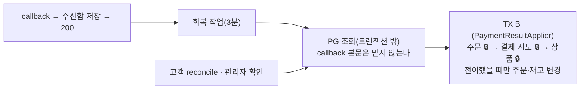

# 5주차 설계 — 응답을 잃은 결제는 실패가 아니다

포인트 결제를 로컬 테스트 PG 결제로 바꾼다. 4주차까지의 설계(`docs/week2~4/design.md`)를 이어받고, 이번 주에 바뀌거나 새로 정한 것만 적는다.

| 문서 | 내용 |
|---|---|
| `design.md` (이 문서) | 한 장 요약 — 범위, 상태, 트랜잭션 경계, 불변식, 결정 목록, 보류 |
| [`decisions.md`](decisions.md) | 결정마다 **근거와 버린 대안**, 불변식의 **반례** |
| [`pg-contract.md`](pg-contract.md) | 외부가 정한 사실 — 테스트 PG API, 응답 매핑, 식별자, callback |
| [`recovery.md`](recovery.md) | 회복 전략과 수치 — 재조회, 스케줄러, circuit breaker, 수신함, 회복 감시 |
| [`load-test/README.md`](load-test/README.md) | (과제 범위 밖) k6 부하 측정과 결과 |

## 1. 범위

- 미확정(DRAFT) 주문의 결제를 **로컬 테스트 PG**로 바꾼다. 포인트 차감은 0회, 이전 POINT 결제 주문은 그대로 조회한다.
- 확정은 **TX A(재고 확보·시도 기록) → 트랜잭션 밖 PG 호출 → TX B(결과 반영)**. PG를 기다리는 동안 DB 트랜잭션과 재고 락을 쥐지 않는다.
- timeout은 실패가 아니다. create는 자동 재시도하지 않는다. PG 장애에 포인트로 대신 결제하지 않는다. 카드 번호는 DB·로그에 남기지 않는다.
- 주문당 결제 시도는 하나. 실패 후 새 시도·환불·정산·사용자 취소는 하지 않는다.

## 2. 상태 — 주문 축과 결제 축

| PG 관찰 | 결제 시도 | 주문 | 재고 예약 |
|---|---|---|---|
| 생성 수락 PENDING | 처리중(PENDING) | PAYMENT_PENDING | 유지 |
| timeout·응답 유실·조회 불가 | UNKNOWN | PAYMENT_PENDING | 유지 |
| 조회로 확인한 SUCCESS | SUCCESS | CONFIRMED | 소비 (추가 차감 없음) |
| 조회로 확인한 FAILED · 효과 0건 확정 거절(422) | FAILED | PAYMENT_FAILED | 한 번 반환 |
| 0건 · 2건 이상 · 주문/금액 불일치 | 그대로 + 충돌 기록 | 그대로 | 그대로, 재발송 없음 |

```
TX A ─▶ 요청됨(REQUESTED) ──202──▶ 처리중 ──┐
                 ├──timeout·오류──▶ UNKNOWN ─┴──조회로 확인──▶ SUCCESS / FAILED
                 └──422 효과 없는 거절──────────────────────▶ FAILED
```

**미종결** = 요청됨·처리중·UNKNOWN, **종결** = SUCCESS·FAILED. 결제 시도 상태는 "외부에서 무슨 일이 일어났나"가 아니라 **"우리가 지금 무엇을 아는가"**다. 오래 남은 요청됨은 PG 호출 도중 서버가 죽은 흔적이다(D-017, D-018).

재고 예약은 따로 저장하지 않는다 — 수량은 `order_item.quantity`, 상태는 `orders.status`로 계산한다(D-003). 재고 5에서 2를 확보하면 3, 성공해도 3, 실패하면 5. 그 사이 관리자가 2로 설정했다면 실패 뒤 4(INV-006).

## 3. 트랜잭션 경계





결과가 들어오는 모든 입구가 같은 TX B를 지난다. 락 순서는 주문 → 결제 시도 → 상품이다(D-002).

## 4. 불변식

반례는 [`decisions.md`](decisions.md#불변식과-반례)에 있다.

| | 규칙 | 지키는 곳 |
|---|---|---|
| [INV-001](decisions.md#inv-001) | 결제 시도·주문·재고 예약은 TX B 하나에서 함께 바뀐다 | `PaymentResultApplier` |
| [INV-002](decisions.md#inv-002) | 미종결 → 종결 전이는 한 번, 재고 효과는 전이에서만 | `PaymentAttempt.apply` + 행 락 |
| [INV-003](decisions.md#inv-003) | 종결 뒤 같은 결과는 무시, 다른 결과는 상태를 바꾸지 않고 충돌로 기록 | `PaymentAttempt` |
| [INV-004](decisions.md#inv-004) | timeout·0건·조회 실패·회로 OPEN은 실패의 근거가 아니다 | `PaymentAttempt` (전이 근거 제한) |
| [INV-005](decisions.md#inv-005) | create는 발송 시작 commit 뒤에만, 어떤 이유로도 다시 보내지 않는다 | TX A, adapter(숨은 재시도 끔) |
| [INV-006](decisions.md#inv-006) | 실패 반환은 지금 값에 예약분을 더한다(관리자 설정 보존), 삭제 상품은 건너뜀 | `Stock`, `ProductService` |
| [INV-007](decisions.md#inv-007) | 결제 시도의 `order_id`는 바뀌지 않는다(잠그지 않고 읽어도 안전) | `PaymentAttempt` 생성자 |

## 5. 결정 목록

한 줄 요약이다. 번호를 누르면 근거와 버린 대안으로 간다.

**확정 요청**
- [D-015](decisions.md#d-015) `paymentAttemptKey`는 요청 이름표 — 같은 주문·같은 키는 저장된 상태(202/200), 같은 주문·다른 키 409, 같은 키·다른 주문 400
- [D-016](decisions.md#d-016) `order_id`·`attempt_key` 각각 UNIQUE · [D-026](decisions.md#d-026) UNIQUE 위반이면 다시 읽어 같은 분류 · [D-027](decisions.md#d-027) 발송 권한은 INSERT를 commit한 실행 하나
- [D-017](decisions.md#d-017) 요청됨(REQUESTED) 상태를 둔다 · [D-018](decisions.md#d-018) 오래 남은 요청됨은 UNKNOWN으로 바꾸지 않는다
- [D-022](decisions.md#d-022) `orders.payment_method`(POINT/PG) 컬럼 · [D-036](decisions.md#d-036) 0원 주문도 PG로 보낸다
- [D-025](decisions.md#d-025) 연결·응답 timeout 모두 UNKNOWN · [D-030](decisions.md#d-030) RestClient + JDK HttpClient, create 연결 1초·응답 2초, 조회 1초·1초

**결과 반영과 재고**
- [D-001](decisions.md#d-001) 종결 여부 검사는 도메인 클래스 · [D-002](decisions.md#d-002) 락 순서 주문 → 결제 시도 → 상품
- [D-003](decisions.md#d-003) 재고 예약은 저장하지 않고 계산 · [D-004](decisions.md#d-004) 재고가 바뀐 commit 뒤에만 캐시 삭제 · [D-019](decisions.md#d-019) 삭제 상품은 잠근 뒤 반환을 건너뜀
- [D-010](decisions.md#d-010) 충돌은 기록하고 사람에게 · [D-011](decisions.md#d-011) 별도 테이블 · [D-012](decisions.md#d-012) 같은 내용은 마지막 발견 시각만 갱신

**회복 경로**
- [D-005](decisions.md#d-005) 경우별 경로: 응답 유실 → 바로 재조회, callback 유실 → 스케줄러, 재시작 → 고객 reconcile·스케줄러, PG에 안 들어감 → 관리자
- [D-020](decisions.md#d-020) callback은 수신함에 원문 저장 후 200("받았다") · [D-021](decisions.md#d-021) 수신함 상태와 3번 실패 시 포기
- [D-040](decisions.md#d-040) 수신함과 스케줄러는 같은 작업(3분) · [D-041](decisions.md#d-041) 처리 단위는 결제 시도, 오래된 순 · [D-042](decisions.md#d-042) 수신함 재시도는 다음 회차
- [D-047](decisions.md#d-047) PG 조회 상한은 **초당 20건**, 밀린 게 없을 때까지 계속, 판단·기록 시각은 회차 시작 하나 (부하 측정으로 [D-034](decisions.md#d-034)의 "회차당 100건"을 바꿈)
- [D-006](decisions.md#d-006)~[D-008](decisions.md#d-008), [D-043](decisions.md#d-043) 발송 1분 뒤부터 조회, 연속 0건 1~3번째 3분 · 4번째 30분 · 이후 1시간, 3번째에 관리자 확인 요청 · [D-044](decisions.md#d-044) 조회 실패는 0건으로 세지 않음
- [D-028](decisions.md#d-028) 조회 재시도는 고객이 기다리는 경로만(바로 재조회 2회, reconcile 3회) · [D-029](decisions.md#d-029) 조회에만 circuit breaker(창 20, 최소 20, 50%, OPEN 30초, 탐색 3)
- [D-037](decisions.md#d-037) 종결된 결제의 고객 reconcile은 저장 상태 200 · [D-038](decisions.md#d-038) 조회 실패면 상태 그대로 202 · [D-039](decisions.md#d-039) 결제 시도 없는 주문은 409

**관리자**
- [D-009](decisions.md#d-009) 사람이 거래 없음을 확인하면 FAILED · [D-045](decisions.md#d-045) 거래 키를 모르는 미종결만 허용 · [D-046](decisions.md#d-046) 처리자는 인증된 관리자 이름
- [D-013](decisions.md#d-013) 관리자 실패 처리 뒤 3일 동안 6시간마다 감시 · [D-014](decisions.md#d-014) 종결된 결제도 단건 확인 · [D-031](decisions.md#d-031) 관리자 API 두 개
- [D-024](decisions.md#d-024) 관리자 응답에 PG 식별자·확인 일정·처리 기록·충돌 목록

**응답·운영·테스트**
- [D-023](decisions.md#d-023) confirm·reconcile·주문 조회는 같은 응답 모양(아래)
- [D-035](decisions.md#d-035) 회복 감시: 자동 회복·관리자 확인 **최장 대기 시간**, `review_requested_at`
- [D-032](decisions.md#d-032) FK·상품명 스냅샷 없음 · [D-033](decisions.md#d-033) 테스트 PG는 WireMock

## 6. 응답 모양 (D-023)

```json
{
  "meta": { "result": "SUCCESS" },
  "data": {
    "id": 42, "status": "PAYMENT_PENDING", "paymentMethod": "PG",
    "payment": { "attemptKey": "key-A", "status": "UNKNOWN", "amount": 7000 },
    "links": { "order": "/api/v1/orders/42", "reconcile": "/api/v1/orders/42/payment/reconcile" }
  }
}
```

- 결제 시도가 미종결이면 **202**, 종결이면 **200**. 202도 `meta.result`는 SUCCESS다(요청은 정상 처리).
- `payment.status`는 줄이지 않는다 — 처리중(잠시 뒤 자동 확인)과 UNKNOWN([결제 결과 확인] 버튼)을 앱이 구분해야 한다.
- `payment`는 DRAFT·이전 POINT 주문에 없다. `links.reconcile`은 미종결일 때만 준다. PG 식별자는 관리자 응답에만 있다.

## 7. 보류

| 항목 | 다시 꺼낼 조건 |
|---|---|
| 서버 여러 대의 스케줄러 중복 실행 방지 | 서버가 2대 이상이 될 때 |
| 충돌 해소(환불, 주문 복구) | 과제 범위 밖 |
| bulkhead | callback이 몰려 스레드가 묶이는 것이 관측될 때 |
| 회복 감시 지표(Gauge)·알림 규칙 구현 (설계는 `recovery.md` 7번) | 결제 흐름 구현이 끝난 뒤 |
| 관리자 확인 목록 조회 API | 관리자 확인 최장 대기 시간을 실제로 보여 줄 때 |
| 회복 작업 병렬 처리 — 지금은 한 건씩, 초당 12~20건 | 피크 뒤 따라잡기가 알림 기준 15분을 계속 넘을 때 |
| 회로 OPEN이면 새 확정 요청을 TX A 전에 거절 | PG 장애 중 관리자 확인이 많이 쌓일 때 |

## 8. 한계

- PG에 아예 들어가지 않은 결제는 영원히 0건이라, 관리자가 실패 처리하기 전까지 재고가 묶인다.
- 조회 결과에 제공자 계정 필드가 없어 "제공자 계정 범위"는 요청 헤더(`X-USER-ID`)를 붙이는 것까지만 한다.
- 재시작 장면은 같은 Spring 컨텍스트에서 TX A만 commit한 상태로 흉내 냈다(`PaymentFailureRecoveryTest`).
