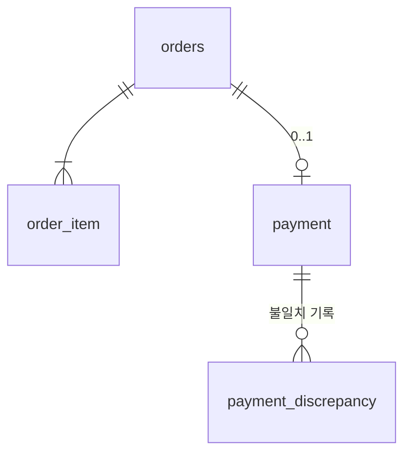
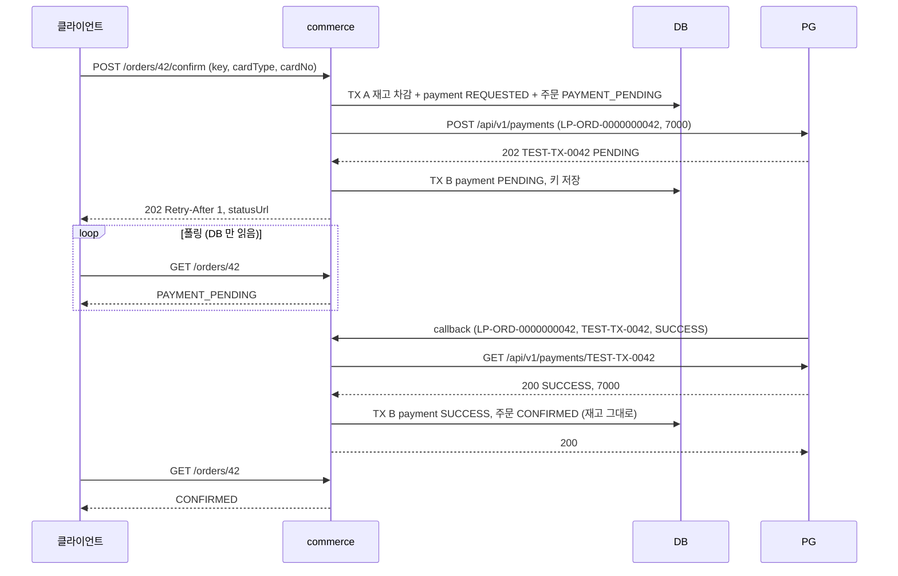
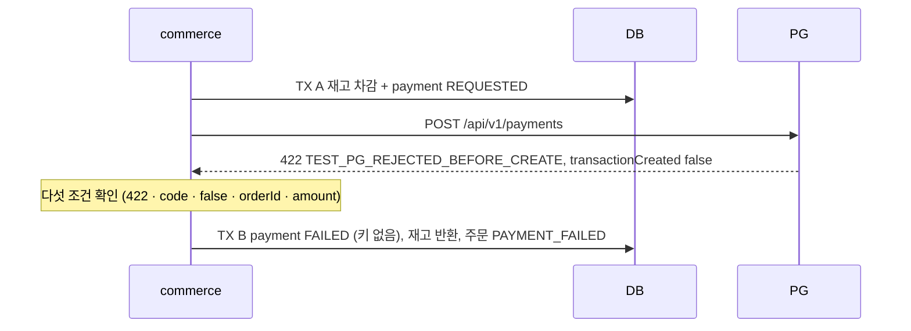
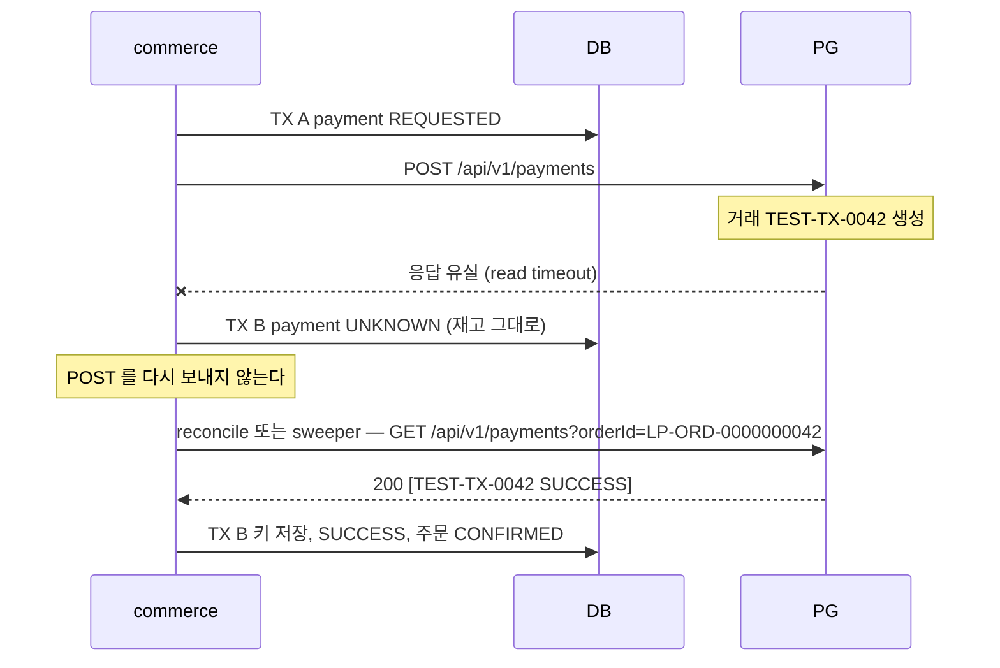
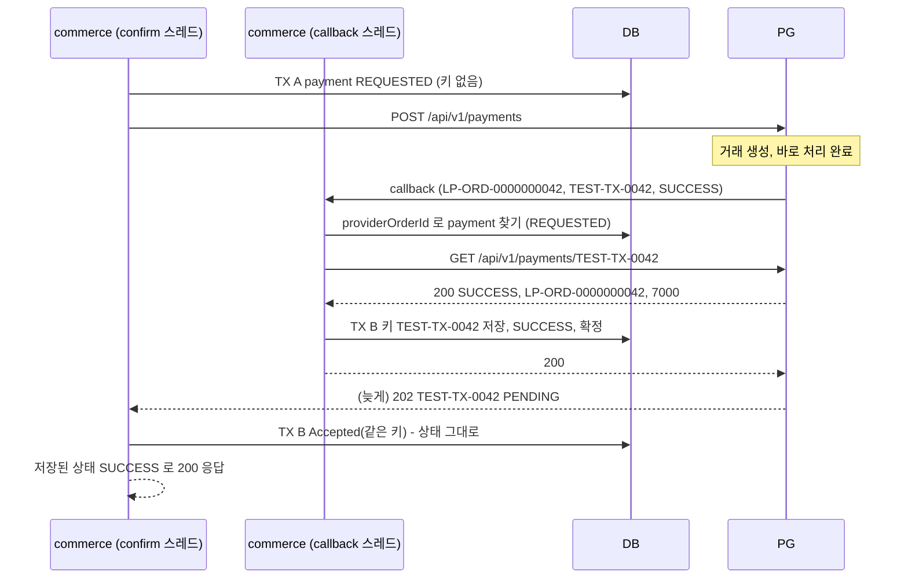
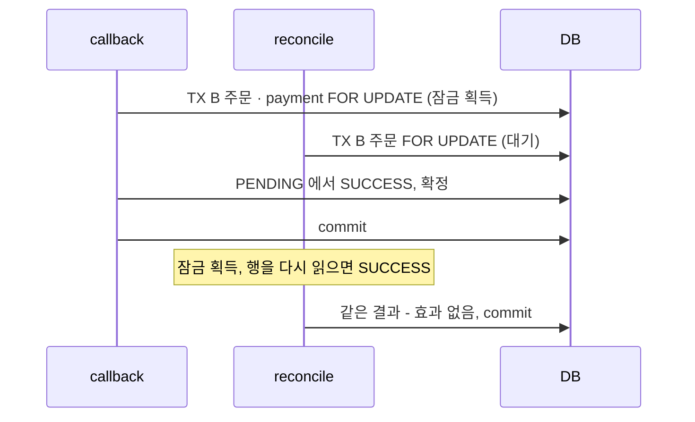
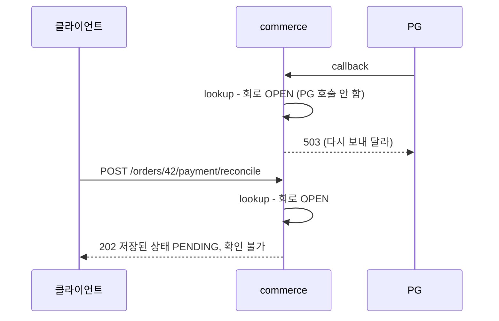
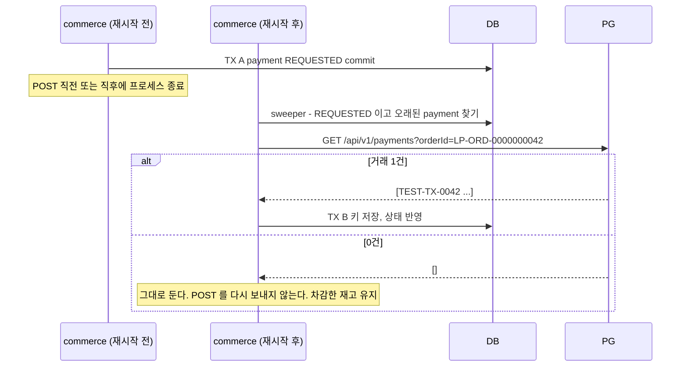

# 커머스 API 설계 — 5주차 · 포인트 결제를 테스트 PG 로 교체

요구사항 명세(`docs/week5/requirements.md`)의 규칙을 어떤 구조로 지키는지, 그리고 그 이유를 적는다.
2 · 3 · 4 주차 설계는 `W2` · `W3` · `W4` 로 가리킨다. 규칙 ID 는 명세의 것이다.

## 1. 무엇이 바뀌는가

### 1.1 한 트랜잭션이 셋으로 나뉜다

W2 의 확정(`OrderConfirmation.confirm`)은 한 트랜잭션에서 주문 확정 · 포인트 차감 · 재고 차감을 했다. 실패하면 전부 rollback 됐다.
PG 결제의 결과는 우리 DB 밖에서 생기므로 rollback 으로 되돌릴 수 없다. 그래서 확정을 셋으로 나눈다.

```
TX A    주문 · 상품 검사 → 재고 예약 → 결제 시도 기록(REQUESTED) → 주문 PAYMENT_PENDING → commit
TX 밖   PG 생성 POST (Tomcat 스레드가 응답을 기다린다, 상한은 timeout)
TX B    PG 의 관찰을 결제 · 주문 · 재고에 한 번만 반영 → commit
```

- **PG 호출 동안 DB 트랜잭션 · 재고 잠금을 쥐지 않는다.** 원문 요구이고, 쥐면 PG 가 느려질 때 같은 상품의 다른 주문이 잠금을 기다린다.
- **TX A 의 commit 이 "보내도 된다" 는 허가다.** 재고가 있고, 같은 주문의 시도가 없고, 보냈다는 기록이 남은 뒤에만 돈을 움직이는 요청을 보낸다.
  예약과 기록을 POST 와 동시에 하거나 뒤에 하면, 재고 없이 결제가 진행되거나 보낸 기록 없이 거래가 생긴다(4.1).
- **TX B 는 응답이 있어야 시작한다.** 응답의 `transactionKey` 를 저장하고, 202 · 422 · timeout 에 따라 상태가 갈리기 때문이다.

### 1.2 이 PG 가 실제 PG 와 다른 점

| 실제 PG 가 흔히 주는 것 | 이 실습의 PG | 설계에 주는 영향 |
|---|---|---|
| 인증과 승인을 나눈 두 단계(승인 API 를 부를 때 돈이 움직임) | **생성 POST 한 번이 승인 시작까지 한다** | 보내기 전에 모든 검증과 재고 확보를 끝내야 한다 |
| 승인 응답에 결과가 담기는 동기 승인 | **202 `PENDING` 만 준다. 결과는 callback · 조회로** | confirm 응답으로 결제 완료를 알릴 수 없다(6.4) |
| 호출자 멱등 키 · 같은 orderId 중복 거절 | **없다.** 같은 orderId 로 다시 보내면 거래가 하나 더 생긴다 | 이중 결제를 막는 책임이 전부 우리에게 있다(4장) |
| 취소 API(망취소 · 보상 취소) | **없다.** 환불 · 취소는 범위 밖 | timeout 을 실패로 다루면 되돌릴 방법이 없다(6.6) |

## 2. 식별자

| 식별자 | 만드는 곳 | 형태 | 쓰는 곳 |
|---|---|---|---|
| `orderId` | commerce DB | bigint | 주문 소유권 · 상태. 코드 안에서 `orderId` 는 언제나 이것이다 |
| `paymentAttemptKey` | **클라이언트** (UUID 권장) | 1~64자 영문 · 숫자 · `-` | 같은 결제 요청의 재전송을 알아본다. **우리 서버의 멱등 키** |
| `providerOrderId` | commerce adapter | `LP-ORD-%010d` | PG 에 보내는 주문 번호. PG 요청 본문에서는 필드 이름이 `orderId` 다 |
| `transactionKey` | **PG** | 문자열 | 거래 한 건. POST 마다 새로 나온다 — 멱등 키가 아니다 |

`providerOrderId` 는 `orderId` 로 계산할 수 있어도 저장한다. 형식이 바뀌어도 이미 보낸 시도는 **보낸 그 문자열**로 조회해야 하고, callback 이 이 값으로 오므로 인덱스가 걸린 열이 필요하다.

**뒤집을 조건**: 같은 PG 계정을 여러 환경(로컬 · 개발 · 스테이징)이 함께 쓰거나 DB 를 자주 초기화해 주문 번호가 겹치면, `providerOrderId` 에 환경 구분자를 넣는다(`LP-ORD-local-0000000042`). 원문 예시 형식과 달라지므로 지금은 쓰지 않는다.

## 3. 저장 모델



### 3.1 `payment` — 결제 시도

| 열 | 제약 · 뜻 |
|---|---|
| `order_id` | **UNIQUE**. 주문당 시도 하나(`PAY-001`) |
| `attempt_key` | **UNIQUE**(`PAY-002`) |
| `provider_order_id` | UNIQUE. callback 이 이것으로 찾는다 |
| `transaction_key` | nullable. 생성 응답이나 조회로 알게 되면 채운다. 한 번 채우면 바꾸지 않는다 |
| `amount` | 저장된 주문 금액 |
| `card_type` | "같은 요청" 비교용(Q-2). **카드 번호 열은 없다**(`PG-014`) |
| `status` | `REQUESTED` · `PENDING` · `UNKNOWN` · `SUCCESS` · `FAILED` · `CONFLICT` |
| `requested_at` · `settled_at` · `last_checked_at` | 마킹 · 종결 · 마지막 PG 확인 시각 |

**주문과 다른 테이블로 둔다.** 주문의 생애(`DRAFT` → `PAYMENT_PENDING` → `CONFIRMED`)와 PG 와 주고받은 기록(`REQUESTED` → `PENDING` → `UNKNOWN` …)은 쓰는 말이 다르다.
`orders` 에 열로 붙이면 한 행에 상태 열이 둘이 되고 `Order` 가 `transactionKey` · `UNKNOWN` 같은 PG 개념을 알게 된다.
지금 고를 수 있는 다른 길은 `orders` 에 열을 붙이는 것이고, 주문당 한 시도라 1:1 이므로 가능하다.
**뒤집을 조건**: 결제 시도를 주문과 따로 읽는 곳이 없어질 때. 지금은 sweeper 가 결제를 상태로 찾으므로 그런 곳이 있다.

**이름이 `payment` 인데 과거 POINT 결제는 이 테이블에 없다.** POINT 결제의 사실은 `orders.paid_amount` · `point_transaction` 에 있고, 원문이 "이전 포인트 결제 주문은 기존 사실을 그대로 조회" 하라고 했다.
**뒤집을 조건**: 결제 수단이 섞이거나(포인트 + 카드) 주문에 결제가 여러 번 붙으면, 모든 결제를 한 테이블에서 봐야 하므로 POINT 결제도 `payment` 로 옮기고 `order_id` 유일 제약을 푼다.

### 3.2 재고 예약 — 테이블을 두지 않는다

**예약은 저장한 행이 아니라 세 사실의 조합이다.**

| 사실 | 어디에 |
|---|---|
| 얼마를 묶었나 | `order_item.quantity` — 접수 뒤 바뀌지 않고(`ORDER-008`), 같은 상품은 한 품목으로 합쳐진다(`ORDER-004`) |
| 묶었나 · 풀었나 · 썼나 | `payment.status` — 미완료(`REQUESTED` · `PENDING` · `UNKNOWN` · `CONFLICT`)면 묶여 있고, `SUCCESS` 면 소비, `FAILED` 면 반환 |
| 가용 재고 | `product.quantity` — TX A 가 품목 수량만큼 뺀다 |

| 사건 | `product.quantity` (재고 5 · 수량 2) |
|---|---|
| TX A (예약) | 5 → 3 — 차감은 여기서 한 번(`RSV-001`) |
| `SUCCESS` (소비) | 3 그대로 — 다시 빼지 않는다(`RSV-002`) |
| `FAILED` (반환) | 3 → 5 — `order_item` 수량만큼 한 번 더한다(`RSV-003`) |
| 미완료 · timeout · 회로 OPEN | 3 그대로(`RSV-004`) |

- **반환이 한 번뿐인 것은 결제 전이가 보장한다.** `FAILED` 로 가는 전이는 TX B 가 행을 잠근 채 "종결 전일 때만" 일어나므로 한 번이고, 반환은 그 전이와 같은 TX 에서만 일어난다(5.3).
- `product.quantity` 는 열을 바꾸지 않고 뜻이 **가용 재고**가 된다. 관리자 재고 설정(`RSV-006`)이 이 열을 그대로 설정하므로 "예약을 뺀 가용 수량" 이라는 원문의 뜻과 맞는다. 품절 판정 · W4 캐시의 `soldOut` 도 그대로 `quantity` 를 본다.
- 상품마다 지금 묶인 수량은 `order_item` ⨝ `payment`(미완료)로 센다.

**왜 예약 테이블을 두지 않나.** `stock_reservation(order_id, product_id, quantity, status)` 를 두면 수량은 `order_item` 과, 상태는 `payment.status` 와 언제나 같은 값이다.
같은 사실을 두 곳에 두면 "결제는 `SUCCESS` 인데 예약은 묶인" 어긋난 상태가 가능해지고, 그것을 막는 코드와 테스트가 따로 필요하다.
예약 상태 조건이 주던 2차 방어는 잃지만, 반환 경로는 `PaymentSettlement.apply` 하나뿐이다.
원문도 "주문별 확보 수량 · 상태를 저장하는 최소 예약 방식으로 구현할 **수 있습니다**" 라고 했다 — 수량은 `order_item` 에, 상태는 `payment` 에 저장돼 있다.

지금 고를 수 있는 다른 길:
- 예약 테이블(위). **뒤집을 조건**: 예약의 생애가 결제와 갈라질 때 — 예약 만료, 일부 수량만 확보, 결제 없이 장바구니 단계에서 예약.
- 전체 · 예약 수량을 상품에 나눠 두기(`product.reserved`). 가용 = `quantity - reserved`. 성공 때 상품 행을 잠가 두 열을 함께 바꿔야 하고, 관리자 설정 · 품절 판정 · 캐시 조회가 모두 바뀐다. **뒤집을 조건**: 상품마다 전체 · 묶인 재고를 한눈에 봐야 하는 화면(창고 관리)이 생길 때.

### 3.3 `payment_discrepancy` — 불일치 기록

원문의 "충돌 기록" 이다. **우리가 아는 사실과 PG 가 말한 것이 다를 때** 아무것도 고치지 않고 관찰을 남긴다(`PAY-017`).

| 열 | 뜻 |
|---|---|
| `payment_id` | 어느 결제인가 |
| `reason` | `MULTIPLE_TRANSACTIONS` · `AMOUNT_MISMATCH` · `ORDER_MISMATCH` · `RESULT_AFTER_SETTLED` |
| `source` | `CREATE_RESPONSE` · `CALLBACK` · `LOOKUP` |
| `observed_transaction_key` · `observed_status` · `observed_amount` | PG 가 말한 것 |
| `observed_at` | |

- **append-only.** 고치거나 지우지 않는다. 포인트 원장(`point_transaction`)과 같은 성격이다.
- **UNIQUE(payment_id, reason, observed_transaction_key, observed_status)** — 같은 모순이 반복돼도(PG 의 재전송, 같은 위조 callback) 한 줄만 남는다.
  네 열은 모두 `NOT NULL` 이고, 관찰에 키나 상태가 없으면 빈 문자열을 넣는다. MySQL 의 UNIQUE 는 NULL 을 서로 다른 값으로 보므로, NULL 을 허용하면 키 없는 관찰이 반복될 때마다 줄이 는다.
- **업무 판단은 이 테이블을 읽지 않는다.** 판단은 `payment.status` 로 한다. 이 테이블은 테스트와 사람이 본다.

**왜 열이 아니라 테이블인가.** 종결 전 불일치는 `payment.status = CONFLICT` 와 이유 열 하나로도 남길 수 있다.
그러나 **종결 뒤 모순**(이미 `SUCCESS` 인데 나중 조회가 `FAILED`)은 상태를 바꾸지 않으므로 열에 남길 자리가 없다.
그 장면은 상품이 돈 없이 나갔을 수 있는, 사람이 반드시 봐야 하는 장면이다. 로그는 보관 기간이 지나면 사라진다.
그래서 `payment` 에는 이유 열을 두지 않고, 이유는 이 테이블에만 둔다(같은 사실을 두 곳에 두지 않는다).

```sql
-- 확정했는데 PG 가 나중에 다르게 말한 것 — payment.status 로는 찾을 수 없다
SELECT a.payment_id, p.order_id, p.status, a.observed_status, a.observed_at
FROM payment_discrepancy a JOIN payment p ON p.id = a.payment_id
WHERE a.reason = 'RESULT_AFTER_SETTLED';
```

지금 고를 수 있는 다른 길: 로그 · 메트릭만 남기기. **뒤집을 조건**: 운영에서 이 기록을 한 번도 조회하지 않고 알림만 보게 되면.

### 3.4 `orders` 의 변경

- `status` 에 `PAYMENT_PENDING` · `PAYMENT_FAILED` 를 더한다.
- `payment_method`(`POINT` · `PG`) 열을 더한다. 기존 `CONFIRMED` 행은 `POINT` 다. DRAFT 는 null 이다.
- `paid_amount` · `confirmed_at` 은 PG 성공 때 채운다. 실패에는 채우지 않는다.

## 4. 이중 결제를 막는 구조

PG 가 중복을 막아 주지 않으므로(1.2) **주문당 POST 를 최대 한 번**만 보내는 것을 우리가 보장한다.

### 4.1 불변식

> **PG 에 우리 거래가 있다면, 우리 DB 에는 반드시 그 `payment` 행이 있다.**

TX A 가 `payment` 를 `REQUESTED` 로 commit 한 뒤에만 POST 를 보내기 때문에 성립한다.
그래서 응답 유실 · callback 유실 · 재시작 뒤에도 확인할 대상이 DB 에 남고, 모르는 `providerOrderId` 의 callback 은 우리가 보낸 적이 없다는 뜻이 된다.
**거꾸로는 성립하지 않는다** — 행이 있어도 거래는 없을 수 있다(마킹 뒤 POST 전에 죽은 경우, 9장).
`payment` 행은 지우지 않는다. 지우면 나중에 온 callback · 불일치를 비교할 기준이 사라진다.

### 4.2 네 겹

| 막는 것 | 장치 |
|---|---|
| 같은 키의 재전송(버튼 두 번 · 네트워크 재전송) | `attempt_key` UNIQUE → 두 번째는 POST 없이 저장된 상태 반환 |
| 같은 주문 · 다른 키 | `order_id` UNIQUE, 그리고 주문이 이미 `DRAFT` 가 아니므로 `ORDER_NOT_DRAFT`(Q-1) |
| 동시 confirm 두 건 | TX A 가 주문 행을 먼저 잠가 한 줄로 세운다. 이긴 쪽만 POST 하고, 진 쪽은 잠금 뒤에서 이긴 쪽의 payment 를 찾아 저장된 상태를 돌려준다(4.3). `order_id` UNIQUE 는 2차 방어 |
| timeout · 재시작 뒤 다시 보내기 | **`REQUESTED` commit 뒤에는 POST 를 다시 보내지 않는다.** 이후에는 조회만 한다 |
| 라이브러리 · 프록시의 숨은 재전송 | HTTP client 의 재시도를 끈다(`PG-012`), 테스트가 create 호출 수를 센다 |
| 결과의 중복 반영 | TX B 가 행을 잠그고 "종결 전일 때만" 바꾼다(5장) |

이 선택은 **"최대 한 번(at-most-once)"** 이다. 이중 결제가 "결제가 안 된 채 남은 주문" 보다 훨씬 비싸서다.
대가로, 보냈는지 모르는 시도가 미완료로 남을 수 있다(9장). 원문도 "중복 방지와 모든 시도의 자동 완료는 같은 보장이 아니다" 라고 한다.

### 4.3 confirm 의 판단 순서 (`PAY-015`)

```
confirm(userId, orderId, key, cardType, cardNo)
  0. bulkhead 자리 얻기 — 실패하면 503 PAYMENT_BUSY, 아무것도 안 함          (7.4)
  1. 주문 소유권 — 남의 주문이면 404
  2. key 의 payment 가 있나?
       있고 같은 주문 · 금액 · cardType → 반복. 저장된 상태 반환(202 · 200), POST 0
       있는데 다른 주문 · 금액 · cardType → 409 충돌
  3. 주문이 DRAFT 인가? 아니면 409 ORDER_NOT_DRAFT                          ← 새 키 · POINT 확정 주문
  4. TX A → POST → TX B → 202
  (finally) bulkhead 자리 반납
```

2 를 3 보다 먼저 본다. 바꾸면 같은 키의 정상 재전송이 `ORDER_NOT_DRAFT` 로 거절된다.

**동시 confirm 두 건이 2 를 함께 통과하는 경우.** 둘 다 아직 payment 가 없을 때 2 를 지나 TX A 로 들어온다. TX A 는 주문 행을 `FOR UPDATE` 로 먼저 잡으므로 진 쪽은 그 잠금 뒤에서 기다린다.
이긴 쪽이 commit 하면 진 쪽은 `PAYMENT_PENDING` 인 주문을 본다. 여기서 바로 `ORDER_NOT_DRAFT` 를 내면 같은 키의 재전송이 409 가 되어 `PAY-004`(다른 실행은 저장된 상태를 돌려준다)와 어긋난다.
그래서 TX A 는 주문을 잠근 뒤 DRAFT 가 아니면 **키로 payment 를 한 번 더 찾는다** — 같은 키 · 같은 요청이면 저장된 상태(202), 다른 요청이면 409 충돌, 없으면 `ORDER_NOT_DRAFT`.
주문 잠금이 동시 confirm 을 한 줄로 세우므로, `order_id` UNIQUE 는 잠금을 우회한 코드가 생겼을 때를 위한 2차 방어다.

## 5. 상태 전이 — 결과 반영 경계

생성 응답 · callback · reconcile · sweeper 는 모두 **관찰**을 만들어 같은 경계(`PaymentSettlement.apply`, TX B)에 넘긴다.
"늦은 생성 응답이 종결을 되돌리지 않는다" 같은 규칙은 특별 처리 없이 이 표에서 나온다.

### 5.1 관찰

| 관찰 | 어디서 | 뜻 |
|---|---|---|
| `Accepted(key)` | 생성 202 | 거래가 생겼고 처리 중 |
| `RejectedNoEffect` | 생성 422 (`PG-010` 의 다섯 조건이 모두 맞을 때만) | 거래가 생기지 않았고 앞으로도 안 생김 |
| `CreateUnknown` | 생성 timeout · 연결 끊김 · 그 밖의 응답 | 거래가 생겼는지 모름 |
| `Verified(key, status)` | 조회한 거래가 계정 · 주문 · 금액과 맞음 | PG 가 말한 이 거래의 현재 상태 |
| `Mismatch(reason, …)` | 조회한 거래의 금액이 다름(`AMOUNT_MISMATCH`), 주문이 다름(`ORDER_MISMATCH`), 2건 이상이거나 **이미 붙은 키와 다른 키의 우리 거래**(`MULTIPLE_TRANSACTIONS`) | 불일치 |
| `NotFound` | 조회 404 · `[]` | 지금은 거래가 보이지 않음 — **없다는 증거가 아님** |
| *(조회 불가)* | timeout · 5xx · 429 · 회로 OPEN | **관찰이 아니다. TX B 를 부르지 않는다**(`PAY-008`) |

조회 불가를 관찰로 만들지 않는 것이 핵심이다. 그래야 회로 OPEN 이 `PENDING` 을 `UNKNOWN` 으로 바꾸거나 `FAILED` 를 만드는 길이 처음부터 없다.

**어느 조회를 쓰나.** 결제에 키가 있으면 키 조회(`GET /payments/{transactionKey}`), 없으면 주문 조회(`GET /payments?orderId=`)다. callback 은 본문의 키로 조회한다.
결제에 이미 키 K 가 있는데 callback 이 K2 를 가리키고 그 거래가 우리 주문 · 금액과 맞으면, 같은 주문에 거래가 둘이라는 뜻이다 → `MULTIPLE_TRANSACTIONS`.
키가 있는 결제는 주문 조회를 하지 않으므로, 키가 붙은 뒤 숨은 재전송으로 생긴 두 번째 거래는 그 거래의 callback 이 와야 드러난다. 이는 9장의 한계에 적는다.

### 5.2 전이 표

| 현재 | 관찰 | 다음 | 효과 (같은 TX B) |
|---|---|---|---|
| `REQUESTED` | `Accepted(K)` | `PENDING` | 키 K 저장 |
| `REQUESTED` | `RejectedNoEffect` | `FAILED` | 예약 반환 · 주문 `PAYMENT_FAILED`. 키는 없다 — 꾸며 저장하지 않는다 |
| `REQUESTED` | `CreateUnknown` | `UNKNOWN` | — |
| `REQUESTED` · `UNKNOWN` · `PENDING` | `Verified(K, PENDING)` | `PENDING` | 키가 없으면 K 저장 |
| `REQUESTED` · `UNKNOWN` · `PENDING` | `Verified(K, SUCCESS)` | `SUCCESS` | 키가 없으면 K 저장 · 예약 소비 · 주문 `CONFIRMED`(`payment_method=PG`, `paid_amount`) |
| `REQUESTED` · `UNKNOWN` · `PENDING` | `Verified(K, FAILED)` | `FAILED` | 키가 없으면 K 저장 · 예약 반환 · 주문 `PAYMENT_FAILED` |
| `REQUESTED` · `UNKNOWN` · `PENDING` | `Mismatch(r)` | `CONFLICT` | 불일치 1줄. 예약 · 주문 그대로 |
| `REQUESTED` · `UNKNOWN` · `PENDING` | `NotFound` | 그대로 | — |
| 키 K 가 있는 모든 상태 | `Accepted(K)` · `CreateUnknown` | 그대로 | **늦은 생성 응답 · timeout 처리.** callback 이 먼저 반영한 경우다 |
| 키 K 가 있는 모든 상태 | `Accepted(K2)` · `Verified(K2, *)` (다른 키) | 종결 전이면 `CONFLICT`, 종결이면 그대로 | 불일치 `MULTIPLE_TRANSACTIONS`. 두 번째 거래의 결과를 반영하지 않는다 |
| `SUCCESS` · `FAILED` | 같은 결과의 `Verified` | 그대로 | — (중복 callback · 늦은 조회) |
| `SUCCESS` · `FAILED` | 다른 결과의 `Verified` · `Mismatch` | 그대로 | 불일치 `RESULT_AFTER_SETTLED` 등. **덮어쓰지 않는다** |
| `CONFLICT` | 모든 관찰 | 그대로 | 새 모순이면 불일치 1줄 |

- 상태는 **앞으로만** 간다. `PENDING` → `UNKNOWN`, 종결 → 미완료로 가는 줄이 표에 없다.
- `UNKNOWN` 과 `REQUESTED` 는 같은 줄을 탄다. 둘 다 "보냈을 수 있고 결과를 모름" 이다. 다른 점은 생성 응답을 받았느냐뿐이다.
- 주문과 재고는 결제 상태가 정한다: 미완료(`REQUESTED` · `PENDING` · `UNKNOWN` · `CONFLICT`) → `PAYMENT_PENDING` · 차감한 재고 유지, `SUCCESS` → `CONFIRMED` · 재고 그대로, `FAILED` → `PAYMENT_FAILED` · 재고 반환.
- `FAILED` 로 가는 길은 **둘뿐**이다: 검증한 `FAILED`, 효과 0건 거절. timeout · 회로 OPEN · 조회 0건은 없다.

### 5.3 TX B 의 잠금

```
TX B(paymentId, observation)
  payment 를 잠그지 않고 읽어 orderId 를 얻는다
  주문 행 FOR UPDATE                        ← 동시 callback · reconcile · TX A 가 여기서 한 줄로 선다
  payment 행 FOR UPDATE                     ← 잠근 뒤 상태를 다시 읽는다
  전이 표 적용 — 효과가 없으면 여기서 commit
  상품 행들(상품 id 순, 반환할 때만, 삭제된 상품 포함) — order_item 수량만큼 더한다
  불일치 INSERT (있으면)
  commit
```

- **모든 TX 가 주문 → payment → 상품(id 순)의 순서로 잡는다.** TX A 는 주문을 잠그고 상품을 차감한 뒤 payment 를 INSERT 한다(INSERT 의 중복 검사도 잠금이다).
  TX B 가 payment 를 먼저 잠그면 TX A(주문 → payment)와 순서가 엇갈려 교착이 생기므로, TX B 도 주문부터 잡는다. 상품 id 순서는 W3 의 잠금 순서와 같다.
- **반환은 삭제된 상품의 행도 잠근다.** 지금의 `findAliveByIdForUpdate` 는 `deletedAt is null` 인 행만 잠그므로, 그 경로로 반환하면 삭제된 상품에서 TX B 가 매번 실패해 결제가 끝나지 않는다.
  반환 전용으로 삭제 여부와 관계없이 잠그는 조회를 둔다. 반환은 수량만 더하고 `deleted_at` 을 건드리지 않으므로 삭제된 상품은 계속 보이지 않는다(`RSV-007`).
  재고를 차감하는 TX A 는 지금처럼 살아 있는 상품만 잠근다 — 삭제 뒤 새로 시작하는 확정은 막아야 하기 때문이다.
- 반환은 `FAILED` 로 가는 전이와 같은 TX 에서만 일어난다. 결제 행 잠금과 "종결 전일 때만" 이 중복 반환을 막는다(3.2).
- 불일치 INSERT 는 상태 변경과 **같은 TX** 다. 따로 쓰면 "`CONFLICT` 인데 이유가 없는 결제" 가 생길 수 있다.

**호출자가 넷이다**(Q-4). 이 경계는 호출자 수에 기대지 않고 위의 잠금과 상태 조건으로 스스로 막는다.

## 6. 흐름

### 6.1 정상 — 접수 뒤 callback 으로 확정



재고 5 · 수량 2 → TX A 뒤 가용 3, 성공 뒤에도 3(`RSV-005`). 포인트 변화 0.

### 6.2 효과 0건 거절



가용 3 → 5. 다섯 조건 중 하나라도 어긋나면(본문 없는 422 등) `CreateUnknown` 이다.

### 6.3 생성 응답 유실 — 조회로 종결



조회 결과가 `[]` 이면 그대로 둔다. 2건이면 `CONFLICT` + `MULTIPLE_TRANSACTIONS`. 어느 쪽도 POST 를 다시 보내지 않는다. create 호출은 끝까지 1 회다.

### 6.4 callback 이 생성 응답보다 먼저 온다



늦은 202 의 키가 붙인 키와 다르면 거래가 두 건이라는 뜻이다 → 불일치 `MULTIPLE_TRANSACTIONS`(종결이므로 상태는 그대로).

### 6.5 callback 과 reconcile 이 동시에



두 경로 모두 TX B 전에 PG 를 각자 조회한다(TX 밖). 조회가 두 번 나가는 것은 허용한다 — 조회는 거래를 만들지 않는다. 반영은 한 번이다.

### 6.6 회로 OPEN



어느 경로도 TX B 를 부르지 않는다. 상태 · 예약 · 주문이 그대로다. `FAILED` · 금액 0 · 포인트 대체가 없다(`RESIL-004`).

### 6.7 발송 기록 뒤 재시작



0건은 "POST 전에 죽었다" 일 수도, "PG 가 아직 거래를 보여 주지 않는다" 일 수도 있다. 로컬 기록으로 둘을 가를 수 없다. 9장의 한계다.

## 7. 회복 도구

### 7.1 HTTP client 와 timeout (`RESIL-009`)

동기 `RestClient` 에 Apache HttpClient 5 를 붙인다. 원문이 동기 client 를 기본으로 두고(`assignment.md:144`), timeout 을 **실제 쓰는** 하위 client 에 두라고 한다.
Apache 를 고르는 이유: 커넥션 풀의 상한과 **풀 대기 timeout** 을 코드로 명시하고 테스트로 확인할 수 있다. JDK `HttpClient` 는 풀을 안에서 관리해 상한을 세밀하게 정하기 어렵다.

| 설정 | 값 | 근거 |
|---|---|---|
| 연결 timeout | 500 ms | 로컬 fixture 기준. 연결이 안 되면 빨리 포기한다 |
| 응답 timeout — 생성 | 2 s | confirm 이 Tomcat 스레드를 쥐는 시간의 상한 |
| 응답 timeout — 조회 | 1 s | 조회는 다시 할 수 있으니 짧게 |
| 커넥션 풀 대기 | 200 ms | 풀 앞에서 하염없이 기다리지 않는다. W4 의 DB 커넥션 대기와 같은 장면 |
| 같은 호스트 동시 연결 · 전체 | 30 · 30 | bulkhead 20 + 조회 경로 여유. bulkhead 보다 작으면 자리를 얻고도 풀 앞에서 또 기다린다 |
| 자동 재시도 | **끔** | `PG-012`. 생성의 숨은 재전송이 거래 2건의 경로다 |

값은 `정함` 이다. **뒤집을 조건**: 실제 PG 의 응답 시간 분포를 알게 되면 p99 의 몇 배로 다시 잡는다.

### 7.2 조회 재시도 (`RESIL-005`)

조회에만 둔다. 생성에는 두지 않는다.

- 최대 3 회(처음 1 + 재시도 2), 간격 100 ms · 200 ms, 대상은 timeout · 연결 실패 · 5xx · 429.
- 최악의 대기는 1 s × 3 + 0.3 s ≈ 3.3 s(study.md 의 예와 같다). callback · reconcile · sweeper 가 이 예산을 쓴다.
- 404 · `[]` 는 재시도하지 않는다. 업무 결과다.

### 7.3 Circuit breaker (`RESIL-001` · `002` · `003`)

**조회 경로 하나**에 둔다. 생성은 회로를 거치지 않는다 — 생성은 bulkhead 와 timeout 으로 막고, 회로 OPEN 을 이유로 confirm 을 거절하면 "PG 가 아프면 결제를 받지 않는다" 는 업무 판단이 되기 때문이다.

| 설정 | 값 |
|---|---|
| 창 | 호출 수 기준, 최근 10 회 |
| 최소 표본 | 5 회 |
| 실패율 | 50 % 이상이면 OPEN |
| 실패로 세는 것 | timeout · 연결 실패 · 5xx · 429. **404 · `[]` · `PENDING` 은 세지 않는다** |
| OPEN 대기 | 10 s (테스트는 짧게 바꾼다) |
| HALF_OPEN 탐색 호출 | 2 회. 둘 다 성공이면 CLOSED, 하나라도 실패면 다시 OPEN |

**재시도와 회로의 순서**: 재시도가 회로를 감싼다(`Retry(CircuitBreaker(call))`). 그래서 재시도 한 번 한 번이 회로의 표본이 되고, 회로가 열리면 `CallNotPermitted` 는 재시도하지 않는다.
반대로 회로가 재시도를 감싸면 세 번의 실패가 표본 하나로 줄어 회로가 늦게 열린다. 테스트에서 PG 의 실제 조회 수로 이 순서를 확인한다.

### 7.4 Bulkhead (`RESIL-007`)

confirm 의 생성 경로에 세마포어 bulkhead 를 둔다. 동시 20, 대기 0.

**자리를 TX A 전에 잡는다.** PG 호출만 감싸면 TX A 가 `REQUESTED` 를 commit 한 뒤 자리가 없어 POST 를 못 보낼 수 있다.
그러면 보내지 않은 결제가 "보냈을 수 있다" 로 영원히 남고 재고가 묶인다 — 4.2 의 대가를 우리가 스스로 만드는 것이다.
그래서 Resilience4j 의 데코레이터가 아니라 `tryAcquirePermission` 과 `onComplete`(`finally`)로 TX A 부터 TX B 까지를 덮는다.
자리가 없으면 503 이고 아무것도 반영하지 않는다. 503 은 W3 의 `LOCK_UNAVAILABLE` 처럼 `ErrorType` 의 상수로 낸다 — 도메인 실패가 아니라 일시적 혼잡이다.

**왜 필요한가.** timeout 은 요청 **하나**의 상한이고 동시에 몇 개가 기다리는지의 상한이 아니다.
PG 가 2 s 씩 느려진 순간 confirm 이 초당 100 건이면 Tomcat 스레드 200 개가 모두 PG 를 기다리고 상품 조회까지 멈춘다(리틀의 법칙: 100 × 2 = 200).
bulkhead 는 PG 를 기다리는 스레드를 20 개로 가둔다.

세마포어는 **서버마다** 따로다. 서버가 N 대면 PG 로 가는 동시 생성은 최대 20 × N 이다.
**뒤집을 조건**: 여러 대로 늘리면 "PG 가 감당하는 동시 수 ÷ 대수" 로 다시 정하거나, 하나의 상한이 필요하면 공유 저장소의 분산 세마포어로 옮긴다.

### 7.5 reconcile 확인 간격 (`RESIL-008`)

고객 폴링(`GET /orders/{id}`)은 DB 만 읽어 PG 로 가지 않는다. reconcile 은 누를 때마다 조회가 나가므로, 같은 결제를 2 s 안에 다시 확인하지 않는다.
간격은 `payment.last_checked_at` 으로 잰다. 서버가 여러 대여도 맞고, sweeper 도 같은 열로 같은 결제를 겹쳐 확인하지 않는다.

**callback 에는 간격을 적용하지 않는다.** callback 은 PG 가 "상태가 바뀌었다" 고 알리는 신호다. reconcile 직후 2 s 안에 온 SUCCESS callback 을 간격 때문에 건너뛰고 200 을 주면 PG 는 다시 보내지 않고, sweeper 가 꺼져 있으면 사람이 다시 누를 때까지 반영되지 않는다.
callback 의 조회도 `last_checked_at` 을 갱신한다.

### 7.6 Sweeper (`RESIL-006`, 선택 · 7.5 단계)

수동 reconcile 을 정한 주기로 대신 누른다. 새 로직은 "어떤 결제를 고를지" 뿐이다.

- 10 s 마다, `REQUESTED` · `PENDING` · `UNKNOWN` 이고 `requested_at` 이 10 s 보다 오래됐고 `last_checked_at` 이 2 s 보다 오래된 결제를 오래된 순으로 50 건.
  `requested_at` 조건은 confirm 이 아직 POST 중인 결제를 건드리지 않기 위해서다.
- **집기는 짧은 TX 하나다.** `SELECT … FOR UPDATE SKIP LOCKED` 로 고르고, 고른 결제의 `last_checked_at` 을 갱신하고, 바로 commit 한다. 조회 · TX B 는 그 뒤 TX 밖에서 한다.
  - SKIP LOCKED 는 두 sweeper 가 **같은 순간에** 집을 때 서로 기다리지 않고 다른 결제를 집게 한다. `last_checked_at` 은 집기 TX 가 끝난 **뒤** 조회하는 동안 다른 sweeper · reconcile 이 같은 결제를 건너뛰게 한다.
  - SKIP LOCKED 만으로 막으려면 PG 조회 내내 TX 를 열어 둬야 한다. 그러면 HTTP 동안 잠금을 쥐고(원문 위반), 그 결제의 callback 이 TX B 에서 payment 잠금을 기다린다.
  - 집기 TX 는 payment 행만 잠그고 남의 잠금을 기다리지 않으므로 TX B(주문 → payment)와 교착이 없다.
  - 인덱스 `(status, requested_at)` 이 필요하다. 없으면 `FOR UPDATE` 가 조건 밖의 행까지 훑으며 잠근다(W3).
  - 조건부 UPDATE(`WHERE last_checked_at < now - 2s`)만으로도 중복은 막는다. 다만 동시에 집는 sweeper 가 같은 행을 두고 잠금을 기다린다. **뒤집을 조건**: MySQL 8 미만으로 옮길 때.
- `CONFLICT` 는 집지 않는다(`PAY-018`). 다시 조회해도 2건은 2건이다.
- 테스트에서는 스케줄을 끄고 "한 번 돌리기" 를 직접 부른다.

## 8. callback

### 8.1 응답 코드 (`SETTLE-009`)

응답 코드는 정합성을 정하지 않는다 — 결과는 언제나 조회로 확정하고 callback 이 없어도 reconcile 로 끝난다.
응답 코드가 정하는 것은 **PG 가 다시 보낼지** 하나다. 그래서 "다시 보내면 도움이 되는가" 로 고른다.

| 상황 | 다시 보내면 도움이 되나 | 응답 |
|---|---|---|
| 반영함 · 이미 같은 결과 · 아직 `PENDING` | 아니요 | 200 |
| 금액 · 주문 · 키 불일치, 다른 계정의 거래 | 아니요. 다시 와도 같다 | 200 + 불일치 기록 |
| 모르는 `providerOrderId` | 아니요. 우리가 보낸 적이 없다(4.1) | 200, 기록하지 않고 로그만 |
| 본문 해석 불가 | 아니요 | 400 |
| 확인 조회 불가(timeout · 5xx · 회로 OPEN) · TX B 의 DB 오류 | **예** | 503 |

불일치에 4xx · 5xx 를 주면 실제 PG 는 계속 다시 보낸다. 위조 callback 이라면 그만큼 우리가 PG 를 반복 조회하게 된다.

### 8.2 inbox — 지금 고를 수 있는 선택지

callback 을 받자마자 `payment_inbox` 에 적고 200 을 준 뒤 작업자가 처리하는 방식이다. PG 를 기다리게 하지 않고, 재시도를 우리가 통제한다.
지금 쓰지 않는 이유: sweeper 가 inbox 가 회복하는 장면(callback 은 왔는데 처리 실패)을 모두 회복하고, inbox 가 못 하는 장면(callback 이 아예 안 옴 · 생성 응답 유실 · 재시작)까지 덮는다.
callback 은 "확인해 보라" 는 계기라 놓쳐도 잃는 정보가 없다 — 확인할 결제는 `payment` 에 남아 있다(4.1). 둘 다 두면 같은 회복 장치가 두 벌이다.
**뒤집을 조건**: callback 처리 시간(조회 + TX B)이 PG 의 callback timeout 에 가까워질 때, PG 의 재전송이 약해 503 에 기댈 수 없을 때, callback 이 많아 바로 조회하면 회로가 자주 열릴 때.

## 9. 알려진 한계

| 장면 | 결과 | 왜 자동으로 풀지 않나 |
|---|---|---|
| `REQUESTED` commit 뒤 POST 전에 프로세스 종료 | 조회 0건이 계속되고 주문 `PAYMENT_PENDING` 과 차감한 재고가 남는다 | 0건이 "안 보냈다" 의 증거가 아니다. 다시 보내면 이중 결제가 될 수 있다 |
| `CONFLICT` | 예약이 묶인 채 사람을 기다린다 | 어느 거래가 진짜인지, 금액이 다른 결제를 받을지는 사람이 PG 와 확인할 일이다 |
| 종결 뒤 PG 가 다른 결과를 말함(`RESULT_AFTER_SETTLED`) | 상태는 그대로, 불일치 기록만 | 취소 API 가 없다(1.2). 특히 `FAILED` · 반환 뒤 `SUCCESS` 는 돈은 받았는데 재고가 팔렸을 수 있다 |
| 오래된 미확인 결제 | 시간이 지나도 실패로 바꾸지 않는다 | 아직 성공할 거래의 재고를 남에게 팔 수 있다. 원문도 무조건 만료를 금한다 |
| 키가 붙은 뒤 숨은 재전송으로 생긴 두 번째 거래 | 그 거래의 callback 이 오기 전에는 드러나지 않는다 | 키가 있는 결제는 키로만 조회한다(5.1). 종결된 결제마다 주문 조회를 더 하면 드러나지만 PG 조회가 그만큼 는다 |
| confirm 스레드의 TX B(생성 응답 반영)가 DB 오류로 실패 | `REQUESTED` 로 남고 confirm 은 202 다 | POST 는 이미 나갔으므로 실패로 응답할 수 없다. callback · reconcile · sweeper 가 조회로 같은 결과에 닿는다 |

### 9.1 지표

한계의 장면이 **생겼는지조차 모르는 것**을 막는다. W4 의 캐시 지표(`product.listing.cache.*`)와 같은 이름 규칙이다. 단계마다 그 단계에서 생기는 지표를 함께 넣고, 테스트는 fixture 의 호출 수와 지표가 같은지도 대조한다.

| 이름 | 종류 | 태그 | 보는 것 |
|---|---|---|---|
| `payment.create` | 카운터 | `result=accepted · rejected · unknown` | 실제 생성 호출 수 |
| `payment.lookup` | 카운터 | `source=callback · reconcile · sweeper`, `result=found · not_found · unavailable` | 조회가 어느 입구에서 얼마나 나가고 얼마나 실패하나 |
| `payment.settle` | 카운터 | `to=pending · success · failed · conflict · noop` | 결과 반영이 바꾼 것과 효과가 없던 것(중복) |
| `payment.discrepancy` | 카운터 | `reason` | 0 이 아니면 사람이 본다 |
| `payment.bulkhead.rejected` | 카운터 | — | 503 `PAYMENT_BUSY` |
| `payment.callback` | 카운터 | `response=200 · 400 · 503` | callback 에 돌려준 것 |
| `payment.unresolved` · `payment.unresolved.oldest` | 게이지 (30 s 마다 DB 에서) | `status` | 미완료 수와 가장 오래된 미완료의 나이 = 묶인 예약의 체류 시간 |

회로 상태는 Resilience4j 가 내는 지표를 그대로 쓴다.

## 10. 지금 고르지 않은 선택지

| 선택지 | 하는 일 | 지금 고르지 않는 이유 | 뒤집을 조건 |
|---|---|---|---|
| confirm 안에서 결과 대기 | POST 뒤 예산(약 1.5 s) 동안 조회해 대부분 200 으로 결과를 준다 | 화면은 폴링과 비슷한데(스피너 → 결과) 스레드를 더 오래 쥐어 대기 자리 bulkhead 가 하나 더 필요하다. 계약이 비동기라 202 경로는 어차피 있다 | 결과까지의 지연이 UX 지표에서 문제로 보일 때, 가상 스레드를 켰을 때 |
| 발송을 작업자에 맡김 | confirm 은 `READY` 만 기록하고 202, 작업자가 `READY` → `REQUESTED` 로 권한을 얻어 POST | 원문이 "발송 권한을 얻은 confirm 실행이 PG 를 부른다" 를 그린다. 즉시 거절(422)도 늦게 알게 된다. 작업자 · 상태 하나가 는다. 이득은 "확실히 안 보냄" 을 가르는 것 하나 | 생성 응답이 느려 confirm 지연이 UX 를 해칠 때, 9장 첫 줄이 운영에서 자주 보일 때 |
| 예약과 POST 를 동시에 · 실패하면 보상 취소 | TX A 의 몇 ms 를 아낀다 | 취소 API 가 없다. 있어도 취소의 timeout 이 또 다른 미확인을 만들고, 사용자가 승인과 취소를 모두 겪는다. 재고는 같은 DB 라 미리 싸게 확보할 수 있다 — 막을 수 있는 실패는 막고 막을 수 없는 실패만 보상한다 | 재고가 다른 서비스로 나가 미리 잠글 수 없게 될 때 |
| 가상 스레드 | 기다림을 싸게 만들어 스레드 고갈을 없앤다 | 앱 전체의 실행 모델이 바뀐다(W3 의 잠금 측정 · W4 의 k6 기준선이 모두 영향을 받는다). 스레드 풀이 하던 숨은 상한이 사라져 DB 풀 · PG 앞에 명시적 상한이 필요하다(7.4 가 그 하나다). Java 21 은 `synchronized` 안의 블로킹이 OS 스레드를 붙잡는다 | PG 지연 때 스레드 고갈이 측정될 때. Java 25(LTS)로 올릴 때 |
| 서블릿 비동기 + `WebClient` | 기다리는 동안 아무 스레드도 쥐지 않는다 | 원문이 WebClient 를 새 필수로 두지 말라 한다. JPA 는 블로킹이라 TX A · B 를 이벤트 루프에서 떼어 내야 하고, `@Transactional` · MDC 가 체인을 넘지 않는다. 효과는 가상 스레드와 비슷한데 바꿀 코드가 훨씬 많다 | 가상 스레드를 쓸 수 없는 환경일 때 |
| `CompletableFuture` 로 감싸기 | 일을 다른 스레드에 맡긴다 | confirm 은 응답을 받아야 다음 단계로 가므로 그사이 할 일이 없다. 기다리는 스레드가 옮겨 갈 뿐이고, `get()` 의 timeout 은 PG 거래를 취소하지 않는다(study.md) | — |

## 11. 코드 배치

```
domain/payment          Payment(애그리거트 · 전이 표) · PaymentStatus · 관찰(sealed) · PaymentDiscrepancy
                        PaymentRepository · PaymentGateway(포트: create · lookup) · PaymentSettlement(TX B 의 규칙)
                        PaymentAttemptKey · ProviderOrderId · CardType
domain/product          차감(`StockDeduction`, 지금 것) · 반환(삭제된 상품 포함)의 좁은 계약
domain/order            주문 상태 2 개 · 결제 시작 · 확정 · 실패 메서드. 예약을 걸치는 확정은 도메인 서비스가 진다
application/payment     PaymentFacade — confirm · onCallback · reconcile · sweep 의 네 입구와 check(lookup → TX B) 하나
                        트랜잭션 경계 · bulkhead 는 여기에만 있다
infrastructure/payment  PgPaymentGateway(RestClient · timeout · 회로 · 재시도) · 엔티티 · JPA 리포지토리
interfaces/api          confirm · reconcile(OrderV1Controller) · callback 컨트롤러 · 요청 record 의 타입 검증
```

- **PG 조회는 `PaymentFacade.check` 한 곳에서만 부른다.** 네 입구가 각자 부르면 검증 순서 · 회로 적용이 어긋날 수 있다. application 에 두는 이유는 PG 호출이 TX 밖이어야 하고, 트랜잭션 경계가 application 에만 있기 때문이다.
- **생성 POST 는 confirm 만 부른다.**
- domain 은 Resilience4j · `RestClient` 를 모른다. ArchUnit 규칙을 하나 더한다.
- 이름은 제안이다. 구현하며 더 맞는 이름이 보이면 바꾼다.
- 새 confirm 은 `PointUsage` 를 부르지 않는다. `PointService.use` 의 호출자가 없어지므로, 남길지 지울지는 구현 단계에서 묻는다.
- 4주차 목록 캐시가 `soldOut` 을 담는다(`ProductViewQuery.View`). 예약 · 반환이 품절 여부를 바꿀 수 있으므로 `ProductListingEvents` 의 무효화에 연결한다(`RSV-008`).

## 12. 검증

### 12.1 PG fixture (테스트 전용, Q-3)

JDK 내장 `HttpServer` 로 테스트 안에서 띄운다. 의존성을 더하지 않는다. 같은 orderId 의 새 POST 는 **새 거래를 만든다** — fixture 가 중복을 막으면 우리 코드가 POST 를 두 번 보내도 테스트가 통과한다.

| 손잡이 | 만드는 장면 |
|---|---|
| 거래 상태 바꾸기(`PENDING` → `SUCCESS` · `FAILED`, 종결 뒤 뒤집기 포함) | 정상 · 실패 · `RESULT_AFTER_SETTLED` |
| callback 보내기(지금, 이 거래로) · 응답 코드 받기 | callback-first · 중복 callback |
| 다음 생성을 422 로 거절 | 효과 0건 거절 |
| 다음 생성은 거래를 만들고 응답만 끊기 · 늦게 주기 | 응답 유실 · callback 이 생성 응답보다 먼저 |
| 같은 orderId 로 거래 하나 더 만들기 · 금액이 다른 거래 만들기 | `MULTIPLE_TRANSACTIONS` · `AMOUNT_MISMATCH` |
| 다음 N 번 조회를 timeout · 5xx · 429 로 | 회로 CLOSED → OPEN → HALF_OPEN → CLOSED · 재차단 |
| create · lookup 호출 수, 저장된 거래, 받은 요청(헤더 · 본문) | 모든 장면의 단언 |

무작위 지연 · 성공 확률이 없다. 자동 callback · 자동 재전송도 없다. 테스트가 명령할 때만 상태가 바뀐다.

### 12.2 테스트의 층

| 테스트 | 확인하는 것 |
|---|---|
| `PaymentTest` (DB 없음) | 5.2 의 전이 표 한 줄마다 한 테스트 |
| `PaymentProviderContractTest` | 실제 adapter 가 보내는 메서드 · 경로 · 헤더 · JSON 타입 · 금액, query 인코딩, 응답 → 관찰 매핑, 다섯 조건의 422 |
| `PaymentIntegrationTest` (MySQL + fixture) | 원문 6장 표의 장면 — 외부 거래 수 · create 수 · 주문 · 가용 재고 · 포인트를 함께 단언 |
| 동시성 | 같은 키 confirm 동시 · callback 과 reconcile 동시 · bulkhead 21 번째 |
| 재시작 | 서비스 · client 를 다시 만들되 같은 DB 와 같은 fixture 를 유지 |
| 외부 성공 뒤 내부 저장 실패 | 다른 커넥션이 주문 행을 잡고 있게 해서 TX B 를 잠금 대기 초과로 rollback 시킨다(W3 `LockWaitTimeoutTest` 와 같은 방식, 테스트 더블 없음). callback 은 503, 잠금을 놓은 뒤 reconcile 이 같은 거래를 조회해 한 번 확정하고 create 는 1 회 그대로 |
| callback E2E | 실제 controller 를 거쳐, 꾸민 본문만으로는 확정되지 않는다 |
| 회귀 | POINT 과거 주문 조회 · 소유권 · 재고 부족 시 create 0 · 삭제 상품 · ArchUnit · Checkstyle |

## 13. 작업 단계

각 단계는 red → green → 커밋이다.

| # | 단계 | 끝났다는 증거 |
|---|---|---|
| 0 | 문서(이 문서와 명세) | — |
| 1 | PG fixture | fixture 가 계약대로 응답하고 손잡이가 동작한다 |
| 2 | PG adapter | `PaymentProviderContractTest` |
| 3 | 도메인 — `Payment` 전이 표 · 주문 상태 | DB 없이 도는 애그리거트 테스트 |
| 4 | 저장 · TX A · 발송 | 동시 confirm 에도 create 1 |
| 5 | TX B | 성공 · 실패 · 거절 · 중복 반영 0 |
| 6 | callback · reconcile | callback-first ≡ lookup-first, 꾸민 callback 거절 |
| 7 | 회복 도구 — timeout · 조회 재시도 · 회로 · bulkhead · reconcile 간격 | 회로 전이, 실제 호출 수, 21 번째 503 |
| 7.5 | sweeper (선택) | 응답 유실 · 재시작 장면이 사람 없이 종결 |
| 8 | 남은 장면 — 성공 뒤 내부 저장 실패 · 재시작 · 관리자 재고 설정 · 삭제 상품 · POINT 과거 주문 · 캐시 무효화 | 원문 6장 표의 나머지 |
| 8.5 | 장애 실험 (k6 + fixture 지연) — 아래 표 | 그래프와 숫자. PR 의 "대표 결과" |
| 9 | 기술 글 | — |

지표(9.1)는 따로 단계를 두지 않고 1 ~ 8 단계마다 함께 넣는다.

**8.5 장애 실험.** 설계의 주장(bulkhead 가 다른 API 를 지킨다, 회로가 PG 호출을 멈춘다)은 아직 계산이다. W4 처럼 k6 로 재서 확인한다. fixture 를 테스트 밖에서 띄우는 작은 진입점이 필요하다.

| 실험 | 조건 | 재는 것 | 기대 |
|---|---|---|---|
| E1 기준선 | PG 접수 50 ms, confirm 초당 50 + 상품 목록 초당 300 | 두 API 의 p50 · p99 · 처리량 | 둘 다 안정 |
| E2 PG 지연 · bulkhead 끔 | PG 접수 2 s | 상품 목록 p99, 사용 중 Tomcat 스레드 | 상품 목록도 느려진다 |
| E3 PG 지연 · bulkhead 20 | E2 와 같음 | 같음 + 503 수 | 상품 목록은 E1 수준, confirm 일부만 503 |
| E4 조회 실패 | 조회에 5xx | 회로 전이 시각, PG 조회 수 | 표본 5 회 안에 OPEN, 이후 조회 0, 대기 뒤 HALF_OPEN → 복구 |
| E5 callback 폭주 | 같은 callback 1,000 건 동시 | 확정 · 가용 재고 · 불일치 수 | 확정 1, 재고 변화 0, 나머지 효과 0 |

**여유가 있으면** — sweeper 의 지수 backoff(확인할 때마다 간격 2 배, 상한 5 분, `check_count` 열. 영원히 0 건인 결제가 PG 를 계속 두드리지 않게), 관리자 결제 조회(`GET /api-admin/v1/payments?status=` · `/{id}/discrepancies`, 조회만).
