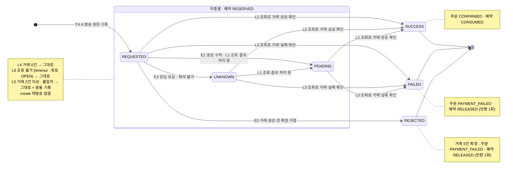
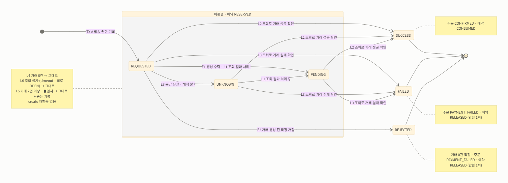

# 5주차 설계: 결제 결과 미확인을 독립 상태로 다루기

이 문서는 `docs/week2/design.md` · `docs/week3/design.md` 를 기준으로 **5주차에 바뀌거나 추가된 것만** 적는다. 절 번호, 규칙 ID(ORD-xx …), 결정 번호(D-xx)는 이전 문서를 이어 쓴다. 이번 결정은 D-59부터다.

## 1. 범위

**주문 확정의 결제를 포인트에서 로컬 테스트 PG로 교체한다.** 외부 호출의 결과는 DB rollback으로 되돌릴 수 없으므로, 확정 트랜잭션 하나를 "로컬 TX A → TX 밖 PG 호출 → 로컬 TX B" 로 나눈다.

| 대상 | 이번 변경 | 유지할 것 |
|---|---|---|
| DRAFT 주문의 확정 | PG 결제 시작. 포인트 차감 0회 | 소유권 · 품목 · 저장 금액 · 만료 · 삭제 · 재고 검사 (ORD-06~ORD-10) |
| 결제 시도 | `Payment` 애그리거트 신설. 시도 · 외부 거래 · 예약 상태를 기록 | — |
| 이전 POINT 확정 주문 | 바꾸지 않음 | 결제수단 POINT · 결제액 · 결제 시각 · 당시 품목 |
| 포인트 충전 · 조회 | API 유지, 주문 결제에서 분리 | 본인 잔액과 충전 규칙 (PNT-01, PNT-02) |
| 고객 · 관리자 주문 조회 | 결제수단 · 결제 상태 표시 | 접근 구분과 과거 주문 보호 |

- **주문당 결제 시도는 하나다.** 실패 후 새 시도, 환불, 정산, 사용자 취소, 부분 취소, 실제 카드 저장은 범위 밖이다(8장).
- **PG 호출 동안 DB 트랜잭션과 행 잠금을 쥐지 않는다.** 3주차 4.1에서 "외부 결제 호출이 이 트랜잭션에 들어오면 다시 판단한다"고 적은 조건이 이번에 생겼다.

## 2. 상태 모델

### 2.1 주문 (`Order`)

| 상태 | 뜻 | 들어오는 경로 |
|---|---|---|
| `DRAFT` | 확정 전 | 주문 생성 |
| `PAYMENT_PENDING` | 재고를 확보하고 PG 결과를 기다리는 중 | TX A |
| `CONFIRMED` | 결제 완료 | TX B의 검증된 SUCCESS, 또는 이전 POINT 확정 |
| `PAYMENT_FAILED` | 결제가 확정 실패함 | TX B에서 결제 상태가 `FAILED` 또는 `REJECTED` 로 종결됨 |

- **`paymentMethod` 컬럼을 추가한다(`POINT` · `PG` · `NONE`).** DRAFT는 비어 있다. 이전 CONFIRMED 주문은 모두 포인트로 결제했으므로 `POINT` 다. `NONE` 은 결제할 금액이 없어 PG 를 부르지 않은 0원 주문이다(D-68).
  - 로컬 · 테스트는 `ddl-auto: create` 라 기존 행이 없다. 운영(`ddl-auto: none`)은 컬럼 추가와 함께 `UPDATE orders SET payment_method = 'POINT' WHERE status = 'CONFIRMED'` 가 필요하다.
- **만료(ORD-08)는 DRAFT의 확정 시작에만 적용한다.** PAYMENT_PENDING 주문은 외부 결과가 나올 때까지 만료로 끝내지 않는다. 시간 경과만으로 실패 처리하면 아직 성공할 거래의 재고를 다른 주문에 팔 수 있다.
- **`paidAt` 은 SUCCESS를 내부에 반영한 시각이다.** PG가 승인한 시각이 아니다. 테스트 PG 계약에 승인 시각이 없다.
- `PAYMENT_FAILED` 는 종결 상태다. 같은 주문으로 다시 결제하지 않는다(범위 밖).

### 2.2 결제 시도 (`Payment`)

| 필드 | 만드는 곳 | 목적 |
|---|---|---|
| `orderId` | commerce | 주문 연결. **UNIQUE** (주문당 한 시도) |
| `attemptKey` | 클라이언트 → commerce | 같은 confirm 요청의 판별과 발송 권한. **UNIQUE** |
| `providerOrderId` | commerce | PG 요청 · 주문 단위 조회. `LP-ORD-` + 주문 ID 10자리(`LP-ORD-0000000042`). **UNIQUE** |
| `transactionKey` | 테스트 PG | 외부 거래 한 건. 생성 응답이나 조회로 알게 되면 기록 |
| `amount` | commerce (주문 합계) | 조회 · 콜백 결과의 금액 검증 기준 |
| `status` | — | 외부 결과를 얼마나 아는가 (아래) |
| `reservationStatus` | — | 확보한 재고의 처리 상태 (2.3) |
| `conflictReason` · `conflictedAt` | — | 마지막으로 기록한 충돌 · 이상 사유와 시각. 결제 상태와 따로 남긴다 (2.2 "충돌 기록") |

- **카드 종류 · 번호는 저장하지 않는다.** PG 요청에만 쓰고 DB · 로그에 남기지 않는다.
- **주문은 식별자로만 가리킨다.** Order가 PG 식별자와 외부 상태를 알지 않도록, 결제 경계의 사실은 Payment가 갖는다.

#### 결제 상태

| 상태 | 뜻 | 거래 키 | 종결 |
|---|---|---|---|
| `REQUESTED` | 발송 권한을 기록함. 생성 응답은 아직 반영하지 못함 | 없음 | ✗ |
| `UNKNOWN` | 생성 결과를 확인하지 못함 (timeout · 연결 유실 · 해석 불가 응답) | 없음 | ✗ |
| `PENDING` | 거래가 있고 PG가 처리 중이라고 알려 줌 | 있음 | ✗ |
| `SUCCESS` | 해당 거래의 SUCCESS를 조회로 확인함 | 있음 | ✓ |
| `FAILED` | 해당 거래의 FAILED를 조회로 확인함 | 있음 | ✓ |
| `REJECTED` | PG가 거래를 만들지 않았다고 확정해 거절함 (효과 0건) | 없음 | ✓ |
| `NOT_REQUIRED` | 결제할 금액이 없어 PG 를 부르지 않고 확정함 (0원 주문, D-68) | 없음 | ✓ |

- **PENDING은 상대가 처리 중이라는 사실이고, UNKNOWN은 우리가 결과를 모른다는 사실이다.** 둘 다 새 결제를 만들 근거가 아니다.
- **`REQUESTED` 를 UNKNOWN과 나눠 두는 이유:** 발송 권한을 얻은 뒤 생성 응답을 반영하기 전에 멈춘 시도를 운영에서 구분해 볼 수 있다. 외부 결과에 대한 의미는 UNKNOWN과 같다. 둘 다 조회로만 진행한다.
- **`REJECTED` 를 FAILED와 나눠 두는 이유(D-67):** "거래가 없음이 확정됨"(키 없음)과 "거래가 실패함"(키 있음)은 다른 사실이다. 주문 · 예약에 대한 효과는 같다(PAYMENT_FAILED, 반환 1회). 실패로 끝낼 수 있는 길이 이 두 가지뿐임이 상태 이름에 드러난다.

#### 사건 정의

**발송 결과** — 발송 권한을 가진 실행만 받는다.

| 기호 | 사건 |
|---|---|
| E1 | 생성 202 + PENDING. 거래 키 있음, `orderId` · `amount` 일치 |
| E2 | 422 확정 거절. `code` · `transactionCreated=false` · `orderId` · `amount` 가 모두 일치 (3.3) |
| E3 | timeout, 연결 끊김, 해석 불가, 그 밖의 4xx · 5xx, 응답의 식별 · 금액 불일치 |

**조회 결과** — reconcile, 또는 callback을 계기로 한 주문 단위 조회(`?orderId=`). callback 본문 자체는 적용하지 않는다(D-62).

| 기호 | 사건 |
|---|---|
| L1 | 거래 1건, PENDING, 주문 · 금액 일치 (저장된 키가 있으면 키도 일치) |
| L2 | 거래 1건, SUCCESS, 주문 · 금액 · 키 일치 |
| L3 | 거래 1건, FAILED, 주문 · 금액 · 키 일치 |
| L4 | 거래 0건 |
| L5 | 거래 2건 이상, 또는 주문 · 금액 · 키 불일치 (저장된 키가 목록에 없음 포함) |
| L6 | 조회 실패 (timeout · 5xx · 회로 OPEN) |

- **조회는 거래 키를 알아도 항상 주문 단위 목록으로 한다(D-66).** 키 단건 조회는 키를 안 뒤에 생긴 두 번째 거래를 보지 못한다. 목록 조회는 매번 거래 수를 확인하므로 2건은 계속 L5다. 그래서 키 단건 조회의 404를 해석할 필요도 없다.

#### 상태 다이어그램

상태가 바뀌는 사건만 그렸다. 그리지 않은 사건은 모두 "그대로"이며, 모순(L5 등)은 상태 대신 기록으로 남긴다(아래 전이표와 D-65). E는 발송자가 받은 생성 응답, L은 주문 단위 조회 결과다(위 사건 정의).




- **종결 상태에서 나가는 화살표는 없다.** 같은 결과는 아무 효과가 없고, 상충하는 결과는 기록만 한다.

#### 전이표

효과 칸의 "확정"은 `주문 CONFIRMED + 예약 CONSUMED + 결제액 · 결제 시각 저장`, "반환"은 `주문 PAYMENT_FAILED + 예약 RELEASED + 품목 수량만큼 재고 반환 1회` 다. "기록"은 `conflictReason` · `conflictedAt` 저장이며 결제 상태를 바꾸지 않는다.

**REQUESTED**

| 사건 | 다음 상태 | 효과 |
|---|---|---|
| E1 | PENDING | 거래 키 저장 |
| E2 | REJECTED | 반환 |
| E3 | UNKNOWN | 없음 |
| L1 | PENDING | 거래 키 저장 (발송 중에 reconcile · callback이 먼저 온 경우) |
| L2 | SUCCESS | 거래 키 저장 + 확정 |
| L3 | FAILED | 거래 키 저장 + 반환 |
| L4 | 그대로 | 없음. 발송 중이거나 발송하지 못했을 수 있음. 재발송하지 않음 |
| L5 | 그대로 | 기록 |
| L6 | 그대로 | 없음 |

**UNKNOWN**

| 사건 | 다음 상태 | 효과 |
|---|---|---|
| E1~E3 | 일어나지 않음 | UNKNOWN은 발송자 자신의 E3로만 들어오고, 발송자의 호출은 이미 끝났다 |
| L1 | PENDING | 거래 키 저장. 아는 것이 엄격히 늘었다(거래가 있고 키를 앎) |
| L2 | SUCCESS | 거래 키 저장 + 확정 |
| L3 | FAILED | 거래 키 저장 + 반환 |
| L4 | 그대로 | 없음. 재발송하지 않음 |
| L5 | 그대로 | 기록 |
| L6 | 그대로 | 없음 |

**PENDING**

| 사건 | 다음 상태 | 효과 |
|---|---|---|
| E1 (늦게 도착, 같은 키) | 그대로 | 없음 |
| E1 (늦게 도착, 다른 키) | 그대로 | 기록 |
| E2 (늦게 도착) | 그대로 | 기록. 거래가 있는데 "효과 없음" 응답이 온 모순 |
| E3 (늦게 도착) | 그대로 | 없음. UNKNOWN으로 낮추지 않음 |
| L1 | 그대로 | 없음 |
| L2 | SUCCESS | 확정 |
| L3 | FAILED | 반환 |
| L4 | 그대로 | 기록. 키를 아는데 거래가 0건인 모순. 실제 PG라면 조회 반영 지연일 수 있어 상태를 굳히지 않음 |
| L5 | 그대로 | 기록 |
| L6 | 그대로 | 없음. 마지막으로 아는 상태 유지, 응답에 "확인 불가" |

**SUCCESS · FAILED · REJECTED (종결)**

| 사건 | 다음 상태 | 효과 |
|---|---|---|
| 같은 결과 (중복 callback · 중복 조회: SUCCESS + L2, FAILED + L3) | 그대로 | 없음. 재고 소비 · 반환 추가 0 |
| 상충하는 결과 (SUCCESS + L3, FAILED + L2, L5) | 그대로 | 기록. 덮어쓰지 않음 |
| 늦게 도착한 E1~E3 | 그대로 | 없음 |
| REJECTED + L1~L3 (거래가 발견됨) | 그대로 | 기록. 테스트 PG 계약상 일어나지 않아야 하는 모순 |
| L1 · L4 · L6 (SUCCESS · FAILED에서) | 그대로 | 없음 |

**NOT_REQUIRED (종결, 0원 주문)**

| 사건 | 다음 상태 | 효과 |
|---|---|---|
| E1~E3 | 일어나지 않음 | 생성 요청을 보내지 않음 |
| L4 · L6 | 그대로 | 없음 |
| L1~L3 · L5 (거래가 발견됨) | 그대로 | 기록 (`TERMINAL_CONTRADICTION`). 보낸 적 없는 주문의 거래라는 모순 |

- **종결 상태에서는 조회하지 않는 것이 기본이다(4.2).** 위 행은 동시에 들어온 조회 · 늦은 응답이 종결 뒤에 적용되는 경우를 다룬다.

#### 표 밖에서 지킬 규칙

- **create를 다시 보내는 행은 하나도 없다.** 이 표의 핵심 불변식이다(D-60).
- **모든 전이는 TX B 안에서 주문 행 잠금(D-63) 아래, `Payment` 의 도메인 메서드가 현재 상태를 검사해 일으킨다.** 결제 상태 변경과 예약 전이 · 재고 반환을 같은 TX에서 처리한다.
  - **버린 대안: 조건부 UPDATE(`WHERE status IN (...)`).** 잠금과 별도의 보호 장치가 하나 더 생기고, bulk UPDATE라 엔티티 규칙을 거치지 않는다.
- **충돌은 상태가 아니라 기록이다(D-65).**
  - 결제 상태는 "외부 결과를 얼마나 아는가" 한 축만 표현한다. 충돌 · 이상은 그와 별개로 `conflictReason` · `conflictedAt` 에 남긴다.
  - 충돌을 상태로 두면 PENDING에서 충돌했을 때 "거래가 있고 키를 안다"는 사실을 잃고, 일시적인 이상(L4)이 상태로 굳어 되돌리는 규칙이 따로 필요해진다.
  - 저절로 풀리면 안 되는 충돌(복수 거래, 금액 불일치)은 목록 조회(D-66)가 매번 다시 L5로 관찰하므로 자동으로 확정되지 않는다.
  - 운영에서는 `conflict_reason IS NOT NULL` 인 미종결 시도를 확인 대상으로 본다. 사건 이력 전체가 필요해지면 별도 테이블로 옮긴다. 기록할 때 로그도 남긴다.

| `conflictReason` 값 | 언제 |
|---|---|
| `MULTIPLE_TRANSACTIONS` | L5: 거래 2건 이상 |
| `MISMATCHED_TRANSACTION` | L5: 주문 · 금액 불일치, 저장된 키가 목록에 없음 |
| `MISSING_KNOWN_TRANSACTION` | PENDING + L4 |
| `LATE_CREATE_CONTRADICTION` | PENDING + 늦은 E1(다른 키) · E2 |
| `TERMINAL_CONTRADICTION` | 종결 상태에서 상충하는 결과, REJECTED + L1~L3 |

### 2.3 재고 예약 (D-59)

**확보한 재고의 처리 상태는 `Payment.reservationStatus` 가 갖는다.** 예약 수량은 주문 품목의 수량(스냅샷)을 읽기만 한다.

| 상태 | 뜻 | 재고 |
|---|---|---|
| `RESERVED` | 이 주문을 위해 재고를 확보함 | TX A에서 가용 재고를 차감함 |
| `CONSUMED` | 결제 성공으로 예약을 소비함 | 추가 차감 없음 |
| `RELEASED` | 결제 확정 실패로 예약을 반환함 | 품목 수량만큼 한 번 되돌림 |

- **`product.stock` 은 가용 재고다.** 예약하면 줄고, 성공해도 그대로이며, 확정 실패 때만 한 번 늘어난다.
  - 재고 5에서 2를 예약하면 3, 성공 후에도 3, 확정 실패 후 5다. 중복 실패 알림으로 7이 되거나 UNKNOWN에서 5가 되면 잘못이다.
- **예약 상태는 결제 상태와 같은 전이에서만 바뀐다.** `SUCCESS` · `NOT_REQUIRED` ⇔ `CONSUMED`, `FAILED` · `REJECTED` ⇔ `RELEASED` 이고, 종결 전(REQUESTED · UNKNOWN · PENDING)에는 충돌 기록이 있어도 항상 `RESERVED` 다. 두 상태를 따로 바꾸는 메서드를 두지 않는다.
- **결제 상태와 따로 두는 이유:** "결제 결과를 모름"과 "재고를 잡고 있음"은 다른 질문이다. 장기 미확인처럼 둘을 나눠 판단해야 하는 장면(8장)에서 각각 읽을 수 있다.
- **반환은 품목 순서가 아니라 상품 ID 오름차순으로 잠근 뒤 수행한다(4.2).**

| 버린 대안 | 얻을 수 있던 것 | 포기한 이유 |
|---|---|---|
| 주문 상태로 표현 (PAYMENT_PENDING = 예약 중) | 컬럼 추가 없음 | 주문 상태 하나를 "결제 대기"와 "재고 점유" 두 의미로 해석해야 한다 |
| `OrderItem` 에 예약 상태 컬럼 | 품목별 부분 반환 가능 | 생성 후 바뀌지 않는 주문 스냅샷에 바뀌는 상태가 생긴다 |
| `StockReservation` 엔티티 (주문 · 상품별 행) | 품목 · 수량 단위 부분 반환, 예약을 독립 사실로 다룸 | 이번 범위에 부분 반환을 일으키는 기능(취소 · 반품)이 없다. 테이블 · 잠금 대상 · 정합성 규칙만 늘어난다 |
| 재고 이동 원장 (append-only) | 유일 제약만으로 반환 1회 보장, 재고 변경 이력 | 현재 상태를 합산으로 구해야 하고, 관리자 재고 설정까지 원장에 넣지 않으면 반쪽 원장이 된다 |
| `product.reserved` 컬럼 | 상품별 예약량을 바로 봄 | 어느 주문의 예약인지는 따로 추적해야 하고, 재고 설정의 의미가 복잡해진다 |

- **다시 검토할 조건:** 부분 취소 · 반품 · 일부 품목 품절 처리가 생기면, 클레임 엔티티와 함께 품목 단위 예약(`StockReservation` 또는 원장)으로 옮긴다. 주문 스냅샷은 어느 쪽이든 바꾸지 않는다.

## 3. 로컬 테스트 PG 계약과 adapter

### 3.1 계약

테스트 내부 HTTP 서버(fixture)로 구현한다. 실제 PG의 규격이라고 주장하지 않는다.

| 요청 | 응답 |
|---|---|
| `POST /api/v1/payments` (`orderId`, `cardType`, `cardNo`, `amount`, `callbackUrl`) | 202, `{transactionKey, orderId, amount, status: PENDING}` |
| `GET /api/v1/payments/{transactionKey}` | 200, 거래 한 건. 없으면 404 |
| `GET /api/v1/payments?orderId={providerOrderId}` | 200, 같은 주문의 거래 배열. 없으면 빈 배열 |
| 공통 헤더 | `X-USER-ID: 135135` (합성 제공자 계정) |

- 테스트 PG는 호출자 멱등 키를 받지 않고, 같은 `orderId` 의 새 POST를 중복 제거하지 않는다. **그래서 생성 POST는 어떤 경우에도 자동으로 다시 보내지 않는다(D-60).**
- 외부 `X-USER-ID` 는 PG 쪽 계정이다. 내부 고객 인증(`LoginUserArgumentResolver` 의 같은 이름 헤더)을 대신하지 않는다.
- base URL · callback URL은 설정으로 고정한다. 고객이 외부 주소를 넣을 수 없다.

### 3.2 adapter 구조

```
domain/payment/gateway/PaymentGateway                (포트: create, findByProviderOrderId)
infrastructure/payment/client/TestPgPaymentGateway   (RestClient 구현)
```

- **포트는 domain에 둔다.** application이 infrastructure에 의존하지 않는다(ArchitectureTest). 포트는 HTTP 형식이 아니라 관찰 결과(생성: `PaymentCreateResult` = E1~E3, 조회: `PaymentLookupResult` = 거래 목록 또는 L6)를 돌려준다.
- **HTTP 클라이언트는 `RestClient` + `JdkClientHttpRequestFactory` 다(D-61).**
  - 기존 `spring-boot-starter-web` 만으로 쓸 수 있다. Feign · WebClient를 새로 들이지 않는다.
  - **`HttpURLConnection`(`SimpleClientHttpRequestFactory`)은 쓰지 않는다.** JDK 기본 설정(`sun.net.http.retryPost`)에서 응답을 읽다 연결이 끊긴 POST를 한 번 다시 보낼 수 있다. 숨은 재시도가 생성 POST를 두 번 보내면 이중 결제가 된다.
  - 계약 테스트에서 "거래 생성 후 응답 유실" 때 fixture가 받은 create 수가 1인지 확인해 숨은 재시도가 없음을 검증한다.
- **query는 URI builder로 인코딩한다.**

### 3.3 응답 매핑

adapter는 HTTP 응답을 2.2의 사건 기호로 바꿔 돌려준다. 상태를 어떻게 바꿀지는 adapter가 아니라 `Payment` 가 전이표로 정한다.

| 생성 응답 | 사건 |
|---|---|
| 202 + `status=PENDING` + 요청과 같은 `orderId` · `amount` + 거래 키 | E1 |
| 422 + `code=TEST_PG_REJECTED_BEFORE_CREATE` + `transactionCreated=false` + 요청과 같은 `orderId` · `amount` | E2 |
| timeout, 연결 유실, 본문 없는 422, 다른 code의 4xx · 5xx, 해석 불가 JSON, 식별 · 금액 불일치, PENDING이 아닌 생성 응답 | E3 |

- **E2는 네 조건이 모두 맞을 때만 인정한다.** 이 응답만이 "거래를 만들지 않았다"는 권위 있는 증거다. 거래가 없으므로 거래 키를 꾸며 저장하지 않는다.
- **생성 응답으로는 성공 · 실패를 종결하지 않는다.** 생성 응답은 거래 키와 PENDING 확인에만 쓴다.

| 주문 조회 결과 (`?orderId=`) | 사건 |
|---|---|
| 1건, 주문 · 금액 일치, 저장된 키가 있으면 키 일치 | 거래 상태에 따라 L1 · L2 · L3 |
| 0건 | L4. 거래 없음의 영구 증거가 아니다 |
| 2건 이상 | L5. 첫 거래를 고르지 않는다 |
| 1건이지만 주문 · 금액 불일치, 또는 저장된 키와 다름 | L5 |
| timeout · 5xx · 회로 OPEN | L6 |

- **비교 기준:** 생성 응답은 adapter가 방금 보낸 요청과 비교해 E1 · E2 · E3로 나눈다. 조회 결과는 adapter가 거래 목록을 그대로 옮기고, TX B에서 `Payment` 에 저장한 `providerOrderId` · `amount` · 거래 키와 비교해 L1~L5로 나눈다. 저장된 거래 키는 TX B의 잠금 아래에서만 정확히 읽을 수 있기 때문이다.
- 제공자 계정 범위는 adapter가 항상 고정 헤더로 조회하는 것으로 보장한다.

## 4. 트랜잭션 경계와 흐름

### 4.1 주문 확정 (`POST /api/v1/orders/{orderId}/confirm`)

```
OrderPaymentFacade.confirm (트랜잭션 없음)
 ── 로컬 TX A ──
 → 주문 잠금 조회 (본인, FOR UPDATE)                         ORD-06
 → 이 주문의 Payment 가 있으면
     같은 attemptKey → 저장 상태 반환 (발송 권한 없음)
     다른 attemptKey → PAYMENT_ATTEMPT_CONFLICT
 → order.validateConfirmable(현재 시각)                       ORD-07, ORD-08
 → 품목의 상품들 잠금 조회 (ID 오름차순, FOR UPDATE)
 → 품목 순서대로 삭제 여부 확인 · product.decrease (= 예약)    ORD-09, ORD-10
 → Payment(REQUESTED, RESERVED) INSERT                        attemptKey · orderId UNIQUE
 → order.startPayment() → PAYMENT_PENDING, paymentMethod = PG
 commit  ── 이후 품절이 된 상품의 캐시 무효화 (4주차 규칙 유지)
 ── TX 밖 ──
 → PaymentGateway.create (재시도 없음)                         E1 · E2 · E3 (3.3)
 ── 로컬 TX B ── applyObservation (4.3)
 → 202 (PENDING · UNKNOWN) 또는 200 (REJECTED 등 종결)
```

- **같은 attemptKey의 재요청은 저장된 상태만 돌려준다.** 미종결이어도 PG를 조회하지 않는다. 외부 결과 확인은 reconcile · callback이 맡아, confirm은 "시도 시작"만, reconcile은 "결과 확인"만 한다.
  - **버린 대안: 미종결이면 confirm 재요청에서도 조회한다.** 클라이언트는 한 API만 반복하면 되지만, confirm이 두 역할을 갖고 confirm 재시도가 PG 조회 부하로 이어진다.
- **발송 권한 = TX A에서 Payment INSERT를 commit한 실행.** 같은 주문의 동시 confirm은 주문 행 잠금에서 줄을 서고, 뒤의 실행은 이미 있는 Payment를 보고 저장 상태를 반환한다. 실제 create는 1회다.
- **다른 주문에 같은 attemptKey** 를 보내면 `attemptKey` 유일 제약 위반으로 TX A 전체가 rollback되고(재고 예약도 취소) `PAYMENT_ATTEMPT_CONFLICT` 로 응답한다.
- **재고 부족 · 삭제 상품 · 만료 · 잘못된 입력이면 PG를 호출하지 않는다.** TX A가 통째로 rollback된다.
- **확인 순서는 3주차 그대로(D-16)이고 잔액 확인만 빠진다:** 만료 → 상품 삭제 여부 → 재고.
- **이전 POINT 확정 주문의 confirm** 은 Payment가 없고 DRAFT가 아니므로 기존 `ORDER_ALREADY_CONFIRMED` 다.
- **0원 주문은 PG 를 부르지 않고 TX A 에서 바로 확정한다(D-68).** 재고를 확보한 뒤 Payment 를 `NOT_REQUIRED` · `CONSUMED` 로 기록하고, 주문은 CONFIRMED(`paymentMethod=NONE`, 결제액 0, 결제 시각)가 된다.
  - 움직일 돈이 없고, 실제 PG 는 최소 결제 금액을 두는 경우가 많다. 0원 승인을 계약에 없는 형식으로 거절하면 E3 가 되어 주문이 미확인에 갇힌다.
  - Payment 를 남기는 이유: 시도 키 멱등성을 PG 주문과 같게 유지한다. 같은 키 재요청은 저장 상태(200), 다른 키는 충돌이다.

| 버린 대안 (0원 주문) | 포기한 이유 |
|---|---|
| PG 에 금액 0 으로 보냄 | 실무와 다르고, 실제 PG 의 거절이 결과 미확인으로 이어져 예약이 무기한 점유될 수 있다 |
| Payment 없이 주문만 확정 | 같은 시도 키 재요청이 `ORDER_ALREADY_CONFIRMED` 가 되어 0원 주문만 멱등 계약이 달라진다 |
| 주문에 시도 키 컬럼 추가 | 시도 키가 두 곳에 생겨 유일 제약 · 충돌 판단을 양쪽에서 지켜야 한다 |
| 0원 주문 확정 거절 | 0원 상품을 허용한 기존 정책(D-30)과 충돌한다 |
- **발송 기록 뒤 프로세스가 멈추면** Payment는 REQUESTED로 남는다. 실제 발송이 0회일 수도, 거래가 이미 있을 수도 있다. 재발송보다 중복 결제 방지를 우선해 create를 다시 보내지 않고 조회(4.2)로만 진행한다.

### 4.2 결과 확인 (`reconcile` · `callback`)

```
POST /api/v1/orders/{orderId}/payment/reconcile   (본인)
POST /api/v1/payments/callback                    (로컬 PG, 내부 인증 없음)
 → Payment 조회 (reconcile: 본인 주문 기준, callback: providerOrderId 기준)
 → 종결이면 저장 상태 반환 (조회하지 않음)
 ── TX 밖 ──
 → PaymentGateway.findByProviderOrderId  (제한 재조회 + 회로, 5장)  거래 목록 또는 L6
 ── 로컬 TX B ── applyObservation (4.3)                               L1~L5 판정 후 전이
```

- **콜백 본문은 확인 요청의 계기로만 쓴다(D-62).** 본문의 `status` 로 주문을 확정하지 않는다. 본문의 `providerOrderId` 로 시도를 찾은 뒤, adapter의 주문 조회 결과만 적용한다. 조작한 본문(`status=SUCCESS`)으로는 아무것도 바뀌지 않는다.
  - 서명 검증은 실제 서비스에서 필요하지만 테스트 PG 계약에 없다(8장).
- **콜백이 없어도 reconcile로 같은 결과에 도달한다.** 상시 스케줄러는 두지 않고 수동 reconcile을 기본 복구 경로로 한다.
- **거래 키를 알아도 주문 단위 조회(`?orderId=`)를 쓴다(D-66).** 거래 키를 모르는 REQUESTED · UNKNOWN 시도도 같은 경로로 확인하고, 매번 복수 거래를 발견한다. 거래 키 단건 조회는 adapter 계약 테스트로만 확인한다.

### 4.3 결과 적용 경계 (`applyObservation`, 로컬 TX B)

```
로컬 TX 시작
 → 주문 잠금 조회 (FOR UPDATE) → 그 주문의 Payment 조회
 → payment.apply(사건)  — 조회 결과면 저장값과 비교해 L1~L5 판정, 전이표(2.2)대로 전이
     SUCCESS 로 종결:            예약 CONSUMED + order.confirmPaid(결제액, 현재 시각)
     FAILED · REJECTED 로 종결:  예약 RELEASED + 품목 상품들 잠금(ID 오름차순) · product.release(수량) + order.failPayment()
     그 밖:                      종결하지 않음 (PENDING 전환 · 거래 키 저장 · 충돌 기록만)
commit ── 이후 품절이 풀린 상품의 캐시 무효화
```

- **동시 적용은 주문 행 `FOR UPDATE` 로 막는다(D-63).** callback과 reconcile이 동시에 와도 두 번째는 첫 번째의 commit을 기다린 뒤 종결 상태를 보고 아무 효과 없이 끝난다.
  - 주문 · 결제는 민감한 데이터이고, 재시도 층 없이 대기만으로 끝나는 편이 동작이 명료하다.
  - Payment는 항상 주문 행 잠금 아래에서만 바뀌므로 Payment 자체에는 `@Version` 을 두지 않는다.
- **반환은 반드시 예약 상태 전이와 같은 TX다.** `stock += quantity` 를 콜백마다 실행하지 않는다. 전이가 이미 일어났으면 반환도 일어나지 않는다.
- **TX B가 DB 오류로 rollback되면** Payment는 이전 비종결 상태로 남는다. 다음 reconcile · callback이 같은 거래를 다시 조회해 한 번 적용한다. create는 다시 보내지 않는다.

| 버린 대안 | 얻을 수 있던 것 | 포기한 이유 |
|---|---|---|
| `@Version` + `~Retrier` (3주차 패턴) | 잠금 대기 없음 | 충돌한 쪽이 재시도 한도를 넘기면 409가 콜백 응답으로 나간다. 같은 결과를 한 번만 적용한다는 보장이 재시도 설정에 기대게 된다 |
| PG 호출을 TX 안에서 | 경계가 하나 | 외부 효과는 rollback되지 않고, 상품 잠금과 커넥션을 PG 응답 시간 동안 쥔다 |
| PG 성공 뒤 재고 차감 | 예약 개념이 필요 없음 | 결제는 됐는데 재고가 없는 상황이 생긴다 |

### 4.4 잠금 순서 (3주차 4.3 갱신)

**자원 종류 사이: brand → orders → product. 같은 종류의 여러 행: ID 오름차순.**

| 경로 | 잠금 순서 |
|---|---|
| 주문 확정 TX A | orders `FOR UPDATE` → product `FOR UPDATE` (ID 오름차순) |
| 결과 적용 TX B | orders `FOR UPDATE` → (반환할 때만) product `FOR UPDATE` (ID 오름차순) |
| 관리자 상품 수정 · 재고 설정 · 삭제 | product `FOR UPDATE` (한 행) |
| 브랜드 일괄 삭제 · 상품 등록 · 브랜드 수정 | 3주차 그대로 |

- orders를 잠그는 경로는 모두 orders를 먼저 잡고, product만 잠그는 경로는 orders를 잡지 않는다. 기다림의 고리가 생기지 않는다.
- **3주차의 주문 확정 순서(product → commit 때 orders)는 사라진다.** 포인트 확정 경로가 없어지기 때문이다. `OrderConfirmRetrier` 와 주문의 버전 충돌 재시도도 확정 경로에서 빠진다.

## 5. timeout · 재조회 · 회로

| 장치 | 적용 대상 | 설정 (기본값, 설정 파일로 변경) |
|---|---|---|
| 연결 timeout | create · 조회 | 1초 |
| 응답 timeout | create 3초, 조회 1초 | |
| 제한 재조회 | **조회만** | 총 3회(처음 1 + 재시도 2), 대기 100ms → 200ms. timeout · 연결 실패 · 5xx만 재시도 |
| 회로 차단 | **조회만** | 횟수 기반 창 10, 최소 표본 5, 실패율 50% 이상 OPEN, OPEN 대기 10초, HALF_OPEN 탐색 2회 |
| fallback | 조회 실패 · 회로 OPEN | 저장된 상태 + "확인 불가" 반환 |

- **도구는 Resilience4j 코어 decorator다(D-64).** adapter 안에서 `Retry(CircuitBreaker(조회))` 로 감싼다.
  - 어느 호출이 회로 표본인지 코드에 보인다: 재시도의 매 시도가 표본 하나다. 회로가 OPEN이면 `CallNotPermittedException` 은 재시도하지 않는다.
  - annotation 방식의 AOP 순서 · 자기 호출 · 프록시 적용 문제가 없다.
  - Spring Boot 3.4 / JDK 21에 맞는 모듈(`resilience4j-circuitbreaker`, `resilience4j-retry`)과 버전을 의존성에 명시한다. Spring Cloud BOM이 버전을 관리하는지 구현할 때 확인한다.
- **최대 대기 예산:** 조회 1회 1초 × 3 + 대기 0.3초 ≈ 3.3초 (+ 연결 시간). 재시도 횟수는 adapter가 실제로 보낸 조회 수로 테스트한다.
- **설정값은 강의 예시를 따른 초기값이다.** 실제 PG 응답 시간 분포를 측정한 뒤 조정한다.
- **404 · 빈 목록은 회로 실패로 세지 않는다.** 정상 업무 결과다. (단건 조회의 404, 주문 단위 조회의 빈 배열)
- **계약과 다른 응답(200 이지만 배열이 아님 · 거래 형식 불일치 · 그 밖의 4xx)은 재조회하지 않고 회로 실패로만 센다.** 같은 응답이 반복될 것이라 재조회해도 소용없고, PG가 비정상이면 회로가 열려 조회를 멈춘다.
- **테스트에서는 회로 상태가 다음 테스트로 새지 않도록 매 테스트 전에 reset한다.** 회로를 bean으로 두고 `TestExecutionListener` 가 되돌린다.
- **fallback은 결과를 지어내지 않는다.** 금액 0, 가짜 성공, 포인트 대체 결제, 예약 반환으로 바꾸지 않는다. 회로 OPEN 동안에도 결제를 FAILED로 확정하지 않는다.
- **create에는 재시도도 회로도 적용하지 않는다.** create 결과가 불확실하면 UNKNOWN으로 두고 조회로만 진행한다.

| 버린 대안 | 포기한 이유 |
|---|---|
| Resilience4j Spring Boot annotation | 코드는 짧지만 advice 순서 · 프록시 적용을 따로 검증해야 하고, 표본 계산이 코드에 보이지 않는다 |
| 직접 구현 | HALF_OPEN · 표본 창 같은 검증된 동작을 다시 만들어야 한다 |
| 기존 spring-retry로 조회 재시도 | 회로 차단이 없어 Resilience4j가 어차피 필요하다. 도구가 둘이 된다 |

## 6. 재고 · 상품 · 캐시와의 연결

- **`Product.release(수량)` 을 추가한다.** 삭제된 상품에도 반환할 수 있고 `deletedAt` 을 바꾸지 않는다. 반환이 삭제 상품을 다시 노출하지 않는다.
  - 삭제 후 새로 시작하는 DRAFT 확정은 기존처럼 `PRODUCT_NOT_FOUND` 로 거절한다(ORD-09). 이미 예약을 마친 PAYMENT_PENDING 주문만 저장된 품목 · 금액 · 예약으로 결과를 마무리한다.
  - 상품은 논리 삭제라 미완료 예약의 참조가 깨지지 않는다.
- **관리자 재고 설정(`changeStock`)은 예약을 제외한 가용 수량을 정한다.** 기존 동작 그대로다. 예약 상태를 건드리지 않고, PG 성공 때 다시 차감하지 않는다. 같은 product 행 잠금 규칙을 쓴다.
- **캐시(4주차):** 목록 · 상세 캐시는 품절 여부만 담는다.
  - TX A의 예약으로 품절이 되면 무효화한다 (기존 확정과 같음).
  - TX B의 반환으로 품절이 풀리면 무효화한다 (새로 추가).
  - 둘 다 commit 뒤에 하고, Redis 실패는 결제 결과에 영향을 주지 않는다.

## 7. API 계약

| API | 성공 | 대표 오류 |
|---|---|---|
| `POST /api/v1/orders/{orderId}/confirm` 본문 `{paymentAttemptKey, cardType, cardNo}` | 202 (REQUESTED · UNKNOWN · PENDING), 200 (SUCCESS · FAILED · REJECTED · NOT_REQUIRED) | `ORDER_NOT_FOUND` 404, `ORDER_ALREADY_CONFIRMED` 409, `ORDER_EXPIRED` 409, `PRODUCT_NOT_FOUND` 404, `OUT_OF_STOCK` 409, `PAYMENT_ATTEMPT_CONFLICT` 409, `INVALID_PAYMENT_REQUEST` 400 |
| `GET /api/v1/orders/{orderId}` | 200. 결제수단 · 결제 상태 · 결과. 새 결제 요청을 만들지 않음 | `ORDER_NOT_FOUND` 404 |
| `POST /api/v1/orders/{orderId}/payment/reconcile` | 202 (미종결), 200 (종결) | `ORDER_NOT_FOUND` 404, `PAYMENT_NOT_FOUND` 404 |
| `POST /api/v1/payments/callback` 본문 `{orderId(providerOrderId), transactionKey, status}` | 200 (처리함. 미종결 유지 포함) | `PAYMENT_NOT_FOUND` 404 |
| 고객 · 관리자 주문 목록 · 상세 | 응답에 `paymentMethod`, `paymentStatus` 추가. 목록 상태 필터에 새 주문 상태 허용 | 기존 그대로 |

- **응답 본문:** 주문 응답에 `paymentMethod`, `paymentStatus`, `statusUrl`(`/api/v1/orders/{id}`)을 더한다. 이번 요청의 조회가 L6이었다면 `paymentCheck: UNAVAILABLE` 을 담는다.
- **충돌 기록은 고객 응답에 내보내지 않는다.** 관리자 주문 조회에만 `paymentConflict` 로 보여 준다. 고객에게는 미종결 상태(결제 확인 중)로 보인다.
- **`INVALID_PAYMENT_REQUEST`:** `paymentAttemptKey` 가 비었거나 64자 초과, `cardType` · `cardNo` 가 비었을 때.
- **이전 POINT 주문의 결제 상태:** Payment가 없으므로 `paymentStatus` 는 비어 있고 `paymentMethod=POINT` 다.

## 8. 알려진 한계

- **장기 미확인:** 조회가 계속 0건이거나 PENDING이면 예약이 무기한 점유된다. 시간 경과만으로 반환하지 않는다. 운영자의 거래 확인과 별도 판단이 필요하다.
- **REQUESTED + 조회 0건:** 실제 발송이 0회였는지, PG 반영이 늦은 것인지 구분하지 못한다. 자동 재발송하지 않으므로 이 시도는 자동 완료되지 않을 수 있다. 중복 방지와 모든 시도의 자동 완료는 같은 보장이 아니다.
- **콜백 서명 없음:** 테스트 PG 계약에 서명이 없어 위조 콜백을 막지 못한다. 대신 본문을 믿지 않고 조회로 검증해, 위조 콜백이 할 수 있는 일은 "조회를 한 번 더 일으키는 것"으로 제한된다.
  - **위조 콜백이 쏟아지면 조회가 늘어 회로가 열릴 수 있다.** 회로가 열려도 결제 결과는 바뀌지 않고(5장), 그동안 reconcile도 "확인 불가"를 받을 뿐이다. 서버는 127.0.0.1에만 열려 있어(로컬 실습 범위) 콜백 경로의 호출 수 제한은 두지 않는다. 외부에 열 때는 서명 검증과 함께 콜백 경로의 호출 수 제한이 필요하다.
- **범위 밖:** 실패 후 새 시도, 환불 · 부분 취소 · 반품, 정산, 사용자 취소, 상시 대사 스케줄러.

## 9. 기존 코드 · 테스트 변경

**포인트 확정 경로를 PG 확정으로 교체한다.** 계약이 바뀌어 지우거나 다시 쓰는 것이다. 검사를 우회하는 변경이 아니다.

| 대상 | 변경 |
|---|---|
| `OrderFacade.confirmOrder`, `OrderConfirmRetrier` | 제거. `OrderPaymentFacade`(순서) + `OrderPaymentSteps`(TX A · TX B)로 대체 |
| `Order.confirm` | `confirmWithPoint` 로 이름을 바꿔 남김. 5주차 전 POINT 확정 주문을 재현하는 용도이며 운영 경로에서는 부르지 않음. PG 결제는 `startPayment` · `confirmPaid` · `failPayment` |
| `OrderService.getConfirmableOrder` · `confirm` | 잠금 조회(`getMyOrderForUpdate` · `getOrderForUpdate`)와 결제 상태 전이 메서드로 대체 |
| `Point.pay` | 남김. 주문 결제에서 부르지 않을 뿐 포인트의 행동으로 유지 |
| `OrderFacadeTest` 의 확정 부분 | `OrderPaymentFacadeTest`(fake 저장소 + PG 대역)로 옮김. 잔액 부족 · 0원 Point 행 검증은 계약이 바뀌어 제거 |
| `OrderConfirmConcurrencyTest` | 재고 경쟁 · 같은 주문 동시 확정을 PG 기준으로 다시 씀. 포인트 경쟁 두 건은 제거 |
| `OrderConfirmTransactionTest` | TX A · TX B 의 원자성과 외부 성공 뒤 내부 저장 실패를 확인하도록 다시 씀 |
| `OrderV1ApiE2ETest`, `PointOrderFlowE2ETest` | 요청 본문 · 202/200 계약, reconcile 로 확정하는 흐름, 포인트 변화 0 으로 갱신. 잔액 부족 테스트는 제거 |
| 캐시 무효화 테스트, `BrandDeleteTransactionTest`, `RedisProductListCacheFailureTest` | 확정 호출을 PG 결제 시작으로 바꾸고, 잔액 부족으로 만든 실패 장면은 다른 품목의 재고 부족으로 바꿈 |
| `RetrierTest` | 주문 확정 재시도 부분만 제거 |
| 포인트 충전 · 조회 테스트, 과거 주문 조회 테스트 | 유지 |
| 2 · 3주차 문서 | ORD-11(잔액)과 3주차 4.3 · 4.4의 확정 흐름이 5주차로 대체됐다고 표시 (6단계) |

- **Spring 테스트의 PG 연결:** 모든 Spring 테스트가 공유 `TestPgServer` 하나를 씀. `META-INF/spring.factories` 의 `TestPgContextInitializer` 가 컨텍스트를 만들기 전에 base URL 을 넣어 설정값이 같게 유지되므로 컨텍스트 캐시가 깨지지 않음. 테스트마다 `reset()` 으로 거래 · 횟수 · 응답 방식을 비움.

## 10. 테스트

| 장면 | 핵심 기대 결과 | 위치 |
|---|---|---|
| 전이표의 모든 칸 | 상태 × 사건(E1~E3, L1~L6)마다 다음 상태 · 예약 상태 · 충돌 기록. 종결 뒤 같은 사건을 반복해도 효과 추가 0 | `PaymentTest` (단위) |
| adapter HTTP 형식 | 메서드 · 경로 · 헤더 · JSON 타입 · 금액, 응답의 E1~E3 매핑, query 인코딩, 응답 유실 때 create 수신 1 | `PaymentProviderContractTest` |
| 정상 PG 주문 | 외부 거래 1, 주문 CONFIRMED, 예약 CONSUMED, 가용 재고 그대로, 포인트 변화 0 | `PaymentIntegrationTest` |
| 생성 수락 PENDING | 주문 PAYMENT_PENDING, 예약 유지, 조회에서 SUCCESS 확인 후에만 확정 | 〃 |
| 효과 0건 확정 거절 | 외부 거래 0, 결제 REJECTED, 주문 PAYMENT_FAILED, 반환 1회. 같은 거절 중복 적용에도 반환 1회 | 〃 |
| 거래 생성 뒤 응답 유실 | 외부 거래 1, UNKNOWN, create 추가 0, 같은 거래 조회로 종결 | 〃 |
| 같은 주문 · 시도의 동시 confirm | Payment 1, 실제 create 1. 다른 키 · 다른 주문 같은 키는 효과 없이 거절 | 〃 |
| callback-first · lookup-first · 동시 적용 | 같은 거래 키와 최종 상태, 추가 차감 0, 중복 반환 0 | 〃 |
| 외부 성공 뒤 내부 저장 실패 | TX B rollback, 같은 거래 재조회로 한 번 확정, create 추가 0 | 〃 |
| 발송 기록 뒤 재시작 | 서비스 · 클라이언트를 새로 만들고 같은 DB · fixture 유지. 시도 · 예약 유지, 자동 재발송 0 | 〃 |
| 조회 0건 · 복수 거래 · 금액/주문 불일치 | 임의 성공 · 실패 · 재결제 없음, 충돌 기록, 예약 유지 | 〃 |
| 복수 거래 뒤 한 건만 SUCCESS | 목록 조회가 계속 L5로 보므로 확정되지 않음 | 〃 |
| timeout · 회로 OPEN · 회복 | 조회 수 제한, 기존 상태 유지, HALF_OPEN 뒤 조회 재개 | 〃 (회로는 짧은 대기 설정) |
| 조작한 callback 본문 | 실제 controller를 거쳐도 조회 결과 없이는 확정되지 않음 | E2E |
| 기존 기능 보호 | POINT 과거 기록 · 소유권, 재고 부족 시 PG 0회, 삭제 상품 · 예약 결과 구분 | E2E · 통합 |

- **테스트 PG fixture:** JDK `HttpServer` 로 만든다(새 의존성 없음). 거래 저장소, create 수신 횟수를 관찰할 수 있고, 시나리오(정상 PENDING, 생성 후 응답 끊기, 422 확정 거절, 조회 지연 · 실패, 복수 거래)를 테스트마다 고정한다. 무작위 지연 · 성공 확률은 넣지 않는다.
- 각 테스트는 자신이 띄운 서버를 정리한다. 기다림은 유한하게 제한한다.

## 11. 결정 요약

| 번호 | 결정 |
|---|---|
| D-59 | 확보 재고의 처리 상태는 `Payment.reservationStatus` 가 갖고, 결제 종결과 같은 전이에서만 바뀐다. 부분 반환은 범위 밖 |
| D-60 | 생성 POST는 자동 재시도하지 않는다. 숨은 재시도가 있는 클라이언트를 쓰지 않는다 |
| D-61 | HTTP 클라이언트는 `RestClient` + `JdkClientHttpRequestFactory` |
| D-62 | 콜백 본문은 확인 계기로만 쓰고, 주문 단위 조회 결과만 적용한다 |
| D-63 | 결과 적용의 동시성은 주문 행 `FOR UPDATE` 로 막는다. 잠금 순서는 orders → product |
| D-64 | 조회 경로의 재조회 · 회로는 Resilience4j 코어 decorator로 adapter 안에서 감싼다 |
| D-65 | 충돌 · 이상은 결제 상태가 아니라 `conflictReason` · `conflictedAt` 기록으로 남긴다. 결제 상태는 "외부 결과를 얼마나 아는가" 한 축만 표현한다 |
| D-66 | 결과 조회는 거래 키를 알아도 항상 주문 단위 목록(`?orderId=`)으로 한다 |
| D-67 | 효과 0건 확정 거절은 `FAILED` 와 나눈 종결 상태 `REJECTED` 로 둔다. 주문 · 예약 효과는 FAILED와 같다 |
| D-68 | 0원 주문은 PG 를 부르지 않고 TX A 에서 바로 확정한다. Payment 는 `NOT_REQUIRED` · `CONSUMED` 로 남겨 시도 키 멱등성을 유지하고, 결제수단은 `NONE` 이다 |
