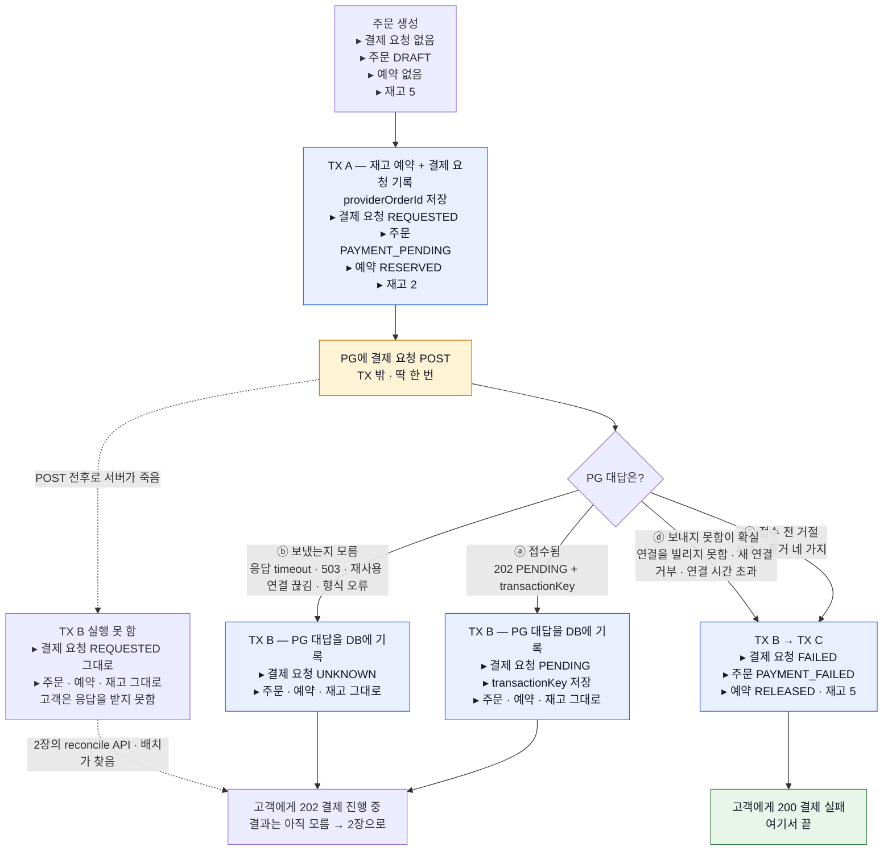
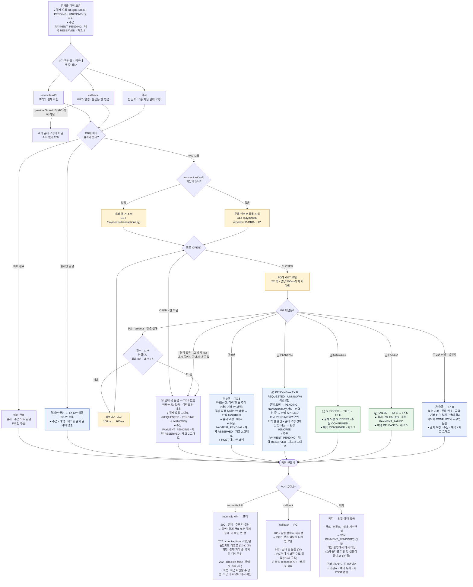
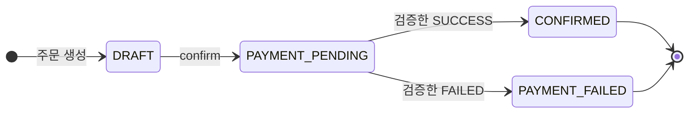
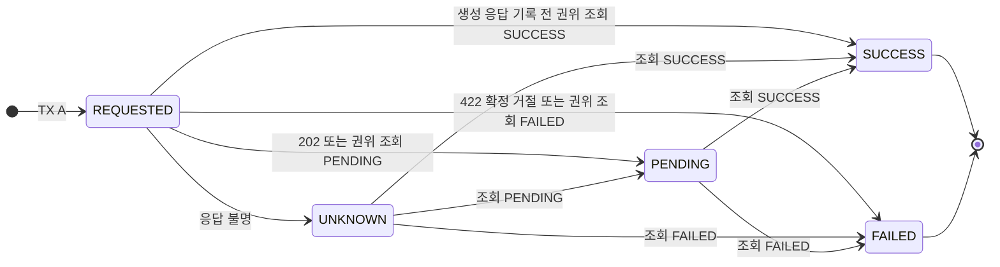
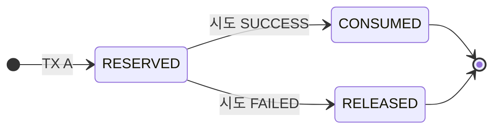
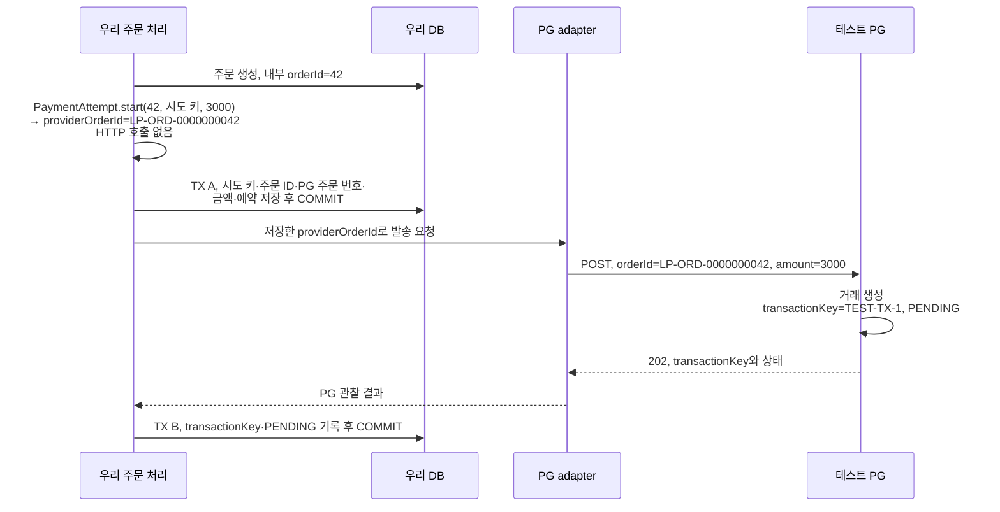
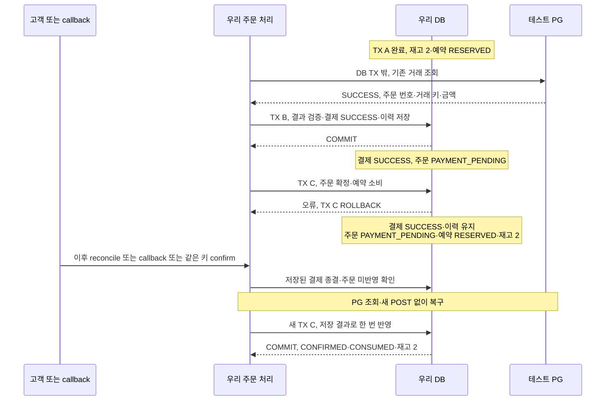

# PG 주문 흐름과 유즈케이스

주문 확정 요청부터 PG 결과 확인·주문 반영까지의 흐름, 상태 전이, 유즈케이스별 기대 결과를 적는다. 결정과 이유는 [설계](design.md), 검증 과정은 [구현 기록](implementation-log.md)에 둔다.

예시는 **주문 42, 상품 수량 3개, 주문 금액 3,000원, 최초 가용 재고 5개**다. 다른 주문·관리자에 의한 재고 변경이 없다고 가정한다.

예약 저장 방식은 **Order의 `reservationStatus` 필드**로 선택했다. 아래 그림의 RESERVED·CONSUMED·RELEASED는 이 필드의 상태이며, 별도 예약 테이블의 행이 아니다. 상품·수량은 OrderItem, 가용 재고는 Product.stock에서 관리한다. 선택 이유는 [재고 예약 설계](design.md#reservation-model)에 둔다.

3주차 포인트 결제는 재고·포인트·주문 변경이 모두 우리 DB에 있어 한 DB TX로 묶었다. PG 결제는 외부 거래가 생기므로 우리 DB 롤백으로 결제까지 취소할 수 없다. 아래 흐름에서는 예약을 먼저 커밋하고 외부 결과를 확인해 마무리한다. 두 DB 작업 사이에 예약·결제 대기 상태가 남는 것이 정상적인 진행 상태다.

## 1. 전체 흐름

`TX A`는 예약·시도 준비, `TX B`는 검증한 결제 결과·이력 저장, `TX C`는 저장 결과의 주문·예약·재고 반영이다. 각 이름은 역할이며 전체 주문에서 TX가 정확히 세 번만 실행된다는 뜻은 아니다. PENDING·UNKNOWN에는 C가 필요 없고, C 오류 뒤에는 B 없이 C부터 재실행한다. PG 생성·조회 HTTP는 DB TX 밖이다.

그림의 **결제 요청**은 결제 시도(`payment_attempt`)다. 각 칸의 ▸ 줄은 그 단계가 끝난 뒤의 상태이며, `결제 요청 · 주문 · 예약 · 재고` 순서로 적는다. 1장은 결제를 시작하는 confirm, 2장은 결과를 아직 모를 때 나중에 확인하는 흐름이다. 1장이 끝나고 고객이 응답을 받은 뒤 시간이 지나야 2장이 시작되므로 두 장으로 나눴다.

### 1장. 결제 시작 (confirm)

- TX A에서 재고 부족·삭제 상품·잘못된 입력이면 전체 롤백하고 PG를 부르지 않는다.
- 같은 키·같은 주문·같은 카드 입력의 다시 요청은 TX A에서 기존 결제 요청을 찾아 POST 없이 저장 상태를 돌려준다. 결제만 종결이고 주문이 미반영이면 TX C만 실행한다. 카드 종류·번호가 달라지면 409이며 기존 기록·재고는 바꾸지 않는다.
- ⓐ의 202 응답은 `checked: true`, ⓑ는 `checked: false`다.
- ⓓ는 요청이 우리 서버 밖으로 나가지 않아 PG에 거래가 생길 수 없다. 이력 사유 `NOT_SENT`로 바로 실패로 닫는다([ADR 0034](../adr/0034-close-only-proven-unsent-payments-and-keep-unresolved-pending.md)). ⓒ·ⓓ로 닫힌 주문은 같은 주문으로 다시 결제하지 않는다.
- 생성 202의 주문 번호·금액이 저장값과 다르면 TX B가 충돌로 기록하고 결제 요청은 REQUESTED에 남는다. 이후 2장에서 providerOrderId로 조회한다.

### 2장. 결과 확인 (reconcile API · callback · 배치)

- 배치는 30분이 지난 REQUESTED·UNKNOWN도 같은 규칙으로 조회한다. 조회 0건에는 `NO_TRANSACTION_YET` 이력만 남기고 미완료·예약을 유지한다. PENDING·조회 실패도 자동 실패의 근거가 아니다([ADR 0034](../adr/0034-close-only-proven-unsent-payments-and-keep-unresolved-pending.md)).

- TX A의 재고 부족·삭제 상품·잘못된 입력은 PG 호출 없이 전체 롤백한다. 외부 호출 전 준비가 실패한 경우다.
- PENDING은 PG가 처리 중임을 알려 준 상태, UNKNOWN은 최종 결과를 확인하지 못한 상태다. 둘 다 주문 확정이나 재고 반환의 근거가 아니다.
- 생성 수락 202는 결제 성공이 아니다. callback도 결과 확인의 계기이며, 본문만으로 확정하지 않고 PG를 조회한다.
- 2장의 ⓐ·ⓑ·ⓒ·ⓕ처럼 결과를 모르는 채로 남은 결제 요청을 다시 조회하는 시점은 reconcile·callback, 그리고 스케줄러를 켜면(`payment.recovery.scheduling-enabled=true`, 기본 꺼짐) 1분마다 도는 배치다. 배치는 만든 지 10분이 지난 시도만 보고, 새 POST·시간만으로 실패 처리를 하지 않는다([ADR 0033](../adr/0033-payment-recovery-batch-for-unfinished-attempts.md)).
- 결과 확인의 입구는 callback API와 reconcile API 두 개이며 바로 같은 길로 합쳐진다. 하나만 와도, 둘 다 와도 B의 결과 저장·C의 주문 반영 규칙으로 한 번만 효과가 생긴다. callback API는 본문 status를 믿지 않고 PG를 직접 조회하는 계기로만 쓴다.
- 회로는 조회 경로의 문지기다. OPEN이면 PG를 부르지 않고 fallback으로 응답하며, 이는 "PG에 못 물어봤다"이지 결제 실패가 아니다. fallback은 reconcile 입구에선 202·`checked: false`, callback 입구에선 503이다.
- B는 식별자·금액·거래 수·종결 결과를 검증하고 결제 시도·관찰 이력을 저장한다. C는 저장된 결과를 읽어 주문·예약·재고에 한 번 반영한다. 결제 종결과 주문 반영은 서로 다른 완료이며, C 실패 뒤에는 PG 조회 없이 C부터 복구한다([ADR 0032](../adr/0032-persist-payment-result-before-order-application.md)).
- callback이 먼저 종결한 뒤 늦게 도착한 PENDING·timeout 처리도 종결 상태를 되돌리지 않는다. 다른 종결 결과와 충돌하면 덮어쓰지 않고 충돌로 남긴다.
- 생성 전 확정 거절은 거래 생성 이후의 일반 오류와 구분한다. 정확한 422 거절 계약은 [설계](design.md)의 HTTP 계약에 둔다. adapter는 증거 네 가지가 모두 맞을 때만 거절로 분류하고, TX B는 거래 키 없이 FAILED를 저장하고 TX C가 재고를 한 번 반환한다.

### 발송 기록 뒤 멈춘 시도를 찾는 방법

TX A 커밋 뒤 POST 전에 종료됐다면 PG 거래가 0건일 수 있고, POST 뒤 TX B 전에 종료됐다면 이미 거래가 있을 수 있다. 둘 다 재시작한 우리 DB에는 REQUESTED·예약·providerOrderId만 남을 수 있으므로 로컬 기록만으로 구분할 수 없다. 같은 DB·외부 거래를 유지한 서비스·HTTP 클라이언트 재생성으로 두 경우의 복구를 확인했다. JVM 종료·재기동 자체를 실행한 검증은 아니다.

기본 복구 경로는 본인 주문의 수동 reconcile이다. 저장된 기존 시도를 찾아 DB TX 밖에서 `GET /api/v1/payments?orderId={저장한 providerOrderId}`로 조회한다. transactionKey가 저장돼 있지 않으므로 PG 주문 번호를 사용한다. 조회 0건이어도 예약을 유지하고 create를 다시 보내지 않는다.

아무도 reconcile하지 않아도 10분이 지나면 배치 대상이 되고 같은 방법으로 조회한다. REQUESTED 기록만으로는 실제 발송 여부를 증명할 수 없으므로 30분이 지나도 조회 0건에는 예약을 유지한다([ADR 0034](../adr/0034-close-only-proven-unsent-payments-and-keep-unresolved-pending.md)). 이후 기존 거래가 보이면 그 결과를 반영하며 재발송은 하지 않는다. 장기 미확인 알림·수동 처리 절차는 아직 없다.

## 2. 상태 전이

주문, 결제 시도, 재고 예약을 따로 그린다. 결제 시도는 TX B에서, 주문과 예약은 TX C에서 바뀐다. 그래서 결제 SUCCESS·FAILED와 주문 PAYMENT_PENDING·예약 RESERVED가 잠시 함께 있을 수 있다([ADR 0032](../adr/0032-persist-payment-result-before-order-application.md)).

### 주문

| 전이                             | 조건                                                            |
| -------------------------------- | --------------------------------------------------------------- |
| → DRAFT                          | 주문 생성                                                       |
| DRAFT → PAYMENT_PENDING          | confirm, TX A에서 재고 예약                                     |
| PAYMENT_PENDING → CONFIRMED      | 검증한 SUCCESS                                                  |
| PAYMENT_PENDING → PAYMENT_FAILED | 검증한 FAILED 또는 생성 전 확정 거절                            |
| DRAFT 유지                       | 재고 부족·삭제 상품·잘못된 입력 (TX A 전체 rollback, PG 호출 0) |
| PAYMENT_PENDING 유지             | PENDING·UNKNOWN·조회 실패·조회 0건·충돌                         |

이전 POINT 결제 주문은 결제수단 POINT로 CONFIRMED에 그대로 있고, 다시 확정하면 기존 409를 유지한다.

### 결제 시도

| 전이                       | 조건                                                |
| -------------------------- | --------------------------------------------------- |
| → REQUESTED                | TX A에서 발송 권한 획득                             |
| REQUESTED → PENDING        | 202 또는 권위 조회 PENDING + transactionKey          |
| REQUESTED → UNKNOWN        | 생성 응답의 timeout·연결 유실·해석 불가 응답 기록 |
| REQUESTED 유지             | TX A 뒤 POST 전 또는 생성 응답 저장 전 종료. 재시작 자체로 상태를 바꾸지 않음 |
| REQUESTED → SUCCESS / FAILED | 생성 응답 기록 전 권위 조회가 종결 결과를 확인 |
| REQUESTED → FAILED         | 422 확정 거절 (code·false·orderId·amount 모두 일치) |
| UNKNOWN → PENDING          | 조회에서 PENDING 거래 1건 발견, transactionKey 저장 |
| UNKNOWN → SUCCESS / FAILED | 조회 결과 SUCCESS / FAILED 1건                      |
| PENDING → SUCCESS / FAILED | 권위 조회 SUCCESS / FAILED                          |
| UNKNOWN 유지               | 0건·2건 이상·금액/주문 불일치·조회 실패·회로 OPEN   |

- SUCCESS·FAILED는 종결 상태다. 늦게 도착한 생성 응답, timeout handler, 상충하는 조회 결과로 되돌리지 않는다.
- 어느 상태에서도 create를 다시 보내지 않는다.
- 2건 이상·불일치는 `payment_event`에 CONFLICT와 사유를 남기고 기존 시도 상태를 유지한다. 조회 0건은 충돌이 아니라 IGNORED(`NO_TRANSACTION_YET`)로 기록한다.

### 재고 예약

| 전이                | 가용 재고                                        |
| ------------------- | ------------------------------------------------ |
| → RESERVED          | TX A에서 차감                                    |
| RESERVED → CONSUMED | TX C. 추가 차감 없음                             |
| RESERVED → RELEASED | TX C. 한 번 반환                                 |
| RESERVED 유지       | 시도가 PENDING·UNKNOWN인 동안 시간이 지나도 유지 |

### 한 표로 보기 (재고 5, 수량 3)

| PG 관찰 | 시도 | 주문 | 예약 | 가용 재고 |
| --- | --- | --- | --- | --- |
| confirm 직후 (TX A) | REQUESTED | PAYMENT_PENDING | RESERVED | 2 |
| 202 PENDING | PENDING | PAYMENT_PENDING | RESERVED | 2 |
| 생성 응답 timeout·유실 | UNKNOWN | PAYMENT_PENDING | RESERVED | 2 |
| 조회 timeout·회로 OPEN | 저장된 시도 상태 유지 | PAYMENT_PENDING | RESERVED | 2 |
| B에 SUCCESS 저장, C 전 | SUCCESS | PAYMENT_PENDING | RESERVED | 2 |
| C까지 반영한 SUCCESS | SUCCESS | CONFIRMED | CONSUMED | 2 |
| B에 FAILED 저장, C 전 | FAILED | PAYMENT_PENDING | RESERVED | 2 |
| C까지 반영한 FAILED·접수 전 거절 | FAILED | PAYMENT_FAILED | RELEASED | 5 |
| 조회 0건 | 기존 유지 + IGNORED 이력 | PAYMENT_PENDING | RESERVED | 2 |
| 2건 이상·불일치 | 기존 유지 + CONFLICT 이력 | PAYMENT_PENDING | RESERVED | 2 |
| 종결 뒤 같은 결과 중복 | 변화 없음 | 변화 없음 | 변화 없음 | 그대로 |

## 3. 식별자는 언제 만들어지고 어떻게 조회에 쓰이는가

| 값 | 만드는 쪽·시점 | 목적 |
| --- | --- | --- |
| `orderId = 42` | 우리 서버, 주문 생성 | 우리 주문의 PK |
| `paymentAttemptKey` | 우리 쪽 결제 요청 식별에 사용하는 키, TX A에서 요청 일치와 함께 보존 | 동일 시도·중복 발송 제어. PG에 보내는 멱등 키가 아님 |
| `providerOrderId = LP-ORD-0000000042` | 우리 서버, `PaymentAttempt.start()`가 TX A에서 만들어 PG 호출 전에 저장 | PG에 보내는 주문 번호. PG API에서는 필드 이름이 `orderId` |
| `transactionKey = TEST-TX-1` | PG가 거래를 생성할 때 | PG 거래 한 건 식별. 결제 성공 전에 PENDING에서도 존재 |

내부 주문 ID와 PG 주문 번호는 PG마다 다른 형식에 대응하기 위해 역할을 구분한다. 어느 PG·계정에서 조회할지와 그 PG에 보낸 주문 번호도 구분한다. 이번 로컬 계약은 고정 PG·제공자 계정 `X-USER-ID: 135135`를 사용한다.

providerOrderId는 결제 시도를 만들 때(`PaymentAttempt.start()`) 한 번 정해져 저장되고, adapter는 `PaymentRequest`로 받은 그 값을 그대로 POST에 쓴다. 번호를 만드는 로컬 작업과 PG HTTP 호출이 분리돼 있어, POST 답장을 못 받거나 서버가 재시작돼도 저장된 같은 번호로 조회할 수 있다. 결제 시도 생성·adapter 변경·TX A 연결은 구현됐다.

| 보유한 정보 | PG 조회 요청 |
| --- | --- |
| transactionKey를 앎 | `GET /api/v1/payments/TEST-TX-1` |
| 응답 유실·내부 저장 실패로 transactionKey를 모름 | `GET /api/v1/payments?orderId=LP-ORD-0000000042` |

PG에는 transactionKey가 이미 있어도 응답을 못 받으면 우리는 그 값을 모를 수 있다. 미리 저장한 providerOrderId로 거래를 찾아 키·상태·금액을 확인한다. 주문 조회는 배열이므로 거래 1건인지도 확인한다. 0건은 실패·재발송의 증거가 아니며, 2건 이상은 충돌로 남긴다.

### 용어: reconcile API, callback API, 결과 확인

"reconcile"은 API 이름이자 작업 이름이라 섞이기 쉽다. 이 문서에서는 셋을 구분한다.

| 이름 | 뜻 |
| --- | --- |
| reconcile API | 고객이 부르는 입구. 본인 확인 뒤 `order_id`로 시도를 찾는다 |
| callback API | PG가 부르는 입구. 결과 알림을 받을 뿐 대조하지 않는다 |
| 결과 확인 | 두 입구가 공통으로 하는 "필요한 PG 조회 → B 결과 저장 → 종결이면 C 주문 반영". 저장된 종결 결과가 있으면 C부터 한다. 대조는 여기서 일어나며 기준은 PG 기록이다 |

API 입구 4개와 callback 처리 순서는 [설계](design.md)의 「API 입구와 결과 확인」에 둔다.

## 4. 유즈케이스별 기대 결과

| 유즈케이스 | 시작·사건 | 우리 DB와 PG의 기대 결과 | 다음 행동 |
| --- | --- | --- | --- |
| UC1. 정상 성공 | 예약 후 생성 수락 PENDING, 이후 조회 SUCCESS | TX A에서 재고 2·예약 RESERVED. 성공 반영 후 재고 2·예약 CONSUMED·주문 CONFIRMED | 추가 결제·재고 차감 없음 |
| UC2. 확정 실패 | 검증한 PG FAILED 또는 생성 전 효과 0건 확정 거절 | B에 FAILED 저장 후 C에서 주문 실패·예약 RELEASED·예약 수량 3 반환(2→5)을 함께 커밋 | 중복 실패에도 추가 반환 없음 |
| UC3. 생성 응답 유실 | PG가 거래를 만들었지만 응답을 받지 못함 | PG 거래 1건, 우리 쪽 UNKNOWN·예약 RESERVED·재고 2 | 같은 providerOrderId로 조회, create 추가 0회 |
| UC4. PG 결과 후 내부 저장·반영 실패 | B 저장 실패 또는 B 커밋 후 C 반영 실패 | B 오류면 결제 결과·이력 롤백. C 오류면 결제 결과·이력은 보존하고 주문·예약·재고만 롤백 | B 오류는 기존 PG 재조회, C 오류는 저장된 결과로 C부터 복구. 새 POST 없음 |
| UC5. 같은 주문 확정 요청 두 번 | 같은 요청 키·주문의 동시/반복 confirm(연타) | 주문당 시도·예약 각각 하나, 발송 권한을 얻은 실행만 PG POST | 같은 키·같은 주문·같은 카드 입력이면 저장 상태 반환. 미완료 저장 상태는 PG를 새로 확인하지 않았으므로 `checked: false`, 주문 반영까지 완료하면 true다. 결제만 종결이면 C를 복구한 뒤 반환한다. 카드 종류·번호 변경, 같은 키+다른 주문, 다른 키+같은 주문은 409. 금액은 저장된 주문에서 정하고 시도 금액과 대조한다 |
| UC6. 같은 결과 두 번 | callback 반복 또는 callback·reconcile 동시 적용 | 같은 transactionKey의 성공 소비·실패 반환 각각 한 번 | 이미 같은 종결 결과이면 추가 효과 없이 종료 |
| UC7. PG에 생성 POST를 두 번 발송 | 같은 providerOrderId로 두 거래 생성 | TEST-TX-1·TEST-TX-2처럼 서로 다른 거래가 같은 주문 번호에 연결될 수 있음 | 복수 거래 충돌 기록. 첫 거래 임의 선택·새 결제·임의 반환 없음 |
| UC8. 조회 불가·회로 OPEN | 기존 거래의 현재 결과를 확인할 수 없음 | 마지막 저장 상태·예약·재고 유지. 결제 실패로 확정하지 않음 | 확인 불가와 다음 조회 경로 반환. 회복 뒤 기존 거래 조회 |
| UC9. 발송 기록 뒤 재시작 | TX A 커밋 뒤 POST 전, 또는 POST 뒤 TX B 전에 종료 | REQUESTED·예약 RESERVED 유지. PG 거래는 0건이거나 이미 존재할 수 있음 | 저장한 providerOrderId로 reconcile 또는 10분 뒤 배치가 조회. 자동 재발송 0, 조회 0건에도 임의 반환 없음 |
| UC10. callback 본문 위조 | 본문은 SUCCESS지만 해당 거래의 PG 조회는 PENDING | 주문 미확정·예약 RESERVED 유지 | 본문으로 성공 처리하지 않고 검증한 조회 결과만 반영 |
| UC11. 과거 POINT 주문 | PG 전환 전에 확정한 포인트 결제 주문 조회·재요청 | 기존 결제수단·금액·결과·소유권 유지. PG 거래 생성·추가 포인트 차감 없음 | 새 PG 주문과 과거 결제 사실을 구분해 회귀 검증 |
| UC12. 예약 뒤 상품 삭제 | PAYMENT_PENDING 주문이 재고를 확보한 뒤 상품 비노출 | 저장된 품목·금액·예약으로 기존 PG 결과 마무리. 성공 시 추가 차감 없음, 확정 실패 시 한 번 반환 | 새 조회·새 주문에서는 계속 제외. 실패 반환으로 상품이 다시 노출되지 않음 |
| UC13. 예약 중 관리자 재고 변경 | 수량 3 예약 뒤 관리자가 가용 재고를 10으로 설정 | 예약 수량 3 유지. 성공이면 가용 재고 10, 확정 실패면 13 | 동일 재고 행 보호 규칙 적용. 실패 반환을 과거 재고 5로 덮어쓰지 않음 |
| UC14. 보내지 못한 결제 생성 | 생성 POST가 연결 단계에서 끝남 (조회가 연결 풀을 모두 잡음, 새 연결 거부) | PG 거래 0건. 결제 시도 키 없이 FAILED(사유 `NOT_SENT`), 주문 PAYMENT_FAILED, 예약 RELEASED, 재고 2→5 | 고객은 주문을 새로 만든다. 같은 주문으로 다시 결제하지 않음 |
| UC15. 오래 결과를 모르는 결제 | 30분이 지나도 REQUESTED·UNKNOWN이고 PG 조회가 0건 | 미완료·예약 RESERVED·재고 유지. `NO_TRANSACTION_YET`·IGNORED 이력만 추가하며 새 POST 없음 | 이후 SUCCESS면 정상 확정. 반복 callback·reconcile·배치에도 추가 차감·반환 없음 |

확정 실패에서의 반환은 **현재 가용 재고에 예약 수량 3을 더하는 작업**이다. 다른 변경이 없다면 2→5이며, 실제 구현에서 재고를 무조건 5로 덮어쓰지 않는다.

### 유즈케이스별 검증

| 유즈케이스 | 확인한 테스트 | 아직 확인하지 않은 것 |
| --- | --- | --- |
| UC1 정상 성공 | `OrderPaymentIntegrationTest` | |
| UC2 확정 실패·접수 전 거절 | `OrderPaymentIntegrationTest`, `PaymentProviderContractTest` | |
| UC3 생성 응답 유실 | `OrderPaymentIntegrationTest`, `PaymentCallbackE2ETest`(키 없는 시도) | |
| UC4 B·C 오류 뒤 복구 | `PaymentResultApplicationTest`, `PaymentChaosTest`(PG 응답 직후 DB 멈춤) | commit 자체 오류 |
| UC5 같은 주문 두 번 확정 | `OrderPaymentIntegrationTest`(같은 키 8개 동시 → POST 1), `OrderConfirmationConcurrencyTest`(다른 키 동시) | |
| UC6 같은 결과 두 번 | `PaymentResultApplicationTest`(B·C 병렬), `PaymentCallbackE2ETest`(callback 반복 + reconcile), `PaymentChaosTest`(callback·reconcile·배치를 `OrderFacade` 수준에서 동시 실행) | |
| UC7 생성 POST 두 번 | `PaymentProviderContractTest`(거래 2건), `OrderPaymentIntegrationTest`(복수 거래 CONFLICT) | |
| UC8 조회 불가·회로 OPEN | `PaymentLookupRetryTest`, `PaymentLookupCircuitBreakerTest`, `OrderPaymentIntegrationTest`, `PaymentCallbackE2ETest`, `PaymentChaosTest`(PG 죽음·느려짐) | — |
| UC9 발송 기록 뒤 재시작 | `PaymentRecoveryRestartTest`(같은 DB·PG로 서비스·클라이언트 재생성), `PaymentRecoveryBatchTest`(아무도 확인하지 않은 시도) | JVM 종료·재기동 자체 |
| UC10 callback 본문 위조 | `PaymentCallbackE2ETest` | |
| UC11 과거 POINT 주문 | `OrderPaymentIntegrationTest`(PG 시작 거절, 조회 시 결제 사실·품목·소유권 유지) | |
| UC12 예약 뒤 상품 삭제 | `OrderPaymentIntegrationTest` | |
| UC13 예약 중 관리자 재고 변경 | `OrderPaymentIntegrationTest`(순차, 실패 반환과 동시 실행) | |
| UC14 보내지 못한 결제 생성 | `PaymentProviderContractTest`(새 연결 거부·연결을 빌리지 못함), `OrderPaymentIntegrationTest`(조회가 연결을 모두 잡은 동안의 confirm), `PaymentChaosTest`(PG가 꺼진 뒤 새 연결) | |
| UC15 오래 결과를 모르는 결제 | `PaymentRecoveryBatchTest`(31분·20분의 조회 0건 유지, PENDING·조회 불가·거래 발견, 0건 뒤 늦은 SUCCESS와 중복 확인), `PaymentChaosTest`(재사용 연결로 끊긴 결제의 예약 유지) | PG 자체의 늦은 거래 생성은 테스트 주입으로 재현. 장기 미확인 운영 절차는 없음 |

## 5. PG 결과 저장 뒤 주문 반영 실패를 복구하는 순서

B의 저장 자체가 실패하면 결과·이력이 남지 않으므로 다음 실행은 PG 재조회 → B → C다. B 커밋 뒤 C 시작 전에 종료된 경우와 C에서 변경 뒤 롤백된 경우는 모두 저장된 결과 → C로 복구한다. 확정 실패도 B의 FAILED는 유지하고 C의 예약 반환만 다시 수행한다. 모든 복구에서 새 PG 생성 POST를 보내지 않는다.
