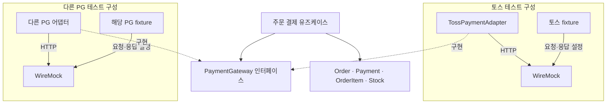

```text
apps/commerce-api/src/
├─ main/java/com/loopers/order/
│  ├─ domain/
│  │  └─ PaymentGateway.java
│  └─ infrastructure/
│     └─ payment/
│        └─ toss/
│           ├─ TossPaymentAdapter.java
│           └─ TossHttpClientFactory.java
└─ test/java/com/loopers/order/
   └─ infrastructure/
      └─ payment/
         └─ toss/
            ├─ TossPgFixture.java
            └─ TossPaymentAdapterTest.java
```
